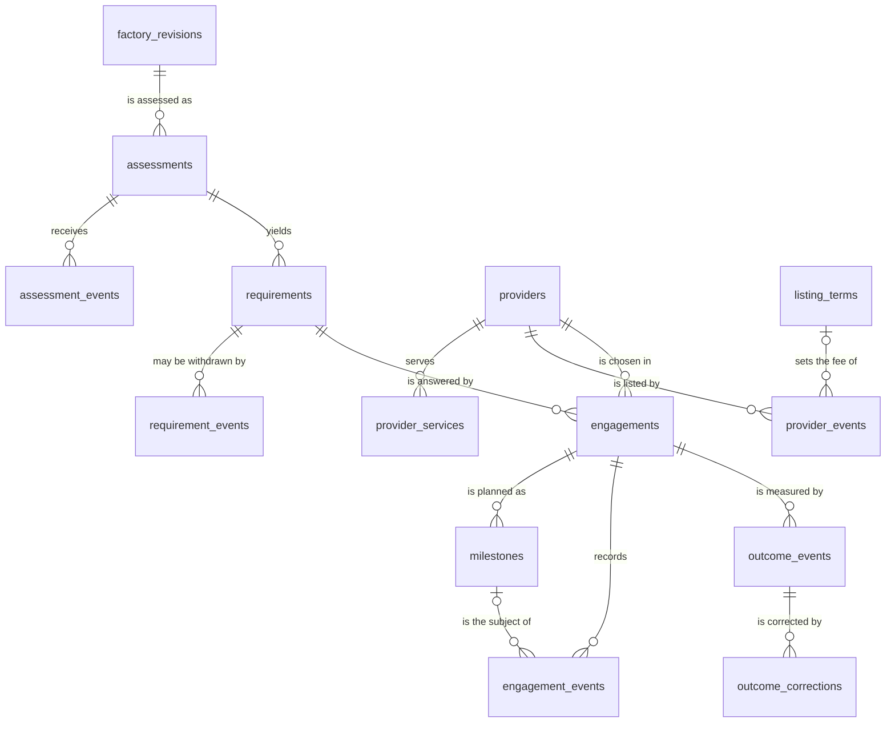
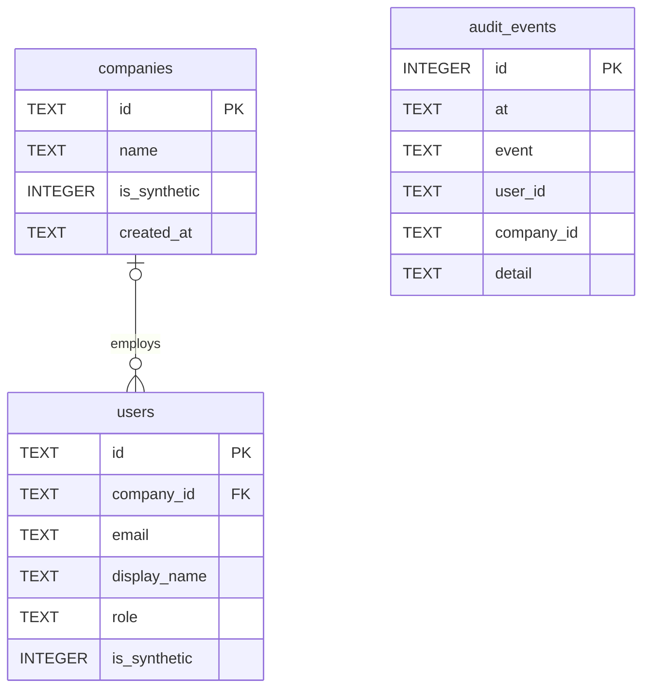
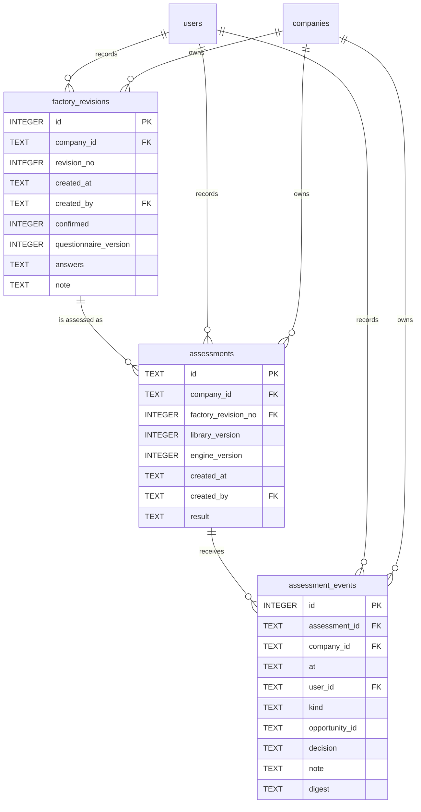
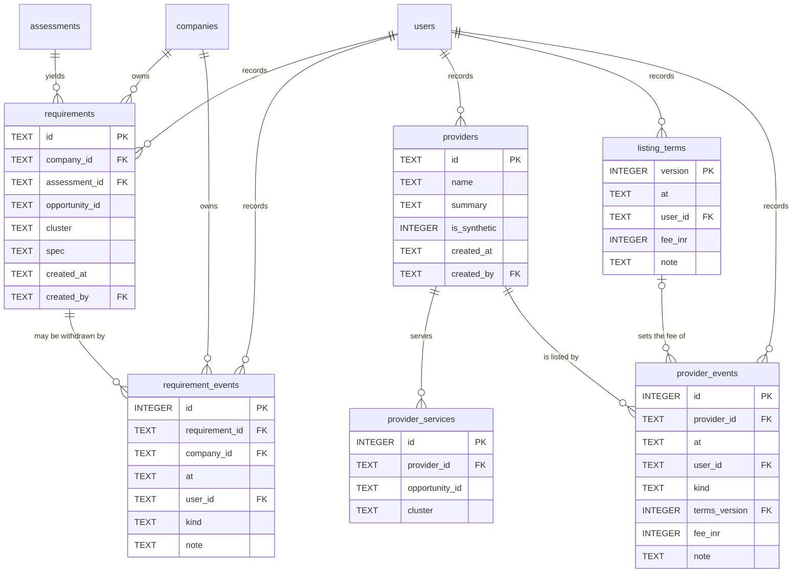
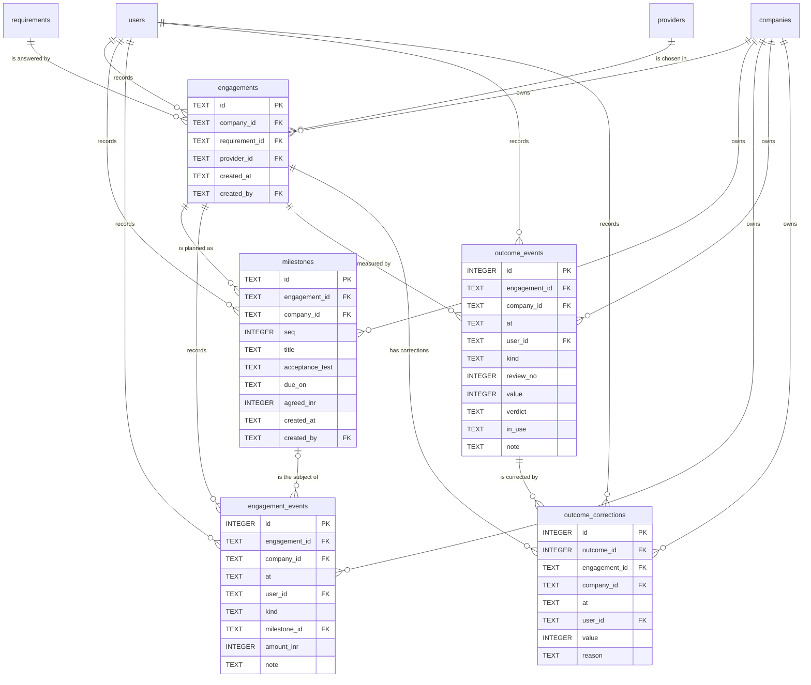

# Data dictionary

Version 0.1. 5 October 2026. Status: draft, not reviewed by a person. Counts and the run module's rows brought up to the code on 6 October 2026 (commit 696640e).

This dictionary describes the database of the APLYD MSME platform as it stands after the sixteen migrations 0000 to 0015 are applied in order (AS BUILT): 17 tables, 98 triggers, and the lists of values that the code keeps outside the database. For every table and column it says what the value means, who writes it, what values it may hold and where each limit is enforced. It also proposes how the data might be classified once real data is allowed (TO BE, Proposed). Every record in the application is SYNTHETIC: no real company, person, provider, rule or figure exists, and no person has reviewed any of the code.

How this relates to the other documents: the [BRD](../brd/BRD.md) says what the data must do (BR-DATA-04, BR-NFR-02); the [FSD](../fsd/FSD.md) says what the screens and rules do with it; the [HLD](HLD.md) and [LLD](LLD.md) say how the modules are built; the [API reference](API-REFERENCE.md) lists every operation that reads or writes it; [Security and privacy](SECURITY-AND-PRIVACY.md) holds the threats; the [glossary](../GLOSSARY.md) defines the terms.

## 1. Conventions and how to read this document

### 1.1 What it describes and how it is kept true

The source of truth is the migrated database, not this text. The migrations in `drizzle/` are applied in the order of `drizzle/meta/_journal.json`, and this document describes the final shape. [Certain]

The test `modules/docs/tests/static/dictionary-sync.test.ts` builds that database in memory on every run and compares it with this document. It fails when a table has no section, when a column is missing from its section or is listed with a different type, nullability, default or key, when an index or a trigger is missing or has changed, when a diagram draws a relationship that is not a foreign key or leaves one out, and when this text names a table, column, index, trigger or check that no longer exists. It also compares the lists in section 5 and the limits in section 8 with the code. It cannot check what a meaning says, who writes a column, where a limit is enforced, the stored-versus-derived table, the classification or the discrepancies. Those are a reading of the code and nothing has verified them but that reading. [Certain]

| Item | Count |
| --- | --- |
| Migrations | 16 |
| Tables | 17 |
| Columns | 125 |
| Indexes made with CREATE INDEX | 31 |
| Triggers | 98 |
| Triggers that make a table append-only | 45 |
| Triggers that enforce a rule | 53 |
| Tables that are append-only | 15 |

### 1.2 Reading a table section

Each table has one section in section 3, headed by its name. A section opens with five lines: Purpose, Owner module, Scope, Append-only and Created in. A table of its columns follows, then a table of its indexes where it has any. The triggers of a table are in section 4, under a heading of the same name.

| Heading | What it holds |
| --- | --- |
| Column | The column name, in the order the table declares them. |
| Type | The SQLite type: INTEGER or TEXT. No column is REAL or BLOB. |
| Null | yes when the column may be NULL, no when it is NOT NULL. |
| Default | The default as SQLite stores it, or none. |
| Key | PK for the primary key. FK followed by the table and columns referred to. A composite key is written once for each of its columns. |
| Meaning | What the value is, in plain words. |
| Allowed values and limits | The values or range the application writes. |
| Written by | The function that inserts it, and the operation (API-NN) that calls it, or seed scripts. |
| Enforced in | Where a limit is held: a CHECK constraint, a trigger, a unique index, a foreign key, the handler, or nothing. |

A limit held only by the handler can be bypassed by a person who writes to the database directly. A limit held by a CHECK or a trigger cannot. The Enforced in column says which, because the difference matters for the review of any change that touches a table (BR-NFR-02).

### 1.3 Types, keys and identifiers

- Times are TEXT in ISO 8601, UTC, with milliseconds, written by the application's clock. The database never defaults a time. A review's due date is counted from these stamps (section 6).
- Money is a whole number of rupees in an INTEGER column. A column of that kind keeps 1.5 as 1.5, so a trigger refuses a fractional amount where the amount matters. No money moves through the platform: the amounts are what the owner and the provider agreed, and what the owner says was paid (D-03).
- A flag is an INTEGER that is 0 or 1. JSON is TEXT. A CHECK with `json_valid` guards the three columns that hold a result, a spec or answers; the audit detail has no such check.
- Text identifiers made by the application are random UUIDs from `crypto.randomUUID()`: assessments, requirements, providers, engagements and milestones. The seeds use readable ids for companies and users, such as `company-synthetic-a`. Rows that are events have an integer identifier that SQLite assigns in order.
- Foreign keys are declared in the tables and enforced by SQLite; the tests run with them on. D1 is believed to enforce them by default. [Likely]
- Several foreign keys are composite and include the company, for example (assessment, company) from an event to its assessment. That is how a row is stopped from naming another company's parent, in the database as well as in the handler.

### 1.4 Owner modules and table families

The platform has one database. Each module defines its own tables in `modules/<module>/src/db/schema.ts`, and its own handlers read and write them. The module named in each table section is the one whose `schema.ts` defines the table; the sync test reads it from the source.

| Family | Owner module | Tables | Migrations |
| --- | --- | --- | --- |
| Platform | platform | `companies`, `users`, `audit_events` | 0000, then 0001 and 0002 for the audit guard |
| Describe | factory | `factory_revisions` | 0003, guards in 0004, rules in 0014 |
| Diagnose | diagnose | `assessments`, `assessment_events` | 0005, guards in 0006 and 0007, rules in 0014 |
| Procure | procure | `requirements`, `requirement_events`, `providers`, `provider_services`, `listing_terms`, `provider_events` | 0008, guards in 0009, rules in 0011 and 0014 |
| Deploy | deliver | `engagements`, `milestones`, `engagement_events` | 0010, guards in 0011, rules in 0014 |
| Run | run | `outcome_events`, `outcome_corrections` | 0012, guards in 0013; `outcome_corrections` and two baseline rules in 0015 |

### 1.5 The append-only principle

15 of the 17 tables are append-only. Three triggers on each refuse an UPDATE, a DELETE, and an INSERT that would replace a row (the id or a unique key already exists, which is what `INSERT OR REPLACE` does). Only `companies` and `users` can change, and no endpoint changes either. A correction is a new row: a new revision, a new decision, a new event. What state a thing is in is worked out when it is read (section 6), never stored. This is BR-DATA-04. [Certain]

What the triggers cannot stop is a person with write access to the database dropping a trigger, dropping a table or altering one: nothing inside SQLite can. The health check (API-01) reports `degraded` when a required trigger is missing, by name and by table; it does not read a trigger's body, so a trigger of the right name with a weaker body would pass. There is no hash chain over the audit log, so a change made outside the application would not be seen. [Certain]

### 1.6 SYNTHETIC data and tags

Everything in the database today is SYNTHETIC (BR-DATA-01). The tables `companies`, `users` and `providers` carry `is_synthetic`, default 1, and sign-in finds only people with it set and only where the environment is local, synthetic or test. Where real company data would be hosted, and which obligations apply to it, is not decided (OQ-07, with counsel). This document does not change that.

Claims that are not plain from a line of code carry a tag: [Certain] for what a file or a test run shows, [Likely] for a strong inference, [Guessing] for a gap that needs testing. Statements marked AS BUILT describe what the code does today; statements marked TO BE or Proposed describe what is not built. No person has reviewed any of the code or of this text.

## 2. Entity-relationship diagrams

A line from a parent to a child reads "one parent, any number of children". A relationship drawn with a broken left end is optional: the foreign key column of the child may be NULL. Every relationship in these diagrams is a foreign key of the database, and every foreign key is drawn in at least one diagram; the sync test checks both. The overall diagram leaves out the links to `companies` (the company that owns a row) and to `users` (the person who wrote it), which nearly every table has, to stay readable; the family diagrams show them, and list every column. PK marks a primary key and FK a column that is part of a foreign key.

### 2.1 Overall

### 2.2 Platform: companies, people and the audit log

The audit log has no foreign key. It keeps a user id and a company id as plain text, so the record stays whole whatever happens to those rows.

### 2.3 Describe and Diagnose

### 2.4 Procure

### 2.5 Deploy and Run

## 3. Tables

Everything in this section is [Certain] unless a line says otherwise: it was read from the migrations, the schema files and the handlers, and the sync test holds the structure to the database. The tables appear in the order of their families.

### companies

- Purpose: One row for each company that has an account. The unit of the scope rule: a person reads and writes only the company they belong to.
- Owner module: platform
- Scope: Company table. A person reads only their own row (API-04). The operator has no company and reads none.
- Append-only: no. No trigger guards this table, and no endpoint changes it. Rows are created by seed scripts only. [Certain]
- Created in: migration 0000
- Note: Every row is SYNTHETIC today. There is no sign-up and no endpoint that creates a company (BR-ID-02 is not built).

| Column | Type | Null | Default | Key | Meaning | Allowed values and limits | Written by | Enforced in |
| --- | --- | --- | --- | --- | --- | --- | --- | --- |
| `id` | TEXT | no | none | PK | The company's identifier. | Free text. Seeds use readable ids such as `company-synthetic-a`. No length limit in the table. | Seed scripts only (`modules/platform/db/seed-synthetic.sql`, the demonstration seeder in `modules/demo`). No endpoint writes this table. | Primary key. |
| `name` | TEXT | no | none | none | The company's display name, shown to its own people only. | Free text. Always starts with SYNTHETIC in every seed. No length limit in the table. | Seed scripts only (`modules/platform/db/seed-synthetic.sql`, the demonstration seeder in `modules/demo`). No endpoint writes this table. | NOT NULL only. |
| `is_synthetic` | INTEGER | no | `1` | none | 1 while every company is synthetic. Shown as SYNTHETIC in the interface (OQ-07, OQ-09). | 1. The value 0 is not used anywhere. | Seed scripts only (`modules/platform/db/seed-synthetic.sql`, the demonstration seeder in `modules/demo`). No endpoint writes this table. | NOT NULL and the default. No CHECK. |
| `created_at` | TEXT | no | none | none | When the row was created. | Free text; no CHECK on the format. The application always writes ISO 8601 UTC. | Seed scripts only (`modules/platform/db/seed-synthetic.sql`, the demonstration seeder in `modules/demo`). No endpoint writes this table. | NOT NULL only. |

The primary key (`id`) also has an index that SQLite makes itself; it is not listed. Check constraints: none.

### users

- Purpose: One row for each person who can sign in: an owner of one company, or a platform operator with no company.
- Owner module: platform
- Scope: Platform table. Read by the sign-in handler, by identity resolution on every request, and by the sign-in page, which lists the synthetic users of a synthetic environment.
- Append-only: no. No trigger guards this table, and no endpoint changes it. Rows are created by seed scripts only. [Certain]
- Created in: migration 0000
- Note: Company and role are read from this table on every request. The session cookie holds only the user id and an expiry, so removing a row ends that person's access at once.
- Note: The role is a free text column with no CHECK. The code compares it with `owner` and `operator` only; any other value on a person who has a company is treated as a read-only member [Certain].

| Column | Type | Null | Default | Key | Meaning | Allowed values and limits | Written by | Enforced in |
| --- | --- | --- | --- | --- | --- | --- | --- | --- |
| `id` | TEXT | no | none | PK | The person's identifier. It is the only thing the session cookie holds about them. | Free text. Seeds use `user-synthetic-owner-a` and similar. | Seed scripts only (`modules/platform/db/seed-synthetic.sql`, the demonstration seeder in `modules/demo`). No endpoint writes this table. | Primary key. |
| `company_id` | TEXT | yes | none | FK companies(id) | The company the person belongs to. Null for a platform operator, who belongs to no company and so reads none (BR-ID-04). | An existing company id, or null. | Seed scripts only (`modules/platform/db/seed-synthetic.sql`, the demonstration seeder in `modules/demo`). No endpoint writes this table. | Foreign key to `companies`. Nothing forces null for the operator role: the code requires both the role and a null company (`authorizeOperator`). |
| `email` | TEXT | no | none | none | The address typed to sign in. Synthetic addresses end in `.invalid` and cannot receive mail. | Free text, unique. Sign-in lower-cases and trims what is typed before comparing, so an address stored with capitals can never match. | Seed scripts only (`modules/platform/db/seed-synthetic.sql`, the demonstration seeder in `modules/demo`). No endpoint writes this table. | Unique index `users_email_unique`. Case is not folded by the table. |
| `display_name` | TEXT | no | none | none | The name shown in the interface and returned by API-02. | Free text. No length limit in the table. | Seed scripts only (`modules/platform/db/seed-synthetic.sql`, the demonstration seeder in `modules/demo`). No endpoint writes this table. | NOT NULL only. |
| `role` | TEXT | no | none | none | What the person may do: `owner` writes for the company, `operator` runs the registry and the fee. | `owner` or `operator` in the seeds. Any other text is read-only for a person with a company (a member, BR-ID-05). No member is seeded. | Seed scripts only (`modules/platform/db/seed-synthetic.sql`, the demonstration seeder in `modules/demo`). No endpoint writes this table. | Nothing in the table. The handlers compare the text (`canWriteOwnCompany`, `authorizeOperator`). |
| `is_synthetic` | INTEGER | no | `1` | none | 1 for a synthetic person. Sign-in finds only people with 1. | 1. The value 0 is not used anywhere. | Seed scripts only (`modules/platform/db/seed-synthetic.sql`, the demonstration seeder in `modules/demo`). No endpoint writes this table. | NOT NULL and the default; the sign-in query filters on it. |

| Index | Columns | Unique | Condition | Purpose |
| --- | --- | --- | --- | --- |
| `users_email_unique` | `email` | yes | none | One person for each address; sign-in looks a person up by it. |

The primary key (`id`) also has an index that SQLite makes itself; it is not listed. Check constraints: none.

### audit_events

- Purpose: The audit log: one row for each sign-in, sign-out, change and refused attempt by a known person.
- Owner module: platform
- Scope: Platform table. Written by every handler. No endpoint and no page reads it today (BR-OPS-06 is partial). [Certain]
- Append-only: yes. Three triggers refuse UPDATE, DELETE and an INSERT that reuses an id.
- Created in: migration 0000
- Note: A request from a person who is not signed in is not audited. A failed sign-in is not audited either: it is a console warning with no address in it (`session.refused`), because anyone can send one and the log cannot be pruned.
- Note: There is no hash chain. A person who can drop a trigger or change the database outside the application can alter the log without the application noticing (platform STATUS, limit 9).

| Column | Type | Null | Default | Key | Meaning | Allowed values and limits | Written by | Enforced in |
| --- | --- | --- | --- | --- | --- | --- | --- | --- |
| `id` | INTEGER | no | none | PK | Position in the log. Entries are read in this order. | Assigned by SQLite (AUTOINCREMENT); never given by the application. | `recordAudit` and `auditIfChanged` (`modules/platform/src/db/audit.ts`), called by every handler. | Primary key. `audit_events_no_replace` refuses a reused id. |
| `at` | TEXT | no | none | none | When the entry was written. | UTC time in ISO 8601 with milliseconds, for example 2026-10-05T06:28:57.620Z, from the application's clock (`new Date().toISOString()`). | `recordAudit` and `auditIfChanged` (`modules/platform/src/db/audit.ts`), called by every handler. | NOT NULL only. |
| `event` | TEXT | no | none | none | What happened, as a dotted name such as `assessment.signed_off` or `company.read.denied`. | One of the names in section 5.8. Names are literals in the handlers; nothing in the table limits them. | `recordAudit` and `auditIfChanged` (`modules/platform/src/db/audit.ts`), called by every handler. | NOT NULL only. |
| `user_id` | TEXT | yes | none | none | The person who did it or tried to. | A user id as text. Always set by the handlers today, because only a known person is audited. | `recordAudit` and `auditIfChanged` (`modules/platform/src/db/audit.ts`), called by every handler. | Nothing: there is no foreign key, so the log keeps the id as text. |
| `company_id` | TEXT | yes | none | none | The person's own company. Null for the operator, whose events (listing terms, providers) belong to no company. | A company id as text, or null. | `recordAudit` and `auditIfChanged` (`modules/platform/src/db/audit.ts`), called by every handler. | Nothing: there is no foreign key. |
| `detail` | TEXT | no | `'{}'` | none | A small JSON object that says which record. Never the contents of a record and never a secret. | Keys in use: `requested` (the first 64 characters of the id in the URL, on a refusal), `assessment`, `opportunity`, `decision`, `revision`, `confirmed`, `requirement`, `cluster`, `engagement`, `milestone`, `provider`, `review`, `feeInr`. Values are text, numbers or booleans. | `recordAudit` and `auditIfChanged` (`modules/platform/src/db/audit.ts`), called by every handler. | NOT NULL and the default `{}`. There is no `json_valid` CHECK: a row with text that is not JSON would be stored. |

The primary key (`id`) also has an index that SQLite makes itself; it is not listed. Check constraints: none.

### factory_revisions

- Purpose: One saved version of a company's description of its factory. A change is a new row with the next revision number.
- Owner module: factory
- Scope: Company table. Every read and write is bound to the signed-in person's company.
- Append-only: yes. Three triggers refuse UPDATE, DELETE and an INSERT that would replace a row, on the id or on (company, revision number).
- Created in: migration 0003
- Note: The owner confirms a revision by saving it with `confirmed` 1. Diagnose reads the latest confirmed one.

| Column | Type | Null | Default | Key | Meaning | Allowed values and limits | Written by | Enforced in |
| --- | --- | --- | --- | --- | --- | --- | --- | --- |
| `id` | INTEGER | no | none | PK | Surrogate key. Not shown to any person. | Assigned by SQLite (AUTOINCREMENT). | `appendRevision` (`modules/factory/src/db/revisions.ts`), from `handleRevisionCreate` (API-06). | Primary key. `factory_revisions_no_replace` refuses a reused id. |
| `company_id` | TEXT | no | none | FK companies(id) | The company the description belongs to. | The signed-in person's own company id, never the one in the URL. | `appendRevision` (`modules/factory/src/db/revisions.ts`), from `handleRevisionCreate` (API-06). | Foreign key to `companies`; the handler compares the person's own company; unique with `revision_no` (`factory_revisions_company_revision`). |
| `revision_no` | INTEGER | no | none | none | The version number of this description for the company. | 1 or more, and one more than the company's highest (no gaps). At most 500 for a company. | `appendRevision` (`modules/factory/src/db/revisions.ts`), from `handleRevisionCreate` (API-06). | CHECK `factory_revisions_revision_positive`; triggers `factory_revisions_no_gaps` and `factory_revisions_limit`; unique index `factory_revisions_company_revision`. |
| `created_at` | TEXT | no | none | none | When this version was saved. | UTC time in ISO 8601 with milliseconds, for example 2026-10-05T06:28:57.620Z, from the application's clock (`new Date().toISOString()`). | `appendRevision` (`modules/factory/src/db/revisions.ts`), from `handleRevisionCreate` (API-06). | NOT NULL only. |
| `created_by` | TEXT | no | none | FK users(id) | The person who saved it. | The signed-in owner's user id. | `appendRevision` (`modules/factory/src/db/revisions.ts`), from `handleRevisionCreate` (API-06). | Foreign key to `users`. |
| `confirmed` | INTEGER | no | `0` | none | 1 when the owner said this version is accurate. Diagnose reads the latest confirmed one. | 0 or 1. The handler writes 1 only when the owner asked to confirm and the required answers are present; otherwise it saves a draft. | `appendRevision` (`modules/factory/src/db/revisions.ts`), from `handleRevisionCreate` (API-06). | CHECK `factory_revisions_confirmed_bool`. |
| `questionnaire_version` | INTEGER | no | none | none | The version of the questionnaire the answers were given to. | 1 today (`QUESTIONNAIRE_VERSION`). A new questionnaire gets a new number; old rows keep theirs. | `appendRevision` (`modules/factory/src/db/revisions.ts`), from `handleRevisionCreate` (API-06). | NOT NULL only. The handler always writes the code's constant. |
| `answers` | TEXT | no | none | none | The answers, as a JSON object keyed by question key. A missing key means unknown. | Keys and values as in section 5.2. Text answers are trimmed; empty answers are dropped. A body of at most 64 KiB characters. | `appendRevision` (`modules/factory/src/db/revisions.ts`), from `handleRevisionCreate` (API-06). | Handler `validateAnswers` (unknown keys, types, options, lengths). Trigger `factory_revisions_answers_are_an_object`. |
| `note` | TEXT | no | `''` | none | What changed and why, in the owner's words. | At most 500 characters, no control characters. Default empty. | `appendRevision` (`modules/factory/src/db/revisions.ts`), from `handleRevisionCreate` (API-06). | Handler: at most 500 characters, no control characters. Table: trigger `factory_revisions_note_is_short` (500 characters and 2,000 bytes). |

| Index | Columns | Unique | Condition | Purpose |
| --- | --- | --- | --- | --- |
| `factory_revisions_company` | `company_id` | no | none | Finds a company's revisions. |
| `factory_revisions_company_revision` | `company_id, revision_no` | yes | none | One revision number for each company, so two saves from the same starting point cannot both succeed. |

The primary key (`id`) also has an index that SQLite makes itself; it is not listed. Check constraints: `factory_revisions_confirmed_bool`, `factory_revisions_revision_positive`.

### assessments

- Purpose: The engine's draft for one company, made from one confirmed version of the description. It never changes.
- Owner module: diagnose
- Scope: Company table. Every read and write is bound to the signed-in person's company.
- Append-only: yes. Three triggers refuse UPDATE, DELETE and an INSERT that repeats the id or the same inputs.
- Created in: migration 0005
- Note: The same company, description version, library version and engine version always give the same result, so one row is enough: asking again returns the existing one (API-08 answers 200, not 201).

| Column | Type | Null | Default | Key | Meaning | Allowed values and limits | Written by | Enforced in |
| --- | --- | --- | --- | --- | --- | --- | --- | --- |
| `id` | TEXT | no | none | PK | The assessment's identifier, a random UUID. | A UUID text from `crypto.randomUUID()`. Lookups refuse an id of more than 64 characters. | `createAssessment` (`modules/diagnose/src/db/assessments.ts`), from `handleAssessmentCreate` (API-08). | Primary key; unique with `company_id` (`assessments_id_company`) so events can point at both. |
| `company_id` | TEXT | no | none | FK factory_revisions(company_id, revision_no); FK companies(id) | The company the assessment is for. | The signed-in person's own company id. | `createAssessment` (`modules/diagnose/src/db/assessments.ts`), from `handleAssessmentCreate` (API-08). | Foreign key to `companies`; composite foreign key to the confirmed revision. |
| `factory_revision_no` | INTEGER | no | none | FK factory_revisions(company_id, revision_no) | Which version of the description the assessment was made from. | The company's latest confirmed revision number at the time. | `createAssessment` (`modules/diagnose/src/db/assessments.ts`), from `handleAssessmentCreate` (API-08). | Composite foreign key (company, revision) to `factory_revisions`; trigger `assessments_needs_confirmed_description`. |
| `library_version` | INTEGER | no | none | none | The version of the opportunity library the engine used. | 1 today (`LIBRARY_VERSION`). | `createAssessment` (`modules/diagnose/src/db/assessments.ts`), from `handleAssessmentCreate` (API-08). | Part of the unique inputs key `assessments_inputs`. |
| `engine_version` | INTEGER | no | none | none | The version of the engine that produced the result. | 1 today (`ENGINE_VERSION`). | `createAssessment` (`modules/diagnose/src/db/assessments.ts`), from `handleAssessmentCreate` (API-08). | Part of the unique inputs key `assessments_inputs`. |
| `created_at` | TEXT | no | none | none | When the assessment was made. | UTC time in ISO 8601 with milliseconds, for example 2026-10-05T06:28:57.620Z, from the application's clock (`new Date().toISOString()`). | `createAssessment` (`modules/diagnose/src/db/assessments.ts`), from `handleAssessmentCreate` (API-08). | NOT NULL only. |
| `created_by` | TEXT | no | none | FK users(id) | The person who asked for it. | The signed-in owner's user id. | `createAssessment` (`modules/diagnose/src/db/assessments.ts`), from `handleAssessmentCreate` (API-08). | Foreign key to `users`. |
| `result` | TEXT | no | none | none | The engine's whole result as JSON, including a copy of every library fact it used, so a later change to the library never changes a past assessment. | A JSON object with `engine`, `engineVersion`, `libraryVersion`, `synthetic`, `inputs`, `items` (at most 8) and `leftOut`. | `createAssessment` (`modules/diagnose/src/db/assessments.ts`), from `handleAssessmentCreate` (API-08). | CHECK `assessments_result_json` (valid JSON). The shape is the engine's (`diagnose`); the table does not check it. |

| Index | Columns | Unique | Condition | Purpose |
| --- | --- | --- | --- | --- |
| `assessments_company` | `company_id` | no | none | Finds a company's assessments. |
| `assessments_id_company` | `id, company_id` | yes | none | Lets events and requirements point at an assessment and its company together. |
| `assessments_inputs` | `company_id, factory_revision_no, library_version, engine_version` | yes | none | One assessment for each set of inputs: the same inputs give the same result, so asking again returns it. |

The primary key (`id`) also has an index that SQLite makes itself; it is not listed. Check constraints: `assessments_result_json`.

### assessment_events

- Purpose: What the owner does with an assessment: a decision on one item, or the sign-off of the whole assessment.
- Owner module: diagnose
- Scope: Company table. A composite foreign key stops an event from naming another company's assessment.
- Append-only: yes. Three triggers refuse UPDATE, DELETE and an INSERT that reuses an id.
- Created in: migration 0005
- Note: The latest decision on an item stands; earlier ones stay. After the sign-off no decision can be added, and the sign-off needs a decision on every item.

| Column | Type | Null | Default | Key | Meaning | Allowed values and limits | Written by | Enforced in |
| --- | --- | --- | --- | --- | --- | --- | --- | --- |
| `id` | INTEGER | no | none | PK | Position of the event. The latest decision on an item is the one with the highest id. | Assigned by SQLite (AUTOINCREMENT). | `appendDecision` (API-10) and `appendSignOff` (API-11), `modules/diagnose/src/db/assessments.ts`. | Primary key. `assessment_events_no_replace` refuses a reused id. |
| `assessment_id` | TEXT | no | none | FK assessments(id, company_id) | The assessment the event is about. | An assessment of the same company. | `appendDecision` (API-10) and `appendSignOff` (API-11), `modules/diagnose/src/db/assessments.ts`. | Composite foreign key (assessment, company) to `assessments`. |
| `company_id` | TEXT | no | none | FK assessments(id, company_id); FK companies(id) | The company of the assessment. | The signed-in person's own company id. | `appendDecision` (API-10) and `appendSignOff` (API-11), `modules/diagnose/src/db/assessments.ts`. | Foreign keys to `assessments` and to `companies`. |
| `at` | TEXT | no | none | none | When it was recorded. | UTC time in ISO 8601 with milliseconds, for example 2026-10-05T06:28:57.620Z, from the application's clock (`new Date().toISOString()`). | `appendDecision` (API-10) and `appendSignOff` (API-11), `modules/diagnose/src/db/assessments.ts`. | NOT NULL only. |
| `user_id` | TEXT | no | none | FK users(id) | The person who decided or signed off. | The signed-in owner's user id. | `appendDecision` (API-10) and `appendSignOff` (API-11), `modules/diagnose/src/db/assessments.ts`. | Foreign key to `users`. |
| `kind` | TEXT | no | none | none | `decision` on one item, or `signoff` of the whole assessment. | `decision` or `signoff`. | `appendDecision` (API-10) and `appendSignOff` (API-11), `modules/diagnose/src/db/assessments.ts`. | CHECK `assessment_events_shape`. |
| `opportunity_id` | TEXT | yes | none | none | The library item the decision is about. Null for the sign-off. | A library id (section 5.3) that is an item of this assessment; at most 80 characters. | `appendDecision` (API-10). | CHECK `assessment_events_shape`; trigger `assessment_events_decision_names_an_item`; handler length check. |
| `decision` | TEXT | yes | none | none | The owner's decision on the item. Null for the sign-off. | `accept`, `defer` or `reject`. | `appendDecision` (API-10). | CHECK `assessment_events_shape`; trigger `assessment_events_decision_needs_a_value`; handler. |
| `note` | TEXT | no | `''` | none | The owner's note on the decision or the sign-off. | At most 500 characters, no control characters. Default empty. | `appendDecision` (API-10) and `appendSignOff` (API-11), `modules/diagnose/src/db/assessments.ts`. | Handler: at most 500 characters, no control characters. Table: trigger `assessment_events_note_is_short` (500 characters and 2,000 bytes). |
| `digest` | TEXT | yes | none | none | The fingerprint of what the sign-off covers: SHA-256, in lower-case hex, of the canonical JSON of the assessment id, its result and the decision standing on each item with its note. Null for a decision. | 64 hexadecimal characters on a sign-off, null otherwise. | `appendSignOff` (API-11). | CHECK `assessment_events_shape` (present for a sign-off, absent for a decision). The length and the characters are not checked by the table. |

| Index | Columns | Unique | Condition | Purpose |
| --- | --- | --- | --- | --- |
| `assessment_events_assessment` | `assessment_id` | no | none | Finds the events of an assessment. |
| `assessment_events_one_signoff` | `assessment_id` | yes | `kind = 'signoff'` | At most one sign-off for each assessment. |

The primary key (`id`) also has an index that SQLite makes itself; it is not listed. Check constraints: `assessment_events_shape`.

### requirements

- Purpose: A company's standard requirement: one accepted item of one signed-off assessment, asked for in one cluster. It never changes.
- Owner module: procure
- Scope: Company table. The one read across companies is a count of companies in a pool (`poolCompanies`, `listPoolsAtFloor`), never a row, id or name (C-04).
- Append-only: yes. Three triggers refuse UPDATE, DELETE and an INSERT that repeats the id or the (company, assessment, item) key.
- Created in: migration 0008
- Note: A withdrawal is a row in `requirement_events`; the requirement row itself stays.

| Column | Type | Null | Default | Key | Meaning | Allowed values and limits | Written by | Enforced in |
| --- | --- | --- | --- | --- | --- | --- | --- | --- |
| `id` | TEXT | no | none | PK | The requirement's identifier, a random UUID. | A UUID text. Lookups refuse an id of more than 64 characters. | `createRequirement` (`modules/procure/src/db/requirements.ts`), from `handleRequirementCreate` (API-13). | Primary key; unique with `company_id` (`requirements_id_company`). |
| `company_id` | TEXT | no | none | FK assessments(id, company_id); FK companies(id) | The company that asks. | The signed-in person's own company id. | `createRequirement` (`modules/procure/src/db/requirements.ts`), from `handleRequirementCreate` (API-13). | Foreign key to `companies`; composite foreign key to the assessment. |
| `assessment_id` | TEXT | no | none | FK assessments(id, company_id) | The signed-off assessment the item comes from. | An assessment of the same company, signed off. | `createRequirement` (`modules/procure/src/db/requirements.ts`), from `handleRequirementCreate` (API-13). | Composite foreign key (assessment, company) to `assessments`; trigger `requirements_needs_signed_off_assessment`. |
| `opportunity_id` | TEXT | no | none | none | The library item asked for. | A library id that is an accepted item of that assessment; at most 80 characters. | `createRequirement` (`modules/procure/src/db/requirements.ts`), from `handleRequirementCreate` (API-13). | Trigger `requirements_needs_accepted_item`; unique key `requirements_one_per_item`; handler checks the item is in the assessment. |
| `cluster` | TEXT | no | none | none | The cluster the requirement is pooled in. | One of the ids in section 5.4. | `createRequirement` (`modules/procure/src/db/requirements.ts`), from `handleRequirementCreate` (API-13). | Handler `isCluster`. No CHECK or trigger in the table. |
| `spec` | TEXT | no | none | none | A copy of the assessed item (title, summary, kind, costs, source, library version, what it addresses), so a later change to the library changes nothing here. | A JSON object built by the handler from the assessment. | `createRequirement` (`modules/procure/src/db/requirements.ts`), from `handleRequirementCreate` (API-13). | CHECK `requirements_spec_json` (valid JSON). The shape is the handler's. |
| `created_at` | TEXT | no | none | none | When the requirement was made. | UTC time in ISO 8601 with milliseconds, for example 2026-10-05T06:28:57.620Z, from the application's clock (`new Date().toISOString()`). | `createRequirement` (`modules/procure/src/db/requirements.ts`), from `handleRequirementCreate` (API-13). | NOT NULL only. |
| `created_by` | TEXT | no | none | FK users(id) | The person who made it. | The signed-in owner's user id. | `createRequirement` (`modules/procure/src/db/requirements.ts`), from `handleRequirementCreate` (API-13). | Foreign key to `users`. |

| Index | Columns | Unique | Condition | Purpose |
| --- | --- | --- | --- | --- |
| `requirements_pool` | `cluster, opportunity_id` | no | none | Counts the companies in a pool (cluster and item). |
| `requirements_company` | `company_id` | no | none | Finds a company's requirements. |
| `requirements_id_company` | `id, company_id` | yes | none | Lets events and engagements point at a requirement and its company together. |
| `requirements_one_per_item` | `company_id, assessment_id, opportunity_id` | yes | none | One requirement for each accepted item of an assessment of a company. |

The primary key (`id`) also has an index that SQLite makes itself; it is not listed. Check constraints: `requirements_spec_json`.

### requirement_events

- Purpose: The only thing that happens to a requirement after it is made: the owner withdraws it. A withdrawn requirement leaves its pool.
- Owner module: procure
- Scope: Company table. A composite foreign key stops an event from naming another company's requirement.
- Append-only: yes. Three triggers refuse UPDATE, DELETE and an INSERT that repeats the id or a second withdrawal.
- Created in: migration 0008
- Note: There is no 'un-withdraw'. An owner who chose the wrong cluster and withdrew must start again from a new assessment (procure STATUS, limit 9).

| Column | Type | Null | Default | Key | Meaning | Allowed values and limits | Written by | Enforced in |
| --- | --- | --- | --- | --- | --- | --- | --- | --- |
| `id` | INTEGER | no | none | PK | Position of the event. | Assigned by SQLite (AUTOINCREMENT). | `withdrawRequirement` (`modules/procure/src/db/requirements.ts`), from API-14. | Primary key. `requirement_events_no_replace` refuses a reused id. |
| `requirement_id` | TEXT | no | none | FK requirements(id, company_id) | The requirement withdrawn. | A requirement of the same company. | `withdrawRequirement` (`modules/procure/src/db/requirements.ts`), from API-14. | Composite foreign key (requirement, company) to `requirements`; unique index `requirement_events_one_withdrawal`. |
| `company_id` | TEXT | no | none | FK requirements(id, company_id); FK companies(id) | The company of the requirement. | The signed-in person's own company id. | `withdrawRequirement` (`modules/procure/src/db/requirements.ts`), from API-14. | Foreign keys to `requirements` and to `companies`. |
| `at` | TEXT | no | none | none | When it was withdrawn. | UTC time in ISO 8601 with milliseconds, for example 2026-10-05T06:28:57.620Z, from the application's clock (`new Date().toISOString()`). | `withdrawRequirement` (`modules/procure/src/db/requirements.ts`), from API-14. | NOT NULL only. |
| `user_id` | TEXT | no | none | FK users(id) | The person who withdrew it. | The signed-in owner's user id. | `withdrawRequirement` (`modules/procure/src/db/requirements.ts`), from API-14. | Foreign key to `users`. |
| `kind` | TEXT | no | none | none | What happened. Only a withdrawal exists. | `withdraw`. | `withdrawRequirement` (`modules/procure/src/db/requirements.ts`), from API-14. | CHECK `requirement_events_kind`. |
| `note` | TEXT | no | `''` | none | Why, in the owner's words. | At most 500 characters, no control characters. Default empty. | `withdrawRequirement` (`modules/procure/src/db/requirements.ts`), from API-14. | Handler: at most 500 characters, no control characters. Table: trigger `requirement_events_note_is_short` (500 characters and 2,000 bytes). |

| Index | Columns | Unique | Condition | Purpose |
| --- | --- | --- | --- | --- |
| `requirement_events_one_withdrawal` | `requirement_id` | yes | none | A requirement is withdrawn at most once. |

The primary key (`id`) also has an index that SQLite makes itself; it is not listed. Check constraints: `requirement_events_kind`.

### providers

- Purpose: A provider on the registry. An operator enters it; a provider does not sign in (OQ-19). SYNTHETIC.
- Owner module: procure
- Scope: Platform table with no company. The operator reads all of it. Any signed-in person reads the listed ones (API-22).
- Append-only: yes. Three triggers refuse UPDATE, DELETE and an INSERT that reuses an id.
- Created in: migration 0008
- Note: Whether a provider is listed is not a column. It is the kind of its latest row in `provider_events`.

| Column | Type | Null | Default | Key | Meaning | Allowed values and limits | Written by | Enforced in |
| --- | --- | --- | --- | --- | --- | --- | --- | --- |
| `id` | TEXT | no | none | PK | The provider's identifier, a random UUID. | A UUID text. Lookups refuse an id of more than 64 characters. | `createProvider` (`modules/procure/src/db/providers.ts`), from `handleProviderCreate` (API-24). | Primary key. |
| `name` | TEXT | no | none | none | The provider's name as the operator typed it. | 1 to 100 characters after trimming, no control characters. | `createProvider` (`modules/procure/src/db/providers.ts`), from `handleProviderCreate` (API-24). | Handler `handleProviderCreate`. NOT NULL only in the table. |
| `summary` | TEXT | no | `''` | none | A short description of the provider. | Up to 300 characters, no control characters. Default empty. | `createProvider` (`modules/procure/src/db/providers.ts`), from `handleProviderCreate` (API-24). | Handler. NOT NULL and the default in the table. |
| `is_synthetic` | INTEGER | no | `1` | none | 1 for a synthetic provider. | 1; the handler writes the literal 1. | `createProvider` (`modules/procure/src/db/providers.ts`), from `handleProviderCreate` (API-24). | NOT NULL and the default. No CHECK. |
| `created_at` | TEXT | no | none | none | When the provider was entered. | UTC time in ISO 8601 with milliseconds, for example 2026-10-05T06:28:57.620Z, from the application's clock (`new Date().toISOString()`). | `createProvider` (`modules/procure/src/db/providers.ts`), from `handleProviderCreate` (API-24). | NOT NULL only. |
| `created_by` | TEXT | no | none | FK users(id) | The operator who entered it. | The operator's user id. | `createProvider` (`modules/procure/src/db/providers.ts`), from `handleProviderCreate` (API-24). | Foreign key to `users`. |

The primary key (`id`) also has an index that SQLite makes itself; it is not listed. Check constraints: none.

### provider_services

- Purpose: Which kind of requirement (a library item) a provider serves, in which cluster. One row for each (provider, item, cluster).
- Owner module: procure
- Scope: Platform table with no company. Read by the operator and by the match for a requirement.
- Append-only: yes. Three triggers refuse UPDATE, DELETE and an INSERT that repeats the id or the (provider, item, cluster) key.
- Created in: migration 0008
- Note: What a provider serves is fixed from its first listing on: a trigger refuses a new service for a provider that has any listing event.

| Column | Type | Null | Default | Key | Meaning | Allowed values and limits | Written by | Enforced in |
| --- | --- | --- | --- | --- | --- | --- | --- | --- |
| `id` | INTEGER | no | none | PK | Surrogate key. | Assigned by SQLite (AUTOINCREMENT). | `createProvider` (`modules/procure/src/db/providers.ts`), from `handleProviderCreate` (API-24). | Primary key. `provider_services_no_replace` refuses a reused id. |
| `provider_id` | TEXT | no | none | FK providers(id) | The provider that serves it. | An existing provider. | `createProvider` (`modules/procure/src/db/providers.ts`), from `handleProviderCreate` (API-24). | Foreign key to `providers`; trigger `provider_services_closed_after_first_listing`. |
| `opportunity_id` | TEXT | no | none | none | The library item the provider serves. | A library id from section 5.3. | `createProvider` (`modules/procure/src/db/providers.ts`), from `handleProviderCreate` (API-24). | Handler (checks the id against the library). No CHECK in the table. |
| `cluster` | TEXT | no | none | none | The cluster it serves the item in. | One of the ids in section 5.4. | `createProvider` (`modules/procure/src/db/providers.ts`), from `handleProviderCreate` (API-24). | Handler `isCluster`. No CHECK in the table. |

| Index | Columns | Unique | Condition | Purpose |
| --- | --- | --- | --- | --- |
| `provider_services_match` | `cluster, opportunity_id` | no | none | Finds the providers that serve an item in a cluster. |
| `provider_services_unique` | `provider_id, opportunity_id, cluster` | yes | none | A provider names a service once. |

The primary key (`id`) also has an index that SQLite makes itself; it is not listed. Check constraints: none.

### listing_terms

- Purpose: The listing fee: one number for every provider (D-03). A new row is a new version; the highest version is in force.
- Owner module: procure
- Scope: Platform table with no company, read and written by the operator only.
- Append-only: yes. Three triggers refuse UPDATE, DELETE and an INSERT that reuses a version.
- Created in: migration 0008
- Note: While there is no row the fee is undecided (OQ-11) and no provider can be listed.
- Note: There is no column that names a provider, a requirement, a company, a deal or a percentage. The figure 1500 in the demonstration is a placeholder typed by the operator; no fee is decided.

| Column | Type | Null | Default | Key | Meaning | Allowed values and limits | Written by | Enforced in |
| --- | --- | --- | --- | --- | --- | --- | --- | --- |
| `version` | INTEGER | no | none | PK | The version of the terms. The highest is in force. | Assigned by SQLite (AUTOINCREMENT), from 1. | `setTerms` (`modules/procure/src/db/providers.ts`), from `handleTermsSet` (API-28). | Primary key. `listing_terms_no_replace` refuses a reused version. |
| `at` | TEXT | no | none | none | When the fee was set. | UTC time in ISO 8601 with milliseconds, for example 2026-10-05T06:28:57.620Z, from the application's clock (`new Date().toISOString()`). | `setTerms` (`modules/procure/src/db/providers.ts`), from `handleTermsSet` (API-28). | NOT NULL only. |
| `user_id` | TEXT | no | none | FK users(id) | The operator who set it. | The operator's user id. | `setTerms` (`modules/procure/src/db/providers.ts`), from `handleTermsSet` (API-28). | Foreign key to `users`. |
| `fee_inr` | INTEGER | no | none | none | The one listing fee for every provider, in whole rupees (D-03). A placeholder until decided (OQ-11). | A whole number from 1 to 1,00,00,000 (the upper bound is a sanity limit, not a proposal). | `setTerms` (`modules/procure/src/db/providers.ts`), from `handleTermsSet` (API-28). | CHECK `listing_terms_fee_positive`; trigger `listing_terms_fee_is_whole`; handler range check. |
| `note` | TEXT | no | `''` | none | The operator's note on the change. | At most 500 characters, no control characters. Default empty. | `setTerms` (`modules/procure/src/db/providers.ts`), from `handleTermsSet` (API-28). | Handler: at most 500 characters, no control characters. Table: trigger `listing_terms_note_is_short` (500 characters and 2,000 bytes). |

The primary key (`version`) also has an index that SQLite makes itself; it is not listed. Check constraints: `listing_terms_fee_positive`.

### provider_events

- Purpose: A provider is listed or unlisted. A listing records the fee that was in force when it was made.
- Owner module: procure
- Scope: Platform table with no company, written by the operator only.
- Append-only: yes. Three triggers refuse UPDATE, DELETE and an INSERT that reuses an id.
- Created in: migration 0008
- Note: Listing and unlisting alternate. A provider keeps the fee it was listed at when the operator later changes the fee (procure STATUS, limit 10).

| Column | Type | Null | Default | Key | Meaning | Allowed values and limits | Written by | Enforced in |
| --- | --- | --- | --- | --- | --- | --- | --- | --- |
| `id` | INTEGER | no | none | PK | Position of the event. The latest one decides whether the provider is listed. | Assigned by SQLite (AUTOINCREMENT). | `listProvider` (API-25) and `unlistProvider` (API-26), `modules/procure/src/db/providers.ts`. | Primary key. `provider_events_no_replace` refuses a reused id. |
| `provider_id` | TEXT | no | none | FK providers(id) | The provider listed or unlisted. | An existing provider. | `listProvider` (API-25) and `unlistProvider` (API-26), `modules/procure/src/db/providers.ts`. | Foreign key to `providers`. |
| `at` | TEXT | no | none | none | When it was listed or unlisted. | UTC time in ISO 8601 with milliseconds, for example 2026-10-05T06:28:57.620Z, from the application's clock (`new Date().toISOString()`). | `listProvider` (API-25) and `unlistProvider` (API-26), `modules/procure/src/db/providers.ts`. | NOT NULL only. |
| `user_id` | TEXT | no | none | FK users(id) | The operator who did it. | The operator's user id. | `listProvider` (API-25) and `unlistProvider` (API-26), `modules/procure/src/db/providers.ts`. | Foreign key to `users`. |
| `kind` | TEXT | no | none | none | `list` or `unlist`. | `list` or `unlist`, alternating, starting with `list`. | `listProvider` (API-25) and `unlistProvider` (API-26), `modules/procure/src/db/providers.ts`. | CHECK `provider_events_shape`; trigger `provider_events_alternate`. |
| `terms_version` | INTEGER | yes | none | FK listing_terms(version) | The version of the listing terms that applied. Null for an unlisting. | The highest version of `listing_terms` at the time. | `listProvider` (API-25), copied from the terms inside the statement. | Foreign key to `listing_terms`; CHECK `provider_events_shape`; trigger `provider_events_list_carries_the_fee_in_force`. |
| `fee_inr` | INTEGER | yes | none | none | The fee in force at the listing, in whole rupees. Null for an unlisting. | Equal to the fee of the highest terms version. | `listProvider` (API-25), copied from the terms. No caller supplies a fee. | CHECK `provider_events_shape`; trigger `provider_events_list_carries_the_fee_in_force`. |
| `note` | TEXT | no | `''` | none | The operator's note. | At most 500 characters, no control characters. Default empty. | `listProvider` (API-25) and `unlistProvider` (API-26), `modules/procure/src/db/providers.ts`. | Handler: at most 500 characters, no control characters. Table: trigger `provider_events_note_is_short` (500 characters and 2,000 bytes). |

| Index | Columns | Unique | Condition | Purpose |
| --- | --- | --- | --- | --- |
| `provider_events_provider` | `provider_id` | no | none | Finds the events of a provider. |

The primary key (`id`) also has an index that SQLite makes itself; it is not listed. Check constraints: `provider_events_shape`.

### engagements

- Purpose: The owner's choice of one listed provider for one requirement. It never changes. A requirement has at most one engagement.
- Owner module: deliver
- Scope: Company table. A composite foreign key ties it to the company's own requirement.
- Append-only: yes. Three triggers refuse UPDATE, DELETE and an INSERT that repeats the id or the requirement.
- Created in: migration 0010
- Note: No fee is stored or read here. Nothing in this family moves money (D-03).

| Column | Type | Null | Default | Key | Meaning | Allowed values and limits | Written by | Enforced in |
| --- | --- | --- | --- | --- | --- | --- | --- | --- |
| `id` | TEXT | no | none | PK | The engagement's identifier, a random UUID. | A UUID text. Lookups refuse an id of more than 64 characters. | `createEngagement` (`modules/deliver/src/db/engagements.ts`), from `handleEngagementCreate` (API-15). | Primary key; unique with `company_id` (`engagements_id_company`). |
| `company_id` | TEXT | no | none | FK requirements(id, company_id); FK companies(id) | The company that chose. | The signed-in person's own company id. | `createEngagement` (`modules/deliver/src/db/engagements.ts`), from `handleEngagementCreate` (API-15). | Foreign key to `companies`; composite foreign key to the requirement. |
| `requirement_id` | TEXT | no | none | FK requirements(id, company_id) | The requirement it answers. | An open requirement of the same company. One engagement for each requirement. | `createEngagement` (`modules/deliver/src/db/engagements.ts`), from `handleEngagementCreate` (API-15). | Composite foreign key (requirement, company) to `requirements`; unique index `engagements_one_per_requirement`; trigger `engagements_needs_an_open_requirement`. |
| `provider_id` | TEXT | no | none | FK providers(id) | The provider chosen. | A provider that is listed and serves the requirement's item in its cluster. | `createEngagement` (`modules/deliver/src/db/engagements.ts`), from `handleEngagementCreate` (API-15). | Foreign key to `providers`; trigger `engagements_needs_a_listed_provider`. |
| `created_at` | TEXT | no | none | none | When the provider was chosen. | UTC time in ISO 8601 with milliseconds, for example 2026-10-05T06:28:57.620Z, from the application's clock (`new Date().toISOString()`). | `createEngagement` (`modules/deliver/src/db/engagements.ts`), from `handleEngagementCreate` (API-15). | NOT NULL only. |
| `created_by` | TEXT | no | none | FK users(id) | The person who chose. | The signed-in owner's user id. | `createEngagement` (`modules/deliver/src/db/engagements.ts`), from `handleEngagementCreate` (API-15). | Foreign key to `users`. |

| Index | Columns | Unique | Condition | Purpose |
| --- | --- | --- | --- | --- |
| `engagements_company` | `company_id` | no | none | Finds a company's engagements. |
| `engagements_id_company` | `id, company_id` | yes | none | Lets milestones and events point at an engagement and its company together. |
| `engagements_one_per_requirement` | `requirement_id` | yes | none | One engagement for each requirement. |

The primary key (`id`) also has an index that SQLite makes itself; it is not listed. Check constraints: none.

### milestones

- Purpose: One step of the plan: what is to be delivered, how the owner will check it, by when, and the price the owner and the provider agreed between themselves.
- Owner module: deliver
- Scope: Company table. A composite foreign key ties it to the company's own engagement.
- Append-only: yes. Three triggers refuse UPDATE, DELETE and an INSERT that repeats the id or the (engagement, place in plan) key.
- Created in: migration 0010
- Note: Added one at a time until the owner agrees the plan; after that none can be added. `agreed_inr` is a number typed by the owner. No money moves through the platform.

| Column | Type | Null | Default | Key | Meaning | Allowed values and limits | Written by | Enforced in |
| --- | --- | --- | --- | --- | --- | --- | --- | --- |
| `id` | TEXT | no | none | PK | The milestone's identifier, a random UUID. | A UUID text. Events refuse an id of more than 64 characters. | `addMilestone` (`modules/deliver/src/db/engagements.ts`), from `handleMilestoneAdd` (API-18). | Primary key; unique with `engagement_id` (`milestones_id_engagement`). |
| `engagement_id` | TEXT | no | none | FK engagements(id, company_id) | The engagement whose plan it belongs to. | An engagement of the same company. | `addMilestone` (`modules/deliver/src/db/engagements.ts`), from `handleMilestoneAdd` (API-18). | Composite foreign key (engagement, company) to `engagements`; trigger `milestones_plan_is_open`. |
| `company_id` | TEXT | no | none | FK engagements(id, company_id); FK companies(id) | The company of the engagement. | The signed-in person's own company id. | `addMilestone` (`modules/deliver/src/db/engagements.ts`), from `handleMilestoneAdd` (API-18). | Foreign keys to `engagements` and to `companies`. |
| `seq` | INTEGER | no | none | none | The place in the plan, from 1. | 1 to 12, one more than the highest so far; the statement works it out. | `addMilestone` (`modules/deliver/src/db/engagements.ts`), from `handleMilestoneAdd` (API-18). | CHECK `milestones_seq`; unique index `milestones_order`; triggers `milestones_limit` and `milestones_numbers_are_whole`. |
| `title` | TEXT | no | none | none | What is to be delivered. | 1 to 120 characters after trimming, no control characters. | `addMilestone` (`modules/deliver/src/db/engagements.ts`), from `handleMilestoneAdd` (API-18). | CHECK `milestones_title`; trigger `milestones_text_is_not_blank`; handler. |
| `acceptance_test` | TEXT | no | none | none | How the owner will check it. | 1 to 500 characters after trimming, no control characters. | `addMilestone` (`modules/deliver/src/db/engagements.ts`), from `handleMilestoneAdd` (API-18). | CHECK `milestones_test`; trigger `milestones_text_is_not_blank`; handler. |
| `due_on` | TEXT | no | none | none | The date it is due, as agreed. | A real calendar date written YYYY-MM-DD, from 2000 to 2100. | `addMilestone` (`modules/deliver/src/db/engagements.ts`), from `handleMilestoneAdd` (API-18). | CHECK `milestones_due` (the shape); trigger `milestones_due_is_a_date` (a real date); handler `isCalendarDate`. |
| `agreed_inr` | INTEGER | no | none | none | The price the owner and the provider agreed between themselves, in whole rupees. The platform takes nothing from it. | A whole number from 1 to 10,00,00,000. | `addMilestone` (`modules/deliver/src/db/engagements.ts`), from `handleMilestoneAdd` (API-18). | CHECK `milestones_agreed`; trigger `milestones_numbers_are_whole`; handler `readAmount`. |
| `created_at` | TEXT | no | none | none | When the milestone was added. | UTC time in ISO 8601 with milliseconds, for example 2026-10-05T06:28:57.620Z, from the application's clock (`new Date().toISOString()`). | `addMilestone` (`modules/deliver/src/db/engagements.ts`), from `handleMilestoneAdd` (API-18). | NOT NULL only. |
| `created_by` | TEXT | no | none | FK users(id) | The person who added it. | The signed-in owner's user id. | `addMilestone` (`modules/deliver/src/db/engagements.ts`), from `handleMilestoneAdd` (API-18). | Foreign key to `users`. |

| Index | Columns | Unique | Condition | Purpose |
| --- | --- | --- | --- | --- |
| `milestones_company` | `company_id` | no | none | Finds a company's milestones. |
| `milestones_id_engagement` | `id, engagement_id` | yes | none | Lets events point at a milestone and its engagement together. |
| `milestones_order` | `engagement_id, seq` | yes | none | One milestone for each place in a plan. |

The primary key (`id`) also has an index that SQLite makes itself; it is not listed. Check constraints: `milestones_seq`, `milestones_title`, `milestones_test`, `milestones_due`, `milestones_agreed`.

### engagement_events

- Purpose: What happens to an engagement: the plan is agreed, a milestone is delivered, accepted or rejected, a payment made outside the platform is recorded, the engagement is closed.
- Owner module: deliver
- Scope: Company table. Composite foreign keys tie it to the company's own engagement and to a milestone of that same engagement.
- Append-only: yes. Three triggers refuse UPDATE, DELETE and an INSERT that reuses an id.
- Created in: migration 0010
- Note: Providers do not sign in (OQ-19), so the owner records every event, including a delivery as the provider told them. `amount_inr` is what the owner says was paid; no money moves through the platform.

| Column | Type | Null | Default | Key | Meaning | Allowed values and limits | Written by | Enforced in |
| --- | --- | --- | --- | --- | --- | --- | --- | --- |
| `id` | INTEGER | no | none | PK | Position of the event. The latest event of a milestone gives its state. | Assigned by SQLite (AUTOINCREMENT). | `appendEvent` (`modules/deliver/src/db/engagements.ts`), from `handleEngagementEvent` (API-19). | Primary key. `engagement_events_no_replace` refuses a reused id. |
| `engagement_id` | TEXT | no | none | FK milestones(id, engagement_id); FK engagements(id, company_id) | The engagement the event is about. | An engagement of the same company. | `appendEvent` (`modules/deliver/src/db/engagements.ts`), from `handleEngagementEvent` (API-19). | Composite foreign keys to `engagements` and (with the milestone) to `milestones`. |
| `company_id` | TEXT | no | none | FK engagements(id, company_id); FK companies(id) | The company of the engagement. | The signed-in person's own company id. | `appendEvent` (`modules/deliver/src/db/engagements.ts`), from `handleEngagementEvent` (API-19). | Foreign keys to `engagements` and to `companies`. |
| `at` | TEXT | no | none | none | When it was recorded. | UTC time in ISO 8601 with milliseconds, for example 2026-10-05T06:28:57.620Z, from the application's clock (`new Date().toISOString()`). | `appendEvent` (`modules/deliver/src/db/engagements.ts`), from `handleEngagementEvent` (API-19). | NOT NULL only. |
| `user_id` | TEXT | no | none | FK users(id) | The owner who recorded it. | The signed-in owner's user id. | `appendEvent` (`modules/deliver/src/db/engagements.ts`), from `handleEngagementEvent` (API-19). | Foreign key to `users`. |
| `kind` | TEXT | no | none | none | What happened. | `plan_agreed`, `delivered`, `accepted`, `rejected`, `payment_recorded` or `closed`. | `appendEvent` (`modules/deliver/src/db/engagements.ts`), from `handleEngagementEvent` (API-19). | CHECK `engagement_events_shape`; the order rules are the triggers in section 4; handler `EVENT_KINDS`. |
| `milestone_id` | TEXT | yes | none | FK milestones(id, engagement_id) | The milestone a delivery, decision or payment is about. Null for `plan_agreed` and `closed`. | A milestone of the same engagement. | `appendEvent` (`modules/deliver/src/db/engagements.ts`), from `handleEngagementEvent` (API-19). | CHECK `engagement_events_shape`; composite foreign key (milestone, engagement) to `milestones`. |
| `amount_inr` | INTEGER | yes | none | none | What the owner says was paid, in whole rupees, outside the platform. Only on `payment_recorded`. | A whole number from 1 to 10,00,00,000, otherwise null. | `appendEvent` (`modules/deliver/src/db/engagements.ts`), from `handleEngagementEvent` (API-19). | CHECK `engagement_events_shape`; triggers `engagement_events_amount_is_whole` and `engagement_events_payment_has_an_amount`; handler `readAmount`. |
| `note` | TEXT | no | `''` | none | The owner's note. | At most 500 characters, no control characters. Default empty. | `appendEvent` (`modules/deliver/src/db/engagements.ts`), from `handleEngagementEvent` (API-19). | Handler: at most 500 characters, no control characters. Table: trigger `engagement_events_note_is_short` (500 characters and 2,000 bytes). |

| Index | Columns | Unique | Condition | Purpose |
| --- | --- | --- | --- | --- |
| `engagement_events_one_payment` | `milestone_id` | yes | `kind = 'payment_recorded'` | A payment is recorded at most once for a milestone. |
| `engagement_events_one_close` | `engagement_id` | yes | `kind = 'closed'` | An engagement is closed at most once. |
| `engagement_events_one_agreement` | `engagement_id` | yes | `kind = 'plan_agreed'` | A plan is agreed at most once for an engagement. |
| `engagement_events_milestone` | `milestone_id` | no | none | Finds the events of a milestone. |
| `engagement_events_engagement` | `engagement_id` | no | none | Finds the events of an engagement. |

The primary key (`id`) also has an index that SQLite makes itself; it is not listed. Check constraints: `engagement_events_shape`.

### outcome_events

- Purpose: The owner's own measurements of what an engagement did: one baseline before anything was accepted, and up to three reviews at 30, 90 and 180 days after the first acceptance.
- Owner module: run
- Scope: Company table. A composite foreign key ties it to the company's own engagement.
- Append-only: yes. Three triggers refuse UPDATE, DELETE and an INSERT that reuses an id.
- Created in: migration 0012
- Note: Nothing here measures anything: the owner types a whole number in the unit the assessment named for the idea.

| Column | Type | Null | Default | Key | Meaning | Allowed values and limits | Written by | Enforced in |
| --- | --- | --- | --- | --- | --- | --- | --- | --- |
| `id` | INTEGER | no | none | PK | Position of the event. | Assigned by SQLite (AUTOINCREMENT). | `recordBaseline` and `recordReview` (`modules/run/src/db/outcomes.ts`), from `handleOutcomeRecord` (API-21). | Primary key. `outcome_events_no_replace` refuses a reused id. |
| `engagement_id` | TEXT | no | none | FK engagements(id, company_id) | The engagement measured. | An engagement of the same company. | `recordBaseline` and `recordReview` (`modules/run/src/db/outcomes.ts`), from `handleOutcomeRecord` (API-21). | Composite foreign key (engagement, company) to `engagements`. |
| `company_id` | TEXT | no | none | FK engagements(id, company_id); FK companies(id) | The company of the engagement. | The signed-in person's own company id. | `recordBaseline` and `recordReview` (`modules/run/src/db/outcomes.ts`), from `handleOutcomeRecord` (API-21). | Foreign keys to `engagements` and to `companies`. |
| `at` | TEXT | no | none | none | When it was recorded. A review's day is counted from this stamp. | UTC time in ISO 8601 with milliseconds, for example 2026-10-05T06:28:57.620Z, from the application's clock (`new Date().toISOString()`). | `recordBaseline` and `recordReview` (`modules/run/src/db/outcomes.ts`), from `handleOutcomeRecord` (API-21). | NOT NULL only; trigger `outcome_events_review_is_due` compares it with the first acceptance. |
| `user_id` | TEXT | no | none | FK users(id) | The owner who recorded it. | The signed-in owner's user id. | `recordBaseline` and `recordReview` (`modules/run/src/db/outcomes.ts`), from `handleOutcomeRecord` (API-21). | Foreign key to `users`. |
| `kind` | TEXT | no | none | none | `baseline` (before the work) or `review` (after it). | `baseline` or `review`. | `recordBaseline` and `recordReview` (`modules/run/src/db/outcomes.ts`), from `handleOutcomeRecord` (API-21). | CHECK `outcome_events_shape`. |
| `review_no` | INTEGER | yes | none | none | Which review: 1, 2 or 3, at 30, 90 and 180 days after the first acceptance. Null for a baseline. | 1, 2 or 3 for a review, null for a baseline. | `recordBaseline` and `recordReview` (`modules/run/src/db/outcomes.ts`), from `handleOutcomeRecord` (API-21). | CHECK `outcome_events_shape`; unique index `outcome_events_one_review`; trigger `outcome_events_value_is_whole`. |
| `value` | INTEGER | no | none | none | The figure the owner typed, in the unit the assessment named for the idea. | A whole number from 0 to 1,000,000,000. | `recordBaseline` and `recordReview` (`modules/run/src/db/outcomes.ts`), from `handleOutcomeRecord` (API-21). | CHECK `outcome_events_value`; trigger `outcome_events_value_is_whole`; handler `readValue`. |
| `verdict` | TEXT | yes | none | none | Whether it did what the assessment expected. Null for a baseline. | `met`, `partly` or `not_met` for a review. | `recordReview` (API-21). | CHECK `outcome_events_shape`; handler `VERDICTS`. |
| `in_use` | TEXT | yes | none | none | Whether it is still in use. Null for a baseline. | `yes` or `no` for a review. | `recordReview` (API-21). | CHECK `outcome_events_shape`; handler `IN_USE`. |
| `note` | TEXT | no | `''` | none | The owner's note. | At most 500 characters, no control characters. Default empty. | `recordBaseline` and `recordReview` (`modules/run/src/db/outcomes.ts`), from `handleOutcomeRecord` (API-21). | Handler. CHECK `outcome_events_note` counts characters with `length()`, which stops at a NUL; there is no byte trigger on this table (section 9). |

| Index | Columns | Unique | Condition | Purpose |
| --- | --- | --- | --- | --- |
| `outcome_events_one_review` | `engagement_id, review_no` | yes | `kind = 'review'` | One review of each number for each engagement. |
| `outcome_events_one_baseline` | `engagement_id` | yes | `kind = 'baseline'` | One baseline for each engagement. |
| `outcome_events_engagement` | `engagement_id` | no | none | Finds the measurements of an engagement. |

The primary key (`id`) also has an index that SQLite makes itself; it is not listed. Check constraints: `outcome_events_value`, `outcome_events_note`, `outcome_events_shape`.

Since migration 0015 a baseline is also refused on a closed engagement and before the plan is agreed (triggers `outcome_events_baseline_not_after_close` and `outcome_events_baseline_needs_an_agreed_plan`). A wrong number is not changed here: a correction is a row of `outcome_corrections` that names it.

### outcome_corrections

- Purpose: A correction of a baseline or a review the owner recorded (BR-RUN-09): the number it should have been and why. The row it corrects is not changed; both stay visible, and the latest correction of a row is its current value.
- Owner module: run
- Scope: Company table. A composite foreign key ties it to the company's own engagement, and a trigger requires the corrected row to be of the same engagement and company.
- Append-only: yes. Three triggers refuse UPDATE, DELETE and an INSERT that reuses an id.
- Created in: migration 0015
- Note: Only the number is corrected. A review's verdict and its answer on use are not. A later correction of the same row supersedes an earlier one, which stays.

| Column | Type | Null | Default | Key | Meaning | Allowed values and limits | Written by | Enforced in |
| --- | --- | --- | --- | --- | --- | --- | --- | --- |
| `id` | INTEGER | no | none | PK | Position of the correction. | Assigned by SQLite (AUTOINCREMENT). | `recordCorrection` (`modules/run/src/db/outcomes.ts`), from `handleOutcomeRecord` (API-21). | Primary key. `outcome_corrections_no_replace` refuses a reused id. |
| `outcome_id` | INTEGER | no | none | FK outcome_events(id) | The baseline or review this corrects. | The id of a row of `outcome_events` of the same engagement and company. | `recordCorrection` (`modules/run/src/db/outcomes.ts`), from `handleOutcomeRecord` (API-21). | Foreign key; trigger `outcome_corrections_names_an_outcome`; trigger `outcome_corrections_value_is_whole`; the `EXISTS` in the insert. |
| `engagement_id` | TEXT | no | none | FK engagements(id, company_id) | The engagement whose number is corrected. | An engagement of the same company. | `recordCorrection` (`modules/run/src/db/outcomes.ts`), from `handleOutcomeRecord` (API-21). | Composite foreign key; trigger `outcome_corrections_names_an_outcome`. |
| `company_id` | TEXT | no | none | FK companies(id); FK engagements(id, company_id) | The company that owns the row. | The signed-in owner's company. | `recordCorrection` (`modules/run/src/db/outcomes.ts`), from `handleOutcomeRecord` (API-21). | Foreign keys; the handler binds it from the identity. |
| `at` | TEXT | no | none | none | When the correction was recorded. | UTC time in ISO 8601 with milliseconds, from the application's clock. | `recordCorrection` (`modules/run/src/db/outcomes.ts`), from `handleOutcomeRecord` (API-21). | NOT NULL only. |
| `user_id` | TEXT | no | none | FK users(id) | The person who recorded it. | The signed-in owner. | `recordCorrection` (`modules/run/src/db/outcomes.ts`), from `handleOutcomeRecord` (API-21). | Foreign key. |
| `value` | INTEGER | no | none | none | The number it should have been, in the same unit as the row it corrects. | A whole number from 0 to 1,000,000,000. | `recordCorrection` (`modules/run/src/db/outcomes.ts`), from `handleOutcomeRecord` (API-21). | CHECK `outcome_corrections_value`; trigger `outcome_corrections_value_is_whole`; handler `readValue`. |
| `reason` | TEXT | no | none | none | Why the first number was wrong, in the owner's words. | 1 to 500 characters and at most 2,000 bytes, no control characters. | `recordCorrection` (`modules/run/src/db/outcomes.ts`), from `handleOutcomeRecord` (API-21). | CHECK `outcome_corrections_reason`; the handler refuses an empty or blank reason and control characters. |

| Index | Columns | Unique | Condition | Purpose |
| --- | --- | --- | --- | --- |
| `outcome_corrections_engagement` | `engagement_id` | no | none | Finds the corrections of an engagement. |

The primary key (`id`) also has an index that SQLite makes itself; it is not listed. Check constraints: `outcome_corrections_value`, `outcome_corrections_reason`.

## 4. Trigger catalogue

The database holds 98 triggers: 45 that make 15 tables append-only and 53 that enforce a rule about what may be inserted. All are BEFORE triggers that refuse with `RAISE(ABORT, ...)`; the Message column is the exact text. Every insert is written inside a D1 batch with its audit entry, so a refusal leaves neither. Handlers read the message to answer with a named code (the Rule column says which). [Certain]

SQLite does not define the order in which several triggers on one table run. The review fixes of migration 0014 therefore gave each rule a condition that excludes the cases of its neighbours, so that a test can name the one trigger that refuses a row. This holds for the three revision rules, the delivery rules and the engagement rules. It does not hold for every note, number and date rule: a row that breaks several things at once is refused, and which message it gets is not defined (deliver STATUS, limit 16). [Certain]

The count by migration. Two triggers (`engagement_events_delivery_limit` and `engagements_needs_a_listed_provider`) were created in 0011 and replaced in 0014, so 0014 creates 19 and drops 2, a net of 17. Migration 0014 does not recreate any table.

| Migration | Created | Dropped |
| --- | --- | --- |
| 0000 | 0 | 0 |
| 0001 | 2 | 0 |
| 0002 | 1 | 0 |
| 0003 | 0 | 0 |
| 0004 | 3 | 0 |
| 0005 | 0 | 0 |
| 0006 | 10 | 0 |
| 0007 | 3 | 0 |
| 0008 | 0 | 0 |
| 0009 | 23 | 0 |
| 0010 | 0 | 0 |
| 0011 | 23 | 0 |
| 0012 | 0 | 0 |
| 0013 | 9 | 0 |
| 0014 | 19 | 2 |
| 0015 | 7 | 0 |

### Triggers on audit_events

| Trigger | Event | Migration | Module | Rule | Message |
| --- | --- | --- | --- | --- | --- |
| `audit_events_no_update` | BEFORE UPDATE | 0001 | platform | Refuses every UPDATE. A row is never changed. | `audit_events is append-only` |
| `audit_events_no_delete` | BEFORE DELETE | 0001 | platform | Refuses every DELETE. A row is never removed. | `audit_events is append-only` |
| `audit_events_no_replace` | BEFORE INSERT | 0002 | platform | Refuses an INSERT that would replace a row: one that reuses the id or a unique key of the table, which is what INSERT OR REPLACE does. | `audit_events is append-only` |

### Triggers on factory_revisions

| Trigger | Event | Migration | Module | Rule | Message |
| --- | --- | --- | --- | --- | --- |
| `factory_revisions_no_update` | BEFORE UPDATE | 0004 | factory | Refuses every UPDATE. A row is never changed. | `factory_revisions is append-only` |
| `factory_revisions_no_delete` | BEFORE DELETE | 0004 | factory | Refuses every DELETE. A row is never removed. | `factory_revisions is append-only` |
| `factory_revisions_no_replace` | BEFORE INSERT | 0004 | factory | Refuses an INSERT that would replace a row: one that reuses the id or a unique key of the table, which is what INSERT OR REPLACE does. | `factory_revisions is append-only` |
| `factory_revisions_answers_are_an_object` | BEFORE INSERT | 0014 | factory | Refuses a new revision whose answers are not text holding a JSON object. A BLOB holding `{}` passes `json_valid` but cannot be read back, and would make the description page fail for good. | `the answers of a revision are a JSON object` |
| `factory_revisions_limit` | BEFORE INSERT | 0014 | factory | Refuses the 501st revision of a company. Surfaces as 409 `too_many_revisions` from API-06. | `a company has the most revisions it may have` |
| `factory_revisions_no_gaps` | BEFORE INSERT | 0014 | factory | A revision number must be one more than the company's highest. Refuses a number that skips ahead; a repeat of an existing number is answered by the replace guard. The handler's own statement already refuses a stale save, so this guards direct writes. | `a revision number follows the one before it` |
| `factory_revisions_note_is_short` | BEFORE INSERT | 0014 | factory | A note is at most 500 characters and at most 2,000 bytes. SQLite's `length()` stops at a NUL character, so the byte bound closes that gap. | `a note is at most 500 characters` |

### Triggers on assessments

| Trigger | Event | Migration | Module | Rule | Message |
| --- | --- | --- | --- | --- | --- |
| `assessments_no_update` | BEFORE UPDATE | 0006 | diagnose | Refuses every UPDATE. A row is never changed. | `assessments is append-only` |
| `assessments_no_delete` | BEFORE DELETE | 0006 | diagnose | Refuses every DELETE. A row is never removed. | `assessments is append-only` |
| `assessments_no_replace` | BEFORE INSERT | 0006 | diagnose | Refuses an INSERT that would replace a row: one that reuses the id or a unique key of the table, which is what INSERT OR REPLACE does. | `assessments is append-only` |
| `assessments_needs_confirmed_description` | BEFORE INSERT | 0006 | diagnose | An assessment may be made only from a revision of the same company that has `confirmed` 1. Surfaces as 409 `no_confirmed_description`. | `an assessment needs a confirmed description` |

### Triggers on assessment_events

| Trigger | Event | Migration | Module | Rule | Message |
| --- | --- | --- | --- | --- | --- |
| `assessment_events_no_update` | BEFORE UPDATE | 0006 | diagnose | Refuses every UPDATE. A row is never changed. | `assessment_events is append-only` |
| `assessment_events_no_delete` | BEFORE DELETE | 0006 | diagnose | Refuses every DELETE. A row is never removed. | `assessment_events is append-only` |
| `assessment_events_no_replace` | BEFORE INSERT | 0006 | diagnose | Refuses an INSERT that would replace a row: one that reuses the id or a unique key of the table, which is what INSERT OR REPLACE does. | `assessment_events is append-only` |
| `assessment_events_decision_limit` | BEFORE INSERT | 0007 | diagnose | Refuses the 201st decision on one assessment. Surfaces as 409 `too_many_decisions` from API-10. | `too many decisions on this assessment` |
| `assessment_events_decision_names_an_item` | BEFORE INSERT | 0006 | diagnose | A decision must name an item that is in the assessment's result. Surfaces as 400 `invalid` with `opportunityId`. | `a decision must name an item in the assessment` |
| `assessment_events_decision_needs_a_value` | BEFORE INSERT | 0014 | diagnose | A decision event must carry accept, defer or reject; a missing value is refused with this message rather than passing a NULL check. | `a decision is accept, defer or reject` |
| `assessment_events_note_is_short` | BEFORE INSERT | 0014 | diagnose | A note is at most 500 characters and at most 2,000 bytes. | `a note is at most 500 characters` |
| `assessment_events_one_signoff_only` | BEFORE INSERT | 0007 | diagnose | Refuses a second sign-off for an assessment, so `INSERT OR REPLACE` cannot delete the first. Surfaces as 409 `already_signed_off`. | `the assessment is already signed off` |
| `assessment_events_signed_off_is_final` | BEFORE INSERT | 0006 | diagnose | Refuses any decision after the sign-off. Surfaces as 409 `signed_off`. | `the assessment is signed off` |
| `assessment_events_signoff_needs_an_item` | BEFORE INSERT | 0007 | diagnose | Refuses a sign-off on an assessment whose result has no items. Surfaces as 409 `no_items`. | `an assessment with no items cannot be signed off` |
| `assessment_events_signoff_needs_every_decision` | BEFORE INSERT | 0006 | diagnose | Refuses a sign-off while any item has no decision. Surfaces as 409 `undecided`. | `every item needs a decision before the sign-off` |

### Triggers on requirements

| Trigger | Event | Migration | Module | Rule | Message |
| --- | --- | --- | --- | --- | --- |
| `requirements_no_update` | BEFORE UPDATE | 0009 | procure | Refuses every UPDATE. A row is never changed. | `requirements is append-only` |
| `requirements_no_delete` | BEFORE DELETE | 0009 | procure | Refuses every DELETE. A row is never removed. | `requirements is append-only` |
| `requirements_no_replace` | BEFORE INSERT | 0009 | procure | Refuses an INSERT that would replace a row: one that reuses the id or a unique key of the table, which is what INSERT OR REPLACE does. | `requirements is append-only` |
| `requirements_needs_accepted_item` | BEFORE INSERT | 0009 | procure | The standing (latest) decision on the item must be accept. Surfaces as 409 `not_accepted`. | `a requirement needs an accepted item` |
| `requirements_needs_signed_off_assessment` | BEFORE INSERT | 0009 | procure | The assessment must have a sign-off. Surfaces as 409 `not_signed_off`. | `a requirement needs a signed-off assessment` |

### Triggers on requirement_events

| Trigger | Event | Migration | Module | Rule | Message |
| --- | --- | --- | --- | --- | --- |
| `requirement_events_no_update` | BEFORE UPDATE | 0009 | procure | Refuses every UPDATE. A row is never changed. | `requirement_events is append-only` |
| `requirement_events_no_delete` | BEFORE DELETE | 0009 | procure | Refuses every DELETE. A row is never removed. | `requirement_events is append-only` |
| `requirement_events_no_replace` | BEFORE INSERT | 0009 | procure | Refuses an INSERT that would replace a row: one that reuses the id or a unique key of the table, which is what INSERT OR REPLACE does. | `requirement_events is append-only` |
| `requirement_events_not_after_engagement` | BEFORE INSERT | 0011 | procure | Refuses the withdrawal of a requirement that has an engagement. Surfaces as 409 `engaged`; the engagement is closed instead. | `an engaged requirement cannot be withdrawn` |
| `requirement_events_note_is_short` | BEFORE INSERT | 0014 | procure | A note is at most 500 characters and at most 2,000 bytes. | `a note is at most 500 characters` |

### Triggers on providers

| Trigger | Event | Migration | Module | Rule | Message |
| --- | --- | --- | --- | --- | --- |
| `providers_no_update` | BEFORE UPDATE | 0009 | procure | Refuses every UPDATE. A row is never changed. | `providers is append-only` |
| `providers_no_delete` | BEFORE DELETE | 0009 | procure | Refuses every DELETE. A row is never removed. | `providers is append-only` |
| `providers_no_replace` | BEFORE INSERT | 0009 | procure | Refuses an INSERT that would replace a row: one that reuses the id or a unique key of the table, which is what INSERT OR REPLACE does. | `providers is append-only` |

### Triggers on provider_services

| Trigger | Event | Migration | Module | Rule | Message |
| --- | --- | --- | --- | --- | --- |
| `provider_services_no_update` | BEFORE UPDATE | 0009 | procure | Refuses every UPDATE. A row is never changed. | `provider_services is append-only` |
| `provider_services_no_delete` | BEFORE DELETE | 0009 | procure | Refuses every DELETE. A row is never removed. | `provider_services is append-only` |
| `provider_services_no_replace` | BEFORE INSERT | 0009 | procure | Refuses an INSERT that would replace a row: one that reuses the id or a unique key of the table, which is what INSERT OR REPLACE does. | `provider_services is append-only` |
| `provider_services_closed_after_first_listing` | BEFORE INSERT | 0014 | procure | Refuses a new service for a provider that has any listing event, listed or not. Allows the repeat of a row that already exists, so the replace guard answers it. | `what a provider serves is fixed once it has been listed` |

### Triggers on listing_terms

| Trigger | Event | Migration | Module | Rule | Message |
| --- | --- | --- | --- | --- | --- |
| `listing_terms_no_update` | BEFORE UPDATE | 0009 | procure | Refuses every UPDATE. A row is never changed. | `listing_terms is append-only` |
| `listing_terms_no_delete` | BEFORE DELETE | 0009 | procure | Refuses every DELETE. A row is never removed. | `listing_terms is append-only` |
| `listing_terms_no_replace` | BEFORE INSERT | 0009 | procure | Refuses an INSERT that would replace a row: one that reuses the id or a unique key of the table, which is what INSERT OR REPLACE does. | `listing_terms is append-only` |
| `listing_terms_fee_is_whole` | BEFORE INSERT | 0014 | procure | A fee is stored as an integer. SQLite keeps 0.5 as 0.5 in an integer column and the CHECK `fee_inr > 0` accepts it. | `a fee is a whole number of rupees` |
| `listing_terms_note_is_short` | BEFORE INSERT | 0014 | procure | A note is at most 500 characters and at most 2,000 bytes. | `a note is at most 500 characters` |

### Triggers on provider_events

| Trigger | Event | Migration | Module | Rule | Message |
| --- | --- | --- | --- | --- | --- |
| `provider_events_no_update` | BEFORE UPDATE | 0009 | procure | Refuses every UPDATE. A row is never changed. | `provider_events is append-only` |
| `provider_events_no_delete` | BEFORE DELETE | 0009 | procure | Refuses every DELETE. A row is never removed. | `provider_events is append-only` |
| `provider_events_no_replace` | BEFORE INSERT | 0009 | procure | Refuses an INSERT that would replace a row: one that reuses the id or a unique key of the table, which is what INSERT OR REPLACE does. | `provider_events is append-only` |
| `provider_events_alternate` | BEFORE INSERT | 0009 | procure | A provider is listed and unlisted in turn: the first event must be a listing, and no event may repeat the kind of the one before it. Surfaces as 409 `already_listed` or `not_listed`. | `a provider is listed and unlisted in turn` |
| `provider_events_list_carries_the_fee_in_force` | BEFORE INSERT | 0009 | procure | A listing must carry the highest terms version and exactly its fee. This is the check that keeps one fee for every provider (D-03). | `a listing carries the fee in force` |
| `provider_events_list_needs_a_service` | BEFORE INSERT | 0009 | procure | A provider with no service cannot be listed. Surfaces as 409 `no_service`. | `a provider needs a service before it is listed` |
| `provider_events_note_is_short` | BEFORE INSERT | 0014 | procure | A note is at most 500 characters and at most 2,000 bytes. | `a note is at most 500 characters` |

### Triggers on engagements

| Trigger | Event | Migration | Module | Rule | Message |
| --- | --- | --- | --- | --- | --- |
| `engagements_no_update` | BEFORE UPDATE | 0011 | deliver | Refuses every UPDATE. A row is never changed. | `engagements is append-only` |
| `engagements_no_delete` | BEFORE DELETE | 0011 | deliver | Refuses every DELETE. A row is never removed. | `engagements is append-only` |
| `engagements_no_replace` | BEFORE INSERT | 0011 | deliver | Refuses an INSERT that would replace a row: one that reuses the id or a unique key of the table, which is what INSERT OR REPLACE does. | `engagements is append-only` |
| `engagements_needs_a_listed_provider` | BEFORE INSERT | 0014 | deliver | The provider must serve the requirement's item in its cluster and have `list` as its latest event. Applies only to the company's own, open requirement, so it never overlaps the open-requirement rule. Surfaces as 409 `provider_unavailable`. Created in 0011 and replaced in 0014. | `an engagement needs a listed provider that serves the requirement` |
| `engagements_needs_an_open_requirement` | BEFORE INSERT | 0011 | deliver | The requirement must be the company's own and not withdrawn. Surfaces as 409 `requirement_withdrawn`. | `an engagement needs an open requirement` |

### Triggers on milestones

| Trigger | Event | Migration | Module | Rule | Message |
| --- | --- | --- | --- | --- | --- |
| `milestones_no_update` | BEFORE UPDATE | 0011 | deliver | Refuses every UPDATE. A row is never changed. | `milestones is append-only` |
| `milestones_no_delete` | BEFORE DELETE | 0011 | deliver | Refuses every DELETE. A row is never removed. | `milestones is append-only` |
| `milestones_no_replace` | BEFORE INSERT | 0011 | deliver | Refuses an INSERT that would replace a row: one that reuses the id or a unique key of the table, which is what INSERT OR REPLACE does. | `milestones is append-only` |
| `milestones_due_is_a_date` | BEFORE INSERT | 0014 | deliver | A due date must come back as itself from `date()` and lie between 2000-01-01 and 2100-12-31. SQLite turns 2026-02-30 into 2026-03-02, so a text that changes is not a date. | `a due date is a real date between 2000 and 2100` |
| `milestones_limit` | BEFORE INSERT | 0011 | deliver | Refuses the 13th milestone of a plan. Surfaces as 409 `too_many`. | `too many milestones in this plan` |
| `milestones_numbers_are_whole` | BEFORE INSERT | 0014 | deliver | The place in the plan and the price are integers, not 5000.5. | `a place in the plan and a price are whole numbers` |
| `milestones_plan_is_open` | BEFORE INSERT | 0011 | deliver | Refuses a milestone once the plan is agreed or the engagement is closed. Surfaces as 409 `plan_locked` or `closed`. | `the plan is agreed or the engagement is closed, so a milestone cannot be added` |
| `milestones_text_is_not_blank` | BEFORE INSERT | 0014 | deliver | A title and a test are not only ASCII blanks (space, tab, newline, vertical tab, form feed, carriage return). The handler also trims other Unicode white space. | `a milestone has a name and a test` |

### Triggers on engagement_events

| Trigger | Event | Migration | Module | Rule | Message |
| --- | --- | --- | --- | --- | --- |
| `engagement_events_no_update` | BEFORE UPDATE | 0011 | deliver | Refuses every UPDATE. A row is never changed. | `engagement_events is append-only` |
| `engagement_events_no_delete` | BEFORE DELETE | 0011 | deliver | Refuses every DELETE. A row is never removed. | `engagement_events is append-only` |
| `engagement_events_no_replace` | BEFORE INSERT | 0011 | deliver | Refuses an INSERT that would replace a row: one that reuses the id or a unique key of the table, which is what INSERT OR REPLACE does. | `engagement_events is append-only` |
| `engagement_events_amount_is_whole` | BEFORE INSERT | 0014 | deliver | An amount is an integer, not 1.5. | `an amount is a whole number of rupees` |
| `engagement_events_closed_is_final` | BEFORE INSERT | 0011 | deliver | Refuses any event of another kind after the close. Surfaces as 409 `closed`. | `the engagement is closed` |
| `engagement_events_decision_needs_a_delivery` | BEFORE INSERT | 0011 | deliver | Accepted or rejected needs the milestone's latest event to be a delivery. Applies only after the plan is agreed and before the close. Surfaces as 409 `wrong_state`. | `only a delivered milestone can be accepted or rejected` |
| `engagement_events_delivery_follows_nothing_or_a_rejection` | BEFORE INSERT | 0011 | deliver | A delivery is the milestone's first event or follows a rejection. Applies only after the plan is agreed and before the close. Surfaces as 409 `wrong_state`. | `a milestone is delivered once, or again after it was rejected` |
| `engagement_events_delivery_limit` | BEFORE INSERT | 0014 | deliver | Refuses the 15th delivery of a milestone, when it would otherwise be allowed. Surfaces as 409 `too_many_deliveries`. Created in 0011 and replaced in 0014 so that it overlaps no other rule. | `too many deliveries of this milestone` |
| `engagement_events_note_is_short` | BEFORE INSERT | 0014 | deliver | A note is at most 500 characters and at most 2,000 bytes. | `a note is at most 500 characters` |
| `engagement_events_one_close` | BEFORE INSERT | 0011 | deliver | Refuses a second close. Surfaces as 409 `closed`. | `the engagement is already closed` |
| `engagement_events_one_plan_agreement` | BEFORE INSERT | 0011 | deliver | Refuses a second agreement of the plan before the close. Surfaces as 409 `already_agreed`. | `the plan is already agreed` |
| `engagement_events_payment_has_an_amount` | BEFORE INSERT | 0014 | deliver | A payment record must carry an amount. | `a payment has an amount` |
| `engagement_events_payment_needs_an_acceptance` | BEFORE INSERT | 0011 | deliver | A payment is recorded once, and only when the milestone's latest event is its acceptance. Applies after the plan is agreed and before the close. Surfaces as 409 `wrong_state`. | `a payment is recorded once, for an accepted milestone` |
| `engagement_events_plan_needs_a_milestone` | BEFORE INSERT | 0011 | deliver | Refuses to agree a plan that has no milestone. Surfaces as 409 `no_milestones`. | `a plan needs at least one milestone` |
| `engagement_events_work_needs_an_agreed_plan` | BEFORE INSERT | 0011 | deliver | A delivery, decision or payment needs the plan to be agreed first. Surfaces as 409 `not_agreed`. | `the plan is not agreed yet` |

### Triggers on outcome_events

| Trigger | Event | Migration | Module | Rule | Message |
| --- | --- | --- | --- | --- | --- |
| `outcome_events_no_update` | BEFORE UPDATE | 0013 | run | Refuses every UPDATE. A row is never changed. | `outcome_events is append-only` |
| `outcome_events_no_delete` | BEFORE DELETE | 0013 | run | Refuses every DELETE. A row is never removed. | `outcome_events is append-only` |
| `outcome_events_no_replace` | BEFORE INSERT | 0013 | run | Refuses an INSERT that would replace a row: one that reuses the id or a unique key of the table, which is what INSERT OR REPLACE does. | `outcome_events is append-only` |
| `outcome_events_baseline_before_acceptance` | BEFORE INSERT | 0013 | run | A first baseline is refused once anything on the engagement is accepted. Surfaces as 409 `baseline_too_late`. | `a baseline is recorded before anything is accepted` |
| `outcome_events_one_baseline_only` | BEFORE INSERT | 0013 | run | Refuses a second baseline. Surfaces as 409 `baseline_exists`. | `a baseline is recorded once` |
| `outcome_events_one_review_each` | BEFORE INSERT | 0013 | run | Refuses a second review with the same number. Surfaces as 409 `review_exists`. | `this review is recorded once` |
| `outcome_events_review_is_due` | BEFORE INSERT | 0013 | run | A review's stamp must be at least 30, 90 or 180 days (for reviews 1, 2 and 3) after the first acceptance's stamp. The database trusts the application's clock. Surfaces as 409 `not_due`. | `this review is not due yet` |
| `outcome_events_review_needs_an_acceptance` | BEFORE INSERT | 0013 | run | A review needs an accepted milestone on the engagement. Surfaces as 409 `nothing_accepted`. | `a review needs an accepted milestone` |
| `outcome_events_value_is_whole` | BEFORE INSERT | 0013 | run | The figure and the review number are integers, not 1.5. | `a figure and a review number are whole numbers` |
| `outcome_events_baseline_not_after_close` | BEFORE INSERT | 0015 | run | A first baseline is refused on a closed engagement where nothing was accepted. Surfaces as 409 `baseline_closed`. | `a baseline is not taken on a closed engagement` |
| `outcome_events_baseline_needs_an_agreed_plan` | BEFORE INSERT | 0015 | run | A first baseline is refused on an open engagement whose plan is not agreed. Surfaces as 409 `baseline_no_plan`. | `a baseline needs an agreed plan` |

### Triggers on outcome_corrections

| Trigger | Event | Migration | Module | Rule | Message |
| --- | --- | --- | --- | --- | --- |
| `outcome_corrections_no_update` | BEFORE UPDATE | 0015 | run | Refuses every UPDATE. A row is never changed. | `outcome_corrections is append-only` |
| `outcome_corrections_no_delete` | BEFORE DELETE | 0015 | run | Refuses every DELETE. A row is never removed. | `outcome_corrections is append-only` |
| `outcome_corrections_no_replace` | BEFORE INSERT | 0015 | run | Refuses an INSERT that reuses the id, which is what INSERT OR REPLACE does. | `outcome_corrections is append-only` |
| `outcome_corrections_value_is_whole` | BEFORE INSERT | 0015 | run | The figure and the id of the corrected row are integers, not 1.5. | `a corrected figure is a whole number` |
| `outcome_corrections_names_an_outcome` | BEFORE INSERT | 0015 | run | The corrected row is a baseline or review of the same engagement and company. The handler answers 404 `not_found` before this is reached. | `a correction names a number recorded for the same engagement` |

## 5. Enumerations and reference data

Some lists are rows in no table: the questionnaire, the opportunity library and the clusters live in code, and the kinds of an event are held by CHECK constraints. They are listed here because the stored values refer to them. The sync test compares each list with the code.

### 5.1 Questionnaire sections

The questionnaire is version 1 and has 25 questions in 5 sections (`modules/factory/src/questionnaire.ts`). Every option list is an assumption written for the first slice and not taken from a source; none is a legal definition of an MSME. A revision stores the version it was answered under, so a new questionnaire does not change an old revision.

| Section | Title | Questions |
| --- | --- | --- |
| `about` | About your unit | `sector`, `sector_other`, `products`, `year_started`, `employees`, `shifts`, `state`, `district` |
| `work` | How work gets done | `processes`, `equipment`, `orders_in`, `production_tracking`, `quality_checks`, `maintenance` |
| `systems` | What you use today | `accounts`, `inventory`, `it_support`, `connectivity`, `data_kept` |
| `problems` | What is hurting most | `problems`, `problem_other`, `own_words` |
| `limits` | What you can spend and decide | `budget_band`, `decides`, `readiness` |

### 5.2 Questions and their allowed values

The answers of a revision are an object keyed by the question key. A missing key means unknown. A text answer is trimmed, and empty text, an empty list and null are dropped. A confirmed revision must answer `sector`, `products`, `employees`, `processes`, `problems`. A text answer is refused when it holds a control character or one of the characters that reverse the direction of text or show nothing, which is how a name could be made to read as another.

| Key | Section | Kind | Limits | To confirm | Allowed values |
| --- | --- | --- | --- | --- | --- |
| `sector` | about | choice | one of the values | yes | `textiles_garments`, `electronics`, `medical_devices`, `pharma`, `other` |
| `sector_other` | about | text | up to 100 characters | no | free text |
| `products` | about | text | up to 500 characters | yes | free text |
| `year_started` | about | number | whole number from 1900 to 2026 | no | a number |
| `employees` | about | choice | one of the values | yes | `1_9`, `10_49`, `50_249`, `250_plus` |
| `shifts` | about | choice | one of the values | no | `one`, `two`, `three` |
| `state` | about | text | up to 100 characters | no | free text |
| `district` | about | text | up to 100 characters | no | free text |
| `processes` | work | multi | any of the values | yes | `cutting`, `stitching_assembly`, `machining`, `moulding_casting`, `fabrication_welding`, `surface_finishing`, `electronics_assembly`, `packaging`, `testing_inspection`, `storage_dispatch`, `other_process` |
| `equipment` | work | text | up to 800 characters | no | free text |
| `orders_in` | work | multi | any of the values | no | `phone_whatsapp`, `email`, `walk_in`, `online_marketplace`, `tenders`, `agents_traders`, `erp` |
| `production_tracking` | work | choice | one of the values | no | `memory`, `paper`, `spreadsheet`, `software` |
| `quality_checks` | work | choice | one of the values | no | `none`, `visual`, `instruments`, `third_party_lab` |
| `maintenance` | work | choice | one of the values | no | `when_it_breaks`, `fixed_schedule`, `condition_based` |
| `accounts` | systems | choice | one of the values | no | `paper`, `spreadsheet`, `accounting_software`, `erp` |
| `inventory` | systems | choice | one of the values | no | `none`, `paper`, `spreadsheet`, `software` |
| `it_support` | systems | choice | one of the values | no | `nobody`, `owner_or_family`, `local_freelancer`, `vendor_support`, `in_house` |
| `connectivity` | systems | choice | one of the values | no | `none`, `unreliable`, `reliable` |
| `data_kept` | systems | multi | any of the values | no | `production_counts`, `machine_hours`, `quality_records`, `energy_bills`, `customer_orders`, `none` |
| `problems` | problems | multi | any of the values, at most 3 | yes | `late_deliveries`, `rejects_rework`, `breakdowns`, `energy_cost`, `material_cost`, `skilled_labour`, `payment_delays`, `compliance_certification`, `finding_buyers`, `stock_shortages`, `safety`, `working_capital`, `other_problem` |
| `problem_other` | problems | text | up to 200 characters | no | free text |
| `own_words` | problems | text | up to 2000 characters | no | free text |
| `budget_band` | limits | choice | one of the values | no | `under_1_lakh`, `1_to_5_lakh`, `5_to_25_lakh`, `over_25_lakh`, `not_sure` |
| `decides` | limits | choice | one of the values | no | `owner_alone`, `owner_family`, `partners_board` |
| `readiness` | limits | choice | one of the values | no | `ready_now`, `within_year`, `just_exploring` |

### 5.3 Library entries and budget bands

The opportunity library has 17 entries (13 that are not AI and 4 that are), version 1, and the engine is version 1. The library is in `modules/diagnose/src/library.ts`, not in the database, so that changing it is a reviewed change and every assessment stores a copy of what it used. Every title, condition, benefit range, cost and risk is SYNTHETIC and labelled an assumption; none is advice or an estimate of anything. The identifier in `opportunity_id` columns is one of these ids.

| Id | Kind | Addresses | Risk |
| --- | --- | --- | --- |
| `digital_job_log` | non_ai | `late_deliveries`, `rejects_rework` | low |
| `inspection_checklist_and_gauges` | non_ai | `rejects_rework` | low |
| `preventive_maintenance_plan` | non_ai | `breakdowns` | low |
| `stock_register_min_max` | non_ai | `stock_shortages`, `working_capital` | low |
| `energy_review_and_tariff_check` | non_ai | `energy_cost` | low |
| `receivables_follow_up` | non_ai | `payment_delays`, `working_capital` | low |
| `accounting_software` | non_ai | `payment_delays`, `working_capital` | medium |
| `skills_training_plan` | non_ai | `skilled_labour` | medium |
| `safety_walkthrough` | non_ai | `safety` | low |
| `marketplace_listing` | non_ai | `finding_buyers` | medium |
| `paperwork_organiser` | non_ai | `compliance_certification` | medium |
| `financing_options_review` | non_ai | `working_capital` | medium |
| `supplier_quotes_comparison` | non_ai | `material_cost` | low |
| `camera_inspection_ai` | ai | `rejects_rework` | medium |
| `predictive_maintenance_ai` | ai | `breakdowns` | high |
| `demand_forecast_ai` | ai | `stock_shortages`, `late_deliveries` | medium |
| `ai_job_scheduling` | ai | `late_deliveries` | medium |

The budget band the owner chose limits what the engine calls affordable. The ceiling is for the first year.

| Band | Ceiling |
| --- | --- |
| `under_1_lakh` | ₹1,00,000 |
| `1_to_5_lakh` | ₹5,00,000 |
| `5_to_25_lakh` | ₹25,00,000 |
| `over_25_lakh` | no ceiling |

### 5.4 Clusters

A requirement is pooled only with others in the same cluster. The first sector and cluster have not been chosen (OQ-03), so these are three invented places.

| Id | Label |
| --- | --- |
| `synthetic-cluster-1` | SYNTHETIC cluster 1 |
| `synthetic-cluster-2` | SYNTHETIC cluster 2 |
| `synthetic-cluster-3` | SYNTHETIC cluster 3 |

### 5.5 Kinds and other values of the event tables

The kind of an event is held by a CHECK constraint that also says which other columns the kind needs and which it must leave empty.

| Table | Kind values | Other values |
| --- | --- | --- |
| assessment_events | `decision`, `signoff` | decision: `accept`, `defer`, `reject` |
| requirement_events | `withdraw` | none |
| provider_events | `list`, `unlist` | none |
| engagement_events | `plan_agreed`, `delivered`, `accepted`, `rejected`, `payment_recorded`, `closed` | none |
| outcome_events | `baseline`, `review` | verdict: `met`, `partly`, `not_met`; in_use: `yes`, `no`; review_no: 1, 2 or 3 |

### 5.6 Roles

The role is the text in `users.role`. A visitor has no row. A person with no company, whatever the role, reads no company's record.

| Role | Stored as | May | May not |
| --- | --- | --- | --- |
| visitor | no session | Read the health check, the home page and the sign-in page. | Read or write anything else. |
| owner | `owner` with a company | Read and write the records of their own company; read the list of listed providers. | Read another company's records; use an operator endpoint. |
| member | any other text with a company; none is seeded | Read the records of their own company through the API. | Change anything (403 forbidden). The pages for making and deciding show a notice instead. |
| operator | `operator` with no company | Keep the provider registry and the one fee; read pool counts of five companies or more; read the list of listed providers. | Read any company's record, including their own, because they have none (404). |

### 5.7 Status words

These words are never stored. Each is worked out when read, from the events (section 6).

| Name | Values | Worked out in |
| --- | --- | --- |
| Engagement status | `planning`, `in_progress`, `complete`, `ended_early` | `modules/deliver/src/state.ts statusOf` |
| Milestone state | `planned`, `delivered`, `accepted`, `rejected`, `paid` | `modules/deliver/src/state.ts milestoneState` |
| Review state | `waiting`, `not_due`, `due`, `recorded` | `modules/run/src/state.ts reviewSlots` |
| Readiness of an item | `ready`, `check`, `needs_first` | `modules/diagnose/src/engine.ts evaluate` |
| Affordability of an item | `within`, `stretch`, `over`, `unknown` | `modules/diagnose/src/engine.ts evaluate` |
| What may be said of a pool | `shown`, `floor`, `atLeast` | `modules/procure/src/pool.ts presentPool` |

### 5.8 Audit event names

A successful change writes its audit entry in the same D1 batch as the row, and only when the row was added (`changes() > 0`), so asking again for something that already exists writes nothing. A refusal after the person is known writes a `.denied` entry with the first 64 characters of the id that was asked for. A request from someone who is not signed in writes nothing. [Certain]

| Event | Written by | When | Detail keys |
| --- | --- | --- | --- |
| `session.created` | API-03 | A sign-in succeeded. | none |
| `session.ended` | API-03 | A person with a valid session signed out. | none |
| `factory.revision.created` | API-06 | A revision was saved. | revision, confirmed |
| `assessment.created` | API-08 | An assessment was added. Not written when the existing one is returned. | assessment, revision |
| `assessment.decision` | API-10 | A decision was recorded. | assessment, opportunity, decision |
| `assessment.signed_off` | API-11 | An assessment was signed off. | assessment |
| `requirement.created` | API-13 | A requirement was added. Not written when the existing one is returned. | requirement, opportunity, cluster |
| `requirement.withdrawn` | API-14 | A requirement was withdrawn. | requirement |
| `provider.created` | API-24 | A provider and its services were entered. | provider |
| `provider.listed` | API-25 | A provider was listed. | provider |
| `provider.unlisted` | API-26 | A provider was unlisted. | provider |
| `listing_terms.set` | API-28 | A new listing fee version was set. | feeInr |
| `engagement.created` | API-15 | A provider was chosen. Not written when the existing choice is returned. | engagement, requirement, provider |
| `milestone.added` | API-18 | A milestone was added to a plan. | engagement, milestone |
| `engagement.plan_agreed` | API-19 | The owner recorded plan agreed. | engagement, milestone (empty text when the event is about no milestone) |
| `engagement.delivered` | API-19 | The owner recorded delivered. | engagement, milestone (empty text when the event is about no milestone) |
| `engagement.accepted` | API-19 | The owner recorded accepted. | engagement, milestone (empty text when the event is about no milestone) |
| `engagement.rejected` | API-19 | The owner recorded rejected. | engagement, milestone (empty text when the event is about no milestone) |
| `engagement.payment_recorded` | API-19 | The owner recorded payment recorded. | engagement, milestone (empty text when the event is about no milestone) |
| `engagement.closed` | API-19 | The owner recorded closed. | engagement, milestone (empty text when the event is about no milestone) |
| `outcome.baseline` | API-21 | A baseline was recorded. | engagement, review (0) |
| `outcome.review` | API-21 | A review was recorded. | engagement, review |
| `outcome.corrected` | API-21 | A correction of a baseline or a review was recorded. | engagement, outcome |
| `company.read.denied` | API-04 | A signed-in person asked for a company that is not their own. | requested |
| `company.export` | API-30 | A person of the company downloaded the file of its records. Each download writes one. | version, records |
| `company.export.denied` | API-30 | A signed-in person asked for the file of a company that is not their own. | requested |
| `factory.read.denied` | API-05 | The same, for the description. | requested |
| `factory.write.denied` | API-06 | A refused attempt to save a revision: another company (404) or a member (403). | requested |
| `assessment.read.denied` | API-07, API-09 | A refused read of assessments. | requested |
| `assessment.write.denied` | API-08, API-10, API-11 | A refused change to assessments. | requested |
| `requirement.read.denied` | API-12 | A refused read of requirements. | requested |
| `requirement.write.denied` | API-13, API-14 | A refused change to requirements. | requested |
| `engagement.read.denied` | API-16, API-17 | A refused read of engagements. | requested |
| `engagement.write.denied` | API-15, API-18, API-19 | A refused change to an engagement. | requested |
| `outcome.read.denied` | API-20 | A refused read of measurements. | requested |
| `outcome.write.denied` | API-21 | A refused change to measurements. | requested |
| `operator.read.denied` | API-23, API-27, API-29 | A signed-in person who is not an operator asked for an operator read. The requested text is the word operator. | requested |
| `operator.write.denied` | API-24, API-25, API-26, API-28 | The same, for an operator change. | requested |

## 6. Stored versus derived values

The platform stores facts and works out states. Nothing below is a column. Each is computed on read by the function named, from rows that are never changed. The consequence is that a state cannot drift from its events, and that a correction needs only a new event. [Certain]

| Value | How it is worked out | Where |
| --- | --- | --- |
| Current description of a company | The row with the highest `revision_no`, and separately the highest with `confirmed` 1. The count of revisions saved is the highest number. | `modules/factory/src/db/revisions.ts loadLatest` |
| Completeness for confirming | Checked when saving: the required questions must be present. The result is stored as `confirmed`; the completeness itself is not. | `modules/factory/src/questionnaire.ts validateAnswers` |
| Standing decision on an item | The latest decision event for that item. Earlier ones stay in the history. | `modules/diagnose/src/digest.ts standingDecisions` |
| Items decided, and when signed off | The count of distinct items with a decision, and the time of the sign-off event. | `modules/diagnose/src/db/assessments.ts listAssessments` |
| Fingerprint verification | The digest is stored with the sign-off. When an assessment is read it is recomputed over the result and the decisions made before the sign-off, and `digestMatches` says whether the two agree. A mismatch means the rows changed outside the application. | `modules/diagnose/src/api/diagnose.ts presentAssessment` |
| Whether a requirement is open | Open until a withdrawal event exists for it. A withdrawn requirement leaves its pool. | `modules/procure/src/db/requirements.ts listRequirements` |
| Pool counts | The count of distinct companies that have an open requirement for the same item in the same cluster. An owner sees nothing below five and, from five, "at least" the largest multiple of five reached. The operator's list holds only pools of five or more, with the exact count. No count of fewer than five is shown to anyone (C-04, OQ-14). | `modules/procure/src/pool.ts presentPool` |
| Whether a provider is listed | The kind of its latest event. The fee it was listed at is the fee of its latest listing event. | `modules/procure/src/db/providers.ts listAllProviders` |
| The fee in force | The row of `listing_terms` with the highest version. None means the fee is undecided and no provider can be listed (OQ-11). | `modules/procure/src/db/providers.ts currentTerms` |
| State of a milestone | What its latest event says; with none it is planned. The next events allowed are worked out from the state and the number of deliveries. | `modules/deliver/src/state.ts milestoneState` |
| Status of an engagement | Planning until the plan is agreed, in progress until it is closed, then complete if every milestone was accepted or paid, otherwise ended early. | `modules/deliver/src/state.ts statusOf` |
| Totals of a plan | The sum of the agreed prices and the sum of the recorded payments. Nothing is stored. These are the owner's own figures. | `modules/deliver/src/api/engagements.ts presentEngagement` |
| Review due dates | The time of the first acceptance plus 30, 90 or 180 days, to the millisecond. The database refuses a review stamped earlier. | `modules/run/src/state.ts dueAt` |
| State of a review | Waiting when nothing is accepted, not due before its day, due from its day, recorded once it has a row. | `modules/run/src/state.ts reviewSlots` |
| Change since baseline | The latest review's figure less the baseline's. Null unless both exist. It is not compared with the expected range, because which way is better depends on the measure. | `modules/run/src/api/outcomes.ts presentOutcomes` |
| Expected benefit | Read from the assessment's own copy of the item (a SYNTHETIC assumption), not from the live library. | `modules/run/src/api/outcomes.ts presentOutcomes` |
| Whether the database is healthy | Whether every required trigger is present, by name and table, in the database's own catalogue. | `modules/platform/src/api/health.ts handleHealth` |

A session is stored nowhere. The cookie holds the user id and an expiry, signed with HMAC-SHA256; the company and the role are read from `users` on every request.

## 7. Data lifecycle and classification

### 7.1 Lifecycle today (AS BUILT)

| Stage | What happens today | Basis |
| --- | --- | --- |
| Creation | Owners and the operator add rows through the operations listed in the API reference. Seed scripts add companies, people and one description. The demonstration seeder adds five more companies and their journeys through the application's own requests. | [Certain] |
| Change | No row of an append-only table is ever changed. A correction is a new row. `companies` and `users` are not changed by any endpoint. | [Certain] |
| Deletion | No path deletes a row; the triggers refuse it. There is no erase, export or archive operation (BR-DATA-03 is not built, BR-DATA-05 is open). | [Certain] |
| Retention | Not defined. Rows are kept for as long as the database exists (BR-DATA-07 is not built). | [Certain] |
| Backup and recovery | None in the application. The hosted demonstration is rebuilt at every start, so a restart is a reset (BR-NFR-07 is not built). | [Certain] |
| Where it runs | Sign-in works only where `APLYD_ENV` is local, synthetic or test, and only with a session secret of at least 32 bytes. Where real data would be hosted is undecided (OQ-07). | [Certain] |

### 7.2 Proposed classification for real data (TO BE, Proposed)

Nothing here is built, decided or advice. It is a proposal for the owner of this platform to decide with counsel. Whether any item below is personal data or is regulated, what obligations apply and for how long data may be kept are legal questions that this document does not answer; counsel must decide them (OQ-07). The classes are labels for discussion. [Guessing]

| Class | Proposed meaning |
| --- | --- |
| Company confidential | Seen by the company's own people, and by a named person the owner has chosen to share it with. Never by another company, and never by the operator (BR-ID-03, BR-ID-04). |
| Identity and contact | Identifies a person or a company. Seen by that person, by their company and by the sign-in service. |
| Platform operational | Needed to run the registry and the fee. Seen by the operator. A listed provider's name and summary are seen by any signed-in person. |
| Audit | A permanent record of who did what, by id. Seen by the operator and a reviewer within the scope rule (BR-OPS-06). |

| Data | Where it lives today | Proposed class | What would need deciding before real data |
| --- | --- | --- | --- |
| Company identity | `companies.name` | Identity and contact | Whether a company name is personal data when the owner is the company (counsel); who may see it besides the company. |
| Contact details | `users.email`, `users.display_name` | Identity and contact | How real owners sign in (OQ-13); whether an address may appear on the sign-in page, which today lists the synthetic people of a synthetic environment; how a person is erased from a table that cannot change (BR-DATA-05). |
| Factory description | `factory_revisions.answers`, `factory_revisions.note` | Company confidential | Where it is hosted (OQ-07); whether the free-text answers (`own_words`, `equipment`, `products`) may hold personal data, which nothing in the application prevents; export and leaving (BR-DATA-03). |
| Assessment | `assessments.result`, the decisions and the sign-off digest | Company confidential | Whether the reuse of the study's material in the library is permitted (OQ-09); who may check a plan (OQ-18). |
| Commercial figures | `milestones.agreed_inr`, `engagement_events.amount_inr`, `outcome_events.value` | Company confidential | Whether a provider may see them (OQ-19, BR-DATA-06); whether any aggregate may be published, which requires five companies at least (C-04). |
| Provider registry and the fee | `providers`, `provider_services`, `listing_terms`, `provider_events` | Platform operational | What the fee is (OQ-11); how a provider is vetted (BR-OPS-04 is not built). |
| Audit | `audit_events` | Audit | Whether the log may carry personal data at all (it is meant to carry ids only); a cap on what one person can write to it (BR-NFR-12); retention (BR-DATA-07); a hash chain. |

## 8. Limits

A limit that is a constant in the code is named so that the sync test can read it: the Defined in column gives the file and the name, and the test fails when the value differs. The limits are assumptions, not measured figures, unless a line says otherwise. Money is shown in rupees with Indian digit grouping. [Certain]

| Limit | Value | Defined in | Enforced in |
| --- | --- | --- | --- |
| Request body, in characters | 65536 | `modules/platform/src/api/body.ts MAX_BODY_CHARACTERS`, `modules/factory/src/api/factory.ts MAX_BODY_CHARACTERS` | Handlers through `readTextWithin`; the byte bound is four for each character, and a declared length above it is refused before the body is read (413). |
| Session life, in seconds (8 hours) | 28800 | `modules/platform/src/identity/session.ts SESSION_SECONDS` | Token expiry and the cookie's Max-Age. |
| Shortest session secret, in bytes | 32 | `modules/platform/src/env.ts MIN_SECRET_BYTES` | `getSessionSecret`; a shorter or one-character secret refuses sign-in and every session. |
| Revisions for a company | 500 | `modules/factory/src/db/revisions.ts MAX_REVISIONS_PER_COMPANY` | Trigger `factory_revisions_limit`; handler answers 409 `too_many_revisions`. |
| Revisions listed in the history | 100 | `modules/factory/src/db/revisions.ts HISTORY_LIMIT` | The query only. Older revisions stay stored and are counted. |
| Note, in characters | 500 | `modules/factory/src/questionnaire.ts MAX_NOTE_LENGTH`, `modules/diagnose/src/api/diagnose.ts MAX_NOTE_LENGTH`, `modules/procure/src/api/providers.ts MAX_NOTE_LENGTH`, `modules/procure/src/api/requirements.ts MAX_NOTE_LENGTH`, `modules/deliver/src/state.ts MAX_NOTE_LENGTH`, `modules/run/src/state.ts MAX_NOTE_LENGTH` | Handlers; triggers `*_note_is_short` on six tables also bound it to 2,000 bytes; a CHECK on `outcome_events`. |
| Items in an assessment | 8 | `modules/diagnose/src/engine.ts MAX_ITEMS` | The engine; the rest are listed as left out. |
| Decisions on one assessment | 200 | `modules/diagnose/src/db/assessments.ts MAX_DECISIONS` | Trigger `assessment_events_decision_limit`; handler answers 409 `too_many_decisions`. |
| Provider name, in characters | 100 | `modules/procure/src/api/providers.ts MAX_NAME_LENGTH` | Handler only. |
| Provider summary, in characters | 300 | `modules/procure/src/api/providers.ts MAX_SUMMARY_LENGTH` | Handler only. |
| Services in one provider | 20 | `modules/procure/src/api/providers.ts MAX_SERVICES` | Handler only. |
| Listing fee, at most, in rupees | ₹1,00,00,000 | `modules/procure/src/api/providers.ts MAX_FEE_INR` | Handler. The table requires only a positive whole number. A sanity bound, not a proposal; the fee is undecided (OQ-11). |
| Companies before a count is shown | 5 | `modules/procure/src/pool.ts AGGREGATE_FLOOR` | `presentPool` and the operator's query (C-04). |
| Milestones in a plan | 12 | `modules/deliver/src/state.ts MAX_MILESTONES` | CHECK `milestones_seq` and trigger `milestones_limit`. |
| Deliveries of one milestone | 14 | `modules/deliver/src/state.ts MAX_DELIVERIES` | Trigger `engagement_events_delivery_limit`; the page offers no delivery beyond it. |
| Milestone title, in characters | 120 | `modules/deliver/src/state.ts MAX_TITLE_LENGTH` | CHECK `milestones_title` and the handler. |
| Acceptance test, in characters | 500 | `modules/deliver/src/state.ts MAX_TEST_LENGTH` | CHECK `milestones_test` and the handler. |
| A price or a payment, at most, in rupees | ₹10,00,00,000 | `modules/deliver/src/state.ts MAX_AMOUNT_INR` | CHECK `milestones_agreed`, CHECK `engagement_events_shape` and the handler. |
| A measured figure, at most | 1000000000 | `modules/run/src/state.ts MAX_VALUE` | CHECK `outcome_events_value` and the handler. |

Other limits that are literals in the code:

| Limit | Value | Where |
| --- | --- | --- |
| Review days after the first acceptance | 30, 90 and 180 | `modules/run/src/state.ts` REVIEW_DAYS, and trigger `outcome_events_review_is_due` |
| Reviews of one engagement | 3 and a baseline | CHECK `outcome_events_shape` |
| Length of an id in a URL | 64 characters; 80 for an item id | Handlers, which answer 404 or 400 `invalid` for a longer one |
| Due date of a milestone | a real date from 2000 to 2100 | Trigger `milestones_due_is_a_date`; `isCalendarDate` |
| Year a unit started | 1900 to 2026 | `modules/factory/src/questionnaire.ts` (question `year_started`) |
| Problems named | at most 3 | `modules/factory/src/questionnaire.ts` (question `problems`) |
| Text answers | 100, 200, 500, 800 or 2000 characters by question | Section 5.2 |

No limit exists on the number of providers an operator adds, on the number of companies or people, on the number of audit entries one person can cause by repeating refused requests, or on the number of requirements and engagements of a company beyond what the assessments allow. No rate limit exists (BR-NFR-12 is not built). [Certain]

## 9. Discrepancies

These are differences between the schema files, the migrations, the STATUS pages and the code that were found while writing this document. None was fixed: this task owns no code. Evidence is a file and line as of 5 October 2026.

| No. | Where | What differs | Effect |
| --- | --- | --- | --- |
| 1 | `modules/deliver/src/api/engagements.ts` line 4; `modules/deliver/src/db/schema.ts` line 63; `modules/run/src/api/outcomes.ts` line 4; `modules/run/src/db/schema.ts` line 10 | The comments say providers do not sign in (OQ-13). In `docs/open-questions.md` OQ-13 is how real owners sign in; whether providers sign in is OQ-19. The comment in `modules/platform/src/api/session.ts` line 40 cites OQ-07 for real sign-in, which is also OQ-13. | None on behaviour. A reader following the cited question reaches the wrong one. |
| 2 | `modules/platform/src/db/schema.ts` line 21 and the other `schema.ts` files | A `schema.ts` declares no trigger, and the platform comment says a trigger refuses UPDATE and DELETE. Migration 0002 added the refusal of a replace. All 91 triggers exist only in the migrations. | A reader of the schema files alone sees none of the guards. The list is in `modules/platform/src/db/guards.ts`, which a test holds to the migrations. |
| 3 | `modules/platform/src/db/schema.ts` line 17 | The comment says the role is owner or operator. The BRD names a member (BR-ID-05), the code treats any other text with a company as one, the table has no CHECK, and no seed or endpoint creates a member. | A member is reachable only by a direct write. The member behaviour is tested with a person added by the test. |
| 4 | `outcome_events.note` | Six other tables bound a note by trigger to 2,000 bytes as well as 500 characters (migration 0014). `outcome_events` has only a CHECK on `length()`, which stops counting at a NUL character. | A direct write could store a longer note. The handler refuses it. The run STATUS page records this as limit 18. |
| 5 | `modules/deliver/STATUS.md` lines 60 and 61; `modules/diagnose/STATUS.md` lines 46 and 47; `modules/procure/STATUS.md` line 54; `modules/journey/STATUS.md` line 5 | These pages describe migration 0014 as on a review-fixes branch or not yet applied. It is in `drizzle/` and in the journal, and every database this dictionary describes has it. | A reader may think the guards of 0014 are optional. |
| 6 | `modules/platform/src/api/session.ts` lines 18 to 27 | The sign-in and sign-out handler reads its body with `request.text()` or `request.json()` and no size bound. The platform STATUS page (line 14) describes bodies read in pieces and abandoned at a bound, which is true of the handlers that call `readTextWithin` or `takeBody`. | A large body to `POST /api/session` is bounded only by the platform in front of it. [Likely] |
| 7 | `modules/platform/src/db/schema.ts` line 28 | The comment says the audit detail is never personal data, secrets or the contents of a record. On a refused attempt the detail holds the first 64 characters of the id in the URL, which is whatever the caller typed. The number of such entries is not capped (platform STATUS, limit 8). | A signed-in person can put text of their choosing, 64 characters at a time, into a log that cannot be pruned. |

Two statements in this document rest on a reading and not on a test: that the hosted D1 enforces foreign keys by default (section 1.3), and that a large body to the session endpoint is bounded by the platform (row 6). Both are tagged where they appear.
