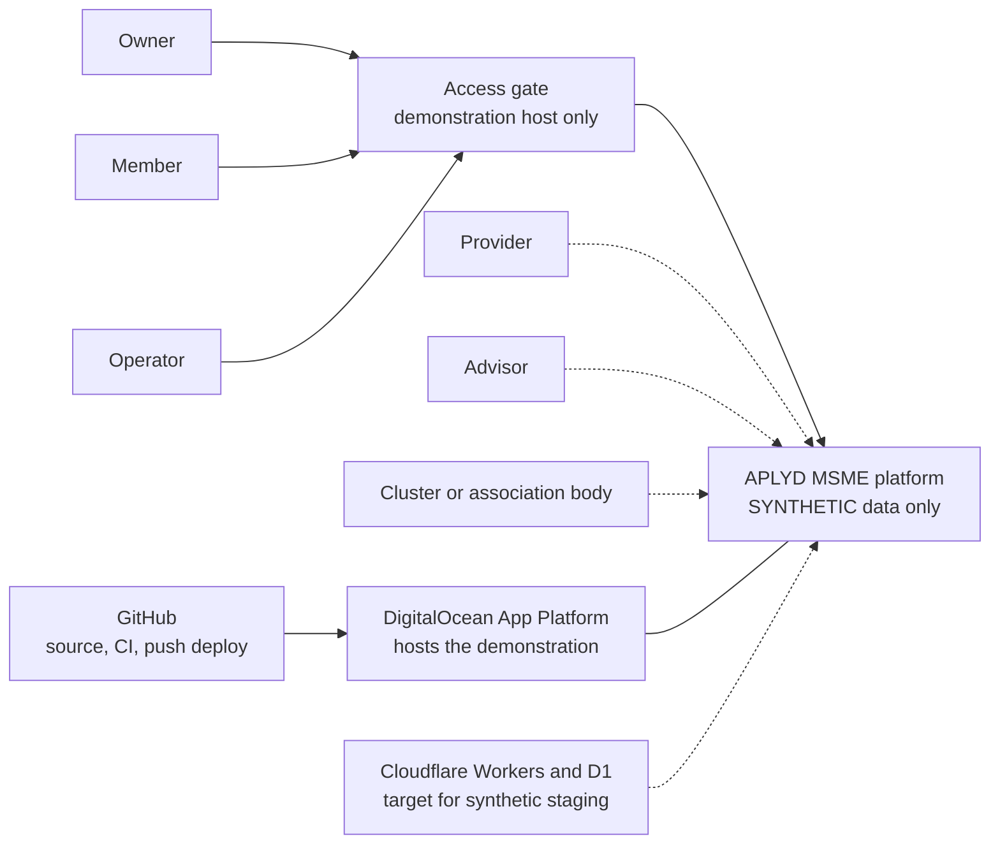
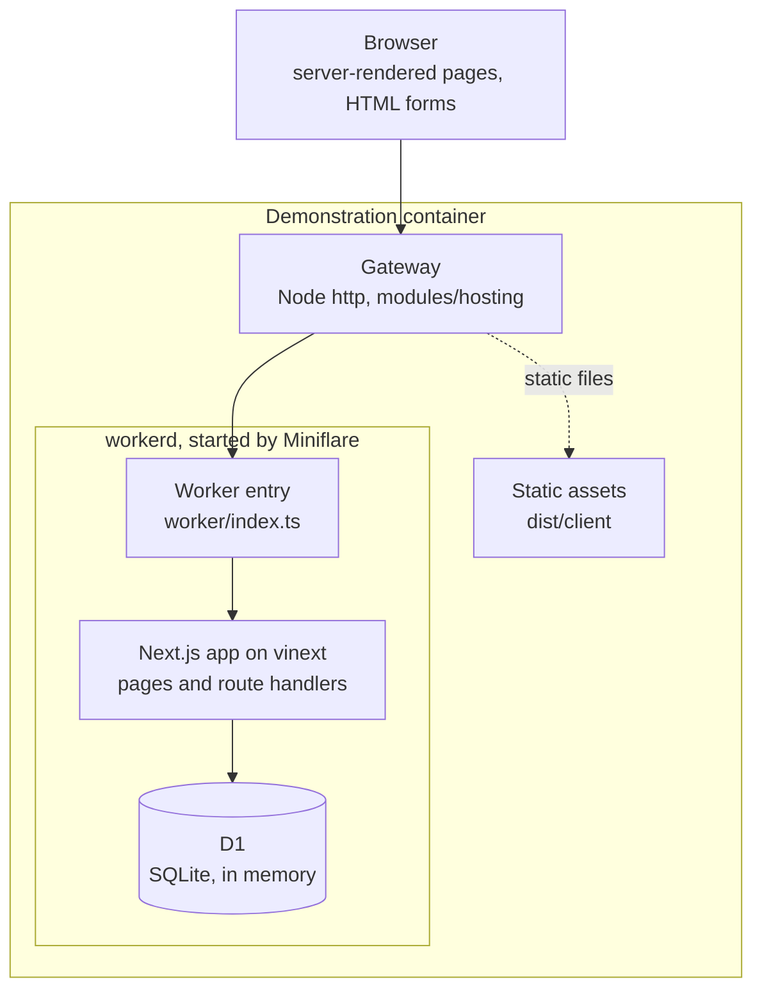
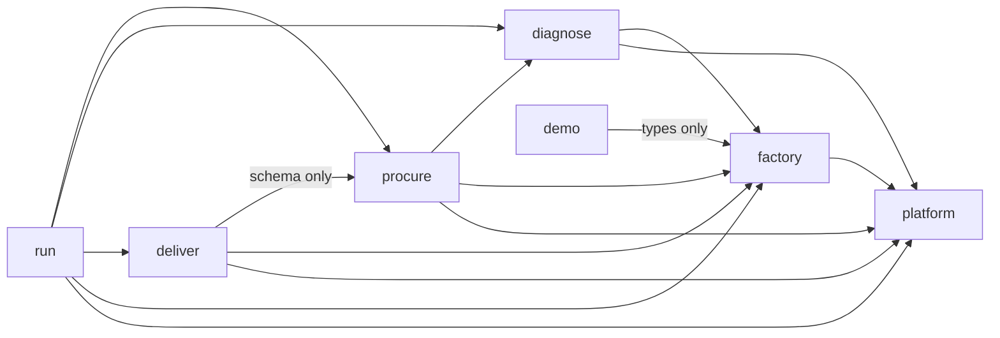
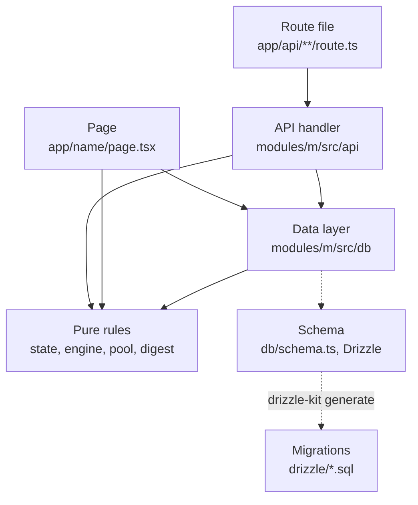
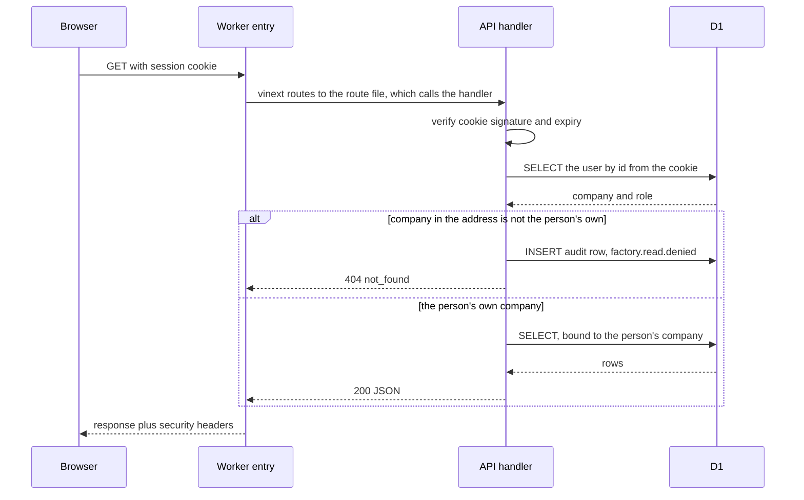
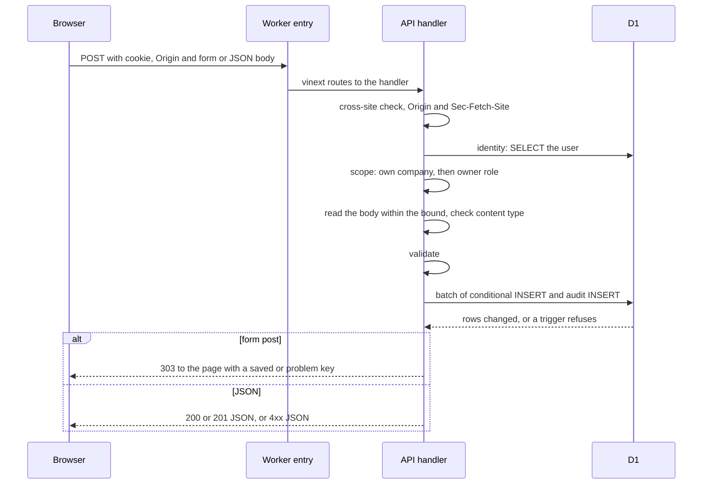
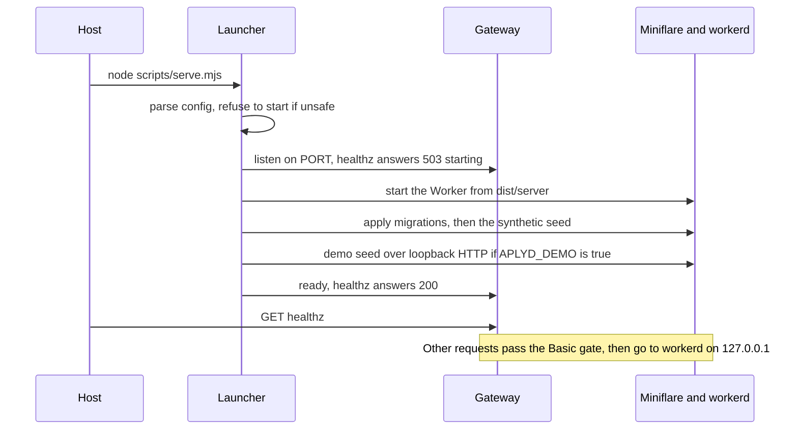
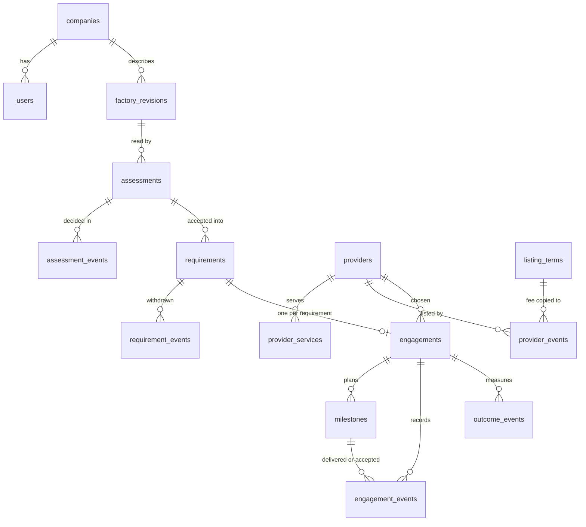
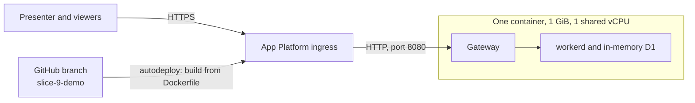
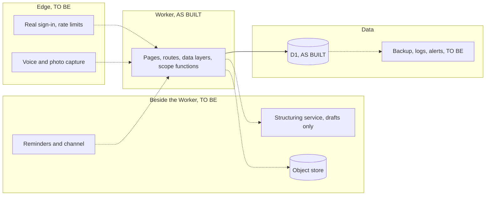

# High-level design: APLYD MSME platform

Version 0.1. Date: 5 October 2026. Status: draft, not reviewed by a person.

This document describes the architecture of the APLYD MSME platform as it is built on 5 October 2026, shows how that architecture meets the business requirements, and sets out where the requirements that are not yet built would fit. It is written for the engineers who will continue the work and for the sponsor's technical reviewers. Every statement about the code was checked in the code on the date above; where the code and a status page disagree, the code is followed and the difference is listed in section 12. Everything in the application is SYNTHETIC: no real company, person, provider, rule or figure exists in it, and no person has read any of the code (see [HANDOVER.md](../../HANDOVER.md), "Merged without review").

How this relates to the other documents: [the BRD](../brd/BRD.md) says what the business needs and is the source of the BR identifiers cited here; [the functional specification](../fsd/FSD.md) says what the system does for each user; this document says how the system is built to do it; [the low-level design](LLD.md) goes down to modules and functions; [the data dictionary](DATA-DICTIONARY.md) holds every table and column; [the API reference](API-REFERENCE.md) holds each operation; [the security and privacy document](SECURITY-AND-PRIVACY.md) holds the threat view; [the wireframes](WIREFRAMES.md) show the screens. The decisions, open questions and the study register are in [decisions](../decisions.md), [open questions](../open-questions.md) and [sources](../sources.md). Test architecture is in [the test strategy](../test/TEST-STRATEGY.md), and operation of the hosted demonstration in [the runbook](../ops/RUNBOOK.md).

## Contents

1. [Introduction](#1-introduction)
2. [System context](#2-system-context)
3. [Containers and components](#3-containers-and-components)
4. [Runtime views](#4-runtime-views)
5. [Data architecture](#5-data-architecture)
6. [Security architecture](#6-security-architecture)
7. [Deployment views](#7-deployment-views)
8. [Quality attributes](#8-quality-attributes)
9. [Architecture decisions](#9-architecture-decisions)
10. [To-be architecture](#10-to-be-architecture)
11. [Constraints, risks and technical questions](#11-constraints-risks-and-technical-questions)
12. [Discrepancies](#12-discrepancies)

## 1. Introduction

### 1.1 Scope and how to read this document

The platform is a "marketplace++" for small Indian manufacturers (D-05): one journey from describing the factory (Describe), through a gap assessment (Diagnose), pooled procurement (Procure), deployment of what was bought (Deploy), to running it (Run). The business requirements are in [the BRD](../brd/BRD.md); 116 of them are numbered, and the BRD records 39 as built, 16 as partial, 49 as not built, 10 as open and 2 as unverified. This document covers the whole system but spends its detail on what exists. Sections 2 to 8 describe the system as built. Section 9 records the decisions behind it. Section 10 describes capabilities that do not exist and are labelled TO BE throughout.

Two labels are used in every section. AS BUILT means the code does it today and the statement was checked in the code. TO BE means the BRD requires it or the design anticipates it, and it does not exist. Where a statement is an inference rather than something read in the code or run, it carries [Likely] or [Guessing]; a statement with hard evidence (code read, a test run, a cited source) may carry [Certain]. A statement without a tag in sections 2 to 8 was read directly in the code or in the document it cites.

Code is cited by path and name in code spans, for example `modules/platform/src/identity/scope.ts`. Paths are relative to the repository root. Line numbers are not given because they move; the name of the function or constant is given instead.

### 1.2 What kind of system this is

The application is one deployable unit: a Next.js application in server-rendered mode, compiled by vinext into a single Cloudflare-style Worker, with one SQLite-dialect database (Cloudflare D1) bound to it. It has no background jobs, no queue, no cache, no object store and makes no outbound network call [Certain: no outbound call of any kind was found in `app/`, `worker/` or `modules/*/src`, apart from the launcher's gateway and the demonstration's HTTP client, which run outside the Worker]. Every page and route file is rendered or run on each request (`export const dynamic = "force-dynamic"` is in all 32 of them), and there are no client components (no file under `app/` declares `"use client"`).

The shape of the repository follows the module ownership rule in [AGENTS.md](../../AGENTS.md): one directory per module under `modules/`, each with its own source, tests, `STATUS.md` and `VALIDATION.md`, and a thin `app/` directory that holds the pages and route files.

### 1.3 Architectural drivers

The drivers below are the requirements and decisions that shaped the architecture most. Each names the part of the design that answers it.

| Driver | Source | What it forces in the design | Answered in |
| --- | --- | --- | --- |
| Authority on the server | BR-NFR-01, BR-ID-03 | Identity from the signed session cookie only; company and role read from the database on every request; no client-settable header is trusted | 6.2, 6.5 |
| Integrity in the database | BR-NFR-02, BR-ID-06, BR-DATA-04 | Append-only tables and business rules enforced by triggers, not only by application code; a missing guard shows as degraded health | 5.4 |
| One company never sees another, and the operator does not override that | BR-ID-03, BR-ID-04, BO-06 | One scope function; queries bound to the signed-in person's company, never to the id in the URL; a refusal that looks like "not found" | 6.3, 6.4 |
| Vendor-neutral earnings | D-03, BR-GOV-02, BR-PROC-05, BR-COM-02, BO-05 | One flat listing fee, copied by the database from the terms in force; no code path takes a fee from a request; no fee shown to an owner | 5.3, 9 (AD-09) |
| Floor of five | C-04, BR-GOV-06, BR-PROC-02, OQ-14 | Pools are counted, never listed; one pure function decides what may be shown; the only cross-company read is a count | 3.5, 9 (AD-08) |
| Synthetic only | BR-DATA-01, BR-UX-08, BR-OPS-08 | A synthetic sign-in that works only where the environment name allows it; a banner; a launcher that refuses to start unless configured as synthetic | 6.9, 7.3 |
| The Saha stack | D-04, D-06 | Next.js on vinext, Workers, D1, Drizzle, pnpm, Node 22, pinned versions; Saha's hosting layer is not reused | 3.2, 9 (AD-01) |
| Where real data lives is open | OQ-07, BR-DATA-02, DP-04 | Nothing in the design commits real data to Cloudflare; the dependence on SQLite syntax in triggers is recorded as a constraint | 7.4, 11.1 |
| The platform does not certify, build registry products or sell data | C-01, C-02, C-03, BR-GOV-03, BR-GOV-04, BR-GOV-05 | Absence: there is no certification record, no provider-side write path for APLYD, and no export of a company's data to anyone but its owner | 3.3, 10.1 |
| Reproducible diagnosis | BR-DIAG-04 | A rules engine with pinned versions rather than a model; the stored result copies library facts | 9 (AD-03) |
| Evidence and regression | BR-NFR-04, BR-NFR-05 | Layered tests, a baseline guard, static tripwires over the source | 4.7, 8 |
| A presenter can show the journey | BR-OPS-07, BR-OPS-08 | A seeded cast, a presenter script page, a hosted synthetic host behind a gate | 3.3, 7.3 |

### 1.4 Reading order

Engineers new to the code should read sections 3 and 4, then the security section, then the data section. A reviewer of protected paths (identity, data scope, migrations, money; [AGENTS.md](../../AGENTS.md)) should read sections 5.4, 6 and 10.4.

## 2. System context

AS BUILT unless dashed. Dashed elements in the diagram are TO BE.

### 2.1 People and roles

| Actor | Role value in code | What the code lets them do | Status |
| --- | --- | --- | --- |
| Owner | `owner`, with a company | Read and write their own company's records: describe, diagnose, requirement, engagement, outcomes | AS BUILT |
| Member | Any role other than `owner`, with a company | Read their own company's records through the API; the pages answer "This page is for the owner" instead of showing the record (BR-ID-05) | AS BUILT in the API only; no member exists in any seed (section 12, item 4) |
| Operator | `operator`, with no company | Keep the provider registry, set the one listing fee, list and unlist providers, see pool counts of five or more; never read a company's record | AS BUILT |
| Provider | none | Nothing: providers see nothing, and the owner records what the provider said (OQ-19) | TO BE (BR-ID-09, BR-DEPL-05) |
| Advisor, a second person who checks | none | Nothing (OQ-18) | TO BE (BR-ID-08, BR-DIAG-06) |
| Cluster or association body | none | Nothing; clusters are a fixed SYNTHETIC list in `modules/procure/src/clusters.ts` | TO BE (BR-PROC-11, AS-05) |

The role is a free text column (`users.role`), with no database constraint on its values (`modules/platform/src/db/schema.ts`). The code treats the two values `owner` and `operator` specially and anything else with a company as read-only.

### 2.2 External systems

No external system is integrated today. The Worker calls nothing, and nothing calls the Worker except people's browsers, the launcher's health probe and the test and demonstration harnesses.

| System | Relation today | Status |
| --- | --- | --- |
| GitHub | Holds the source; runs `engineering-checks` and `documentation-checks` (`.github/workflows/`); on the hosted demonstration, a push to the tracked branch triggers a rebuild (live host fact, supplied by the lead, not verifiable from the repository) | AS BUILT |
| DigitalOcean App Platform | Hosts the synthetic demonstration: one container, built from the repository `Dockerfile` (section 7.3) | AS BUILT (live host fact, same caveat) |
| Cloudflare Workers and D1 | The intended runtime for synthetic data (D-06). The code is written for it and runs on its open-source runtime locally. No Cloudflare account, hosted database or Worker deployment exists | TO BE as a hosted environment |
| Government portals, banks, financiers, messaging channels, speech and language services, model providers | None. No open question names a model or speech provider | TO BE (section 10) |

### 2.3 Trust boundaries

There are four boundaries. The browser is untrusted: it supplies the cookie and the request, and nothing it says about who it is is believed beyond the cookie's signature (6.2). On the demonstration host, the access gate sits in front of the application and is a second, independent check (6.8). The Worker is trusted to hold the session secret and to enforce scope; the database is trusted to enforce the append-only and ordering rules even if the Worker's code is wrong (5.4). The build and the host are trusted not to be hostile: nothing here defends against someone who can change the database file or the deployed code (section 6.10).

## 3. Containers and components

### 3.1 Containers

AS BUILT. The picture is of the hosted demonstration; local runs and tests use the same Worker and the same database engine with a different front (section 7).

The Worker entry (`worker/index.ts`) is five lines: it hands the request to the vinext fetch handler and adds the security headers to what comes back. Static files under `/_next/static/` are served by the assets layer of the runtime and do not pass through the Worker, so they do not carry those headers (section 12, item 6).

### 3.2 Technology

Every version below is pinned exactly in `package.json` and `pnpm-lock.yaml`, and was chosen by D-06 ("with the pinned versions Saha uses"). [Certain: versions read from `package.json`, `Dockerfile` and `pnpm-workspace.yaml`.]

| Layer | Choice | Pin | Notes |
| --- | --- | --- | --- |
| Language | TypeScript, strict, `erasableSyntaxOnly`, imports with `.ts` extensions | 5.9.3 | Tests and scripts run directly under Node type stripping, so there is no compile step for them |
| UI framework | Next.js, App Router, React server components only | next 16.3.6, react 19.2.6 | No client components; forms post to route handlers |
| Build and serve | vinext (runs Next.js apps on Vite) with the Cloudflare Vite plugin | vinext 1.0.0-beta.5, vite 8.0.13, @cloudflare/vite-plugin 1.37.1, @vitejs/plugin-rsc 0.5.26 | vinext is a beta release |
| Runtime | Cloudflare Workers runtime, compatibility date 2026-05-15, flag `nodejs_compat` | wrangler 4.92.0, miniflare 4.20260515.0 | Locally and on the demonstration host the open-source runtime (workerd) runs the built Worker |
| Database | Cloudflare D1, a SQLite dialect, binding `DB` | n/a | Triggers use SQLite syntax |
| Schema and migrations | Drizzle ORM and Drizzle Kit | drizzle-orm 0.45.2, drizzle-kit 0.31.10 | Used to declare tables and generate migrations only; queries are hand-written SQL (AD-02) |
| Package manager and Node | pnpm, Node 22 | pnpm 11.25.0, Node at least 22.18.0 (`engines`), Docker image `node:22.22.0-bookworm-slim` | Packages younger than seven days are refused (`minimumReleaseAge: 10080`); dependency build scripts run only for four listed packages |
| Browser tests | playwright-core driving Chromium, no browser download | 1.56.1 | Chrome or Chromium must be present |

The build produces `dist/server` (the Worker bundle and a generated `wrangler.json`) and `dist/client` (static assets with immutable caching for `/_next/static/`). The generated configuration carries the D1 binding with a placeholder database id, no environment name and `observability.enabled: true`. The binding is declared in `vite.config.ts`, and "hosted environments are configured outside this file" in the words of its comment: no deployable Cloudflare configuration exists in the repository (TO BE).

### 3.3 Modules

AS BUILT. The modules are directories, not packages: each is a folder under `modules/` that other modules import from by relative path. Nothing enforces the boundaries except convention, review and the static tests described in 3.5.

| Module | Purpose | Tables | Pages | Route files, operations |
| --- | --- | --- | --- | --- |
| `platform` | Identity, session, scope rule, audit, body bounds, health, guard lists, migration applier, test support | `companies`, `users`, `audit_events` | `/`, `/sign-in` | session, company, health: 3 files, 4 operations |
| `factory` | Describe: the questionnaire and the factory record kept as versions | `factory_revisions` | `/factory` | 2 files, 2 operations |
| `diagnose` | Diagnose: the rules engine, the SYNTHETIC library, assessments, decisions, sign-off, fingerprint | `assessments`, `assessment_events` | `/diagnose` | 4 files, 5 operations |
| `procure` | Requirements, pools with a floor of five, the provider registry, the one listing fee, the operator's page | `requirements`, `requirement_events`, `providers`, `provider_services`, `listing_terms`, `provider_events` | `/procure`, `/operator` | 8 files, 11 operations |
| `deliver` | Choice of a provider, the milestone plan, deliveries, acceptances, payments the owner made, close | `engagements`, `milestones`, `engagement_events` | `/deliver` | 5 files, 5 operations |
| `run` | Baseline, reviews at 30, 90 and 180 days, change since baseline, next idea | `outcome_events` | `/run` | 1 file, 2 operations |
| `hosting` | Gate and gateway for the demonstration host; no import from any other module | none | none | none |
| `demo` | The cast, the seeder (through the application's own requests), the presenter script | none | `/demo` (only with `APLYD_DEMO=true`) | none |
| `journey` | One browser test that walks the whole journey through the pages; no application code | none | none | none |
| `docs` | Reads the BRD as data for `scripts/check-traceability.mjs`; no application code | none | none | none |

The totals are 9 pages, 23 route files and 29 operations (GET and POST), counted from `app/`. The operation-level catalogue is in [the API reference](API-REFERENCE.md). One route of the `deliver` module lives under the `requirements` path (`requirements/[rid]/engagement`), and the `/operator` page belongs to `procure`.

Capabilities that the invariants say must not exist have no component: there is no certification record (C-01), no write path through which APLYD lists a product of its own (C-02), and no interface that exports a company's data (C-03).

### 3.4 Dependencies between modules

AS BUILT. An arrow means that a file under the source module's `src/` imports from the target module. The Next.js pages and route files under `app/` import from every module and are not drawn.

`platform`, `hosting` and `docs` import nothing from another module. `demo` talks to the application over HTTP, not through imports, except for the questionnaire types. The graph has no cycle, and the direction follows the journey: a later stage reads an earlier stage, never the reverse [Certain: imports read by pattern over `modules/*/src`].

The factory module imports the platform's individual checks (`identity/scope.ts`, `identity/resolve.ts`, `identity/cross-site.ts`, `db/audit.ts`, `api/body.ts`) rather than the combined `authorize*` functions the other modules use; section 12, item 10.

### 3.5 Where the scope rule is deliberately crossed

AS BUILT. A company's records are reached only through queries bound to the signed-in person's company. The places where one module's data layer reads another's tables, or reads across companies, are few, and each is pinned by a static test that fails if it grows.

| Place | What crosses | Why | Pinned by |
| --- | --- | --- | --- |
| `modules/procure/src/db/pool.ts` | Two `COUNT(DISTINCT company_id)` queries across all companies | The only cross-company read. Returns a number, never a row; called only through `presentPool`, which applies the floor of five | `modules/procure/tests/static/rules.test.ts` |
| `modules/deliver/src/db/engagements.ts` | Joins `providers` and `requirements`; its inserts check `EXISTS (SELECT 1 FROM requirements WHERE id = ? AND company_id = ?)` | An engagement names a listed provider and the owner's own requirement; the join is bound to the engagement's company | `modules/deliver/tests/static/rules.test.ts` |
| `modules/run/src/db/outcomes.ts` | One statement names `engagements`, the existence check inside the insert | An outcome belongs to the owner's own engagement | `modules/run/tests/static/rules.test.ts` |
| `modules/run/src/api/outcomes.ts` | Reads other modules only through their data layers and presenters (`loadEngagement`, `listRequirements`, `loadAssessment`, `presentAssessment`) | The Results page shows the engagement, the requirement and the assessment's expected range together | same test |
| `modules/hosting/src/gate.ts`, `modules/hosting/src/gateway.ts`, `modules/demo/src/client.ts` | Read request headers that the header-read rule otherwise forbids | Host-side processes that run outside the Worker (6.5) | `modules/platform/tests/static/source-rules.test.ts` (`HOST_PROCESS_FILES`) |
| `app/sign-in/page.tsx` | Selects the synthetic users (email, name, role) directly from `users` | The sign-in page lists them as a pick-list; it does so only where the environment is synthetic | No static test of its own; the browser layer exercises the page |

### 3.6 Layers inside a module

AS BUILT. Every module with a route follows the same layering. The rules in the right-hand column are conventions, and several are pinned by static tests (for example, in each of the five domain modules a test fails if a page, a route or another module queries that module's tables itself).

| Layer | Holds | Rules |
| --- | --- | --- |
| Page | A server component that reads the cookie through `next/headers`, resolves the identity with `resolveIdentityFromCookieHeader`, calls data-layer functions and rules, and renders forms | Reads the database directly through the data layer, not through the module's own API. Messages are looked up from a fixed table by a key in the address (`?saved=`, `?problem=`) with `Object.hasOwn`, and nothing the sender wrote is echoed back |
| Route file | Between 6 and 13 lines: reads `env` from `cloudflare:workers` and the route parameters and calls one handler | No logic |
| API handler | Authorises (cross-site check, identity, scope), reads the body within a bound, validates, calls the data layer, answers JSON or a 303 redirect | One handler per operation. Form or JSON is decided by the request's content type |
| Data layer | Hand-written prepared SQL (`db.prepare`), the conditional insert plus its audit row in one `db.batch`, and the mapping of trigger refusals to typed reasons | Always binds the company id from the identity, never from the URL |
| Pure rules | `state.ts` (deliver, run), `engine.ts`, `library.ts`, `digest.ts` (diagnose), `pool.ts`, `clusters.ts` (procure), `questionnaire.ts` (factory) | No I/O; unit-tested |
| Schema | Drizzle table declarations in `modules/*/src/db/schema.ts` | Used to generate migrations; never to run queries |

The pages and the API read through the same data-layer functions, so the two read paths agree by construction. A person at a form is sent back to the page with a message key; a program gets JSON. Refusals made before the person is known (401, 403, 404, 413) answer in JSON even to a form, a known limit of the form flow.

### 3.7 Routes and pages

AS BUILT. Pages are listed in 3.3. The route files are listed here with the authoriser each uses; the operations, bodies and responses are in [the API reference](API-REFERENCE.md).

| Route file under `app/api/` | Methods | Authorisation |
| --- | --- | --- |
| `session` | GET, POST | GET reads identity; POST is sign-in (synthetic) or sign-out |
| `health` | GET | None; public |
| `companies/[id]` | GET | Company read |
| `companies/[id]/factory` | GET | Inline company read (factory module) |
| `companies/[id]/factory/revisions` | POST | Inline company write (factory module) |
| `companies/[id]/assessments` | GET, POST | Company read, company write |
| `companies/[id]/assessments/[aid]` | GET | Company read |
| `companies/[id]/assessments/[aid]/decisions` | POST | Company write |
| `companies/[id]/assessments/[aid]/signoff` | POST | Company write |
| `companies/[id]/requirements` | GET, POST | Company read, company write |
| `companies/[id]/requirements/[rid]/withdraw` | POST | Company write |
| `companies/[id]/requirements/[rid]/engagement` | POST | Company write |
| `companies/[id]/engagements` | GET | Company read |
| `companies/[id]/engagements/[eid]` | GET | Company read |
| `companies/[id]/engagements/[eid]/milestones` | POST | Company write |
| `companies/[id]/engagements/[eid]/events` | POST | Company write |
| `companies/[id]/engagements/[eid]/outcomes` | GET, POST | Company read, company write |
| `providers` | GET | Any signed-in person (listed providers belong to no company) |
| `operator/providers` | GET, POST | Operator |
| `operator/providers/[pid]/list` | POST | Operator |
| `operator/providers/[pid]/unlist` | POST | Operator |
| `operator/listing-terms` | GET, POST | Operator |
| `operator/pools` | GET | Operator |

## 4. Runtime views

### 4.1 A read request

AS BUILT. The example is `GET /api/companies/{id}/factory`; every company-scoped read follows the same steps through `authorizeCompanyRead` (the factory module inlines the same steps).

### 4.2 A state-changing request

AS BUILT. The example is a form post that saves a factory description; the other write operations differ in the validation and the data-layer call.

### 4.3 What each step may refuse

AS BUILT. The order is fixed: a refusal that costs nothing is made before one that needs the database, and the body of a refused request is drained so the connection stays usable. The statuses were read from the handlers.

| Step | Refusal | Status and body | Audit row |
| --- | --- | --- | --- |
| Cross-site check (changes only) | Origin differs from the request's own origin, or no Origin and `Sec-Fetch-Site: cross-site` | 403 `cross_site_refused` | None |
| Storage | No database binding | 503 `storage_unavailable` | None |
| Identity | No cookie, bad signature, expired, unknown user, or no valid secret configured | 401 `not_signed_in` | None |
| Scope | The company in the address is not the person's own, or the person has no company | 404 `not_found`, the same answer as for a company that does not exist | `<area>.read.denied` or `<area>.write.denied`, with the requested id cut to 64 characters |
| Role | Own company, but not the owner (a change) | 403 `forbidden` | The same event names |
| Operator | Operator routes: not the operator role, or the person has a company | 403 `forbidden` | `operator.read.denied` or `operator.write.denied` |
| Body | A content type other than a form or JSON; over the bound; unreadable or not an object | 415 `unsupported_content_type`; 413 `too_large`; 400 `bad_request` | None |
| Validation | A field out of range or malformed | 400 `invalid` with the fields, or a redirect with `?problem=` | None |
| Rule | A precondition in the conditional insert fails, or a trigger refuses | 409 with a typed reason, 404 for a missing parent, or a redirect with `?problem=` | None |

A successful change returns 201 for something new and 200 where a create was repeated and the existing record was returned (assessments and requirements are created once per key). Every success writes its audit row in the same batch as the record (5.5).

### 4.4 A page request

AS BUILT. A page is a server component. It reads the cookie through `next/headers`, resolves the identity itself, calls the data layer for the person's own company and renders HTML. It writes nothing: no page contains an insert, an audit call or a `run()`. A form on the page posts to a route file, which answers with a 303 redirect back to the page carrying a `?saved=` or `?problem=` key. All JSON and redirect responses carry `cache-control: no-store`. A person who is not signed in, or is not an owner, gets a short page that says so; no audit row is written for a page view.

### 4.5 The demonstration host: start-up and request path

AS BUILT. The launcher `scripts/serve.mjs` runs the built Worker in workerd through Miniflare, with an in-memory D1, and puts the gateway in front.

The gateway (`modules/hosting/src/gateway.ts`, rules in `gate.ts`) is a Node `http` server. It answers `/healthz` before the gate (503 `starting` until the launcher is ready; afterwards it probes the Worker's `/api/health`, cached for 2 seconds). For every other request it checks HTTP Basic credentials against SHA-256 digests with a constant-time comparison, strips the `Authorization` header, rewrites `Origin` to `http://<Host>` when the origin's host equals the Host header (or is listed in `APLYD_PUBLIC_HOSTS`), enforces a 256 KiB body cap (declared or streamed, answered 413), closes upgrade requests, removes hop-by-hop headers, applies a 60-second upstream timeout and writes one log line per refusal. The launcher refuses to start unless `APLYD_ENV` is a synthetic name, the session secret is valid and the gate is configured (a user name without a colon and a password of at least 12 characters, or `DEMO_ACCESS=open`). It replaces Miniflare's own SIGTERM handler so the gateway can stop cleanly.

Measured once on a development machine and recorded in the hosting module's validation record: ready in about 12 seconds, about 190 MB for the Node process and 110 MB for workerd when idle [Certain for that run; not measured on the live host]. The demonstration seeder reported "5 companies, 3 providers, 68 requests" in the demonstration module's validation record: the five companies and their owners are inserted with SQL (`modules/demo/src/identities.ts`), and everything else is done through the application's own requests (`modules/demo/src/seed.ts`).

### 4.6 Local development

AS BUILT. `pnpm db:local` (`scripts/local-db.mjs`) deletes `.wrangler/state/v3/d1`, then applies every migration and the synthetic seed through `wrangler d1 execute --local`. `pnpm dev` runs `vinext dev --port 5173`; the Vite configuration sets `APLYD_ENV` to `local` for the development server only, so a built Worker carries no environment name unless whoever runs it supplies one. The session secret comes from `.dev.vars`, which is not tracked. The development server needs no gateway and no gate.

### 4.7 Tests and continuous integration

AS BUILT. `node scripts/test.mjs <layer> [--guard]` runs a layer. The catalogue (`node scripts/test.mjs --list`) holds 67 suites on 5 October 2026: 17 static, 23 unit, 8 integration, 8 smoke and 11 browser.

| Layer | What runs | Needs |
| --- | --- | --- |
| Static | Type check, documentation check, traceability check, `drizzle-kit check`, and source-reading tests: the header-read rule, no secrets or build output tracked, every query bound to a company, every append-only table touched only by its data layer, the money-column allow-list, page message keys | Node only |
| Unit | Pure rules and platform functions: session, scope, cross-site, body reader, guards, engine, pool, state | Node only |
| Integration | The API handlers called directly against a real SQL engine, Miniflare's D1, built from the migrations and seed (`modules/platform/tests/support/d1.ts`); one probe per database rule | Node, Miniflare |
| Smoke | The built Worker started on a free port (`modules/platform/tests/support/worker.ts`, using Wrangler's local mode) or, for the hosting and demonstration suites, the launcher | A build |
| Browser | Chromium driven by playwright-core against the built Worker or the launcher | A build and Chrome or Chromium |

Each module keeps `tests/baseline.json`; with `--guard` a suite that is missing, has no baseline or passes fewer tests than its baseline fails the run (BR-NFR-05). Mutation checks (`scripts/mutation/mutate.py`) were run by the module authors and are recorded in each `VALIDATION.md`. The recorded full runs on 5 October 2026 passed 58 of 58 suites for the hosting slice and 64 of 64 for the demonstration slice, on a two-core container in about 10.5 and 11 minutes [Certain for those runs; the catalogue now lists 67 suites and no full run of all 67 is recorded in the repository].

CI is `.github/workflows/ci.yml` (`engineering-checks`): on pull requests and pushes to `main` that change something other than Markdown or `docs/`, on `ubuntu-latest` with Node 22 and a 20-minute limit, it checks the catalogue, installs with `pnpm install --frozen-lockfile`, runs `pnpm build`, shows the Chrome version, runs `node scripts/test.mjs pr --guard` and uploads `reports/summary.json`. It holds no secret, uses no hosted database and deploys nothing. `.github/workflows/docs.yml` (`documentation-checks`) runs `scripts/check-documentation.mjs` on every pull request. A concurrency group cancels superseded runs. [Certain for the files; the result of a CI run on the merged tree is not recorded (HANDOVER.md).]

## 5. Data architecture

The column-level description of every table is in [the data dictionary](DATA-DICTIONARY.md). This section gives the design rules.

### 5.1 Principles

AS BUILT. Four rules shape every table.

1. A confirmed record is never changed. A correction is a new row that carries evidence; the old row stays (BR-DATA-04, AGENTS.md). Fourteen of the 15 tables are append-only. `companies` and `users` are not, but no route creates or edits them: only the seed files and the demonstration seeder write them, so there is no sign-up path today (BR-ID-01 is partial).
2. Change is recorded as events. Where something changes state (a decision on an idea, a withdrawal, a listing, a delivery, an acceptance, a review), the change is an event row, and the state is read from the events.
3. State is derived on read, never stored (5.6). There is no "status" column to go out of step with the events.
4. Every refusal that matters is also made by the database (5.4), so a bug in the application layer cannot write what a rule forbids.

Identifiers and time follow one convention. Records that people name in a URL (assessments, requirements, providers, engagements, milestones) have `crypto.randomUUID()` text keys. Event and audit rows use an autoincrement integer. Factory revisions are numbered per company with no gaps (a trigger enforces it). Every timestamp is ISO 8601 text taken from the Worker's clock; the database never supplies a time. Structured values (the questionnaire answers, an assessment's result, a requirement's specification) are stored as JSON text, and a trigger checks that factory answers are an object. Money, where it appears, is a whole number of rupees in an `_inr` column.

### 5.2 Table families

AS BUILT. 15 tables, created by migrations 0000 to 0014.

| Module | Table | Holds | Append-only | Notes |
| --- | --- | --- | --- | --- |
| platform | `companies` | A company: id, name, synthetic flag, created time | No | Seed only |
| platform | `users` | A person: company (null for the operator), email, name, role, synthetic flag | No | Seed only. Sign-in picks from rows where `is_synthetic = 1` |
| platform | `audit_events` | One row per write and per refused attempt: time, event name, user, company, short JSON detail | Yes | No foreign keys; the detail holds no personal data or record contents by design |
| factory | `factory_revisions` | One version of a company's description: revision number, answers, note, confirmed flag, questionnaire version, author | Yes | Per-company numbering with no gaps; at most 500 revisions per company (a trigger) |
| diagnose | `assessments` | One ranked result for a company: the factory revision it read, library and engine versions, the stored result | Yes | Unique per company, revision, library version and engine version; refused unless the revision is confirmed |
| diagnose | `assessment_events` | Decisions (accept, defer, reject, with a note) and the sign-off with its fingerprint | Yes | One sign-off only; a sign-off needs a decision on every idea; at most 200 decisions |
| procure | `requirements` | A standard requirement made from an accepted idea in a signed-off assessment, with its cluster and specification | Yes | One per assessment and idea |
| procure | `requirement_events` | Withdrawal of a requirement | Yes | Refused once an engagement exists |
| procure | `providers` | A provider in the operator's registry (SYNTHETIC) | Yes | |
| procure | `provider_services` | The ideas and clusters a provider serves | Yes | Closed once the provider has been listed |
| procure | `listing_terms` | The listing fee, versioned: version, fee in whole rupees, note | Yes | One fee, with nothing that could make it differ: no provider, company, requirement, offer, deal or percentage column |
| procure | `provider_events` | List and unlist events; a list event carries the terms version and a copy of the fee | Yes | Events must alternate; a listing needs a service and the fee in force |
| deliver | `engagements` | The owner's choice of one listed provider for one of the company's requirements | Yes | One per requirement |
| deliver | `milestones` | A step of the plan: the owner's test, the agreed price in rupees, a due date | Yes | Up to 12; open only until the plan is agreed |
| deliver | `engagement_events` | Plan agreed, delivery, acceptance, rejection, payment the owner says they made, close | Yes | A fixed order enforced by triggers (5.4) |
| run | `outcome_events` | One baseline and the reviews at 30, 90 and 180 days: the owner's number, whether it did what was expected, whether it is in use | Yes | Numbers are whole; one baseline; one review of each kind |

`audit_events` is left off the diagram: it refers to users and companies by text, with no foreign key. Where a child row names a parent that belongs to a company, the key is composite (the parent's id and its company id), so a child cannot name another company's parent even by a mistake in the application (for example `assessment_events` refers to `(assessment_id, company_id)`). The foreign keys declare `ON DELETE no action`; deletion is in any case refused by the append-only triggers.

### 5.3 Money in the schema

AS BUILT. Money appears in four columns and no more, and a static test pins the list (`modules/procure/tests/static/rules.test.ts`, `modules/deliver/tests/static/rules.test.ts`). `listing_terms.fee_inr` is the one flat fee, and `provider_events.fee_inr` is the copy made when a provider is listed; these two are the only columns that can carry APLYD's earnings. `milestones.agreed_inr` and `engagement_events.amount_inr` are the owner's own record of a price and of a payment the owner says they made outside the platform; they are limited to ₹10,00,00,000 (`MAX_AMOUNT_INR` in the deliver module) and no code compares them with anything or moves anything. A payment can be recorded only after an acceptance (a trigger). The platform holds and moves no money. No table holds a commission, a share, an offer or a balance, and the static test would fail on a new column with a money-like name that is not on the list.

### 5.4 Guards in the database

AS BUILT. `modules/platform/src/db/guards.ts` lists, by name and table, every trigger the application relies on: 42 append-only triggers and 49 rule triggers, 91 in all. The migrations contain 93 `CREATE TRIGGER` statements; migration 0014 drops and recreates two, so 91 stand. A unit test checks the lists against the migrations, so a trigger cannot be added or dropped without the list changing.

| Module | Triggers | Kinds |
| --- | --- | --- |
| platform | 3 | Append-only on `audit_events` |
| factory | 7 | Append-only; answers are an object; no gaps in numbering; at most 500 revisions; a short note |
| diagnose | 15 | Append-only on two tables; an assessment needs a confirmed description; a decision names an item and has a value; one sign-off only and it is final; a sign-off needs a decision on every idea; at most 200 decisions; a short note |
| procure | 29 | Append-only on six tables; a requirement needs a signed-off assessment and an accepted idea; the fee is whole rupees; a listing carries the fee in force, needs a service, and listing events alternate; services are closed after the first listing; a requirement cannot be withdrawn after an engagement |
| deliver | 28 | Append-only on three tables; an engagement needs an open requirement and a listed provider; the plan is open only until agreed; at most 12 milestones and 14 deliveries; whole numbers and dates; a fixed order of events (plan before work, delivery before decision, acceptance before payment, one close and it is final) |
| run | 9 | Append-only; whole numbers; one baseline; the baseline before the first acceptance; one review of each kind; a review needs an acceptance and must be due |

Each append-only table has three triggers: no update, no delete and no replace (the last stops `INSERT OR REPLACE` from overwriting a row, the defect that the independent review of the diagnose module found in a sign-off, fixed in migration 0007).

The health endpoint `GET /api/health` reads `sqlite_master` and checks that each required trigger exists by name and table. It answers 200 `ok` or 503 `degraded`, with the fields `database` and `auditGuard`. It does not read trigger bodies, so a trigger with the right name and a weaker body would pass; the integration tests, which run one probe per rule against real SQL, are what show the bodies are right [Certain: `modules/platform/src/api/health.ts` says so]. The endpoint is public and carries nothing beyond those three fields.

The data layers recognise a trigger's refusal by matching its `RAISE(ABORT)` message with a regular expression and turn it into a typed reason (for example `already_listed`, `no_service`). This couples the SQL text of the migrations to the TypeScript that interprets it; a reworded message in a new migration would turn a typed refusal into a 500 [Likely: no test was found that renames a message, and the integration probes would catch it for the rules they cover].

### 5.5 How a record is written

AS BUILT. Every write, except the audit rows of refusals, has one shape: a single `db.batch([insert, audit])` in which the first statement is a conditional `INSERT ... SELECT ... WHERE <precondition>` and the second is `auditIfChanged`, an `INSERT INTO audit_events ... WHERE changes() > 0`. The record and its audit row therefore succeed or fail together, and the precondition (the parent exists and belongs to this company, the state allows it) is evaluated in the same statement as the insert. The handler reads `meta.changes` to learn whether the precondition held and maps a trigger's refusal to a typed reason. Refusals of access are audited by `recordAudit`, a plain insert.

Repeating a create returns the existing record rather than a second one (200 instead of 201), because the unique keys say so. Factory revisions use optimistic concurrency: the request names the revision it starts from (`basedOn`), and if someone has saved since, nothing is written and the answer is 409 `stale` with the latest. SQLite serialises writers, so two simultaneous writes cannot both pass a precondition; this was reasoned from the engine and tested on Miniflare's D1, and not tested with two Workers against a hosted D1 [Likely].

### 5.6 What is derived and what is stored

AS BUILT. Nothing below has a column.

| Derived value | From | Computed in |
| --- | --- | --- |
| Latest and latest confirmed factory revision | `factory_revisions` by revision number and confirmed flag | `modules/factory/src/db/revisions.ts` |
| The decision standing on each idea | The latest decision event per idea | `standingDecisions` in `modules/diagnose/src/digest.ts` |
| Whether a sign-off still covers the decisions | The stored fingerprint against one recomputed from the rows | `digestOf` and the assessment data layer (`digestMatches`) |
| A requirement's withdrawn state | A withdrawal event | `modules/procure/src/db/requirements.ts` |
| A pool's size as shown | A count of distinct companies, passed through `presentPool` (shown only from five, as the largest multiple of five at or below the count) | `modules/procure/src/pool.ts`, `db/pool.ts` |
| Whether a provider is listed, and the fee in force | The last provider event; the highest terms version | `modules/procure/src/db/providers.ts` |
| A milestone's state and the engagement's status | A fold over the engagement's events | `modules/deliver/src/state.ts` |
| A review's state (waiting, not due, due, recorded) | The first acceptance plus `REVIEW_DAYS` (30, 90, 180) | `modules/run/src/state.ts` |
| Change since the baseline; the next idea | The baseline, the latest review and the accepted ideas | `modules/run/src/state.ts` and the run page |

What is stored and not derived: the assessment's `result`, which copies the library's facts at the time (so later library changes do not alter it), the questionnaire answers as saved, and the fee copied onto a listing.

### 5.7 Fingerprint of a sign-off

AS BUILT. When the owner signs off an assessment, the application computes a SHA-256 over a canonical, key-sorted JSON of the assessment's id, its whole result and the decision standing on each idea with its note, and stores it on the sign-off event (`modules/diagnose/src/digest.ts`). On every read the digest is recomputed from the stored rows and compared; a mismatch shows that the rows were changed outside the application. The sign-off insert is conditional on the number of decision events the digest was computed over, so a decision that arrives between the computation and the insert makes the sign-off fail rather than cover a different set. The fingerprint does not cover who decided, when, decisions that were replaced, or the sign-off note [Certain: read from `digestOf`]. It is a tamper signal for an accidental change, not a signature: anyone able to write the database can recompute it (section 6.10).

### 5.8 The audit log

AS BUILT. `audit_events` records every write (event names such as `factory.revision.created`, `assessment.created`, `assessment.decision`, `assessment.signed_off`, `requirement.created`, `requirement.withdrawn`, `provider.created`, `provider.listed`, `provider.unlisted`, `listing_terms.set`, `engagement.created`, `milestone.added`, `engagement.<kind>`, `outcome.<kind>`), every sign-in and sign-out (`session.created`, `session.ended`) and every access refusal (`<area>.read.denied`, `<area>.write.denied`, for the areas factory, assessment, requirement, engagement, outcome, operator and company). A failed sign-in is not written, because anyone can send one and the log cannot be pruned; it is logged as a JSON line (`session.refused`) without the address. There is no hash chain: someone with write access to the database could replace the whole table. There is no operator view of the log (BR-OPS-06 is partial), and nothing limits how much an authenticated person can write to it by repeated refused requests (BR-NFR-12; platform limits 2 and 8).

### 5.9 Migrations

AS BUILT. Migrations are SQL files in `drizzle/`, numbered 0000 to 0014. Table definitions are generated from the modules' `db/schema.ts` files with `pnpm db:generate`; triggers are written as custom SQL migrations (`pnpm db:generate --custom`). `drizzle-kit check` runs in the static layer. Applied migrations are never edited; a defect in a rule is fixed by a later migration that drops and recreates the trigger (0007 and 0014 do this). The test and local scripts apply them with `modules/platform/src/db/migrate.ts`, which also holds the seed functions; no application code applies migrations at run time. Against a hosted D1 the sponsor or an operator would apply them with Wrangler (TO BE; nothing is hosted).

## 6. Security architecture

AS BUILT. The threat view, with each threat and its status, is in [the security and privacy document](SECURITY-AND-PRIVACY.md); this section describes the controls as an architecture. No person has reviewed any of them, and the identity and scope code is on a protected path ([AGENTS.md](../../AGENTS.md); RK-07; BR-NFR-14).

### 6.1 Principles

Authority is on the server: what a person may see or do is decided from the database on each request, and no header, field or token claim a client controls can widen it. The rule is deny by default. A refusal that would tell an outsider something (that a company exists) is made to look like the answer for something that does not exist. Where the application and the database can both enforce a rule, both do (5.4).

### 6.2 Identity and session

Identity comes only from a signed session cookie (`modules/platform/src/identity/session.ts`, `resolve.ts`). The token is `base64url(payload).base64url(HMAC-SHA256)`, where the payload holds only the user id and an expiry (`u`, `exp`). It lives for 8 hours (`SESSION_SECONDS`). The signature is checked in constant time, only one spelling of the signature is accepted (the last base64 character carries unused bits), and a cookie name that appears twice is refused so a sibling site cannot shadow it. The cookie is `aplyd_session`, `HttpOnly; Secure; SameSite=Lax; Path=/`.

The signing key is `SESSION_SECRET`. `getSessionSecret` accepts it only if it is at least 32 bytes and is not a single repeated character, and every place that signs or verifies goes through it, so a placeholder cannot reach a deployment by accident; with no valid secret, sign-in and every identity lookup refuse.

Company and role are read from `users` on every request, never from the token. A token for a user who no longer exists therefore stops working at once, but no route removes or disables a user, and a user who has saved a record cannot be deleted at all (a foreign key protects the history), so there is no operational way to cut off one such person (section 12, item 8). Sign-out clears the cookie in the browser and writes an audit row; the token itself stays valid until it expires. The way to end every session at once is to change `SESSION_SECRET`.

Sign-in today is synthetic: the person picks one of the seeded users from a list, with no password. It works only where `APLYD_ENV` is `local`, `synthetic` or `test` and the chosen user has `is_synthetic = 1`; anywhere else the route answers 503. Real sign-in is TO BE (OQ-13, BR-ID-02).

### 6.3 The scope rule

`modules/platform/src/identity/scope.ts` holds the rule in two functions. `canReadCompany` is true only when the identity exists, has a company, and that company equals the one requested. `canWriteOwnCompany` also needs the role `owner`. Owner authority, the operator role and every other role are irrelevant to the first; a person with no company reads no company.

Two design choices make the rule hard to get wrong. First, the company id in a URL is only compared with the signed-in person's company; every query is then bound to the person's own company id, not the URL's, so a handler cannot read the wrong company by forgetting the comparison. Second, the data layers are the only code that touches a module's tables, and a static test per module fails if a query on those tables is not bound to a company, or if a page, route or other module queries them directly (3.5).

A request for another company gets 404 `not_found`, identical to the answer for a company that does not exist, and an audit row (`<area>.read.denied` or `.write.denied`) records the person and the requested id truncated to 64 characters. A person of the same company who is not the owner can read but not write: the API answers 403, and the pages answer "This page is for the owner" (BR-ID-05, partial). On 5 October 2026 the launcher was run on spare ports for this document, and a request for another company's id and a request for a made-up id returned the same status and body [Certain for that run].

### 6.4 The operator

`authorizeOperator` accepts a signed-in person whose role is `operator` and whose company is null; anyone else gets 403 and an audit row. An operator reads the provider registry, the listing terms and pool counts, and never a company's record: the scope functions give a person with no company no company, and no operator route queries a company's tables. The operator sees a pool only when it holds five or more companies, as a count, never as names (BR-OPS-02, BR-ID-04). The operator's changes (adding a provider, listing, unlisting, setting the fee) are checked for cross-site origin before the person is looked up.

### 6.5 The header-read rule

Because a client can set any request header, identity must never come from one. A test reads the syntax tree of every source file under `app/`, `worker/` and `modules/*/src` and fails if the code reads a request header outside an allow-list of five: `cookie`, `origin`, `sec-fetch-site`, `content-type`, `content-length` (`modules/platform/tests/static/source-rules.test.ts`, `modules/platform/tests/support/header-rule.ts`). Three files are exempt because they run in a Node process beside the Worker, not in it: the launcher's `gate.ts` and `gateway.ts` (which read `Authorization` as the gate's own password and strip it) and the demonstration's `client.ts` (which reads the response header that sets its session). A second test fails if anything the Worker runs can import one of them. The rule is a tripwire, not a proof: it finds direct reads, not every way of reaching a header (BRD, BR-NFR-01; platform limit 4).

### 6.6 Cross-site requests

A change that arrives from another website is refused by two layers. `SameSite=Lax` keeps the cookie off cross-site posts in browsers that honour it. `isCrossSite` (`identity/cross-site.ts`) then refuses any request that is not GET, HEAD or OPTIONS when its `Origin` differs from the request's own origin, or when there is no `Origin` and `Sec-Fetch-Site` is `cross-site`. A request with neither header passes: a program holding a valid cookie can post without an `Origin`, and a browser that sends neither is old enough that the cookie's `SameSite` setting is the only defence [Likely]. Behind the demonstration gateway, `Origin` is rewritten to the public host when it matches the Host header, so the check compares like with like (4.5).

### 6.7 Input bounds

The content type is checked before the body is read, and only forms and JSON objects are accepted (415 otherwise). `readTextWithin` (`modules/platform/src/api/body.ts`) refuses a declared length over four bytes per allowed character without reading, and abandons a stream when it passes the bound; the bound is `MAX_BODY_CHARACTERS` = 64 × 1,024 characters, so 256 KiB. The bound is checked between chunks, so one chunk larger than the bound is held whole before the check: it is not a hard memory cap. Every field has its own limit (the questionnaire's answer lengths, notes capped at 500 characters on the factory page, whole numbers in range, calendar dates) and control characters are refused in text. One exception: the sign-in route reads its body with `request.text()` or `request.json()` without the bound (section 12, item 5). A 2 MB body sent to that route on a Worker run on spare ports on 5 October 2026 was accepted [Certain for that run]; on the demonstration host the gateway's 256 KiB cap applies first.

### 6.8 Response headers and the access gate

`withSecurityHeaders` adds four headers to every response the Worker produces: `x-content-type-options: nosniff`, `x-frame-options: DENY`, `referrer-policy: same-origin` and a `content-security-policy` that holds only `frame-ancestors 'none'; base-uri 'self'; form-action 'self'`. It is not a full policy: it does not restrict scripts, and the framework emits inline scripts into each page, so a script-restricting policy would need nonces or hashes added to the build [Likely; not tried]. Static assets served by the assets layer do not pass through the Worker and carry none of these headers (section 12, item 6).

On the demonstration host the gateway adds a second, independent barrier: one shared HTTP Basic credential, compared as SHA-256 digests in constant time, in front of everything except `/healthz`. It is one password for all viewers, it has no lockout, and the traffic between the host's ingress and the container is plain HTTP (RK-10). It is a barrier against casual access to a synthetic demonstration, not a user-identity mechanism, and it is not a basis for real data.

### 6.9 Environments and the synthetic marks

Three things keep synthetic data from being mistaken for real. The environment name: `isSyntheticEnvironment` is true only for `local`, `synthetic` and `test`, and the sign-in route and page refuse in any other environment. The build carries no environment name (the Vite configuration sets one only for the development server), so a deployment that does not set `APLYD_ENV` has no sign-in. The marks: `companies.is_synthetic` and `users.is_synthetic` default to 1, the root layout shows a "SYNTHETIC environment. Do not enter real company or personal data" banner in a synthetic environment, and library and cluster content is labelled SYNTHETIC. The launcher: it refuses to start with an environment that is not a synthetic name, and the Dockerfile and spec say the host is for synthetic data only (BR-DATA-01, BR-UX-08).

### 6.10 Secrets, and what is not protected

Secrets are the session secret and, on the demonstration host, the gate's user name and password. They are held in the host's encrypted environment and a local untracked `.dev.vars`; a static test fails on a tracked secret or build output (BR-NFR-03). Logs carry no header or body: the gateway writes one line per refusal, and a failed sign-in is logged as an event without the address. The following are not protected today. Each is a limit to carry into any decision about real users.

| Not protected | Why it matters | Where recorded |
| --- | --- | --- |
| A stolen session token works until it expires, and sign-out does not revoke it | No session store; revoking everyone means rotating `SESSION_SECRET`, and revoking one person means deleting their user row, which a foreign key allows only for a user with no records | BR-ID-07; platform limit 3 |
| No rate limit on sign-in or writes; no cap on audit writes by one person | A signed-in person can fill the audit log; guessing a gate password is not slowed | BR-NFR-12; platform limits 2 and 8 |
| A request with neither `Origin` nor `Sec-Fetch-Site` is accepted | See 6.6 | `identity/cross-site.ts` |
| The audit log and the fingerprint can be replaced by anyone with write access to the database | No hash chain, no external anchor | BR-ID-06 status |
| The cookie has no `__Host-` prefix and the policy does not restrict scripts | Weaker against a sibling site or an injected script | BR-NFR-13 |
| Sign-in has no password and the sign-in page lists the synthetic users' addresses | Acceptable only for synthetic data | OQ-13 |
| The demonstration gate is one shared password over plain HTTP inside the host | Real data entered there would be lost or exposed | RK-10 |
| No log shipping and no alert | Nobody is told when the service is unhealthy | BR-NFR-10 |
| Users cannot be removed or disabled | See 6.2 | Factory module limit 3 |
| The test baseline can be edited in a pull request | A suite can be weakened by a change a reviewer must notice | BR-NFR-05; platform limit 9 |
| No person has read the code on protected paths | Every control above is unreviewed | RK-07; OQ-08 |
| `GET /api/health` is public | It shows only the three fields in 5.4; accepted | `modules/platform/src/api/health.ts` |

## 7. Deployment views

### 7.1 Local development and tests

AS BUILT. Described in 4.6 and 4.7. Everything runs on one developer machine: a Node process, the Worker in workerd through Vite or Miniflare, and a SQLite file under `.wrangler/state` or an in-memory D1. Nothing leaves the machine.

### 7.2 Continuous integration

AS BUILT. Described in 4.7. A GitHub-hosted Linux runner builds the application and runs every layer against Miniflare's D1 and the runner's Chrome. It uses no secret and creates no hosted resource.

### 7.3 Hosted synthetic demonstration (DigitalOcean App Platform)

AS BUILT, and live on 5 October 2026 according to the lead; the facts in the table below were supplied by the lead and cannot be verified from the repository. The container recipe is the repository's `Dockerfile` (non-root user, `NODE_ENV=production` set after the build, a `HEALTHCHECK` on `/healthz`, `CMD ["node", "scripts/serve.mjs"]`).

| Fact | Value | Evidence |
| --- | --- | --- |
| Platform and region | DigitalOcean App Platform, Bangalore (BLR1) | Lead's report; the repository's spec names no region |
| App name | `aplyd-msme-demo` | Lead's report; the repository's spec says `aplyd-demo` |
| Size | One container, 1 GiB, 1 shared vCPU | Lead's report; the repository's spec says `apps-s-1vcpu-1gb-fixed` [Likely the same] |
| Build | From the repository `Dockerfile`; first build took 2 minutes 11 seconds | Lead's report; the repository says no build had been run (section 12, item 1) |
| Source | Branch `slice-9-demo`, with autodeploy on push | Lead's report; the repository's spec says `main` and `deploy_on_push: false` |
| Health check | The platform's default check, not `/healthz` (the endpoint exists in the gateway and the Dockerfile; the DigitalOcean app was not pointed at it) | Lead's report; differs from `.do/app.yaml` |
| Environment | `APLYD_DEMO=true` and three secrets set by the sponsor | Lead's report; `APLYD_ENV` was not in the list, and the launcher defaults to `synthetic` [Certain: launcher header comment] |
| State | In memory; reset on every restart | The code; the lead's report |
| Live since | 5 October 2026 | Lead's report |

Consequences, read from the code and not observed on the live host. Each push to the tracked branch rebuilds and restarts the container, which empties the database and reseeds it (about 12 seconds on a development machine, then the demonstration seed). The session secret persists across restarts, and the seeded users keep their ids, so a person signed in before a restart probably stays signed in after it [Likely]. While the container restarts, `/healthz` answers 503 `starting`. The repository's `APLYD_PUBLIC_HOSTS` option is not in the list of settings reported, so the live host relies on the ingress passing the public host name in the Host header for the origin check; whether a browser sign-in and form post were exercised on the live host is not recorded [Guessing that they were; untested here]. The host tracks a slice branch, not `main`: the merge record in HANDOVER.md lists pull requests 1 to 9 only, and the hosting and demonstration slices (10 and 11) are not in it, so `main` may not hold the code that is live [Likely].

### 7.4 Intended Cloudflare target

TO BE. D-06 says Cloudflare is the stack for synthetic data only, and the code is written for it: the Worker entry, the D1 binding named `DB`, `nodejs_compat`, and a generated configuration with observability enabled. What does not exist: a Cloudflare account, a hosted D1 database, a deployable Wrangler configuration (the repository has only the placeholder id used locally), a deployment workflow, and a hosted staging environment that people other than the sponsor can reach. HANDOVER.md names these as needing the sponsor's Cloudflare account, OQ-07 and a real sign-in decision (OQ-13) if others are to reach it. On that target the gate in 4.5 would be replaced by an access layer in front of the Worker (OQ-13 lists it as a candidate). Where real company data would be hosted is undecided (OQ-07); nothing in the design commits it to Cloudflare, and the dependence of the guard triggers on SQLite syntax is a constraint on any other choice (11.1).

### 7.5 Environments

| Environment | Purpose | Runtime | Database | `APLYD_ENV` | Who can reach it | Data | Status |
| --- | --- | --- | --- | --- | --- | --- | --- |
| Local development | Building and trying | Vite dev server with workerd | SQLite file under `.wrangler/state`, rebuilt by `pnpm db:local` | `local` (set by the dev server) | The developer | SYNTHETIC | AS BUILT |
| Automated tests | Proving behaviour | Node, Miniflare, built Worker | In-memory or temporary D1 from migrations and seed | `test` | The test run | SYNTHETIC | AS BUILT |
| CI | The same on every pull request and push to `main` | GitHub-hosted Ubuntu runner | As tests | `test` | GitHub | SYNTHETIC | AS BUILT |
| Hosted synthetic demonstration | Presenting the journey | Container: Node launcher, gateway, workerd | In-memory D1, rebuilt at each start | `synthetic` (default) | Whoever holds the shared password | SYNTHETIC | AS BUILT (live host facts from the lead) |
| Cloudflare synthetic staging | A staging others can reach | Workers | Hosted D1 | `synthetic` | To be decided (OQ-13) | SYNTHETIC | TO BE |
| Real-data environment | A pilot with real owners | Not decided | Not decided | Not applicable | Not decided | Real | TO BE; blocked by OQ-07, OQ-13, OQ-09 and the data position (BR-DATA-01) |

## 8. Quality attributes

AS BUILT against BR-NFR-01 to BR-NFR-15. The status column is the BRD's own, read on 5 October 2026; the other columns are this document's reading of the architecture. A target that the BRD says is unset (BR-NFR-08, BR-NFR-09) is unset here too: OQ-16 asks the sponsor to set them.

| Requirement | How the architecture addresses it | What is missing or unmeasured | BRD status |
| --- | --- | --- | --- |
| BR-NFR-01 Authority on the server | Signed cookie, database lookup of company and role per request, one scope function, header-read rule, cross-company probes in the integration and browser layers (6.2 to 6.5) | The header rule is a tripwire, not a proof | Built |
| BR-NFR-02 Integrity in the database | 91 triggers listed in `guards.ts`; a health check that names a missing one (5.4) | The check matches names, not bodies; one probe per rule in tests | Built |
| BR-NFR-03 Nothing secret or real in git | A static test over tracked files; secrets in the host's environment and an untracked `.dev.vars` | The test reads tracked files, not history [Likely] | Built |
| BR-NFR-04 Evidence for every change | A `STATUS.md` and `VALIDATION.md` per module, with dates and limits | Evidence is written by the builders, and no person has read it | Built |
| BR-NFR-05 Regression protection | `tests/baseline.json` per module and the `--guard` option (4.7) | A baseline can be edited in a pull request | Built |
| BR-NFR-06 Supply-chain control | Exact pins, `--frozen-lockfile`, a seven-day minimum release age, `strictDepBuilds` with four allowed build scripts (3.2) | No bill of materials and no audit step in CI | Partial |
| BR-NFR-07 Backup and recovery | None. The demonstration database is in memory | No durable store, no backup, no restore drill. A hosted D1's own backup features are not described here because none was examined [Guessing] | Not built |
| BR-NFR-08 Availability | One instance, a health check, a start-up probe in the gateway | No target, no measurement, restarts empty the database | Not built |
| BR-NFR-09 Performance | Server-rendered pages with a small number of indexed queries each [Likely: not counted] | No target. One measurement: ready in about 12 seconds, about 300 MB resident, on a development machine | Not built |
| BR-NFR-10 Observability | The gateway's one-line refusal log; a `session.refused` event; observability enabled in the generated Worker configuration | No log review, no alert, nothing collects logs on the demonstration host | Partial |
| BR-NFR-11 Browsers and devices | Pages are server-rendered HTML with plain forms and links, which should suit small screens and old browsers [Likely] | Only desktop Chromium 141 on Linux has been run | Partial |
| BR-NFR-12 Abuse protection | Body bound and content-type check; the gateway's body cap | No rate limit, no cap on audit writes | Not built |
| BR-NFR-13 Browser security headers | Four headers (6.8) | No script restriction, no `__Host-` cookie, no headers on static assets | Partial |
| BR-NFR-14 A person reviews protected paths | Protected paths are named in AGENTS.md and the pull-request label exists; static tests pin the scope and money rules | No person has read any of it | Not built |
| BR-NFR-15 More than one instance | A stateless Worker, with all state in one database, is the shape that allows it [Likely] | The demonstration host runs one instance with an in-memory database; two Workers against one hosted D1 have not been tried | Not built |

Three attributes that the BRD does not number also shaped the design. Reproducibility: the same confirmed description and the same library and engine versions give the same ranking (BR-DIAG-04, AD-03). Modifiability: the layering and the data-layer door (3.6, AD-24) let a module change its rules without touching another's; the test suites are the safety net. Portability: the code is portable across Workers hosts that provide a D1-compatible database, and not across SQL engines, because the guards are SQLite triggers (11.1).

## 9. Architecture decisions

Each record gives the context, the decision, its consequences, its status and its source. Where no decision was recorded by the sponsor, the source is the code and the commit that introduced it, and the reason given is inferred and tagged. No decision below was made for this document. The decisions D-01 to D-06 are in [decisions](../decisions.md); the architecture decisions here are numbered AD-nn and are not recorded elsewhere.

### AD-01 Build on the Saha stack

Context. The sponsor asked for the platform to be built the way Saha was built, and Saha's lessons were recorded.

Decision. Next.js on vinext, Cloudflare Workers, D1 and Drizzle, pnpm and Node 22, at Saha's exact pinned versions. Saha's hosting-platform layer is not reused. Cloudflare is the stack for synthetic data only.

Consequences. The database is SQLite-dialect and the runtime is the Workers runtime, so the application has no server process of its own and a Node host needs a launcher (AD-19). vinext is a beta release, so the framework layer carries upgrade risk. Where real data lives stays open (OQ-07).

Status. Decided by the sponsor; built.

Source. D-04, D-06; [Saha lessons](../saha-lessons.md); commit 1260d45 (slice 1).

### AD-02 Drizzle declares the schema; queries are hand-written SQL

Context. The guards are triggers (AD-05) and every write is a conditional insert-select (AD-06). Neither is written through a query builder.

Decision. Drizzle (`modules/*/src/db/schema.ts`) declares the tables and generates migrations; triggers go in custom SQL migrations; runtime queries are `db.prepare` strings in each module's data layer.

Consequences. The SQL is visible as text, which is what lets the static tests read every query and check that it is bound to a company (3.5). Row types are asserted by hand at each call, so a renamed column would not fail the type check [Likely]. The schema files and the SQL can drift; `drizzle-kit check` covers only part of that.

Status. Built. No decision was recorded; the reason is inferred from the code [Likely].

Source. Code in `modules/*/src/db/`; [development guide](../DEVELOPMENT.md) for the generation commands; commit 1260d45.

### AD-03 A rules engine, not a model, with pinned versions

Context. BR-DIAG-04 needs the same description to give the same ranking, and BR-DIAG-09 needs the owner to see why.

Decision. The ranking is a written-out formula over a library held in the repository: 10 points for each problem the owner named that the idea addresses, plus readiness (4, 2 or 0), plus fit with the yearly budget (2, 0 or minus 2), minus risk (0, 1 or 2), minus 1 for an unanswered gap; there is no term for AI. The stored result copies every library fact it used. The library, the points and the engine's output for eight fixed descriptions are pinned by hash to `LIBRARY_VERSION` and `ENGINE_VERSION` (both 1) in `modules/diagnose/tests/unit/pins.test.ts`.

Consequences. Results are reproducible and a library change cannot alter a past assessment. The weights are choices, not findings (diagnose limit 1). The stored result holds English sentences, which complicates languages (10.3). Each library or engine change needs a version bump and new pins.

Status. Built. Nothing calls a model.

Source. [Diagnose status](../../modules/diagnose/STATUS.md); BR-DIAG-04; commit a644577 (slice 3).

### AD-04 Append-only tables, change recorded as events, state derived on read

Context. BR-DATA-04, BR-ID-06 and [AGENTS.md](../../AGENTS.md): confirmed records, revisions and audit entries are never edited or deleted, and corrections append.

Decision. Fourteen of the 15 tables are append-only. A change of state is an event row. No table has a stored status column (5.1, 5.6).

Consequences. History and audit come with the model, and a stale status is impossible. Reads fold events, which costs more as history grows; the caps (500 revisions, 200 decisions, 12 milestones, 14 deliveries) bound it. A wrong entry cannot be removed, so a wrong provider choice is permanent (OQ-15) and an erasure request has no answer (BR-DATA-05, OQ-07). A hosted demonstration cannot be put back by deleting rows, which is why its reset is a rebuild (AD-19).

Status. Built.

Source. AGENTS.md; BR-DATA-04; the module status pages; commits 1260d45 and 408352b.

### AD-05 Rules are enforced in the database as well as in the application

Context. The independent reviews of slices 2 to 5 found rules that the application kept and the database did not. The review of slice 3 found a high defect: a second sign-off could replace the first through `INSERT OR REPLACE`.

Decision. 91 triggers (42 append-only and 49 rule triggers), listed by name in `modules/platform/src/db/guards.ts`; a unit test compares the list with the migrations; the health endpoint reports `degraded` if one is missing.

Consequences. A defective handler cannot write what a rule forbids, and a rule change is a migration. Trigger messages are matched by regular expression in TypeScript (5.4), the health check cannot see a weakened body, and the rules are SQLite-specific (CN-01).

Status. Built. The second tranche (migration 0014, about 20 triggers and two recreated) came from the review fixes.

Source. BR-NFR-02; [platform validation record](../../modules/platform/VALIDATION.md); [HANDOVER.md](../../HANDOVER.md); commits b0056c4 and 78b20a2.

### AD-06 One batch holds the conditional insert and its audit row

Context. BR-ID-06 needs an audit row for every write, and a record without its audit row, or the reverse, would be a hole.

Decision. Each write is `db.batch([conditional INSERT ... SELECT ... WHERE precondition, INSERT audit ... WHERE changes() > 0])` (5.5).

Consequences. One round trip, and no read-then-write race, because the precondition is part of the insert. The batch is atomic in D1 [Likely: D1 treats a batch as a transaction; not checked here]. The logic of every write lives in SQL text, and a handler cannot tell why an insert changed nothing without a second read.

Status. Built.

Source. `modules/platform/src/db/audit.ts`; the module status pages; commits 408352b and a644577.

### AD-07 Scope is enforced on the server, bound to the signed-in person, and a refusal looks like "not found"

Context. BR-ID-03 and BR-ID-04: one company never sees another, and the operator does not override that. A different answer for "exists but not yours" would reveal that the company exists.

Decision. One function pair (`canReadCompany`, `canWriteOwnCompany`); every query bound to the identity's company id; a 404 identical to a missing record and an audit row for every refusal (6.3).

Consequences. A handler that used the URL's id would break the rule, so static tests read every query. The factory handlers repeat the sequence inline instead of calling `authorizeCompanyRead` and `authorizeCompanyWrite` (section 12, item 10). Because the operator reads no company, there is no support view (BR-OPS-03 needs a scope decision, OQ-08).

Status. Built; unreviewed by a person (RK-07).

Source. BR-ID-03, BR-ID-04, BR-NFR-01; AGENTS.md ("Keep authorisation on the server"); [platform status](../../modules/platform/STATUS.md); commit 1260d45.

### AD-08 Pools are counts, never lists, and the floor of five lives in one function

Context. C-04 and BR-GOV-06: no aggregate figure from fewer than five companies. OQ-14 asks whether the floor applies to a pool's own members and to the operator.

Decision. `presentPool` shows a number only from five, as the largest multiple of five at or below the count, and shows nothing below five, to the pool's members and the operator alike. The operator's list holds only pools of five or more. The one cross-company read is a `COUNT(DISTINCT company_id)` query that only `presentPool`'s callers use, and a static test pins that.

Consequences. It is the cautious reading, which gives away least. An owner cannot be told "three other companies want this" (OQ-14). Pooling actions (BR-PROC-03) would need member information that the design withholds today, so they need a new decision (10.2). Whether repeated counts over time let someone infer a small pool was not analysed [Guessing].

Status. Built the cautious way, pending OQ-14.

Source. C-04; OQ-14; [procure status](../../modules/procure/STATUS.md); commit 3f07d7b.

### AD-09 One flat listing fee, copied by the database, shown to no owner

Context. D-03: APLYD's earnings never vary with which vendor a customer chooses. OQ-11 (the revenue model) is open, and no fee is decided.

Decision. `listing_terms` holds one fee per version, with no column that could make it differ by provider, company, requirement, offer, deal or percentage. A listing's insert selects the fee from the highest terms version in the same statement, a trigger checks that the listing carries the fee in force, and no endpoint reads a fee from a request. The ₹1,500 figure is a placeholder shown to the operator only; no owner page reads a fee or terms. Static tests pin the list of money columns and that nothing an owner sees is ordered or filtered by fee.

Consequences. D-03 holds by construction for the one revenue line that exists. Any further revenue line (OQ-11 lists some) adds columns and has to be added to the money-column test on purpose. The test's list of money-like words is a heuristic.

Status. Built; the fee itself is undecided.

Source. D-03; BR-GOV-02, BR-PROC-05, BR-COM-02; AGENTS.md; procure and deliver static tests.

### AD-10 Identity comes only from the signed cookie, and a test reads every source file for header reads

Context. A client can set any header. Saha's lessons and AGENTS.md say never to trust identity headers.

Decision. Identity is resolved from the verified cookie and the `users` row. A syntax-tree test fails if any application source reads a header outside an allow-list of five (6.5).

Consequences. The rule is a tripwire, not a proof. It forced the exemption of the launcher's gate and gateway and the demonstration's client, which run outside the Worker.

Status. Built.

Source. BR-NFR-01; AGENTS.md; commit 1260d45; the demonstration slice's change to the exempt list.

### AD-11 A stateless signed session of 8 hours, with no session store

Context. A Worker cannot rely on memory between requests, and a store would need a table or a key-value service. Sign-in is synthetic.

Decision. A token carrying the user id and an expiry, signed with HMAC-SHA256; role and company come from the database on each request.

Consequences. No extra table, and a role change takes effect at once. No revocation: sign-out only clears the cookie, and a stolen token works until it expires (BR-ID-07 is not built). Real sign-in will probably need a revocation mechanism (10.2).

Status. Built. That statelessness was chosen for these reasons is inferred [Likely]; the limit is recorded in the platform status (limit 3).

Source. `modules/platform/src/identity/session.ts`; platform status; commit 1260d45.

### AD-12 Synthetic sign-in works only where the environment name allows it

Context. OQ-13: real owners have no way to sign in yet. The independent review of slice 1 found that a deployed build would have carried synthetic sign-in.

Decision. The sign-in route and page work only when `APLYD_ENV` is `local`, `synthetic` or `test`. A build carries no environment name; the development server sets `local`; the launcher refuses other values.

Consequences. A deployment that does not set the variable has no sign-in. Real sign-in has to arrive as a separate provider module (AGENTS.md), not as a change to this one.

Status. Built.

Source. OQ-13; the comment in `vite.config.ts`; commits 1260d45 and d5b3c12.

### AD-13 Cross-site requests are refused by SameSite=Lax and an Origin check

Context. Changes carry the session cookie, so a request another website starts must be refused.

Decision. `SameSite=Lax` on the cookie, and `isCrossSite` on every change (6.6), made before the person is looked up.

Consequences. A request with neither `Origin` nor `Sec-Fetch-Site` passes. Behind a TLS-terminating proxy the application sees an `http://` origin, so the gateway rewrites the origin (AD-20).

Status. Built.

Source. [Platform status](../../modules/platform/STATUS.md); `modules/platform/src/identity/cross-site.ts`; commit 1260d45.

### AD-14 A deterministic fingerprint of what the owner signed off

Context. BR-DIAG-05: the sign-off carries a fingerprint. The owner must be able to tell later that what they signed is what is stored.

Decision. A SHA-256 over canonical, key-sorted JSON of the assessment id, its result and the standing decisions with notes, stored on the sign-off and recomputed on every read; the sign-off insert is conditional on the number of decisions the digest covers (5.7).

Consequences. A change made outside the application shows. The fingerprint is a tamper signal, not a signature, and it does not cover who or when.

Status. Built.

Source. [Diagnose status](../../modules/diagnose/STATUS.md); `modules/diagnose/src/digest.ts`; commits a644577 and b0056c4.

### AD-15 One engagement per requirement

Context. OQ-15: after an owner closes an engagement, may the requirement be given another provider? Allowing it means deciding what happens to the first engagement's recorded payments and to the pool.

Decision. The strict way: one engagement per requirement; a requirement with a provider chosen cannot be withdrawn; closing ends it.

Consequences. A wrong click or a failed provider is permanent for that requirement (BR-PROC-10 is not built). The shape of `engagements` depends on the answer to OQ-15.

Status. Built the strict way, pending OQ-15.

Source. OQ-15; [deliver status](../../modules/deliver/STATUS.md); commit 674c69e.

### AD-16 Factory revisions use optimistic concurrency

Context. Two tabs, or two people of one company, can save the description at once; a silent overwrite would lose answers.

Decision. A save names the revision it starts from (`basedOn`); if a later one exists, nothing is written and the answer is 409 with the latest. Revisions are numbered per company without gaps by a trigger.

Consequences. A person at a form is told their copy is stale and keeps what they typed. There are no merges.

Status. Built.

Source. [Factory status](../../modules/factory/STATUS.md); `modules/factory/src/db/revisions.ts`; commit 408352b.

### AD-17 Pages are server-rendered, read through the data layer, and send forms to routes that answer with a redirect and a message key

Context. Owners use forms on a phone-class device (assumed, AS-02), and refusals must not echo what the sender wrote.

Decision. Server components only; a page reads through the module's data layer; a form posts to a route file; the answer is a 303 to the page with a key (`?saved=`, `?problem=`) looked up in a fixed table with `Object.hasOwn`; static tests check that every key sent has a message and every message has a sender.

Consequences. No client-side state to secure, and no page of JSON for a person at a form, except for refusals made before the person is known. Strings are inline in the pages, which matters for languages (10.3).

Status. Built.

Source. The module status pages; commits 6d272e9 (own-property lookups) and the slice commits.

### AD-18 The questionnaire and the library are versioned in the repository

Context. Saved answers and stored assessments must stay readable when the questions or the library change.

Decision. `QUESTIONNAIRE_VERSION` is stored on each revision; library and engine versions are stored on each assessment. The library is code, and is SYNTHETIC.

Consequences. Old records keep their meaning. Real content needs a custodian and a publishing path (BR-GOV-10, OQ-04); the library is not data an operator can edit.

Status. Built.

Source. [Factory status](../../modules/factory/STATUS.md); [diagnose status](../../modules/diagnose/STATUS.md); commits 408352b and a644577.

### AD-19 The demonstration host runs the built Worker in workerd, with an in-memory database rebuilt at every start

Context. DigitalOcean has neither a Workers runtime nor D1. The tables are append-only, so a demonstration cannot be put back by deleting rows.

Decision. A Node launcher (`scripts/serve.mjs`) runs the same built Worker in workerd through Miniflare, with Miniflare's in-memory D1 built from the migrations and the synthetic seed at each start.

Consequences. The host runs the code that tests run, so it is not a separate port. A restart is a reset, by design. It is one instance, and nothing is durable (BR-NFR-07, BR-NFR-15).

Status. Built; live host reported by the lead.

Source. [Hosting status](../../modules/hosting/STATUS.md) ("Why a launcher, not a plain deployment"); commit bc30309.

### AD-20 The access gate and the health check live in a gateway process outside the Worker

Context. Synthetic sign-in lets anyone who can reach the address sign in as any synthetic user. The platform's health check must work without the gate, and the Worker must never trust identity headers.

Decision. A Node gateway in front of workerd answers `/healthz`, applies the Basic gate, strips `Authorization`, rewrites a matching `Origin`, caps the body and removes hop-by-hop headers (4.5). Its files are exempt from the header rule, and a test checks the Worker cannot import them.

Consequences. The Worker stays free of host concerns, and the gate is not an identity mechanism. It is one shared password, and the gateway is a second place that parses HTTP.

Status. Built.

Source. Hosting status; commits bc30309 and bf5252e.

### AD-21 The demonstration is seeded through the application's own requests

Context. A demonstration that wrote straight into the tables could show states the application cannot reach.

Decision. `modules/demo/src/seed.ts` signs in as the operator and each owner over HTTP and does what they would do on the pages. Only the cast's people (companies and users) are inserted with SQL.

Consequences. Every demonstrated state is reachable through the real rules and triggers, and the seeder fails if a rule changes. It depends on the application's speed; the validation record reports 68 requests.

Status. Built.

Source. [Demonstration status](../../modules/demo/STATUS.md); commit c1994df.

### AD-22 Pinned dependencies, a frozen lockfile and a seven-day rule

Context. Saha's lessons record the supply-chain practice; BR-NFR-06.

Decision. Exact versions in `package.json`; `pnpm install --frozen-lockfile` in CI and the Dockerfile; `minimumReleaseAge: 10080` (seven days); `strictDepBuilds` with four packages allowed to run build scripts; one override for `sharp` under Miniflare.

Consequences. A fix published in the last seven days cannot be installed without changing the policy. There is no bill of materials and no audit step (BR-NFR-06 is partial).

Status. Built; taken from Saha.

Source. `pnpm-workspace.yaml` ("Supply-chain policy taken from Saha"); [Saha lessons](../saha-lessons.md); commit 1260d45.

### AD-23 Layered tests, a regression guard and static tripwires

Context. BR-NFR-04 and BR-NFR-05; AGENTS.md: a passing unit check does not promote an acceptance case.

Decision. Five layers run by one runner; a baseline per module with a guard; source-reading tests for the rules that a reviewer should not have to catch by eye; one validation record per module; a mutation record for the rule-bearing modules (4.7).

Consequences. A rule broken by a change is likely to fail a test of its own. The tripwires read source text, so they can be evaded by code they do not recognise. A baseline can be edited in a pull request. Tests run in Chromium only.

Status. Built.

Source. [Development guide](../DEVELOPMENT.md); [test strategy](../test/TEST-STRATEGY.md); commits 1260d45 and d916c06.

### AD-24 Module boundaries are conventions pinned by static tests, and a data layer is the only door to a module's tables

Context. AGENTS.md: each module is owned by one agent, and agents do not edit another module's files.

Decision. Each module has its own data layer; other modules and the pages reach its tables only through it; the few exceptions are listed (3.5) and pinned.

Consequences. A change in one module rarely reaches another. Nothing enforces the boundary at build time: the modules are folders, not packages, and an import across them is accepted by the compiler.

Status. Built.

Source. AGENTS.md; the module static tests; the module status pages.

## 10. To-be architecture

TO BE throughout: nothing in this section exists. It shows where each unbuilt requirement would sit in the architecture above, which existing component it would touch, whether it triggers a protected path, and which open question blocks it. These are design proposals for review, not decisions. Most of this section is [Likely] or [Guessing]: it rests on the shape of the code and not on any decision or measurement, and where a design depends on a fact about Cloudflare or another service that was not examined here, it says so.

### 10.1 Rules that would hold for anything added

These follow from the decisions in section 9 and from AGENTS.md.

1. A new record is append-only, has guard triggers listed in `guards.ts`, and writes its audit row in the same batch (AD-04 to AD-06).
2. A new way to read a company's data goes through a scope function with its own tests, and the existing functions are not loosened (AD-07).
3. A model or an external service produces drafts only. The owner confirms before a draft becomes a confirmed record, which the draft-then-confirm path of the factory record (BR-DESC-03) already provides.
4. The Worker makes no outbound call today. The first one is an architectural step: it needs a decision on which service and what data may leave (TQ-01), a secret, a timeout and a rule for what happens when the answer is unknown.
5. A new money column is added to the money-column test deliberately, and nothing about money may depend on which provider is chosen (AD-09).
6. Nothing real is entered or sent until the data position is settled (BR-DATA-01).

### 10.2 Capabilities

The advisor and provider scopes and the owner's export are new code inside the Worker (new scope functions, routes and pages), so they are not drawn as separate boxes.

| Capability and requirement | Where it would sit | Existing components touched | Protected path | Blocked by |
| --- | --- | --- | --- | --- |
| Real sign-in and session control (BR-ID-02, BR-ID-07) | A provider module behind the `resolveIdentity` seam; a session record, or a per-user not-before value that the cookie is checked against, for sign-out everywhere; rate limits at the edge or in the route | `identity/session.ts`, `identity/resolve.ts`, `api/session.ts`, the sign-in page, `users` | Identity | OQ-13, OQ-07 |
| Voice and photo input (BR-DESC-04, BR-DESC-05) | A capture step on the Describe page and an upload route in the factory module; files in an object store; an append-only attachment table tied to a factory revision | Factory module and questionnaire; `body.ts` (a 256 KiB bound does not fit audio or photographs, so uploads need their own bounded path); migrations | Data scope, migrations | OQ-17, OQ-07, TQ-02 |
| Interface and content in the owner's language (BR-DESC-06, BR-UX-04) | A message catalogue and a locale choice read by the pages; translated questionnaire labels; per-language library text | Every page (strings are inline in the pages, and `<html lang="en">` is fixed in the layout), `questionnaire.ts`, `library.ts`, and the stored assessment result, which holds English sentences | Rule-library publishing path for translated library text; migrations if the result's shape changes | OQ-17 |
| AI structuring of what was said (BR-DESC-07) | A server-side step that turns text, speech or photographs into a draft revision (`confirmed = false`) that the owner confirms | Factory API and `appendRevision`; the first outbound call from the Worker; a secret | Data scope (company data leaves the platform) | TQ-01 (no open question names a model provider), OQ-07, OQ-09 |
| A second person who checks (BR-ID-08, BR-DIAG-06, BR-RUN-06, BR-OPS-03) | An advisor role; an owner-created grant record that a later event revokes; a scoped read function beside `canReadCompany`; a reviewed event kind on assessments | `identity/scope.ts`, `api/authorize.ts`, `users.role`, diagnose and run events | Identity, data scope | OQ-18, OQ-08 |
| Provider sign-in and a provider surface (BR-ID-09, BR-DEPL-05, BR-DATA-06) | Provider users tied to `providers`; a provider scope rule beside the company scope rule (a provider sees only what is addressed to it and shared); pages for the requirement, the plan and deliveries | `users` (a null company means operator today, so a provider needs its own key), `authorize.ts`, deliver events, procure | Identity, data scope, migrations | OQ-19, OQ-13 |
| Offers and quotes (BR-PROC-07, BR-PROC-08) | Offer events in the procure module; a total-cost comparison as a pure rule beside `state.ts`; an accepted offer becomes the plan | Procure data layer and pages, deliver, the money-column tests (updated on purpose) | Money, data scope | OQ-19, OQ-12, OQ-11 |
| Pooling actions (BR-PROC-03) | A pool-level event, a joint request, issued through the operator or the owners | `pool.ts`, `db/pool.ts`, the operator page; the floor of five would have to govern who sees membership | Data scope (widens the one cross-company read) | OQ-14, OQ-19, OQ-12 |
| Reminders and notifications (BR-RUN-07, BR-UX-11) | A scheduled job that reads the derived "due" state and sends through a channel; a contact record with consent; an append-only notification log | `run/src/state.ts`; a scheduler (none on the demonstration host; the target's scheduling features were not examined here [Guessing]); contact data | Data scope | OQ-17, OQ-13, OQ-07 |
| Document export (BR-UX-10, BR-DATA-03) | Read-only export routes in each module that render the owner's own records as a printable page or a file, with the SYNTHETIC marks, to nobody but the owner (BR-GOV-05) | Every module's data layer (read side) and a rendering component | Data scope | None; TQ-04 |
| Payments (BR-DEPL-10, BR-DEPL-04) | None proposed. If OQ-12 decides that the platform holds or moves money, a separate module behind a narrow interface called from `deliver`, with its own append-only ledger and no import by other modules | `deliver` money columns, the D-03 tests | Money | OQ-12, OQ-11 (BR-DEPL-10 is open) |
| Durable hosting, backup, retention and erasure (BR-NFR-07, BR-NFR-15, BR-DATA-02, BR-DATA-05, BR-DATA-07) | A hosted database with restore on whichever platform OQ-07 selects; migrations applied by a deployment step; a redaction record as the way to answer an erasure request without editing history | Deployment, `migrate.ts`, the guards and the health check | Migrations, data scope | OQ-07 |
| Observability and abuse protection (BR-NFR-10, BR-NFR-12, BR-OPS-06) | Log shipping and alerts from the host; rate limits at the edge or gateway; an audit view for the operator | Worker logging, the gateway, `audit_events` (which names users and companies, so an operator view is a scope question), the health endpoint | Data scope (audit view) | TQ-03 |
| Real, sourced library content and clusters (BR-DIAG-07, BR-DIAG-12, BR-GOV-10, BR-PROC-11) | A publishing path from a named custodian into the library, carrying source, date read and custodian on every item, with a version bump and new pins; clusters as data | `library.ts`, `pins.test.ts`, `clusters.ts`; the engine does not change | Rule-library publishing path | OQ-04, OQ-09, OQ-03 |

### 10.3 Notes on the harder cases

Language. Strings are inline in the page files (the `PROBLEMS` and `SAVED` maps and the labels), the questionnaire's labels are in `questionnaire.ts`, and a stored assessment's result contains English sentences copied from the library. A stored sentence cannot be shown in another language without translating it, and the fingerprint covers the result as stored (AD-14). A design that stores keys and renders text at read time would change the result's shape and `ENGINE_VERSION`; one that stores a sentence per language multiplies what the fingerprint covers. Either choice needs the owner's languages first (OQ-17).

AI structuring. The existing draft-then-confirm path is the control: model output may create a draft revision, never a confirmed one. The new facts are the egress and the data that leaves. No open question names the service, so this document cannot say which data protection obligations apply (TQ-01).

Advisor and provider scopes. Each is a new scope function with its own tests of the form "every query is bound", not a change to `canReadCompany`. The operator still reads no company. Because users have a single company id today, a person in two roles would need a different shape.

Offers, pools and payments. These are the places where D-03 and C-04 are most easily broken. An offer is not a fee, but an offer table next to a fee table makes it easy to add a share. The static tests that read the money columns would flag it; they would have to be extended with the new tables, deliberately.

Durable hosting. A different SQL engine would mean rewriting the 91 triggers and the regular expressions that read their messages (CN-01). Staying on D1 keeps them. Which is right depends on OQ-07, which no document in the repository answers.

### 10.4 Protected paths and what would touch them

| Protected path ([AGENTS.md](../../AGENTS.md)) | Capabilities in 10.2 that would touch it |
| --- | --- |
| Authentication and identity | Real sign-in, provider sign-in, advisor role |
| Which company's data a person can read | Advisor, provider surface, pooling actions, attachments, export, audit view, durable hosting (erasure) |
| Database migrations | Every capability that adds a table, and durable hosting |
| Anything that moves or records money | Offers and quotes, payments, any revenue line chosen under OQ-11 |
| The rule-library publishing path | Real library content, translated library text |

### 10.5 Questions the register does not yet ask

The open-questions register holds OQ-01 to OQ-19. The following are needed by the capabilities above and are not in it. They are listed here as technical questions (11.3); this document does not add them to the register.

| Technical question | Needed by |
| --- | --- |
| TQ-01 Which model, speech and translation services, and what data may be sent to them | AI structuring, voice, language |
| TQ-02 Where attachments live and for how long | Voice and photo input, retention |
| TQ-03 Whether the operator may read the audit log, which names companies and users | Operator audit view (BR-OPS-06) |
| TQ-04 What form an export takes, and whether it is one document or per record | BR-UX-10, BR-DATA-03 |

## 11. Constraints, risks and technical questions

### 11.1 Constraints

| ID | Constraint | Source |
| --- | --- | --- |
| CN-01 | The guard triggers and the code that reads their messages are SQLite-specific. Another SQL engine means rewriting them | `modules/platform/src/db/guards.ts`; AD-05 |
| CN-02 | The runtime is request-scoped. There is no background work, queue or scheduler configured | Worker entry; 3.1 |
| CN-03 | The framework layer is a beta release (vinext 1.0.0-beta.5), and behaviour such as static-asset headers depends on it | `package.json`; section 12, item 6 |
| CN-04 | Synthetic data only, until where real data lives, the right to reuse the study's material and a real sign-in are settled | BR-DATA-01; OQ-07, OQ-09, OQ-13 |
| CN-05 | The invariants: earnings never vary with the provider chosen (D-03); no aggregate from fewer than five companies (C-04); no certification, no own products in the registry, no data sale (C-01 to C-03) | decisions; AGENTS.md |
| CN-06 | Append-only records cannot be removed, which conflicts with an erasure request until a redaction design exists | BR-DATA-05; OQ-07 |
| CN-07 | A change on a protected path needs a named human reviewer, and none has been named | BR-NFR-14; OQ-08; RK-07 |
| CN-08 | A package published in the last seven days cannot be installed without changing the policy | `pnpm-workspace.yaml` |
| CN-09 | English only: the language is fixed in the layout and the strings are inline | `app/layout.tsx` |
| CN-10 | The numeric limits (12 milestones, 14 deliveries, 500 versions, ₹10,00,00,000, text lengths, 30, 90 and 180 days) are the builders' placeholders | AS-07 |

### 11.2 Risks

The business risks are RK-01 to RK-11 in [the BRD](../brd/BRD.md); those with an architectural effect are RK-01 (built before the ten-owner test), RK-07 (code on protected paths unread) and RK-10 (the demonstration host's shared password and in-memory database). The technical risks below are this document's additions.

| ID | Risk | Evidence | Mitigation today |
| --- | --- | --- | --- |
| TR-01 | A trigger's message and the regular expression that reads it drift apart, and a typed refusal becomes a 500 | 5.4 | One integration probe per rule, for the rules they cover |
| TR-02 | Hand-written SQL drifts from the schema files | AD-02 | `drizzle-kit check` and integration tests, in part |
| TR-03 | The audit log and the fingerprints are not tamper-evident against someone who can write the database | 5.7, 5.8 | None; a hash chain is not built |
| TR-04 | Concurrent writers across two Workers have not been tested against a hosted D1 | 5.5 | Reasoned from SQLite's serialised writes [Likely] |
| TR-05 | The English prose stored in assessment results makes languages expensive | 10.3 | None |
| TR-06 | A session cannot be ended, so a leaked token is valid for 8 hours | 6.2 | The 8-hour expiry; rotating the secret |
| TR-07 | The code the demonstration host runs may not be on `main` | 7.3 | The host tracks its own branch |
| TR-08 | Pool counts repeated over time may reveal small pools to someone who watches them | AD-08 | The rounding to multiples of five; not analysed [Guessing] |
| TR-09 | The framework's beta status means an upgrade may change behaviour that the tests do not cover | CN-03 | Exact pins |
| TR-10 | The security headers and the scope rule rest on tripwire tests that read source text | 6.5 | Review by a person, which has not happened |

### 11.3 Technical questions

| ID | Question | Related |
| --- | --- | --- |
| TQ-01 | Which model, speech and translation services may be used, and what company data may be sent to them? | BR-DESC-04 to BR-DESC-07; OQ-07, OQ-09 |
| TQ-02 | Where do attachments (audio, photographs) live, and for how long? | BR-DESC-04, BR-DESC-05, BR-DATA-07; OQ-07 |
| TQ-03 | May the operator read the audit log, which names companies and users, and under what limits? | BR-OPS-06; OQ-08 |
| TQ-04 | What form does an owner's export take? | BR-UX-10, BR-DATA-03 |
| TQ-05 | How is a session ended everywhere once sign-in is real? | BR-ID-07; OQ-13 |
| TQ-06 | Does real data stay on D1 with its triggers, or move to another engine? | CN-01; OQ-07 |
| TQ-07 | How will two Workers writing to one hosted database be tested? | BR-NFR-15 |
| TQ-08 | Which browsers and devices are the supported list? | BR-NFR-11, BR-UX-05 |
| TQ-09 | Are the builders' limits right for real owners? | CN-10, AS-07 |
| TQ-10 | Is `main` meant to hold the hosting and demonstration modules that the live host runs? | 7.3 |

## 12. Discrepancies

These are places where the code, a status page and the BRD disagree, or where the repository's records disagree with the facts supplied for the live host. The code is followed in this document. Item numbers are cited from earlier sections. None has been corrected; the files are not owned by this document.

| No. | Where | What the code shows | What the other document says | Effect |
| --- | --- | --- | --- | --- |
| 1 | `modules/hosting/STATUS.md` (opening paragraph and the deployment section) and the slice 8 bullet in `HANDOVER.md` | A live host exists, per the lead: Bangalore, first build 2 minutes 11 seconds, live on 5 October 2026 | "Nothing has been deployed"; the `Dockerfile` comment says it was never built or run | The status pages are out of date. BRD BR-OPS-08 already treats the host as live |
| 2 | `.do/app.yaml` against the live app | Live: name `aplyd-msme-demo`, branch `slice-9-demo` with autodeploy, region BLR1, `APLYD_DEMO=true` | Spec: name `aplyd-demo`, branch `main`, `deploy_on_push: false`, no region, no `APLYD_DEMO` | A deployment from the spec would not reproduce the live host |
| 3 | `modules/platform/tests/static/source-rules.test.ts` (`HOST_PROCESS_FILES`) | Three exempt files: the gate, the gateway and `modules/demo/src/client.ts` | `modules/hosting/STATUS.md` (limit 9) says the exemption is exactly two files | The status page predates the demonstration slice |
| 4 | `modules/platform/src/db/schema.ts` and every seed | Roles are `owner` and `operator`; `users.role` has no constraint; only tests insert another value; any non-owner with a company is read-only | BRD BR-ID-01 and BR-ID-05 describe a member role; the platform status page lists three synthetic users, two owners and the operator | No member can exist today without a seed change |
| 5 | `modules/platform/src/api/session.ts` (`readBody`) and `modules/platform/src/api/http.ts` (`drain`) | The sign-in body is read with `request.text()` or `request.json()` without a bound, and `drain` buffers a whole body | The platform status page describes the bounded body reader without this exception; a 2 MB sign-in body was accepted on a Worker run on spare ports | Only the demonstration gateway's 256 KiB cap bounds it |
| 6 | Static assets under `/_next/static/` | Served by the assets layer, with none of the four security headers | `modules/platform/STATUS.md` says every response carries them | The statement holds for responses the Worker produces only |
| 7 | `modules/diagnose/STATUS.md` (limit 4 and others), `modules/procure/STATUS.md` (limits 3 and 11), `modules/deliver/STATUS.md` (items 16 and 17) | Migration 0014 is merged. `modules/diagnose/src/api/diagnose.ts` refuses control characters in a decision note | "Migration 0014 on the review-fixes branch", "until 0014 is applied", and that the diagnose handler does not refuse control characters | Wording from before the merge; one statement is no longer true |
| 8 | `modules/platform/src/identity/resolve.ts` (comment) and `modules/platform/STATUS.md` (limit 3) | No route or column removes or disables a user, and a user who has saved a version cannot be deleted (factory limit 3) | "A removed user loses access at once"; a session can be revoked "by deleting the user" | True in principle; in practice revocation is by rotating `SESSION_SECRET` for everyone |
| 9 | `docs/open-questions.md` | No open question covers a model or speech provider, an operator view of the audit log, or an owner's export | The BRD has requirements that need them (BR-DESC-07, BR-OPS-06, BR-UX-10, BR-DATA-03) | Technical questions TQ-01, TQ-03 and TQ-04 are not tracked in the register |
| 10 | `modules/factory/src/api/factory.ts` | The factory handlers inline the sign-in check, the scope check and the body bound (their own `MAX_BODY_CHARACTERS`) | `modules/platform/src/api/authorize.ts` says the checks are in one place "so that no endpoint can forget one" | The other four modules call the shared functions; the factory copy has to be kept in step by hand |

Two further observations are not discrepancies. The catalogue lists 67 suites, while the recorded full runs in the module validation records show 58 and 64: the later runs predate the BRD commit that added the documentation suites [Likely]. The hosting status page says the demonstration host was built "on `main` after pull requests #1 to #9 were merged", while the HANDOVER pull-request table stops at #9; the question of what `main` holds is TQ-10.
