# Low-level design: APLYD MSME platform

Version 0.1. Date: 5 October 2026. Status: draft, not reviewed by a person.

This document describes how the APLYD MSME platform is built, module by module and file by file, as it stood on 5 October 2026. It is written for a developer who is about to change the code. It follows [the high-level design](HLD.md), which says what the parts are and why; this document says what each file holds, what it exports, how a request moves through it, and what must not be broken. Every statement was checked in the code, or says that it was not. A test keeps the files tables, the paths, the exported names, the tables and triggers and the environment variables named here equal to the code (`modules/docs/tests/static/lld-sync.test.ts`); that test does not check the prose.

## Contents

- [1. Introduction](#1-introduction)
   - [1.1 Purpose and audience](#11-purpose-and-audience)
   - [1.2 Conventions](#12-conventions)
   - [1.3 How this relates to the other documents](#13-how-this-relates-to-the-other-documents)
   - [1.4 Reading order](#14-reading-order)
- [2. Repository layout and module ownership](#2-repository-layout-and-module-ownership)
   - [2.1 Directories](#21-directories)
   - [2.2 The ownership rule](#22-the-ownership-rule)
   - [2.3 Imports between modules](#23-imports-between-modules)
- [3. Cross-cutting design](#3-cross-cutting-design)
   - [3.1 The request pipeline in code](#31-the-request-pipeline-in-code)
   - [3.2 Handlers, responses and errors](#32-handlers-responses-and-errors)
   - [3.3 Identity, session and the scope rule](#33-identity-session-and-the-scope-rule)
   - [3.4 Audit](#34-audit)
   - [3.5 Identifiers, clocks, money, time and JSON](#35-identifiers-clocks-money-time-and-json)
   - [3.6 Environment and bindings](#36-environment-and-bindings)
   - [3.7 Database access: reads, batches, the guards that refuse writes](#37-database-access-reads-batches-the-guards-that-refuse-writes)
- [4. Modules](#4-modules)
   - [4.1 The platform module](#41-the-platform-module)
   - [4.2 The factory module](#42-the-factory-module)
   - [4.3 The diagnose module](#43-the-diagnose-module)
   - [4.4 The procure module](#44-the-procure-module)
   - [4.5 The deliver module](#45-the-deliver-module)
   - [4.6 The run module](#46-the-run-module)
   - [4.7 The journey module](#47-the-journey-module)
   - [4.8 The demo module](#48-the-demo-module)
   - [4.9 Hosting, scripts and the documentation readers](#49-hosting-scripts-and-the-documentation-readers)
- [5. The pages layer](#5-the-pages-layer)
   - [5.1 How a page is built](#51-how-a-page-is-built)
   - 5.2 The shared frame and parts in app/_ui/
   - 5.3 Forms, redirects and the ?saved= and ?problem= contract
   - [5.4 The pages one by one](#54-the-pages-one-by-one)
   - [5.5 Design tokens and CSS](#55-design-tokens-and-css)
   - [5.6 What the pages must keep for the tests](#56-what-the-pages-must-keep-for-the-tests)
- [6. Build, bundling and runtime](#6-build-bundling-and-runtime)
   - [6.1 Build](#61-build)
   - [6.2 The worker and bindings](#62-the-worker-and-bindings)
   - [6.3 Migrations](#63-migrations)
   - [6.4 The demo host](#64-the-demo-host)
   - [6.5 Configuration names](#65-configuration-names)
- [7. Test design](#7-test-design)
   - [7.1 Layers](#71-layers)
   - [7.2 The runner and the baselines](#72-the-runner-and-the-baselines)
   - [7.3 The local database helper and fixtures](#73-the-local-database-helper-and-fixtures)
   - [7.4 The contracts the pages must keep and which test enforces each](#74-the-contracts-the-pages-must-keep-and-which-test-enforces-each)
   - [7.5 How a test is added](#75-how-a-test-is-added)
- [8. How to change things](#8-how-to-change-things)
   - [8.1 Add a questionnaire question](#81-add-a-questionnaire-question)
   - [8.2 Add an idea to the library](#82-add-an-idea-to-the-library)
   - [8.3 Add an endpoint](#83-add-an-endpoint)
   - [8.4 Add a table and a migration](#84-add-a-table-and-a-migration)
   - [8.5 Add a page and a stage](#85-add-a-page-and-a-stage)
   - [8.6 Add an audit event](#86-add-an-audit-event)
- [9. Discrepancies and technical debt](#9-discrepancies-and-technical-debt)
   - [9.1 From section 2.3: Imports between modules](#91-from-section-23-imports-between-modules)
   - [9.2 From section 3.7: Database access: reads, batches, the guards that refuse writes](#92-from-section-37-database-access-reads-batches-the-guards-that-refuse-writes)
   - [9.3 From section 4.1: The platform module](#93-from-section-41-the-platform-module)
   - [9.4 From section 4.2: The factory module](#94-from-section-42-the-factory-module)
   - [9.5 From section 4.3: The diagnose module](#95-from-section-43-the-diagnose-module)
   - [9.6 From section 4.4: The procure module](#96-from-section-44-the-procure-module)
   - [9.7 From section 4.5: The deliver module](#97-from-section-45-the-deliver-module)
   - [9.8 From section 4.6: The run module](#98-from-section-46-the-run-module)
   - [9.9 From section 4.7: The journey module](#99-from-section-47-the-journey-module)
   - [9.10 From section 4.8: The demo module](#910-from-section-48-the-demo-module)
   - [9.11 From section 4.9: Hosting, scripts and the documentation readers](#911-from-section-49-hosting-scripts-and-the-documentation-readers)
   - [9.12 From section 5.6: What the pages must keep for the tests](#912-from-section-56-what-the-pages-must-keep-for-the-tests)
   - [9.13 From section 6.5: Configuration names](#913-from-section-65-configuration-names)
   - [9.14 From section 7.5: How a test is added](#914-from-section-75-how-a-test-is-added)
   - [9.15 From section 8.6: Add an audit event](#915-from-section-86-add-an-audit-event)

## 1. Introduction

### 1.1 Purpose and audience

This is the low-level design (LLD) of the APLYD MSME platform as it was built on 5 October 2026. It is for a developer who is about to change the code. For each module it says what each file is for and what it exports, how a request travels through it, what it reads and writes, what it refuses and with which answer, and what must not be broken.

The code was read at commit 21fd329 of the branch slice-10-interface. The journey module (4.7), the shared page frame (5.2) and the statements that depend on them were read again at commit f35b835, after the next-step rules were rewritten. On 6 October 2026 the statements about behaviour in sections 1 to 9 were read again against commit b741f59 of the branch docs-11-review (about 200 statements, each checked in the code); those that no longer matched were corrected in place, and the files tables, counts and lists of the documentation module were brought up to that commit. Everything in the application is SYNTHETIC. No person has reviewed the code (AGENTS.md; HANDOVER.md, "Merged without review"), and no person has reviewed this document.

This document does not repeat what the other design documents already hold. Tables, columns, triggers and indexes are in [the data dictionary](DATA-DICTIONARY.md). The REST operations are in [the API reference](API-REFERENCE.md). Screens, rules and messages are in [the functional specification](../fsd/FSD.md). The architecture and its decisions are in [the high-level design](HLD.md). Where this document needs one of them, it points to it. Where the code and one of them disagree, the code is followed, and the difference is listed under "Found while writing" at the end of the section and collected in section 9.

The system is one Next.js application, compiled by vinext into one Worker, with one D1 (SQLite) database bound to it (HLD 3.1 and 3.2). Every page and route file is rendered on each request, and no file under `app/` is a client component (HLD 1.2; checked again here by search for a client-component marker in `app/` and in each module's `src/`, which found none).

### 1.2 Conventions

- **AS BUILT** means the code does it and the statement was checked in the code. The whole document describes what is built, so the label is used only where a contrast with TO BE matters.
- **TO BE** means a requirement or design that does not exist yet. It is marked wherever it appears.
- **Assumption** and **Not determined** mark a statement that was not checked in the code. An assumption says what is taken to be true and why. Not determined says that the question was looked at and could not be answered from the repository.
- A test is said to have passed only when the text names the test file and the date on which it was run for this document. Where nothing says so, nothing was run.
- Code is cited by path and name in code spans, for example `modules/platform/src/identity/scope.ts` `canReadCompany`. Paths are relative to the repository root. Line numbers are not given, because they move.
- A **files table** has the columns File, Holds and Exports. The File cell is one code span with an existing path. The Exports cell lists every exported name of the file in its own code span, or says `none`, or says `default` for a default export. A name is exported only if the file says `export function`, `export async function`, `export const`, `export let`, `export class`, `export type`, `export interface`, `export enum`, `export { ... }` or `export default`. For route files and pages under `app/`, the exports include `dynamic`, `metadata`, `viewport`, `GET` and `POST` where the file has them.
- A **flow** is a numbered list of steps, and each step names the function that does it. A Mermaid diagram, where there is one, shows the same steps.
- Every module section and every major section ends with `Found while writing`. It lists, with path and name as evidence, what the code does, what a document says and the risk. A difference already recorded in another document is not repeated: the list says "already recorded in HLD 12", "already recorded in DATA-DICTIONARY 9", "already recorded in FSD 12.1" or "already recorded in API-REFERENCE 6", with the item number.
- Identifiers are those of the other documents: BR (business requirement), FR (functional requirement), UC (use case), SCR (screen), MSG (message), RULE (business rule), API (operation), AD (architecture decision, in the HLD), D (decision), OQ (open question) and FND (finding in [the findings register](../FINDINGS.md)). The terms are defined in [the glossary](../GLOSSARY.md). This document creates no identifier of its own.
- An **owner** is a signed-in person whose `users.role` is `owner` and who has a company. A **member** is a signed-in person who has a company and any other role. The **operator** is a signed-in person with the role `operator` and no company. A person who is not signed in is a **visitor**. These are the meanings used in [the functional specification](../fsd/FSD.md) and [the API reference](API-REFERENCE.md).
- Money is whole rupees. Times are ISO 8601 text in UTC. Names of environment variables and bindings appear in code spans; their values never do.

### 1.3 How this relates to the other documents

| Document | What it holds | What this document adds |
| --- | --- | --- |
| [High-level design](HLD.md) | Context, containers, runtime views, security architecture, the decisions AD-01 to AD-24 and the discrepancies in its section 12 | The files, exports and function-level flows behind each box. The directory and import facts of section 2 come from a scan of the code, not from the HLD's own graph |
| [Data dictionary](DATA-DICTIONARY.md) | Every table, column, trigger, index and list of values | How the code reaches them: which function reads or writes a table, and how a refusal by a trigger becomes an answer |
| [API reference](API-REFERENCE.md) | The 29 operations API-01 to API-29, error codes and form posts | Which function in which file answers each step of an operation |
| [Functional specification](../fsd/FSD.md) | Functions, rules RULE-01 to RULE-nn, messages, screens | The function that decides each rule and where it lives |
| [Glossary](../GLOSSARY.md), [findings register](../FINDINGS.md), [documentation index](../DOCUMENTATION-INDEX.md) | Terms, known limits and findings, and where each document sits | Cross-references only |
| The STATUS and VALIDATION pages of each module, for example [the platform status page](../../modules/platform/STATUS.md) | What the module's owner says works, what is not built and which limits are known | A check of those statements against the code, in the `Found while writing` lists |
| [AGENTS.md](../../AGENTS.md) and [HANDOVER.md](../../HANDOVER.md) | The working rules and the current state | The rules as they apply to files (section 2.2) |

Section 9 is assembled from the `Found while writing` lists of all sections. Nothing in the code was changed. Where a list says that a document was corrected, it gives the date.

### 1.4 Reading order

Read sections 2 and 3 first. They hold what every module relies on: where code lives, who may change it, and how a request, an identity, an audit row and a database write work. Then read the section of the module you are changing.

| If you are | Read |
| --- | --- |
| Changing sign-in, a session, the scope rule, an audit row or a shared check | 3.3, 3.4 and 4.1, then `modules/platform/STATUS.md` for the known limits |
| Adding or changing an endpoint | 3.1, 3.2 and 3.7, then the section of the module that owns it (4.1 to 4.6), then section 8 (how to change things) |
| Adding a table or a trigger | 3.7, section 6.3 (migrations) and section 8, then [the data dictionary](DATA-DICTIONARY.md) |
| Changing a page | Section 5 (the pages layer), then the module's section |
| Changing a rule that decides what an owner sees or may do | The module section for Describe (4.2), Decide (4.3), Choose (4.4), Deliver (4.5) or Measure (4.6), and [the functional specification](../fsd/FSD.md) for the rule |
| Changing a test, the runner or CI | Section 7 and section 6 |
| Running the demonstration host | 4.8 (the demonstration module) and 4.9 (hosting and scripts) |

#### Found while writing

None found.

## 2. Repository layout and module ownership

### 2.1 Directories

The repository has one application, in one tree. Counts below were taken from the working tree on 5 October 2026.

| Path | Holds | Notes |
| --- | --- | --- |
| `app/` | The Next.js layer: 9 page files (named page.tsx), 23 route files (named route.ts), `app/layout.tsx`, `app/globals.css`, the shared frame and parts in `app/_ui/`, and one CSS file per page | Every page and route file exports `dynamic = "force-dynamic"`. The pages and routes are thin: they call a module (section 5) |
| `worker/` | `worker/index.ts`, the one Worker entry | It hands every request to vinext and adds the security headers to the answer (3.1) |
| `modules/` | Ten module directories: `modules/platform/`, `modules/factory/`, `modules/diagnose/`, `modules/procure/`, `modules/deliver/`, `modules/run/`, `modules/journey/`, `modules/demo/`, `modules/hosting/` and `modules/docs/` | The table headed "The modules" below. Each module has a `src/` and a `tests/` directory |
| `drizzle/` | The migrations `drizzle/0000_init.sql` to `drizzle/0014_review_fixes.sql`, and `drizzle/meta/` with the journal `drizzle/meta/_journal.json` and one snapshot for each migration | Applied by tools only, never by the Worker (3.7). An applied migration is never edited (AGENTS.md; HLD 5.9) |
| `scripts/` | `scripts/test.mjs` (the test runner), `scripts/check-documentation.mjs`, `scripts/check-traceability.mjs`, `scripts/check-test-docs.mjs`, `scripts/local-db.mjs`, `scripts/serve.mjs` (the demonstration launcher) and `scripts/mutation/` (a mutation tool and its README) | Section 4.9 and section 6 |
| `docs/` | `docs/brd/`, `docs/design/`, `docs/fsd/`, `docs/ops/`, `docs/test/`, and the root documents `docs/decisions.md`, `docs/open-questions.md`, `docs/thesis.md`, `docs/sources.md`, `docs/saha-lessons.md`, `docs/ten-owner-test.md` and `docs/DEVELOPMENT.md` | The documents are read as data by the readers in `modules/docs/src/` (section 4.9) |
| `.github/workflows/` | `.github/workflows/ci.yml` and `.github/workflows/docs.yml` | Section 7 |
| Root files | `package.json`, `pnpm-lock.yaml`, `pnpm-workspace.yaml`, `tsconfig.json`, `vite.config.ts`, `next.config.ts`, `drizzle.config.ts`, `cloudflare-env.d.ts`, `.env.example`, `.gitignore`, `Dockerfile`, `.dockerignore`, `.do/app.yaml`, `AGENTS.md`, `HANDOVER.md`, `README.md` | Section 6 describes the build files. `.env.example` holds names only |

Build output (the dist directory), node_modules, the .wrangler, .next and .vinext directories, files named .env, database files and the reports directory are listed in `.gitignore` and are not tracked. The Worker's compiled form exists only after a build, so it is not described as a file here.

#### The modules

The table gives each module's role as its own STATUS page and HLD 3.3 state it, the number of files under its `src/` and `tests/` directories, and where this document describes it. File counts include support files, baselines and fixtures.

| Module | Role | Files in `src/` | Files in `tests/` | Tables it owns | Pages | Section |
| --- | --- | --- | --- | --- | --- | --- |
| `modules/platform/` | Identity, session, the scope rule, audit, body bounds, health, the guard lists, the migration applier, the test kit | 17 | 26 | `companies`, `users`, `audit_events` | `/`, `/sign-in` | 4.1 |
| `modules/factory/` | Describe: the questionnaire and the factory record kept as versions | 5 | 7 | `factory_revisions` | `/factory` | 4.2 |
| `modules/diagnose/` | Decide: the rules engine, the synthetic library, assessments, decisions, sign-off | 7 | 11 | `assessments`, `assessment_events` | `/diagnose` | 4.3 |
| `modules/procure/` | Choose: requirements, pools, the provider registry, the one listing fee | 9 | 9 | `requirements`, `requirement_events`, `providers`, `provider_services`, `listing_terms`, `provider_events` | `/procure`, `/operator` | 4.4 |
| `modules/deliver/` | Deliver: the chosen provider, the plan, deliveries, acceptances, payments the owner noted, the close | 5 | 8 | `engagements`, `milestones`, `engagement_events` | `/deliver` | 4.5 |
| `modules/run/` | Measure: the baseline and the reviews at 30, 90 and 180 days | 5 | 7 | `outcome_events` | `/run` | 4.6 |
| `modules/journey/` | The next-step logic and the facts it reads, and the browser test that walks the journey | 2 | 5 | none | none | 4.7 |
| `modules/demo/` | The cast, the seeder, the presenter script and its tests | 5 | 7 | none | `/demo` | 4.8 |
| `modules/hosting/` | The gate and gateway for the demonstration host | 2 | 6 | none | none | 4.9 |
| `modules/docs/` | Readers that read the documents as data, and their tests | 10 | 22 | none | none | 4.9 |

The 16 tables are the 3 of the platform and 13 of the domain modules. Only `modules/platform/` and `modules/factory/` have a seed file (`modules/platform/db/seed-synthetic.sql` and `modules/factory/db/seed-synthetic.sql`); `seedFiles` in `modules/platform/src/db/migrate.ts` finds a seed by that file name, platform first. Four modules keep recorded mutations in a `mutations/` directory: `modules/platform/mutations/`, `modules/procure/mutations/`, `modules/deliver/mutations/` and `modules/run/mutations/`. `modules/docs/` has no STATUS or VALIDATION page.

### 2.2 The ownership rule

The rule is in AGENTS.md ("Parallel work") and `docs/DEVELOPMENT.md` ("Adding a module"). It has four parts.

1. Each writing agent owns one module directory under `modules/`. An agent does not edit another module's files. A change that crosses modules goes through the owner's pull request.
2. A pull request that touches a protected path carries the label `needs-human-review`. AGENTS.md names the protected paths by kind: authentication and identity, anything that decides which company's data a person can read, database migrations, anything that moves or records money, and the rule library publishing path.
3. There is no shared tracking file. Each module keeps its own STATUS page and its own VALIDATION page. The root documents are updated by the sponsor's integrating pull request only.
4. At most four agents write code at the same time.

Each STATUS page opens with the paths its module claims. The claims, read from the third line of each page, are in the table. Where a page says it also changed a file outside its claim, that is in the last column.

| Module | Paths claimed | Stated changes outside the claim |
| --- | --- | --- |
| Platform (`modules/platform/STATUS.md`) | `modules/platform/`, `app/`, `worker/`, `drizzle/`, `scripts/` | None |
| Factory (`modules/factory/STATUS.md`) | `modules/factory/`, `app/factory/`, `app/api/companies/[id]/factory/`, migrations 0003 and 0004 | None |
| Diagnose (`modules/diagnose/STATUS.md`) | `modules/diagnose/`, `app/diagnose/`, `app/api/companies/[id]/assessments/`, migrations 0005, 0006 and 0007 | None |
| Procure (`modules/procure/STATUS.md`) | `modules/procure/`, `app/procure/`, `app/operator/`, `app/api/providers/`, `app/api/operator/`, `app/api/companies/[id]/requirements/`, migrations 0008 and 0009 | The operator check in `modules/platform/src/api/authorize.ts` (`authorizeOperator`) |
| Deliver (`modules/deliver/STATUS.md`) | `modules/deliver/`, `app/deliver/`, `app/api/companies/[id]/engagements/`, `app/api/companies/[id]/requirements/[rid]/engagement/`, migrations 0010 and 0011 | A form in `app/procure/page.tsx`, a refusal to withdraw an engaged requirement in `modules/procure/`, a link on the home page |
| Run (`modules/run/STATUS.md`) | `modules/run/`, `app/run/`, `app/api/companies/[id]/engagements/[eid]/outcomes/`, migrations 0012 and 0013 | A link on the home page, and the test-only `exec` helper in `modules/platform/tests/support/worker.ts` |
| Journey (`modules/journey/STATUS.md`) | `modules/journey/` only | It says it adds no code to the application and no page (see Found while writing) |
| Demo (`modules/demo/STATUS.md`) | `modules/demo/`, `app/demo/page.tsx`, a change to `scripts/serve.mjs` | The change to the hosting module's launcher `scripts/serve.mjs` |
| Hosting (`modules/hosting/STATUS.md`) | `modules/hosting/`, `Dockerfile`, `.dockerignore`, `.do/app.yaml`, `scripts/serve.mjs` | None |

What enforces the rule in the code is limited. The modules are directories, not packages, and the compiler accepts an import across them (HLD 3.3; AD-24). No file under `.github/` names a code owner. No test checks which module imports which; the one test that walks imports is the check that the three files that read headers outside the Worker cannot be reached from the Worker (`modules/platform/tests/static/source-rules.test.ts`). What the tests do pin is the data-layer door: in the five domain modules a static test fails if a page, a route or another module queries that module's tables itself (`modules/factory/tests/static/scope-rules.test.ts`, `modules/diagnose/tests/static/scope-rules.test.ts`, `modules/procure/tests/static/rules.test.ts`, `modules/deliver/tests/static/rules.test.ts`, `modules/run/tests/static/rules.test.ts`). The ordering of the modules, which section 2.3 measures, is a convention in HLD 3.4.

The protected paths, read against the platform module (the mapping is this document's, not AGENTS.md's):

| Kind in AGENTS.md | Where it sits in the platform module |
| --- | --- |
| Authentication and identity | `modules/platform/src/identity/` and `modules/platform/src/api/session.ts` |
| Which company's data a person can read | `modules/platform/src/identity/scope.ts`, `modules/platform/src/api/authorize.ts`, and every data-layer query in the other modules, which binds the company from the identity |
| Database migrations | `drizzle/` and the guard lists in `modules/platform/src/db/guards.ts` |
| Money | Not in the platform module: the four money columns are in the procure and deliver tables (3.5) |

### 2.3 Imports between modules

**Method.** The scan reads every `.ts`, `.tsx` and `.mjs` file under `app/`, `modules/`, `scripts/` and `worker/`. It takes each static `import ... from`, `export ... from` and `import()` with a relative path, resolves the path to a file and keeps the pair when the two files are in different units. A unit is a module's `src/` directory, a module's `tests/` directory, `app/`, `scripts/` or `worker/`. A computed `import()` cannot be resolved by a scan of text. There is one: `scripts/serve.mjs` loads `modules/demo/src/seed.ts` from a path it builds, only when the demonstration is switched on. The scan ran on 5 October 2026. The script is not in the repository; the version below is short enough to run again from the repository root with `node`.

```js
import { readFileSync, readdirSync } from "node:fs";
import { join, dirname, resolve, relative } from "node:path";
const root = process.cwd();
const walk = (d) => readdirSync(d, { withFileTypes: true }).flatMap((e) =>
  e.name === "node_modules" || e.name.startsWith(".") ? [] : e.isDirectory() ? walk(join(d, e.name)) : /\.(tsx?|mjs)$/.test(e.name) ? [join(d, e.name)] : []);
const files = ["app", "modules", "scripts", "worker"].flatMap((d) => walk(join(root, d))).map((f) => relative(root, f));
const known = new Set(files);
const unit = (f) => f.match(/^modules\/([^/]+)\/(src|tests)\//)?.slice(1, 3).join("/") ?? f.split("/")[0];
const spec = /(?:from\s+|import\s*\(\s*|import\s+)["'](\.[^"']*)["']/g;
const pairs = new Map();
for (const f of files) for (const m of readFileSync(f, "utf8").matchAll(spec)) {
  const base = relative(root, resolve(dirname(f), m[1]));
  const to = [base, base + ".ts", base + ".tsx", base + "/index.ts"].find((c) => known.has(c));
  if (!to || unit(f) === unit(to)) continue;
  const key = `${unit(f)} -> ${unit(to)}`;
  (pairs.get(key) ?? pairs.set(key, new Set()).get(key)).add(`${f} -> ${to}`);
}
for (const [k, v] of [...pairs].sort()) console.log(k, v.size);
```

**Module to module, in `src/`.** A row is every pair of module whose `src/` files import each other, with the importing files, the files imported and the number of distinct file pairs.

| From | To | Importing files | Files imported | Pairs |
| --- | --- | --- | --- | --- |
| factory | platform | `modules/factory/src/api/factory.ts`, `modules/factory/src/db/revisions.ts`, `modules/factory/src/db/schema.ts` | `modules/platform/src/api/body.ts`, `modules/platform/src/api/http.ts`, `modules/platform/src/db/audit.ts`, `modules/platform/src/db/schema.ts`, `modules/platform/src/env.ts`, `modules/platform/src/identity/cross-site.ts`, `modules/platform/src/identity/resolve.ts`, `modules/platform/src/identity/scope.ts` | 9 |
| diagnose | platform | `modules/diagnose/src/api/diagnose.ts`, `modules/diagnose/src/db/assessments.ts`, `modules/diagnose/src/db/schema.ts` | `modules/platform/src/api/authorize.ts`, `modules/platform/src/api/body.ts`, `modules/platform/src/api/http.ts`, `modules/platform/src/db/audit.ts`, `modules/platform/src/db/schema.ts`, `modules/platform/src/env.ts` | 6 |
| diagnose | factory | `modules/diagnose/src/api/diagnose.ts`, `modules/diagnose/src/db/schema.ts`, `modules/diagnose/src/engine.ts` | `modules/factory/src/db/revisions.ts`, `modules/factory/src/db/schema.ts`, `modules/factory/src/questionnaire.ts` | 4 |
| procure | platform | `modules/procure/src/api/providers.ts`, `modules/procure/src/api/requirements.ts`, `modules/procure/src/db/providers.ts`, `modules/procure/src/db/requirements.ts`, `modules/procure/src/db/schema.ts` | `modules/platform/src/api/authorize.ts`, `modules/platform/src/api/body.ts`, `modules/platform/src/api/http.ts`, `modules/platform/src/db/audit.ts`, `modules/platform/src/db/schema.ts`, `modules/platform/src/env.ts` | 11 |
| procure | factory | `modules/procure/src/api/providers.ts`, `modules/procure/src/api/requirements.ts` | `modules/factory/src/questionnaire.ts` | 2 |
| procure | diagnose | `modules/procure/src/api/providers.ts`, `modules/procure/src/api/requirements.ts`, `modules/procure/src/db/schema.ts` | `modules/diagnose/src/db/assessments.ts`, `modules/diagnose/src/db/schema.ts`, `modules/diagnose/src/library.ts` | 3 |
| deliver | platform | `modules/deliver/src/api/engagements.ts`, `modules/deliver/src/db/engagements.ts`, `modules/deliver/src/db/schema.ts` | `modules/platform/src/api/authorize.ts`, `modules/platform/src/api/body.ts`, `modules/platform/src/api/http.ts`, `modules/platform/src/db/audit.ts`, `modules/platform/src/db/schema.ts`, `modules/platform/src/env.ts` | 6 |
| deliver | factory | `modules/deliver/src/api/engagements.ts` | `modules/factory/src/questionnaire.ts` | 1 |
| deliver | procure | `modules/deliver/src/db/schema.ts` | `modules/procure/src/db/schema.ts` | 1 |
| run | platform | `modules/run/src/api/outcomes.ts`, `modules/run/src/db/outcomes.ts`, `modules/run/src/db/schema.ts` | `modules/platform/src/api/authorize.ts`, `modules/platform/src/api/body.ts`, `modules/platform/src/api/http.ts`, `modules/platform/src/db/audit.ts`, `modules/platform/src/db/schema.ts`, `modules/platform/src/env.ts` | 6 |
| run | factory | `modules/run/src/api/outcomes.ts` | `modules/factory/src/questionnaire.ts` | 1 |
| run | diagnose | `modules/run/src/api/outcomes.ts` | `modules/diagnose/src/api/diagnose.ts`, `modules/diagnose/src/db/assessments.ts` | 2 |
| run | procure | `modules/run/src/api/outcomes.ts` | `modules/procure/src/db/requirements.ts` | 1 |
| run | deliver | `modules/run/src/api/outcomes.ts`, `modules/run/src/db/schema.ts` | `modules/deliver/src/db/engagements.ts`, `modules/deliver/src/db/schema.ts` | 2 |
| journey | factory | `modules/journey/src/facts.ts` | `modules/factory/src/db/revisions.ts` | 1 |
| journey | diagnose | `modules/journey/src/facts.ts` | `modules/diagnose/src/db/assessments.ts`, `modules/diagnose/src/digest.ts` | 2 |
| journey | procure | `modules/journey/src/facts.ts` | `modules/procure/src/db/providers.ts`, `modules/procure/src/db/requirements.ts` | 2 |
| journey | deliver | `modules/journey/src/facts.ts`, `modules/journey/src/progress.ts` | `modules/deliver/src/db/engagements.ts`, `modules/deliver/src/state.ts` | 3 |
| journey | run | `modules/journey/src/facts.ts`, `modules/journey/src/progress.ts` | `modules/run/src/db/outcomes.ts`, `modules/run/src/state.ts` | 2 |
| demo | factory | `modules/demo/src/cast.ts` | `modules/factory/src/questionnaire.ts` | 1 |

The table is the whole of it: in `src/`, `modules/platform/src/` imports nothing from another module, `modules/hosting/src/` and `modules/docs/src/` import nothing from another module, and no row runs from an earlier module to a later one in the order platform, factory, diagnose, procure, deliver, run, journey. `modules/demo/src/cast.ts` imports only a type from `modules/factory/src/questionnaire.ts`, and `modules/deliver/src/db/schema.ts` imports only the table declarations of `modules/procure/src/db/schema.ts`. The same facts as a graph:

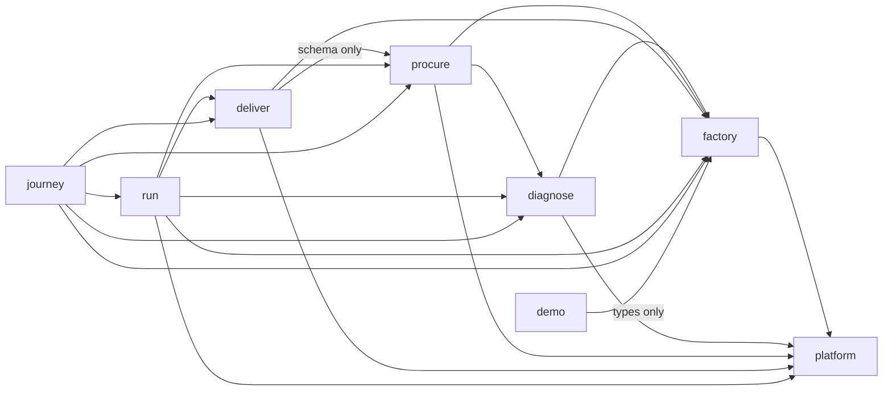

**From `app/` to the modules.** The pages and route files import from every module, as HLD 3.4 says. `app/` files that import a module's `src/` files, and the files imported:

| Module | Files in `app/` that import it | Files imported |
| --- | --- | --- |
| platform | 34 | `modules/platform/src/api/companies.ts`, `modules/platform/src/api/health.ts`, `modules/platform/src/api/session.ts`, `modules/platform/src/db/companies.ts`, `modules/platform/src/env.ts`, `modules/platform/src/identity/resolve.ts`, `modules/platform/src/identity/scope.ts` |
| factory | 4 | `modules/factory/src/api/factory.ts`, `modules/factory/src/db/revisions.ts`, `modules/factory/src/progress.ts`, `modules/factory/src/questionnaire.ts` |
| diagnose | 7 | `modules/diagnose/src/api/diagnose.ts`, `modules/diagnose/src/db/assessments.ts`, `modules/diagnose/src/engine.ts`, `modules/diagnose/src/library.ts`, `modules/diagnose/src/progress.ts` |
| procure | 12 | `modules/procure/src/api/providers.ts`, `modules/procure/src/api/requirements.ts`, `modules/procure/src/clusters.ts`, `modules/procure/src/db/providers.ts`, `modules/procure/src/view.ts` |
| deliver | 8 | `modules/deliver/src/api/engagements.ts`, `modules/deliver/src/db/engagements.ts`, `modules/deliver/src/state.ts`, `modules/deliver/src/summary.ts` |
| run | 2 | `modules/run/src/api/outcomes.ts`, `modules/run/src/state.ts`, `modules/run/src/view.ts` |
| journey | 3 | `modules/journey/src/facts.ts`, `modules/journey/src/progress.ts` |
| demo | 1 | `modules/demo/src/cast.ts`, `modules/demo/src/script.ts` |

The Worker reaches 15 of the 17 files in `modules/platform/src/`: not `modules/platform/src/db/migrate.ts` and not `modules/platform/src/db/schema.ts`. No module's schema file is reachable from `app/` or `worker/`, so the declarations are used only by `drizzle-kit` (`drizzle.config.ts` reads the schema file of every module by a glob). Of the other modules' `src/` files the Worker does not reach `modules/demo/src/client.ts`, `modules/demo/src/identities.ts`, `modules/demo/src/seed.ts`, `modules/hosting/src/gate.ts`, `modules/hosting/src/gateway.ts` or any file of `modules/docs/src/`. These were computed by following the same imports from every file under `app/` and `worker/`.

**From `worker/` and `scripts/` to the modules.**

| Importing file | File imported |
| --- | --- |
| `worker/index.ts` | `modules/platform/src/api/security-headers.ts` |
| `scripts/check-test-docs.mjs` | `modules/docs/src/brd.ts` |
| `scripts/check-test-docs.mjs` | `modules/docs/src/testdocs.ts` |
| `scripts/check-traceability.mjs` | `modules/docs/src/brd.ts` |
| `scripts/check-traceability.mjs` | `modules/docs/src/fsd.ts` |
| `scripts/check-traceability.mjs` | `modules/docs/src/ids.ts` |
| `scripts/local-db.mjs` | `modules/platform/src/db/migrate.ts` |
| `scripts/serve.mjs` | `modules/hosting/src/gateway.ts` |
| `scripts/serve.mjs` | `modules/hosting/src/gate.ts` |
| `scripts/serve.mjs` | `modules/platform/src/db/migrate.ts` |

`scripts/serve.mjs` also loads `modules/demo/src/seed.ts` through the computed `import()` described above.

**From a module's `tests/` to other modules.** Tests import freely, because they drive the other modules' handlers and use the platform's test kit. The table groups the imports by the importing module and by what is imported. The count is the number of test files that import something from that group.

| Tests of | Import from | Test files | Files imported |
| --- | --- | --- | --- |
| `modules/deliver/tests/` | `modules/diagnose/src/` | 1 | `modules/diagnose/src/api/diagnose.ts`, `modules/diagnose/src/engine.ts`, `modules/diagnose/src/library.ts` |
| `modules/deliver/tests/` | `modules/platform/src/` | 1 | `modules/platform/src/api/session.ts`, `modules/platform/src/env.ts` |
| `modules/deliver/tests/` | `modules/platform/tests/` | 4 | `modules/platform/tests/support/browser.ts`, `modules/platform/tests/support/d1.ts`, `modules/platform/tests/support/sql-rules.ts`, `modules/platform/tests/support/ui.ts`, `modules/platform/tests/support/worker.ts` |
| `modules/deliver/tests/` | `modules/procure/src/` | 1 | `modules/procure/src/api/providers.ts`, `modules/procure/src/api/requirements.ts` |
| `modules/demo/tests/` | `modules/diagnose/src/` | 1 | `modules/diagnose/src/engine.ts`, `modules/diagnose/src/library.ts` |
| `modules/demo/tests/` | `modules/factory/src/` | 1 | `modules/factory/src/questionnaire.ts` |
| `modules/demo/tests/` | `modules/hosting/tests/` | 2 | `modules/hosting/tests/support/launcher.ts` |
| `modules/demo/tests/` | `modules/platform/tests/` | 1 | `modules/platform/tests/support/browser.ts`, `modules/platform/tests/support/ui.ts` |
| `modules/demo/tests/` | `modules/procure/src/` | 2 | `modules/procure/src/clusters.ts`, `modules/procure/src/pool.ts` |
| `modules/diagnose/tests/` | `modules/factory/src/` | 3 | `modules/factory/src/api/factory.ts`, `modules/factory/src/questionnaire.ts` |
| `modules/diagnose/tests/` | `modules/journey/src/` | 1 | `modules/journey/src/progress.ts` |
| `modules/diagnose/tests/` | `modules/platform/src/` | 1 | `modules/platform/src/api/health.ts`, `modules/platform/src/api/session.ts`, `modules/platform/src/env.ts` |
| `modules/diagnose/tests/` | `modules/platform/tests/` | 5 | `modules/platform/tests/support/browser.ts`, `modules/platform/tests/support/d1.ts`, `modules/platform/tests/support/sql-rules.ts`, `modules/platform/tests/support/ui.ts`, `modules/platform/tests/support/worker.ts` |
| `modules/docs/tests/` | `modules/deliver/src/` | 1 | `modules/deliver/src/state.ts` |
| `modules/docs/tests/` | `modules/diagnose/src/` | 1 | `modules/diagnose/src/engine.ts`, `modules/diagnose/src/library.ts` |
| `modules/docs/tests/` | `modules/factory/src/` | 1 | `modules/factory/src/questionnaire.ts` |
| `modules/docs/tests/` | `modules/platform/src/` | 2 | `modules/platform/src/db/migrate.ts` |
| `modules/docs/tests/` | `modules/procure/src/` | 1 | `modules/procure/src/clusters.ts` |
| `modules/factory/tests/` | `modules/platform/src/` | 1 | `modules/platform/src/api/companies.ts`, `modules/platform/src/api/health.ts`, `modules/platform/src/api/session.ts`, `modules/platform/src/db/migrate.ts`, `modules/platform/src/env.ts` |
| `modules/factory/tests/` | `modules/platform/tests/` | 4 | `modules/platform/tests/support/browser.ts`, `modules/platform/tests/support/d1.ts`, `modules/platform/tests/support/sql-rules.ts`, `modules/platform/tests/support/ui.ts`, `modules/platform/tests/support/worker.ts` |
| `modules/journey/tests/` | `modules/deliver/src/` | 1 | `modules/deliver/src/api/engagements.ts` |
| `modules/journey/tests/` | `modules/diagnose/src/` | 1 | `modules/diagnose/src/api/diagnose.ts`, `modules/diagnose/src/db/assessments.ts`, `modules/diagnose/src/engine.ts` |
| `modules/journey/tests/` | `modules/factory/src/` | 1 | `modules/factory/src/db/revisions.ts` |
| `modules/journey/tests/` | `modules/platform/src/` | 1 | `modules/platform/src/api/session.ts`, `modules/platform/src/env.ts` |
| `modules/journey/tests/` | `modules/platform/tests/` | 2 | `modules/platform/tests/support/browser.ts`, `modules/platform/tests/support/d1.ts`, `modules/platform/tests/support/ui.ts` |
| `modules/journey/tests/` | `modules/procure/src/` | 1 | `modules/procure/src/api/providers.ts`, `modules/procure/src/api/requirements.ts` |
| `modules/journey/tests/` | `modules/run/src/` | 1 | `modules/run/src/api/outcomes.ts` |
| `modules/procure/tests/` | `modules/diagnose/src/` | 1 | `modules/diagnose/src/api/diagnose.ts`, `modules/diagnose/src/engine.ts` |
| `modules/procure/tests/` | `modules/factory/src/` | 1 | `modules/factory/src/api/factory.ts` |
| `modules/procure/tests/` | `modules/platform/src/` | 1 | `modules/platform/src/api/session.ts`, `modules/platform/src/env.ts` |
| `modules/procure/tests/` | `modules/platform/tests/` | 5 | `modules/platform/tests/support/browser.ts`, `modules/platform/tests/support/d1.ts`, `modules/platform/tests/support/sql-rules.ts`, `modules/platform/tests/support/ui.ts`, `modules/platform/tests/support/worker.ts` |
| `modules/run/tests/` | `modules/deliver/src/` | 1 | `modules/deliver/src/api/engagements.ts` |
| `modules/run/tests/` | `modules/diagnose/src/` | 1 | `modules/diagnose/src/api/diagnose.ts`, `modules/diagnose/src/engine.ts` |
| `modules/run/tests/` | `modules/factory/src/` | 1 | `modules/factory/src/api/factory.ts` |
| `modules/run/tests/` | `modules/platform/src/` | 1 | `modules/platform/src/api/session.ts`, `modules/platform/src/env.ts` |
| `modules/run/tests/` | `modules/platform/tests/` | 4 | `modules/platform/tests/support/browser.ts`, `modules/platform/tests/support/d1.ts`, `modules/platform/tests/support/sql-rules.ts`, `modules/platform/tests/support/ui.ts`, `modules/platform/tests/support/worker.ts` |
| `modules/run/tests/` | `modules/procure/src/` | 1 | `modules/procure/src/api/providers.ts`, `modules/procure/src/api/requirements.ts` |

**Imports that cross the rule or a convention.** In `src/` no import runs against the order of the modules. The following run against a convention or are shared in a way a developer should know about.

| What | File that does it | Note |
| --- | --- | --- |
| A test of an earlier module imports a file of a later module | `modules/diagnose/tests/unit/progress.test.ts` imports `NO_FACTS` and `nextStep` from `modules/journey/src/progress.ts` | The only test import that runs against the order. The file under test belongs to the journey module and the test to the diagnose module |
| A module's test imports another module's test support, other than the platform's | `modules/demo/tests/browser/walk.test.ts` and `modules/demo/tests/smoke/demo.test.ts` import `modules/hosting/tests/support/launcher.ts` | Every other cross-module test import of test support is of `modules/platform/tests/support/` (browser, d1, sql-rules, ui, worker) |
| A module's `src/api/` file imports another module's `src/api/` file | `modules/run/src/api/outcomes.ts` imports `presentAssessment` from `modules/diagnose/src/api/diagnose.ts` | Recorded in HLD 3.5 |
| One module's handlers use a text check that lives in another module's questionnaire file | `modules/diagnose/src/api/diagnose.ts`, `modules/procure/src/api/requirements.ts`, `modules/procure/src/api/providers.ts`, `modules/deliver/src/api/engagements.ts` and `modules/run/src/api/outcomes.ts` import `hasControlCharacters` from `modules/factory/src/questionnaire.ts` | The check is general (it refuses control and direction-changing characters in a note), but it is defined in the factory module, so its owner's change reaches four other modules |
| A module edits a file of another module's claim | See the last column of the table in 2.2: procure in `modules/platform/src/api/authorize.ts`, run in `modules/platform/tests/support/worker.ts`, deliver in `app/procure/page.tsx` and `modules/procure/` | Recorded in the STATUS pages |

**Layers inside a module** (AS BUILT, from the scan above and a second scan of the imports of every file in the `src/` directory of each module). Each stage module (factory, diagnose, procure, deliver, run) has the same shape. A route file under `app/api/` calls a handler in the module's `src/api/`. A handler calls the module's `src/db/` and its rules. The rules are the `.ts` files directly in `src/` (for example `state.ts`, `engine.ts`, `digest.ts`, `pool.ts`, `view.ts`, `progress.ts`, `questionnaire.ts`, `clusters.ts`, `summary.ts`): they take plain values and use no database or request. No file in a `db/` directory imports from an `api/` directory, and no rules file imports from `api/` or `db/`, with one exception: `modules/journey/src/facts.ts` imports data functions of five other modules (9.9). A page in `app/` imports a handler's presenters and constants as well as the data layer (for example `app/procure/page.tsx` imports `presentRequirements`, `MAX_NOTE_LENGTH` and `loadAssessment`), so that the page and the endpoint show the same thing (5.1). The `db/schema.ts` files declare the tables for Drizzle's tools; the SQL that runs is in the other `db/` files (6.3).

#### Found while writing

7 items, listed in [section 9.1](#91-from-section-23-imports-between-modules).

## 3. Cross-cutting design

This section describes what every module relies on. The platform module's own files are described one by one in 4.1; this section describes how the pieces work together.

### 3.1 The request pipeline in code

Every request, for a page or for the API, takes the same first and last steps. The middle differs: an API request ends in a route file and a module handler, and a page request ends in a server component.

An API request:

1. The runtime calls `fetch` on the default export of `worker/index.ts`, with the request, the bindings (`env`) and the execution context.
2. `fetch` awaits `handler.fetch(request, env, ctx)`. `handler` is the default export of `vinext/server/fetch-handler`. That file only re-exports `virtual:vinext-worker-entry`, which the vinext plugin resolves at build time to the handler for the App Router (read in the vinext package, in its file fetch-handler.js). The generated handler was not read. Assumption: it maps the path and method to a file under `app/`, as HLD 3.1 says.
3. The route file under `app/api/` exports `GET` or `POST`, or both. Each takes `(request, context)`, awaits `context.params` when the path has parameters, takes `env` from `import { env } from "cloudflare:workers"`, casts it with `env as unknown as AppEnv`, and calls one handler of a module. The route file holds no logic. Example: `app/api/companies/[id]/route.ts` `GET` calls `handleCompanyRead` in `modules/platform/src/api/companies.ts` with the `id` of the path.
4. The handler makes the checks of 3.2 and 3.3 and reads and validates the body.
5. The data layer of the module runs `db.prepare(...)`, `.bind(...)` and `.first()`, `.all()` or `.run()`, or `db.batch([...])`, against `env.DB` (3.7).
6. The handler returns `json(...)` or `redirect(...)` from `modules/platform/src/api/http.ts`.
7. Back in `worker/index.ts`, `withSecurityHeaders(response)` copies the response and sets four headers (`modules/platform/src/api/security-headers.ts`).

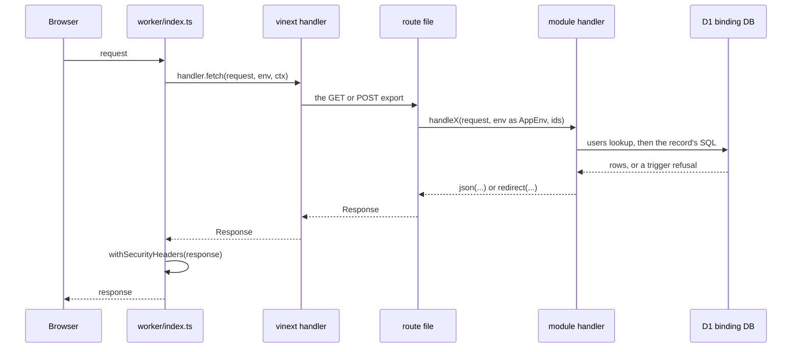

A page request:

1. Steps 1 and 2 are the same.
2. The framework renders `app/layout.tsx` `RootLayout` around the page. `RootLayout` calls `isSyntheticEnvironment(env)` to show the SYNTHETIC banner, and renders `AppBar` (`app/_ui/appbar.tsx`), which calls `resolveIdentityFromCookieHeader((await headers()).get("cookie"), env)` with `headers` from `next/headers`.
3. The page's default export (for example `Home` in `app/page.tsx`) resolves the identity again in the same way, reads through data-layer functions bound to the identity's company, and renders. A page writes nothing (HLD 4.4). A person who is not entitled to the page gets a short page that says so, with status 200, not an error status (FSD 2.2).
4. A form on the page posts to a route file, which is an API request as above, and the answer is a 303 redirect back to the page with a message key (3.2).
5. Step 7 above is the same.

Effects worth knowing:

- A page view that has a session reads the `users` row at least twice, once in `AppBar` and once in the page. Nothing caches an identity across the two (`resolveIdentityFromCookieHeader` runs the query each time).
- Three response headers come from three places. `json` sets `content-type` (`application/json; charset=utf-8`) and `cache-control: no-store`. `redirect` sets `location` and `cache-control: no-store`. `withSecurityHeaders` sets `x-content-type-options`, `x-frame-options`, `referrer-policy` and `content-security-policy`. The cookie header is set only by sign-in and sign-out (`modules/platform/src/api/session.ts`). No `access-control-` header is set anywhere in `app/`, `worker/` or `modules/`; a search for it found none (also API-REFERENCE 2.9).
- `worker/index.ts` has no `try` or `catch`. If `handler.fetch` throws, the exception leaves `fetch` and `withSecurityHeaders` does not run. What the framework answers then was not read (also API-REFERENCE 2.10). Not determined.
- Static files under `/_next/static/` are served by the assets layer and do not pass through the Worker, so they carry none of the four headers (already recorded in HLD 12, item 6).
- The Worker makes no outbound call. A search for `fetch(` in `app/`, `worker/` and the modules' `src/` finds the call to `handler.fetch` in `worker/index.ts` and two calls in `modules/demo/src/client.ts`, which runs in the demonstration launcher's Node process (HLD 1.2).

### 3.2 Handlers, responses and errors

A handler is an exported async function with the form `handleX(request: Request, env: AppEnv, ...ids: string[]): Promise<Response>`. It takes `env` as a parameter and does not import it, so a test can call it with a database from Miniflare and a hand-made `env` (`createTestEnvironment` in `modules/platform/tests/support/d1.ts`). The shared helpers are in `modules/platform/src/api/`.

| Function | File | What it does |
| --- | --- | --- |
| `json(status, body, headers)` | `modules/platform/src/api/http.ts` | A JSON response with `content-type` and `cache-control: no-store`. Extra headers are merged last |
| `redirect(location, extra)` | `modules/platform/src/api/http.ts` | A 303 response with no body, `location` and `cache-control: no-store` |
| `drain(request)` | `modules/platform/src/api/http.ts` | Reads the request body to the end with `request.arrayBuffer()` and discards it, so the connection stays usable. It buffers the whole body (already recorded in HLD 12, item 5) |
| `takeBody(request)` | `modules/platform/src/api/body.ts` | Reads the body or answers the refusal. Returns a `Body` or a `Response` |
| `readBody(request, maxCharacters)` | `modules/platform/src/api/body.ts` | Returns a `Body` (`form`, `json` or `empty`) or a `BodyProblem` (`unsupported`, `too_large`, `bad`) |
| `readTextWithin(request, maxCharacters)` | `modules/platform/src/api/body.ts` | Reads the stream in pieces and abandons it once it passes four bytes for each character allowed |
| `problemStatus(problem)` | `modules/platform/src/api/body.ts` | Maps a `BodyProblem` to 415 `unsupported_content_type`, 413 `too_large` or 400 `bad_request` |
| `bodyField(body, name)` | `modules/platform/src/api/body.ts` | The value of a field of a form or a JSON object, or `undefined` |
| `authorizeCompanyRead`, `authorizeCompanyWrite`, `authorizeSignedIn`, `authorizeOperator` | `modules/platform/src/api/authorize.ts` | The checks before any work. Each returns what the handler needs or the refusal `Response` |

The order of the checks for a change under a company, as `authorizeCompanyWrite` and then the handler make them:

1. `isCrossSite(request)`. If another website sent the request: `drain`, then 403 `cross_site_refused`. Nothing is audited.
2. `env.DB` is bound. If not: `drain`, then 503 `storage_unavailable`.
3. `resolveIdentity(request, env)`. If there is none: `drain`, then 401 `not_signed_in`. Nothing is audited.
4. `canReadCompany(identity, requestedId)`. If the company is not the person's own: `drain`, `refuse` writes the audit row, then 404 `not_found`.
5. `canWriteOwnCompany(identity, requestedId)`. If the person is not the owner: `drain`, `refuse` writes the audit row, then 403 `forbidden`.
6. `takeBody(request)`. An unreadable body, or JSON that is not an object, is 400 `bad_request`. A content type that is neither a form nor JSON is 415 `unsupported_content_type` (and the body is drained). A body over the bound is 413 `too_large`.
7. The handler validates the fields. A failure is 400 `invalid` with `fields` for a program, or a 303 to the page with `?problem=` for a form.
8. The data layer is called. A rule the database or the conditional insert refuses is 409 with a typed reason, or 404 `not_found` for a missing parent, or a 303 with `?problem=`.
9. On success, 201 (something new) or 200 (an existing record returned) with JSON, or a 303 to the page with a key such as `?saved=` or `?made=`. The audit row was written in the same batch as the record (3.4).

A read runs steps 2, 3 and 4 only. `authorizeOperator` runs step 1 for a change only, then steps 2 and 3, then refuses anyone whose role is not `operator` or who has a company (403 `forbidden`, audited with `requested` set to `operator`), then the body steps. The same order is in [the API reference](API-REFERENCE.md) 2.4 and in the functional specification (FSD 2.2).

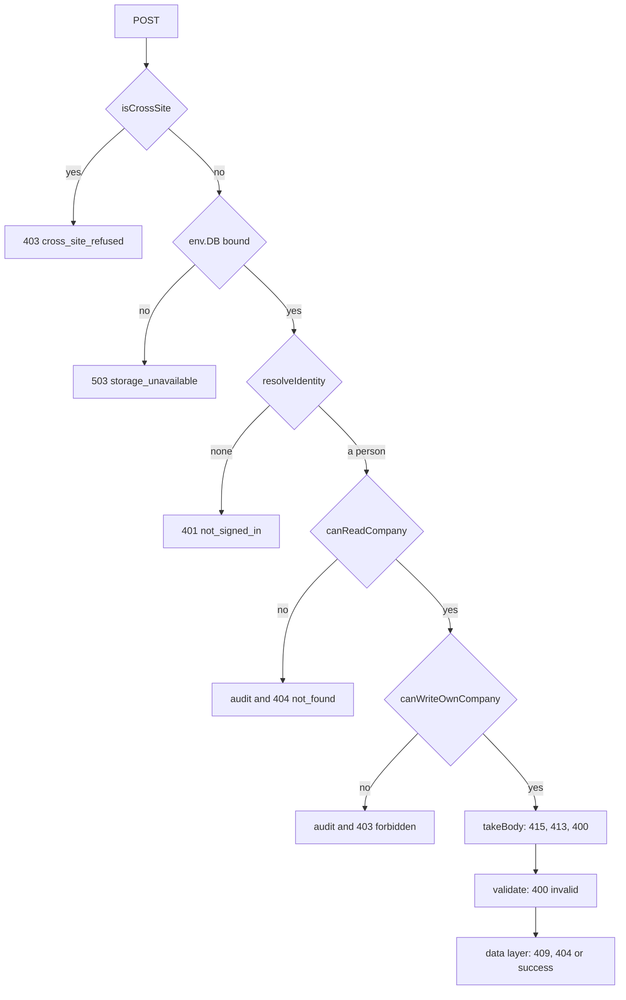

**Statuses and codes the platform answers with.** The full list, with the other modules' 409 reasons, is in [the API reference](API-REFERENCE.md) section 4.

| Status | Body | Answered by | Audited |
| --- | --- | --- | --- |
| 200 | The company record (`handleCompanyRead`), the person's identity (`handleSessionRead`), `{"signedIn":true}` or `{"signedOut":true}` (`handleSessionWrite`), or the health object (`handleHealth`) | `handleCompanyRead`, `handleSessionRead`, `handleSessionWrite`, `handleHealth` | No |
| 303 | None, with `location` | `redirect`, used by `handleSessionWrite` (to `/` or `/sign-in?refused=1`) and by every module's form path | No |
| 400 | `{"error":"bad_request"}` | `takeBody`, and the sign-in reader in `handleSessionWrite` | No |
| 401 | `{"error":"not_signed_in"}` | `authorizeCompanyRead`, `authorizeCompanyWrite`, `authorizeSignedIn`, `authorizeOperator`, `handleSessionRead`, `handleCompanyRead` | No |
| 401 | `{"error":"unknown_user"}` | `handleSessionWrite` | No (one console line, no address) |
| 403 | `{"error":"cross_site_refused"}` | `authorizeCompanyWrite`, `authorizeOperator` (changes only), `handleSessionWrite` | No |
| 403 | `{"error":"forbidden"}` | `authorizeCompanyWrite` (not the owner), `authorizeOperator` | Yes |
| 404 | `{"error":"not_found"}` | `authorizeCompanyRead`, `authorizeCompanyWrite`, `handleCompanyRead` | Yes, when the company is not the person's own. Not when the person has a company and the row is missing |
| 413 | `{"error":"too_large"}` | `takeBody` | No |
| 415 | `{"error":"unsupported_content_type"}` | `takeBody`, `handleSessionWrite` | No |
| 503 | `{"error":"storage_unavailable"}` | the four authorize functions in `modules/platform/src/api/authorize.ts`, `handleCompanyRead` | No |
| 503 | `{"error":"sign_in_not_available"}` | `handleSessionWrite` | No |
| 503 | `{"status":"degraded","database":...,"auditGuard":...}` | `handleHealth` | No |

**Form and JSON.** `takeBody` returns a `Body` whose `kind` is `form`, `json` or `empty`. A handler that serves both sets `const form = body.kind === "form"`, and on every outcome after the body is read answers a form with `redirect(...)` to the page that sent it, and a program with `json(...)`. The redirect carries a key in the query: `?saved=`, `?made=` or `?withdrawn=` on success and `?problem=` on a refusal. The keys are looked up on the page in a fixed table with `Object.hasOwn`, and `modules/platform/tests/static/page-lookups.test.ts` fails a page that looks a key up without it. Section 5.3 lists the keys. A refusal made before the handler reads the form's fields is JSON even for a form: the checks in the authorize functions (including the 404 and 403 that come after the person is known), `takeBody` and the sign-in handler answer with `json`. A person at a form whose session ended therefore sees JSON at the address of the operation (already recorded in API-REFERENCE 6, item 8).

**What is not caught.** A handler wraps a data-layer call in `try` only to turn a known trigger message into a typed reason (3.7). Any other error is thrown out of the handler. The route file does not catch it, and neither does `worker/index.ts`.

### 3.3 Identity, session and the scope rule

**The token.** A session is a signed token, `base64url(payload) + "." + base64url(mac)`. The payload is the JSON `{"u": <user id>, "exp": <seconds since 1 January 1970>}` (`SessionClaims`). The mac is HMAC-SHA256 over the payload text, keyed with the session secret. The token holds no company and no role. Both come from the database on every request (`modules/platform/src/identity/resolve.ts`).

| Function | File | What it does |
| --- | --- | --- |
| `signSession(userId, secret, nowSeconds)` | `modules/platform/src/identity/session.ts` | Builds the claims with `exp = nowSeconds + SESSION_SECONDS` (8 hours, 28800 seconds), encodes them and signs the encoded text with Web Crypto |
| `verifySession(token, secret, nowSeconds)` | `modules/platform/src/identity/session.ts` | Returns the claims, or `null` for anything that is not a valid, unexpired token |
| `readCookie(header, name)` | `modules/platform/src/identity/session.ts` | The value of the named cookie. A name that appears twice gives `null` |
| `sessionCookie(token)` | `modules/platform/src/identity/session.ts` | `aplyd_session=<token>; HttpOnly; Secure; SameSite=Lax; Path=/; Max-Age=28800` |
| `clearedSessionCookie()` | `modules/platform/src/identity/session.ts` | The same cookie with an empty value and `Max-Age=0` |
| `getSessionSecret(env)` | `modules/platform/src/env.ts` | The secret, or `null` when it is missing, shorter than `MIN_SECRET_BYTES` (32, counted in UTF-8 bytes) or one repeated character |

`verifySession` refuses a token in this order: not exactly two parts; a mac that is not made of the characters A to Z, a to z, 0 to 9, `_` and `-`; a mac whose re-encoding differs from the text (so one token has one valid spelling); a mac that `crypto.subtle.verify` does not accept (a constant-time comparison); a payload that does not decode or parse; a `u` that is not a string or an `exp` that is not a number; an `exp` less than or equal to the time now.

**Resolving an identity.** `resolveIdentityFromCookieHeader(cookieHeader, env)` in `modules/platform/src/identity/resolve.ts`:

1. `getSessionSecret(env)` and `env.DB`. If either is missing, the result is `null`.
2. `readCookie(cookieHeader, SESSION_COOKIE)`. A missing or duplicated cookie gives `null`.
3. `verifySession(token, secret, Math.floor(Date.now() / 1000))`. A `null` gives `null`.
4. One query: `SELECT id, company_id, role, display_name FROM users WHERE id = ?`, bound to `claims.u`. No row gives `null`.
5. The result is an `Identity`: `userId`, `companyId` (a string, or `null` for the operator), `role` and `displayName`.

`resolveIdentity(request, env)` passes `request.headers.get("cookie")`. A page passes the cookie it read with `headers()`. The function does not look at `APLYD_ENV` or at `users.is_synthetic`; only sign-in does (already recorded in API-REFERENCE 6, item 4).

**The scope rule.** It is two pure functions in `modules/platform/src/identity/scope.ts`.

- `canReadCompany(identity, requestedCompanyId)` is true only when the identity exists, its `companyId` is not `null` and not the empty string, and it is strictly equal to the requested id.
- `canWriteOwnCompany(identity, requestedCompanyId)` is `canReadCompany` and `role === "owner"`.

The role is irrelevant to reading. The operator has no company and so reads none. The company id in a URL is only compared; every query is bound to `identity.companyId`, not to the URL's id (`handleCompanyRead` calls `loadOwnCompany(env.DB, identity)`, which binds `identity.companyId`). The outcomes:

| Person | Reads own company | Reads another company or a missing one | Changes own company | Operator operation |
| --- | --- | --- | --- | --- |
| Not signed in | 401 | 401 | 401 | 401 |
| Owner | Allowed | 404 and an audit row | Allowed | 403 and an audit row |
| Member (a company, a role other than `owner`) | Allowed | 404 and an audit row | 403 and an audit row | 403 and an audit row |
| Operator (role `operator`, no company) | 404 and an audit row, because no company matches | 404 and an audit row | 404 and an audit row | Allowed |
| Role `operator` with a company | Allowed (the role is irrelevant) | 404 and an audit row | 403 and an audit row | 403 and an audit row, because the company is not `null` |

The table is read from `canReadCompany`, `canWriteOwnCompany` and `authorizeOperator`. `modules/platform/tests/unit/scope.test.ts` pins the functions, and `modules/platform/tests/integration/platform-api.test.ts` pins the operator and cross-company cases through the handlers (both run for this document, section 4.1).

**The cross-site check.** `isCrossSite(request)` in `modules/platform/src/identity/cross-site.ts` is false for GET, HEAD and OPTIONS. For any other method, in any letter case: with an `Origin` header it is true when `new URL(origin).origin` differs from `new URL(request.url).origin`, or when either does not parse (the text `null` does not parse); with no `Origin` it is true only when `Sec-Fetch-Site` is `cross-site`. A request with neither header is allowed (a limit recorded in the platform STATUS page, limit 7, and [FND-006](../FINDINGS.md)). It runs before the person is looked up, and the cookie's `SameSite=Lax` is the first defence.

**The header-read rule.** Application code may read request headers only through `.get("<name>")` with a literal name from an allow-list of five: `cookie`, `origin`, `sec-fetch-site`, `content-type` and `content-length`. `headerReadProblems` in `modules/platform/tests/support/header-rule.ts` walks the syntax tree and reports every other use of a `headers` value (an alias, a spread, a loop, `Array.from`, destructuring, a computed name, `has`, `forEach`, `headers()` from `next/headers` used other than as `.get`). `modules/platform/tests/static/source-rules.test.ts` applies it to every tracked or untracked file under `app/`, `worker/` and each module's `src/`, except the three files in `HOST_PROCESS_FILES` (`modules/hosting/src/gate.ts`, `modules/hosting/src/gateway.ts`, `modules/demo/src/client.ts`), which run in a Node process beside the Worker. A second test follows every relative import from `app/` and `worker/` and fails if the Worker can reach one of those three files. The rule is a tripwire, not a proof ([FND-004](../FINDINGS.md); platform STATUS limit 4). The reads found in the code are:

| Header | Read in |
| --- | --- |
| `cookie` | `resolveIdentity` in `modules/platform/src/identity/resolve.ts`; `AppBar` and seven pages through `(await headers()).get("cookie")` |
| `origin`, `sec-fetch-site` | `isCrossSite` |
| `content-type` | `readBody` in `modules/platform/src/api/body.ts`, `readBody` in `modules/platform/src/api/session.ts`, `readSubmission` in `modules/factory/src/api/factory.ts` |
| `content-length` | `readTextWithin` in `modules/platform/src/api/body.ts` |

**Sign-in and sign-out.** Sign-in is synthetic. It works only where `APLYD_ENV` is `local`, `synthetic` or `test`, with a database and a usable secret, for a user whose `is_synthetic` is 1, and it has no password ([FND-001](../FINDINGS.md)). The steps are in 4.1. A signed token cannot be revoked before it expires: sign-out only clears the cookie in that browser ([FND-003](../FINDINGS.md); platform STATUS limit 3). The cookie is named `aplyd_session`, not with a `__Host-` prefix ([FND-010](../FINDINGS.md)).

### 3.4 Audit

**The table.** `audit_events` holds `id` (integer, autoincrement), `at`, `event`, `user_id`, `company_id` and `detail` (text, default `{}`). It is declared as `auditEvents` in `modules/platform/src/db/schema.ts` and created in `drizzle/0000_init.sql`. Three triggers make it append-only: `audit_events_no_update` and `audit_events_no_delete` (`drizzle/0001_audit_append_only.sql`) and `audit_events_no_replace` (`drizzle/0002_audit_no_replace.sql`), which refuses an insert that reuses an existing `id`. `user_id` and `company_id` have no foreign key. Nothing inside SQLite stops `DROP TRIGGER`, `DROP TABLE` or `ALTER TABLE`, and there is no hash chain ([FND-009](../FINDINGS.md); the comment in `drizzle/0002_audit_no_replace.sql`). Columns and limits are in [the data dictionary](DATA-DICTIONARY.md).

**Two writers.** Both live in `modules/platform/src/db/audit.ts`. Both stamp `at` with `new Date().toISOString()` in the Worker, take `user_id` and `company_id` from `fields` (default `null`) and write `detail` as `JSON.stringify(fields.detail ?? {})`. The detail is a flat object of strings, numbers and booleans.

| Function | Returns | Use it for |
| --- | --- | --- |
| `recordAudit(db, event, fields)` | A promise. It runs a plain `INSERT ... VALUES` | An event that stands alone: a refusal, a sign-in, a sign-out |
| `auditIfChanged(db, event, fields)` | A prepared statement for `db.batch`: `INSERT ... SELECT ... WHERE changes() > 0` | The audit row of a record written in the same batch. It is written only when the statement before it in the batch changed a row |

**Where each is called.**

| Writer | Callers |
| --- | --- |
| `recordAudit` | `refuse` in `modules/platform/src/api/authorize.ts`; `handleCompanyRead` in `modules/platform/src/api/companies.ts`; `handleSessionWrite` in `modules/platform/src/api/session.ts`; `refuse` in `modules/factory/src/api/factory.ts` (the factory's own copy) |
| `auditIfChanged` | `modules/factory/src/db/revisions.ts`, `modules/diagnose/src/db/assessments.ts`, `modules/procure/src/db/requirements.ts`, `modules/procure/src/db/providers.ts`, `modules/deliver/src/db/engagements.ts`, `modules/run/src/db/outcomes.ts` |

**Events the platform writes.** The events of the record writes are listed in the functional specification (FSD 9.5) and by module in sections 4.2 to 4.6. Two names are built from a variable: `engagement.${kind}` in `modules/deliver/src/db/engagements.ts` and `outcome.${shape.kind}` in `modules/run/src/db/outcomes.ts`.

| Event | Written by | When | `detail` |
| --- | --- | --- | --- |
| `session.created` | `handleSessionWrite` | A sign-in succeeds. `user_id` and `company_id` are the signed-in user's | `{}` |
| `session.ended` | `handleSessionWrite` | A sign-out arrives with a session that identifies a person | `{}` |
| `company.read.denied` | `handleCompanyRead` | The id in the path is not the person's own company | `requested`, cut to 64 characters |
| `factory.read.denied`, `factory.write.denied` | the factory's own `refuse` | The same, for the factory endpoints | `requested`, cut to 64 characters |
| `assessment.`, `requirement.`, `engagement.` and `outcome.` with `read.denied` or `write.denied` | `refuse` in `modules/platform/src/api/authorize.ts`, through `authorizeCompanyRead` and `authorizeCompanyWrite` | The company is not the person's own (404), or a member tries a change (403) | `requested`, cut to 64 characters |
| `operator.read.denied`, `operator.write.denied` | `refuse` through `authorizeOperator` | The person is not the operator, or has a company (403) | `requested` set to `operator` |

A refusal row carries the signed-in person's own `user_id` and `company_id`, not the requested company's.

**What is not audited.** A request with no valid session; a sign-in refused for an unknown user (the handler writes one console line, `{"event":"session.refused"}`, and no address, because anyone can send the request and the log cannot be pruned); a cross-site refusal; a 503; a successful read; a page view. The event names are free text in the code: no list or type checks them. `modules/docs/tests/static/dictionary-sync.test.ts` compares the data dictionary's list of audit events with the code.

**Reading it.** No code in `app/`, `worker/`, the modules' `src/` or `scripts/` reads `audit_events` (a search for the table name found it only in `modules/platform/src/db/`). There is no audit viewer (BR-OPS-06 is not built, FSD 9.5). An authenticated person can write many rows by repeating denied requests or sign-outs, and the table cannot be pruned ([FND-007](../FINDINGS.md), [FND-019](../FINDINGS.md); platform STATUS limit 8).

### 3.5 Identifiers, clocks, money, time and JSON

**Identifiers.**

| Kind | Where | How made |
| --- | --- | --- |
| Text id for a record that is created by an owner or the operator | `assessments.id`, `requirements.id`, `providers.id`, `engagements.id`, `milestones.id` | `crypto.randomUUID()`, called in the data layer: `modules/diagnose/src/db/assessments.ts`, `modules/procure/src/db/requirements.ts`, `modules/procure/src/db/providers.ts`, and twice in `modules/deliver/src/db/engagements.ts` |
| Text id for a company or a user | `companies.id`, `users.id` | Written in a seed file: `modules/platform/db/seed-synthetic.sql`, and for the demonstration `modules/demo/src/identities.ts` |
| Integer, autoincrement | The event and log tables: `audit_events.id`, `factory_revisions.id`, `assessment_events.id`, `requirement_events.id`, `provider_services.id`, `provider_events.id`, `engagement_events.id`, `outcome_events.id`, and `listing_terms.version` | Assigned by SQLite. A caller never supplies it |
| A number that counts per company | `factory_revisions.revision_no` | `MAX(revision_no) + 1` computed by the caller and checked in the same statement (`appendRevision` in `modules/factory/src/db/revisions.ts`) |

A text id is not a secret and gives no access: every read is bound to the person's company (3.7). The `id` of a company in a URL is compared with the person's own and never used to find a row (3.3).

**Clocks.**

- The Worker's clock is the only clock. Every timestamp is `new Date().toISOString()`, made in TypeScript and passed to SQL as a bound parameter. No migration uses `datetime('now')`, `CURRENT_TIMESTAMP` or `strftime`; a search of `drizzle/` for them found none.
- A session's `iat` is not stored. `exp` is `Math.floor(Date.now() / 1000) + SESSION_SECONDS`, in whole seconds (`handleSessionWrite`, `signSession`), and is compared with the same expression at each request (`resolveIdentityFromCookieHeader`).
- Only the run module's handlers take a clock as a parameter: `handleOutcomeRead` and `handleOutcomeRecord` in `modules/run/src/api/outcomes.ts` take `now: () => Date`, defaulting to `new Date()`. The pages call `new Date()` themselves.
- In tests, a date is reached in one of three ways. An integration test of the run module passes a clock to `handleOutcomeRecord` or `handleOutcomeRead` (`now: () => Date`), so it can stand on either side of a review date. The pure functions `nextStep`, `stageStatuses`, `stageLine` (`modules/journey/src/progress.ts`) and `reviewSlots` (`modules/run/src/state.ts`) take `now` as an argument, and `dueAt` takes the acceptance time, so a unit test fixes the instant. A smoke or browser test runs the built application with the real clock and adds past-dated delivered and accepted rows to the Worker's own throwaway database with `exec` of `startBuiltApp` (`modules/run/tests/browser/run.test.ts`); the triggers still apply. `seedDemo` takes an optional `now` for the milestone dates (`modules/demo/src/seed.ts`). A data layer that stamps with `new Date().toISOString()` has no argument for a clock.
- The database compares times in one place: the trigger `outcome_events_review_is_due` (`drizzle/0013_run_guards.sql`) uses `julianday`, while `reviewSlots` in `modules/run/src/state.ts` uses milliseconds (already recorded in FSD 12.1, item 20).

**Times and dates in text.** A timestamp is an ISO 8601 string in UTC, for example `2026-10-04T00:00:00.000Z`, as the seed writes it. A page shows a date as the first ten characters (`createdAt.slice(0, 10)` in `app/page.tsx`). A milestone's due date is a calendar date, `YYYY-MM-DD`, in `milestones.due_on`: the data layer checks it with `isCalendarDate` in `modules/deliver/src/state.ts` and the trigger `milestones_due_is_a_date` checks it again. A review is due 30, 90 and 180 days after the first acceptance (`REVIEW_DAYS` in `modules/run/src/state.ts`).

**Money.** Money is a whole number of rupees in an integer column. The code has no fractions and no paise. Four columns carry money, and a static test in each of the procure and deliver modules pins the list (`modules/procure/tests/static/rules.test.ts`, `modules/deliver/tests/static/rules.test.ts`).

| Column | What it is | Held to a whole number by |
| --- | --- | --- |
| `listing_terms.fee_inr` | The one flat listing fee. A placeholder; the operator sees it, an owner never does | The trigger `listing_terms_fee_is_whole` |
| `provider_events.fee_inr` | The copy of the fee in force when a provider is listed | The trigger `provider_events_list_carries_the_fee_in_force` |
| `milestones.agreed_inr` | The owner's own record of an agreed price | The trigger `milestones_numbers_are_whole` |
| `engagement_events.amount_inr` | The owner's own record of a payment made outside the platform | The trigger `engagement_events_amount_is_whole` |

APLYD's earnings never depend on the provider an owner chooses (D-03). The two fee columns are the only ones that can carry an earning, and the fee is copied by the database from the terms in force, not supplied by a caller (section 4.4). A page writes an amount as `₹${n.toLocaleString("en-IN")}` (`app/operator/page.tsx`, `app/procure/page.tsx`, `app/deliver/page.tsx`, `app/diagnose/page.tsx`).

**Limits and versions that are constants** (AS BUILT, values read in the files named). The three limits on money are sanity bounds, and none is a price or a proposal. They are also held in the database in different ways: `milestones_agreed` (`drizzle/0010_deliver_tables.sql`) and the shape check of `engagement_events` hold an amount to 1 to 100000000; `listing_terms_fee_positive` holds the fee above zero and nothing holds it below `MAX_FEE_INR`, so the handler `handleTermsSet` alone enforces that upper limit; `outcome_events_value` holds a measured value to 0 to 1000000000.

| Constant | Value | Defined in |
| --- | --- | --- |
| `MAX_BODY_CHARACTERS` | 65536 (`64 * 1024`) | `modules/platform/src/api/body.ts`, and a copy in `modules/factory/src/api/factory.ts` |
| `SESSION_SECONDS` | 28800 (eight hours) | `modules/platform/src/identity/session.ts` |
| `MIN_SECRET_BYTES` | 32 | `modules/platform/src/env.ts`, and a copy in `modules/hosting/src/gate.ts` |
| `MAX_PROXY_BODY_BYTES` | 262144 | `modules/hosting/src/gate.ts` |
| `MIN_PASSWORD_CHARACTERS` | 12 | `modules/hosting/src/gate.ts` |
| `MAX_AMOUNT_INR` | 100000000 (`readAmount` takes a JSON number or 1 to 9 digits) | `modules/deliver/src/state.ts` |
| `MAX_FEE_INR` | 10000000 (`handleTermsSet` takes a JSON number or 1 to 8 digits) | `modules/procure/src/api/providers.ts` |
| `MAX_VALUE` | 1000000000 (a JSON number or 1 to 10 digits) | `modules/run/src/state.ts` |
| `MAX_NOTE_LENGTH` | 500 | Six files, one for each of the factory, diagnose, procure (two files), deliver and run modules (9.4) |
| `MAX_SERVICES` | 20 | `modules/procure/src/api/providers.ts` |
| `MAX_MILESTONES`, `MAX_DELIVERIES` | 12, 14 | `modules/deliver/src/state.ts` |
| `MAX_REVISIONS_PER_COMPANY` | 500 | `modules/factory/src/db/revisions.ts` |
| `MAX_ITEMS` | 8 | `modules/diagnose/src/engine.ts` |
| `QUESTIONNAIRE_VERSION`, `ENGINE_VERSION`, `LIBRARY_VERSION` | 1, 1, 1 | `modules/factory/src/questionnaire.ts`, `modules/diagnose/src/engine.ts`, `modules/diagnose/src/library.ts` |
| `AGGREGATE_FLOOR` | 5 | `modules/procure/src/pool.ts` |

**JSON in text columns.** Four columns hold JSON text: `audit_events.detail` (an object, written by `JSON.stringify`), `factory_revisions.answers` (an object; the trigger `factory_revisions_answers_are_an_object` refuses anything else), `assessments.result` and `requirements.spec` (each held to valid JSON by a CHECK constraint in `drizzle/0005_diagnose_assessments.sql` and `drizzle/0008_procure_tables.sql`). The code writes with `JSON.stringify` and reads with `JSON.parse(...) as T`, a cast with no run-time check of the shape (`modules/factory/src/db/revisions.ts`, `modules/diagnose/src/db/assessments.ts`, `modules/procure/src/db/requirements.ts`). The SQL JSON functions are used in four places: `json_valid` in the two CHECK constraints above, `json_each`, `json_extract` and `json_valid` inside triggers (`drizzle/0006_diagnose_guards.sql`, `drizzle/0007_diagnose_review_fixes.sql`, `drizzle/0014_review_fixes.sql`), and `json_array_length` in one read, the assessment list in `modules/diagnose/src/db/assessments.ts`.

### 3.6 Environment and bindings

The bindings and variables below were found by searching the code for reads of `env.<NAME>` and `process.env`. Names only; no value is given anywhere in this document.

| Name | Kind | Read in | Effect, and what happens when it is absent |
| --- | --- | --- | --- |
| `DB` | D1 binding | `AppEnv` in `modules/platform/src/env.ts`; every handler and data layer | Declared optional. Absent: the authorize functions and `handleCompanyRead` answer 503 `storage_unavailable`, `resolveIdentityFromCookieHeader` returns `null` (so `GET /api/session` answers 401), and `handleHealth` reports `database` as `unavailable`. Bound in `vite.config.ts` for the local build, with a placeholder database id; hosted environments are configured outside that file (a comment there says so) |
| `APLYD_ENV` | Variable | `isSyntheticEnvironment` in `modules/platform/src/env.ts`; `app/layout.tsx` (the banner); `app/sign-in/page.tsx` | Must be exactly `local`, `synthetic` or `test` for sign-in to work. Absent: no sign-in, no banner. Set to `local` by `vite.config.ts` only when the command is `serve`; a build carries no environment name, and `modules/platform/tests/smoke/built-app.test.ts` checks that. `scripts/serve.mjs` passes the launcher's value to the Worker |
| `SESSION_SECRET` | Secret | `getSessionSecret` in `modules/platform/src/env.ts` | Absent, shorter than 32 bytes or one repeated character: nobody can sign in and every cookie is refused. `modules/hosting/src/gate.ts` repeats the rule so a bad value stops the launch |
| `APLYD_DEMO` | Variable | `app/demo/page.tsx` (through a cast, because `AppEnv` does not declare it); `parseConfig` in `modules/hosting/src/gate.ts` | The page `/demo` answers not found unless it is exactly `true`. `scripts/serve.mjs` adds it to the Worker's bindings only when the demonstration is switched on |

Host variables are read by the launcher, not the Worker: `PORT`, `APLYD_UPSTREAM_PORT`, `DEMO_USER`, `DEMO_PASSWORD`, `DEMO_ACCESS` and `APLYD_PUBLIC_HOSTS`, all in `parseConfig` in `modules/hosting/src/gate.ts`, and `APLYD_ENV`, `SESSION_SECRET` and `APLYD_DEMO` again. Section 6.5 lists them. The browser tests read `APLYD_CHROMIUM_PATH` (`CHROMIUM_ENV` in `modules/platform/tests/support/browser.ts`).

How a value reaches code:

1. The Worker's `fetch` receives `env` as `unknown` and passes it to vinext unchanged (`worker/index.ts`).
2. A route file or page imports `env` from `cloudflare:workers` and casts it to `AppEnv` (for example `app/api/session/route.ts`, `app/layout.tsx`).
3. A handler receives it as a parameter. A test passes a hand-made object, so no test needs the module `cloudflare:workers`.
4. `cloudflare-env.d.ts` declares `DB`, `APLYD_ENV` and `SESSION_SECRET` on `Cloudflare.Env`, all optional. It does not declare `APLYD_DEMO`.

`.env.example` holds the names `APLYD_ENV` and `SESSION_SECRET` with no values, and a static test fails if any line of it has a value (`modules/platform/tests/static/source-rules.test.ts`, "the environment template holds names only"). Local values go in `.dev.vars`, which `.gitignore` excludes.

### 3.7 Database access: reads, batches, the guards that refuse writes

**The interface.** The code uses the D1 binding directly: `db.prepare(sql).bind(...).first<T>()`, `.all<T>()` or `.run()`, and `db.batch([...])`. There is no query builder and no ORM at run time. `drizzle-orm` is imported only in the schema files (`modules/platform/src/db/schema.ts` and the five other modules' `src/db/schema.ts`), which no file the Worker runs imports (2.3); `drizzle-kit` reads them to generate migrations (`drizzle.config.ts`; AD-02). Row types are asserted by a type parameter at each call and mapped by hand to camel-case records, for example `loadOwnCompany` in `modules/platform/src/db/companies.ts`. A renamed column would not fail the type check (AD-02).

**Reads.**

1. A read of a company's rows is bound to `company_id = ?` with the id taken from the identity, never from the URL.
2. A data-layer function takes `db` and the company id as arguments and returns a plain record or `null`.
3. A page and its API route call the same data-layer function (`presentRequirements` is an example), so the two read paths agree (HLD 3.6).
4. The static tests read the SQL text: `problemsWith` in `modules/platform/tests/support/sql-rules.ts` reports a `SELECT` of a table that does not say `company_id = ?`, and any `UPDATE`, `DELETE`, `REPLACE` or `INSERT OR`. It reads string and template literals in the syntax tree, so SQL built at run time is not seen. The factory, diagnose, procure, deliver and run static tests use it or their own copy of it.
5. The platform has two reads that are not bound to a company, by design: the sign-in lookup by email in `handleSessionWrite`, and the pick-list of synthetic users in `app/sign-in/page.tsx` (recorded in HLD 3.5).

**Writes.** The shape is the same in every module. `appendRevision` in `modules/factory/src/db/revisions.ts` is the model, and section 4.2 describes it.

1. The data-layer function builds one conditional statement, `INSERT ... SELECT ... WHERE <precondition>`, with the company, the user and a timestamp bound as parameters.
2. It builds the audit statement with `auditIfChanged`.
3. It runs `db.batch([insert, audit])`. The audit row is written only when the insert changed a row (`WHERE changes() > 0`).
4. It reads `inserted.meta.changes`. If it is 1 the write happened. If it is 0 the precondition did not hold and nothing was written, and the function reads again to say why (a stale revision, an existing record that is returned instead).
5. A trigger that refuses makes `db.batch` throw. The function's `catch` matches `String(error)` against a regular expression for a known message and returns a typed reason (`/needs a confirmed description/` in `createAssessment`, `/engaged requirement cannot be withdrawn/` in `withdrawRequirement`, `/the most revisions it may have/` in `appendRevision`). An error that matches nothing is thrown.

Two things follow. A reworded message in a new migration turns a typed refusal into a thrown error (HLD 5.4 records this). And the audit row depends on its place in the batch: `auditIfChanged` tests the statement immediately before it, so a statement added between a record and its audit row changes what the audit depends on (`createProvider` in `modules/procure/src/db/providers.ts` puts its audit row after the last service insert, not after the provider insert). Assumption, taken from HLD AD-06 and not checked against D1: a `db.batch` runs as one transaction, so a record and its audit row succeed or fail together.

**Migrations and seeds.** Only tools apply them.

1. `migrationFiles()` in `modules/platform/src/db/migrate.ts` reads `drizzle/meta/_journal.json`, sorts the entries by `idx` and lists the files. It throws if a `.sql` file is not in the journal or a journal entry has no file.
2. `migrationStatements()` splits each file on the text `--> statement-breakpoint`.
3. `seedFiles()` lists `db/seed-synthetic.sql` in every module that has one, the platform's first. `seedStatements()` drops comment lines and splits on a semicolon at the end of a line, so no seed text may contain one inside a statement.
4. `applyMigrations(db, { seed })` runs each statement with `db.prepare(sql).run()`, one by one, not in a transaction.
5. It is called by the integration tests (`createTestEnvironment` in `modules/platform/tests/support/d1.ts`). `migrationStatements` and `seedStatements` are called by `scripts/serve.mjs` and `modules/platform/tests/support/worker.ts`; `scripts/local-db.mjs` calls `modules/platform/src/db/migrate.ts` too. The Worker never imports that file, because it reads the file system.

**The guards.** The database holds 91 triggers: 42 that make 14 tables append-only (`<table>_no_update`, `<table>_no_delete`, `<table>_no_replace`) and 49 that enforce a rule about what may be inserted. The migrations hold 93 `CREATE TRIGGER` statements; `drizzle/0014_review_fixes.sql` drops two and creates them again, so 91 stand. The two tables that are not append-only are `companies` and `users`.

| Name in `modules/platform/src/db/guards.ts` | What it is |
| --- | --- |
| `APPEND_ONLY_TABLES` | For each of the 14 tables, its three trigger names |
| `RULE_TRIGGERS` | For each of 12 tables, the names of its rule triggers (49 in all) |
| `ALL_APPEND_ONLY_TRIGGERS` | The 42 names, flat |
| `ALL_REQUIRED_TRIGGERS` | All 91 names, flat |
| `REQUIRED_TRIGGERS_BY_TABLE` | All 91 as `{ table, name }`, so a trigger of the right name on the wrong table is not taken for the real one |

Three things use the lists.

- `handleHealth` reads SQLite's own catalogue of schema objects for the triggers and answers 200 `ok` only when every required trigger exists by name and table. It does not read a trigger's body, so a trigger with the right name and a weaker body would pass (the file says so). The JSON field is still called `auditGuard`.
- `modules/platform/tests/unit/guards.test.ts` compares the lists with the triggers the migrations create, in both directions, and counts a trigger that a later migration drops and creates again once.
- `modules/platform/tests/integration/append-only-keys.test.ts` checks that every unique key of every append-only table is looked at by a BEFORE INSERT trigger, so that `INSERT OR REPLACE` cannot delete a row through the key.

A change to a trigger is a new migration; an applied migration is not edited (AGENTS.md). A new table or trigger must be added to the lists in `modules/platform/src/db/guards.ts`, or `modules/platform/tests/unit/guards.test.ts` fails and `handleHealth` does not know to look for it (section 8).

#### Found while writing

5 items, listed in [section 9.2](#92-from-section-37-database-access-reads-batches-the-guards-that-refuse-writes).

## 4. Modules

Each module is described in the same order: what it is for; a table of its files, with what each holds and every name it exports; the data it reads and writes; its main flows as numbered steps that name the function; the refusals it makes and the messages that go with them; what must not be broken, with the test that holds it; and `#### Found while writing`. The modules follow the chain of imports measured in 2.3, which is also the order of the journey: 4.1 the platform, which every other module imports; 4.2 Describe (`factory`); 4.3 Decide (`diagnose`); 4.4 Choose (`procure`); 4.5 Deliver (`deliver`); 4.6 Measure (`run`); 4.7 the journey (`journey`); 4.8 the demonstration (`demo`); and 4.9 the hosting module, the scripts and the documentation readers. The tables, columns and triggers of a module are in [the data dictionary](DATA-DICTIONARY.md), its operations are in [the API reference](API-REFERENCE.md), and its screens are in [the functional specification](../fsd/FSD.md). This section adds what those do not say: which function does what, in which order, and what a change must not break.

### 4.1 The platform module

**Purpose.** `modules/platform/` holds what every request needs before a module does any work of its own: who the person is, which company's records the person may read or change, whether another website sent the request, how a body is read and an answer is made, which headers every answer carries, how an audit row is written, and which triggers the health check demands. It owns three tables: `companies`, `users` and `audit_events`. It owns the synthetic seed for the first two, the lists of required triggers, and the code that applies the migrations in tests and local scripts. It adds no product function of its own (`modules/platform/STATUS.md`). Its pages are `/` and `/sign-in` (HLD 3.3); they are in `app/` and are described in section 5. Its routes are `GET /api/health` ([API-01](API-REFERENCE.md)), `GET` and `POST /api/session` ([API-02](API-REFERENCE.md), [API-03](API-REFERENCE.md)) and `GET /api/companies/{id}` ([API-04](API-REFERENCE.md)). The other modules use it through the imports listed under "Who uses what" below.

Section 3 describes how the pieces work together (the pipeline in 3.1, the response helpers in 3.2, identity and the scope rule in 3.3, audit in 3.4, environment in 3.6, the database and its guards in 3.7). This section describes the files, the five flows the platform answers itself, and the tests.

#### Files: identity and environment

| File | Holds | Exports |
| --- | --- | --- |
| `modules/platform/src/identity/session.ts` | The signed token and the cookie text. `signSession` builds the claims `{u, exp}` with `exp` eight hours after the time it is given and signs them with HMAC-SHA256 (Web Crypto). `verifySession` applies the refusal order in 3.3 and returns the claims or `null`. `readCookie` returns `null` for a name that appears twice. `sessionCookie` and `clearedSessionCookie` build the two `set-cookie` values. No database and no clock: the caller passes the time | `SESSION_COOKIE`, `SESSION_SECONDS`, `SessionClaims`, `signSession`, `verifySession`, `readCookie`, `sessionCookie`, `clearedSessionCookie` |
| `modules/platform/src/identity/scope.ts` | The `Identity` type (`userId`, `companyId` or `null`, `role`, `displayName`) and the two scope functions: `canReadCompany` (a company is the person's own) and `canWriteOwnCompany` (the same, and the role is `owner`). Pure | `Identity`, `canWriteOwnCompany`, `canReadCompany` |
| `modules/platform/src/identity/resolve.ts` | The one place a cookie becomes an `Identity`. `resolveIdentityFromCookieHeader` checks the secret and `env.DB`, reads the cookie, verifies the token against `Math.floor(Date.now() / 1000)` and runs one query on `users`. `resolveIdentity` passes it the request's `cookie` header. Pages call the first, because they read the cookie with `headers()` from `next/headers` | `resolveIdentityFromCookieHeader`, `resolveIdentity` |
| `modules/platform/src/identity/cross-site.ts` | `isCrossSite`: whether a request that changes something was started by another website (3.3). Pure | `isCrossSite` |
| `modules/platform/src/env.ts` | `AppEnv`, the three optional bindings the platform reads (`DB`, `APLYD_ENV`, `SESSION_SECRET`). `getSessionSecret` returns the secret only if it is at least `MIN_SECRET_BYTES` (32) UTF-8 bytes and not one repeated character. `isSyntheticEnvironment` is true only for the exact names `local`, `synthetic` and `test`. Every module's handlers take an `AppEnv` | `AppEnv`, `MIN_SECRET_BYTES`, `getSessionSecret`, `isSyntheticEnvironment` |

#### Files: handlers and answers

| File | Holds | Exports |
| --- | --- | --- |
| `modules/platform/src/api/http.ts` | The three answer helpers. `json(status, body, headers)` sets `content-type` and `cache-control: no-store`. `redirect(location, extra)` answers 303 with `location` and `no-store`. `drain(request)` reads a body to its end and drops it. `notSignedIn(request)` is the one answer to a call that has no valid session: for a form post (`isFormPost`: a method other than GET, HEAD or OPTIONS with a urlencoded or multipart body) it is a 303 to `EXPIRED_LOCATION` (`/sign-in?expired=1`), and for any other caller it is 401 `{"error":"not_signed_in"}` (BR-UX-06) | `drain`, `json`, `redirect`, `EXPIRED_LOCATION`, `isFormPost`, `notSignedIn` |
| `modules/platform/src/api/body.ts` | The body reader of 3.2: the `Body` and `BodyProblem` types, `MAX_BODY_CHARACTERS` (64 * 1024), `readTextWithin` (reads in pieces, abandons a body past four bytes for each character allowed), `readBody` (form, JSON object, or empty; otherwise a problem), `problemStatus` (415, 413 or 400), `takeBody` (the body or the refusal `Response`) and `bodyField` | `Body`, `BodyProblem`, `MAX_BODY_CHARACTERS`, `readTextWithin`, `readBody`, `problemStatus`, `takeBody`, `bodyField` |
| `modules/platform/src/api/authorize.ts` | The checks before any work, one function for each kind of endpoint: `authorizeCompanyRead`, `authorizeCompanyWrite`, `authorizeSignedIn` and `authorizeOperator`, with the order in 3.2. The types `Allowed` and `OperatorAllowed` are what a successful check returns. The private `refuse` writes the audit row of a refusal with `requested` cut to 64 characters | `Allowed`, `OperatorAllowed`, `authorizeCompanyRead`, `authorizeCompanyWrite`, `authorizeSignedIn`, `authorizeOperator` |
| `modules/platform/src/api/session.ts` | The two handlers of `/api/session`: `handleSessionRead` (who am I) and `handleSessionWrite` (synthetic sign-in, or sign-out when `intent` is `sign-out`). A private `readBody` reads the form or JSON body for this route only. Flows below | `handleSessionRead`, `handleSessionWrite` |
| `modules/platform/src/api/companies.ts` | `handleCompanyRead`: the handler of `GET /api/companies/{id}`. It makes the storage, identity and scope checks itself and does not call `authorizeCompanyRead` (see Found while writing) | `handleCompanyRead` |
| `modules/platform/src/api/health.ts` | `handleHealth`: the database and trigger check, with the public answer `{status, database, auditGuard}` | `handleHealth` |
| `modules/platform/src/api/security-headers.ts` | `withSecurityHeaders`: a copy of a response with the four headers set (3.1). The header table is a private constant | `withSecurityHeaders` |
| `worker/index.ts` | The Worker entry. Its `fetch` awaits the framework's handler and passes the response through `withSecurityHeaders` | `default` |
| `app/api/session/route.ts` | The route of `/api/session`: `GET` calls `handleSessionRead`, `POST` calls `handleSessionWrite` | `dynamic`, `GET`, `POST` |
| `app/api/health/route.ts` | The route of `/api/health`: `GET` calls `handleHealth` | `dynamic`, `GET` |
| `app/api/companies/[id]/route.ts` | The route of `/api/companies/{id}`: `GET` awaits `context.params` and calls `handleCompanyRead` | `dynamic`, `GET` |

#### Files: database

| File | Holds | Exports |
| --- | --- | --- |
| `modules/platform/src/db/audit.ts` | The two audit writers of 3.4. `recordAudit` is a plain insert and is awaited. `auditIfChanged` returns a statement for `db.batch` that inserts only when the statement before it changed a row | `auditIfChanged`, `recordAudit` |
| `modules/platform/src/db/companies.ts` | `loadOwnCompany`: the one query that reads a `companies` row. It is bound to `identity.companyId` and returns `null` for a person with no company. `CompanyRecord` is the answer: `id`, `name`, `synthetic`, `createdAt` | `CompanyRecord`, `loadOwnCompany` |
| `modules/platform/src/db/guards.ts` | The lists of triggers the database must hold, as in 3.7: 14 append-only tables with three triggers each, 49 rule triggers, and the flat lists the health check uses. `modules/platform/tests/unit/guards.test.ts` compares the lists with the migrations in both directions | `APPEND_ONLY_TABLES`, `RULE_TRIGGERS`, `ALL_APPEND_ONLY_TRIGGERS`, `ALL_REQUIRED_TRIGGERS`, `REQUIRED_TRIGGERS_BY_TABLE` |
| `modules/platform/src/db/migrate.ts` | The migration and seed applier for tests and local scripts (3.7). It reads the file system, so the Worker never imports it | `migrationFiles`, `migrationStatements`, `seedFiles`, `seedStatements`, `applyMigrations` |
| `modules/platform/src/db/schema.ts` | The Drizzle declarations of `companies`, `users` and `auditEvents` (the table `audit_events`). They exist for `drizzle-kit` and for the other modules' foreign keys. No query uses them. The Worker does not reach this file | `companies`, `users`, `auditEvents` |
| `modules/platform/db/seed-synthetic.sql` | The synthetic seed: two companies and three users (an owner in each company, and an operator with no company). Each row is `INSERT OR IGNORE`, so it can be applied twice. All addresses end in `@synthetic.invalid` | `none` |
| `drizzle/0000_init.sql` | Creates `audit_events`, `companies`, `users` and the unique index `users_email_unique` | `none` |
| `drizzle/0001_audit_append_only.sql` | Creates `audit_events_no_update` and `audit_events_no_delete` | `none` |
| `drizzle/0002_audit_no_replace.sql` | Creates `audit_events_no_replace` | `none` |

#### Files: records kept with the module

| File | Holds | Exports |
| --- | --- | --- |
| `modules/platform/STATUS.md` | What works, what is not built and the eleven known limits, as of 4 October 2026 | `none` |
| `modules/platform/VALIDATION.md` | Dated results, by slice: the first slice and its review, the browser layer, and the review-fixes branch with its two sets of mutation checks | `none` |
| `modules/platform/tests/baseline.json` | The regression baseline: the least number of passing tests in each of 18 suites (`updatedAt` 5 October 2026). `node scripts/test.mjs` with `--guard` fails when a suite passes fewer | `none` |
| `modules/platform/mutations/review-fixes-0014.json` | 60 deliberate breaks of `drizzle/0014_review_fixes.sql` and its tests, for `scripts/mutation/mutate.py` | `none` |
| `modules/platform/mutations/review-fixes-0014b.json` | 9 further breaks (the same migration and two pages), run after the fixes the review prompted | `none` |

#### Files: tests

The module has 18 test files in five layers (`unit`, `static`, `integration`, `smoke`, `browser`, the layers of `scripts/test.mjs`) and 7 support files. The number after each test file is the number of `test(` calls in it. It equals the number recorded for the suite in `modules/platform/tests/baseline.json`.

| File | Holds | Exports |
| --- | --- | --- |
| `modules/platform/tests/unit/body.test.ts` | 7 tests of `readBody`, `readTextWithin`, `takeBody` and `bodyField`: a form and a JSON object; each problem (another type, too large, a JSON array, broken JSON); a declared length over the bound is refused unread; a streamed body is abandoned past the bound; a body that breaks off is a body that cannot be read; the bound is four bytes for each character and the characters are counted after decoding | `none` |
| `modules/platform/tests/unit/cross-site.test.ts` | 8 tests of `isCrossSite`: reads are never refused; same origin passes; another origin, an unreadable origin and `null` are refused; no `Origin` is refused only when `Sec-Fetch-Site` says `cross-site`; every method but the three reads counts, in any letter case; a pinned limit: neither header is allowed | `none` |
| `modules/platform/tests/unit/guards.test.ts` | 3 tests: the lists in `modules/platform/src/db/guards.ts` match the triggers the migrations create; each append-only table has its three triggers and the flat list has no duplicate; a trigger that a migration drops is created again by the same migration | `none` |
| `modules/platform/tests/unit/migrations.test.ts` | 2 tests: the migrations are in the order of drizzle's journal and every SQL file is in it; each migration yields at least one statement and no statement is empty | `none` |
| `modules/platform/tests/unit/scope.test.ts` | 7 tests of `canReadCompany` and `canWriteOwnCompany`: own company; another company; the operator role does not override; nobody; empty and null-like ids; exact match only (case, spacing, prefixes, look-alikes); a company that is the empty string | `none` |
| `modules/platform/tests/unit/secret.test.ts` | 4 tests: `getSessionSecret` accepts 32 bytes; refuses a missing, empty, short or single-character secret; counts bytes, not characters; `isSyntheticEnvironment` accepts exactly three names | `none` |
| `modules/platform/tests/unit/security-headers.test.ts` | 2 tests: every response gets the headers and keeps its body, status and own headers; a response with immutable headers still gets them and a redirect stays a redirect | `none` |
| `modules/platform/tests/unit/session.test.ts` | 10 tests of `signSession`, `verifySession`, `readCookie`: a signed token verifies; another secret, a changed payload, an expiry, malformed tokens, an empty signature and bad claims with a genuine signature are refused; one token has one spelling; a cookie found by name; a name that appears twice is refused | `none` |
| `modules/platform/tests/static/conflict-markers.test.ts` | 2 tests of `scripts/check-documentation.mjs` on a small tree of its own: a clean tree passes (a Markdown heading underlined with equals signs is not a marker); a marker in a document, code, SQL or JSON fails and names the file and line | `none` |
| `modules/platform/tests/static/page-lookups.test.ts` | 2 tests: the rule sees an unguarded message lookup and accepts a guarded one; no page looks a message up by a key from the address without `Object.hasOwn`. Applies to every page | `unguardedLookups` |
| `modules/platform/tests/static/source-rules.test.ts` | 8 tests of rules from AGENTS.md: request code reads only allow-listed headers; the three files in `HOST_PROCESS_FILES` cannot be reached from the Worker; the import walk finds what it should; the header rule accepts and reports the right forms; no tracked file is a secret, a database, build output or a source document; the environment template holds names only; the Worker entry adds the security headers to every response it returns | `HOST_PROCESS_FILES` |
| `modules/platform/tests/integration/append-only-keys.test.ts` | 2 tests: every unique key of every append-only table is looked at by a BEFORE INSERT trigger that names it as `NEW.<column>`, so `INSERT OR REPLACE` cannot delete a row through a key; and the check can fail (a plain primary key, a composite key and a partial index) | `none` |
| `modules/platform/tests/integration/platform-api.test.ts` | 26 tests of the handlers against a real D1 database in Miniflare: health; sign-in and own company; the scope rule both ways; the operator reads no company; tampered and doubled cookies; identity never from a header; a removed user loses access; unknown and non-synthetic users; no sign-in outside a synthetic environment or without a secret; cross-site refused with the body read; form redirects; the audit rows; the audit triggers; cookie attributes; the eight hours; near-miss ids; 64 characters of a refused id; content types; sign-out | `none` |
| `modules/platform/tests/smoke/built-app.test.ts` | 12 tests of the built application in a local Worker over HTTP: health; the pages; sign-in and the API; the scope rule; cross-site refused; sign-in refused outside a synthetic environment and with no environment name; the build carries no environment name; the headers on every kind of answer; 415 and a crafted multipart type; the health guard; a message key such as `constructor` is no message | `none` |
| `modules/platform/tests/browser/cross-origin.test.ts` | 5 tests in a real browser: a sign-in post with a foreign `Origin` is refused and sets no cookie; the same post from the application's own origin works; `null` and a look-alike origin are refused; a foreign origin cannot sign a person out; a real cross-site form post is refused | `none` |
| `modules/platform/tests/browser/harness.test.ts` | 8 tests of the browser layer itself: the order in which a browser is chosen; a path that names nothing is an error; a browser that cannot be launched fails with a clear message; with no browser a suite fails and does not skip; the browser and the Worker are closed when a test throws, never finishes or the process is killed; a page can reach nothing but the application | `none` |
| `modules/platform/tests/browser/pages.test.ts` | 3 tests: the home page and the sign-in page render with the SYNTHETIC banner; the sign-in page lists only synthetic users; a refused person is told so | `none` |
| `modules/platform/tests/browser/session-and-scope.test.ts` | 8 tests: sign-in through the form; the cookie is HttpOnly, SameSite=Lax, Secure and eight hours long; a script cannot read or replace it; the own company is shown and reachable; the other company is a 404 that shows nothing; the second owner sees only their company; a browser that never signed in is refused; sign-out clears the cookie | `none` |
| `modules/platform/tests/support/browser.ts` | Starts the built application in a local Worker and drives a headless Chromium through `playwright-core`. It never downloads a browser and throws when none can be launched, so a browser suite fails and is never skipped. `chooseBrowser` picks `APLYD_CHROMIUM_PATH` first, then the preinstalled Chromium, then Google Chrome. `useBrowserHarness` and `withBrowserHarness` close the browser and the Worker on every exit. Used by the browser tests of this module and of `factory`, `diagnose`, `procure`, `deliver`, `run`, `journey` and `demo` | `CHROMIUM_ENV`, `PREINSTALLED_CHROMIUM`, `TEST_TIMEOUT_MS`, `SETUP_TIMEOUT_MS`, `TEARDOWN_TIMEOUT_MS`, `BrowserChoice`, `chooseBrowser`, `launchBrowser`, `BrowserHarness`, `startBrowserHarness`, `useBrowserHarness`, `withBrowserHarness` |
| `modules/platform/tests/support/d1.ts` | A real D1 database from Miniflare with the migrations and the synthetic seed applied (`createTestEnvironment`, which also builds an `AppEnv` with a test secret that is not a real one), and request builders: `post` (JSON, with `origin` set), `get` and `cookieFrom` (the `name=value` part of `set-cookie`). Used by the integration tests of this module and of `factory`, `diagnose`, `procure`, `deliver`, `run` and `journey` | `TEST_SECRET`, `createTestEnvironment`, `ORIGIN`, `post`, `get`, `cookieFrom` |
| `modules/platform/tests/support/header-rule.ts` | The header-read rule as a function over source text, so the rule can be tested itself: `headerReadProblems` reports every read of a `headers` value other than a plain `.get` of a name in `ALLOWED_HEADERS`; writing a header is not a read (3.3) | `ALLOWED_HEADERS`, `headerReadProblems` |
| `modules/platform/tests/support/sql-rules.ts` | The rule for how an append-only company table may be queried, read from the syntax tree of the application's source files: no `UPDATE`, `DELETE`, `REPLACE` or `INSERT OR`, and a `SELECT` must contain `company_id = ?`. Used by the static tests of `factory`, `diagnose`, `procure`, `deliver` and `run`. A tripwire: it cannot see SQL built at run time | `ROOT`, `applicationFiles`, `sqlMentioning`, `problemsWith` |
| `modules/platform/tests/support/token.ts` | Builds a token with any payload text, signed with the real key, so a test can show that verification refuses a bad claim and not only a bad signature | `toBase64Url`, `signRaw` |
| `modules/platform/tests/support/ui.ts` | What a person does in the browser, with role and label locators and no test ids: `signInAsOwner` opens the sign-in page, picks the n-th owner, submits and waits for the home page; `watchPage` collects page errors, console errors and failed requests; `getFromPage` makes a request from inside the page. `OWN_COMPANY` and `OTHER_COMPANY` repeat the seeded company ids and names. Used by the browser tests of the same eight modules as `modules/platform/tests/support/browser.ts` | `SESSION_COOKIE`, `OWN_COMPANY`, `OTHER_COMPANY`, `watchPage`, `getFromPage`, `SignedInAs`, `signInAsOwner`, `signInAsFirstOwner` |
| `modules/platform/tests/support/worker.ts` | Starts the built application (`dist/`) in a local Worker under Wrangler, with its own empty database, the migrations and the synthetic seed applied, and returns `base`, `stop`, `killNow`, `output` and `exec` (SQL against that Worker's database, for a test that needs a past the application would not let it make). Used by the smoke tests of this module and of `factory`, `diagnose`, `procure`, `deliver` and `run`, and by `modules/platform/tests/support/browser.ts` | `RunningWorker`, `startBuiltApp` |

#### Who uses what

This is derived from the import statements of application code (tests excluded) on 5 October 2026, with a script that follows multi-line imports.

| Platform names | Used by |
| --- | --- |
| `authorizeCompanyRead`, `authorizeCompanyWrite` | `modules/diagnose/src/api/diagnose.ts`, `modules/procure/src/api/requirements.ts`, `modules/deliver/src/api/engagements.ts`, `modules/run/src/api/outcomes.ts` |
| `authorizeOperator`, `authorizeSignedIn`, `Body` | `modules/procure/src/api/providers.ts` |
| `takeBody`, `bodyField`, `json`, `redirect` | The four files above and `modules/procure/src/api/providers.ts`. `json` and `redirect` are also used by `modules/factory/src/api/factory.ts` |
| `drain`, `readTextWithin`, `isCrossSite`, `resolveIdentity`, `canReadCompany`, `canWriteOwnCompany`, `recordAudit` | `modules/factory/src/api/factory.ts` only: the factory module makes its own copy of the checks (3.2) |
| `auditIfChanged` | `modules/factory/src/db/revisions.ts`, `modules/diagnose/src/db/assessments.ts`, `modules/procure/src/db/requirements.ts`, `modules/procure/src/db/providers.ts`, `modules/deliver/src/db/engagements.ts`, `modules/run/src/db/outcomes.ts` |
| `AppEnv` | The handlers of the five domain modules, and 34 files under `app/` (the routes and the pages) |
| `resolveIdentityFromCookieHeader` | `app/_ui/appbar.tsx` and the pages `app/page.tsx`, `app/factory/page.tsx`, `app/diagnose/page.tsx`, `app/procure/page.tsx`, `app/deliver/page.tsx`, `app/run/page.tsx` and `app/operator/page.tsx` |
| `isSyntheticEnvironment` | `app/layout.tsx` and `app/sign-in/page.tsx` |
| `loadOwnCompany` | `app/page.tsx` |
| `withSecurityHeaders` | `worker/index.ts` |
| `migrationStatements`, `seedStatements` | `scripts/local-db.mjs` and `scripts/serve.mjs`; `migrationFiles` and `migrationStatements` are also used by `modules/docs/tests/static/api-sync.test.ts` and `modules/docs/tests/static/dictionary-sync.test.ts` |
| `companies`, `users` (the Drizzle tables) | The schema file of each of `factory`, `diagnose`, `procure`, `deliver` and `run`, for foreign keys. `drizzle.config.ts` names the schema file of every module |

#### Data it reads and writes

| Data | Read by | Written by |
| --- | --- | --- |
| `users` | `resolveIdentityFromCookieHeader` (`id, company_id, role, display_name` where `id = ?`); `handleSessionWrite` (`id, company_id` where `email = ?` and `is_synthetic = 1`); `app/sign-in/page.tsx`, which selects `email, display_name, role` of every synthetic user for its pick-list (recorded in HLD 3.5) | No code the Worker runs. Rows come from `modules/platform/db/seed-synthetic.sql` and from `modules/demo/src/identities.ts`, which builds `INSERT OR IGNORE` text for the demonstration seeder (`modules/demo/src/seed.ts`) |
| `companies` | `loadOwnCompany`, bound to `identity.companyId` | Seeds only, as for `users` |
| `audit_events` | Nothing in application code (3.4) | `recordAudit`, `auditIfChanged`. Events written by the platform: `session.created`, `session.ended`, `company.read.denied`, and the `.read.denied` and `.write.denied` rows of `refuse` in `modules/platform/src/api/authorize.ts` |
| SQLite's catalogue of schema objects | `handleHealth`: the name and table of every trigger | Not written |

Besides the database, the module reads the clock (`Date.now()` in `resolveIdentityFromCookieHeader` and `handleSessionWrite`; `new Date().toISOString()` in `modules/platform/src/db/audit.ts`), uses Web Crypto for the HMAC, and writes one console line (`session.refused`). It makes no outbound call. Neither `users` nor `companies` has an application write path, so a company or a user cannot be created, changed or removed through the application (platform STATUS limit 5).

#### Flows

**Sign in** (`POST /api/session`; [API-03](API-REFERENCE.md); FR-ID-02 and RULE-10 in [the functional specification](../fsd/FSD.md)).

AS BUILT, sign-in is synthetic and has no password. How a real owner signs in is TO BE (OQ-13).

1. `POST` in `app/api/session/route.ts` calls `handleSessionWrite(request, env as unknown as AppEnv)`.
2. `isCrossSite(request)`. If it is true: `drain(request)`, then 403 `cross_site_refused`.
3. The private `readBody(request)` in `modules/platform/src/api/session.ts` reads the body. It takes the content type without its parameters, in lower case. For `application/x-www-form-urlencoded` it reads `email` and `intent` from `URLSearchParams(await request.text())`. For `application/json` it needs an object that is not an array, and takes `email` and `intent` when they are strings (an empty text otherwise). Any other type is `"unsupported"`: `drain`, then 415 `unsupported_content_type`. A body that cannot be read, or JSON that is not an object, gives `null`: 400 `bad_request`. This reader has no size bound.
4. If `intent` is `sign-out`, the sign-out flow below runs. Any other value, or none, is a sign-in.
5. `getSessionSecret(env)`, `isSyntheticEnvironment(env)` and `env.DB`. If one is missing or refuses: 503 `sign_in_not_available`, for a form too, so a person at the form sees JSON.
6. The address is trimmed and lower-cased. An empty address skips the query and counts as an unknown user.
7. The query `SELECT id, company_id FROM users WHERE email = ? AND is_synthetic = 1`, bound to the address, with `.first()`.
8. No row: one console line `{"event":"session.refused"}`, no audit row and no address. A form gets a 303 to `/sign-in?refused=1`. A program gets 401 `unknown_user`.
9. A row: `signSession(user.id, secret, Math.floor(Date.now() / 1000))`, then `recordAudit(env.DB, "session.created", { userId, companyId })`. If the insert throws, the exception leaves the handler and no cookie is set.
10. The answer carries `set-cookie` from `sessionCookie(token)`: a 303 to `/` for a form, or 200 `{"signedIn":true}` for a program.

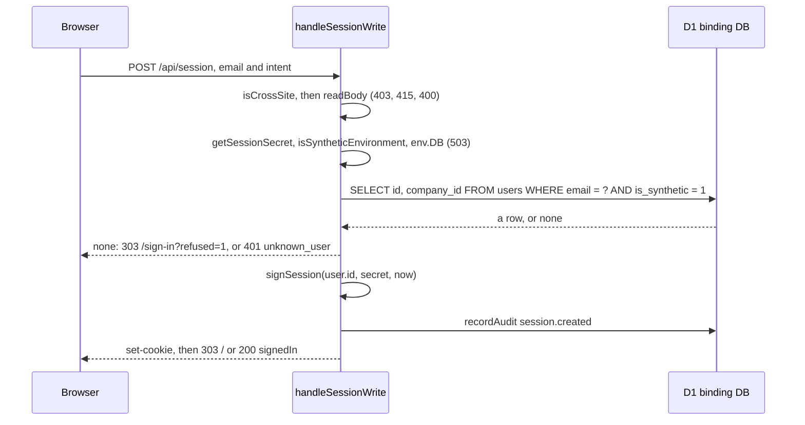

**Sign out** (`POST /api/session` with `intent` equal to `sign-out`; FR-ID-05).

1. Steps 1 to 3 of sign-in. A sign-out with an unsupported content type is a 415, as for a sign-in.
2. `resolveIdentity(request, env)`.
3. With an identity and a bound `env.DB`: `recordAudit(env.DB, "session.ended", { userId, companyId })`. With no valid session nothing is written.
4. The answer carries `set-cookie` from `clearedSessionCookie()`: a 303 to `/` for a form, or 200 `{"signedOut":true}`. No check of the environment, the database or the secret is made, so sign-out works where sign-in does not. The token is not recorded anywhere and stays valid until it expires (3.3).

**Who am I** (`GET /api/session`; [API-02](API-REFERENCE.md); FR-ID-06).

1. `GET` in `app/api/session/route.ts` calls `handleSessionRead`.
2. `resolveIdentity(request, env)`.
3. An identity gives 200 with `userId`, `companyId`, `role` and `displayName`. None gives 401 `not_signed_in`. A missing database or secret gives 401 too, never 503. Nothing is audited.

**Read the person's own company** (`GET /api/companies/{id}`; [API-04](API-REFERENCE.md); FR-ID-13).

1. `GET` in `app/api/companies/[id]/route.ts` awaits `context.params` and calls `handleCompanyRead(request, env, id)`.
2. No `env.DB`: 503 `storage_unavailable`.
3. `resolveIdentity`. None: 401 `not_signed_in`.
4. `canReadCompany(identity, requestedId)`. If it is false: `recordAudit(env.DB, "company.read.denied", { userId, companyId, detail: { requested: requestedId.slice(0, 64) } })`, then 404 `not_found`. This is the answer for the operator, for another company's id and for an id that does not exist.
5. `loadOwnCompany(env.DB, identity)` runs `SELECT id, name, is_synthetic, created_at FROM companies WHERE id = ?`, bound to `identity.companyId`, not to the id in the path.
6. A row: 200 with `id`, `name`, `synthetic` (`is_synthetic` equal to 1) and `createdAt`. No row: 404 `not_found`, not audited. The seeded users all have a company that exists, so this case does not arise from the seed.

**Health** (`GET /api/health`; [API-01](API-REFERENCE.md)).

1. `GET` in `app/api/health/route.ts` calls `handleHealth`. No session is read and no cross-site check is made.
2. With `env.DB`: the query `SELECT name, tbl_name FROM sqlite_master WHERE type = 'trigger'`. If it succeeds, `database` is `ok`.
3. Each entry of `REQUIRED_TRIGGERS_BY_TABLE` must be present as the pair `<table>.<name>`. All present gives `auditGuard` `ok`; any absent gives `missing`.
4. With no `env.DB`, or when the query throws, `database` is `unavailable` and `auditGuard` stays `unknown`.
5. When both are `ok`: 200 `{"status":"ok","database":"ok","auditGuard":"ok"}`. Otherwise 503 with `"status":"degraded"` and the two fields.

**The three flows described in section 3.** Resolving an identity from a cookie is in 3.3 (`resolveIdentityFromCookieHeader`, five steps). The security headers are added in 3.1 (`withSecurityHeaders`, step 7). Applying the migrations and the seed is in 3.7 (`applyMigrations`, five steps).

#### Refusals and messages

The messages are in the functional specification, 8.1 (MSG-01 to MSG-18 and MSG-177, MSG-178); the rules are in 6.1 (RULE-01 to RULE-10). This table is what the platform's own handlers answer. The refusals made by the authorize functions for other modules' endpoints are in 3.2.

| Where | Condition | Answer | Audited | Message and rule |
| --- | --- | --- | --- | --- |
| `handleSessionWrite` | Another website sent the request | 403 `cross_site_refused`, body drained | No | MSG-15, RULE-06 |
| `handleSessionWrite` | Content type is neither a form nor JSON | 415 `unsupported_content_type`, body drained | No | MSG-16, RULE-07 |
| `handleSessionWrite` | Body unreadable, or JSON that is not an object | 400 `bad_request` | No | MSG-18 |
| `handleSessionWrite` | Sign-in where the environment is not synthetic, or `env.DB` or a good secret is missing | 503 `sign_in_not_available` (JSON, for a form too) | No | MSG-06, RULE-10 |
| `handleSessionWrite` | Sign-in with an empty address, an unknown address or a user whose `is_synthetic` is not 1 | A form: 303 to `/sign-in?refused=1`. A program: 401 `unknown_user`. One console line | No | MSG-05, MSG-07 |
| `handleSessionWrite` | Sign-in succeeds | `set-cookie`, then 303 to `/` or 200 `{"signedIn":true}` | `session.created` | MSG-08 |
| `handleSessionWrite` | Sign-out | Cleared cookie, then 303 to `/` or 200 `{"signedOut":true}` | `session.ended`, only when a person is identified | MSG-09 |
| `handleSessionRead` | No valid session | 401 `not_signed_in` | No | MSG-11 |
| `handleCompanyRead` | No `env.DB` | 503 `storage_unavailable` | No | MSG-14 |
| `handleCompanyRead` | No valid session | 401 `not_signed_in` | No | MSG-11 |
| `handleCompanyRead` | The id is not the person's own company, including every operator request | 404 `not_found` | `company.read.denied` | MSG-13, RULE-03 |
| `handleHealth` | The database cannot be read, or a required trigger is missing | 503 with `"status":"degraded"` | No | MSG-178 |
| `handleHealth` | The database answers and every required trigger is present | 200 with `"status":"ok"` | No | MSG-177 |
| `app/layout.tsx` | `isSyntheticEnvironment` is true | The banner "SYNTHETIC environment. Do not enter real company or personal data." above every page | n/a | MSG-01, RULE-10 |
| `app/page.tsx` | No valid session, or a person with no company | "You are not signed in." or "No company is linked to this account, so there is no company record to show." | n/a | MSG-02, MSG-03 |
| `app/sign-in/page.tsx` | The environment is not synthetic, or `env.DB` is missing | "Sign-in is not available in this environment." | n/a | MSG-04 |
| `app/sign-in/page.tsx` | `?refused=1` | "That user was not found." | n/a | MSG-05 |

#### Invariants

What must not be broken, where it is held, and the test that fails when it is. A test that was not run for this document is marked.

| Invariant | Held by | Test |
| --- | --- | --- |
| Identity comes only from the verified cookie token. No other request header is read for identity | `resolveIdentityFromCookieHeader`; the allow-list in `modules/platform/tests/support/header-rule.ts` | `modules/platform/tests/static/source-rules.test.ts` ("request code reads only the headers on the allow-list"); `modules/platform/tests/integration/platform-api.test.ts` ("identity is never taken from request headers") |
| Company and role are read from `users` on every request, so a removed user loses access at once | `resolveIdentityFromCookieHeader` | `modules/platform/tests/integration/platform-api.test.ts` ("a user removed from the database loses access at once") |
| A secret that fails `getSessionSecret` signs nobody and verifies nobody | `getSessionSecret`, called by `resolveIdentityFromCookieHeader` and `handleSessionWrite` | `modules/platform/tests/unit/secret.test.ts`; `modules/platform/tests/integration/platform-api.test.ts` ("a secret that is too short signs nobody in and verifies nobody") |
| One token has one valid spelling; a cookie name that appears twice is nobody | `verifySession`; `readCookie` | `modules/platform/tests/unit/session.test.ts`; `modules/platform/tests/integration/platform-api.test.ts` ("a cookie sent twice counts as nobody") |
| A person reads only their own company. Another company, a missing one and the operator all get 404 and an audit row with `requested` cut to 64 characters | `canReadCompany`; `handleCompanyRead`; `refuse` | `modules/platform/tests/unit/scope.test.ts`; `modules/platform/tests/integration/platform-api.test.ts` ("an owner cannot read another company", "the platform operator reads no company", "near-miss company ids are refused", "only 64 characters of a refused company id are stored") |
| The query for a company's row is bound to `identity.companyId`, not to the id in the URL | `loadOwnCompany` | No test shows this alone. After `canReadCompany` passes the two ids are equal, so a handler test cannot tell the two bindings apart. It is a second layer |
| A change that another website started is refused before anything else is checked, and its body is read | `isCrossSite`, then `drain` | `modules/platform/tests/unit/cross-site.test.ts`; `modules/platform/tests/integration/platform-api.test.ts` ("a sign-in that another website started is refused", "a request refused as cross-site has its body read"); `modules/platform/tests/browser/cross-origin.test.ts` (not run) |
| Sign-in exists only in a synthetic environment, with a database and a good secret, for a user whose `is_synthetic` is 1 | `handleSessionWrite` | `modules/platform/tests/integration/platform-api.test.ts` ("sign-in refuses outside a synthetic environment and without a secret", "a user that is not marked synthetic cannot sign in through the synthetic sign-in"); `modules/platform/tests/smoke/built-app.test.ts` (not run) |
| An unknown user writes nothing to the audit log | `handleSessionWrite` | `modules/platform/tests/integration/platform-api.test.ts` ("an unknown user is refused and nothing is written") |
| The sign-in and sign-out rows carry the person and the company and never the address | `handleSessionWrite` | `modules/platform/tests/integration/platform-api.test.ts` ("sign-in is audited with the person and company, never the address", "signing out while signed in is audited, and signing out as nobody is not") |
| The cookie is `HttpOnly; Secure; SameSite=Lax; Path=/` and lasts 28800 seconds | `sessionCookie`; `SESSION_SECONDS` | `modules/platform/tests/integration/platform-api.test.ts` ("the session cookie has exactly the documented attributes", "a session lasts eight hours to the second") |
| Every answer the Worker returns carries the four security headers | `withSecurityHeaders`; `worker/index.ts` | `modules/platform/tests/unit/security-headers.test.ts`; `modules/platform/tests/static/source-rules.test.ts` ("the Worker entry adds the security headers to every response it returns") |
| The guard lists equal the triggers the migrations create | `modules/platform/src/db/guards.ts` | `modules/platform/tests/unit/guards.test.ts`; `modules/platform/tests/integration/platform-api.test.ts` ("health reports degraded when the audit triggers are missing") |
| The audit log refuses edits, deletes and an insert that reuses an id; every unique key of every append-only table is looked at by a BEFORE INSERT trigger | The triggers in `drizzle/0001_audit_append_only.sql` and `drizzle/0002_audit_no_replace.sql` | `modules/platform/tests/integration/platform-api.test.ts` ("the audit log refuses edits and deletes", "the audit log refuses INSERT OR REPLACE and REPLACE INTO that reuse an id"); `modules/platform/tests/integration/append-only-keys.test.ts` |
| The migrations on disk are the migrations in drizzle's journal | `migrationFiles` | `modules/platform/tests/unit/migrations.test.ts` |
| A page looks a message key from the address up with `Object.hasOwn` | Each page | `modules/platform/tests/static/page-lookups.test.ts` |
| The Worker does not import `modules/platform/src/db/migrate.ts`, which reads the file system | The import graph | No test. A script that follows the imports from `worker/index.ts` and `app/` reaches 15 of the 17 files in `modules/platform/src/` and neither `modules/platform/src/db/migrate.ts` nor `modules/platform/src/db/schema.ts` (checked on 5 October 2026). What a Worker bundle does with a file-system read was not checked |

#### Tests run for this document

On 5 October 2026, with Node v22.22.0, one file at a time with `node --test`: the eight unit files (43 tests), `modules/platform/tests/static/page-lookups.test.ts` (2), `modules/platform/tests/static/source-rules.test.ts` (8) and the two integration files (28), which use a real D1 database in Miniflare. That is 81 tests, and all passed. Not run: `modules/platform/tests/smoke/built-app.test.ts` (it needs `pnpm build`), the four browser files (they need a browser and a build) and `modules/platform/tests/static/conflict-markers.test.ts`. Results from earlier days are in `modules/platform/VALIDATION.md`, with their dates.

#### Found while writing

4 items, listed in [section 9.3](#93-from-section-41-the-platform-module).

### 4.2 The factory module

#### Purpose

The factory module is the Describe stage. It holds the questionnaire an owner answers (25 questions in five sections), the checks on each answer, and the append-only record of the descriptions an owner has saved. Each save is one revision of the company's description. The module serves two operations, API-05 and API-06 in [the API reference](API-REFERENCE.md), and the requirements FR-DESC-01 to FR-DESC-08 in [the functional specification](../fsd/FSD.md). The page that draws the questionnaire is `app/factory/page.tsx`; section 5.4 describes it.

Other modules depend on this one in three ways. Diagnose reads the newest confirmed revision through `loadLatest`. The journey reads both the newest and the newest confirmed revision through `loadLatest` in `modules/journey/src/facts.ts`. Deliver, Diagnose, Procure and Run import `hasControlCharacters` to refuse unsafe text in their own notes (see Found while writing).

The module has the standard layers of HLD section 3.6: a route file, one handler per operation, a data layer of hand-written SQL, and pure files that do no input or output (`questionnaire.ts`, `progress.ts`). The questionnaire is code and not data. `QUESTIONNAIRE_VERSION` (1) is stored on each revision (AD-18 in [the HLD](HLD.md)).

#### The questionnaire at a glance

The table is derived from `SECTIONS` in `modules/factory/src/questionnaire.ts`, read by a script. Questions marked "required" are the five in `REQUIRED_TO_CONFIRM`. The kinds are choice (13 questions), text (7), number (1) and multiple choice (4).

| Section id | Title | Questions, in order (kind) |
| --- | --- | --- |
| `about` | About your unit | `sector` (choice, required), `sector_other` (text), `products` (text, required), `year_started` (number), `employees` (choice, required), `shifts` (choice), `state` (text), `district` (text) |
| `work` | How work gets done | `processes` (multiple, required), `equipment` (text), `orders_in` (multiple), `production_tracking` (choice), `quality_checks` (choice), `maintenance` (choice) |
| `systems` | What you use today | `accounts` (choice), `inventory` (choice), `it_support` (choice), `connectivity` (choice), `data_kept` (multiple) |
| `problems` | What is hurting most | `problems` (multiple, at most 3, required), `problem_other` (text), `own_words` (text) |
| `limits` | What you can spend and decide | `budget_band` (choice), `decides` (choice), `readiness` (choice) |

Limits written into the questionnaire: `sector_other` 100 characters, `products` 500, `equipment` 800, `state` 100, `district` 100, `problem_other` 200, `own_words` 2000. `year_started` runs from 1900 to 2026. The values of every choice and the keys of every question are read by the Diagnose library, so a rename is a change to two modules (see Invariants).

#### Files

| File | Holds | Exports |
| --- | --- | --- |
| `modules/factory/src/questionnaire.ts` | The questionnaire as data, the check of an answer, the control-character test and the reader that turns a posted form into answers. Pure. | `QUESTIONNAIRE_VERSION`, `Option`, `TextField`, `NumberField`, `ChoiceField`, `MultiField`, `Field`, `Section`, `Answer`, `Answers`, `SECTIONS`, `FIELDS`, `REQUIRED_TO_CONFIRM`, `MAX_NOTE_LENGTH`, `Validation`, `hasControlCharacters`, `validateAnswers`, `answersFromForm` |
| `modules/factory/src/progress.ts` | How many questions the saved answers cover and how many of the five needed to confirm. Two follow-up questions (`sector_other`, `problem_other`) count only once the answer that asks for them is given, so a complete description reads 23 of 23. Pure. | `FOLLOW_UP_KEYS`, `isAnswered`, `Progress`, `progressOf`, `progressWords`, `confirmWords` |
| `modules/factory/src/api/factory.ts` | The two handlers, a private body reader (`readSubmission`), a private refusal writer (`refuse`) and the check for missing required answers (`missingRequired`). | `handleFactoryRead`, `handleRevisionCreate` |
| `modules/factory/src/db/revisions.ts` | The only reads and the only write of `factory_revisions`. Every function takes the company id from the caller's identity. | `Revision`, `HistoryEntry`, `loadLatest`, `loadRevision`, `MAX_REVISIONS_PER_COMPANY`, `HISTORY_LIMIT`, `loadHistory`, `latestRevisionNo`, `AppendResult`, `appendRevision` |
| `modules/factory/src/db/schema.ts` | The Drizzle declaration of `factory_revisions`, with the index `factory_revisions_company_revision` (unique), the index `factory_revisions_company` and the checks `factory_revisions_confirmed_bool` and `factory_revisions_revision_positive`. It is read by the migration generator; the application does not query through it. | `factoryRevisions` |
| `modules/factory/db/seed-synthetic.sql` | One confirmed SYNTHETIC revision for `company-synthetic-a`, added only if that company has none. Company B has no revision, so an empty record can be shown. Found by `seedFiles` in `modules/platform/src/db/migrate.ts` and applied by `seedStatements` in the tests, in `scripts/local-db.mjs` and in the demonstration launcher `scripts/serve.mjs`. The migrations do not apply it. | none |

Routes and the page that belong to the module. The route files are 6 to 13 lines each: they set `dynamic` to `force-dynamic`, read the id from the URL and call one handler.

| File | Holds | Exports |
| --- | --- | --- |
| `app/api/companies/[id]/factory/route.ts` | API-05, calls `handleFactoryRead` | `dynamic`, `GET` |
| `app/api/companies/[id]/factory/revisions/route.ts` | API-06, calls `handleRevisionCreate` | `dynamic`, `POST` |
| `app/factory/page.tsx` | SCR-03, the Describe page (section 5.4). It imports `loadHistory`, `loadLatest`, `loadRevision`, `confirmWords`, `progressOf`, `progressWords`, `MAX_NOTE_LENGTH`, `REQUIRED_TO_CONFIRM` and `SECTIONS`. | `dynamic`, `default`, `metadata` |

Records and tests of the module. For this document I ran the unit and static test files of this module on 5 October 2026 with `node --test` (22 tests, all passed). The integration, smoke and browser files are described from their code and were not run.

| File | Holds | Exports |
| --- | --- | --- |
| `modules/factory/STATUS.md` | The module's own status page | none |
| `modules/factory/VALIDATION.md` | The module's own validation record | none |
| `modules/factory/tests/baseline.json` | The recorded test counts the runner compares with | none |
| `modules/factory/tests/unit/questionnaire.test.ts` | 12 tests of `validateAnswers`, `answersFromForm` and the shape of `SECTIONS` | none |
| `modules/factory/tests/unit/progress.test.ts` | 7 tests of `progressOf` and the two sentences | none |
| `modules/factory/tests/static/scope-rules.test.ts` | 3 tests: every query on `factory_revisions` is bound to a company and none changes a row; pages and routes do not query the table; the rule itself catches an unbound read | none |
| `modules/factory/tests/integration/factory-api.test.ts` | 34 tests of both operations against a migrated local database: scope, concurrency, forms, limits, triggers, seed | none |
| `modules/factory/tests/smoke/describe.test.ts` | 11 tests through a running Worker | none |
| `modules/factory/tests/browser/describe.test.ts` | 9 tests in a browser | none |

#### Data read and written

Columns and constraints are in [the data dictionary](DATA-DICTIONARY.md); this table says which function touches what.

| Table | Read by | Written by |
| --- | --- | --- |
| `factory_revisions` | `loadLatest` (newest, or newest with `confirmed = 1`), `loadRevision` (one by number), `loadHistory` (newest 100 without the answers), `latestRevisionNo` (for the 409 answer) | `appendRevision`, by one conditional `INSERT` and nothing else. The seed file inserts a row once. |
| `audit_events` | not by this module | `auditIfChanged` writes `factory.revision.created` (detail: the revision number and the confirmed flag) in the same batch as the insert. `refuse` calls `recordAudit` with `factory.read.denied` or `factory.write.denied` (detail: the first 64 characters of the id asked for). |

Other modules read `factory_revisions` too: the trigger `assessments_needs_confirmed_description` (migration `drizzle/0006_diagnose_guards.sql`) reads it, and the foreign key from `assessments` to `factory_revisions` (company and revision number) declared in `modules/diagnose/src/db/schema.ts` points to it.

Limits the module applies (the full list of limits is in section 8 of the data dictionary):

| Limit | Value | Where it is applied |
| --- | --- | --- |
| Revisions for one company | 500 | The trigger `factory_revisions_limit` (migration `drizzle/0014_review_fixes.sql`). `MAX_REVISIONS_PER_COMPANY` states the same number and a test holds the two equal. |
| Revisions the history lists | 100 | `HISTORY_LIMIT` in `loadHistory`. Older revisions are stored and open by number. |
| Note | 500 characters in the handler (`MAX_NOTE_LENGTH`); 500 characters or 2,000 bytes in the trigger `factory_revisions_note_is_short` | `handleRevisionCreate` and the trigger |
| Request body | 65,536 characters (`64 * 1024`) | `readTextWithin` through the module's own constant `MAX_BODY_CHARACTERS` in `factory.ts` |
| Choices for `problems` | 3 | `maxChoices` on the field, checked by `validateAnswers` |

#### Main flows

**Read the description (API-05).**

1. The route `GET` calls `handleFactoryRead` with the environment and the id from the URL.
2. `handleFactoryRead` answers 503 `storage_unavailable` if the `DB` binding is absent.
3. `resolveIdentity` returns no identity: 401 `not_signed_in`.
4. `canReadCompany` is false (another company, no company, or an operator): `refuse` writes `factory.read.denied` and the answer is 404 `not_found`, the same answer as for a company that does not exist.
5. `loadLatest` (any), `loadLatest` (confirmed) and `loadHistory` run in parallel, each bound to the identity's own company id.
6. The answer is 200 with `questionnaireVersion`, `latest`, `latestConfirmed`, `history` and `revisionsSaved`. `revisionsSaved` is the latest revision number, or 0; there are no gaps, so it is also the count.

**Save a revision, as a draft or confirmed (API-06).** A form post and a JSON post follow the same steps; they differ in how a refusal is answered (section Refusals and messages).

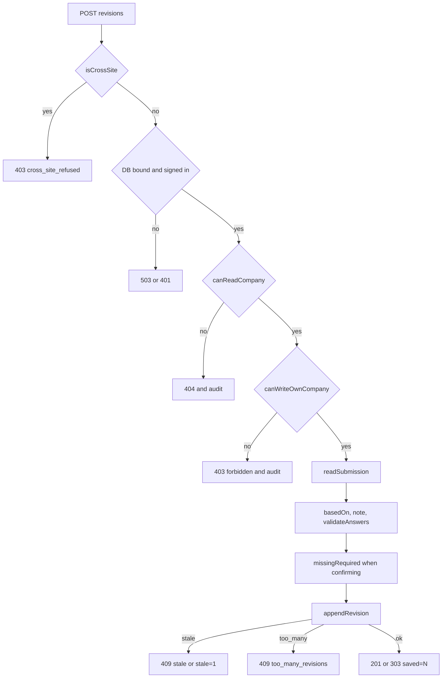

1. The route `POST` calls `handleRevisionCreate`.
2. `isCrossSite` (in `modules/platform/src/identity/cross-site.ts`) refuses a request another website started: `drain` reads the body, then 403 `cross_site_refused`.
3. The handler answers 503 without a `DB`, and 401 when `resolveIdentity` finds no one.
4. `canReadCompany` false gives 404 and a `factory.write.denied` row by `refuse`. `canWriteOwnCompany` false (a member who is not the owner) gives 403 `forbidden` and the same audit row. Both calls are in `modules/platform/src/identity/scope.ts`. The handler does not call `authorizeCompanyWrite`; it repeats the same order of checks inline (already recorded in HLD 12, item 10).
5. `readSubmission` reads the body. It accepts only `application/x-www-form-urlencoded` and `application/json`. A form gives `answers` from `answersFromForm`, the `note` trimmed, `confirm` true when the field `intent` is `confirm`, and `basedOn` from `based_on` (turned into a number only when it is 1 to 9 digits). JSON must be an object; a `note` that is not text or a `confirm` that is not a boolean gives null, which becomes 400 `bad_request`.
6. The handler checks that `basedOn` is a whole number of 0 or more, then that the note is within `MAX_NOTE_LENGTH` and passes `hasControlCharacters`.
7. `validateAnswers(answers, { confirm: false })` checks every answer. A failure returns the per-question messages.
8. If `confirm` is true, `missingRequired` lists which of `REQUIRED_TO_CONFIRM` are absent from the valid answers. A JSON post with any missing is refused 400. A form post is saved as a draft (`confirmed` false) and the redirect carries `missing=`, so typed answers are not lost.
9. `appendRevision` inserts revision `basedOn + 1` in one batch with `auditIfChanged`.
10. On success a form is redirected 303 to `/factory?saved=N`, with `&confirmed=1` and `&missing=<keys>` when they apply; JSON gets 201 `{revision, confirmed}`.

**Confirm.** Confirming is not a separate operation. It is a save with `confirm` true (JSON) or `intent=confirm` (form) in which the five questions in `REQUIRED_TO_CONFIRM` are answered. The stored flag `confirmed` is then 1. A later save without confirm is a new draft revision: it becomes the newest revision, while `loadLatest(..., "confirmed")` still returns the older confirmed one. No function sets a flag on an existing row. The newest confirmed revision is what Diagnose reads.

**Two saves from the same starting point (concurrency).**

1. Both requests pass the checks above with the same `basedOn`.
2. `appendRevision` runs `INSERT INTO factory_revisions ... SELECT ... WHERE (SELECT COALESCE(MAX(revision_no), 0) ...) = basedOn`. The first statement to run inserts one row, so `meta.changes` is 1 and the result is `{ ok: true, revision }`.
3. The second statement finds a higher maximum and inserts nothing (`changes` is 0). `appendRevision` also treats the two messages that a collision on the company and revision number would raise as the lost race: the trigger `factory_revisions_no_replace` (message `factory_revisions is append-only`) and the unique index `factory_revisions_company_revision`. The code comment gives the reason as a save that raced and lost. I did not find a way for the application's own statement to reach either message while its precondition holds; that depends on how the runtime orders statements, which I did not test (assumption). The integration test for this branch feeds `appendRevision` a database that throws those messages. Any other error is rethrown, so it is never reported to the owner as someone else's save.
4. `appendRevision` returns `{ ok: false, reason: "stale", latest }` with `latest` from `latestRevisionNo`. The audit row is not written, because `auditIfChanged` writes only when the previous statement changed a row.
5. The handler answers a form with `?stale=1` and JSON with 409 `stale` and `latest`. Nothing the person typed is kept (see Found while writing).

**The 501st revision.** The trigger `factory_revisions_limit` raises a message that contains `the most revisions it may have`. `appendRevision` turns it into `{ ok: false, reason: "too_many" }`. The handler never compares with `MAX_REVISIONS_PER_COMPANY` itself.

#### Rules and the function that decides each

| Rule | Decided by | FSD | Pinned by |
| --- | --- | --- | --- |
| An answer fits its question: unknown key refused; text trimmed and within its length; whole number in range; one listed option; a list of listed options without repeats and within `maxChoices`; empty, null and an empty list mean "unknown" and are dropped | `validateAnswers` | RULE-11, FR-DESC-02 | `modules/factory/tests/unit/questionnaire.test.ts` |
| Text with control, direction-changing or invisible characters is refused, not cleaned. Tab, line feed, carriage return, U+200C and U+200D are allowed | `hasControlCharacters`, called by `validateAnswers` and by the handler for the note | RULE-12 | the same file, and the integration test on notes |
| A draft needs one answer; confirming needs the five | `validateAnswers` says "There is nothing to save yet. Answer at least one question." when nothing is left. The handler's `missingRequired` decides the five. | RULE-13, FR-DESC-04 | `modules/factory/tests/integration/factory-api.test.ts` |
| A form field becomes an answer: a repeated name is a multiple choice; a number is read only when it is digits with an optional minus sign, otherwise it stays text and is refused later; unknown fields are ignored | `answersFromForm` | RULE-11 | `modules/factory/tests/unit/questionnaire.test.ts` |
| Every save is a new revision from the newest one; numbers start at 1 without gaps; the revision holds exactly the answers sent | `appendRevision` (the `WHERE` precondition) and the trigger `factory_revisions_no_gaps` | RULE-14, FR-DESC-03, FR-DESC-05 | `modules/factory/tests/integration/factory-api.test.ts` |
| At most 500 revisions for a company | the trigger `factory_revisions_limit` | RULE-14, FR-DESC-07 | the same file |
| A note is at most 500 characters and plain text | `handleRevisionCreate`, and the trigger `factory_revisions_note_is_short` | RULE-15 | the same file |
| The answers of a revision are a JSON object | the trigger `factory_revisions_answers_are_an_object` | not stated | the same file |
| Scope: a person reads and writes only the company that is theirs; only an owner writes | `canReadCompany`, `canWriteOwnCompany` | FR-ID-07, FR-ID-08 | `modules/factory/tests/integration/factory-api.test.ts` |
| How far an owner has got: questions that apply and are answered, and how many of the five | `progressOf` | not stated | `modules/factory/tests/unit/progress.test.ts` |

#### Refusals and messages

A refusal made by the request checks (401, 403, 404, 413, 415, 400 `bad_request`, 503) is JSON even for a form. A refusal about the content gives a form a 303 to `/factory?...` and gives a program JSON. The page turns `problem=` keys into the sentences in section 8.2 of the specification; the keys that exist are `invalid`, `note`, `request` and `too_many`.

| Refusal | A form is sent to | A program gets | FSD |
| --- | --- | --- | --- |
| Request started by another website | 403 JSON `cross_site_refused` | the same | MSG-15 |
| No `DB` binding | 503 JSON `storage_unavailable` | the same | MSG-14 |
| Not signed in | 401 JSON `not_signed_in` | the same | MSG-11 |
| Company is not the person's own, or does not exist | 404 JSON `not_found`, audited | the same | MSG-13 |
| A member of the company who is not the owner | 403 JSON `forbidden`, audited | the same | MSG-12 |
| Body is neither a form nor JSON, or has no content type | 415 JSON `unsupported_content_type` | the same | MSG-16 |
| Body over 65,536 characters | 413 JSON `too_large` (the body is not drained) | the same | MSG-17 |
| Body unreadable, JSON not an object, `note` not text, `confirm` not a boolean | 400 JSON `bad_request` | the same | MSG-18 |
| `basedOn` missing, not a whole number, or below 0 | `?problem=request` | 400 `invalid`, field `basedOn`: "Say which revision this starts from (0 for the first)." | MSG-25, MSG-41 |
| Note over 500 characters or with a refused character | `?problem=note` | 400 `invalid`, field `note`: "Keep the note under 500 characters, as plain text." | MSG-24, MSG-42 |
| An answer fails its question | `?problem=invalid&fields=<sorted keys that are real questions>` | 400 `invalid` with one message per key | MSG-23, MSG-28 to MSG-39 |
| Confirm asked and a required answer is missing | the draft is saved; `?saved=N&missing=<keys>` | 400 `invalid`, each missing key: "Answer this before you confirm the description." | MSG-22, MSG-21, MSG-40 |
| The revision it starts from is not the newest | `?stale=1` | 409 `stale` with `latest` | MSG-27, MSG-44 |
| The company already holds 500 revisions | `?problem=too_many` | 409 `too_many_revisions` | MSG-26, MSG-45 |
| Saved | `?saved=N`, and `&confirmed=1` when confirmed | 201 `{revision, confirmed}` | MSG-20, MSG-21, MSG-46 |

The per-question messages come from `validateAnswers`: "Answers must be an object.", "This question does not exist.", "Answer in words.", "This answer has characters that cannot be saved.", "Keep this under N characters.", "Give a whole number.", "Give a number from 1900 to 2026.", "Choose one of the options.", "Choose from the options.", "An option was chosen twice.", "Choose at most 3.", and "There is nothing to save yet. Answer at least one question."

On a refused form the redirect names only keys that are real questions (`LABEL_KEYS`), sorted, so nothing the sender wrote is echoed and the same mistakes always give the same address. An unknown field in a form is ignored and not reported.

#### Invariants

| Invariant | Held by | Test |
| --- | --- | --- |
| A revision is never edited, deleted or replaced | the triggers `factory_revisions_no_update`, `factory_revisions_no_delete`, `factory_revisions_no_replace` (migration `drizzle/0004_factory_revisions_append_only.sql`); no function in the module issues an `UPDATE`, a `DELETE` or a replace | the static test `scope-rules.test.ts` and the integration test "the table refuses edits, deletes and any insert that would replace a row" |
| Every query on `factory_revisions` is bound to one company | `modules/factory/src/db/revisions.ts` (company id from the identity, never from the URL) | `modules/factory/tests/static/scope-rules.test.ts` |
| One company's revision numbers run 1, 2, 3 with no gap and no duplicate | the `WHERE` precondition in `appendRevision`, the trigger `factory_revisions_no_gaps`, the unique index `factory_revisions_company_revision` | the integration tests on stale saves and on gaps |
| Two saves from one starting point: one wins, one is told it is stale and writes nothing | `appendRevision` | "two saves from the same starting version" in the integration test |
| `confirmed` is 1 only when the five required questions were answered | the handler only (`missingRequired`); the database does not check the answers against the five, so a direct insert could mark an empty description confirmed | the integration tests on confirming |
| The constant 500 and the trigger's 500 are one number | not derived: stated twice | the integration test "the limit written into migration 0014 is the one the application states" |
| Every question key and option value that the Diagnose library names still exists | none in this module | the test "the library is well formed against the questionnaire it reads" in `modules/diagnose/tests/unit/engine.test.ts` |
| A refusal does not echo what the sender wrote | `LABEL_KEYS` filter in `handleRevisionCreate` | the integration test on forms that cannot be saved |

#### Found while writing

9 items, listed in [section 9.4](#94-from-section-42-the-factory-module).

### 4.3 The diagnose module

#### Purpose

The diagnose module is the Decide stage. From the owner's newest confirmed description it makes an assessment: a ranked list of ideas, chosen by fixed rules and not by an AI model, with the reason for each and a list of what was left out. The assessment is stored whole and never changes. The owner then records accept, defer or reject on each idea and signs the assessment off once, and the sign-off carries a fingerprint of what was signed. The module serves API-07 to API-11 in [the API reference](API-REFERENCE.md) and FR-DIAG-01 to FR-DIAG-10 in [the functional specification](../fsd/FSD.md). The page is `app/diagnose/page.tsx` (SCR-04, section 5.4).

The code and the programming interface call an idea an item (`opportunityId`, "That item is not in this assessment."); the pages and the specification call it an idea.

Other modules depend on it. Procure reads a signed-off assessment through `loadAssessment` and its database triggers read `assessment_events`. Run calls `loadAssessment` and `presentAssessment` in `modules/run/src/api/outcomes.ts`. The journey calls `listAssessments` in `modules/journey/src/facts.ts`. The provider handlers of the Procure module (`modules/procure/src/api/providers.ts`) and the operator page (`app/operator/page.tsx`) read `LIBRARY`.

#### The rule library at a glance

The library is code in `modules/diagnose/src/library.ts`, not data in the database. Every entry is SYNTHETIC with source `assumption` (the file's own heading says so, and a test requires each figure to be an assumption or to cite the source register). The table is derived by a script from `LIBRARY`: 17 entries, 13 non-AI and 4 AI. A condition is `is`, `not`, `has` or `lacks` on one question. The gap is a list of conditions that must all hold. A prerequisite is either a condition with a sentence (`{text, when}`) or another idea (`{text, opportunity}`).

| Idea id | Kind | Problems it addresses | Gap (question and condition) | Prerequisites | Risk |
| --- | --- | --- | --- | --- | --- |
| `digital_job_log` | non-AI | `late_deliveries`, `rejects_rework` | `production_tracking` is | none | low |
| `inspection_checklist_and_gauges` | non-AI | `rejects_rework` | `quality_checks` is | none | low |
| `preventive_maintenance_plan` | non-AI | `breakdowns` | `maintenance` is | none | low |
| `stock_register_min_max` | non-AI | `stock_shortages`, `working_capital` | `inventory` is | none | low |
| `energy_review_and_tariff_check` | non-AI | `energy_cost` | none | `data_kept` | low |
| `receivables_follow_up` | non-AI | `payment_delays`, `working_capital` | `accounts` is | none | low |
| `accounting_software` | non-AI | `payment_delays`, `working_capital` | `accounts` is | `it_support` | medium |
| `skills_training_plan` | non-AI | `skilled_labour` | none | none | medium |
| `safety_walkthrough` | non-AI | `safety` | none | none | low |
| `marketplace_listing` | non-AI | `finding_buyers` | `orders_in` lacks | `connectivity` | medium |
| `paperwork_organiser` | non-AI | `compliance_certification` | none | none | medium |
| `financing_options_review` | non-AI | `working_capital` | none | none | medium |
| `supplier_quotes_comparison` | non-AI | `material_cost` | none | none | low |
| `camera_inspection_ai` | AI | `rejects_rework` | `quality_checks` is | idea `inspection_checklist_and_gauges`; `data_kept`; `it_support` | medium |
| `predictive_maintenance_ai` | AI | `breakdowns` | `maintenance` is | idea `preventive_maintenance_plan`; `data_kept`; `connectivity` | high |
| `demand_forecast_ai` | AI | `stock_shortages`, `late_deliveries` | `inventory` is | idea `stock_register_min_max`; `data_kept` | medium |
| `ai_job_scheduling` | AI | `late_deliveries` | `production_tracking` not | idea `digital_job_log`; `it_support` | medium |

The problem `other_problem` ("something else") is addressed by no entry, so it never brings an idea in (the test "every problem the questionnaire offers has at least one opportunity, except 'something else'"). The yearly budget ceilings in `BUDGET_CEILING` are 100000 for `under_1_lakh`, 500000 for `1_to_5_lakh`, 2500000 for `5_to_25_lakh` and no ceiling (`null`) for `over_25_lakh`. `not_sure` is absent on purpose, so its affordability is "unknown". The full library with sentences and figures is in appendix A of the specification and is not repeated here.

#### Files

| File | Holds | Exports |
| --- | --- | --- |
| `modules/diagnose/src/library.ts` | The library, its types and the budget ceilings. `LIBRARY_VERSION` is bumped by hand. | `LIBRARY_VERSION`, `Condition`, `Prerequisite`, `Range`, `Benefit`, `Opportunity`, `LIBRARY`, `BUDGET_CEILING` |
| `modules/diagnose/src/engine.ts` | The ranking: the points, the judgement of a condition, affordability, and `diagnose`. Pure; the same answers always give the same result. | `ENGINE_VERSION`, `MAX_ITEMS`, `Truth`, `Readiness`, `Affordability`, `Item`, `LeftOut`, `Result`, `evaluate`, `POINTS`, `affordability`, `diagnose` |
| `modules/diagnose/src/digest.ts` | The sign-off fingerprint: canonical JSON, the decision standing on each item, and the SHA-256. Pure apart from the Web Crypto call. | `StandingDecision`, `canonicalJson`, `standingDecisions`, `digestOf` |
| `modules/diagnose/src/progress.ts` | What the page says about where the owner is: sign-off state, the next undecided idea, the pointer onward after a sign-off, whether an assessment is from the newest confirmed description, the short decision words and the score sentence. Pure. It declares its own `TurnLike` type so that the module does not import the journey. | `SignOffState`, `signOffState`, `signOffWords`, `firstUndecided`, `TurnLike`, `Onward`, `afterSignOff`, `Relation`, `relationToConfirmed`, `hasAssessmentFrom`, `Decision`, `DECISION_WORD`, `decisionWord`, `scoreLine` |
| `modules/diagnose/src/api/diagnose.ts` | The five handlers, `presentAssessment`, the decision values, the note reader (`readNote`) and the answer to a sign-off (`signOffAnswer`). It uses `authorizeCompanyRead`, `authorizeCompanyWrite` and `takeBody` from the platform. | `MAX_NOTE_LENGTH`, `DECISIONS`, `DecisionValue`, `notOwnerMessage`, `presentAssessment`, `handleAssessmentList`, `handleAssessmentRead`, `handleAssessmentCreate`, `handleDecisionCreate`, `handleSignOff`, `signOffAnswer` |
| `modules/diagnose/src/db/assessments.ts` | All reads and writes of `assessments` and `assessment_events`, each bound to the company id from the identity. | `EventRow`, `AssessmentRecord`, `AssessmentSummary`, `listAssessments`, `loadAssessment`, `loadLatestAssessmentId`, `CreateResult`, `createAssessment`, `MAX_DECISIONS`, `DecisionResult`, `appendDecision`, `SignOffResult`, `appendSignOff` |
| `modules/diagnose/src/db/schema.ts` | The Drizzle declaration of both tables, for the migration generator. Indexes `assessments_inputs`, `assessments_id_company`, `assessments_company`, `assessment_events_one_signoff` (partial) and `assessment_events_assessment`; a foreign key from `assessments` to `factory_revisions` and one from `assessment_events` to `assessments`; checks `assessments_result_json` and `assessment_events_shape`. | `assessments`, `assessmentEvents` |

Routes and the page:

| File | Holds | Exports |
| --- | --- | --- |
| `app/api/companies/[id]/assessments/route.ts` | API-07 (list) and API-08 (make) | `dynamic`, `GET`, `POST` |
| `app/api/companies/[id]/assessments/[aid]/route.ts` | API-09 (read one) | `dynamic`, `GET` |
| `app/api/companies/[id]/assessments/[aid]/decisions/route.ts` | API-10 (decide) | `dynamic`, `POST` |
| `app/api/companies/[id]/assessments/[aid]/signoff/route.ts` | API-11 (sign off) | `dynamic`, `POST` |
| `app/diagnose/page.tsx` | SCR-04. It imports `presentAssessment`, `DECISIONS`, `MAX_NOTE_LENGTH`, `notOwnerMessage`, `listAssessments`, `loadAssessment`, `loadLatestAssessmentId`, `MAX_ITEMS`, `POINTS`, the helpers of `progress.ts`, `loadLatest` from the factory module, and `loadFacts` and `nextStep` from the journey. | `metadata`, `dynamic`, `default` |

Records and tests. For this document I ran the unit and static test files of this module on 5 October 2026 with `node --test` (39 tests, all passed). The integration, smoke and browser files were not run.

| File | Holds | Exports |
| --- | --- | --- |
| `modules/diagnose/STATUS.md` | The module's status page | none |
| `modules/diagnose/VALIDATION.md` | The module's validation record | none |
| `modules/diagnose/tests/baseline.json` | The recorded test counts | none |
| `modules/diagnose/tests/unit/engine.test.ts` | 20 tests of ranking, conditions, affordability, left-out reasons, the cap of eight, and the shape of the library against the questionnaire | none |
| `modules/diagnose/tests/unit/digest.test.ts` | 3 tests of canonical JSON, the standing decision and the digest | none |
| `modules/diagnose/tests/unit/pins.test.ts` | 3 tests that hold the library and the engine's output to recorded hashes (see Rules) | none |
| `modules/diagnose/tests/unit/progress.test.ts` | 7 tests of the page helpers | none |
| `modules/diagnose/tests/unit/not-owner.test.ts` | 1 test of `notOwnerMessage` | none |
| `modules/diagnose/tests/static/scope-rules.test.ts` | 4 tests: every query on the assessment tables is bound to a company and none changes a row; pages and routes do not query them; only this data layer touches them | none |
| `modules/diagnose/tests/static/problems.test.ts` | 1 test: every `?problem=` key the handlers send has a message on the page and every message is sent | none |
| `modules/diagnose/tests/integration/diagnose-api.test.ts` | 34 tests of all five operations against a migrated local database | none |
| `modules/diagnose/tests/smoke/diagnose.test.ts` | 8 tests through a running Worker | none |
| `modules/diagnose/tests/browser/diagnose.test.ts` | 8 tests in a browser | none |

#### Data read and written

Columns are in [the data dictionary](DATA-DICTIONARY.md). This table says which function touches what.

| Table | Read by | Written by |
| --- | --- | --- |
| `assessments` | `listAssessments` (with the count of items by `json_array_length`, the count of items decided and the sign-off time), `loadAssessment` (the row and all its events, ordered by id), `loadLatestAssessmentId` | `createAssessment`, one conditional `INSERT` |
| `assessment_events` | `loadAssessment`, `listAssessments` | `appendDecision` (kind `decision`) and `appendSignOff` (kind `signoff`, with the digest) |
| `factory_revisions` | `loadLatest(..., "confirmed")` from the factory module, in `handleAssessmentCreate`; the trigger `assessments_needs_confirmed_description` | not written |
| `audit_events` | not by this module | `assessment.created`, `assessment.decision`, `assessment.signed_off` through `auditIfChanged`; `assessment.read.denied` and `assessment.write.denied` through the platform's `authorizeCompanyRead` and `authorizeCompanyWrite` |

What an assessment stores: the `result` column holds the whole `Result` as JSON, which includes the title, summary, costs, benefit, risk and source of each idea, copied from the library at that moment. A later change to the library or to the questionnaire labels therefore never rewrites a stored assessment (test: "an assessment is not affected by a later change in the factory description").

Limits the module applies:

| Limit | Value | Where |
| --- | --- | --- |
| Ranked ideas in one assessment | 8 | `MAX_ITEMS` in `diagnose` |
| Decision rows in one assessment | 200 | `MAX_DECISIONS`, and the trigger `assessment_events_decision_limit` (migration `drizzle/0007_diagnose_review_fixes.sql`); a test holds them equal |
| Note | 500 characters, and 2,000 bytes in the table | `readNote` and the trigger `assessment_events_note_is_short` (migration `drizzle/0014_review_fixes.sql`) |
| Idea id in a decision | 1 to 80 characters | `handleDecisionCreate` |
| Assessment id | 1 to 64 characters | `loadAssessment` returns nothing outside that range |
| Request body | 65,536 characters | `takeBody` |

#### Main flows

**Make an assessment (API-08).**

1. The route `POST` calls `handleAssessmentCreate`.
2. `authorizeCompanyWrite(request, env, id, "assessment.write.denied")` applies the platform's order of checks: cross-site 403, no `DB` 503, no identity 401, another company 404 with an audit row, a non-owner 403 with an audit row.
3. `takeBody` reads the body: 415, 413 or 400 for a bad one. An empty post is allowed and counts as JSON for the answer.
4. `loadLatest(db, companyId, "confirmed")` returns the newest confirmed revision. If there is none, a form is redirected to `/diagnose?needs=confirm` and a program gets 409 `no_confirmed_description`. A newer draft does not count.
5. `diagnose(revision.answers)` makes the `Result` (next flow). It reads nothing from the database.
6. `createAssessment` runs one batch: `INSERT INTO assessments ... SELECT ... WHERE NOT EXISTS (same company, revision, library version, engine version)` and `auditIfChanged("assessment.created")`. If the row already exists nothing is inserted, no audit row is written, and the existing id is returned with `created: false`. The trigger `assessments_needs_confirmed_description` refuses a revision that is not confirmed; its message `needs a confirmed description` is turned into `no_confirmed_description`.
7. A form is redirected 303 to `/diagnose?a=<id>`. A program gets 201 `{id, created: true, factoryRevisionNo}` or, for an assessment that already existed, 200 with `created: false`.

**Rank the ideas (what `diagnose` does).**

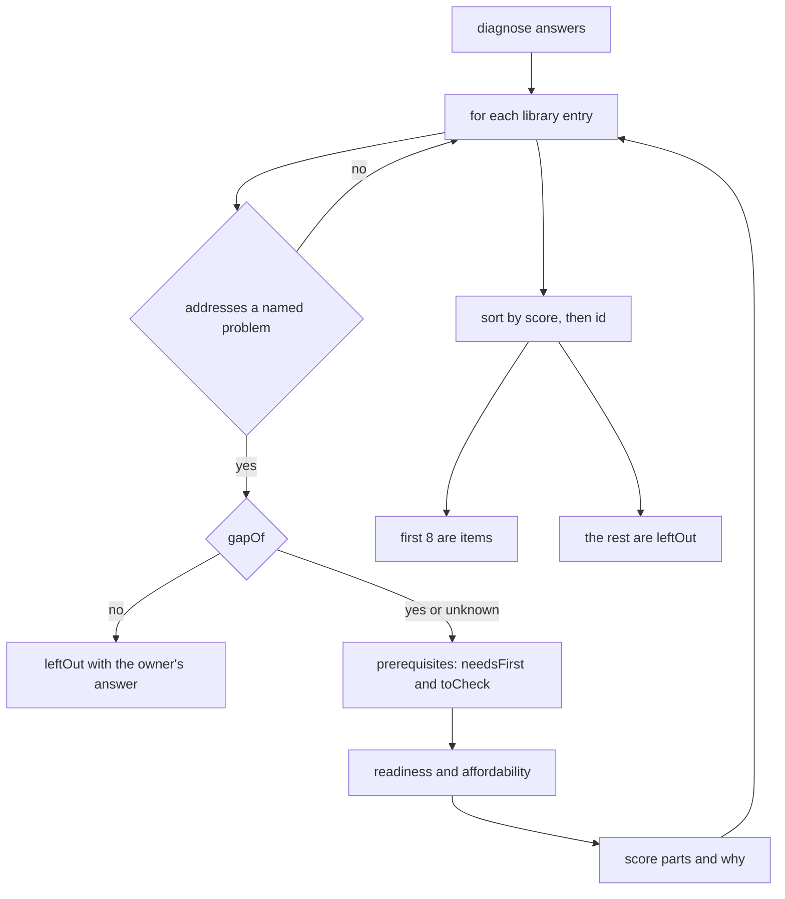

1. `diagnose` reads the problems named (`answers.problems`, an array) and `budget_band` (a string, else null).
2. For each library entry in order, the problems it addresses that the owner named are `matched`. If none, the entry is skipped and not listed anywhere.
3. `gapOf` takes the conjunction of `evaluate` over the entry's `appliesWhen`: "no" if any condition is "no", else "unknown" if any is "unknown", else "yes". `evaluate` returns "unknown" when the question has no answer. An entry with no conditions has a gap of "yes".
4. A gap of "no" puts the entry in `leftOut` with the sentence `Your answer to "<question>" is <given>; this is for units where it is <expected>, so the gap does not seem to exist here.` The words come from the questionnaire's labels (`questionLabel`, `optionLabel`), so a label edit changes the sentence (see Found while writing).
5. For each prerequisite: one that names another idea is judged by that idea's gap (a gap that still exists, "yes", puts the text in `needsFirst`; "unknown" puts it in `toCheck`); one with a condition is judged by `evaluate` ("no" gives `needsFirst`, "unknown" gives `toCheck`).
6. Readiness is `needs_first` if `needsFirst` is not empty, else `check` if `toCheck` is not empty, else `ready`.
7. `firstYear` is the one-time cost plus the yearly cost, low with low and high with high. `affordability` compares it with the ceiling.
8. The score is the sum of the parts below. The `why` list gets one sentence about the problems named and, if the entry has conditions, either the owner's answers or "An answer needed to see whether the gap exists is missing."
9. The candidates are sorted by score, highest first, and by `opportunityId` (string comparison) when scores are equal. The first `MAX_ITEMS` are numbered from rank 1. Each later one goes to `leftOut` with "Ranked below the first 8."
10. `Result` is `{engine: "rules", engineVersion, libraryVersion, synthetic: true, inputs, items, leftOut}`. `inputs` echoes the owner's problems, budget band, sector and readiness answer as labels. The readiness answer is shown and never scored (already recorded in FSD 12.1, item 11).

| Score part | Values | Defined in |
| --- | --- | --- |
| Problems | 10 for each named problem the entry addresses | `POINTS.perProblem` |
| Readiness | ready 4, check 2, needs first 0 | `POINTS.readiness` |
| Affordability | within the ceiling 2, stretch 0, unknown 0, over -2 | `POINTS.affordability` and `affordability` |
| Risk | low 0, medium -1, high -2 | `POINTS.risk` |
| Missing gap answer | -1 when the gap is "unknown", else 0 | `POINTS.missingGapAnswer` |

There is no term for whether an idea is AI. Affordability is "within" when the high end of the first year is at or under the ceiling, "stretch" when only the low end is, "over" when even the low end is above it, "within" for a band with no ceiling, and "unknown" for no band or `not_sure`.

Worked example, run for this document: `{problems: ["late_deliveries", "rejects_rework"], production_tracking: "paper", quality_checks: "visual", budget_band: "5_to_25_lakh"}` gives five items and nothing left out.

| Rank | Idea | Score | Parts (problems, readiness, affordability, risk, missing answer) |
| --- | --- | --- | --- |
| 1 | `digital_job_log` | 26 | 20, 4, 2, 0, 0 (ready) |
| 2 | `inspection_checklist_and_gauges` | 16 | 10, 4, 2, 0, 0 (ready) |
| 3 | `demand_forecast_ai` | 12 | 10, 2, 2, -1, -1 (check) |
| 4 | `ai_job_scheduling` | 11 | 10, 0, 2, -1, 0 (needs first) |
| 5 | `camera_inspection_ai` | 11 | 10, 0, 2, -1, 0 (needs first) |

Ranks 4 and 5 tie and are ordered by id. With `{problems: ["rejects_rework"], quality_checks: "third_party_lab"}` the entries `inspection_checklist_and_gauges` and `camera_inspection_ai` are left out with the owner's own answer as the reason. With three problems (`late_deliveries`, `rejects_rework`, `working_capital`) there are nine candidates, so eight are ranked and `demand_forecast_ai` is left out as "Ranked below the first 8."

**Read an assessment (API-07, API-09).**

1. `handleAssessmentList` or `handleAssessmentRead` calls `authorizeCompanyRead(..., "assessment.read.denied")` (503, 401, or 404 with an audit row for any company that is not the person's own; a member may read).
2. The list is `listAssessments`, newest first. One assessment is `loadAssessment`; an id that is another company's, or does not exist, or is over 64 characters gives the same 404 `not_found`.
3. `presentAssessment` builds the view: `standingDecisions` gives the decision standing on each item, and the history lists every decision event. If there is a sign-off, it takes the decisions with an `id` below the sign-off's `id`, recomputes `digestOf` and sets `digestMatches`. The digest is therefore checked on every read, not stored as a verdict.

**Decide on an idea (API-10).**

1. The route `POST` calls `handleDecisionCreate`, which calls `authorizeCompanyWrite` and `takeBody`.
2. The idea id comes from the form field `opportunity` or the JSON field `opportunityId`; the decision from `decision`; the note from `note` through `readNote`.
3. The handler checks the id (1 to 80 characters), that `decision` is one of `DECISIONS` (accept, defer, reject) and the note. Any failure is `?problem=decision` for a form, or 400 `invalid` with a message per field for a program.
4. `appendDecision` runs `INSERT INTO assessment_events ... SELECT ... WHERE EXISTS (the assessment of this company)` in a batch with `auditIfChanged("assessment.decision")`. The triggers refuse a decision on an idea that is not in the assessment (`assessment_events_decision_names_an_item`), after the sign-off (`assessment_events_signed_off_is_final`), and past 200 (`assessment_events_decision_limit`). The message is matched by pattern and turned into `unknown_item`, `signed_off` or `too_many`. No row inserted means `not_found`.
5. A later decision on the same idea is a new row. `standingDecisions` takes the latest row for each idea, so the earlier one stays in the history and the later one stands.

**Sign off (API-11).**

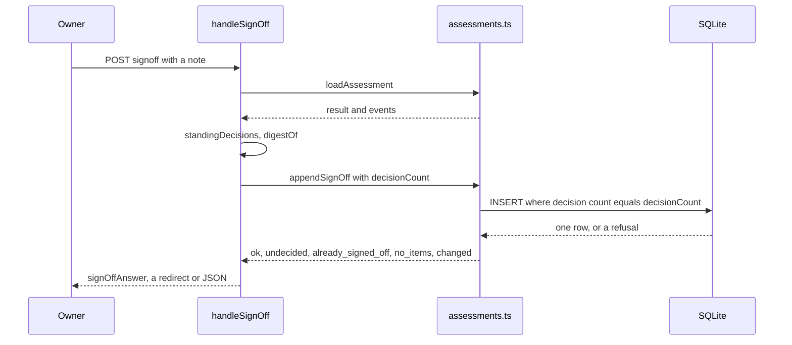

1. The route `POST` calls `handleSignOff`, which calls `authorizeCompanyWrite`, `takeBody` and `readNote`. A bad note is `?a=<id>&problem=note` or 400 `invalid`.
2. `loadAssessment` returns the assessment and its events. None: `?problem=missing` or 404.
3. The handler takes the decision events, then `standingDecisions` and `digestOf(record.id, record.result, standing)`.
4. `appendSignOff` inserts the `signoff` row with the digest and the note, only `WHERE EXISTS (the assessment) AND (SELECT COUNT(*) ... kind = 'decision') = decisionCount`. `decisionCount` is the number of decision events the digest was computed over, so a decision that arrived in between makes the insert change nothing.
5. The triggers refuse the sign-off if an idea has no decision (`assessment_events_signoff_needs_every_decision`), if the assessment has no ideas (`assessment_events_signoff_needs_an_item`), or if a sign-off exists (`assessment_events_one_signoff_only`, and the partial unique index `assessment_events_one_signoff`). The messages become `undecided`, `no_items` and `already_signed_off`.
6. With no insert and no refusal, `appendSignOff` checks that the assessment exists: if it does the result is `changed`, otherwise `not_found`. The audit row `assessment.signed_off` is written only with an inserted row.
7. `signOffAnswer` maps the result: a form is redirected to `/diagnose?a=<id>&signed=1` or `&problem=<undecided|signed|no_items|changed>`; a program gets 201 `{ok: true, digest}` or a 409 with the code. The `changed` answer carries the detail "A decision was added while this was being signed. Read it again."

**What the digest covers.** `digestOf` is SHA-256, written as 64 hexadecimal characters, over `canonicalJson({assessmentId, result, standing})`. `canonicalJson` sorts object keys by code unit, keeps array order and drops `undefined`. `standing` is, for each ranked idea in the result's order that has a decision, the object `{opportunityId, decision, note}`. It does not cover who decided, when, the sign-off note or a decision that was replaced (RULE-24; [FND-087](../FINDINGS.md) records it).

#### Rules and the function that decides each

| Rule | Decided by | FSD | Pinned by |
| --- | --- | --- | --- |
| An assessment is made only from a confirmed description, once for each description, library version and engine version | `createAssessment` (`WHERE NOT EXISTS`), the trigger `assessments_needs_confirmed_description`, the index `assessments_inputs` | RULE-16, FR-DIAG-01, FR-DIAG-05, FR-DIAG-10 | `modules/diagnose/tests/integration/diagnose-api.test.ts` |
| Which ideas are ranked, the score and the order | `diagnose`, `POINTS` | RULE-17, FR-DIAG-02 | `modules/diagnose/tests/unit/engine.test.ts`, `modules/diagnose/tests/unit/pins.test.ts` |
| The yearly budget against the first-year cost | `affordability`, `BUDGET_CEILING` | RULE-18 | `modules/diagnose/tests/unit/engine.test.ts` |
| Readiness from the prerequisites | `diagnose` with `evaluate` and `gapOf` | RULE-19 | `modules/diagnose/tests/unit/engine.test.ts` |
| What is left out and why | `diagnose` | RULE-20, FR-DIAG-03 | `modules/diagnose/tests/unit/engine.test.ts` |
| No term for AI, at most eight ideas, ties by id | `diagnose`, `MAX_ITEMS` | RULE-21 | the test "the ranking has no term for AI" |
| A decision names an idea of the assessment, is one of three, and is final after sign-off; at most 200 | `handleDecisionCreate` (the three values), `appendDecision`, the triggers named above and `assessment_events_decision_needs_a_value` | RULE-22, FR-DIAG-07 | `modules/diagnose/tests/integration/diagnose-api.test.ts` |
| Sign-off once, with every idea decided, never over a decision it did not read | `appendSignOff`, the triggers named above | RULE-23, FR-DIAG-08 | the same file |
| The fingerprint | `digestOf`, `canonicalJson`, `standingDecisions` | RULE-24 | `modules/diagnose/tests/unit/digest.test.ts` |
| A change to the library or the engine's output carries a new version | `LIBRARY_PINS` and `ENGINE_PINS` in the test, and the two version constants | FR-DIAG-05 | `modules/diagnose/tests/unit/pins.test.ts` |
| A note is text, at most 500 characters, without refused characters | `readNote`, and the trigger `assessment_events_note_is_short` | RULE-12, RULE-15 | `modules/diagnose/tests/integration/diagnose-api.test.ts` |
| Scope | `authorizeCompanyRead`, `authorizeCompanyWrite` | FR-ID-07, FR-ID-08 | `modules/diagnose/tests/static/scope-rules.test.ts` |

How the pins work, as `pins.test.ts` states it. `LIBRARY_PINS` maps a library version to the SHA-256 of the library, the ceilings, the points and the cap. `ENGINE_PINS` maps an engine version to the library version it was recorded against and the SHA-256 of the engine's output for eight fixed descriptions. A change to the library, the ceilings, the points or the output without a new version fails a test, and the message says to bump the version and add a line. An earlier line is never edited. As the engine pin records which library version it was made under, raising `LIBRARY_VERSION` also needs a new `ENGINE_VERSION` and a new engine pin (read from the test; I did not run that change).

#### Refusals and messages

Refusals made by `authorizeCompanyRead` and `authorizeCompanyWrite` are JSON for a form too: 503 `storage_unavailable` (MSG-14), 401 `not_signed_in` (MSG-11), 404 `not_found` (MSG-13), 403 `forbidden` (MSG-12), 403 `cross_site_refused` (MSG-15). `takeBody` gives 415, 413 and 400 `bad_request` (MSG-16 to MSG-18). The rest:

| Refusal | A form is sent to | A program gets | FSD |
| --- | --- | --- | --- |
| No confirmed description when making an assessment | `/diagnose?needs=confirm` | 409 `no_confirmed_description` | MSG-52, MSG-67 |
| A decision with no idea id (or one over 80 characters), a decision that is not accept, defer or reject, or a bad note | `/diagnose?a=<id>&problem=decision` | 400 `invalid` with `opportunityId`: "Say which item this is about.", `decision`: "Choose accept, defer or reject.", `note`: "Write the note as text.", "Keep the note under 500 characters." or "The note has characters that cannot be saved." | MSG-53, MSG-61 to MSG-65 |
| The idea is not in this assessment | `?a=<id>&problem=decision` | 400 `invalid`, `opportunityId`: "That item is not in this assessment." | MSG-53, MSG-66 |
| A decision after the sign-off | `?a=<id>&problem=signed` | 409 `signed_off` | MSG-54, MSG-68 |
| The 201st decision | `?a=<id>&problem=too_many` | 409 `too_many_decisions` | MSG-58, MSG-69 |
| The assessment is not the company's or does not exist (decision or sign-off) | `/diagnose?problem=missing` | 404 `not_found` | MSG-60, MSG-13 |
| A sign-off note that is not valid | `?a=<id>&problem=note` | 400 `invalid`, field `note` | MSG-56, MSG-63 to MSG-65 |
| A sign-off while an idea has no decision | `?a=<id>&problem=undecided` | 409 `undecided` | MSG-55, MSG-70 |
| A second sign-off | `?a=<id>&problem=signed` | 409 `already_signed_off` | MSG-54, MSG-71 |
| A sign-off of an assessment with no ideas | `?a=<id>&problem=no_items` | 409 `no_items` | MSG-59, MSG-72 |
| A decision arrived while the sign-off was being made | `?a=<id>&problem=changed` | 409 `changed` with the detail sentence | MSG-57, MSG-73 |
| Assessment made | `/diagnose?a=<id>` | 201, or 200 when it existed, `{id, created, factoryRevisionNo}` | MSG-74 |
| Decision saved | `?a=<id>&saved=<idea id>` | 201 `{ok: true}` | MSG-50, MSG-75 |
| Signed off | `?a=<id>&signed=1` | 201 `{ok: true, digest}` | MSG-51, MSG-75 |

The page also tells a signed-in person who is not an owner what the page is for, through `notOwnerMessage(isMember)`: one sentence for a member of a company and one for a person with no company (MSG-48, MSG-49). The static test `problems.test.ts` holds the `?problem=` keys above to the messages in `PROBLEMS` in `app/diagnose/page.tsx`: `decision`, `signed`, `undecided`, `note`, `changed`, `too_many`, `no_items` and `missing`.

#### Invariants

| Invariant | Held by | Test |
| --- | --- | --- |
| An assessment and its events are never edited, deleted or replaced | the triggers `assessments_no_update`, `assessments_no_delete`, `assessments_no_replace`, `assessment_events_no_update`, `assessment_events_no_delete`, `assessment_events_no_replace` (migration `drizzle/0006_diagnose_guards.sql`); no function issues an `UPDATE` or a `DELETE` | `modules/diagnose/tests/static/scope-rules.test.ts` and "the database refuses what the application would never send" in the integration test |
| Every query on the assessment tables is bound to one company, and only this data layer runs one | `modules/diagnose/src/db/assessments.ts` | `modules/diagnose/tests/static/scope-rules.test.ts` |
| The stored result is exactly what `diagnose` returned and is never recomputed | `createAssessment` stores `JSON.stringify(result)` | the integration test on a later change of the description |
| The same description, library version and engine version give one assessment | the index `assessments_inputs` and the `WHERE NOT EXISTS` | "making it again changes nothing" |
| The engine is pure and has no AI term | `diagnose` takes only answers and a library | "the same answers give the same result" and "the ranking has no term for AI" |
| The library and the engine's output change only with a version | the pins | `modules/diagnose/tests/unit/pins.test.ts` |
| Every question key and option value the library names exists in the questionnaire; prerequisites between ideas never loop; every library figure is an assumption or cites a source; no entry names a company or a real product | none in code | four tests in `modules/diagnose/tests/unit/engine.test.ts` |
| One sign-off for each assessment, only with every idea decided and at least one idea, and no decision after it | the triggers `assessment_events_one_signoff_only`, `assessment_events_signoff_needs_every_decision`, `assessment_events_signoff_needs_an_item`, `assessment_events_signed_off_is_final` | the integration tests on sign-off |
| A sign-off never covers a decision it did not read | the `decisionCount` condition in `appendSignOff` | "a decision that lands between reading and signing makes the sign-off fail with 'changed'" |
| A change made outside the application to a decision, a note or the result shows as a digest that does not match | `presentAssessment` recomputes on every read | "the digest is recomputed on every read" |
| The constant 200 and the trigger's 200 are one number | not derived | "the number in the database trigger is the one in the code" |
| Every `?problem=` key has a message | none in code | `modules/diagnose/tests/static/problems.test.ts` |
| A decision always carries a value, and a note is within 500 characters in the table | the triggers `assessment_events_decision_needs_a_value`, `assessment_events_note_is_short` | integration tests on a decision with no value and on notes |

#### Found while writing

7 items, listed in [section 9.5](#95-from-section-43-the-diagnose-module).

### 4.4 The procure module

#### Purpose

The procure module is the Choose stage. An owner turns an idea they accepted in a signed-off assessment into a standard requirement in one of three clusters. The module counts how many companies asked for the same thing, tells the owner a lower bound once five have, lists the providers that are listed for the requirement, and lets the owner withdraw it. A platform operator keeps the registry of providers, sets the one listing fee, lists and unlists providers, and sees the pools that have reached five companies. The module serves API-12 to API-14 and API-22 to API-29 in [the API reference](API-REFERENCE.md) and FR-PROC-01 to FR-PROC-11 in [the functional specification](../fsd/FSD.md). Its pages are `app/procure/page.tsx` (SCR-05, the owner) and `app/operator/page.tsx` (SCR-08, the operator); section 5.4 describes them.

Two commitments shape the code and are held by tests. First, APLYD's earnings never vary with which provider an owner chooses (D-03 in `docs/decisions.md`): there is one listing fee for every provider, copied by the database statement itself, and the owner sees no fee at all. Second, no aggregate figure is published from fewer than five companies (`AGENTS.md`, "Invariants that need a test"; OQ-14 in `docs/open-questions.md` asks whether the floor also applies to a pool's own members, and the code takes the cautious reading and applies it to them). The fee has not been decided (OQ-11); it is a placeholder that only the operator sees.

Choosing a provider is the first step of the Deliver stage and its handler belongs to the deliver module (`handleEngagementCreate`, section 4.5). This module supplies the list the owner chooses from (`listedProvidersFor`) and the rule that an engaged requirement cannot be withdrawn.

Other modules depend on it. The journey (`modules/journey/src/facts.ts`) and Run (`modules/run/src/api/outcomes.ts`) call `listRequirements`. The deliver module's schema imports `providers` and `requirements` from `modules/procure/src/db/schema.ts`, and its queries and triggers join them. The Procure, operator, Deliver and Run pages import `clusterLabel`.

#### The clusters and the pool at a glance

`CLUSTERS` in `modules/procure/src/clusters.ts` holds three invented places, labelled "SYNTHETIC cluster 1", "SYNTHETIC cluster 2" and "SYNTHETIC cluster 3", with ids `synthetic-cluster-1`, `synthetic-cluster-2` and `synthetic-cluster-3`. The first real cluster is undecided (OQ-03). A requirement is pooled only with others of the same idea in the same cluster.

`presentPool(n)` in `modules/procure/src/pool.ts` decides what may be said about a pool of `n` companies. `AGGREGATE_FLOOR` is 5.

| Companies in the pool (n) | `presentPool(n)` | What the owner's page says (FSD) |
| --- | --- | --- |
| 0 to 4 | `{shown: false, floor: 5}` | "Fewer than 5 companies have asked for this in your cluster, so the number is not shown to anyone, to protect the companies that asked." (MSG-92) |
| 5 to 9 | `{shown: true, atLeast: 5}` | "At least 5 companies in this cluster have asked for the same thing." (MSG-91) |
| 10 to 14 | `{shown: true, atLeast: 10}` | the same sentence with 10 |
| 15 or more | `{shown: true, atLeast: m}`, where `m` is the largest multiple of 5 that is at most `n` | the same sentence with `m` |
| any value that is not a whole number | `{shown: false, floor: 5}` | not shown |

The operator's list is the one place an exact count appears (RULE-29; already recorded in FSD 12.1, item 13).

#### Files

| File | Holds | Exports |
| --- | --- | --- |
| `modules/procure/src/clusters.ts` | The three clusters and their labels. Pure. | `CLUSTERS`, `ClusterId`, `isCluster`, `clusterLabel` |
| `modules/procure/src/pool.ts` | The floor and what may be said about a pool's size. Pure. | `AGGREGATE_FLOOR`, `PoolView`, `presentPool` |
| `modules/procure/src/view.ts` | The sentences and tags the two pages print: the state of one requirement, the counts at the top of the owner's page, the one sentence there, the tags, the order of accepted ideas, the operator's summary, the number of different fees among listed providers, and the grouping of a provider's services. Pure; it reads no pool size, no fee and no other company's record. | `RequirementStateKey`, `RequirementState`, `requirementState`, `ProcureCounts`, `RequirementFacts`, `procureCounts`, `procureSentence`, `StatusTag`, `readyTone`, `procureTags`, `readyFirst`, `FeeState`, `OperatorSummary`, `operatorSummary`, `distinctListedFees`, `serviceGroups`, `askedLabel`, `nothingLeftToAsk` |
| `modules/procure/src/api/requirements.ts` | The owner's handlers: list, make, withdraw; and `presentRequirements`, which the page and the list handler both use. | `MAX_NOTE_LENGTH`, `PresentedRequirement`, `presentRequirements`, `handleRequirementList`, `handleRequirementCreate`, `handleRequirementWithdraw` |
| `modules/procure/src/api/providers.ts` | The operator's handlers (providers, listing, the fee, the pools), the one public list, the limits on provider text, and the readers of services, notes and the fee. | `MAX_NAME_LENGTH`, `MAX_SUMMARY_LENGTH`, `MAX_NOTE_LENGTH`, `MAX_SERVICES`, `MAX_FEE_INR`, `handlePublicProviders`, `handleOperatorProviders`, `handleProviderCreate`, `handleProviderList`, `handleProviderUnlist`, `handleTermsRead`, `handleTermsSet`, `presentPools`, `handlePools` |
| `modules/procure/src/db/requirements.ts` | Reads and writes of `requirements` and `requirement_events`, all bound to the company id from the identity. | `Spec`, `RequirementRecord`, `listRequirements`, `CreateResult`, `createRequirement`, `WithdrawResult`, `withdrawRequirement` |
| `modules/procure/src/db/providers.ts` | The registry, the fee and the listing, with the mapping of trigger messages to reasons. | `Terms`, `Service`, `ProviderRecord`, `PublicProvider`, `currentTerms`, `listTermsHistory`, `setTerms`, `CreateProviderResult`, `createProvider`, `ListResult`, `listProvider`, `UnlistResult`, `unlistProvider`, `listAllProviders`, `listedProvidersFor`, `listPublicProviders` |
| `modules/procure/src/db/pool.ts` | The only two queries that read requirements across companies. They return counts, never a row, an id or a name. | `poolCompanies`, `PoolRow`, `listPoolsAtFloor` |
| `modules/procure/src/db/schema.ts` | The Drizzle declaration of the six tables, for the migration generator. Indexes `requirements_one_per_item` (unique on company, assessment and idea), `requirements_id_company`, `requirements_company`, `requirements_pool`, `requirement_events_one_withdrawal`, `provider_services_unique`, `provider_services_match`, `provider_events_provider`; a foreign key from `requirements` to `assessments` and one from `requirement_events` to `requirements`; checks `requirements_spec_json`, `requirement_events_kind`, `listing_terms_fee_positive`, `provider_events_shape`. | `requirements`, `requirementEvents`, `providers`, `providerServices`, `listingTerms`, `providerEvents` |
| `modules/procure/mutations/m7.json` | A list of 51 deliberate small breaks of the code, run by `scripts/mutation/mutate.py` to see whether the tests notice | none |
| `modules/procure/mutations/m7b.json` | 11 further breaks | none |
| `modules/procure/mutations/m7c.json` | 16 further breaks | none |

Routes and pages that belong to the module:

| File | Holds | Exports |
| --- | --- | --- |
| `app/api/companies/[id]/requirements/route.ts` | API-12 (list) and API-13 (make) | `dynamic`, `GET`, `POST` |
| `app/api/companies/[id]/requirements/[rid]/withdraw/route.ts` | API-14 (withdraw) | `dynamic`, `POST` |
| `app/api/companies/[id]/requirements/[rid]/engagement/route.ts` | API-15 (choose a provider). It calls the deliver module's `handleEngagementCreate`. | `dynamic`, `POST` |
| `app/api/providers/route.ts` | API-22, the list of listed providers for any signed-in person | `dynamic`, `GET` |
| `app/api/operator/providers/route.ts` | API-23 (every provider and the terms) and API-24 (add a provider) | `dynamic`, `GET`, `POST` |
| `app/api/operator/providers/[pid]/list/route.ts` | API-25 | `dynamic`, `POST` |
| `app/api/operator/providers/[pid]/unlist/route.ts` | API-26 | `dynamic`, `POST` |
| `app/api/operator/listing-terms/route.ts` | API-27 (read the fee and its history) and API-28 (set the fee) | `dynamic`, `GET`, `POST` |
| `app/api/operator/pools/route.ts` | API-29, the pools of five or more | `dynamic`, `GET` |
| `app/procure/page.tsx` | SCR-05. It builds its view from `listAssessments`, `presentRequirements`, `presentEngagements` (deliver) and `presentAssessment` (diagnose), and draws the helpers of `view.ts`. | `dynamic`, `default`, `metadata` |
| `app/operator/page.tsx` | SCR-08. It reads `currentTerms`, `listTermsHistory`, `listAllProviders` and `presentPools`, and prints the fee; no other page under `app/` refers to a fee (checked by a search for the fee's names). | `dynamic`, `default`, `metadata` |

Tests of the module. For this document I ran the unit and static test files of this module on 5 October 2026 with `node --test` (34 tests, all passed). The integration, smoke and browser files were not run.

| File | Holds | Exports |
| --- | --- | --- |
| `modules/procure/STATUS.md` | The module's status page | none |
| `modules/procure/VALIDATION.md` | The module's validation record | none |
| `modules/procure/tests/baseline.json` | The recorded test counts | none |
| `modules/procure/tests/unit/clusters.test.ts` | 2 tests of the cluster list | none |
| `modules/procure/tests/unit/pool.test.ts` | 5 tests of the floor and the lower bound | none |
| `modules/procure/tests/unit/view.test.ts` | 15 tests that pin each sentence of `view.ts` | none |
| `modules/procure/tests/static/rules.test.ts` | 10 tests that read the source: no write other than an insert; every read of requirements bound to a company except the two counts; counts only; the pool's size reaches a caller only through `presentPool`; pages and routes do not query the tables; the money columns; one fee in the terms; the listing statement takes no fee from a caller; providers ordered by name only; the owner's page prints only `r.pool.atLeast` | none |
| `modules/procure/tests/static/problems.test.ts` | 2 tests: every `?problem=` key the owner's and the operator's handlers send has a message on its page | none |
| `modules/procure/tests/integration/procure-api.test.ts` | 34 tests of every operation against a migrated local database | none |
| `modules/procure/tests/smoke/procure.test.ts` | 6 tests through a running Worker | none |
| `modules/procure/tests/browser/procure.test.ts` | 3 tests in a browser | none |

#### Data read and written

Columns are in [the data dictionary](DATA-DICTIONARY.md). This table says which function touches what.

| Table | Read by | Written by |
| --- | --- | --- |
| `requirements` | `listRequirements`, and the existing-row lookup in `createRequirement`, both bound to the company. `poolCompanies` and `listPoolsAtFloor` read it across companies and return counts. | `createRequirement` |
| `requirement_events` | the withdrawn-time sub-select of `listRequirements`, the existing-row lookup, and both pool queries | `withdrawRequirement` (kind `withdraw`) |
| `providers`, `provider_services` | `listAllProviders`, `listedProvidersFor`, the existence checks in `listProvider` and `unlistProvider` | `createProvider`, in one batch with the audit row |
| `listing_terms` | `currentTerms`, `listTermsHistory`, and inside the insert of `listProvider` | `setTerms` |
| `provider_events` | `listAllProviders`, `listedProvidersFor` | `listProvider` (kind `list`, with a copy of the fee), `unlistProvider` (kind `unlist`) |
| `assessments`, `assessment_events` | `loadAssessment` from the diagnose module in `handleRequirementCreate`; the triggers `requirements_needs_signed_off_assessment` and `requirements_needs_accepted_item` | not written |
| `engagements` | the trigger `requirement_events_not_after_engagement` | not written (the deliver module writes it) |
| `audit_events` | not by this module | `requirement.created`, `requirement.withdrawn`, `provider.created`, `provider.listed`, `provider.unlisted`, `listing_terms.set` through `auditIfChanged`; `requirement.read.denied`, `requirement.write.denied`, `operator.read.denied`, `operator.write.denied` through the platform |

A requirement stores a copy of the idea it was made from in its `spec` column (`Spec`: title, summary, kind, the problems it addresses as labels, costs, source and library version), taken from the stored assessment result and not from the library. Money columns in this module are `listing_terms.fee_inr` and its copy `provider_events.fee_inr`; the static test `rules.test.ts` fixes the list of money columns in the whole application.

Limits the module applies:

| Limit | Value | Where |
| --- | --- | --- |
| Provider name | 1 to 100 characters | `MAX_NAME_LENGTH`, `text` in `providers.ts` |
| Provider summary | at most 300 characters | `MAX_SUMMARY_LENGTH` |
| Services of one provider | 1 to 20 | `MAX_SERVICES`, `readServices` |
| Fee | a whole number of rupees from 1 to 10,000,000 | `MAX_FEE_INR` in `handleTermsSet`; triggers `listing_terms_fee_is_whole` and the check `listing_terms_fee_positive` |
| Note | 500 characters, and 2,000 bytes in the table | each handler, and the triggers `listing_terms_note_is_short`, `provider_events_note_is_short`, `requirement_events_note_is_short` (migration `drizzle/0014_review_fixes.sql`) |
| Assessment id, requirement id, provider id | 1 to 64 characters | the handlers |
| Idea id | 1 to 80 characters | `handleRequirementCreate` |
| Clusters | the 3 in `CLUSTERS` | `isCluster` |
| Pool shown | from 5 companies | `AGGREGATE_FLOOR` |
| Providers, requirements | no limit | recorded in [FND-111](../FINDINGS.md) and section 8 of the data dictionary |

#### Main flows

**Add a requirement (API-13).**

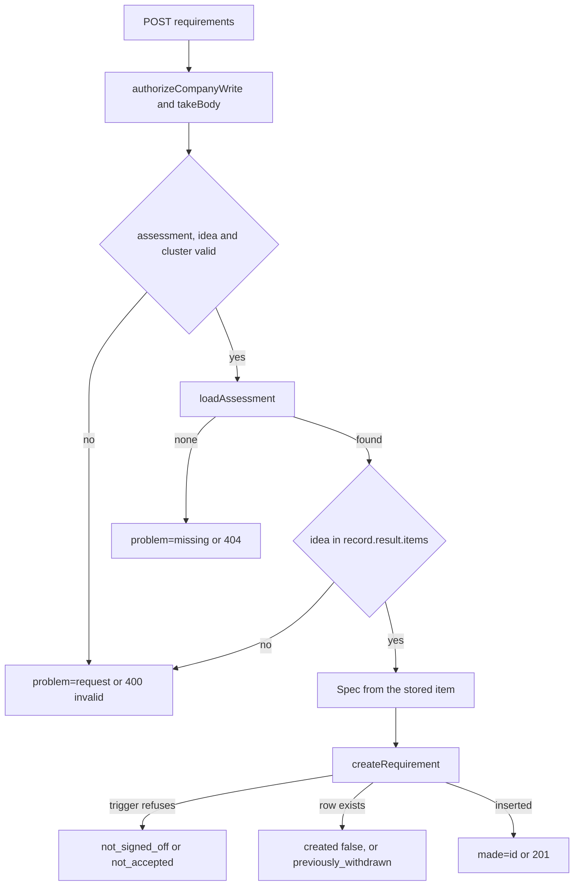

1. The route `POST` calls `handleRequirementCreate`.
2. `authorizeCompanyWrite(request, env, id, "requirement.write.denied")` applies the platform's checks. `takeBody` reads the body.
3. The handler reads the assessment id (form field `assessment`, JSON `assessmentId`), the idea id (`opportunity`, `opportunityId`) and `cluster`. It checks the lengths (64 and 80) and `isCluster`. Any failure is `?problem=request` for a form or 400 `invalid` with a message per field for a program.
4. `loadAssessment` (from `modules/diagnose/src/db/assessments.ts`) returns the company's assessment or nothing: `?problem=missing` or 404.
5. The handler finds the idea in `record.result.items`. If it is not there the answer is `?problem=request` or 400 with "That idea is not in this assessment."
6. The handler builds the `Spec` from the stored item and `record.libraryVersion`.
7. `createRequirement` runs one batch: `INSERT INTO requirements ... SELECT ... WHERE NOT EXISTS (same company, assessment and idea)` and `auditIfChanged("requirement.created")`.
8. The triggers `requirements_needs_signed_off_assessment` (a sign-off exists) and `requirements_needs_accepted_item` (the latest decision on the idea is accept) refuse otherwise. The messages `needs a signed-off assessment` and `needs an accepted item` become `not_signed_off` and `not_accepted`. A foreign-key failure becomes `not_found`.
9. If no row was inserted, `createRequirement` reads the existing one. A withdrawn one gives `previously_withdrawn`. Otherwise the result is `created: false` with the cluster stored the first time, which may differ from the cluster asked for now.
10. A form is redirected to `/procure?made=<id>`, or to `?problem=already_made` when `created` is false, so the page never says that something was recorded now when it was not. A program gets 201 `{id, created: true, cluster}` or 200 with `created: false`, and a 409 with the reason for the three refusals.

**Withdraw a requirement (API-14).**

1. The route `POST` calls `handleRequirementWithdraw`, which calls `authorizeCompanyWrite` and `takeBody`.
2. The note is optional text. A note that is not text, is over 500 characters or fails `hasControlCharacters` gives `?problem=note` or 400. A requirement id that is empty or over 64 characters gives `?problem=missing` or 404.
3. `withdrawRequirement` inserts a `withdraw` event `WHERE EXISTS (the requirement of this company) AND NOT EXISTS (an event for it)`, with `auditIfChanged("requirement.withdrawn")`.
4. The trigger `requirement_events_not_after_engagement` refuses a withdrawal when an engagement exists (message `an engaged requirement cannot be withdrawn`): the result is `engaged`. With no row inserted, the function checks the requirement exists: `already_withdrawn` if it does, `not_found` if not.
5. The requirement is not changed; it is marked withdrawn by the event. `listRequirements` returns `withdrawnAt`. `poolCompanies` stops counting it, and `presentRequirements` shows neither a pool nor providers for it. A form is redirected to `/procure?withdrawn=1`; a program gets 201 `{ok: true}`.

**Pooling and the floor of five.**

1. `presentRequirements(db, companyId)` calls `listRequirements`, which returns the company's own requirements, newest first.
2. For each requirement that is not withdrawn it calls `poolCompanies(db, cluster, opportunityId)`: `SELECT COUNT(DISTINCT r.company_id)` over requirements with that cluster and idea that have no `withdraw` event. A company counts once however many assessments it asked from. The company's own requirement is in the count. A requirement whose engagement has been closed still counts.
3. The count goes at once into `presentPool`. The exact number stays inside the function call; the presented requirement carries only the `PoolView`.
4. The owner's page prints `r.pool.atLeast` when `shown` is true and the sentence for fewer than five otherwise. The static test requires that the page never reads an exact count.
5. For the operator, `handlePools` calls `presentPools`, which is `listPoolsAtFloor`: the same count grouped by cluster and idea, `HAVING COUNT(DISTINCT r.company_id) >= AGGREGATE_FLOOR`. A pool below the floor is not listed. A row has the cluster, the idea and the exact number of companies, and nothing that names a company, a user or a requirement.
6. The two counting queries are the only cross-company reads in the application (HLD 3.5). The static test `rules.test.ts` checks that they select counts and the pool's own key, that only files in `modules/procure/src/api/` call them, and that their results go to `presentPool`.
7. What this does not hide is recorded in [FND-109](../FINDINGS.md) (a company that joins a pool across the floor learns it held at least four others) and in the comment at the head of `pool.ts`.

**Add a provider (API-24, operator).**

1. The route `POST` calls `handleProviderCreate`, which calls `authorizeOperator(request, env, "operator.write.denied", true)`. The last argument says this is a change, so a cross-site request is refused first. An operator is a signed-in person with the role `operator` and no company; anyone else gets 403 `forbidden` and an audit row.
2. `takeBody` reads the body. `text` reads the name (required, at most 100) and the summary (optional, at most 300) and refuses a control character.
3. `readServices` reads the services. JSON: a `services` array of 1 to 20 objects `{opportunityId, cluster}`, each idea in `LIBRARY` (checked against a set built from `LIBRARY`) and each cluster in `CLUSTERS`. Form: all values of `opportunity` and `cluster`, taken as every combination (the count of ticked ideas times the count of ticked clusters may not exceed 20), with duplicates removed.
4. Any failure is `?problem=provider` or 400 `invalid` with `name`, `summary` and `services` messages.
5. `createProvider` refuses a repeated service (`duplicate_service`, reachable only from a JSON post, since the form removes duplicates) and otherwise inserts the provider row (always `is_synthetic` 1), one row for each service and the audit row `provider.created`, in one batch. The provider is not listed.
6. A form is redirected to `/operator?made=<id>`; a program gets 201 `{id}`.

**Set the listing fee (API-28, operator).**

1. `handleTermsSet` calls `authorizeOperator(..., true)` and `takeBody`.
2. The fee is read from `feeInr`: a JSON number, or text of 1 to 8 digits after trimming. It must be a whole number from 1 to `MAX_FEE_INR`. The note is read by `readNote`.
3. A bad fee or note gives `?problem=fee` or 400 `invalid` with `feeInr` or `note`. The form reports a bad note as a fee problem (already recorded in FSD 12.1, item 15).
4. `setTerms` inserts a new `listing_terms` row (a new version) and the audit row `listing_terms.set`, then reads back the row it added by `last_row_id`, so a second operator's change in between is not reported as this one.
5. A form is redirected to `/operator?fee=1`; a program gets 201 `{terms}`. Earlier versions and the listings made under them stay as they were.

**List and unlist a provider (API-25, API-26, operator).**

1. `handleProviderList` and `handleProviderUnlist` call `authorizeOperator(..., true)` and `takeBody`. The body is read only for a note; `handleProviderList` ignores any fee in it.
2. `listProvider` runs `INSERT INTO provider_events (provider_id, at, user_id, kind, terms_version, fee_inr, note) SELECT p.id, ?, ?, 'list', t.version, t.fee_inr, ? FROM providers p, listing_terms t WHERE p.id = ? AND t.version = (SELECT MAX(version) FROM listing_terms)`. The fee and version are read from the terms in force inside the statement, so no parameter can carry a fee. The audit row is `provider.listed`.
3. The triggers refuse a listing with no service (`provider_events_list_needs_a_service`, message `needs a service`, reason `no_service`), a listing that does not carry the fee in force (`provider_events_list_carries_the_fee_in_force`; no function maps its message, because the statement takes the version and the fee from one row and so should not produce one: my reading, not tested), and a second listing in a row (`provider_events_alternate`, message `in turn`, reason `already_listed`).
4. With no row inserted and no refusal, `listProvider` checks whether the provider exists: `fee_undecided` if it does (no terms row yet), `not_found` if not.
5. On success `listProvider` reads the fee from the row it just added (`last_row_id`) and the handler answers 201 `{ok: true, feeInr}` (this is the operator's own answer; an owner never receives it).
6. `unlistProvider` inserts an `unlist` event for an existing provider, audit `provider.unlisted`. The same trigger `provider_events_alternate` refuses it when the provider is not listed (`not_listed`). The earlier listing and its fee stay on record.
7. A provider is "listed" when its latest event is a `list`. Nothing is stored as a flag.

**Show providers to an owner.**

1. `presentRequirements` calls `listedProvidersFor(db, opportunityId, cluster)` for every requirement that is not withdrawn.
2. The query joins `providers` to `provider_services` for the idea and the cluster, keeps providers whose latest `provider_events` row is `list`, and orders by `p.name COLLATE NOCASE, p.id`. It returns `id`, `name` and `summary` only (`PublicProvider`): no fee, no time of listing and no count of requirements. The order is the same for every requester.
3. `GET /api/providers` (`handlePublicProviders`) returns every listed provider with its services to any signed-in person. It builds on `listAllProviders` and discards the fee and the listing time.
4. The operator's `handleOperatorProviders` returns every provider, listed or not, with the fee it was listed at and the time, and the terms in force.

**Choose a provider (API-15, deliver module).**

1. On the owner's page, each open requirement that has listed providers carries a form with a `select` built from the list above. It posts the field `provider` to `/api/companies/{id}/requirements/{rid}/engagement`; a program posts `providerId`.
2. The route calls `handleEngagementCreate` in `modules/deliver/src/api/engagements.ts`. It calls `authorizeCompanyWrite` and `takeBody`, and checks the provider id is 1 to 64 characters (`?problem=engage` or 400 `invalid` with "Choose a provider from the list.") and the requirement id likewise (`?problem=missing` or 404).
3. `createEngagement` in `modules/deliver/src/db/engagements.ts` inserts the engagement `WHERE EXISTS (the requirement of this company) AND NOT EXISTS (an engagement for it)`. The statement carries no fee: choosing is not priced.
4. The triggers decide whether the choice is allowed (migration `drizzle/0011_deliver_guards.sql`, the second recreated in `drizzle/0014_review_fixes.sql`). `engagements_needs_an_open_requirement` refuses a withdrawn requirement (`requirement_withdrawn`, page key `withdrawn`). `engagements_needs_a_listed_provider` refuses a provider that does not serve the requirement's idea in its cluster, or whose latest event is not a listing (`provider_unavailable`). The recreated trigger applies only when the requirement exists and is open, so that the two messages cannot compete.
5. If no row was inserted, the existing engagement is read: the same provider gives `created: false` (200); another provider gives `already_engaged`.
6. A form is redirected to `/deliver?made=1`, or back to `/procure?problem=<engage|missing|withdrawn|provider_unavailable|already_engaged>`. A program gets 201 or 200 `{id, created}` or a 409 with the reason.
7. From then on `withdrawRequirement` is refused by the trigger `requirement_events_not_after_engagement`, and the page shows the state "Provider chosen" through `requirementState`.

#### Rules and the function that decides each

| Rule | Decided by | FSD | Pinned by |
| --- | --- | --- | --- |
| A requirement needs a signed-off assessment and an idea the owner accepted; one for each company, assessment and idea; the cluster is one of three; asking again returns the existing one; a withdrawn one is not made again | `createRequirement`, the triggers `requirements_needs_signed_off_assessment` and `requirements_needs_accepted_item`, the index `requirements_one_per_item`, `isCluster` | RULE-25, FR-PROC-02, FR-PROC-03 | `modules/procure/tests/integration/procure-api.test.ts` |
| A requirement is withdrawn once, stays on record, and cannot be withdrawn after a provider is chosen | `withdrawRequirement`, the index `requirement_events_one_withdrawal`, the trigger `requirement_events_not_after_engagement` | RULE-26, FR-PROC-04 | the same file |
| A pool counts companies, not requirements, and leaves when withdrawn | `poolCompanies` | RULE-27, FR-PROC-05 | the same file ("a company counts once however many requirements it has") |
| The floor of five, and a lower bound in steps of five | `presentPool`, `AGGREGATE_FLOOR` | RULE-28, FR-PROC-06 | `modules/procure/tests/unit/pool.test.ts` |
| The operator sees only pools of five or more, with the exact count and no company | `listPoolsAtFloor` | RULE-29, FR-PROC-07 | `modules/procure/tests/static/rules.test.ts` and the integration test on the operator's list |
| A provider: name, summary, 1 to 20 services each named once; always synthetic and not listed; services fixed from the first listing | `handleProviderCreate`, `readServices`, `createProvider`, the trigger `provider_services_closed_after_first_listing` | RULE-30, FR-PROC-08 | the integration tests on a provider and on what a provider serves |
| A provider is listed only with a service and a fee set; listing and unlisting alternate | `listProvider`, `unlistProvider`, the triggers `provider_events_list_needs_a_service` and `provider_events_alternate` | RULE-31, FR-PROC-09 | the integration test "a provider is listed and unlisted in turn" |
| One fee for every provider; a listing copies the fee in force; a new fee is a new version | `setTerms`, `listProvider` (fee read inside the statement), the trigger `provider_events_list_carries_the_fee_in_force`, `MAX_FEE_INR` | RULE-32, FR-PROC-10, D-03 | `modules/procure/tests/static/rules.test.ts` and the integration test "every provider is listed at the same fee" |
| Providers shown in name order, without a fee, a time or demand | `listedProvidersFor`, `PublicProvider` | RULE-33, FR-PROC-11 | the integration test "owners see providers in name order" and the static test on ordering |
| Operator functions are for a person with the operator role and no company | `authorizeOperator` | FR-ID-09 | the integration tests on operator access |
| The state of a requirement and the next action | `requirementState` | not stated | `modules/procure/tests/unit/view.test.ts` |

#### Refusals and messages

Refusals made by the platform helpers are JSON for a form too: 503 `storage_unavailable` (MSG-14), 401 `not_signed_in` (MSG-11), 404 `not_found` for another company (MSG-13), 403 `forbidden` for a member or, on an operator endpoint, for anyone who is not an operator, with an audit row (MSG-12), 403 `cross_site_refused` (MSG-15). `takeBody` gives 415, 413 and 400 `bad_request` (MSG-16 to MSG-18).

The owner's endpoints. A form is sent to `/procure?...`.

| Refusal | A form is sent to | A program gets | FSD |
| --- | --- | --- | --- |
| Assessment id missing or over 64 characters; idea id missing or over 80; cluster not one of the three | `?problem=request` | 400 `invalid`: `assessmentId` "Say which assessment this is from.", `opportunityId` "Say which idea this is about.", `cluster` "Choose a cluster from the list." | MSG-79, MSG-93 to MSG-95 |
| The assessment is not the company's or does not exist | `?problem=missing` | 404 `not_found` | MSG-86, MSG-13 |
| The idea is not in the assessment | `?problem=request` | 400 `invalid`, `opportunityId`: "That idea is not in this assessment." | MSG-79, MSG-96 |
| The assessment is not signed off | `?problem=not_signed_off` | 409 `not_signed_off` | MSG-80, MSG-98 |
| The idea was not accepted | `?problem=not_accepted` | 409 `not_accepted` | MSG-81, MSG-98 |
| The requirement was withdrawn earlier | `?problem=previously_withdrawn` | 409 `previously_withdrawn` | MSG-83, MSG-98 |
| The requirement already exists | `?problem=already_made` | 200 `{id, created: false, cluster}` | MSG-82, MSG-100 |
| Requirement made | `?made=<id>` | 201 `{id, created: true, cluster}` | MSG-77, MSG-100 |
| A withdrawal note that is not text, too long, or has a refused character | `?problem=note` | 400 `invalid`, `note`: "Keep the note to text under 500 characters." | MSG-84, MSG-97 |
| Requirement not found (or its id is empty or over 64 characters) | `?problem=missing` | 404 `not_found` | MSG-86 |
| Withdrawn twice | `?problem=withdrawn` | 409 `already_withdrawn` | MSG-85, MSG-99 |
| Withdrawal after a provider was chosen | `?problem=engaged` | 409 `engaged` | MSG-87, MSG-99 |
| Requirement withdrawn | `?withdrawn=1` | 201 `{ok: true}` | MSG-78, MSG-101 |
| No provider named when choosing | `?problem=engage` | 400 `invalid`, `providerId`: "Choose a provider from the list." | MSG-88 |
| The provider is not listed for this requirement | `?problem=provider_unavailable` | 409 `provider_unavailable` | MSG-89 |
| Another provider is already chosen | `?problem=already_engaged` | 409 `already_engaged` | MSG-90 |

The operator's endpoints. A form is sent to `/operator?...`. A person who is not the operator gets 403 JSON; the page itself tells a visitor and a non-operator what the page is for (MSG-154, MSG-155).

| Refusal | A form is sent to | A program gets | FSD |
| --- | --- | --- | --- |
| Name missing or over 100 characters, summary too long or with a refused character, services missing, over 20, not in the library or the clusters, or named twice | `?problem=provider` | 400 `invalid`: `name` "Give a name of up to 100 characters.", `summary` "Keep the summary to text under 300 characters.", `services` "Choose what it serves: ideas from the library, in clusters from the list." or "Each service may be named once." | MSG-161, MSG-169 to MSG-172 |
| Provider added | `?made=<id>` | 201 `{id}` | MSG-156, MSG-176 |
| A note on a listing or unlisting that is too long or has a refused character | `?problem=note` | 400 `invalid`, `note`: "Keep the note to text under 500 characters." | MSG-163, MSG-174 |
| The provider id is empty, over 64 characters, or not found | `?problem=missing` | 404 `not_found` | MSG-168 |
| Listing while no fee is set | `?problem=fee_undecided` | 409 `fee_undecided` | MSG-164, MSG-175 |
| Listing a provider with no service | `?problem=no_service` | 409 `no_service` | MSG-165, MSG-175 |
| Listing a provider that is listed | `?problem=already_listed` | 409 `already_listed` | MSG-166, MSG-175 |
| Unlisting a provider that is not listed | `?problem=not_listed` | 409 `not_listed` | MSG-167, MSG-175 |
| Provider listed | `?listed=1` | 201 `{ok: true, feeInr}` | MSG-157, MSG-176 |
| Provider unlisted | `?unlisted=1` | 201 `{ok: true}` | MSG-158, MSG-176 |
| A fee that is not a whole number from 1 to 10000000, or a note that is too long | `?problem=fee` | 400 `invalid`: `feeInr` "Give a whole number of rupees from 1 to 10000000.", `note` as above | MSG-162, MSG-173, MSG-174 |
| Fee set | `?fee=1` | 201 `{terms}` | MSG-159, MSG-176 |

The operator page also prints a notice when the providers now listed pay more than one fee (`distinctListedFees` above 1, MSG-160). `no_service` cannot be reached through the page, which requires a service when a provider is added (already recorded in FSD 12.1, item 14). The static test `modules/procure/tests/static/problems.test.ts` holds the `?problem=` keys of both sets to the messages on the two pages.

#### Invariants

| Invariant | Held by | Test |
| --- | --- | --- |
| No row of the six procure tables is edited, deleted or replaced | the triggers `*_no_update`, `*_no_delete` and `*_no_replace` on `requirements`, `requirement_events`, `providers`, `provider_services`, `provider_events` and `listing_terms` (migration `drizzle/0009_procure_guards.sql`); no function issues anything but an `INSERT` | the first test of `modules/procure/tests/static/rules.test.ts` and "the registry and the fee are append-only" |
| Every read of a company's requirements is bound to that company, except the two counting queries | `modules/procure/src/db/requirements.ts` | `modules/procure/tests/static/rules.test.ts` (the deliver module's own join is bound through the engagement) |
| The counting queries return counts of companies and the pool's key, nothing that names a company, a person or a requirement | `modules/procure/src/db/pool.ts` | the same file; the integration test on the operator's list |
| A pool's size reaches a caller only through `presentPool`, and only files in `modules/procure/src/api/` call the counting queries | `presentRequirements` | the same file |
| The owner's page prints a lower bound and never reads an exact count | `app/procure/page.tsx` prints `r.pool.atLeast` | the last test of the same file |
| A pool below five is shown to nobody, its members included, and a withdrawal takes it back below | `presentPool`, `poolCompanies` | the integration test on pools; `modules/procure/tests/unit/pool.test.ts` |
| One fee for every provider: no caller supplies a fee; the terms hold one fee and nothing that could make it differ | `listProvider` reads the fee inside the statement; `handleProviderList` reads only a note; the trigger `provider_events_list_carries_the_fee_in_force` | two tests of `rules.test.ts` and "every provider is listed at the same fee" |
| An owner is shown no fee, no listing time and no demand | `PublicProvider` has three fields; `listedProvidersFor` selects three columns | the integration tests on what owners see |
| Providers are ordered by name alone, in every query that orders them | `listedProvidersFor`, `listAllProviders` | `rules.test.ts` |
| The money columns of the application are a fixed list | none in code | `rules.test.ts` |
| A listed provider is listed in turn with unlisting; a provider's services are fixed from its first listing | the triggers `provider_events_alternate` and `provider_services_closed_after_first_listing` | the integration tests on listing in turn and on services |
| An engaged requirement is not withdrawn | the trigger `requirement_events_not_after_engagement` | the integration tests of the deliver module and of this one |
| A requirement is a copy of the idea as it was assessed | `handleRequirementCreate` builds `Spec` from the stored result | not tested as such |
| Every `?problem=` key has a message on its page | none in code | `modules/procure/tests/static/problems.test.ts` |
| An operator is a person with the operator role and no company | `authorizeOperator` | three integration tests on operator, company-bound operator and role-less person |

#### Found while writing

6 items, listed in [section 9.6](#96-from-section-44-the-procure-module).

### 4.5 The deliver module

#### Purpose

The deliver module is the fourth stage of the journey. The thesis and the BRD call it Deploy, the owner pages call it Deliver, and its page is Delivery (see [the glossary](../GLOSSARY.md)). In it an owner:

1. chooses one of the providers listed for a requirement, which creates an engagement;
2. writes a plan as milestones, each with a title, the test the owner will check it by, a due date and an agreed price;
3. agrees the plan, which fixes it;
4. records what happens: a delivery (as the provider told the owner), an acceptance or a rejection against the test, a payment the owner made outside the platform, and the close.

The module moves no money, contacts no provider and has no provider sign-in. The owner records every event. The code comments in `modules/deliver/src/api/engagements.ts` and `modules/deliver/src/db/schema.ts` cite OQ-13 for "providers do not sign in"; that citation is already recorded in DATA-DICTIONARY 9 item 1. Nothing the module stores touches the listing fee (D-03, RULE-45).

Two design choices shape every file.

- **State is never stored.** An engagement has no status column and a milestone has no state column. `modules/deliver/src/state.ts` `milestoneState` and `statusOf` work both out from the events on every read.
- **Every rule about order is kept twice.** A pure function (`nextKinds` in `modules/deliver/src/state.ts`) decides what the page offers. Triggers in `drizzle/0011_deliver_guards.sql` and `drizzle/0014_review_fixes.sql` decide what the database accepts. The database has the last word. The data layer turns a trigger's message text into a named refusal.

The tables are described in [DATA-DICTIONARY.md](DATA-DICTIONARY.md) and the five operations in [API-REFERENCE.md](API-REFERENCE.md). The screen (SCR-06), the requirements (FR-DEPL-01 to FR-DEPL-08) and the rules (RULE-34 to RULE-39) are in [the functional specification](../fsd/FSD.md).

#### Files

| File | Holds | Exports |
| --- | --- | --- |
| `modules/deliver/src/state.ts` | The vocabulary and the pure rules: event kinds, milestone kinds, states, statuses, the six limits, what may follow what, and the calendar-date test. No I/O. | `EVENT_KINDS`, `EventKind`, `MILESTONE_KINDS`, `MilestoneKind`, `MilestoneState`, `EngagementStatus`, `MAX_MILESTONES`, `MAX_DELIVERIES`, `MAX_AMOUNT_INR`, `MAX_TITLE_LENGTH`, `MAX_TEST_LENGTH`, `MAX_NOTE_LENGTH`, `milestoneState`, `nextKinds`, `statusOf`, `isCalendarDate` |
| `modules/deliver/src/summary.ts` | The words and counts the Delivery page says about where things stand, the one main button of an engagement, the link to the first delivery waiting for the owner, and whether accepting now ends the chance to record a starting number. Pure. | `acceptedCount`, `acceptedLabel`, `EngagementView`, `DeliverySummary`, `deliverySummary`, `PrimaryAction`, `primaryAction`, `WaitingDecision`, `firstWaitingDecision`, `acceptEndsBaseline` |
| `modules/deliver/src/test-quality.ts` | What a milestone's acceptance test lacks that someone else would need (a number, a unit), and the sentence the Delivery page shows for it (BR-DEPL-08). Pure; never blocks a save. | `TestFlag`, `testQuality`, `testFlagSentence` |
| `modules/deliver/src/db/schema.ts` | The Drizzle declarations of the three tables, their keys, indexes and CHECKs. It declares no trigger. | `engagements`, `milestones`, `engagementEvents` |
| `modules/deliver/src/db/engagements.ts` | The data layer: two reads (`listEngagements`, `loadEngagement`) and three conditional appends (`createEngagement`, `addMilestone`, `appendEvent`). Also the shared read fragment `SELECT_ENGAGEMENTS` and the private `assemble`. It re-exports `MilestoneKind`. | `MilestoneRecord`, `EventRow`, `EngagementRecord`, `listEngagements`, `loadEngagement`, `CreateResult`, `createEngagement`, `MilestoneInput`, `AddMilestoneResult`, `addMilestone`, `EventResult`, `appendEvent`, `MilestoneKind` |
| `modules/deliver/src/api/engagements.ts` | The five handlers, the presenters that turn a record into what a viewer needs, and the private field readers `readText` and `readAmount`. | `PresentedMilestone`, `PresentedEngagement`, `presentEngagement`, `presentEngagements`, `handleEngagementList`, `handleEngagementRead`, `handleEngagementCreate`, `handleMilestoneAdd`, `handleEngagementEvent` |
| `app/deliver/page.tsx` | The Delivery page (SCR-06): the summary card, one card per engagement, and the forms. | `default`, `dynamic` |
| `app/deliver/deliver.css` | The page's own styles. | `none` |
| `app/api/companies/[id]/requirements/[rid]/engagement/route.ts` | Route for choosing a provider. | `dynamic`, `POST` |
| `app/api/companies/[id]/engagements/route.ts` | Route for the company's engagements. | `dynamic`, `GET` |
| `app/api/companies/[id]/engagements/[eid]/route.ts` | Route for one engagement. | `dynamic`, `GET` |
| `app/api/companies/[id]/engagements/[eid]/milestones/route.ts` | Route for adding a milestone. | `dynamic`, `POST` |
| `app/api/companies/[id]/engagements/[eid]/events/route.ts` | Route for recording an event. | `dynamic`, `POST` |
| `drizzle/0010_deliver_tables.sql` | The three tables, their indexes and CHECKs. | `none` |
| `drizzle/0011_deliver_guards.sql` | 23 triggers: nine that make the tables append-only, and fourteen that enforce order, limits and references. | `none` |
| `drizzle/0014_review_fixes.sql` | Six more triggers on these tables (note length, whole amounts, a payment has an amount, whole numbers and a real date and a non-blank text on a milestone) and the recreation of two of the fourteen. The same file also holds triggers of other modules. | `none` |
| `modules/deliver/STATUS.md` | The module's status page (not code). | `none` |
| `modules/deliver/VALIDATION.md` | The module's validation record (not code). | `none` |
| `modules/deliver/mutations/review-fixes.json` | Twelve mutations run by `scripts/mutation/mutate.py` against the delivery cap, the milestone counts and the two reads. | `none` |
| `modules/deliver/tests/baseline.json` | The recorded test counts of the module's seven suites. | `none` |

Each of the five route files is nine lines long: three imports, `dynamic`, and a function of three lines that reads `params` and calls the handler with `env`. No route file holds a rule.

#### Data it reads and writes

| Table | Written by | Read by | Notes |
| --- | --- | --- | --- |
| `engagements` | `createEngagement` | `listEngagements`, `loadEngagement` (both through `SELECT_ENGAGEMENTS`, joined to `providers` and `requirements`); the `EXISTS` test inside the run module's insert (`modules/run/src/db/outcomes.ts` `append`) | One row for each requirement. Never changed. |
| `milestones` | `addMilestone` | `assemble` (inside `listEngagements` and `loadEngagement`) | `seq` is worked out in the INSERT itself: `COALESCE(MAX(seq), 0) + 1`. |
| `engagement_events` | `appendEvent` | `assemble`; and, by trigger text, the run module's guards `outcome_events_baseline_before_acceptance`, `outcome_events_review_needs_an_acceptance` and `outcome_events_review_is_due` in `drizzle/0013_run_guards.sql` | One row for each plan agreement, delivery, acceptance, rejection, payment and close. |
| `audit_events` | `auditIfChanged` in the same batch as each append | not read by this module | See below. |

The module reads three tables that belong to the procure module. `SELECT_ENGAGEMENTS` takes the provider's name and summary from `providers` and the idea, cluster and spec (for the title) from `requirements`, joined on the requirement's id and the company. The triggers `engagements_needs_an_open_requirement` and `engagements_needs_a_listed_provider` read `requirements`, `requirement_events`, `provider_services` and `provider_events`. The trigger `requirement_events_not_after_engagement` is in this module's migration and guards a procure table: once an engagement exists for a requirement, a withdrawal is refused (the procure data layer `modules/procure/src/db/requirements.ts` maps it to the reason `engaged`).

Audit entries written (all through `modules/platform/src/db/audit.ts` `auditIfChanged`, so a row exists only if the append changed a row):

| Event | Written when | Detail keys |
| --- | --- | --- |
| `engagement.created` | `createEngagement` inserted a row | `engagement`, `requirement`, `provider` |
| `milestone.added` | `addMilestone` inserted a row | `engagement`, `milestone` |
| `engagement.plan_agreed`, `engagement.delivered`, `engagement.accepted`, `engagement.rejected`, `engagement.payment_recorded`, `engagement.closed` | `appendEvent` inserted a row (the name is `engagement.` followed by the kind) | `engagement`, `milestone` (empty text for the two engagement-level kinds) |
| `engagement.read.denied`, `engagement.write.denied` | `authorizeCompanyRead` or `authorizeCompanyWrite` refused (written by `recordAudit`, not by the batch) | `requested` (the first 64 characters of the company id in the URL) |

Because the audit insert is `WHERE changes() > 0` and a batch of D1 is atomic, a refused append (a trigger aborts it) writes no audit row, and choosing the same provider twice writes one `engagement.created` row, not two.

#### Main flows

All five operations have the same spine. The route calls the handler. A write handler calls `authorizeCompanyWrite` and then `takeBody`; a read handler calls `authorizeCompanyRead`. Each handler then asks the data layer and answers in one of two shapes: when the body was an HTML form (`body.kind === "form"`) the answer is a 303 redirect carrying a message key (`redirect`), and when it was JSON the answer is a status code and a JSON body (`json`). A refusal that happens before the body is read (no session, another website, another company, a body of the wrong type or size) is JSON even for a form; that is [FND-050](../FINDINGS.md).

The form field names differ from the JSON names:

| Meaning | Form field | JSON field |
| --- | --- | --- |
| The provider chosen | `provider` | `providerId` |
| What is delivered | `title` | `title` |
| How the owner will check it | `test` | `acceptanceTest` |
| Due date | `due` | `dueOn` |
| Agreed price | `amount` | `agreedInr` |
| Event kind | `kind` | `kind` |
| The milestone an event is about | `milestone` | `milestoneId` |
| Amount paid | `amount` | `amountInr` |
| Note | `note` | `note` |

**Flow 1: choosing a provider** (`POST /api/companies/{id}/requirements/{rid}/engagement`, posted by the form on `/procure`).

1. `app/api/companies/[id]/requirements/[rid]/engagement/route.ts` `POST` calls `handleEngagementCreate` with the company id and the requirement id from the URL.
2. `authorizeCompanyWrite(request, env, requestedId, "engagement.write.denied")` answers 403 `cross_site_refused` first, then 503, 401, 404 (another company, the operator; audited) or 403 `forbidden` (a member who is not the owner; audited).
3. `takeBody` reads the body (415, 413 or 400 for a body that cannot be read).
4. The handler reads the provider id and refuses an empty one or one over 64 characters: a form is sent to `/procure?problem=engage`, JSON gets 400 `invalid` with `fields.providerId`. A requirement id that is empty or over 64 characters is `/procure?problem=missing` or 404.
5. `createEngagement` runs one `db.batch([insert, audit])`. The insert is `INSERT ... SELECT ... WHERE EXISTS (a requirement of this company) AND NOT EXISTS (an engagement for this requirement)`.
6. The triggers decide the rest: `engagements_needs_an_open_requirement` (the message "an engagement needs an open requirement") becomes `requirement_withdrawn`; `engagements_needs_a_listed_provider` ("an engagement needs a listed provider that serves the requirement") becomes `provider_unavailable`.
7. If no row was inserted, `createEngagement` reads the engagement that exists for the requirement. The same provider gives `{ ok: true, created: false }`; another gives `already_engaged`; none gives `not_found`.
8. The handler answers. A form goes to `/deliver?made=1` on success and to `/procure?problem=<reason>` otherwise (`withdrawn` for `requirement_withdrawn`). JSON gets 201 (created) or 200 (already there) with `{ id, created }`, 404 `not_found`, or 409 with the reason.

**Flow 2: adding a milestone** (`POST /api/companies/{id}/engagements/{eid}/milestones`).

1. The route calls `handleMilestoneAdd`; steps 2 and 3 of flow 1 apply.
2. The handler reads each field: `readText` for the title (at most `MAX_TITLE_LENGTH`) and the test (at most `MAX_TEST_LENGTH`) trims, refuses text that is empty or holds a character `hasControlCharacters` refuses; `isCalendarDate` for the due date; `readAmount` for the price (a JSON number, or text of 1 to 9 digits, that is a whole number from 1 to `MAX_AMOUNT_INR`). All errors are collected into `fields`. Any error sends a form to `/deliver?problem=invalid` and JSON gets 400 `invalid` with `fields`.
3. `addMilestone` runs one batch: an `INSERT ... SELECT` guarded by `EXISTS` (an engagement of this company), and the audit row `milestone.added`.
4. A trigger may abort the insert. The message "the plan is agreed or the engagement is closed, so a milestone cannot be added" (`milestones_plan_is_open`) is matched by `/cannot be added/`; the data layer then looks for a `closed` event on this engagement and answers `closed` if there is one and `plan_locked` if not. "too many milestones in this plan" (`milestones_limit`) becomes `too_many`.
5. On success `addMilestone` reads back the new `seq`. The handler answers a redirect to `/deliver?saved=milestone` or JSON 201 `{ id, seq }`. `not_found` (no row inserted) is `/deliver?problem=missing` or 404; the other reasons are `/deliver?problem=<reason>` or 409.

**Flow 3: recording an event** (`POST /api/companies/{id}/engagements/{eid}/events`).

1. The route calls `handleEngagementEvent`; steps 2 and 3 of flow 1 apply.
2. The handler checks `kind` against `EVENT_KINDS`. For the four kinds in `MILESTONE_KINDS` it needs a milestone id (1 to 64 characters); for `plan_agreed` and `closed` it refuses one. Only `payment_recorded` takes an amount (`readAmount`); any other kind with an amount is refused. The note is read by `readText` (optional, at most `MAX_NOTE_LENGTH`).
3. `appendEvent` runs one batch. The insert checks, in its own `WHERE`, that the engagement is the company's and, when a milestone id is given, that the milestone belongs to this engagement and this company. The audit name is `engagement.` followed by the kind.
4. The triggers decide the order (see the rules table). Their message text is mapped by regular expressions to `closed`, `already_agreed`, `no_milestones`, `not_agreed`, `wrong_state` and `too_many_deliveries`. Any other error is thrown again.
5. The handler answers `/deliver?saved=<kind>` or 201 `{ ok: true }` on success; `not_found` is `/deliver?problem=missing` or 404; the other reasons are `/deliver?problem=<reason>` or 409.

**Flow 4: reading** (`GET /api/companies/{id}/engagements` and `.../{eid}`).

1. `handleEngagementList` or `handleEngagementRead` calls `authorizeCompanyRead` (no cross-site check, no owner check: a member of the company may read).
2. `listEngagements` runs the list statement ordered newest first, then reads the company's milestones and events in two statements; `loadEngagement` returns null at once for an id that is empty or over 64 characters and otherwise narrows the milestone and event reads to that engagement. An id that is another company's gives null, exactly as one that does not exist, and the handler answers 404 `not_found` without an audit row.
3. `presentEngagement` builds the view. For each milestone it takes that milestone's events in id order, derives the state with `milestoneState`, counts its `delivered` events, finds its payment, and sets `next` to `nextKinds(state, deliveries)` only when the plan is agreed and the engagement is not closed (otherwise `[]`). It sets `status` with `statusOf` and the two totals by summing `agreedInr` and `paidInr`.

**Flow 5: drawing the page** (`app/deliver/page.tsx` `Deliver`).

1. `resolveIdentityFromCookieHeader` reads the session. No identity gives `SignedOut`; an identity that is not an owner with a company, or no database binding, gives `NotOwner` (both from `app/_ui/parts.tsx`).
2. `presentEngagements` returns the views. `deliverySummary` builds the sentence and the tag, and `firstWaitingDecision` finds the link target.
3. For each engagement, `primaryAction` (only while it is open) picks which of its forms is drawn as the main button.
4. Each milestone draws the forms its `next` allows: a decision form (two buttons, `kind` accepted or rejected) when `next` includes `accepted`; a delivery form and a payment form for `delivered` and `payment_recorded`. A plan that is not agreed and not closed draws the add-milestone form (while fewer than `MAX_MILESTONES`) and, once there is a milestone, the agree form. An open engagement draws the close form. A rejected milestone with nothing left to record gets the notice `delivery-cap-<seq>`.
5. The page is wrapped by `Page` (`app/_ui/parts.tsx`), which reads the journey facts for the strip and the next-step card (section 4.7). If that read fails, `Page` opens the page without the strip and the card.
6. The query values `made`, `saved` and `problem` choose a notice. `saved` and `problem` are looked up with `Object.hasOwn` in `SAVED` and `PROBLEMS`, so an unknown value shows nothing.

The milestone states and what may be recorded next:

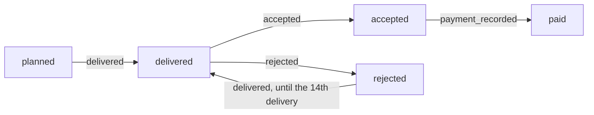

The write path of flow 3:

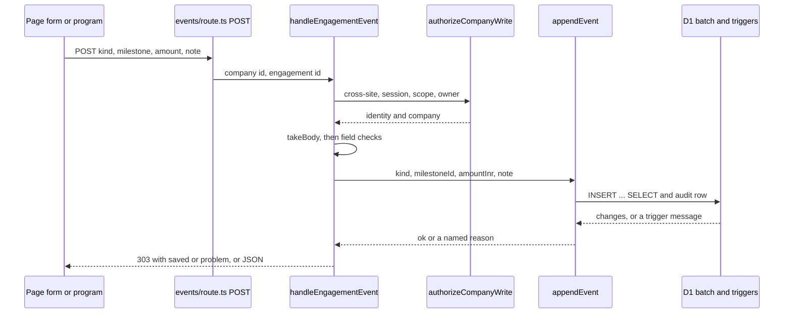

Only `plan_agreed` and `closed` are engagement-level; the other four kinds are milestone-level (`MILESTONE_KINDS`).

#### Rules and the function that decides each

| Rule | Decided in the application by | Held in the database by | Refusal |
| --- | --- | --- | --- |
| One engagement for each requirement; the same provider again returns it; another provider is refused (RULE-34) | `createEngagement` (the `NOT EXISTS` in the insert, then the read of the existing row) | unique index `engagements_one_per_requirement`; trigger `engagements_no_replace` | `already_engaged` |
| The requirement is the company's and not withdrawn | `createEngagement` (the `EXISTS`); the withdrawal is not tested in code | `engagements_needs_an_open_requirement`; the composite foreign key on `requirement_id` and `company_id` in `drizzle/0010_deliver_tables.sql` | `not_found`, `requirement_withdrawn` |
| The provider is listed now and serves that idea in that cluster | not tested in code | `engagements_needs_a_listed_provider` (recreated in 0014 so that it applies to an open requirement only) | `provider_unavailable` |
| A requirement with an engagement is not withdrawn | not in this module | `requirement_events_not_after_engagement` | `engaged` (a procure reason) |
| A plan holds 1 to 12 milestones (RULE-35) | `MAX_MILESTONES` in `state.ts`; the page hides the add form at the limit | `milestones_limit`; CHECK `milestones_seq`; `engagement_events_plan_needs_a_milestone` for the minimum | `too_many`, `no_milestones` |
| Title 1 to 120, test 1 to 500, neither blank | `readText` | CHECKs `milestones_title`, `milestones_test`; `milestones_text_is_not_blank` | `invalid` |
| Due date is a real date from 2000 to 2100 | `isCalendarDate` | CHECK `milestones_due`; `milestones_due_is_a_date` | `invalid` |
| Price is a whole number from 1 to 100,000,000 | `readAmount` | CHECK `milestones_agreed`; `milestones_numbers_are_whole` | `invalid` |
| Milestones are added until the plan is agreed, never after the close | `addMilestone` tells `closed` from `plan_locked` | `milestones_plan_is_open` | `plan_locked`, `closed` |
| The plan is agreed once and only with a milestone | `appendEvent` | `engagement_events_one_plan_agreement`; unique index `engagement_events_one_agreement`; `engagement_events_plan_needs_a_milestone` | `already_agreed`, `no_milestones` |
| Nothing is delivered, accepted, rejected or paid before the plan is agreed | `presentEngagement` offers nothing (`next` is `[]`) | `engagement_events_work_needs_an_agreed_plan` | `not_agreed` |
| The order of a milestone: delivered, then accepted or rejected; a rejected one is delivered again; an accepted one is paid once (RULE-36) | `nextKinds` (what is offered); `appendEvent` (the mapping) | `engagement_events_delivery_follows_nothing_or_a_rejection`, `engagement_events_decision_needs_a_delivery`, `engagement_events_payment_needs_an_acceptance`; unique index `engagement_events_one_payment` | `wrong_state` |
| At most 14 deliveries of a milestone (RULE-37) | `MAX_DELIVERIES`; `nextKinds(state, deliveries)` offers nothing at the cap | `engagement_events_delivery_limit` | `too_many_deliveries` |
| A payment is for an accepted milestone, once, with a whole amount from 1 to 100,000,000; only a payment has an amount (RULE-38) | `readAmount`; the handler's check that no other kind carries an amount | `engagement_events_payment_needs_an_acceptance`, `engagement_events_payment_has_an_amount`, `engagement_events_amount_is_whole`; CHECK `engagement_events_shape` | `wrong_state`, `invalid` |
| A note is at most 500 characters | `readText` with `MAX_NOTE_LENGTH` | `engagement_events_note_is_short` (500 characters and 2,000 bytes) | `invalid` |
| The engagement is closed once, and nothing is recorded after | `appendEvent` | `engagement_events_one_close`, `engagement_events_closed_is_final`; unique index `engagement_events_one_close` | `closed` |
| The status is worked out, never stored (RULE-39) | `statusOf`, `milestoneState` | none (nothing to hold) | none |
| The records are never changed | none: the data layer has no UPDATE, DELETE or REPLACE | `engagements_no_update`, `engagements_no_delete`, `engagements_no_replace`, and the same three for `milestones` and for `engagement_events` | an error that is thrown, not a named refusal |
| The limits in code equal the limits in the database | `modules/deliver/src/state.ts` constants | the numbers in `drizzle/0010_deliver_tables.sql` and `drizzle/0011_deliver_guards.sql` | held by the unit test `modules/deliver/tests/unit/state.test.ts` |

Where several triggers could refuse one event, only one answers: the `WHEN` clauses are written not to overlap, and the order is closed first, then "plan not agreed", then the rest (`drizzle/0011_deliver_guards.sql` comments; FND-149 in [the register](../FINDINGS.md) says SQLite does not define the order triggers run in). Two rules can still overlap for a milestone with a fractional price that is also out of range (FND-142).

The status and state vocabulary, as `state.ts` defines it:

| Name | Values |
| --- | --- |
| `EventKind` | `plan_agreed`, `delivered`, `accepted`, `rejected`, `payment_recorded`, `closed` |
| `MilestoneState` | `planned`, `delivered`, `accepted`, `rejected`, `paid` |
| `EngagementStatus` | `planning` (plan not agreed), `in_progress` (agreed, not closed), `complete` (closed, at least one milestone, every milestone accepted or paid), `ended_early` (closed otherwise, including closed before any plan) |

`nextKinds(state, deliveries)` returns: `planned` gives `delivered`; `rejected` gives `delivered` unless `deliveries >= MAX_DELIVERIES`, when it gives nothing; `delivered` gives `accepted` and `rejected`; `accepted` gives `payment_recorded`; `paid` gives nothing.

`primaryAction` in `summary.ts` picks the one main button of an engagement: first a milestone that may be accepted, then one that may be paid, then one that may be delivered; among milestones the earliest in the plan wins. The other actions stay on the page and are drawn quietly.

#### Refusals and messages

A refusal has a key. The data layer returns the key as `reason`; the handler turns it into a redirect (`?problem=<key>`) or a JSON error. The page shows the message from its own `PROBLEMS` table. The static test `modules/deliver/tests/static/rules.test.ts` holds the two sides together: every `?problem=` key the API sends has a message on `/deliver` or `/procure`, and every message there is sent by something.

| Key | Raised by | JSON answer | Form answer | Message on the page | FSD |
| --- | --- | --- | --- | --- | --- |
| `invalid` | the field checks of `handleMilestoneAdd` and `handleEngagementEvent` | 400 `{ error: "invalid", fields }` | `/deliver?problem=invalid` | `PROBLEMS.invalid` on `/deliver` | MSG-111, MSG-121 to MSG-129 |
| `not_found` | the three appends; `loadEngagement` | 404 `not_found` | `/deliver?problem=missing` (milestone, event) or `/procure?problem=missing` (choosing) | `PROBLEMS.missing` on `/deliver` or `/procure` | MSG-120 |
| `plan_locked` | `addMilestone` | 409 | `/deliver?problem=plan_locked` | `PROBLEMS.plan_locked` | MSG-112 |
| `closed` | `addMilestone`, `appendEvent` | 409 | `/deliver?problem=closed` | `PROBLEMS.closed` | MSG-114 |
| `too_many` | `addMilestone` | 409 | `/deliver?problem=too_many` | `PROBLEMS.too_many` | MSG-113 |
| `already_agreed` | `appendEvent` | 409 | `/deliver?problem=already_agreed` | `PROBLEMS.already_agreed` | MSG-115 |
| `no_milestones` | `appendEvent` | 409 | `/deliver?problem=no_milestones` | `PROBLEMS.no_milestones` | MSG-116 |
| `not_agreed` | `appendEvent` | 409 | `/deliver?problem=not_agreed` | `PROBLEMS.not_agreed` | MSG-117 |
| `wrong_state` | `appendEvent` | 409 | `/deliver?problem=wrong_state` | `PROBLEMS.wrong_state` | MSG-118 |
| `too_many_deliveries` | `appendEvent` | 409 | `/deliver?problem=too_many_deliveries` | `PROBLEMS.too_many_deliveries` | MSG-119 |
| `engage` | `handleEngagementCreate` (no provider id) | 400 `invalid` with `fields.providerId` | `/procure?problem=engage` | `PROBLEMS.engage` on `/procure` | MSG-130 |
| `requirement_withdrawn` | `createEngagement` | 409 | `/procure?problem=withdrawn` | `PROBLEMS.withdrawn` on `/procure` | MSG-131 |
| `provider_unavailable` | `createEngagement` | 409 | `/procure?problem=provider_unavailable` | `PROBLEMS.provider_unavailable` on `/procure` | MSG-131 |
| `already_engaged` | `createEngagement` | 409 | `/procure?problem=already_engaged` | `PROBLEMS.already_engaged` on `/procure` | MSG-131 |

The success notices are `made` (any non-empty value shows MSG-103) and `saved` with one of seven words: `milestone`, `plan_agreed`, `delivered`, `accepted`, `rejected`, `payment_recorded`, `closed` (MSG-104 to MSG-110). The test pins the seven words. The success codes are in MSG-134.

The refusals that come before the module's own code are the platform's: 401 `not_signed_in`, 404 `not_found` (another company or the operator; audited), 403 `forbidden` (a member who is not the owner; audited), 403 `cross_site_refused`, 503 `storage_unavailable`, and 415, 413 and 400 for the body. They are described in [HLD.md](HLD.md) section 4.3 and in API-REFERENCE.md section 2.

#### Invariants

What a change must not break, with the test that notices.

1. **Every query is bound to the company from the identity, never from the URL.** `authorizeCompanyRead` and `authorizeCompanyWrite` return the identity's company; every statement in `modules/deliver/src/db/engagements.ts` binds it, and `SELECT_ENGAGEMENTS` is only used with `WHERE g.company_id = ?`. Held by `modules/deliver/tests/static/rules.test.ts` and `modules/deliver/tests/unit/reads.test.ts`.
2. **Every INSERT checks its parent in the same statement.** Each of the three inserts has `WHERE EXISTS (SELECT 1 FROM <parent> WHERE id = ? AND company_id = ?)`. Held by the static test.
3. **Nothing is updated, deleted or replaced.** No statement in the application does it, and the nine `*_no_update`, `*_no_delete` and `*_no_replace` triggers refuse it in the database. The platform lists them in `modules/platform/src/db/guards.ts` `APPEND_ONLY_TABLES` and `RULE_TRIGGERS`, and the health check needs them to exist.
4. **Only `modules/deliver/src/db/engagements.ts` touches the three tables.** The one exception is the run module's insert, which names `engagements` in an `EXISTS` and nothing else. Held by the static test.
5. **The page offers exactly what the database would accept.** `nextKinds` mirrors the triggers. A unit test reads the trigger text and compares it with the table; an integration test runs every state and every kind against the real triggers (the titles are in the test table below).
6. **Nothing recorded here changes what APLYD earns (D-03).** The only money columns of the database are `listing_terms.fee_inr`, `provider_events.fee_inr`, `milestones.agreed_inr` and `engagement_events.amount_inr`. No file of this module mentions `fee_inr`, `listing_terms` or `currentTerms`, no statement reads a price or a payment together with the fee, and none sums or averages them. Held by the static test and by an integration test that lists providers at different fees and walks the whole path.
7. **The limits are equal in the code and in the migrations.** `MAX_MILESTONES`, `MAX_DELIVERIES`, `MAX_AMOUNT_INR`, `MAX_TITLE_LENGTH`, `MAX_TEST_LENGTH` and `MAX_NOTE_LENGTH` are the numbers in `drizzle/0010_deliver_tables.sql` and `drizzle/0011_deliver_guards.sql`. A change to one needs the other and a new migration (applied migrations are not edited).
8. **A write and its audit row succeed or fail together.** They are one `db.batch`.
9. **A message key has a place on the page, and a page message has a sender.** Held by the static test.
10. **The run module's triggers read this module's rows.** `drizzle/0013_run_guards.sql` finds the first acceptance with `SELECT at FROM engagement_events WHERE ... kind = 'accepted' ORDER BY id LIMIT 1`. Renaming the kind `accepted`, or changing what `at` holds, changes when a review is due; section 4.6 has the other half.

#### Tests it owns

The counts are the ones recorded in `modules/deliver/tests/baseline.json`. I counted the same number of `test(` blocks in each file, and ran the three unit files and the static file with `node --test` (7, 3, 8 and 9 tests passed). I did not run the integration, smoke or browser files.

| Test file | Layer | What it checks |
| --- | --- | --- |
| `modules/deliver/tests/unit/state.test.ts` | unit, 7 | The state of a milestone, `nextKinds` at and before the delivery cap, `statusOf`, `isCalendarDate`, that the state table agrees with the trigger text (a text match, not a run), and that the limits equal the migrations' numbers. |
| `modules/deliver/tests/unit/summary.test.ts` | unit, 8 | The words and counts of `deliverySummary`, `acceptedLabel`, `primaryAction` and `firstWaitingDecision`. |
| `modules/deliver/tests/unit/reads.test.ts` | unit, 3 | With a fake database that records each statement: a single read asks only for that engagement's milestones and events, every statement carries the company, and an over-long id is not looked up. |
| `modules/deliver/tests/static/rules.test.ts` | static, 9 | Append-only queries, company-bound reads, parent-checked inserts, the data layer as the only door, the money columns, no reference to the listing fee, and the message-key and `saved` word contracts. |
| `modules/deliver/tests/integration/deliver-api.test.ts` | integration, 32 | The real handlers on a real D1 (Miniflare) with the real migrations: the choice, the plan, the order, the cap, scope for another company, the operator and a member, cross-site refusal, form answers, every refusal by direct SQL, D-03. Its helper is `modules/platform/tests/support/d1.ts`. |
| `modules/deliver/tests/smoke/deliver.test.ts` | smoke, 8 | The built application over HTTP: the whole path through the pages' endpoints, the 404 for another owner and the operator, the fee on no owner page, the cap on the page. The tests share state and run in order (FND-154). |
| `modules/deliver/tests/browser/deliver.test.ts` | browser, 3 | One owner through the page in Chromium: choose, plan, agree, deliver, accept, pay, close; a bad date, a rejection and a stale form; another owner's page. |

#### Found while writing

8 items, listed in [section 9.7](#97-from-section-45-the-deliver-module).

### 4.6 The run module

#### Purpose

The run module is the fifth stage of the journey. The thesis and the BRD call it Run, the owner pages call it Measure, and its page is Results (see [the glossary](../GLOSSARY.md)). After an owner has accepted work, the module lets the owner:

1. record one baseline for an engagement: a whole number for how things stood before the work, taken before anything is accepted;
2. record up to three reviews, numbered 1 to 3, which open 30, 90 and 180 days after the first acceptance: a whole number, whether the work did what the assessment expected, and whether it is still in use;
3. see what the assessment expected for the idea, the change since the baseline, and the next accepted idea that has no requirement yet.

The module measures nothing. The owner types every number. Nobody else signs in: the code comments cite OQ-13 for "providers do not sign in", a citation already recorded in DATA-DICTIONARY 9 item 1 and API-REFERENCE 6 item 2. Nothing the module stores touches money or the listing fee (D-03, RULE-45).

Three design choices shape every file.

- **State is never stored.** A review is `waiting`, `not_due`, `due` or `recorded`. No column holds that. `modules/run/src/state.ts` `reviewSlots` works it out from the first acceptance, the clock and the reviews on record, each time a page or the read operation needs it.
- **The same order rules are kept twice.** `reviewSlots` and `presentOutcomes` decide what the page offers. Triggers in `drizzle/0013_run_guards.sql` decide what the database accepts. The database has the last word, and `modules/run/src/db/outcomes.ts` `append` turns a trigger's message text into a named refusal.
- **The module reads other stages and writes only its own table.** The first acceptance comes from the deliver module's events, the expected range from the diagnose module's assessment, and the next idea from the procure module's requirements. The run module writes `outcome_events` and `audit_events` and nothing else.

The table is described in [DATA-DICTIONARY.md](DATA-DICTIONARY.md) and the two operations (`GET` and `POST /api/companies/{id}/engagements/{eid}/outcomes`) in [API-REFERENCE.md](API-REFERENCE.md). The screen (SCR-07), the requirements (FR-RUN-01 to FR-RUN-07, with FR-RUN-08 to FR-RUN-13 marked TO BE) and the rules (RULE-40 to RULE-42) are in [the functional specification](../fsd/FSD.md).

#### Files

| File | Holds | Exports |
| --- | --- | --- |
| `modules/run/src/state.ts` | The vocabulary and the pure rules: review days, review numbers, verdicts, uses, the two limits, when a review falls due and the state of each of the three slots, why a baseline cannot be taken now, and the unit words. No I/O. | `REVIEW_DAYS`, `ReviewNo`, `VERDICTS`, `Verdict`, `IN_USE`, `InUse`, `MAX_VALUE`, `MAX_NOTE_LENGTH`, `isReviewNo`, `dueAt`, `ReviewState`, `ReviewSlot`, `reviewSlots`, `BaselineBlock`, `baselineBlock`, `UNIT_LABEL` |
| `modules/run/src/view.ts` | The words and choices of the Results page: the label of each review state, the latest recorded review, the count of recorded reviews, the one sentence for the whole page, the first open review and where the owner's turn is. Pure. | `REVIEW_TAG`, `latestRecorded`, `firstOpenReview`, `recordedCount`, `ResultsView`, `ResultsSummary`, `resultsSummary`, `FirstTurn`, `firstTurn` |
| `modules/run/src/db/schema.ts` | The Drizzle declarations of `outcome_events` and `outcome_corrections`, their keys, indexes and CHECKs. It declares no trigger. | `outcomeEvents`, `outcomeCorrections` |
| `modules/run/src/db/outcomes.ts` | The data layer: two reads (`listOutcomes`, `listCorrections`), two appends (`recordBaseline`, `recordReview`) that share the private `append`, and the append of a correction (`recordCorrection`). | `OutcomeRow`, `listOutcomes`, `RecordResult`, `recordBaseline`, `recordReview`, `CorrectionRow`, `listCorrections`, `CorrectionResult`, `recordCorrection` |
| `modules/run/src/api/outcomes.ts` | The two handlers (a correction is a kind of the POST), the presenter that builds what a viewer needs, the current value of a corrected number, and the private field reader `readValue`. | `PresentedOutcomes`, `Corrected`, `corrected`, `presentOutcomes`, `handleOutcomeRead`, `handleOutcomeRecord` |
| `app/run/page.tsx` | The Results page (SCR-07): the summary card, one card for each engagement and the forms. | `default`, `dynamic` |
| `app/run/run.css` | The page's own styles; every class begins `ru-`. | `none` |
| `app/api/companies/[id]/engagements/[eid]/outcomes/route.ts` | Route for reading and recording measurements. | `dynamic`, `GET`, `POST` |
| `drizzle/0012_run_tables.sql` | The table `outcome_events` and its three indexes. | `none` |
| `drizzle/0013_run_guards.sql` | Nine triggers: three that make the table append-only and six that enforce whole numbers, once-only, order and dates. | `none` |
| `drizzle/0015_run_corrections.sql` | The table `outcome_corrections` and its index; its five triggers (three append-only, whole numbers, the corrected row is the same engagement's and company's); and two triggers on `outcome_events` that refuse a baseline on a closed engagement or before the plan is agreed. | `none` |
| `modules/run/STATUS.md` | The module's status page (not code). | `none` |
| `modules/run/VALIDATION.md` | The module's validation record (not code). | `none` |
| `modules/run/mutations/m10.json` | 77 mutations run by `scripts/mutation/mutate.py` against `modules/run/src/state.ts`, `modules/run/src/db/outcomes.ts`, `modules/run/src/api/outcomes.ts`, `drizzle/0012_run_tables.sql` and `drizzle/0013_run_guards.sql`. | `none` |
| `modules/run/mutations/after-first-run.json` | 27 mutations from the first run, against four of those files (all but `modules/run/src/state.ts`). | `none` |
| `modules/run/tests/baseline.json` | The recorded test counts of the module's six suites. | `none` |

The route file has the same shape as the deliver routes, with a `GET` and a `POST` function (13 lines): each reads `params`, then calls its handler with `env`. It passes no clock, so the handlers use `new Date()`. The migration `drizzle/0014_review_fixes.sql` holds no trigger on `outcome_events`.

#### Data it reads and writes

| Table | Written by | Read by | Notes |
| --- | --- | --- | --- |
| `outcome_events` | `recordBaseline`, `recordReview` (through `append`) | `listOutcomes`, called by `presentOutcomes` and by `modules/journey/src/facts.ts` `loadFacts` | One row for each baseline or review. Never changed. `listOutcomes` is the module's only read, and it is bound to the company and the engagement. |
| `engagements` | not written | the `EXISTS` test inside the insert of `append` | The one statement of the module's own that names another table. |
| `audit_events` | `auditIfChanged` in the same batch as each append | not read by this module | See below. |

The module reads three other stages through their own reads and never by SQL of its own:

| Read | From | Used for |
| --- | --- | --- |
| `loadEngagement` (one engagement, with its milestones and events) and `listEngagements` (the page) | `modules/deliver/src/db/engagements.ts` | The title, the requirement and the events, from which the first acceptance is found |
| `listRequirements` | `modules/procure/src/db/requirements.ts` | The engagement's requirement and its assessment; which ideas already have a requirement, withdrawn ones included |
| `loadAssessment` and `presentAssessment` | `modules/diagnose/src/db/assessments.ts`, `modules/diagnose/src/api/diagnose.ts` | The benefit range of the idea, the standing decision on each idea and the assessment's order |

The triggers of `drizzle/0013_run_guards.sql` read `engagement_events` (the deliver module's table) by SQL: `outcome_events_baseline_before_acceptance`, `outcome_events_review_needs_an_acceptance` and `outcome_events_review_is_due` look for an event with `kind = 'accepted'`, and the last one takes the earliest by `ORDER BY id LIMIT 1`.

Audit entries written:

| Event | Written when | Detail keys |
| --- | --- | --- |
| `outcome.baseline` | `append` inserted a baseline | `engagement`, `review` (always 0) |
| `outcome.review` | `append` inserted a review | `engagement`, `review` (the number, 1 to 3) |
| `outcome.read.denied`, `outcome.write.denied` | `authorizeCompanyRead` or `authorizeCompanyWrite` refused with 404 or 403 (written by the platform, not by the batch) | `requested` (the first 64 characters of the company id in the URL) |

The audit insert is `WHERE changes() > 0` inside one atomic `db.batch`, so a refused append (a trigger aborts it) writes no audit row.

#### Main flows

Both operations have the deliver module's spine: the route calls the handler; a write handler calls `authorizeCompanyWrite` and then `takeBody`; a read handler calls `authorizeCompanyRead`. A form post is answered by a 303 redirect to `/run` carrying `?saved=` or `?problem=`; a JSON post by a status code and a body. A refusal that comes before the body is read (no session, another website, another company, a body that cannot be read) is JSON even for a form; that is [FND-050](../FINDINGS.md).

The field names differ between a form and JSON:

| Meaning | Form field | JSON field |
| --- | --- | --- |
| Baseline or review | `kind` | `kind` |
| The number | `value`, text | `value`, a number or text of 1 to 10 digits |
| Note | `note` | `note` |
| Which review | `review`, text `1`, `2` or `3` | `reviewNo`, a number |
| Did it do what was expected | `verdict` | `verdict` |
| Still in use | `in_use` | `inUse` |

**Flow 1: recording a baseline or a review** (`POST /api/companies/{id}/engagements/{eid}/outcomes`, posted by the forms on `/run`).

1. `app/api/companies/[id]/engagements/[eid]/outcomes/route.ts` `POST` calls `handleOutcomeRecord` with the company id and the engagement id from the URL. No clock is passed, so `now` is `() => new Date()`.
2. `authorizeCompanyWrite(request, env, requestedId, "outcome.write.denied")` answers 403 `cross_site_refused` first, then 503, 401, 404 (another company or the operator; audited) or 403 `forbidden` (a member who is not the owner; audited).
3. `takeBody` reads the body (415, 413 or 400 for a body that cannot be read).
4. The handler reads each field with `bodyField`. `readValue` accepts a JSON number or text that is 1 to 10 digits after trimming, and returns null unless the result is a whole number from 0 to `MAX_VALUE`. The note is optional, is trimmed, and is refused if it is not text, is over `MAX_NOTE_LENGTH` or holds a character `hasControlCharacters` refuses. The review number is read from `review` (a form: only the text `1`, `2` or `3` is turned into a number) or from `reviewNo` (JSON: a number is required).
5. For `kind` equal to `review` the handler requires a review number (`isReviewNo`), a verdict from `VERDICTS` and a use from `IN_USE`. For `baseline` it refuses a review number, a verdict or a use that is present and not empty. Every error is collected into `fields`.
6. Any error answers a form with `/run?problem=invalid` and JSON with 400 `{ error: "invalid", fields }`. An engagement id that is empty or over 64 characters answers `/run?problem=missing` or 404 `not_found`. Both checks run before the database is asked.
7. `recordBaseline` or `recordReview` calls `append`, which runs one `db.batch([insert, audit])`. The insert is `INSERT ... SELECT ... WHERE EXISTS (an engagement with this id and this company)`; the audit row is `outcome.baseline` or `outcome.review`. The stamp `at` is `now().toISOString()`.
8. The triggers decide the rest. `append` matches the message text of an aborted batch and returns a named reason (the mapping is in the rules table). Any other error is thrown again. If the insert changed no row, the reason is `not_found`.
9. The handler answers. On success a form goes to `/run?saved=baseline` or `/run?saved=review` and JSON gets 201 `{ ok: true }`. `not_found` is `/run?problem=missing` or 404; every other reason is `/run?problem=<reason>` or 409 `{ error: <reason> }`.

**Flow 2: reading** (`GET /api/companies/{id}/engagements/{eid}/outcomes`).

1. `handleOutcomeRead` calls `authorizeCompanyRead(request, env, requestedId, "outcome.read.denied")`. There is no cross-site check and no owner check: a member of the company may read.
2. `loadEngagement` returns null at once for an id that is empty or over 64 characters, and for another company's engagement exactly as for one that does not exist. The handler answers 404 `not_found` with no audit row.
3. `presentOutcomes` builds the view (flow 3) and the handler answers 200 with it.

**Flow 3: building the view** (`presentOutcomes`).

1. `listOutcomes` returns the engagement's rows in id order. The baseline is the first row of kind `baseline`; the reviews are the rows of kind `review`.
2. The first acceptance is the `accepted` event with the lowest id among `e.events`. Its `at` is `firstAcceptedAt`, or null.
3. `listRequirements` gives the company's requirements. The engagement's own requirement leads, through `loadAssessment` and `presentAssessment`, to the assessment. `expected` is the benefit (measure, unit, low, high) of the item whose idea is the engagement's, with `synthetic` copied from the assessment's result; it is null when the requirement or the assessment cannot be found, or when the idea is not among the items.
4. `next` is the first item, in the assessment's order, whose standing decision is `accept` and whose idea has no requirement in the same assessment. The set of ideas that have one is built from every requirement of that assessment, withdrawn ones included, so a withdrawn requirement counts as asked.
5. `reviewSlots({ firstAcceptedAt, now, recorded })` gives the three slots. Each slot gets its `record` (time, value, verdict, use, note) from the review row with that number, or null.
6. `changeSinceBaseline` is the value of the highest-numbered recorded review less the baseline's value, and null unless both exist. It is not compared with `expected`: which way is better depends on the measure.
7. `canRecordBaseline` is true when there is no baseline and nothing is accepted. It does not look at whether the engagement is closed (see Found while writing).

**Flow 4: drawing the page** (`app/run/page.tsx` `Run`).

1. `resolveIdentityFromCookieHeader` reads the session. No identity gives `SignedOut`; an identity that is not an owner with a company, or no database binding, gives `NotOwner` (both from `app/_ui/parts.tsx`).
2. `listEngagements` returns every engagement of the company, closed ones included, and `presentOutcomes` runs for each one, all at the same `new Date()`.
3. `resultsSummary` gives the one sentence and the tag ("Your turn" or "Nothing to do now"); `firstTurn` gives the link target, an in-page anchor `#rv-<engagement id>-<n>` or `#bl-<engagement id>`.
4. Each engagement card draws: the expected range (or the notice that the assessment could not be read); the baseline block (the number, the form when `canRecordBaseline`, or the notice `no-baseline`); the figures once a review is recorded, using `latestRecorded`; and the three review items. A review item draws its record when recorded, the text "Starts when you accept your first milestone." when `waiting`, "Opens on <date>." when `not_due`, and otherwise (state `due`) the form. The form's button is the main button only when it is the review `firstOpenReview` names.
5. The `next` line, the collapsed "About these numbers and dates" card and the three links close the page. No script runs on the page.
6. `saved` and `problem` are looked up with `Object.hasOwn` in `SAVED` and `PROBLEMS`, so an unknown value shows nothing.

The state of a review slot, as `reviewSlots` computes it:

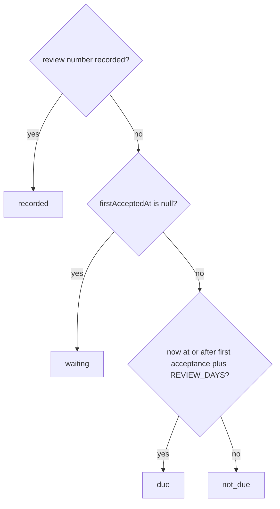

The write path of flow 1:

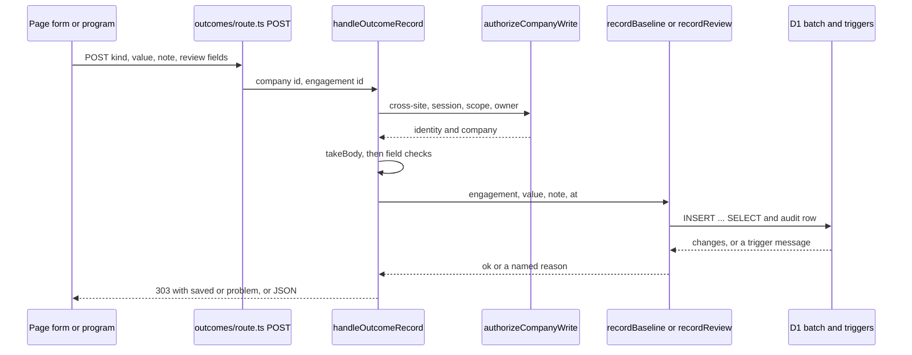

#### Rules and the function that decides each

| Rule | Decided in the application by | Held in the database by | Refusal |
| --- | --- | --- | --- |
| The baseline is one whole number from 0 to 1,000,000,000 with an optional note (RULE-40) | `readValue`, `MAX_VALUE`; the field checks of `handleOutcomeRecord` | CHECK `outcome_events_value`; trigger `outcome_events_value_is_whole` | `invalid` (the database's refusal is an error that is thrown, not a named reason) |
| A review's figure has the same limits (RULE-41) | the same `readValue` | the same CHECK and trigger | `invalid` |
| A note is at most 500 characters and holds no control character | the handler, with `MAX_NOTE_LENGTH` and the factory's `hasControlCharacters` | CHECK `outcome_events_note` (counts with `length()`, see FND-039 in Found while writing) | `invalid` |
| A baseline has no review number, verdict or use; a review has all three | the two branches in `handleOutcomeRecord` | CHECK `outcome_events_shape`, which names every needed column as NOT NULL as well as in range | `invalid` |
| A review number is 1, 2 or 3 | `isReviewNo`; the form converts only `1`, `2`, `3`; JSON must send a number | CHECK `outcome_events_shape` | `invalid` |
| One baseline for each engagement (RULE-40) | `append` maps the message | unique index `outcome_events_one_baseline`; trigger `outcome_events_one_baseline_only` ("a baseline is recorded once") | `baseline_exists` |
| The baseline is taken before anything is accepted (RULE-40) | `presentOutcomes` `canRecordBaseline` hides the form | trigger `outcome_events_baseline_before_acceptance` ("a baseline is recorded before anything is accepted") | `baseline_too_late` |
| One review of each number for each engagement (RULE-41) | `append` maps the message | unique index `outcome_events_one_review`; trigger `outcome_events_one_review_each` ("this review is recorded once") | `review_exists` |
| A review needs an accepted milestone (RULE-41) | `reviewSlots` gives `waiting`, so the page draws no form | trigger `outcome_events_review_needs_an_acceptance` ("a review needs an accepted milestone") | `nothing_accepted` |
| A review is recorded only from its day: 30, 90 and 180 days after the first acceptance (RULE-41) | `REVIEW_DAYS`, `dueAt`, `reviewSlots` (milliseconds) | trigger `outcome_events_review_is_due` ("this review is not due yet"), which compares `julianday(NEW.at)` with `julianday` of the first acceptance plus 30, 90 or 180 | `not_due` |
| A late review is still recorded; the reviews are independent, so review 3 may be recorded before review 1 | `reviewSlots` judges each number on its own | no trigger orders the numbers | none |
| The first acceptance is the earliest `accepted` event of the engagement | `presentOutcomes` and `engagementFacts` (sort by event id) | the `ORDER BY id LIMIT 1` inside `outcome_events_review_is_due` | none |
| The engagement is the company's | the `EXISTS` in the insert; `loadEngagement` for the read | the composite foreign key on `engagement_id` and `company_id` in `drizzle/0012_run_tables.sql` | `not_found` |
| The change since the baseline is the latest recorded review less the baseline, in the assessment's unit (RULE-42) | `presentOutcomes`; the unit word from `UNIT_LABEL` | none | none |
| The next idea is the first accepted idea of the same assessment that has no requirement, withdrawn ones included (RULE-42; FND-168) | `presentOutcomes` | none | none |
| The records are never changed | none: the data layer has no UPDATE, DELETE or REPLACE | `outcome_events_no_update`, `outcome_events_no_delete`, `outcome_events_no_replace` | an error that is thrown |
| The day counts in code equal the day counts in the database | `REVIEW_DAYS` | the `CASE NEW.review_no WHEN 1 THEN 30 WHEN 2 THEN 90 WHEN 3 THEN 180` in `0013` | held by the unit test `modules/run/tests/unit/state.test.ts` |

The `WHEN` clauses of the six rule triggers are written not to overlap, because SQLite does not define the order in which triggers run (the comment at the top of `drizzle/0013_run_guards.sql`; [FND-149](../FINDINGS.md) records the problem). `outcome_events_value_is_whole` fires on a figure or review number that is not an integer, and each of the other five rule triggers begins its `WHEN` with `typeof(...) = 'integer'` for both. A second baseline or review is refused as "once" before any other rule is looked at. The two review triggers `outcome_events_review_needs_an_acceptance` and `outcome_events_review_is_due` are mutually exclusive because one needs no accepted event and the other needs one.

The vocabulary, as `state.ts` defines it:

| Name | Values |
| --- | --- |
| `REVIEW_DAYS` | 30, 90, 180 (assumptions) for review numbers 1, 2, 3 |
| `VERDICTS` | `met`, `partly`, `not_met` |
| `IN_USE` | `yes`, `no` |
| `ReviewState` | `waiting` (nothing accepted), `not_due` (accepted, the day has not come), `due` (it can be recorded now), `recorded` |
| `UNIT_LABEL` | `percent` is "percent", `days` is "days", `rupees_per_year` is "rupees a year" |

How `view.ts` decides what the page says:

- `resultsSummary(list)` returns the one sentence in this order: if any review is `due`, "N reviews are open now."; otherwise, if any engagement can still take a baseline, "Write down your starting number before the first milestone is accepted."; otherwise, if a review is `not_due`, "Nothing needs you today. The next review opens on <date>." with the earliest UTC date; otherwise, if every review of every engagement is `recorded`, "Every review is recorded."; otherwise "Nothing needs you today. The reviews are counted from the day you accept your first milestone." `yourTurn` is true when a review is due or a baseline can be taken.
- `firstTurn(list)` uses the same order: the first engagement, in the order of the list, that has a due review (and within it the first due review, `firstOpenReview`); otherwise the first engagement that can take a baseline.
- Nothing in `view.ts` judges a number.

#### Refusals and messages

A refusal has a key. The data layer returns it as `reason`; the handler turns it into a redirect (`?problem=<key>`) or a JSON error. The page shows the sentence from its own `PROBLEMS` table. The static test `modules/run/tests/static/rules.test.ts` holds the two sides together: every `?problem=` key the API sends has a message on `/run`, and every message there is sent by something.

| Key | Raised by | JSON answer | Form answer | Message on the page | FSD |
| --- | --- | --- | --- | --- | --- |
| `invalid` | the field checks of `handleOutcomeRecord` | 400 `{ error: "invalid", fields }` | `/run?problem=invalid` | `PROBLEMS.invalid` | MSG-138; the field messages are MSG-145 to MSG-151 |
| `not_found` | an engagement id that is empty or over 64 characters; `append` when no row was inserted | 404 `not_found` | `/run?problem=missing` | `PROBLEMS.missing` | MSG-144 |
| `baseline_exists` | `append` | 409 | `/run?problem=baseline_exists` | `PROBLEMS.baseline_exists` | MSG-139 |
| `baseline_too_late` | `append` | 409 | `/run?problem=baseline_too_late` | `PROBLEMS.baseline_too_late` | MSG-140 |
| `review_exists` | `append` | 409 | `/run?problem=review_exists` | `PROBLEMS.review_exists` | MSG-141 |
| `nothing_accepted` | `append` | 409 | `/run?problem=nothing_accepted` | `PROBLEMS.nothing_accepted` | MSG-142 |
| `not_due` | `append` | 409 | `/run?problem=not_due` | `PROBLEMS.not_due` | MSG-143 |

The field messages the JSON answer carries in `fields` (the form shows only `PROBLEMS.invalid`):

| Field | Message | Sent when | FSD |
| --- | --- | --- | --- |
| `kind` | `Say whether this is a baseline or a review.` | `kind` is neither | MSG-145 |
| `value` | `Give a whole number from 0 to 1000000000.` | `readValue` returns null | MSG-146 |
| `note` | `Keep the note to text under 500 characters.` | not text, too long, or a refused character | MSG-147 |
| `reviewNo` | `Say which review: 1, 2 or 3.` | a review with no number from 1 to 3 | MSG-148 |
| `verdict` | `Say whether it did what the assessment expected.` | a review with no verdict from `VERDICTS` | MSG-149 |
| `inUse` | `Say whether it is still in use.` | a review with no use from `IN_USE` | MSG-150 |
| `reviewNo`, `verdict` or `inUse` | `A baseline has no review number, verdict or use.` | a baseline that carries one | MSG-151 |

The success notices are `saved=baseline` (MSG-136) and `saved=review` (MSG-137); the JSON success is 201 `{ ok: true }` (MSG-153) and the five 409 answers are MSG-152. A visitor on `/run` sees `SignedOut` (MSG-135) and a person who is not an owner sees `NotOwner` (MSG-10 when the account has no company, MSG-198 when it has one and is not its owner; `app/run/page.tsx` passes `hasCompany` to `NotOwner` to choose the words). The platform's refusals before the module's own code (401 `not_signed_in`, 404 `not_found`, 403 `forbidden`, 403 `cross_site_refused`, 503 `storage_unavailable`, and 415, 413 and 400 for the body) are described in [HLD.md](HLD.md) section 4.3 and in API-REFERENCE.md section 2.

`PROBLEMS.invalid` on the page prints the limit with `MAX_VALUE.toLocaleString("en-IN")`, so it reads "1,00,00,00,000"; the field message in the JSON answer prints plain digits. Both are as MSG-138 and MSG-146 give them.

#### Invariants

What a change must not break, with the test that notices.

1. **Every query is bound to the company from the identity, never from the URL.** `listOutcomes` has `WHERE company_id = ? AND engagement_id = ?`, the insert binds `company_id`, and the platform's `authorizeCompany*` return the identity's company. Held by `modules/run/tests/static/rules.test.ts` and by the integration test that tries another company, the operator and a visitor.
2. **The insert checks its parent in the same statement.** `WHERE EXISTS (SELECT 1 FROM engagements WHERE id = ? AND company_id = ?)`. Held by the static test, which also requires exactly one read and exactly one insert on the table.
3. **Nothing is updated, deleted or replaced.** No statement does it, and the three `outcome_events_no_*` triggers refuse it. The platform lists them in `modules/platform/src/db/guards.ts` `APPEND_ONLY_TABLES` and the six rule triggers in `RULE_TRIGGERS`; the health check needs all of them to exist.
4. **Only `modules/run/src/db/outcomes.ts` touches `outcome_events`.** The one other table the module's own SQL names is `engagements`, in the insert. Held by the static test.
5. **The page offers what the database would accept.** `reviewSlots`, `canRecordBaseline` and the forms mirror the triggers. The unit test reads `drizzle/0013_run_guards.sql` and `drizzle/0012_run_tables.sql` and compares the day counts, the limits and the lists of verdicts and uses with the code; an integration test runs each refusal against the real triggers by direct SQL.
6. **Nothing recorded here changes what APLYD earns (D-03).** The static test pins the column list of `outcome_events` (`id`, `engagement_id`, `company_id`, `at`, `user_id`, `kind`, `review_no`, `value`, `verdict`, `in_use`, `note`) and forbids `fee`, `commission`, `price`, `amount`, `rupee`, `inr` and `payment` in the table's text. It forbids `fee_inr`, `listing_terms`, `currentTerms` and `provider_events` in every application file of `modules/run/` and `app/run/` (tests are not scanned), forbids `SUM`, `AVG`, `MAX`, `MIN` and `COUNT` in a query of `outcome_events`, and forbids the words "fee", "commission" and "rupee" and the rupee sign on the page.
7. **A write and its audit row succeed or fail together.** They are one `db.batch`.
8. **A message key has a place on the page and a page message has a sender; the `saved` words are `baseline` and `review`.** Held by the static test.
9. **The first acceptance means the same to the page and to the trigger.** Both take the `accepted` event with the lowest id of the engagement. Renaming the kind, or reordering events in `modules/deliver/src/db/engagements.ts`, changes when a review is due. Section 4.5 has the other half.
10. **The journey module reads this module's reads.** `modules/journey/src/facts.ts` calls `listOutcomes` and `modules/journey/src/progress.ts` calls `reviewSlots`. A change to the fields of `OutcomeRow` or to the states of `ReviewState` reaches the home page and every stage strip (section 4.7).
11. **The control-character rule for a note is the factory's.** `hasControlCharacters` lives in `modules/factory/src/questionnaire.ts` and is also used by the deliver, procure and diagnose handlers (RULE-12 says the other notes use the same test). Changing it changes the note rule of every one of them.

#### Tests it owns

The counts are the ones in `modules/run/tests/baseline.json` (63 in all). I counted the same number of top-level `test(` blocks in each file, and ran the two unit files and the static file with `node --test` (6, 9 and 8 tests passed). I did not run the integration, smoke or browser files.

| Test file | Layer | What it checks |
| --- | --- | --- |
| `modules/run/tests/unit/state.test.ts` | unit, 6 | `reviewSlots` at 30, 90 and 180 days to the millisecond, the waiting state, a recorded slot, review numbers, and that the day counts, limits and vocabularies equal the migrations' (a text match, not a run). |
| `modules/run/tests/unit/view.test.ts` | unit, 9 | The label of each state, the latest recorded review, the count, the first open review, the sentence of `resultsSummary`, and the target of the link at the top. |
| `modules/run/tests/static/rules.test.ts` | static, 8 | Append-only queries, company-bound reads, one parent-checked insert, the data layer as the only door, the column list, no reference to the listing fee, and the message-key and `saved` contracts. It reads SQL string literals with `modules/platform/tests/support/sql-rules.ts`. |
| `modules/run/tests/integration/run-api.test.ts` | integration, 29 | The real handlers on a real D1 (Miniflare) with the real migrations and a handed-in clock: the baseline and its limits, each review on its day, the first acceptance against the latest, late and independent reviews, field checks, scope for another company, the operator, a visitor and a member, cross-site refusal, every refusal by direct SQL, form answers, two engagements of one company, the next idea, a withdrawn requirement, and D-03. Its helper is `modules/platform/tests/support/d1.ts`. |
| `modules/run/tests/smoke/run.test.ts` | smoke, 7 | The built application over HTTP: the empty page, set-up, the baseline form and its refusals, the dates after the first acceptance and an early review sent back, the next idea, another company. The tests share state and run in order ([FND-154](../FINDINGS.md)). |
| `modules/run/tests/browser/run.test.ts` | browser, 4 | An owner in Chromium: the baseline, then the dates; a due review recorded from the page with the change and the next idea shown; a stale review form and a missing baseline; another owner's page. A review that is due needs an acceptance dated in the past, which the test adds with `exec` from `modules/platform/tests/support/worker.ts` (the page's clock cannot be moved). |

The mutation lists `modules/run/mutations/m10.json` and `modules/run/mutations/after-first-run.json` are run by `scripts/mutation/mutate.py`; I did not run them.

#### Found while writing

4 items, listed in [section 9.8](#98-from-section-46-the-run-module).

### 4.7 The journey module

#### Purpose

The journey module says where an owner is on the five stages and what is the owner's turn. It is not a stage. It has no table, no route, no page and no handler. It holds two files of code:

1. `modules/journey/src/facts.ts` reads a small set of facts about one company by calling the stage modules' own reads.
2. `modules/journey/src/progress.ts` turns those facts, and the time, into four answers: the one next step (`nextStep`), whether that step needs the owner (`isOwnersTurn`), the status of each stage (`stageStatuses`) and a line of words for each stage (`stageLine`).

The pages in `app/` draw the answers: the home page, the five-step strip and the "Your next step" card on every owner stage page, and the step shown after a sign-off. Nothing the module works out is stored. Each page view works it out again from the records, so the answer is always what the records say.

The stage names differ by audience (see [the glossary](../GLOSSARY.md)): the thesis and the BRD say Describe, Diagnose, Procure, Deploy and Run; the owner pages say Describe, Decide, Choose, Deliver and Measure; the page names are "Describe your factory", "What to do about it", "What you need", "Delivery" and "Results". `STAGES` in `modules/journey/src/progress.ts` holds all of them: the stage id (`describe`, `diagnose`, `procure`, `deliver`, `run`), its number, the one word for the strip (`short`), the page's name (`page`), the address (`href`) and a sentence on what the stage is (`what`).

Three design choices shape the module.

- **The decision is a pure function.** `nextStep(facts, now)` takes plain data and a time and returns plain data. The same facts and the same time give the same step, so a person can check by hand why the home page says what it says. The time matters only through `reviewSlots` of the run module, so a day passing can change the step with no write.
- **The facts reader has no query of its own.** `loadFacts` calls the stage modules' own read functions. All of them are bound to the company id they are given except `listedProvidersFor`, which reads the providers that every company shares (see Data it reads and writes). The static tests of the domain modules scan the source files of every module (`applicationFiles` in `modules/platform/tests/support/sql-rules.ts`), so a SQL string naming one of their tables in `facts.ts` would fail them.
- **A step can say that nothing is needed.** Three of the 18 keys (`keep_going`, `waiting_for_listing` and `caught_up`) are not the owner's turn, and `isOwnersTurn` says so. The strip marks no stage as "your turn" for them, and a stage page that is not about them does not repeat them at its foot. The home page still shows them.

The screens and rules are in [the functional specification](../fsd/FSD.md): FR-UX-19 (the facts), FR-UX-20 (the next step), FR-UX-21 (the statuses and the lines), and, for the pages that draw them, FR-UX-16 to FR-UX-18 and FR-UX-22. The module has no operation in [API-REFERENCE.md](API-REFERENCE.md).

#### Files

| File | Holds | Exports |
| --- | --- | --- |
| `modules/journey/src/progress.ts` | The five stages, the shape of the facts, the 19 rules of `nextStep` (18 keys), `isOwnersTurn`, the status of each stage, and the line under each stage. Pure: no I/O and no clock (the time is a parameter). | `STAGE_IDS`, `StageId`, `Stage`, `STAGES`, `stageById`, `EngagementFacts`, `Facts`, `NO_FACTS`, `milestoneStatesOf`, `StageStatus`, `NextStep`, `isOwnersTurn`, `nextStep`, `stageStatuses`, `StageProgress`, `stageProgress`, `stageLine` |
| `modules/journey/src/facts.ts` | The reader: builds `Facts` for one company from the stage modules' reads, and the one-engagement helper. Writes nothing. | `engagementFacts`, `loadFacts` |
| `modules/journey/STATUS.md` | The module's status page (not code). | `none` |
| `modules/journey/VALIDATION.md` | The module's validation record (not code). | `none` |
| `modules/journey/tests/baseline.json` | The recorded test counts of the module's four suites. | `none` |

The module has no mutation list. The pages that use it are not part of it:

| Consumer | What it calls | What it draws |
| --- | --- | --- |
| `app/_ui/parts.tsx` | `loadFacts`, `stageStatuses`, `nextStep`, `isOwnersTurn`, `STAGES`, `STAGE_IDS`, `stageById` | `Page` loads the facts, inside a `try`, for an owner with a company and a bound database, then draws `Strip` (the five steps), `PageHead` (the line "Step N of 5") and `NextUp` (the card "Your next step") |
| `app/page.tsx` | `loadFacts`, `nextStep`, `stageStatuses`, `stageLine`, `STAGES` | The home page: the next step first, then one card for each stage. It loads the facts with no `try` |
| `app/diagnose/page.tsx` | `loadFacts`, `nextStep` | The step after a sign-off, passed through `afterSignOff` in `modules/diagnose/src/progress.ts`. It loads the facts with no `try` |

`afterSignOff` takes the step as a `TurnLike`, which is a copy of the type, and has its own copy of the set of steps that need nothing from the owner. `modules/diagnose/tests/unit/progress.test.ts` imports `NO_FACTS` and `nextStep` to test `afterSignOff` against the real step.

#### Data it reads and writes

The module writes nothing: no table, no audit row. It reads through the stage modules' reads and never by SQL of its own.

| Read | From | Becomes |
| --- | --- | --- |
| `loadLatest(db, companyId, "any")` and `loadLatest(db, companyId, "confirmed")` | `modules/factory/src/db/revisions.ts` | `factory.latestRevision` and `factory.confirmedRevision`: the number of the newest version and of the newest confirmed version, each null when there is none |
| `listAssessments` | `modules/diagnose/src/db/assessments.ts` | `assessment`: `items` (the length of the stored result's list), `decided` (the count of distinct ideas with a decision event) and `signedOff` of the counted assessment, or null |
| `loadAssessment`, only when the counted assessment is signed off, and `standingDecisions` | `modules/diagnose/src/db/assessments.ts` and `modules/diagnose/src/digest.ts` | `ideasToAsk` |
| `listRequirements` | `modules/procure/src/db/requirements.ts` | `requirements` (those with no withdrawal) and `requirementsWithoutProvider` (of those, the ones no engagement names) |
| `listedProvidersFor`, once for each requirement without a provider | `modules/procure/src/db/providers.ts` | `requirementsToChoose` (of those, the ones with at least one listed provider) |
| `listEngagements` | `modules/deliver/src/db/engagements.ts` | `engagements`, through `engagementFacts` |
| `listOutcomes`, once for each engagement | `modules/run/src/db/outcomes.ts` | `baselineRecorded` and `reviewsRecorded` of each engagement |

`listedProvidersFor(db, opportunityId, cluster)` takes no company id. It returns the providers whose latest event is a listing and that serve the idea in the cluster, and it selects the id, the name and the summary and no fee. `loadFacts` keeps only the length of the list. `modules/procure/src/api/requirements.ts` (`presentRequirements`) calls the same read for the Choose page, so the page and the home page ask the same question.

`Facts` has the fields below. `NO_FACTS` is the value for a company that has done nothing, with every count zero, both versions null and no engagement.

| Field | Meaning |
| --- | --- |
| `factory.latestRevision`, `factory.confirmedRevision` | The newest saved version and the newest confirmed version, each a number or null |
| `assessment` | `items`, `decided` and `signedOff` of the counted assessment (the newest signed-off one, else the newest), or null |
| `ideasToAsk` | Of the ideas the owner accepted in the counted assessment, when it is signed off, how many have no requirement. A requirement that was withdrawn still counts as asked for, because a withdrawn requirement is not made again. Zero when nothing is signed off |
| `requirements` | Requirements that were not withdrawn |
| `requirementsWithoutProvider` | Of those, the ones for which no provider has been chosen |
| `requirementsToChoose` | Of those, the ones that have at least one listed provider. Never more than `requirementsWithoutProvider` |
| `engagements` | One `EngagementFacts` for each engagement, below |

`engagementFacts(g, outcomes)` builds one `EngagementFacts` from an `EngagementRecord` and its outcome rows:

| Field | Worked out as |
| --- | --- |
| `planAgreed` | some event of kind `plan_agreed` |
| `closed` | some event of kind `closed` |
| `milestones` | for each milestone in plan order, the events of that milestone whose kind is in `MILESTONE_KINDS`, sorted by event id, passed to `milestoneStatesOf` and so to `milestoneState` of the deliver module |
| `baselineRecorded` | some outcome of kind `baseline` |
| `firstAcceptedAt` | the `at` of the `accepted` event with the lowest id in the whole engagement, or null |
| `reviewsRecorded` | the review numbers of the outcomes of kind `review` |

#### Main flows

**Flow 1: loading the facts** (`loadFacts(db, companyId)`).

1. The caller passes the company id of the signed-in owner; `modules/journey/src/facts.ts` takes no id from a URL.
2. `Promise.all` runs five reads together: `loadLatest` for the newest version, `loadLatest` for the newest confirmed one, `listAssessments`, `listRequirements` and `listEngagements`.
3. `Promise.all` then runs `listOutcomes` once for each engagement.
4. The counted assessment is `assessments.find((a) => a.signedOffAt !== null) ?? assessments[0] ?? null`. `listAssessments` returns the newest first, so this is the newest signed-off assessment, or else the newest. A newer one that is not signed off is not asked about while an older, signed-off one is what the work came from.
5. `requirements` is the count of requirements with `withdrawnAt === null`. `requirementsWithoutProvider` counts those whose id is not the `requirementId` of any engagement.
6. `Promise.all` runs `listedProvidersFor` once for each requirement without a provider. `requirementsToChoose` counts those for which the list is not empty.
7. When the counted assessment has a sign-off, `loadAssessment` loads it. `asked` is the set of idea ids of every requirement of that assessment, withdrawn ones included. `ideasToAsk` counts the items of `standingDecisions` (the decision that stands on each item) whose decision is `accept` and whose idea is not in `asked`. When the assessment cannot be loaded, `ideasToAsk` stays 0.
8. Each engagement becomes `engagementFacts(g, outcomes[i])`. The function returns `Facts`. A company id that has no records gives the same value as `NO_FACTS` (an integration test asserts it for an id that does not exist).

**Flow 2: working out the answers** (`nextStep`, `isOwnersTurn`, `stageStatuses`, `stageLine`).

1. `nextStep(facts, now)` tries the rules in the table below in order and returns the first that fits, as `{ stage, key, title, body, cta, href }`. The `href` is the stage's own page (`stageById(stage).href`); the step names no record and no anchor.
2. `isOwnersTurn(step)` is false for `keep_going`, `waiting_for_listing` and `caught_up`, and true for the other 15 keys.
3. `stageStatuses(facts, now)` calls `nextStep`, then sets each stage to `current` when `isOwnersTurn` is true for the step and the stage is the step's stage, else to `done` when its done test holds, else to `todo`.
4. `stageLine(stage, facts, now)` returns one line of words for a stage (the lines are in FSD FR-UX-21).
5. Only `reviewSlots` of `modules/run/src/state.ts` reads `now`. Rule 9, the date in rule 16 and the line under Measure therefore change with the clock; everything else changes only when a record does.

**Flow 3: a page uses the answers** (every owner stage page, the home page, and `/diagnose` after a sign-off).

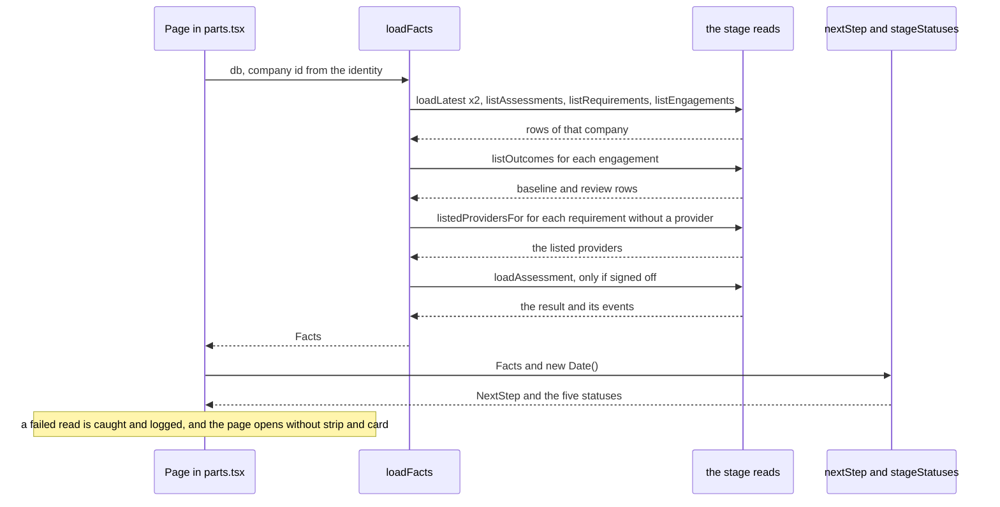

1. `Page` in `app/_ui/parts.tsx` calls `loadFacts` only when the identity is an owner with a company and the database is bound. A visitor, a member and the operator get no strip and no card. The call is inside a `try`: when a read throws, `Page` logs `journey.facts_failed` with the error's message and goes on with no facts.
2. `Page` draws `Strip` from `stageStatuses(facts, new Date())`, then the page head, then the page's own content, then `NextUp` unless the page passed `hideNext`.
3. `NextUp` calls `nextStep(facts, new Date())` itself and draws nothing when the step's stage is the page's own stage or `isOwnersTurn` is false for the step.
4. `app/page.tsx` loads the facts with no `try`, reads one `new Date()` and uses it for `nextStep`, `stageStatuses` and every `stageLine`.
5. `app/diagnose/page.tsx` loads the facts a second time after a sign-off, with no `try`, and passes the step to `afterSignOff`. It returns the step's words unless the step's key is in its own copy of the nothing-needed set or the step's stage is `describe` or `diagnose`. The page then passes `hideNext` so the step is not drawn twice.

#### Rules and the function that decides each

`nextStep` in `modules/journey/src/progress.ts` decides every rule. The words of each step are in FSD FR-UX-20 ("The next-step rules"); this table gives the conditions as the code states them. The order is the order of the code. There are 19 rules and 18 keys: `record_baseline` is rule 7 and rule 11.

| Order | Key | Stage id | Fires when | Decided by |
| --- | --- | --- | --- | --- |
| 1 | `describe` | `describe` | `factory.latestRevision` is null | `nextStep` |
| 2 | `confirm` | `describe` | `factory.confirmedRevision` is null | `nextStep` |
| 3 | `diagnose` | `diagnose` | `assessment` is null | `nextStep` |
| 4 | `no_ideas` | `describe` | the counted assessment is not signed off and `items` is 0 | `nextStep` |
| 5 | `decide` | `diagnose` | the counted assessment is not signed off and `decided < items`; the title counts `items - decided` ideas, with "idea" or "ideas" | `nextStep`, `plural` |
| 6 | `sign_off` | `diagnose` | the counted assessment is not signed off (and so `decided >= items` and `items > 0`) | `nextStep` |
| 7 | `record_baseline` | `run` | some engagement passes both `hasDelivery` and `canRecordBaseline`; the title is "Write down your starting number first" | `nextStep`, `hasDelivery`, `canRecordBaseline` |
| 8 | `judge_delivery` | `deliver` | some engagement passes `hasDelivery` | `hasDelivery` |
| 9 | `review_due` | `run` | a slot of any engagement, closed or not, has the state `due`; the title is "Review N is open" for one slot and "K reviews are open" for more | `slotsOf`, which calls `reviewSlots` of the run module |
| 10 | `agree_plan` | `deliver` | some engagement has `!planAgreed && !closed` | `nextStep` |
| 11 | `record_baseline` | `run` | some engagement passes `canRecordBaseline`; the title is "Write down your starting number" | `canRecordBaseline` |
| 12 | `choose_provider` | `procure` | `requirementsToChoose > 0` | `loadFacts`, which counts it with `listedProvidersFor` |
| 13 | `make_requirement` | `procure` | `requirements === 0`, there is no engagement and `ideasToAsk > 0` | `nextStep`; `ideasToAsk` comes from `loadFacts` |
| 14 | `new_assessment` | `describe` | the same as rule 13 with `ideasToAsk === 0` | `nextStep` |
| 15 | `close_engagement` | `deliver` | some engagement passes `allAccepted` | `allAccepted` |
| 16 | `keep_going` | `deliver` | some engagement that is not closed has `statusOf(...) === "in_progress"`; the body is described below | `statusOf` of the deliver module, `slotsOf`, `readable` |
| 17 | `waiting_for_listing` | `procure` | `requirementsWithoutProvider > 0` | `nextStep` |
| 18 | `ask_for_more` | `procure` | `ideasToAsk > 0`; the title is "One more idea is ready to ask for" for one and "N more ideas are ready to ask for" for more | `nextStep` |
| 19 | `caught_up` | `run` | none of the above | `nextStep` |

The body of `keep_going` begins "Nothing needs you today." and ends with one of three sentences. It names the earliest `dueAt` among the `not_due` slots of all engagements, as its first ten characters (a UTC date). When there is no such slot and some engagement has a first acceptance that can be read, it says "Every review you can record so far is recorded." Otherwise it says to accept each milestone as it is delivered.

The helpers are not exported. They are the places where a rule's test is written:

| Helper | True, or returns |
| --- | --- |
| `hasDelivery(g)` | the engagement is not closed and some milestone is in the state `delivered` |
| `canRecordBaseline(g)` | the plan is agreed, the engagement is not closed, no baseline is recorded and `firstAcceptedAt` is null |
| `allAccepted(g)` | the engagement is not closed, the plan is agreed, there is at least one milestone and every milestone is `accepted` or `paid` |
| `slotsOf(g, now)` | `reviewSlots` of the run module for the engagement, with a `firstAcceptedAt` that cannot be read as a date (`readable`) treated as null |
| `step(...)` | builds the `NextStep`, with `href` taken from the stage |

Notes on how the rules combine:

- Rules 4 to 6 return for any counted assessment that is not signed off, so rules 7 to 19 are tried only when it is signed off. An unsigned assessment outranks a delivery that is waiting.
- Rule 7 comes before rule 8 on purpose. Accepting the first milestone ends the chance to record a starting number (the trigger `outcome_events_baseline_before_acceptance` in `drizzle/0013_run_guards.sql` refuses the number afterwards), so the home page says to write the number down before it says to check the delivery. Rule 11 asks for the same number when no delivery is waiting, after the rules for a review and a plan.
- A closed engagement is not a delivery waiting, cannot take a starting number and is not asked for a plan. It can still have a review open (rule 9): the body of `close_engagement` says the reviews carry on.
- Rules 13 and 14 test the same two counts and differ only in `ideasToAsk`, so at most one of them fires. Both need that no requirement and no engagement exists. Once one exists, the other accepted ideas come up only through rule 18, which is below rule 16.
- Rule 12 counts requirements with a listed provider. When rule 17 is reached, rule 12 has not fired, so no requirement without a provider has a listed provider.
- Rule 15 is above rule 16: an open engagement with every milestone accepted is told to close before it is told that work is under way.
- Rule 16 uses the same `statusOf` as the Delivery page. Rule 9 uses the same `reviewSlots` as the Results page, so the home page and the Results page agree on when a review is open.
- Rules 16, 17 and 19 are not the owner's turn. Rule 18 is optional, but it is something the owner can do, so it is.

`isOwnersTurn(s)` is `!NOTHING_NEEDED.has(s.key)`, where `NOTHING_NEEDED` is the set `keep_going`, `waiting_for_listing`, `caught_up`. It takes any object with a `key`.

`stageStatuses` has three values, `done`, `current` and `todo`. A stage is `current` when `isOwnersTurn` is true for the step and the step's stage is that stage. The current test comes first, so a stage that was done can be the owner's turn again. Otherwise a stage is `done` when its own test holds and every stage before it is done (the first stage has no stage before it), else `todo`. The own tests are:

| Stage id | Own test |
| --- | --- |
| `describe` | `factory.confirmedRevision` is not null |
| `diagnose` | the counted assessment is signed off |
| `procure` | the counted assessment is signed off, an engagement exists and `requirementsWithoutProvider === 0` |
| `deliver` | an engagement exists and every engagement is closed |
| `run` | an engagement exists and every engagement is reviewed: reviews 1, 2 and 3 are recorded, or it is closed with `firstAcceptedAt` null |

`STAGE_IDS` is the order of the stages: `describe`, `diagnose`, `procure`, `deliver`, `run`. `milestoneStatesOf` maps the event kinds of each milestone to states with `milestoneState`.

`stageLine` tests its branches in this order:

| Stage id | The line, by the first condition that holds |
| --- | --- |
| `describe` | no version: "Not started"; no confirmed version: a draft is saved; the confirmed version is the newest: "Confirmed. Newest version is N."; otherwise the confirmed version and the newer draft are both named |
| `diagnose` | no confirmed version: "Waits for a confirmed description"; no assessment: "Not started"; no ideas: "No idea fits your answers yet."; signed off: how many of the ideas were decided; otherwise how many were decided and that it is not signed off |
| `procure` | not signed off: "Waits for your signed-off decisions"; no requirement: "Nothing asked for yet"; otherwise the counts of requirements and of providers chosen |
| `deliver` | no engagement: "Waits for a chosen provider"; no engagement has an agreed plan: "Closed before a plan was agreed." when all are closed, else "Plan not agreed yet"; otherwise how many milestones are accepted |
| `run` | no engagement: "Waits for work to start"; a review is open (`slotsOf`): how many; otherwise a clause on the starting number ("Starting number recorded", "No starting number was recorded" once nothing more can be recorded, or "No starting number yet"; a count when there are several engagements) and the number of reviews recorded |

**The FSD, version 0.2, checked against the code**

The brief asked for the fuller description of the journey in the functional specification (FR-UX-15 onward) to be verified against the code. The author of the FSD corrected its journey text against the same commit of the code, so agreement is expected; what I looked for was a mistake in copying and anything left out. What I compared, and what I found:

| FSD item | How I compared | Result |
| --- | --- | --- |
| The 19 rules of FR-UX-20 (key, order, button words, the start of each title and sentence) | A script read the table in FSD.md and looked for each key, button text and the start of each title and sentence in `modules/journey/src/progress.ts`, then compared the order of the keys with the order of the `step` calls | All 19 rows found, with no mismatch; the order equals the order of the code (19 calls, 18 distinct keys) |
| The conditions in the "Fires when" column and the paragraph under the table | Read against `nextStep` | All agree. The FSD column "Stage" says Deploy for rules 8, 10, 15 and 16, where the code's stage id is `deliver` (a naming difference, see the glossary) |
| "The line under each stage" (19 rows) in FR-UX-21 | The script looked for the strings in `stageLine`; I read the four rows made from numbers by hand | 15 rows found string for string; the four built from numbers agree |
| The own tests and the monotonic done rule of FR-UX-21, and "current" only for a step that needs the owner | Read against `stageStatuses` | Agree |
| FR-UX-19: the facts, the counted assessment, the unreadable time, and that `Page` catches a failed read while the home page does not | Read against `Facts`, `loadFacts`, `engagementFacts`, `readable`, `Page` and `Home` | Agree |
| FR-UX-16, FR-UX-17 and FR-UX-18: the line "Step N of 5", the `nav` named "Your five steps", `aria-current="page"`, the words ", done", ", your turn" and ", not started", the `aside` named "What is next" with `data-testid="next-up"`, when the card is hidden, and `hideNext` | Read against `PageHead`, `Strip`, `NextUp` and `Page` in `app/_ui/parts.tsx` and against `app/diagnose/page.tsx` | Agree. I did not read the CSS claims (five columns at every width, the colour of the line between two dots) |
| FR-UX-22: the tag words "Done", "Your turn" and "Not yet" on the home page | Read against `app/page.tsx` | The three words are there. I did not compare the rest of the home page |
| FR-UX-20's account of the unit test: 36 cases, one at least for each key, and which swaps of neighbouring rules fail it | Read the unit test, ran it, and swapped neighbouring rules in a scratch copy (see Found while writing) | Agree: my swaps give the same split as the FSD's, and I also tried the first rules, which the FSD did not |
| FR-UX-15, FR-UX-23 and FR-UX-24 | Not compared | They belong to other modules' page helpers and to `app/layout.tsx`; section 5 of this document and Part 4 cover the pages |

#### Refusals and messages

The module has no refusal, no error key and no message of the `MSG-nn` kind. It returns a value. `nextStep` cannot fail on any `Facts`: a first-acceptance time that cannot be read as a date is treated as null by `readable`, so `reviewSlots` is never given one. `loadFacts` throws what the stage reads throw. `Page` catches that and logs `journey.facts_failed`; the home page and the step after a sign-off on `/diagnose` do not, so a failed read stops them. The words of each step, the strip and the stage lines are in the FSD tables under FR-UX-17, FR-UX-20 and FR-UX-21.

#### Invariants

What a change must not break, with what notices it.

1. **`progress.ts` is pure.** It imports only the pure rules of the deliver and run modules (`milestoneState`, `statusOf`, `reviewSlots`), reads no clock and does no I/O. No test checks this directly; the unit tests pass a fixed time.
2. **`facts.ts` writes nothing and holds no SQL.** The static tests of the domain modules (for example `modules/run/tests/static/rules.test.ts`, "outcome_events is touched only by the run data layer") would fail if it queried their tables.
3. **Every read of a company's records is bound to the company id the caller passes.** The caller is `Page`, the home page or `/diagnose`, each with the id from the identity. Held by the integration test "a company reads only its own facts". `listedProvidersFor` is the one read with no company id; it returns shared provider rows and no company data, and no test pins that.
4. **A stage is `current` only for a step that needs the owner, and then it is the step's stage.** Held by the unit tests "exactly one stage is the owner's turn, except when the owner is up to date" (six sets of facts and one up-to-date set), the two tests of `keep_going` and `waiting_for_listing`, and "only the steps that need nothing from the owner are not the owner's turn" (`isOwnersTurn` for all 18 keys).
5. **A strip word and a button's words never contain a page's name.** A test or a person who looks for the link "Delivery" or "Results" must find one link. Held by two unit tests (the second for the fact sets it lists); `modules/journey/tests/browser/journey.test.ts` finds links by those names.
6. **The order, numbers, addresses and names of the five stages are pinned.** Held by the unit test on `STAGES`.
7. **The keys and stage ids are used as text elsewhere.** `afterSignOff` in `modules/diagnose/src/progress.ts` compares `turn.key` with its own copy of the nothing-needed set and `turn.stage` with `describe` and `diagnose` as plain strings, because `TurnLike` is a copy of the type. Renaming a key or a stage id, or adding a key that needs nothing from the owner, needs a change there. Held only in part by `modules/diagnose/tests/unit/progress.test.ts`, which calls the real `nextStep` and checks the null answer for `caught_up` alone.
8. **The home page and the Results page agree on when a review opens.** Both call `reviewSlots`. A change to `REVIEW_DAYS` or to `reviewSlots` changes the home page too (section 4.6).
9. **The counted assessment is the newest signed-off one, else the newest.** Held by the integration test "with a newer assessment not yet signed off, an older one that was is the one the work in progress came from".
10. **The first acceptance is found the same way in three places:** `engagementFacts`, `presentOutcomes` in `modules/run/src/api/outcomes.ts`, and the trigger `outcome_events_review_is_due`. Each takes the `accepted` event with the lowest id.
11. **A closed engagement is never a delivery waiting and never takes a starting number.** `hasDelivery`, `canRecordBaseline` and `allAccepted` test `closed`. Held by the unit tests "a closed engagement's delivery is not waiting for a decision, and it does not hide the steps after it" and "a closed engagement is not asked for a starting number".
12. **The starting number is asked for before a waiting delivery is judged.** Rule 7 is above rule 8. Held by the unit test "a delivery waiting while the starting number is not written down says to write it first, because accepting would lose it" and by the integration walk; swapping the two rules fails one test.
13. **A stage is done only when every stage before it is.** Held by the unit test "the strip never shows a finished step after one that is not".
14. **A first-acceptance time that cannot be read does not stop the page.** `readable` guards `slotsOf` and the `keep_going` sentence. Held by the unit test "a first-acceptance time that cannot be read does not stop the page".

#### Tests it owns

The counts are the ones in `modules/journey/tests/baseline.json`: `unit/progress` 36, `unit/contrast` 8, `integration/facts` 7 and `browser/journey` 1. With `node --test` I ran `modules/journey/tests/unit/progress.test.ts` (36 passed), `modules/journey/tests/unit/contrast.test.ts` (8 passed) and `modules/diagnose/tests/unit/progress.test.ts` (7 passed). I did not run the integration or the browser file.

| Test file | Layer | What it checks |
| --- | --- | --- |
| `modules/journey/tests/unit/progress.test.ts` | unit, 36 | At least one test asserts each of the 18 keys. It also checks the plural in the titles of rules 5, 9 and 18, the order of some rules (an unsigned assessment before work in progress; a delivery before a review, a plan and a provider; the starting number before a waiting delivery; `keep_going` before `waiting_for_listing`; `waiting_for_listing` before `ask_for_more`), `isOwnersTurn` for all 18 keys, one current stage or none, done and todo, the monotonic done rule, `STAGES`, the two name tests, `milestoneStatesOf`, the lines under the stages, a newer draft, and a time that cannot be read. It builds the facts by hand and draws no page. |
| `modules/journey/tests/unit/contrast.test.ts` | unit, 8 | Reads the colour tokens of `app/globals.css` and measures 34 text and ground pairs at 4.5 to 1 and 6 edge pairs at 3 to 1, in the light set and the two dark sets (six tests from one loop), that the two dark sets are the same colours, and that the ratio function gives known values. It measures only the pairs written in the file. |
| `modules/journey/tests/integration/facts.test.ts` | integration, 7 | `loadFacts` and `nextStep` on a real D1 (Miniflare) with the real migrations and the synthetic seed. One test follows an owner through the real handlers, from a confirmed description to a closed engagement, and asserts the key and the facts at each step: `diagnose`, `decide`, `sign_off`, `make_requirement`, `choose_provider`, `agree_plan`, `record_baseline` before and after a delivery, `judge_delivery`, `keep_going`, `review_due` (with a later date), `close_engagement` and `ask_for_more`. The others cover a signed-off company that rejected every idea (`new_assessment`), a withdrawn request that is not offered again, a request with no listed provider (`waiting_for_listing`, then `choose_provider` once one is listed), a newer draft of the description, another company's facts and an id that does not exist, and a newer unsigned assessment next to an older signed-off one. Its helper is `modules/platform/tests/support/d1.ts`. |
| `modules/journey/tests/browser/journey.test.ts` | browser, 1 | One owner in Chromium from the home page through every stage by the pages' own links and buttons, with the operator listing a provider in a second context; the listing fee on no owner page (D-03); no page, console or request error; and a second company's owner seeing none of it. Its helpers are `modules/platform/tests/support/browser.ts` and `modules/platform/tests/support/ui.ts`. It does not follow a page's own next-step button and does not read the strip or the card ([FND-179](../FINDINGS.md), [FND-181](../FINDINGS.md), [FND-182](../FINDINGS.md)). |

#### Found while writing

12 items, listed in [section 9.9](#99-from-section-47-the-journey-module).

### 4.8 The demo module

#### Purpose

The demo module is a presenter-led demonstration of what the platform does today. It is built from invented data only. It has three parts.

1. **A cast and a script, as data.** `modules/demo/src/cast.ts` holds five invented companies (C to G), three invented providers and the names of the platform's own people. `modules/demo/src/script.ts` holds the presenter's script: eight steps, a list of what the demonstration does not show, and a note on starting again.
2. **A seeder.** `modules/demo/src/seed.ts` `seedDemo` brings a freshly built database to the state the script describes. It signs in as the operator and as each owner over HTTP and makes the requests that person would make on the pages. `modules/demo/src/client.ts` is the HTTP client it uses, and `modules/demo/src/identities.ts` adds the people, which is the one thing it does not do through a request.
3. **One page.** `app/demo/page.tsx` shows the script at `/demo`, and only when the Worker has the binding `APLYD_DEMO` equal to exactly "true". Anywhere else the address is not found.

The requirements are FR-OPS-03 (the cast), FR-OPS-04 (the script page) and RULE-46 (the page exists only in demonstration mode, and the seeder cannot run twice into one database), and the screen is SCR-09, all in [the functional specification](../fsd/FSD.md). The business requirement behind them is BR-OPS-07. The launcher that starts the whole thing is `scripts/serve.mjs`, which belongs to section 4.9; this section describes only the lines of it that call the demo module.

Three design choices shape every file.

- **The seeder uses the application's own requests, not its functions or its tables.** `modules/demo/src/seed.ts` and `modules/demo/src/client.ts` import nothing from another module. Every check a page meets is met by the seeder, and every write it makes leaves an audit entry, as it would for a person. The code comment at the head of `modules/demo/src/seed.ts` says so, and the HLD says the same in its module table ([HLD.md](HLD.md), section 3.3). The one exception is the people, because there is no sign-up (OQ-13): `identityStatements` writes `companies` and `users` rows directly.
- **The seeder cannot be run twice.** The append-only tables refuse a second description, assessment or plan. `seedDemo` has no recovery, so a second run on one database stops at the first refusal. It is meant for a database that was just built, and the launcher builds one at every start ([FND-208](../FINDINGS.md)).
- **The script is data, and tests hold it to the code.** Every person, label, cluster and claim about the floor of five that the script names is checked by a test against the cast, the pages or the engine. A script that no longer matches the application is meant to fail a test before it fails in front of an audience.

The module has no database directory, no table, no trigger, no migration and no audit event of its own. It owns no operation. It owns one page route.

#### Files

| File | Holds | Exports |
| --- | --- | --- |
| `modules/demo/src/cast.ts` | The cast as data: the two cluster names and the two ideas the whole demonstration is built on, the four stages a company can be taken to, the five companies with their owners, answers, stage, provider and one-line story, the three providers with the ideas and clusters they serve, the platform's own people used by the presenter, and the placeholder fee. It imports one type, `Answers`, from `modules/factory/src/questionnaire.ts`. | `FIRST_CLUSTER`, `SECOND_CLUSTER`, `FIRST_IDEA`, `SECOND_IDEA`, `Stage`, `STAGES`, `DemoCompany`, `DEMO_COMPANIES`, `firstPool`, `secondPool`, `WALKED_COMPANY`, `WITNESS_COMPANY`, `OPERATOR`, `DemoProvider`, `DEMO_PROVIDERS`, `PLACEHOLDER_FEE_INR` |
| `modules/demo/src/client.ts` | A person's session over HTTP: `Session.signIn` posts to `/api/session` and keeps the cookie, `get` and `post` send it with an `Origin` equal to the application's own. A reply other than the expected one throws `RequestFailed`. It uses `fetch` and no database. It is written with plain fields because the repository's `erasableSyntaxOnly` setting refuses constructor parameter properties (the module's VALIDATION). | `Reply`, `RequestFailed`, `Session` |
| `modules/demo/src/identities.ts` | `identityStatements`: ten `INSERT OR IGNORE` statements, five into `companies` and five into `users`, built from `modules/demo/src/cast.ts` with single quotes doubled. | `identityStatements` |
| `modules/demo/src/seed.ts` | `seedDemo`, its two private parts `operatorPart` and `companyPart`, the report it returns, and the two self-checks as exported functions so that tests can reach them. | `checkRanking`, `checkPools`, `DemoReport`, `seedDemo` |
| `modules/demo/src/script.ts` | The presenter's script as data: the type of a step, the eight steps, what the demonstration does not show, the note on starting again, and a record of the two clusters the script uses. It imports only `modules/demo/src/cast.ts`. | `Step`, `STEPS`, `DOES_NOT_SHOW`, `RESET_NOTE`, `CLUSTERS_USED` |
| `app/demo/page.tsx` | The presenter page (SCR-09): the head, a note that everything is SYNTHETIC, the people, the walk, what is not shown and how to start again. It is `notFound()` unless the binding `APLYD_DEMO` is "true". It runs no script of its own. | `default`, `dynamic`, `metadata` |
| `app/demo/demo.css` | The page's own styles; every class begins `dm-`. | `none` |
| `scripts/serve.mjs` | The launcher. It passes the flag `APLYD_DEMO` to the Worker and calls `seedDemo` (flow 1 below). Described in section 4.9. | `none` |
| `modules/demo/STATUS.md` | The module's status page (not code). | `none` |
| `modules/demo/VALIDATION.md` | The module's validation record (not code). | `none` |
| `modules/demo/tests/baseline.json` | The recorded test counts of the module's six suites. There is no mutation list for this module: its VALIDATION records ten changes made by hand and reverted. | `none` |

The cast, as the code has it:

| Company | Owner (`ownerName`) | Stage (`Stage`) | Asks for the second idea | Provider | What it is for |
| --- | --- | --- | --- | --- | --- |
| C | SYNTHETIC Owner C | `running` | no | 1 | The finished example: starting number, one milestone accepted and paid, one delivered and waiting. |
| D | SYNTHETIC Owner D | `plan_agreed` | yes | 2 | A plan agreed, waiting for the first delivery. |
| E | SYNTHETIC Owner E | `provider_chosen` | yes | 1 | A provider chosen, no plan yet. |
| F | SYNTHETIC Owner F | `requirements` | yes | none | Two requirements, no provider. |
| G | SYNTHETIC Owner G | `requirements` | no | none | One requirement. |

Companies A and B are not in `modules/demo/src/cast.ts` `DEMO_COMPANIES`. They come from the platform's own seed (`modules/platform/db/seed-synthetic.sql`, which also adds the operator) and the factory's (`modules/factory/db/seed-synthetic.sql`, which adds A's one confirmed description). The module only names them (`WALKED_COMPANY`, `WITNESS_COMPANY`, `OPERATOR`). Company A is walked live, so the seeder does nothing to it. Company B has nothing, to show that it sees none of the others.

The providers: provider 1 serves the first idea in both clusters and the second idea in the second cluster; provider 2 serves the first idea in the first cluster; provider 3 serves the second idea in both clusters. The first idea is `digital_job_log` and the second is `inspection_checklist_and_gauges` (`FIRST_IDEA`, `SECOND_IDEA`). Five companies (all of them) ask for the first idea in the first cluster. Three (D, E and F) ask for the second idea in the second cluster (`firstPool`, `secondPool`).

The script has the fields below (`Step`).

| Field | Meaning |
| --- | --- |
| `n`, `title`, `minutes` | The number, the title and the time of the step. The eight steps add up to fifteen minutes, and the page sums them. |
| `signInAs` | The name on the sign-in page. It must be a person in the cast, the operator, A's owner or B's owner. |
| `open` | The text of the link the step starts from. It is the page name that `STAGES` in `modules/journey/src/progress.ts` gives (`page`), or the operator's link. |
| `do`, `say` | What to do, in order, and what to point out. |
| `labels` | Exact texts the step names on buttons, links and fields. The static test looks each up in the sources. |

#### Data it reads and writes

The module has no table. It writes in two ways.

**Directly, by SQL.** `identityStatements` is the only direct write. `seedDemo` runs each statement with `options.db.prepare(statement).run()`.

| Table | Statement | Notes |
| --- | --- | --- |
| `companies` | `INSERT OR IGNORE INTO companies (id, name, is_synthetic, created_at)` for each of C to G | `is_synthetic` is 1. `created_at` is the fixed text in `CREATED_AT`. |
| `users` | `INSERT OR IGNORE INTO users (id, company_id, email, display_name, role, is_synthetic)` for each owner | `role` is `owner`, `is_synthetic` is 1. The addresses end `@synthetic.invalid`. |

These two tables are not append-only. No route creates or edits them: the HLD (section 5.1) says only the seed files and this seeder write them, and [DATA-DICTIONARY.md](DATA-DICTIONARY.md) names the same writers in the "written by" cell of each column. No audit row is written for these people. They are written the way the platform's seed writes A, B and the operator.

**Through the application's requests.** Each handler writes its own tables, and the audit rows with them, as the person signed in. The seeder reads a reply only to take an id or, for the assessment, the ranked ideas.

| Person | Request (`POST` unless marked) | Handler's tables |
| --- | --- | --- |
| Operator | `/api/operator/listing-terms` with the fee `PLACEHOLDER_FEE_INR` and a note | `listing_terms` |
| Operator | `/api/operator/providers`, once for each of the three | `providers`, `provider_services` |
| Operator | `/api/operator/providers/{pid}/list`, once for each | `provider_events` |
| Operator | `GET /api/operator/pools` (the last request) | read only |
| Owner | `/api/companies/{id}/factory/revisions` with `confirm` true and `basedOn` 0 | `factory_revisions` |
| Owner | `/api/companies/{id}/assessments` | `assessments` |
| Owner | `GET /api/companies/{id}/assessments/{aid}` | read only |
| Owner | `/api/companies/{id}/assessments/{aid}/decisions`, once for each idea, all "accept" | `assessment_events` |
| Owner | `/api/companies/{id}/assessments/{aid}/signoff` | `assessment_events` |
| Owner | `/api/companies/{id}/requirements`, once or twice | `requirements` |
| Owner | `/api/companies/{id}/requirements/{rid}/engagement` with the provider | `engagements` |
| Owner | `/api/companies/{id}/engagements/{eid}/milestones`, once or twice | `milestones` |
| Owner | `/api/companies/{id}/engagements/{eid}/events` | `engagement_events` |
| Owner | `/api/companies/{id}/engagements/{eid}/outcomes` with kind `baseline` | `outcome_events` |

Every call carries an `Origin` equal to the application's own, as the cross-site check requires. The operations are described in [API-REFERENCE.md](API-REFERENCE.md).

The page `app/demo/page.tsx` reads nothing from the database. It reads one binding and the two data files.

| Name | Read by | Used for |
| --- | --- | --- |
| `APLYD_DEMO` | `parseConfig` in `modules/hosting/src/gate.ts` (the launcher's process) and `Demo` in `app/demo/page.tsx` (the Worker's binding) | Whether to seed, and whether the page exists. The launcher sets the binding only when its own setting was "true". |
| `APLYD_ENV` | `isSyntheticEnvironment` in `modules/platform/src/env.ts`, called by `handleSessionWrite` in `modules/platform/src/api/session.ts` | Synthetic sign-in, which `Session.signIn` uses, exists only where `APLYD_ENV` is local, synthetic or test. |

#### Main flows

**Flow 1: starting the demonstration** (`scripts/serve.mjs`, covered in section 4.9; only what touches this module is listed here).

1. `parseConfig` (`modules/hosting/src/gate.ts`) sets `config.demo` to true only when `APLYD_DEMO` is exactly "true".
2. The launcher starts the gateway, which answers 503 until `ready` is true, and then Miniflare with the bindings `APLYD_ENV`, `SESSION_SECRET` and, only when `config.demo` is true, `APLYD_DEMO` set to "true". The Worker listens on `127.0.0.1` at the upstream port. The database is an in-memory D1 database that is built again at every start.
3. After `worker.ready`, the launcher applies `migrationStatements()` and `seedStatements()` from `modules/platform/src/db/migrate.ts`. The seeds hold the platform's people and companies A and B and A's description.
4. If `config.demo` is true, the launcher checks that `modules/demo/src/seed.ts` exists. If it does not, it throws the text of MSG-197. Otherwise it imports the file and calls `seedDemo({ db, baseUrl })`. The `baseUrl` is the Worker's own loopback address, not the gateway's, so the seeder needs no gate password. A smoke test asserts that `Session.signIn` against the public address is refused with 401.
5. The launcher prints MSG-195 with the report's three counts, sets `ready` to true and prints "The application is ready." Any error goes to the catch, which prints MSG-197 and stops with exit code 1.

**Flow 2: `seedDemo`**

1. `identityStatements()` is run, one statement at a time, on `options.db`.
2. `operatorPart` signs in as the operator with `Session.signIn`, posts the fee, then for each of `DEMO_PROVIDERS` posts the provider and then its listing. It returns a map from provider number to provider id. The fee comes first because `listProvider` in `modules/procure/src/db/providers.ts` can refuse with `fee_undecided`.
3. `companyPart` runs for each of `DEMO_COMPANIES`, in the order C, D, E, F, G (flow 3).
4. The self-check: `seedDemo` signs in as the operator again, reads `GET /api/operator/pools` and passes the list to `checkPools`.
5. It returns a `DemoReport` of the number of companies, the number of providers, the number of counted requests and the two booleans of the pool check.

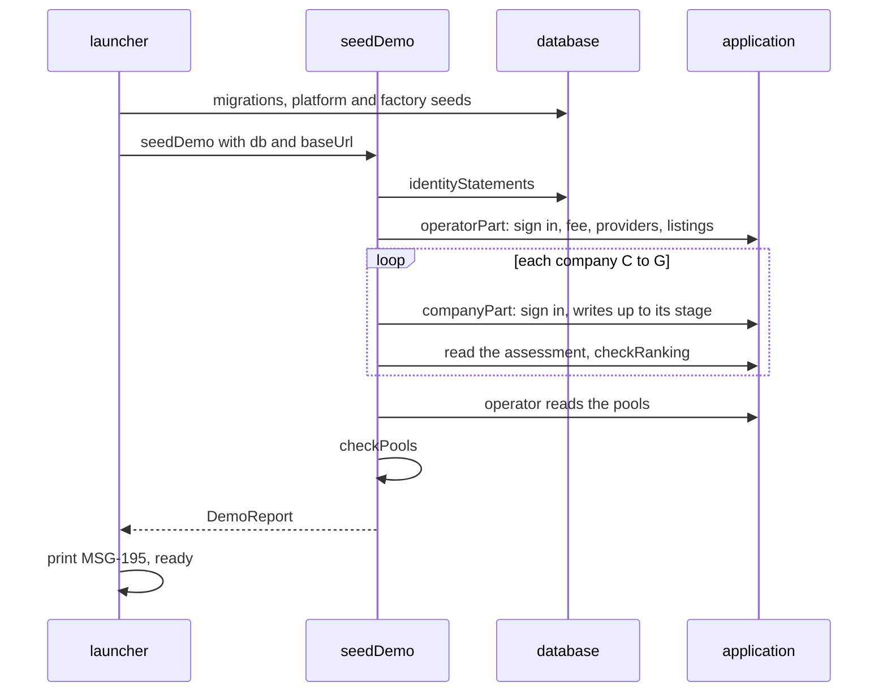

**Flow 3: `companyPart`, for one company.** `reached(stage, wanted)` compares positions in `STAGES`. Each stage includes the ones before it.

1. `Session.signIn` as the owner. Every later POST is made through a local helper that adds one to the counter `count.n` and posts to `/api/companies/{id}` plus the path.
2. Describe: post `/factory/revisions` with the company's answers, `confirm` true and `basedOn` 0, so version 1 is a confirmed version.
3. Decide: post `/assessments`, read the new assessment, take the ideas in the order of `result.items`, and call `checkRanking` on them. Then post one decision "accept" for every idea and the sign-off.
4. Choose: post a requirement for `FIRST_IDEA` in `FIRST_CLUSTER`, and a second one for `SECOND_IDEA` in `SECOND_CLUSTER` when `asksSecond` is true. If the company's stage is before `provider_chosen`, return (F and G stop here).
5. Provider: a company at `provider_chosen` or later must have a provider, or the function throws. It posts the engagement for the first requirement with the provider's id. If the stage is before `plan_agreed`, return (E stops here).
6. Plan: post one milestone, or two when the stage is `running`, with due dates 30 and 60 days after `now` (`dateOf`), then the event `plan_agreed`. If the stage is not `running`, return (D stops here).
7. Run: post the baseline (kind `baseline`), then for the first milestone the events `delivered`, `accepted` and `payment_recorded`, and for the second milestone the event `delivered` and nothing more. The baseline comes before the acceptance because the run module refuses a baseline after the first acceptance (section 4.6). C ends here.

For the cast as shipped the counted requests are 68: 7 by the operator and 18, 13, 11, 10 and 9 for C, D, E, F and G. I checked this by running `seedDemo` in a scratch script outside the repository against a stubbed `fetch` and a stubbed database, with no application or server. The same run showed 81 HTTP calls in all, because sign-ins (seven) and reads (six) are not counted. [VALIDATION](../../modules/demo/VALIDATION.md) records the figure 68 from a real run. I did not run the application.

**Flow 4: serving `/demo`** (`GET /demo`).

1. The route renders `Demo` in `app/demo/page.tsx`, which is `force-dynamic`.
2. `Demo` reads `env.APLYD_DEMO` from `cloudflare:workers`. If it is not exactly "true" it calls `notFound()`, and the framework's not-found page answers.
3. Otherwise it sums the steps' `minutes`, and renders the head, the note, the sign-in sentence, the people (the operator, A's owner, B's owner, then a card for each company of `DEMO_COMPANIES` with `data-testid` `cast-<id>`), the walk (a card for each step with `data-testid` `step-<n>`), `DOES_NOT_SHOW` and `RESET_NOTE`.
4. Nothing on the page depends on who is signed in, and the page makes no database call.

#### Rules and the function that decides each

| Rule | Decided by |
| --- | --- |
| The page exists only when `APLYD_DEMO` is exactly "true" (RULE-46). | `Demo` in `app/demo/page.tsx` for the page; `parseConfig` `demo` in `modules/hosting/src/gate.ts` for the seeding. The gate unit test in `modules/hosting/tests/unit/gate.test.ts` ("demonstration mode is on only for the exact word true") covers the second; the smoke test covers the first. |
| The demonstration is seeded after the migrations and the platform seed, and only in demonstration mode. | The `try` block of `scripts/serve.mjs`. |
| The seeder takes a company to the stage the cast gives it. | `reached` and the early `return`s of `companyPart`. |
| A company at `provider_chosen` or later names a provider. | A `throw` in `companyPart`; the unit test "each stage is used... a provider is named exactly from the stage that needs one" holds the data to it. |
| The diagnosis must rank the first idea first and the second idea second. If it does not, the seeder stops. | `checkRanking` in `modules/demo/src/seed.ts`, called by `companyPart` for each company. |
| The first pool has reached the floor and is shown; the second has not and is hidden (RULE-28, RULE-29). | `checkPools` in `modules/demo/src/seed.ts`, called last by `seedDemo`. It looks for a pool for the first idea in the first cluster in the operator's list, and for none for the second idea in the second cluster. |
| The second pool stays under five even when the walked company joins it, and the first pool says "at least 5" and not "at least 10". | No function. The unit test "the floor of five is shown on purpose" checks `secondPool().length + 1 < AGGREGATE_FLOOR` and `firstPool().length < 2 * AGGREGATE_FLOOR` against `AGGREGATE_FLOOR` in `modules/procure/src/pool.ts`. |
| The seeder stops at its first refusal. | `Session.get` and `Session.post` in `modules/demo/src/client.ts` throw `RequestFailed` for any status other than 200 (GET) or 200 and 201 (POST). `redirect` is "manual", so a redirect also fails. `seedDemo` has no `catch`. |
| One listing fee for every provider; no owner reads it (D-03). | `operatorPart` posts one fee, and the providers are listed after it. `modules/demo/tests/unit/script.test.ts` fails if the script states the fee. The smoke test "the listing fee is on no page or answer an owner can read (D-03)" reads the owner pages, `/demo` and `GET /api/providers`. The module's code does not decide it. |
| Every person is SYNTHETIC. | The data in `modules/demo/src/cast.ts`; held by the first two tests of `modules/demo/tests/unit/cast.test.ts`. |
| The script claims nothing the application does not do. | `DOES_NOT_SHOW`, and the test "the script never claims what the application does not do", which searches the steps for a short list of phrases. |
| The Worker cannot reach the seeder's HTTP client. | No function. `HOST_PROCESS_FILES` in `modules/platform/tests/static/source-rules.test.ts` lists `modules/demo/src/client.ts` as exempt from the header-read rule, and a second test there fails if anything under `app/` or `worker/` reaches it through imports. |

#### Refusals and messages

The page returns no refusal other than "not found". The launcher's configuration refusals (MSG-184 to MSG-194) belong to section 4.9.

| Where | Text | When |
| --- | --- | --- |
| `scripts/serve.mjs` (MSG-195) | `The demonstration was added: <N> companies, <N> providers, <N> requests.` | After `seedDemo` returns. |
| `scripts/serve.mjs` (MSG-197) | `The application did not start: <message>`, exit code 1 | The migrations, the seed or the demonstration threw. |
| `scripts/serve.mjs` | `APLYD_DEMO=true, but this build has no demonstration package (modules/demo).` | The message inside MSG-197 when `modules/demo/src/seed.ts` is missing. |
| `RequestFailed` in `modules/demo/src/client.ts` | `<METHOD> <path> answered <status>: <body, at most 300 characters>` | Any request the application does not answer as expected, sign-in included. |
| `checkRanking` | `<company>: the diagnosis ranked <first two ideas> first, not digital_job_log, inspection_checklist_and_gauges. The cast's answers or the library changed.` | The diagnosis of a company's answers does not rank the two ideas first and second. |
| `checkPools` | `the pools are not as the script says: first pool shown <true or false>, second pool hidden <true or false>` | The operator's pool list does not have the first pool or has the second. |
| `companyPart` | `<company> reaches <stage> but names no provider` | A cast entry is wrong. A unit test prevents it. |
| `/demo` | The framework's not-found page | `APLYD_DEMO` is not exactly "true". |

A second run on a database that already holds the demonstration stops at whichever request the application refuses first, as a `RequestFailed`. I did not run a second seeding, so I cannot say which request that is.

#### Invariants

1. Nothing outside the application's own requests writes demonstration data, except `identityStatements`. Do not add a direct `INSERT` for anything else. The append-only tables would refuse a repair, and a seeder that bypasses the handlers shows a state the pages could not have made.
2. `modules/demo/src/identities.ts` takes its values only from `modules/demo/src/cast.ts`, never from a request. It builds SQL text by joining strings, and `sql` doubles the single quotes.
3. Only `modules/demo/src/cast.ts` and `modules/demo/src/script.ts` may be reached from `app/` or `worker/`. `modules/demo/src/client.ts` reads the response header that sets the session cookie, which the scan of the header-read rule would flag in code the Worker runs, and it is exempt only because the Worker cannot reach it. Do not import `client.ts`, `seed.ts` or `identities.ts` into a page.
4. Every name, id and address in the cast is marked SYNTHETIC, and every address ends `@synthetic.invalid`. No text looks like a real web address, phone number or personal name field.
5. The fee is stated nowhere an owner can read it: not in `STEPS`, not on `/demo`, not on any owner page. `PLACEHOLDER_FEE_INR` is the same for every provider. It is a placeholder and no fee is decided (OQ-11). The script once stated it, which D-03 forbids, and a unit test now fails if it does ([FND-211](../FINDINGS.md)).
6. The cast's answers must give the same first and second idea. If the questionnaire, the library or the engine changes, `modules/demo/tests/unit/cast.test.ts` fails, and the seeder would stop at `checkRanking` in any case.
7. The first pool has five companies, and the second has three, so it is still under five when the company the presenter walks (A) joins. Adding a fourth company that asks for the second idea breaks the script, and a test fails.
8. The baseline is posted before the first acceptance, and a review is never posted. The demonstration shows the review dates only because the application's clock cannot be moved by a request (the module's STATUS, limit 2).
9. A step's `labels` and `open` must be texts that exist in the pages. A step's `signInAs` must be a name that the sign-in page lists.
10. `/demo` is `notFound()` unless the binding is exactly "true". The check is a string comparison, not a truthiness test.
11. The seeder runs once on a database just built. The launcher's database is in memory and is built again at every start, so a restart is the reset. There is no reset button, on purpose (`RESET_NOTE`).

#### Tests it owns

The counts are the ones in `modules/demo/tests/baseline.json`. I ran the four unit and static files with `node --test` (10, 5, 2 and 3 passed). I did not run the smoke or the browser file, which need `pnpm build`, a launcher and Chromium.

| Test file | Layer | What it checks |
| --- | --- | --- |
| `modules/demo/tests/unit/cast.test.ts` | unit, 10 | Every person and company is SYNTHETIC with a unique id and an address that cannot receive mail; no real-looking address, phone number or web address; every company's answers pass `validateAnswers` with confirmation; `diagnose` ranks the same first and second idea for each, the first not an AI idea and some AI idea shown; every provider service names a real idea and cluster; the floor of five (first pool at least five, second pool under five with A added); each stage is used, one company is `running`, and a provider is named exactly from `provider_chosen`; the first idea in the first cluster has at least two providers; the fee is one whole number of rupees within a bound; `identityStatements` shape. It does not test quote escaping, although its title says so. |
| `modules/demo/tests/unit/script.test.ts` | unit, 5 | Steps are numbered in order, each signs in as someone in the cast, and has content; the total is between ten and twenty minutes; the walked company's steps open the five stages in order; the script names both clusters, says "placeholder", "at least 5" and "fewer than 5", and does not state the fee; it avoids a short list of claims and carries a list of what is not shown and a note on restarting. |
| `modules/demo/tests/unit/seed-checks.test.ts` | unit, 2 | `checkRanking` accepts the two ideas first and second and throws in each other case with a message that names the company and the ideas; `checkPools` needs the first pool shown and the second hidden and throws either way round. |
| `modules/demo/tests/static/script-labels.test.ts` | static, 3 | Every label of every step is a substring of the combined text of the page files under `app/` and the source files of every other module; the home page or those sources hold every `open` text; no label repeats within a step and none is shorter than four characters. It lists files with `git ls-files`. See the first item below. |
| `modules/demo/tests/smoke/demo.test.ts` | smoke, 10 | The launcher, started twice (with and without `APLYD_DEMO`), against the built application: it prints MSG-195 only in demonstration mode; the cast signs in and is listed on the sign-in page; the operator sees one fee, three listed providers and the first pool; the finished example's plan, payment and starting number; the other companies' stages; A has only its description and B has nothing; the seeder's client is refused at the public address (401); walking A shows "at least 5" for the first requirement and no number for the second, with the providers the cast gives; no owner-readable page or answer shows the fee (D-03); `/demo` exists only in demonstration mode and lists the eight steps. Helpers: `modules/hosting/tests/support/launcher.ts`. |
| `modules/demo/tests/browser/walk.test.ts` | browser, 2 | The script page lists the cast and the eight steps and the sign-in page lists everyone the script names; then Chromium follows the eight steps as written, signed in as the people named, through the launcher and its gate, with every request to another origin blocked and no page error. Helpers: `modules/hosting/tests/support/launcher.ts`, `modules/platform/tests/support/browser.ts` and `modules/platform/tests/support/ui.ts`. |

That is 32 tests in six files. The platform module owns the test of the exemption for `modules/demo/src/client.ts` (`modules/platform/tests/static/source-rules.test.ts`), and the hosting module owns the test of the flag (`modules/hosting/tests/unit/gate.test.ts`).

Nothing runs `seedDemo` without a built application. The only tests of the seeder's own requests are the smoke and browser files.

#### Found while writing

8 items, listed in [section 9.10](#910-from-section-48-the-demo-module).

### 4.9 Hosting, scripts and the documentation readers

This section covers three groups of code that handle no application request. The hosting module (`modules/hosting/`) is the Node server that puts an access gate in front of the built Worker on the demonstration host. The scripts under `scripts/` start that host, reset the local database, run every test layer and check the documents. The documentation readers (`modules/docs/src/`) are pure functions that read the project's Markdown documents as data. All three run in Node, never inside the Worker. No file under `app/` or `worker/` imports from `modules/hosting/src/` or `modules/docs/src/`. The importers are `scripts/serve.mjs`, `scripts/check-traceability.mjs`, `scripts/check-test-docs.mjs` and the tests of the two modules. The demo module's smoke and browser tests also import the launcher helper `modules/hosting/tests/support/launcher.ts`. One static test of the platform module (`modules/platform/tests/static/source-rules.test.ts`) names the two hosting files so that they are exempt from the header-read rule.

The architecture of the host is in [the HLD](HLD.md) (sections 3.1, 4.5, 7.3 and decisions AD-19 and AD-20). This section adds the file-level facts: what each function decides, in which order, and what the tests pin.

#### Files: the hosting module

| File | Holds | Exports |
| --- | --- | --- |
| `modules/hosting/src/gate.ts` | The launcher's decisions as plain functions: read and validate the environment (`parseConfig`), compare HTTP Basic credentials (`passesGate`), and build the headers handed on to the Worker (`upstreamHeaders`). Imports only Node's `crypto` and `http` types | `SYNTHETIC_ENVIRONMENTS`, `MIN_SECRET_BYTES`, `MIN_PASSWORD_CHARACTERS`, `MAX_PROXY_BODY_BYTES`, `Config`, `ConfigResult`, `parseConfig`, `passesGate`, `upstreamHeaders` |
| `modules/hosting/src/gateway.ts` | A Node `http` server that answers `/healthz`, applies the gate, bounds the body and hands every other request to the Worker on loopback. It starts nothing itself, so a test can point it at a stub | `GatewayOptions`, `createGateway` |
| `modules/hosting/tests/support/launcher.ts` | Test helper that starts `scripts/serve.mjs` as a child process on a free port with a chosen environment, reads its output, and stops every process it started | `ROOT`, `SERVE`, `SECRET`, `PASSWORD`, `AUTH_PARTS`, `AUTH`, `Launched`, `freePort`, `exited`, `launchServe`, `stopAllLaunched` |
| `modules/hosting/tests/unit/gate.test.ts` | Unit suite for `parseConfig`, `passesGate` and `upstreamHeaders` | none |
| `modules/hosting/tests/integration/gateway.test.ts` | Integration suite: the gateway in front of a stub application | none |
| `modules/hosting/tests/static/deploy-files.test.ts` | Reads `Dockerfile`, `.do/app.yaml` and `.dockerignore` as text and checks them against `package.json` and `parseConfig` | none |
| `modules/hosting/tests/smoke/serve.test.ts` | Smoke suite: the real launcher over a built Worker | none |
| `modules/hosting/tests/baseline.json` | Least passing count for each of the four suites | none |
| `modules/hosting/STATUS.md` | The module's own status page | none |
| `modules/hosting/VALIDATION.md` | The module's validation record | none |

#### Files: the scripts

| File | Holds | Exports |
| --- | --- | --- |
| `scripts/serve.mjs` | The demonstration launcher: parse the configuration, start the gateway, start the built Worker in Miniflare, build the database, optionally add the demonstration, then mark ready | none |
| `scripts/local-db.mjs` | `pnpm db:local`: resets the local development database and applies the migrations and the synthetic seed with Wrangler | none |
| `scripts/test.mjs` | The one entry point for every test layer: catalogue, runner, regression guard, baseline update | none |
| `scripts/check-documentation.mjs` | Documentation integrity with Node only: relative links and anchors, decision, question and source ids, source checksums, merge-conflict markers | none |
| `scripts/check-traceability.mjs` | Reads the BRD and the FSD with the readers: row shape, counts block, every requirement id mentioned exists, FSD section 11 coverage, every cited identifier defined | none |
| `scripts/check-test-docs.mjs` | Reads the seven test documents with `modules/docs/src/testdocs.ts` | none |
| `scripts/mutation/mutate.py` | Manual mutation tool: applies one small change at a time to a copy of the tree and runs the tests | none |
| `scripts/mutation/README.md` | How the mutation files in each module are kept and why CI does not run them | none |

#### Files: the documentation readers

| File | Holds | Exports |
| --- | --- | --- |
| `modules/docs/src/ids.ts` | The identifier kinds the documents cite (FR, UC, TC, SCR, MSG, RULE, AD, SC, RP, TD, TH, API), where an identifier is defined, and which citations are broken | `ID_KIND_NAMES`, `definedIds`, `citedIds`, `brokenReferences` |
| `modules/docs/src/brd.ts` | Reads the requirement rows of the BRD (six cells each), classifies the status word, counts by area, and renders the generated counts block between two markers | `AREAS`, `Area`, `STATUSES`, `Status`, `STATUS_LABEL`, `PRIORITIES`, `Priority`, `BASES`, `Requirement`, `REQUIREMENT_ID`, `classifyStatus`, `parseRequirements`, `Counts`, `emptyCounts`, `countByArea`, `renderCounts`, `withCounts`, `mentionedIds` |
| `modules/docs/src/fsd.ts` | Reads the FR rows of the FSD and the coverage table of its section 11; checks that the table and the rows agree with each other and with the BRD | `FR_STATUSES`, `FrStatus`, `FunctionalRequirement`, `parseFunctionalRequirements`, `functionsByRequirement`, `parseCoverageTable`, `checkCoverage` |
| `modules/docs/src/api.ts` | Reads API-REFERENCE.md (summary table, one section per operation, error-code index) and compares it with the route files, the page files, the form posts and the error literals in the source | `METHODS`, `routePath`, `normalisePath`, `exportedMethods`, `pagePaths`, `formActions`, `SUMMARY_HEADER`, `PROPERTIES`, `REQUEST_HEADER`, `RESPONSE_HEADER`, `ACTORS`, `Operation`, `Entry`, `parseSummary`, `parseEntries`, `RouteFact`, `compareApi`, `errorIndex`, `errorLiterals` |
| `modules/docs/src/dictionary.ts` | Reads DATA-DICTIONARY.md (tables, columns, indexes, triggers, Mermaid entity diagrams) and compares it with facts taken from the migrated database; also the helpers for lists, audit event names and numeric constants that other checks use | `Section`, `parseSections`, `MdTable`, `parseTables`, `codeSpans`, `withoutFences`, `COLUMN_HEADER`, `INDEX_HEADER`, `TRIGGER_HEADER`, `ColumnDoc`, `IndexDoc`, `TableDoc`, `TriggerDoc`, `ParsedDictionary`, `parseDictionary`, `SchemaFacts`, `migrationIndex`, `tableOwners`, `triggerParts`, `indexCondition`, `compareDictionary`, `unknownReferences`, `ErDiagram`, `erBlocks`, `parseEr`, `compareEr`, `undrawnRelationships`, `tableUnder`, `firstSpans`, `compareSets`, `auditEventNames`, `constantNumbers` |
| `modules/docs/src/testdocs.ts` | Reads the seven test documents (case table, scenarios, regression pack, traceability, UAT plan, test data, strategy): case rows, automation grammar, numbering, requirement coverage, the generated matrix and counts | `LAYERS`, `Layer`, `CASE_TYPES`, `CaseType`, `VERDICTS`, `Verdict`, `Automation`, `TestCase`, `PARTLY`, `NOT_TESTABLE`, `parseCases`, `parseAutomation`, `declaredTitles`, `checkNumbering`, `checkRequirementsExist`, `checkEveryRequirementCovered`, `checkAutomation`, `GAPS_START`, `GAPS_END`, `parseGaps`, `checkMustAutomated`, `verdictOf`, `MatrixRow`, `buildMatrix`, `compactIds`, `NOT_LINKED`, `COVERAGE_START`, `COVERAGE_END`, `MATRIX_START`, `MATRIX_END`, `functionalCells`, `renderMatrix`, `renderCoverage`, `withBlock`, `withTraceability`, `checkSequence`, `mentionedCaseIds`, `mentionedPaths`, `checkDocument`, `Inputs`, `checkCaseTable`, `TEST_DOCUMENTS`, `checkTestDocuments` |
| `modules/docs/src/findings.ts` | Reads the findings register (`docs/FINDINGS.md`): one row for each finding, the vocabulary of modules, severities and status words, grouping by module, source links and evidence paths that resolve, and the counts block at the top. The documentation index and the glossary readers use its `resolveLink` | `FINDING_MODULES`, `FindingModule`, `SEVERITIES`, `Severity`, `STATUS_KINDS`, `StatusKind`, `MAX_STATEMENT_LENGTH`, `SourceLink`, `EvidenceItem`, `NO_EVIDENCE`, `Finding`, `statusKindOf`, `evidenceItemOf`, `parseFindings`, `checkGrouping`, `headingAnchors`, `scriptAnchors`, `resolveLink`, `Resolver`, `checkSourceLinks`, `Files`, `checkEvidence`, `ModuleCounts`, `countsOf`, `COUNTS_START`, `COUNTS_END`, `countsBlock`, `checkCounts` |
| `modules/docs/src/glossary.ts` | Reads the glossary (`docs/GLOSSARY.md`): one row for each term in four cells, the order of the rows, the terms the BRD and FSD convention tables need, the identifier schemes, paths and links in the "where" cell, terms never used elsewhere, and the stage table against the progress strip's words | `MAX_MEANING_SENTENCES`, `GlossaryEntry`, `cellsOf`, `sortKey`, `letterOf`, `sentenceCount`, `parseGlossary`, `Required`, `requiredTerms`, `missingTerms`, `definedPrefixes`, `missingPrefixes`, `looksLikePath`, `checkWhere`, `searchKey`, `unusedTerms`, `SUITE_LIKE`, `checkPathsInText`, `StageRow`, `stageRows`, `checkStages` |
| `modules/docs/src/docindex.ts` | Reads the documentation index (`docs/DOCUMENTATION-INDEX.md`): the table of documents, the reading paths and the table of checks. It checks that every document of the repository is listed, that each row says what the document says of itself, that the reading paths lead to listed documents, and that every check, path and suite named exists | `READERS`, `Reader`, `PATH_NAMES`, `MIN_PATH_ITEMS`, `IndexedDocument`, `parseDocuments`, `isDocumentPath`, `missingFromIndex`, `missingListed`, `checkStatusClaims`, `ReadingPath`, `parseReadingPaths`, `checkReadingPaths`, `IndexedCheck`, `parseChecks`, `suiteIdOf`, `checkChecks`, `checkCodeSpans`, `suiteIdsOf` |
| `modules/docs/src/lld.ts` | Reads this document: the files tables (each row names a file that exists and lists exactly the names it exports), repository paths and named things in code spans, the document's own anchors, its structure and its diagrams, and the pointers to section 9. It reads no prose | `REQUIRED_HEADINGS`, `MODULE_SECTIONS`, `MAX_DIAGRAM_LINES`, `exportedNames`, `FilesTableRow`, `parseFilesTables`, `checkFilesTables`, `codeSpans`, `checkPathSpans`, `checkNamedThings`, `headings`, `checkOwnAnchors`, `checkStructure`, `checkDiagrams`, `checkFoundPointers` |
| `modules/docs/tests/static/api-sync.test.ts` | Holds the API reference to the route files, form posts, redirect targets and error literals | none |
| `modules/docs/tests/static/dictionary-sync.test.ts` | Holds the data dictionary to the migrated database and to the constants of other modules | none |
| `modules/docs/tests/static/brd.test.ts` | Holds the BRD to its own row grammar and counts block | none |
| `modules/docs/tests/static/fsd.test.ts` | Holds the FSD to the BRD | none |
| `modules/docs/tests/static/ids.test.ts` | Holds every cited identifier to a definition | none |
| `modules/docs/tests/static/testdocs.test.ts` | Holds the test documents to the BRD and to the test files | none |
| `modules/docs/tests/static/findings.test.ts` | Holds the findings register to its own row grammar, grouping, source links, evidence paths and counts block, and requires every module's status and validation page to be the source of at least one finding | none |
| `modules/docs/tests/static/glossary.test.ts` | Holds the glossary to its row grammar and order, to the convention tables of the BRD and FSD and the identifier schemes, to its paths and links, to the use of each term elsewhere, and to the stage table | none |
| `modules/docs/tests/static/docindex.test.ts` | Holds the documentation index to the repository: every Markdown file and every HTML page under `docs/` is listed, each row agrees with its document, the reading paths and the table of checks resolve | none |
| `modules/docs/tests/static/lld-sync.test.ts` | Holds this document to the code: the plan's headings, the files tables, repository paths, named things, anchors and diagrams. It does not check prose | none |
| `modules/docs/tests/static/wireframes.test.ts` | Holds `docs/design/wireframes.html` to being one self-contained page with a place for every screen of the FSD and links that land | none |
| `modules/docs/tests/unit/api.test.ts` | Unit suite for `modules/docs/src/api.ts` with small invented documents | none |
| `modules/docs/tests/unit/brd.test.ts` | Unit suite for `modules/docs/src/brd.ts` | none |
| `modules/docs/tests/unit/dictionary.test.ts` | Unit suite for `modules/docs/src/dictionary.ts` | none |
| `modules/docs/tests/unit/fsd.test.ts` | Unit suite for `modules/docs/src/fsd.ts` | none |
| `modules/docs/tests/unit/ids.test.ts` | Unit suite for `modules/docs/src/ids.ts` | none |
| `modules/docs/tests/unit/testdocs.test.ts` | Unit suite for `modules/docs/src/testdocs.ts` | none |
| `modules/docs/tests/unit/findings.test.ts` | Unit suite for `modules/docs/src/findings.ts`, each check with a seeded fault | none |
| `modules/docs/tests/unit/glossary.test.ts` | Unit suite for `modules/docs/src/glossary.ts`, each check with a seeded fault | none |
| `modules/docs/tests/unit/docindex.test.ts` | Unit suite for `modules/docs/src/docindex.ts`, each check with a seeded fault | none |
| `modules/docs/tests/unit/lld.test.ts` | Unit suite for `modules/docs/src/lld.ts`, each check with a seeded fault and a clean case | none |
| `modules/docs/tests/baseline.json` | Least passing count for each of the 21 suites | none |

The readers import only each other. `modules/docs/src/api.ts` uses three helpers from `modules/docs/src/dictionary.ts`. Both `modules/docs/src/fsd.ts` and `modules/docs/src/testdocs.ts` use `modules/docs/src/brd.ts`. Both `modules/docs/src/glossary.ts` and `modules/docs/src/docindex.ts` use `resolveLink` from `modules/docs/src/findings.ts`, and `modules/docs/src/docindex.ts` also uses three helpers from `modules/docs/src/glossary.ts`. None opens a file or a database. The static tests and the scripts read the files and give the readers text. The sync tests (`dictionary-sync`, `api-sync`) also import constants from the data layers of other modules (`LIBRARY`, `ENGINE_VERSION`, `SECTIONS`, `EVENT_KINDS`, `CLUSTERS`) and the migration reader of the platform; section 8 lists what each of those checks pins.

The module holds ten reader files at the pinned commit: the six above that read the BRD, the FSD, the identifiers, the API reference, the data dictionary and the test documents, and four that read the findings register, the glossary, the documentation index and this document. `scripts/check-traceability.mjs` and `scripts/check-test-docs.mjs` are the only scripts that import a reader. No script runs the readers for the findings register, the glossary, the documentation index or this document; their static tests do.

#### What the hosting module decides

`parseConfig(env)` is the only place the launcher's settings are read and validated. It returns `{ ok: true, config }` or `{ ok: false, problems }`, and it collects every problem before returning so that one launch shows them all. The rules are listed in the table; names are the environment variables read by this function, and the values are never written down here.

| Name | Rule enforced by `parseConfig` |
| --- | --- |
| `PORT` | Whole number from 1 to 65535; default 8080; must differ from the upstream port |
| `APLYD_UPSTREAM_PORT` | Whole number from 1 to 65535; default 8787 |
| `APLYD_ENV` | Default `synthetic`; only a name in `SYNTHETIC_ENVIRONMENTS` is served, so a non-synthetic name is a problem (OQ-13: how a real owner signs in is undecided) |
| `SESSION_SECRET` | At least `MIN_SECRET_BYTES` bytes, and not one repeated character; the message never prints the value |
| `DEMO_USER`, `DEMO_PASSWORD` | Both required unless `DEMO_ACCESS` is `open`; the user must not contain a colon; the password must have at least `MIN_PASSWORD_CHARACTERS` characters (counted as code points) |
| `DEMO_ACCESS` | Only the word `open` is accepted; with it set, `DEMO_USER` and `DEMO_PASSWORD` must both be empty |
| `APLYD_PUBLIC_HOSTS` | Comma-separated; each entry is trimmed, lower-cased and must be a host name with an optional port |
| `APLYD_DEMO` | `config.demo` is true only for the exact word `true` |

`passesGate(authorization, access)` returns true for open access, false for a missing or malformed `Basic` header, and otherwise compares the SHA-256 digest of the decoded user and of the decoded password with `timingSafeEqual`. Only the first colon of the decoded value ends the user, so a password may contain colons.

`upstreamHeaders(headers, publicHosts)` copies the request headers, removes `authorization` (the gate's credential never reaches the Worker), and rewrites `origin` to `http://<Host>` only when the Origin parses as an http or https URL whose host equals the Host header (or is in `publicHosts`) and equals its own origin string. The reason is that the Worker compares the Origin with the origin of the request URL it is given, and behind an ingress that URL is the launcher's own `http://` one. Every other Origin passes unchanged and the Worker refuses it as cross-site (the check is in `modules/platform/src/identity/cross-site.ts`; see sections 3.3 and 4.1).

#### Flow: how the gateway answers a request

Function: `createGateway` in `modules/hosting/src/gateway.ts`. The numbers are the order of the checks.

1. The handler takes the path before any `?`.
2. If the path is exactly `/healthz` and the method is GET or HEAD, it answers before the gate. If `options.ready()` is false it answers 503 `starting`. Otherwise, if the last probe is more than `HEALTH_CACHE_MS` (2 seconds) old, `probe` sends a GET to the Worker's `/api/health` on loopback with a 2 second timeout and caches the result; the answer is 200 `ok` or 503 `application not answering`.
3. `passesGate(req.headers.authorization, options.access)`. If false: one log line, the request body is drained, answer 401 with a `www-authenticate` header for HTTP Basic.
4. If `options.ready()` is false: 503 with `retry-after: 5`. This comes after the gate, so a person without the password learns nothing about start-up.
5. If a declared `content-length` is all digits and larger than `maxBodyBytes` (default `MAX_PROXY_BODY_BYTES`, 256 KiB): 413, the body is drained and not handed on.
6. `upstreamHeaders` builds the outgoing headers; the hop-by-hop names (`connection`, `keep-alive`, `proxy-authenticate`, `proxy-authorization`, `proxy-connection`, `te`, `trailer`, `transfer-encoding`, `upgrade`) are removed in both directions.
7. `http.request` hands the request to `127.0.0.1` on the upstream port with a 60 second timeout and pipes the response back unchanged, including redirects and cookies.
8. While the body streams, the gateway counts bytes. If the count passes the limit, it destroys the upstream request and answers 413 (`streamed length`).
9. If the upstream call fails or times out, it answers 502 `The application did not answer.` and logs the reason. The reason is not sent to the client.
10. An `upgrade` event closes the socket. `headersTimeout` is 20 seconds and `requestTimeout` is 120 seconds.

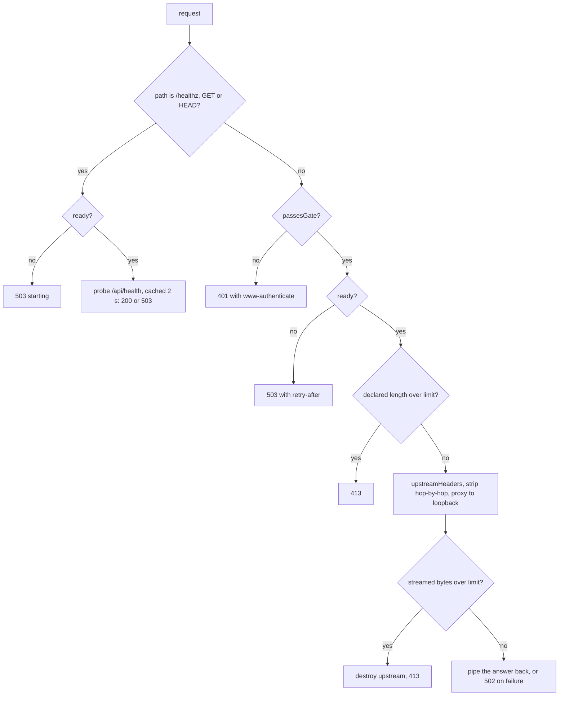

#### Flow: how the launcher starts

Script: `scripts/serve.mjs`. It is Node code and runs under Node 22.18 or later (`package.json` `engines`), which strips the TypeScript types of the files it imports.

1. `parseConfig(process.env)`. On any problem it prints each one and exits with code 2.
2. It requires the generated Wrangler configuration in the build output (dist/server/wrangler.json, produced by `pnpm build`, not tracked by Git). If it is missing it exits with code 2.
3. `createGateway({ access, publicHosts, upstreamPort, ready: () => ready, log })` and `gateway.listen(config.port, "0.0.0.0")`. From here `/healthz` answers 503 `starting`.
4. It lists the Worker's modules (the build's entry file index.js first, then every .js or .mjs file under the build's server directory) and creates the `Miniflare` instance: the D1 binding `DB` takes its identifier from the built configuration; the bindings `APLYD_ENV` and `SESSION_SECRET` take the parsed values, and `APLYD_DEMO` is added only when `config.demo` is true; the static assets come from the build; the Worker listens on `127.0.0.1` at the upstream port.
5. It removes Miniflare's own `SIGINT` and `SIGTERM` handlers and installs `stop`, which marks the process not ready, closes the gateway, disposes of the Worker and exits (a 10 second timer forces the exit).
6. After `worker.ready` it takes the D1 database with `getD1Database("DB")` and runs each statement of `migrationStatements()` and then `seedStatements()` (both in `modules/platform/src/db/migrate.ts`) one by one. The database is in memory, so every start is a reset.
7. If `config.demo` is true it checks that `modules/demo/src/seed.ts` exists, imports `seedDemo`, calls `seedDemo({ db, baseUrl })` with the loopback address of the Worker, and prints the three counts the seeder returns. If the file is missing it throws.
8. It sets `ready` to true and prints that the application is ready. Any error in steps 6 to 7 prints a message and calls `stop(1)`.

#### What the other scripts do

| Script | Reads | Writes | Fails with |
| --- | --- | --- | --- |
| `scripts/local-db.mjs` | `migrationStatements()` and `seedStatements()` from the platform module | Deletes the local D1 state directory, writes a one-database Wrangler configuration and a SQL file under `.wrangler/` (not tracked), then runs `wrangler d1 execute DB --local` with the same placeholder database id as `vite.config.ts` | The exit code of Wrangler |
| `scripts/check-documentation.mjs` | Every Markdown file listed by `git ls-files` (a directory walk when Git is unavailable); `docs/decisions.md`, `docs/open-questions.md`, `docs/sources.md` | Nothing | Exit 1 with one line per problem |
| `scripts/check-traceability.mjs` | `docs/brd/BRD.md`, `docs/fsd/FSD.md` and every Markdown file, through `modules/docs/src/brd.ts`, `modules/docs/src/fsd.ts` and `modules/docs/src/ids.ts` | With `--write`: the counts block of the BRD | Exit 1 with one line per problem |
| `scripts/check-test-docs.mjs` | `docs/brd/BRD.md` and the seven files of `TEST_DOCUMENTS`, and the test files that automated cases name | With `--write`: the generated blocks of `docs/test/TRACEABILITY.md` | Exit 1 with one line per problem |

`scripts/check-documentation.mjs` does not use the readers on purpose: its header says it needs only Node so that the documentation workflow needs no install. It strips fenced and inline code before it looks for links and identifiers, so a path or an identifier written in a code span is not checked by it. Its slug function removes every character that is not a letter, a digit, whitespace or a hyphen, lower-cases, and turns each whitespace character into a hyphen; a repeated heading gets `-1`, `-2` and so on.

`scripts/test.mjs` is described in section 7.2. The mutation tool is run by hand by a module's author on a copy of the tree; its records are the `mutations/` directories of the platform, procure, deliver and run modules and the counts in each module's VALIDATION.md; nothing in CI runs it (`scripts/mutation/README.md`).

#### What the hosting tests pin

| Suite | Count in baseline | What it holds in place |
| --- | --- | --- |
| `hosting/unit/gate` | 17 | Every configuration rule above, the exact-word `true` for the demonstration, the gate's constant-time comparison and Basic parsing, the Origin rewrite and its refusals, the body limit being above the application's own |
| `hosting/integration/gateway` | 14 | The gate in front of a stub application: the password never reaches the application, only the exact health path is open, 503 while starting, 413 whether the length is declared or streamed, hop-by-hop headers removed, 502 when the application is down, no header or credential in a log line, upgrade closed |
| `hosting/static/deploy-files` | 6 | `Dockerfile` pins the same pnpm as `package.json` and a Node image that satisfies `engines`, installs from the lockfile, sets the production mode only after the build, ends as a non-root user and runs `scripts/serve.mjs`; no secret in the image or the app spec; every placeholder in the spec is refused by `parseConfig`; the spec names the same port and health path as the launcher; the build context leaves out secrets and build output |
| `hosting/smoke/serve` | 6 | The real launcher on a built Worker: refuses a real environment, a weak secret or no gate; 401 without the password; sign-in as behind a TLS-terminating ingress; a cross-site post refused and the next request fine; 413; open access only when asked, and a clean stop on SIGTERM |

The counts come from `modules/hosting/tests/baseline.json`. I did not run these suites. The static suite reads text; it is not a container build, and `modules/hosting/VALIDATION.md` says what was and was not run.

#### Found while writing

8 items, listed in [section 9.11](#911-from-section-49-hosting-scripts-and-the-documentation-readers).

## 5. The pages layer

The directory `app/` holds one layout, three shared parts, nine pages, 23 route files and eight stylesheets. It holds no business rule. A page reads through the data layer and the pure view modules of the modules, draws HTML, and posts plain forms to the route files. A route file is a few lines that hand the request to a handler in the `src/api/` directory of a module (for example `modules/deliver/src/api/`). What each screen shows is in [the FSD](../fsd/FSD.md) (SCR-01 to SCR-09). What each operation accepts and answers is in [the API reference](API-REFERENCE.md). The visual rules are in [the interface guide](INTERFACE-GUIDE.md). This section says how the code is put together and what must not be broken when a page is changed.

### 5.1 How a page is built

Every page is an `async` React server component, the default export of a file named page.tsx in the page's own directory under `app/`. It runs on the server once for each request. A search of `app/` for `use client`, `use server`, `onClick`, `onChange`, `onSubmit`, `<script`, `dangerouslySetInnerHTML` and `fetch(` finds nothing (searched on 5 October 2026; as a whole this is a convention, and the static test `modules/docs/tests/static/api-sync.test.ts` enforces only that no page exports a request method and that the application uses no server action). So a page sends no script to the browser, and a form is a plain `<form method="post" action="...">`.

The same steps run for every owner page. The page `app/deliver/page.tsx` is the example.

1. The Worker entry (`worker/index.ts`, default `fetch`) passes the request to the vinext handler, which renders `RootLayout` in `app/layout.tsx` around the page.
2. `RootLayout` draws the skip link, the SYNTHETIC banner (only when `isSyntheticEnvironment` in `modules/platform/src/env.ts` is true for the bindings), the bar `AppBar` (`app/_ui/appbar.tsx`), `<main id="main">` and the footer. `AppBar` reads the session itself with `resolveIdentityFromCookieHeader`.
3. The page function reads its bindings with `env` from `cloudflare:workers`, cast `as unknown as AppEnv`, and awaits `searchParams`.
4. The page calls `resolveIdentityFromCookieHeader((await headers()).get("cookie"), e)` (`modules/platform/src/identity/resolve.ts`). So a page that resolves the session itself (every page except `/sign-in` and `/demo`) resolves it twice, once in the bar and once in the page; each resolution of a valid session reads one row of `users`, and one with no valid cookie reads none.
5. With no identity, the page returns `SignedOut`. With an identity that has no company, is not an `owner`, or when `e.DB` is missing, it returns `NotOwner`. `/diagnose` draws its own not-owner text with `notOwnerMessage`, and `/operator` has its own operator check (5.4).
6. The page reads with the module's data layer, always passing `identity.companyId` as the company: for example `presentEngagements(e.DB, companyId)` on `/deliver`. The company never comes from the address.
7. Pure functions of the view modules turn the rows into words, tags and the one action to offer, for example `deliverySummary` and `primaryAction` in `modules/deliver/src/summary.ts`.
8. The page draws its markup inside `Page` (`app/_ui/parts.tsx`) with a stage name, which adds the five-step strip, the head and, when the next step is elsewhere, the next-step card.
9. The Worker entry adds the four security headers to the response (`withSecurityHeaders`, `modules/platform/src/api/security-headers.ts`).

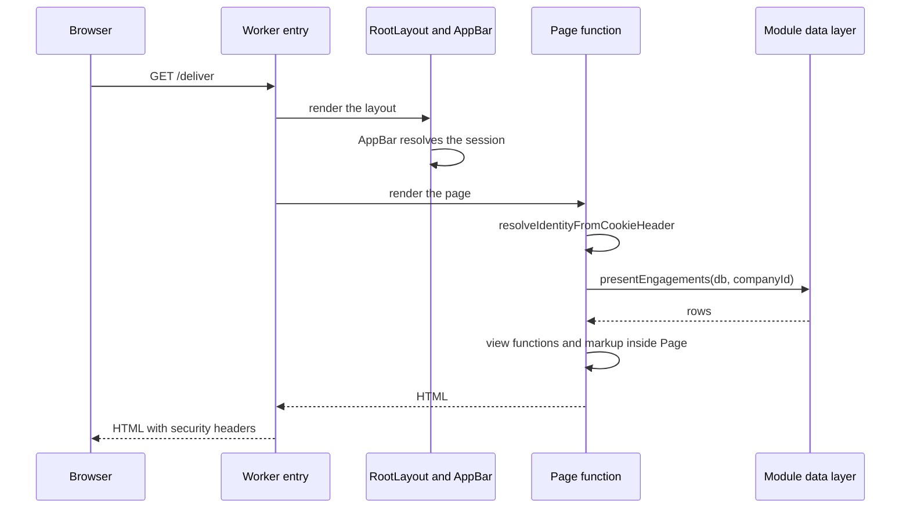

Rules that every page follows, each checked in the code:

- Every page and every route file exports `dynamic = "force-dynamic"`. A search for files that lack it found none.
- No page writes to the database. The only SQL in `app/` is the `SELECT` of `app/sign-in/page.tsx` on `users`; every other read goes through a module function.
- A value read from the address is never shown as typed, except the version number on `/factory` (5.3). A message comes from a fixed table, and a key from the address is looked up with `Object.hasOwn`.
- The name of a record in the address is read through a company-scoped loader, so another company's id finds nothing. The two cases are `?a=` on `/diagnose` (`loadAssessment(db, companyId, id)`) and `?rev=` on `/factory` (`loadRevision(db, companyId, number)`).
- There is no `error.tsx` and no custom not-found file under `app/`. The only `catch` in `app/` is in `Page` (`app/_ui/parts.tsx`), around `loadFacts`: when that read fails it writes one console line (`journey.facts_failed`) and the page opens with no strip and no next-step card. Any other error inside a page is answered as vinext answers an uncaught error (not read for this document). `/demo` calls `notFound()` when `APLYD_DEMO` is not `true`, and the framework's not-found page answers.
- Pages import the pure `present*` functions of the handler files (`presentAssessment`, `presentRequirements`, `presentEngagements`, `presentOutcomes`, `presentPools`) so that a page and the JSON read operation show the same data.

The one file of this subsection:

| File | Holds | Exports |
| --- | --- | --- |
| `app/layout.tsx` | The root layout: page title and description, theme colours, the skip link, the SYNTHETIC banner with `role="note"`, the bar, the main area and the footer. It imports `app/globals.css`, so that one stylesheet is on every page | `metadata`, `viewport`, `default` |

The `viewport` theme colours (light `#f3f6f6`, dark `#0b1519`) are written in the file. They are the same as the `--bg` tokens of `app/globals.css`, but no test ties them (see Found while writing).

### 5.2 The shared frame and parts in `app/_ui/`

The three files below are the only shared code of the pages. A page that uses them keeps what the tests find a page by (5.6).

| File | Holds | Exports |
| --- | --- | --- |
| `app/_ui/appbar.tsx` | The bar at the top of every page: the mark with the link "APLYD home", and, for a signed-in person, their initials, name and role and a "Sign out" form that posts `intent=sign-out` to `/api/session`. A visitor sees the mark only | `AppBar` |
| `app/_ui/icons.tsx` | Seven small inline SVG icons, each `aria-hidden`, so there is no icon font and no request | `Check`, `Arrow`, `Lock`, `Layers`, `Eye`, `Coin`, `Logo` |
| `app/_ui/parts.tsx` | The parts a page is built from. `Notice` (a message with a role, a tone and a `data-testid`), `Tag`, `Meter` (a bar with its words), `PageHead` (the eyebrow "Step n of 5", the one `h1`, the lede), `SignedOut`, `NotOwner` (takes `title` and `hasCompany`: a member of a company who is not its owner is told the page is for the owner and pointed to the home page), `Strip` (the five steps as a `nav` named "Your five steps"), `Page` (the frame). `NextUp` and the word table `SAYS` are private to the file | `Tone`, `Notice`, `Tag`, `Meter`, `PageHead`, `SignedOut`, `NotOwner`, `Strip`, `Page` |

How `Page` draws a page (`app/_ui/parts.tsx`):

1. `Page` is `async`. When the identity is an owner with a company and `e.DB` is bound, it calls `loadFacts` (`modules/journey/src/facts.ts`) inside a `try`; if the read throws it logs `journey.facts_failed` to the console and carries on with `facts` null. Otherwise `facts` is null and no strip is drawn.
2. With facts, it draws `Strip` from `stageStatuses(facts, new Date())` (`modules/journey/src/progress.ts`). Each step is a link to the step's page. The step named by the `stage` argument carries `aria-current="page"`. A screen reader hears the status after the name (`SAYS`: "done", "your turn", "not started").
3. It draws `PageHead` with the stage, which gives the eyebrow from `stageById` and `STAGES.length`.
4. It draws the page's own children.
5. Unless `hideNext` is set, it draws `NextUp`, a card with `data-testid="next-up"`. `NextUp` calls `nextStep(facts, new Date())` and draws nothing when the next step belongs to this page's stage or when `isOwnersTurn` (`modules/journey/src/progress.ts`) is false for it (the keys `keep_going`, `waiting_for_listing` and `caught_up`).

The parts:

- `SignedOut` draws a `PageHead` and one link named "Sign in" to `/sign-in`, followed by the page's reason in its own words. There must be one such link on a visitor's page (5.6).
- `NotOwner` draws a sentence and a link "Back" to `/`. A page tells it whether the account has a company (`hasCompany`, true when `identity.companyId` is not null). With a company, the sentence is "This page is for the owner of your company. You can see your company's record on the home page." Without one, it is "This page is for the owner of a company. Your account is not linked to one." Before this was corrected a member of a company was told the second sentence, which is untrue; the FSD records it (section 12, item 4).
- `Notice` takes a `role` of `status`, `alert` or `note` and a `tone` of `info`, `success`, `warn` or `danger`. The role is what a screen reader announces and what a test finds the message by. The tone is the colour only.
- `Tag` takes a tone of `ok`, `turn`, `warn`, `brand` or `danger`. `Meter` clamps `done` to `of` and draws the width as a rounded percentage; the words in `label` carry the meaning.

### 5.3 Forms, redirects and the `?saved=` and `?problem=` contract

A person at a form is never sent to a page of JSON on success or on a refusal the form can cause. The contract has two halves: the handler answers a form post with a 303 redirect to a page address with one small query, and the page turns that query into a message from a fixed table.

How a form post travels (the example is the delivery event of `/deliver`):

1. The browser posts `application/x-www-form-urlencoded` to the action of the form, here `/api/companies/<id>/engagements/<eid>/events`.
2. The route file `app/api/companies/[id]/engagements/[eid]/events/route.ts` (`POST`) awaits `context.params` and calls `handleEngagementEvent(request, env as unknown as AppEnv, id, eid)` (`modules/deliver/src/api/engagements.ts`).
3. The handler calls `authorizeCompanyWrite(request, env, requestedId, "engagement.write.denied")` (`modules/platform/src/api/authorize.ts`). A refusal here (401, 403, 404 or 503) is JSON, even for a form post, and the refusal is audited. This is already recorded in the API reference (section 6 item 8).
4. The handler reads the body with `takeBody` (`modules/platform/src/api/body.ts`) and sets `form = body.kind === "form"`. A field is read with `bodyField`, under the form's name when `form` is true and under the JSON name otherwise (table below).
5. The handler checks each field. On failure it answers `redirect("/deliver?problem=invalid")` (`modules/platform/src/api/http.ts`) for a form, and `json(400, { error: "invalid", fields })` for JSON.
6. It writes through the data layer (`appendEvent`, `modules/deliver/src/db/engagements.ts`), which answers `ok` or a `reason`.
7. On success a form gets `redirect("/deliver?saved=<kind>")` and JSON gets `json(201, { ok: true })`. On a data refusal a form gets `redirect("/deliver?problem=<reason>")` and JSON gets `json(409, { error: <reason> })`; a missing record is `problem=missing` or `404`.
8. The redirect is `303` with `location` and `cache-control: no-store`. The browser then asks for the page with GET.
9. `app/deliver/page.tsx` reads `?saved=` and `?problem=`, looks the key up in its `SAVED` and `PROBLEMS` tables with `Object.hasOwn`, and draws a `Notice` with role `status` for `saved` or `alert` for `problem`. An unknown key draws nothing.

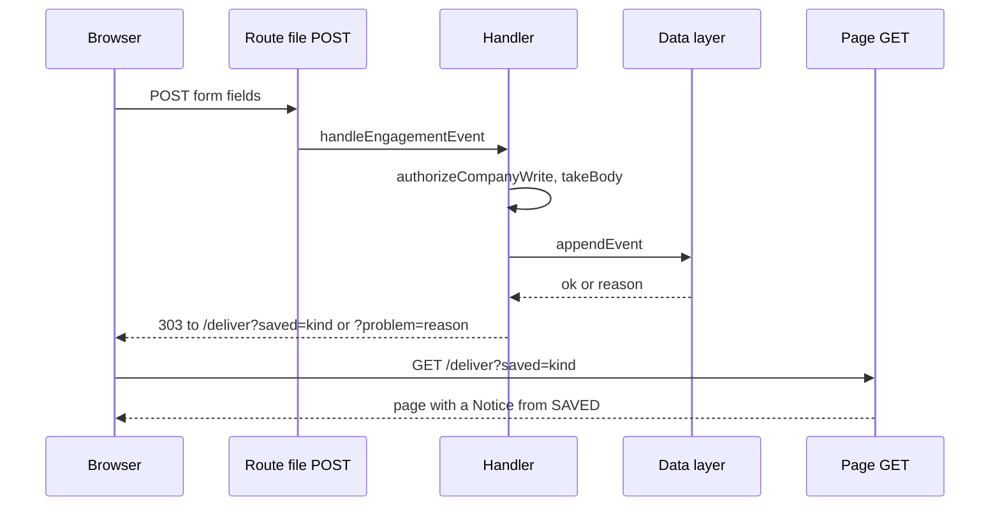

The route files are the only place a handler is bound to an address. Each exports `dynamic` and one or two methods.

| File | Holds | Exports |
| --- | --- | --- |
| `app/api/session/route.ts` | API-02 `handleSessionRead` and API-03 `handleSessionWrite` (sign-in, sign-out) | `dynamic`, `GET`, `POST` |
| `app/api/health/route.ts` | API-01 `handleHealth` | `dynamic`, `GET` |
| `app/api/companies/[id]/route.ts` | API-04 `handleCompanyRead` | `dynamic`, `GET` |
| `app/api/companies/[id]/factory/route.ts` | API-05 `handleFactoryRead` | `dynamic`, `GET` |
| `app/api/companies/[id]/factory/revisions/route.ts` | API-06 `handleRevisionCreate` | `dynamic`, `POST` |
| `app/api/companies/[id]/assessments/route.ts` | API-07 `handleAssessmentList` and API-08 `handleAssessmentCreate` | `dynamic`, `GET`, `POST` |
| `app/api/companies/[id]/assessments/[aid]/route.ts` | API-09 `handleAssessmentRead` | `dynamic`, `GET` |
| `app/api/companies/[id]/assessments/[aid]/decisions/route.ts` | API-10 `handleDecisionCreate` | `dynamic`, `POST` |
| `app/api/companies/[id]/assessments/[aid]/signoff/route.ts` | API-11 `handleSignOff` | `dynamic`, `POST` |
| `app/api/companies/[id]/requirements/route.ts` | API-12 `handleRequirementList` and API-13 `handleRequirementCreate` | `dynamic`, `GET`, `POST` |
| `app/api/companies/[id]/requirements/[rid]/withdraw/route.ts` | API-14 `handleRequirementWithdraw` | `dynamic`, `POST` |
| `app/api/companies/[id]/requirements/[rid]/engagement/route.ts` | API-15 `handleEngagementCreate` | `dynamic`, `POST` |
| `app/api/companies/[id]/engagements/route.ts` | API-16 `handleEngagementList` | `dynamic`, `GET` |
| `app/api/companies/[id]/engagements/[eid]/route.ts` | API-17 `handleEngagementRead` | `dynamic`, `GET` |
| `app/api/companies/[id]/engagements/[eid]/milestones/route.ts` | API-18 `handleMilestoneAdd` | `dynamic`, `POST` |
| `app/api/companies/[id]/engagements/[eid]/events/route.ts` | API-19 `handleEngagementEvent` | `dynamic`, `POST` |
| `app/api/companies/[id]/engagements/[eid]/outcomes/route.ts` | API-20 `handleOutcomeRead` and API-21 `handleOutcomeRecord` | `dynamic`, `GET`, `POST` |
| `app/api/providers/route.ts` | API-22 `handlePublicProviders` | `dynamic`, `GET` |
| `app/api/operator/providers/route.ts` | API-23 `handleOperatorProviders` and API-24 `handleProviderCreate` | `dynamic`, `GET`, `POST` |
| `app/api/operator/providers/[pid]/list/route.ts` | API-25 `handleProviderList` | `dynamic`, `POST` |
| `app/api/operator/providers/[pid]/unlist/route.ts` | API-26 `handleProviderUnlist` | `dynamic`, `POST` |
| `app/api/operator/listing-terms/route.ts` | API-27 `handleTermsRead` and API-28 `handleTermsSet` | `dynamic`, `GET`, `POST` |
| `app/api/operator/pools/route.ts` | API-29 `handlePools` | `dynamic`, `GET` |

The table has 23 files and 29 methods, which agrees with the count sentence of the API reference (29 operations in 23 route files). A route file whose address has a parameter takes `context: { params: Promise<...> }` and awaits it; the parameters are the company id (`id`), `aid`, `eid`, `rid` and `pid`. Every route file passes `env as unknown as AppEnv` from `cloudflare:workers`. The file name must be route.ts, because `modules/docs/src/api.ts` (`compareApi`) and its test read exactly that name.

The names the form uses are not always the names the JSON uses. A handler picks one by `form ? "<form name>" : "<json name>"`. A test or a page that posts a form must use the form names.

| Handler | Form field names | JSON field names |
| --- | --- | --- |
| `handleRevisionCreate` (own reader `readSubmission`) | `a.<question key>` for each answer, `note`, `based_on`, and the button `intent` with value `save` or `confirm` | `answers` (an object), `note`, `basedOn`, `confirm` (a boolean) |
| `handleDecisionCreate` | `opportunity`, `decision`, `note` | `opportunityId`, `decision`, `note` |
| `handleSignOff` | `note` | `note` |
| `handleRequirementCreate` | `assessment`, `opportunity`, `cluster` | `assessmentId`, `opportunityId`, `cluster` |
| `handleRequirementWithdraw` | `note` | `note` |
| `handleEngagementCreate` | `provider` | `providerId` |
| `handleMilestoneAdd` | `title`, `test`, `due`, `amount` | `title`, `acceptanceTest`, `dueOn`, `agreedInr` |
| `handleEngagementEvent` | `kind`, `milestone`, `amount`, `note` | `kind`, `milestoneId`, `amountInr`, `note` |
| `handleOutcomeRecord` | `kind`, `review`, `value`, `verdict`, `in_use`, `note` | `kind`, `reviewNo`, `value`, `verdict`, `inUse`, `note` |
| `handleProviderCreate` (reader `readServices`) | `name`, `summary`, and `opportunity` and `cluster`, each repeated; the services are every chosen idea in every chosen cluster | `name`, `summary`, `services` (a list of objects with `opportunityId` and `cluster`) |
| `handleProviderList`, `handleProviderUnlist` | `note` | `note` |
| `handleTermsSet` | `feeInr`, `note` | `feeInr`, `note` |
| `handleSessionWrite` (own reader `readBody`) | `email`, `intent` (`sign-out` for the form in the bar) | `email`, `intent` |

What each handler sends, and which page table receives it. The success key and the refusal keys are literals in the handler; the refusals that are `<reason>` come from the data function and are limited to the keys of the page's `PROBLEMS` table by a static test where one exists (the last column).

| Form posts to (API id) | Handler | On success the form goes to | On refusal the form goes to | Key-sync test |
| --- | --- | --- | --- | --- |
| API-03 sign-in | `handleSessionWrite` | `/` with the cookie set | `/sign-in?refused=1` for an unknown user | none (the page shows one fixed text for `refused`) |
| API-03 sign-out | `handleSessionWrite` | `/` with the cookie cleared | none | none |
| API-06 | `handleRevisionCreate` | `/factory?saved=<revision>`, plus `&confirmed=1` when confirmed, plus `&missing=<keys>` when a confirm lacked answers | `/factory?problem=invalid` (plus `&fields=<keys>`), `problem=note`, `problem=request`, `problem=too_many`, and `/factory?stale=1` | none |
| API-08 | `handleAssessmentCreate` | `/diagnose?a=<assessment id>` | `/diagnose?needs=confirm` | none (the page reads `needs`) |
| API-10 | `handleDecisionCreate` | `/diagnose?a=<id>&saved=<opportunity id>` | `problem=decision`, `signed`, `too_many` on the same address; `/diagnose?problem=missing` | `modules/diagnose/tests/static/problems.test.ts`, both directions |
| API-11 | `handleSignOff` | `/diagnose?a=<id>&signed=1` | `problem=note`, `undecided`, `signed`, `no_items`, `changed` on the same address; `/diagnose?problem=missing` | the same |
| API-13 | `handleRequirementCreate` | `/procure?made=<requirement id>` | `/procure?problem=request`, `missing`, `already_made`, or the data reason (`not_signed_off`, `not_accepted`, `previously_withdrawn`) | `modules/procure/tests/static/problems.test.ts`, sent keys have a message |
| API-14 | `handleRequirementWithdraw` | `/procure?withdrawn=1` | `/procure?problem=note`, `missing`, `withdrawn`, `engaged` | the same |
| API-15 | `handleEngagementCreate` | `/deliver?made=1` | `/procure?problem=engage`, `missing`, `withdrawn`, or the data reason (`provider_unavailable`, `already_engaged`) | `modules/deliver/tests/static/rules.test.ts`, both directions, for `/deliver` and `/procure` |
| API-18 | `handleMilestoneAdd` | `/deliver?saved=milestone` | `/deliver?problem=invalid`, `missing`, or the data reason (`plan_locked`, `too_many`, `closed`) | the same |
| API-19 | `handleEngagementEvent` | `/deliver?saved=<kind>` | `/deliver?problem=invalid`, `missing`, or the data reason (`closed`, `already_agreed`, `no_milestones`, `not_agreed`, `wrong_state`, `too_many_deliveries`) | the same |
| API-21 | `handleOutcomeRecord` | `/run?saved=<kind>` | `/run?problem=invalid`, `missing`, or the data reason (`baseline_exists`, `baseline_too_late`, `review_exists`, `nothing_accepted`, `not_due`) | `modules/run/tests/static/rules.test.ts`, `PROBLEMS` and `SAVED` |
| API-24 | `handleProviderCreate` | `/operator?made=<provider id>` | `/operator?problem=provider` | `modules/procure/tests/static/problems.test.ts` (operator), sent keys have a message |
| API-25 | `handleProviderList` | `/operator?listed=1` | `/operator?problem=note`, `missing`, or the data reason (`already_listed`, `fee_undecided`, `no_service`) | the same |
| API-26 | `handleProviderUnlist` | `/operator?unlisted=1` | `/operator?problem=note`, `missing`, `not_listed` | the same |
| API-28 | `handleTermsSet` | `/operator?fee=1` | `/operator?problem=fee` | the same |

The deliver handler sends a refusal of API-15 to `/procure`, because the form is on that page. The `made` key means different things on different pages: on `/procure` it is a requirement id, on `/deliver` it is the fixed value `1`, and on `/operator` it is a provider id.

The page side of the contract, as built:

- Each page declares `type Search = {...}` and a `PROBLEMS` table in the form `const PROBLEMS: Record<string, string> = {` with two-space-indented keys and a closing `};` line. `/deliver` and `/run` also declare `SAVED`. The static tests read these declarations as text with that exact shape (7.4). A page that rewrites the shape, for example to a `Map`, makes the tests find no keys and fail on their minimum-size assertions.
- A key is looked up with `Object.hasOwn(PROBLEMS, q.problem)`, never `PROBLEMS[q.problem]` alone. A key such as `__proto__`, `constructor` or `toString` then shows no message and does not break the page. `modules/platform/tests/static/page-lookups.test.ts` (`unguardedLookups`) holds this for upper-case constant tables indexed by the address values, and `modules/platform/tests/smoke/built-app.test.ts` sends those keys to a built page.
- A confirmation key is tested in one of two ways. `made` (on `/procure`, `/deliver` and `/operator`) and `saved` (on `/diagnose` and `/factory`) show their notice for any non-empty value. `signed` (on `/diagnose`), `withdrawn` (on `/procure`) and `listed`, `unlisted` and `fee` (on `/operator`) show only for the exact value `1`. Of the pages, only `/deliver` and `/run` check `saved` against `SAVED`. On `/factory`, `q.saved` is printed as typed in "Version N saved ..."; this and the other pages that show a fixed confirmation for any non-empty value are already recorded in the FSD (12.1 item 5).
- Keys that name questions (`missing`, `fields` on `/factory`) are split on commas and filtered against the questionnaire's own keys before use. `?rev` is accepted only as one to nine digits. `?a` on `/diagnose` is used only when it is at most 64 characters, otherwise the newest assessment is shown.
- The text of a `PROBLEMS` entry is written by hand in the page. Where it states a limit it states it in words (500 characters, 500 saved versions on `/factory`; "five" on `/procure`; "30, 90 and 180 days" on `/run`). The constants are `MAX_NOTE_LENGTH` in `modules/factory/src/questionnaire.ts`, `MAX_REVISIONS_PER_COMPANY` in `modules/factory/src/db/revisions.ts`, and the pool floor and review days in their modules; no test ties the words to the constants (see Found while writing).

A message names a thing that went wrong in words the owner can act on, and never shows what was sent. The factory handler builds the `fields` list from `LABEL_KEYS`, so only question keys of the questionnaire can appear in the address.

### 5.4 The pages one by one

Each row names the page, what it reads and what it posts. Screen contents are in the FSD (SCR-01 to SCR-09). Every page except `/sign-in` and `/demo` resolves the identity in the same way (5.1). The four owner pages (`/factory`, `/procure`, `/deliver`, `/run`) start with the same two refusals, and `/diagnose` and `/operator` have their own forms of them.

| File | Holds | Exports |
| --- | --- | --- |
| `app/page.tsx` | `/` (SCR-01), the home page. A visitor sees the hero with the "Sign in" link, "How it works" built from `STAGES`, the list of promises and "About this version". An owner sees the next step as the hero (`nextStep`), the five steps with a status word (`stageStatuses`, `stageLine`), a "Company record" card (`loadOwnCompany`) and the promises. An operator sees a hero that links to `/operator`. Any other signed-in person sees "You are signed in". Reads `loadFacts`, `loadOwnCompany`. Posts nothing | `dynamic`, `default` |
| `app/sign-in/page.tsx` | `/sign-in` (SCR-02). Outside a synthetic environment, or without a database, it says "Sign-in is not available in this environment." Otherwise it lists the synthetic users with one `SELECT` on `users` (`is_synthetic = 1`, by display name) and a form with the select `email` (label "Synthetic user") and the button "Sign in". Reads `searchParams.refused`. Posts to `/api/session` (API-03) | `dynamic`, `default`, `metadata` |
| `app/factory/page.tsx` | `/factory` (SCR-03), Describe. One form with a fieldset for each section of the questionnaire, drawn from `SECTIONS`. Reads `loadLatest`, `loadHistory`, `loadRevision`, `progressOf`, `progressWords`, `confirmWords`. Posts to `/api/companies/<id>/factory/revisions` (API-06) | `dynamic`, `default`, `metadata` |
| `app/diagnose/page.tsx` | `/diagnose` (SCR-04), Decide. The ranked ideas of one assessment, the decision form of each idea and the sign-off. Reads `listAssessments`, `loadAssessment`, `loadLatestAssessmentId`, `loadLatest(db, id, "confirmed")`, `presentAssessment`, `POINTS`, `MAX_ITEMS` and the helpers of `modules/diagnose/src/progress.ts`. Posts to API-08, API-10 and API-11 | `metadata`, `dynamic`, `default` |
| `app/procure/page.tsx` | `/procure` (SCR-05), Choose. For each accepted idea of the newest signed-off assessment: the requirement form, the pool, the listed providers and the choice. Reads `listAssessments`, `loadAssessment`, `presentAssessment`, `presentRequirements`, `presentEngagements` and the view functions of `modules/procure/src/view.ts`. Posts to API-13, API-14 and API-15 | `dynamic`, `default`, `metadata` |
| `app/deliver/page.tsx` | `/deliver` (SCR-06), Deliver. For each engagement: the milestones, the plan, the event forms and the history. Reads `presentEngagements` and the functions of `modules/deliver/src/summary.ts`. Posts to API-18 and API-19 | `dynamic`, `default` |
| `app/run/page.tsx` | `/run` (SCR-07), Measure. For each engagement: the expected result, the starting number and three reviews. Reads `listEngagements`, `presentOutcomes` and the functions of `modules/run/src/view.ts`. Posts to API-21 | `dynamic`, `default` |
| `app/operator/page.tsx` | `/operator` (SCR-08), the operator's page. Providers, the single listing fee and its history, the pools. Reads `currentTerms`, `listAllProviders`, `listTermsHistory`, `presentPools`, `operatorSummary`, `distinctListedFees`, `serviceGroups`, `LIBRARY`. Posts to API-24, API-25, API-26 and API-28 | `dynamic`, `default`, `metadata` |
| `app/demo/page.tsx` | `/demo` (SCR-09), the presenter's script. It answers `notFound()` unless the binding `APLYD_DEMO` equals `"true"`. It reads `DEMO_COMPANIES`, `OPERATOR`, `WALKED_COMPANY`, `WITNESS_COMPANY` and `DOES_NOT_SHOW`, `RESET_NOTE`, `STEPS`. It reads no database and checks no identity. Posts nothing | `dynamic`, `default`, `metadata` |

#### Home and sign-in

- `/` draws a different `h1` for each kind of visitor: "APLYD MSME platform" for a visitor, the next step's title for an owner, "Keep the list of providers" for an operator and "You are signed in" for anyone else. The page's own `Promises` card has `aria-label="What you can rely on"`, and `CompanyCard` has `aria-label="Company record"`.
- `/sign-in` has its own markup, not `Page`. The refusal key is `refused=1`, which draws one fixed alert, "That user was not found." There is no other key.
- The select of the sign-in form lists each synthetic user as "<display name> (<role>)". The browser tests rely on this and on the label text (5.6).

#### Describe

- Address: `saved`, `confirmed`, `missing`, `stale`, `rev`, `problem`, `fields`. `?rev=<n>` opens an older version read-only, through `loadRevision`; the form is then drawn with `readOnly` and the save buttons are left out.
- Form fields: hidden `based_on` (the newest revision number, 0 for none), `a.<key>` for each question, `note` (at most `MAX_NOTE_LENGTH`), and two submit buttons named `intent`, `save` and `confirm`. The form carries `data-testid="describe-form"`.
- `Input` draws a `textarea` for a long text question, `input type="number"` for a number, and radio or checkbox options for a choice. A choice list of more than five options is drawn in two columns (`LONG_LIST`). The question `state` is drawn beside `district` (`PAIRED_WITH`).
- Messages: `PROBLEMS` has `invalid`, `note`, `request` and `too_many`. `stale=1` has its own notice. `saved` prints the version number, `confirmed=1` changes the sentence, and `missing` lists the labels of the questions still needed to confirm.
- Test ids: `saved`, `missing`, `problem`, `stale`, `status`, `answered`, `viewing`, `history`, `describe-form`, `section-<section id>`.

#### Decide

- Address: `a` (an assessment id), `saved`, `signed`, `problem`, `needs`. `PROBLEMS` has `decision`, `signed`, `undecided`, `note`, `changed`, `too_many`, `no_items` and `missing`.
- It uses `Page` with `hideNext` set after a sign-off, because the page then offers the next step itself (`afterSignOff`).
- Forms: make (`data-testid="make-form"`, no fields), decision (hidden `opportunity`, radio `decision`, `note`) and sign-off (`note`).
- The make form (`MakeForm`) is drawn only when the company has a confirmed description. Without one the page shows a card (`data-testid="no-description"`) with a link to `/factory`. The query `needs=confirm`, sent when the handler refuses to make an assessment, shows the alert `needs-confirm`. A signed-in person who is not an owner reads the text of `notOwnerMessage` (`modules/diagnose/src/api/diagnose.ts`), which differs for a member of a company and for an account without a company.
- Test ids: `make-form`, `saved`, `signed`, `problem`, `needs-confirm`, `no-description`, `assessment`, `drafted-by`, `signoff`, `progress`, `no-items`, `left-out`, `assessments`, `item-<id>` and `decision-<id>`.

#### Choose

- Address: `made`, `withdrawn`, `problem`. `PROBLEMS` has `request`, `not_signed_off`, `not_accepted`, `already_made`, `previously_withdrawn`, `note`, `withdrawn`, `missing`, `engaged`, `engage`, `provider_unavailable` and `already_engaged`.
- A requirement can be offered only for an idea the owner accepted in the newest signed-off assessment (already recorded in the FSD, 12.1 item 17).
- Forms: requirement (`assessment`, `opportunity`, `cluster`), choose a provider (`provider`) and withdraw (`note`).
- The pool is shown as a count in steps of five, from `presentRequirements`. The page shows no listing fee (the listing fee is on the operator's page only, and decision D-03 says APLYD's earnings never vary with which provider an owner chooses).
- Test ids: `made`, `withdrawn`, `problem`, `procure-state`, `accepted`, `accepted-<id>`, `requirements`, `requirement-<id>`, `no-requirements`, `pool`, `providers`, `engaged`, `choose-provider`.

#### Deliver

- Address: `made`, `saved`, `problem`. `SAVED` has `milestone`, `plan_agreed`, `delivered`, `accepted`, `rejected`, `payment_recorded` and `closed`; `PROBLEMS` has `invalid`, `plan_locked`, `too_many`, `closed`, `already_agreed`, `no_milestones`, `not_agreed`, `wrong_state`, `too_many_deliveries` and `missing`. A non-empty `made` shows one fixed sentence.
- Forms: add a milestone (`title`, `test`, `due`, `amount`) and an event (`kind`, `milestone`, `note`, `amount`). Each event is its own form with its own test id: `form-decision-<seq>` for accept or reject, `form-<kind>-<seq>` for the other milestone events, and `add-milestone`, `agree-plan` and `close` for the engagement.
- The page reads the limits for its input attributes from `modules/deliver/src/state.ts` (`MAX_AMOUNT_INR`, `MAX_DELIVERIES`, `MAX_MILESTONES`, `MAX_NOTE_LENGTH`, `MAX_TEST_LENGTH`, `MAX_TITLE_LENGTH`).
- Test ids: `made`, `saved`, `problem`, `no-engagements`, `summary`, `engagements`, `engagement-<id>`, `milestones`, `milestone-<seq>`, `history`, `totals`, `add-milestone`, `agree-plan`, `close`, `form-decision-<seq>`, `form-<kind>-<seq>`, `delivery-cap-<seq>`.

#### Measure

- Address: `saved`, `problem`. `SAVED` has `baseline` and `review`; `PROBLEMS` has `invalid`, `baseline_exists`, `baseline_too_late`, `review_exists`, `nothing_accepted`, `not_due` and `missing`.
- Form: one form for the baseline and one for each due review, with `kind` (`baseline` or `review`), `review` (1 to 3), `value`, `verdict`, `in_use` and `note`.
- The page casts `e.DB as D1Database` for `presentOutcomes` inside `Promise.all`; the cast is safe because the `NotOwner` branch has already returned when the binding is missing.
- Test ids: `saved`, `problem`, `no-engagements`, `summary`, `outcomes`, `outcome-<id>`, `expected`, `baseline`, `form-baseline`, `no-baseline`, `waiting`, `change`, `reviews`, `review-<n>`, `review-<n>-record`, `review-<n>-due`, `form-review-<n>`, `next`.

#### Operator

- Access: `role` must be `operator` and `companyId` must be null. A signed-in person who is not an operator reads "This page is for a platform operator." and a "Back" link. The page uses `PageHead`, not `Page`, because there are no steps.
- Address: `made`, `listed`, `unlisted`, `fee`, `problem`. `PROBLEMS` has `provider`, `fee`, `note`, `fee_undecided`, `no_service`, `already_listed`, `not_listed` and `missing`.
- Forms: the listing fee (`feeInr`, `note`), a new provider (`name`, `summary`, checkboxes `opportunity` for the ideas of `LIBRARY` and `cluster` for the clusters of `CLUSTERS`), and List and Unlist buttons for each provider.
- This is the only page that shows the listing fee. Its text says the fee is undecided and that any fee set is a placeholder (OQ-11), and that the fee does not depend on which provider an owner chooses (D-03). The operator sees the exact count of a pool of five or more; an owner sees steps of five (already recorded in the FSD, 12.1 item 13).
- Test ids: `made`, `listed`, `unlisted`, `fee-saved`, `problem`, `at-a-glance`, `fee`, `fee-now`, `fee-differs`, `providers`, `provider-<name>`, `pools`.

#### Demonstration

- `/demo` is a script for the person who presents: who to sign in as, where to start, what to do and what to say, in steps. The text comes from `modules/demo/src/script.ts` (`STEPS`), and the cast from `modules/demo/src/cast.ts`.
- It calls `notFound()` when the binding `APLYD_DEMO` is not the string `true`. It checks no identity, so on the demonstration host the access gate of section 4.9 is the only protection (the script lists companies and how to sign in, all synthetic).
- The page uses `role="note"` for its warning notice. Test ids: `cast-<id>`, `step-<n>`.

### 5.5 Design tokens and CSS

The visual rules, the colour table and the parts are in [the interface guide](INTERFACE-GUIDE.md). This subsection says where they live in the code and what holds them.

| File | Holds | Exports |
| --- | --- | --- |
| `app/globals.css` | The one shared stylesheet: tokens in `:root` (colour, type, space `--s-1` to `--s-8`, radius, shadow, `--gutter`, `--measure`), the dark set twice (`@media (prefers-color-scheme: dark)` with `:root:not([data-theme="light"])`, and `:root[data-theme="dark"]`), layout helpers and the classes of the shared parts. Its header says nothing loads from another site | none |
| `app/factory/factory.css` | Rules only `/factory` needs. Every class starts with `fc-` | none |
| `app/diagnose/diagnose.css` | Rules only `/diagnose` needs, prefix `dg-` | none |
| `app/procure/procure.css` | Rules only `/procure` needs, prefix `pr-` | none |
| `app/deliver/deliver.css` | Rules only `/deliver` needs, prefix `dl-` | none |
| `app/run/run.css` | Rules only `/run` needs, prefix `ru-` | none |
| `app/operator/operator.css` | Rules only `/operator` needs, prefix `op-` | none |
| `app/demo/demo.css` | Rules only `/demo` needs, prefix `dm-` | none |

How the CSS is wired and kept:

1. `app/layout.tsx` imports `app/globals.css`, so the tokens are on every page. A page imports its own file with `import "./<name>.css"` at the top of the page file.
2. A per-page file uses tokens (`var(--brand)`) and no colour value. A search of the seven per-page files for hexadecimal colours, `rgb(` and `hsl(` found none. `app/globals.css` has one literal outside the token blocks: the `#fff` in the `color-mix` of the hover rule for `button.turn` and `.btn.turn`.
3. Type is the device's own (`--font` and `--font-mono` are system stacks). The browser harness blocks every request that leaves the application (7.3), so a web font or a CDN link would fail the browser tests.
4. A dark colour set is chosen in two ways: by the system (`prefers-color-scheme: dark` unless the root carries `data-theme="light"`) and by the root attribute `data-theme="dark"`. Nothing in the code sets `data-theme`; it exists for a future switch (the interface guide says a language switch and a bottom bar are not built).
5. `modules/journey/tests/unit/contrast.test.ts` reads `app/globals.css`, takes the six-digit hexadecimal tokens of the three blocks and measures the pairs in its hand-written lists `TEXT` and `EDGE`: 4.5 to 1 for text and 3 to 1 for the edge of a control.

The classes the markup uses (`card`, `tint`, `notice`, `tag`, `meter`, `strip`, `page-head`, `options`, `field-row`, `primary`, `small`, `sticky-actions`) are defined in `app/globals.css`; the interface guide's section "Parts" says how a page uses them.

### 5.6 What the pages must keep for the tests

The browser and smoke tests find things by what a person sees, and the static tests read the page files as text. The interface guide lists the elements to keep in its section "What a test finds a page by". This list adds how each item is held and where it is not.

| What a page keeps | Held by |
| --- | --- |
| The text of the one `h1`, and exactly one `h1` for each page | the browser tests of each stage (`getByRole("heading", { level: 1 })`); `PageHead` draws it |
| One link named "Sign in" on a visitor's page, and no link whose name contains another page's link name ("Delivery", "Results", "What you need", "What to do about it", "Describe your factory") | `modules/journey/tests/unit/progress.test.ts` for the step labels and the next step's button words; `SignedOut` |
| The page title "APLYD MSME platform" on every page | `modules/platform/tests/browser/pages.test.ts`; `metadata` in `app/layout.tsx` |
| Exactly one SYNTHETIC banner with `role="note"` on `/` and `/sign-in`, above the content, inside the first screen, with the two sentences | `modules/platform/tests/browser/pages.test.ts` (`assertSyntheticBannerOnScreen`) |
| The label "Synthetic user", the option text "<display name> (<role>)" and the button "Sign in" | `modules/platform/tests/browser/pages.test.ts`; `signInAsOwner` in `modules/platform/tests/support/ui.ts` |
| Each `data-testid` and each notice's `role` listed in 5.4 | the browser and smoke tests of the stage; 7.4 names the ids that no test mentions |
| The field `name` of each form (5.3) | the browser tests (a form posts what it posted before) and the integration tests of the handlers |
| `Object.hasOwn` on every lookup of a message by a key from the address | `modules/platform/tests/static/page-lookups.test.ts`; `modules/platform/tests/smoke/built-app.test.ts` |
| The `PROBLEMS` and `SAVED` declaration shape | the key-sync tests of diagnose, procure, deliver and run (5.3) |
| No listing fee on any owner page | `modules/journey/tests/browser/journey.test.ts` |
| No request that leaves the application | `startBrowserHarness` in `modules/platform/tests/support/browser.ts` blocks every request that is not to the application and records it in `blockedRequests`; `modules/platform/tests/browser/pages.test.ts` asserts that none occurred |
| Contrast of every listed text and ground pair, in the light set and both dark sets | `modules/journey/tests/unit/contrast.test.ts` |
| The page files are read only by the data layer of their module, never by SQL | `modules/diagnose/tests/static/scope-rules.test.ts`, `modules/factory/tests/static/scope-rules.test.ts`, `modules/deliver/tests/static/rules.test.ts`, `modules/procure/tests/static/rules.test.ts` and `modules/run/tests/static/rules.test.ts`, each for the tables it lists |
| The header-read rule: a page reads the request's headers only from the allow-list (`cookie`, `origin`, `sec-fetch-site`, `content-type`, `content-length`) | `modules/platform/tests/static/source-rules.test.ts` with `modules/platform/tests/support/header-rule.ts` |
| Script labels used by the demonstration script exist in the page sources | `modules/demo/tests/static/script-labels.test.ts` |

Two limits of the safety net. First, the tests find a page by text, so a reworded label or heading fails a browser test, but a changed `data-testid` that no test mentions does not (7.4 lists them). Second, the tests do not draw the page in more than one width or in the dark set; the interface guide's 360-pixel and dark-set rules are held by the contrast test and by review only.

#### Found while writing

10 items, listed in [section 9.12](#912-from-section-56-what-the-pages-must-keep-for-the-tests).

## 6. Build, bundling and runtime

This section follows the code from the source tree to a running process: how the application is built, what the Worker entry does, how the database is made, how the demonstration host runs the build, and which configuration names exist. The architecture is in [the HLD](HLD.md) (sections 3, 4.5 and 7.3). Nothing here was built or run for this document: the facts come from reading the build configuration, its consumers and the tests that start a built application. What a build produces is inferred from those consumers and marked as such.

### 6.1 Build

The application is built with `pnpm build`, which runs `vinext build` (`package.json` script `build`). vinext is the Next.js runtime of decision D-06. The build is configured in code, not in a separate Wrangler file: the repository has no Wrangler configuration file. The configuration is the object that `vite.config.ts` passes to the Cloudflare plugin.

| File | Holds | Exports |
| --- | --- | --- |
| `package.json` | The scripts (`dev`, `build`, `typecheck`, `db:generate`, `db:check`, `test`, `test:static`, `test:unit`, `test:integration`, `test:smoke`, `test:catalogue`, `docs:check`, `db:local`), the engine floor (Node 22.18.0 or later), the pinned package manager and exact versions of every dependency | none |
| `vite.config.ts` | The build: the `vinext` plugin and the `@cloudflare/vite-plugin` plugin. The Worker entry is `./worker/index.ts`, the flag is `nodejs_compat`, and the D1 binding is `DB` with the database name `aplyd-local` and a placeholder id. The development server alone adds the variable `APLYD_ENV` | `default` |
| `next.config.ts` | The Next.js configuration, an empty object | `default` |
| `tsconfig.json` | The TypeScript settings for the whole tree: strict, no emit, `erasableSyntaxOnly`, `allowImportingTsExtensions`; it includes every `.ts`, `.tsx` and `.mts` file, tests and scripts too | none |
| `cloudflare-env.d.ts` | The type of the Worker bindings: `DB`, `APLYD_ENV`, `SESSION_SECRET`, all optional | none |
| `pnpm-workspace.yaml` | The supply-chain policy: no package published in the last seven days (`minimumReleaseAge: 10080`), dependency build scripts only for the named packages (`strictDepBuilds`, `allowBuilds`), and one override | none |
| `.gitignore` | What stays out of Git: `node_modules`, `dist/`, `.wrangler/`, `.env` files other than `.env.example`, `.dev.vars`, database and key files, `reports/`, `sources/` | none |
| `.env.example` | The names of the two variables a local run needs, with no values | none |

What the build does, in order, as far as the code shows:

1. `vinext build` loads `vite.config.ts`. For a build the `command` is not `serve`, so `vars` is not added: **a built Worker carries no `APLYD_ENV`**, and synthetic sign-in is refused until whoever runs it sets one. `modules/platform/tests/smoke/built-app.test.ts` checks that the build carries none.
2. `vite.config.ts` sets Wrangler and Miniflare defaults on `process.env` for the process (no telemetry, no log files outside `.wrangler/`, no network fetch for `Request.cf`) and imports the Cloudflare plugin after that, because Wrangler reads its log path while the plugin is imported.
3. The Cloudflare plugin is given the Worker entry `worker/index.ts` and the Vite environment `rsc` with the child environment `ssr`. The pages and route files of `app/` are built by vinext, the Next.js runtime that decision D-06 names (assumption: the repository only configures it; its internals were not read for this document).
4. The output goes under `dist/` (ignored by Git). The consumers show what it holds: `dist/server/wrangler.json` (the generated Worker configuration, with `compatibility_date`, `compatibility_flags`, `d1_databases` and `assets.directory`), `dist/server/index.js` and any other `.js` or `.mjs` file under `dist/server`, and the static assets in the directory that `assets.directory` names, relative to `dist/server`. This layout is inferred from `scripts/serve.mjs` and `modules/platform/tests/support/worker.ts`, which read exactly those; no build was run for this document.

Who consumes the build:

| Consumer | How it uses `dist/` |
| --- | --- |
| `scripts/serve.mjs` | Reads `dist/server/wrangler.json`, lists every module of `dist/server` for Miniflare, and runs the Worker in workerd (4.9, the demonstration host) |
| `modules/platform/tests/support/worker.ts` (`startBuiltApp`) | Runs `wrangler dev --local --config dist/server/wrangler.json` on a free port for the smoke and browser layers |
| The `Dockerfile` | Runs `pnpm build` inside the image, then starts `scripts/serve.mjs` |
| `.github/workflows/ci.yml` | Runs `pnpm build` before the layers that need it |

Other build-time facts:

- `pnpm dev` runs `vinext dev --port 5173`. For the development server `vite.config.ts` adds `vars: { APLYD_ENV: "local" }`, so local sign-in works. The local database is made by `pnpm db:local` (6.3).
- `pnpm typecheck` is `tsc --noEmit`. The runner also runs it as the command suite `static/typecheck` (7.2). Because `tsconfig.json` includes every `.ts` file, a type error in a test or a script fails the type check.
- Node runs the TypeScript of `modules/` and `scripts/` directly (no compile step) for the tests, `scripts/serve.mjs`, `scripts/check-traceability.mjs` and `scripts/check-test-docs.mjs`. This is why the engine floor is 22.18.0 and why `tsconfig.json` has `erasableSyntaxOnly`: a file may not use a TypeScript feature that needs a transform (enums, parameter properties, namespaces). `docs/DEVELOPMENT.md` says the tests are TypeScript run directly by Node.
- `pnpm install --frozen-lockfile` follows `pnpm-lock.yaml` exactly. The `Dockerfile` and the workflow `.github/workflows/ci.yml` both use it.

**Pinned versions** (AS BUILT, from `package.json` and `tsconfig.json`; every version is exact, with no range). Four packages are runtime dependencies: `drizzle-orm`, `next`, `react` and `react-dom`. Every other package, `miniflare` and `vinext` included, is a development dependency.

| Part | Version | What the code uses it for |
| --- | --- | --- |
| Node | 22.18.0 or later (`engines`) | Runs the tests (the TypeScript files directly), the launcher and the documentation checks |
| pnpm | 11.25.0 (`packageManager`) | Installs, under the policy of `pnpm-workspace.yaml` |
| TypeScript | 5.9.3 | The type check only (`tsc --noEmit`), with `strict`, `erasableSyntaxOnly`, `verbatimModuleSyntax`, `isolatedModules` and `allowImportingTsExtensions` |
| next, react, react-dom | 16.3.6, 19.2.6, 19.2.6 | The code imports `next/headers` and `next/navigation` and the types of `next` |
| vinext | 1.0.0-beta.5 | The build, the development server and the fetch handler that the Worker calls |
| vite, @cloudflare/vite-plugin | 8.0.13, 1.37.1 | The bundler, and the plugin that builds for the Workers runtime |
| wrangler, miniflare | 4.92.0, 4.20260515.0 | The local Worker and D1 for the tests and the launcher |
| drizzle-orm, drizzle-kit | 0.45.2, 0.31.10 | Table declarations and migration generation. The SQL that runs is written by hand (3.7) |
| playwright-core | 1.56.1 | The browser layer. It drives a browser that is already installed |

Two details of `tsconfig.json` that are not used: it has a `paths` alias `@/*`, and no source file under `app/`, `modules/`, `worker/` or `scripts/` imports through it; and its `include` list names `next-env.d.ts`, a file that the repository does not have.

**Continuous integration** (AS BUILT, `.github/workflows/`). Two workflows run on GitHub, with no secret, no hosted database and no deployment.

- `docs.yml` (`documentation-checks`, 5-minute limit) runs on every pull request and by hand. It uses Node 22, installs nothing, and runs `scripts/check-documentation.mjs`, `scripts/check-traceability.mjs` and `scripts/check-test-docs.mjs`.
- `ci.yml` (`engineering-checks`, 20-minute limit) runs on a pull request and on a push to `main`, unless every changed file is Markdown or under `docs/` (`paths-ignore`), and by hand. In order: `node scripts/test.mjs --check-catalogue`, `corepack enable` and `pnpm install --frozen-lockfile`, `pnpm build`, `google-chrome --version` (the browser layer uses the Chrome that the runner image has, and the step fails if it is missing), `node scripts/test.mjs pr --guard`, and last an upload of `reports/summary.json`, also when an earlier step failed. A new run for the same pull request or branch cancels the one before it.
- The sync tests of the documentation module are suites of the static layer, so only `ci.yml` runs them. A pull request that changes only documents runs `docs.yml` and not the sync tests (9.11).

### 6.2 The worker and bindings

The Worker entry is one small file.

| File | Holds | Exports |
| --- | --- | --- |
| `worker/index.ts` | The entry: every request goes to vinext's fetch handler (`handler.fetch(request, env, ctx)`), and the response it returns is passed through `withSecurityHeaders` | `default` |
| `modules/platform/src/api/security-headers.ts` | The four headers added to every response the Worker produces, and the function that adds them to a copy of the response | `withSecurityHeaders` |
| `modules/platform/src/api/health.ts` | The health answer for `/api/health` | `handleHealth` |
| `modules/platform/src/env.ts` | The binding type `AppEnv`, the session-secret floor and the two functions every sign-in check goes through | `AppEnv`, `MIN_SECRET_BYTES`, `getSessionSecret`, `isSyntheticEnvironment` |

The path of one request through the Worker:

1. The runtime calls `fetch` of the default export of `worker/index.ts`.
2. `fetch` calls `handler.fetch(request, env, ctx)` from `vinext/server/fetch-handler`. vinext matches the address to a page or a route file of `app/`, or, for a request the assets layer answers, serves a static file without calling the Worker.
3. A route file runs its `GET` or `POST` and calls a handler (5.3). A page renders (5.1).
4. `withSecurityHeaders` makes a copy of the response, because the headers of the original may be immutable, and sets `x-content-type-options: nosniff`, `x-frame-options: DENY`, `referrer-policy: same-origin` and `content-security-policy: frame-ancestors 'none'; base-uri 'self'; form-action 'self'`.
5. The copy is returned. `modules/platform/tests/static/source-rules.test.ts` holds step 4 to the entry's text with the pattern `withSecurityHeaders(await handler.fetch(`.

The bindings the code reads (names only):

| Binding | Type | Read in | Effect when missing |
| --- | --- | --- | --- |
| `DB` | D1 database | every module's data layer, through `env.DB`; `resolveIdentityFromCookieHeader` returns no identity without it; the sign-in page and `handleHealth` check it | no identity, so every owner page shows `SignedOut`; `/api/health` answers 503 with `database` `unavailable` |
| `APLYD_ENV` | text | `isSyntheticEnvironment` (`modules/platform/src/env.ts`): `local`, `synthetic` or `test` | no SYNTHETIC banner, no synthetic sign-in |
| `SESSION_SECRET` | text | `getSessionSecret`: at least `MIN_SECRET_BYTES` bytes and not one repeated character | a null secret, so no session can be signed or verified and sign-in is refused |
| `APLYD_DEMO` | text, the value `true` | `app/demo/page.tsx`, read by an untyped cast; `scripts/serve.mjs` sets it only when the launcher was told to add the demonstration | `/demo` answers not found |

The health answer (`handleHealth`):

1. It starts with `database: "unavailable"` and `auditGuard: "unknown"`.
2. When `env.DB` exists, it reads the name and table of every trigger from `sqlite_master`. If that read works, `database` is `ok`.
3. It compares those with `REQUIRED_TRIGGERS_BY_TABLE` (`modules/platform/src/db/guards.ts`). All present gives `auditGuard: "ok"`, otherwise `missing`.
4. It answers 200 with `status: "ok"` only when both are `ok`, otherwise 503 with `status: "degraded"`. The body names no table and no trigger.

The check looks at the name and the table of each trigger, not its body. The comment in the file says so and says the integration tests are what show the bodies are right.

### 6.3 Migrations

The database has one schema, made by 15 SQL files in order. The tables and columns are in [the data dictionary](DATA-DICTIONARY.md); this subsection says how the files are made, ordered, applied and checked.

| File | Holds | Exports |
| --- | --- | --- |
| `drizzle.config.ts` | The settings of `drizzle-kit`: the schema file in the `src/db/` directory of every module, the output directory `./drizzle`, dialect `sqlite` | `default` |
| `drizzle/meta/_journal.json` | The list of migrations, in order, each with its tag and `breakpoints: true`. The reader and `drizzle-kit` both follow it | none |
| `modules/platform/src/db/migrate.ts` | The Node-only reader and applier: `migrationFiles` (journal order; throws if a file and the journal disagree), `migrationStatements` (splits a file on `--> statement-breakpoint`), `seedFiles` (the file seed-synthetic.sql in the `db/` directory of every module that has one, the platform's first), `seedStatements` (splits on a semicolon that ends a line, drops comment lines), `applyMigrations(db, { seed })` | `migrationFiles`, `migrationStatements`, `seedFiles`, `seedStatements`, `applyMigrations` |
| `modules/platform/src/db/guards.ts` | The lists of append-only tables and of rule triggers, by table, and the flat lists the health check uses | `APPEND_ONLY_TABLES`, `RULE_TRIGGERS`, `ALL_APPEND_ONLY_TRIGGERS`, `ALL_REQUIRED_TRIGGERS`, `REQUIRED_TRIGGERS_BY_TABLE` |
| `modules/platform/db/seed-synthetic.sql` | The synthetic companies, users and the operator | none |
| `modules/factory/db/seed-synthetic.sql` | One confirmed factory revision for the first synthetic company | none |
| `scripts/local-db.mjs` | Makes the local development database from the migrations and the seed with Wrangler (`pnpm db:local`) | none |

The 15 files in `drizzle/` follow one pattern for each module: a file of tables made by `drizzle-kit generate` from the module's schema file, then a hand-written file of triggers made with `--custom`, because a schema file cannot declare a trigger (already recorded in the data dictionary, section 9 item 2).

| Order | Files | What they hold |
| --- | --- | --- |
| Platform | `drizzle/0000_init.sql`, `drizzle/0001_audit_append_only.sql`, `drizzle/0002_audit_no_replace.sql` | Tables `audit_events`, `companies`, `users`; the triggers that refuse update and delete of `audit_events`; the trigger that refuses a replace |
| Describe | `drizzle/0003_factory_revisions.sql`, `drizzle/0004_factory_revisions_append_only.sql` | The table `factory_revisions` and its three append-only triggers |
| Decide | `drizzle/0005_diagnose_assessments.sql`, `drizzle/0006_diagnose_guards.sql`, `drizzle/0007_diagnose_review_fixes.sql` | Tables `assessments` and `assessment_events`, their ten guards, and the review fixes of 0007 (three new triggers; none is dropped) |
| Choose | `drizzle/0008_procure_tables.sql`, `drizzle/0009_procure_guards.sql` | Tables `listing_terms`, `provider_events`, `provider_services`, `providers`, `requirement_events`, `requirements` and their triggers |
| Deliver | `drizzle/0010_deliver_tables.sql`, `drizzle/0011_deliver_guards.sql` | Tables `engagement_events`, `engagements`, `milestones` and their triggers |
| Measure | `drizzle/0012_run_tables.sql`, `drizzle/0013_run_guards.sql` | The table `outcome_events` and its triggers |
| Review fixes | `drizzle/0014_review_fixes.sql` | Triggers for rules that the application kept and the database did not (two triggers dropped and made again) |

How a database is made, step by step (the same on every path):

1. `migrationFiles` reads `drizzle/meta/_journal.json`, sorts the entries by `idx` and takes the tags. It lists the SQL files of `drizzle/`. If a tag has no file or a file has no tag, it throws the sentence "drizzle/ and its journal disagree".
2. `migrationStatements` reads each file in that order and splits it on the text `--> statement-breakpoint`, so each trigger body is one statement.
3. `seedStatements` reads each seed file, drops lines that start with `--`, and splits on a semicolon followed by a line break. A seed value therefore must not contain a semicolon at the end of a line. The platform seed uses `INSERT OR IGNORE`, so running it twice changes nothing.
4. The statements are run one by one: by `applyMigrations(db, { seed })` on a Miniflare database in the tests (`createTestEnvironment` in `modules/platform/tests/support/d1.ts`), through `wrangler d1 execute --local` for `scripts/local-db.mjs` and for `startBuiltApp`, and through `db.prepare(statement).run()` in `scripts/serve.mjs`.
5. The health check (6.2) then confirms that every required trigger exists.

How a migration is changed. The applied migrations are never edited: the comment of 0007 says earlier files "may already have been applied, so the fixes are new triggers", and `docs/DEVELOPMENT.md` says the same. A change is a new file:

1. Change the module's schema file and run `pnpm db:generate` (`drizzle-kit generate`) for a table or column; for a trigger or other custom SQL, run `pnpm db:generate --custom --name <name>` and write the SQL, with `--> statement-breakpoint` between statements.
2. The command adds the SQL file, a snapshot file in `drizzle/meta/` and an entry in `drizzle/meta/_journal.json`. Commit all three.
3. Add each new append-only table and rule trigger to `modules/platform/src/db/guards.ts`. `modules/platform/tests/unit/guards.test.ts` fails when the lists and the triggers of the migrations differ, and when a migration drops a trigger it does not create again.
4. `pnpm db:check` (`drizzle-kit check`), run as the command suite `static/migrations`, checks that the snapshots and the journal agree.
5. Update the data dictionary (section 8.4 lists what).

Where migrations are applied: the paths above are the only ones in the repository. A search of the TypeScript, script, JSON, workflow and Docker files found no `wrangler d1 migrations` command and no `migrations_dir`, so nothing in the repository applies migrations to a hosted D1 database. The demonstration host rebuilds an in-memory database at every start (6.4).

### 6.4 The demo host

The demonstration host is the Node process of 4.9. This subsection lists what in the repository defines it, and what holds those files to each other.

| File | Holds | Exports |
| --- | --- | --- |
| `Dockerfile` | The image: Node 22.22.0 on Debian slim, pnpm 11.25.0 by corepack, install from the lockfile, `pnpm build`, then `NODE_ENV=production`, a non-root user, port 8080, a health check of `/healthz` and the command `node scripts/serve.mjs` | none |
| `.dockerignore` | What is left out of the build context: Git data, `node_modules`, build output, secrets and keys, `docs`, every `tests` directory, `reports`, `sources` | none |
| `.do/app.yaml` | The DigitalOcean App Platform spec: name, the Dockerfile, the repository and branch with no deploy on push, port 8080, one instance, the health route, and the four variables `APLYD_ENV` (a value) and `SESSION_SECRET`, `DEMO_USER`, `DEMO_PASSWORD` (secrets with a placeholder to replace) | none |
| `scripts/serve.mjs` | The launcher (4.9) | none |

The request path on the host:

1. The platform's ingress terminates HTTPS and sends the request to the container's `PORT`, where `createGateway` (`modules/hosting/src/gateway.ts`) listens.
2. The gateway answers `/healthz` itself, applies `passesGate`, bounds the body and hands the request on with `upstreamHeaders` to the Worker that Miniflare runs on loopback at `APLYD_UPSTREAM_PORT`.
3. The Worker is the build of 6.1 with the bindings of `scripts/serve.mjs` (6.2). It answers as in 6.2, including the security headers.
4. The gateway sends the answer back.

`modules/hosting/tests/static/deploy-files.test.ts` holds the files to one another with six tests: the Dockerfile pins the same pnpm as `package.json` and a Node that meets its engines; it installs from the lockfile, builds, then runs as a non-root user with `NODE_ENV` set only after the build; neither it nor the spec holds a secret; every secret in the spec is an encrypted value and the placeholder is refused by the launcher; the spec points at the Dockerfile, the port and the health route and is not deployed on every push; the build context leaves out secrets, dependencies and build output.

The Dockerfile and the app spec were never built or deployed in the session that wrote them (the Dockerfile comment says so), and were not built for this document. What differs between the spec and the live host is already recorded in HLD 12 (items 1 and 2).

### 6.5 Configuration names

Names only; values are never written in the repository (`.env.example` holds names and no value, which `modules/platform/tests/static/source-rules.test.ts` checks line by line).

| Name | Read in | Set by | When missing or wrong |
| --- | --- | --- | --- |
| `PORT` | `parseConfig` (`modules/hosting/src/gate.ts`) | the host; the Dockerfile sets 8080 | the launcher uses its default; a value that is not a whole number from 1 to 65535 stops the launch |
| `APLYD_UPSTREAM_PORT` | `parseConfig` | the host, optionally | default; it must differ from `PORT` |
| `APLYD_ENV` | `parseConfig` (default `synthetic`, anything but `local`, `synthetic` or `test` stops the launch); the Worker, through `isSyntheticEnvironment` | the launcher passes it to the Worker; `vite.config.ts` for the dev server; the tests, which pass `test` (`createTestEnvironment`, the callers of `startBuiltApp`, the browser harness) | a Worker without it has no SYNTHETIC banner and no sign-in |
| `SESSION_SECRET` | `parseConfig` (the same floor as `getSessionSecret`); the Worker, through `getSessionSecret` | the host, as a secret; `.dev.vars` locally | the launcher refuses to start; a Worker without it refuses sign-in |
| `DEMO_USER`, `DEMO_PASSWORD` | `parseConfig`, for the access gate (a user without a colon, a password of at least `MIN_PASSWORD_CHARACTERS` characters) | the host, as secrets | the launcher refuses to start unless `DEMO_ACCESS` is `open` |
| `DEMO_ACCESS` | `parseConfig`; only the value `open` is accepted | the host, optionally | with a user and a password the gate is on; `open` together with a user or a password stops the launch |
| `APLYD_PUBLIC_HOSTS` | `parseConfig`, a comma-separated list of host names with an optional port | the host, optionally | none; only the host the browser sent counts as the site's own |
| `APLYD_DEMO` | `parseConfig` (the value `true`); `scripts/serve.mjs`; `app/demo/page.tsx` | the host, optionally | no demonstration data and `/demo` is not found |
| `DB` | every data layer, as the binding `env.DB` | `vite.config.ts` (a placeholder local database) for a build; Miniflare in `scripts/serve.mjs` and in the tests | no database: see 6.2 |
| `APLYD_CHROMIUM_PATH` | `modules/platform/tests/support/browser.ts` (`CHROMIUM_ENV`) | a developer or the CI job, optionally | the browser layer looks for the preinstalled browser, then for Google Chrome; a path that names a missing file is an error |
| `APLYD_BROWSER_DEBUG` | `modules/platform/tests/support/browser.ts` | a developer | no Worker output is printed on failure |
| `CLOUDFLARE_CF_FETCH_ENABLED`, `WRANGLER_SEND_METRICS`, `WRANGLER_WRITE_LOGS`, `WRANGLER_LOG_PATH`, `WRANGLER_REGISTRY_PATH`, `MINIFLARE_REGISTRY_PATH` | the Wrangler and Miniflare tools | `vite.config.ts` (defaults for a build and the dev server), `modules/platform/tests/support/worker.ts` and `scripts/local-db.mjs` | the tools would fetch from the network, write telemetry or logs, and share their registry across runs |
| `NODE_ENV` | no file of the repository reads it; the Dockerfile sets it to `production` after the build and `modules/hosting/tests/smoke/serve.test.ts` starts the launcher with it | the Dockerfile | the test ensures the launcher works when it is set |

To add a configuration name that the Worker reads:

1. Add it, optional, to the type `AppEnv` in `modules/platform/src/env.ts` and to `cloudflare-env.d.ts`, and read it only through a function that checks it (as `getSessionSecret` does).
2. Add its name, with no value, to `.env.example` if a developer must set it. The test of that file accepts only lines of the form `NAME=` or comments.
3. If the demonstration host must pass it on, add it to the `bindings` object of `scripts/serve.mjs`; nothing else carries a value from the launcher's environment to the Worker.
4. If the launcher must check it before starting, add the check to `parseConfig` in `modules/hosting/src/gate.ts` and a case to `modules/hosting/tests/unit/gate.test.ts`.
5. If the host must set it, add it to `.do/app.yaml` as a secret with a placeholder (the static deploy test requires every secret in the spec to be an encrypted value) and say so in `modules/hosting/STATUS.md`.
6. Run the header-read rule in your head: a value read from a request header is never an identity (`modules/platform/tests/static/source-rules.test.ts`). A configuration name is read from `env`, never from a header.

#### Found while writing

11 items, listed in [section 9.13](#913-from-section-65-configuration-names).

## 7. Test design

This section says how the tests are organised, how the runner decides that a run is good, what the tests need, which contract is held by which test, and how a test is added. It describes the tests that exist. It does not say that any test passes: no test was run for this document, except that `node scripts/test.mjs --list` and `node scripts/test.mjs --check-catalogue` were run on the pinned commit to count suites. The strategy and the cases are in `docs/test/TEST-STRATEGY.md` and `docs/test/TEST-CASES.md`; this section adds how the code is arranged.

### 7.1 Layers

A test is a file modules/<module>/tests/<layer>/<name>.test.ts, run by `node --test`. The layer is the name of the directory. There are five layers, and `pr` is the alias that means all five (`ALIASES` in `scripts/test.mjs`).

| Layer | What the suites check | What they need | Limit for one suite |
| --- | --- | --- | --- |
| `static` | Source files and documents read as text or as a syntax tree, without running the application; also five command suites (type check, documentation check, traceability check, test-documentation check, migrations check) | a Git checkout (several tests list files with `git ls-files`), the installed packages; no build | 10 minutes |
| `unit` | Pure functions, with no database | the installed packages | 10 minutes |
| `integration` | Request handlers called as functions against a real SQLite database (workerd's, through Miniflare) with every migration and the synthetic seed applied, a fresh one for each test; also the hosting gateway against a stub | the installed packages (`miniflare`) | 15 minutes |
| `smoke` | The built application in a local Worker, walked over HTTP; also the launcher `scripts/serve.mjs` started as a process | `pnpm build` first (`dist/server/wrangler.json`), `wrangler` | 15 minutes |
| `browser` | The built application in headless Chromium through `playwright-core`: pages, sign-in through the form, scope, a cross-site post, whole journeys | `pnpm build` first, and a Chromium (see `APLYD_CHROMIUM_PATH` in 6.5) | 15 minutes |

The limits are `TIMEOUT_MIN` in `scripts/test.mjs`. There is no `test:browser` script in `package.json`: the browser layer runs inside `pnpm test` (which is `node scripts/test.mjs pr --guard`) or by `node scripts/test.mjs browser`.

The suites on the pinned commit, counted by `node scripts/test.mjs --list` (95 suites; `--check-catalogue` prints "Test catalogue clean: 95 suites in 5 layers."):

| Module | static | unit | integration | smoke | browser |
| --- | ---: | ---: | ---: | ---: | ---: |
| `platform` | 3 | 8 | 2 | 1 | 4 |
| `factory` | 1 | 2 | 1 | 1 | 1 |
| `diagnose` | 2 | 5 | 1 | 1 | 1 |
| `procure` | 2 | 3 | 1 | 1 | 1 |
| `deliver` | 1 | 3 | 1 | 1 | 1 |
| `run` | 1 | 2 | 1 | 1 | 1 |
| `journey` | 0 | 2 | 1 | 0 | 1 |
| `demo` | 1 | 3 | 0 | 1 | 1 |
| `hosting` | 1 | 1 | 1 | 1 | 0 |
| `docs` | 11 | 10 | 0 | 0 | 0 |
| command suites (no module) | 5 | 0 | 0 | 0 | 0 |
| Total | 28 | 39 | 9 | 8 | 11 |

The five command suites are `static/typecheck` (`tsc --noEmit`), `static/documentation` (`scripts/check-documentation.mjs`), `static/traceability` (`scripts/check-traceability.mjs`), `static/test-docs` (`scripts/check-test-docs.mjs`) and `static/migrations` (`drizzle-kit check`). They are listed in `COMMAND_SUITES` and have no baseline.

The modules own their tests: a module's tests are in its own directory, and shared helpers are in `modules/platform/tests/support/` (7.3). Other modules import those helpers by a relative path such as `../../../platform/tests/support/d1.ts`.

### 7.2 The runner and the baselines

`scripts/test.mjs` is the one entry point (4.9 lists the file). It finds suites by directory, runs each in its own process, and decides from the output.

How a run goes (functions of the file in brackets):

1. The arguments are read. Layers are positional (`pr` by default); the flags are `--guard`, `--only <id,...>`, `--list`, `--check-catalogue`, `--update-baseline` with `--reason "<why>"`. Another flag, another layer, or `--update-baseline` with no reason exits with code 2.
2. `discover` builds the catalogue. For each module it lists the files named <name>.test.ts in each layer directory under its `tests/` directory as suites with the id <module>/<layer>/<name>; it adds the five command suites. It reports a catalogue error for: a test file (any name with `.test.` in it) anywhere in a module outside a layer directory (including the `support/` directory and `src/`), an entry in `tests/` that is not a layer directory, `support` or the baseline file baseline.json, a file in a layer directory whose name does not end in .test.ts, and two suites with the same id.
3. `--list` prints each suite and exits 0, before any catalogue check. `checkCatalogue` then adds a catalogue error for each baseline key that names a suite that does not exist. Any error exits 2 and prints the list; `--check-catalogue` prints the count and exits 0 when clean.
4. The suites of the requested layers (and of `--only`) run one after another, never in parallel. `run` starts `node --test --test-reporter=tap <file>` (or the command of a command suite), collects the output, and kills the process group at the layer's limit.
5. A suite is `ok` only if the exit code is 0, it did not time out, and, for a test file, `failed` is 0, `passed` is more than 0 and `skipped`, `todo` and `cancelled` are all 0. The counts are read from the lines `# pass N` and so on of the TAP output. A skipped test is a failure even without `--guard`.
6. With `--guard`, for every module that ran, each suite that ran must have a baseline key (`<layer>/<name>`) and `passed` must be at least that count. Unless `--only` is used, a baseline key whose layer was requested and which did not run is also a problem.
7. With `--update-baseline`, the runner refuses to write while any suite failed. Otherwise, for each module that ran, it sets the baseline of each suite that ran to its current `passed`, and writes `{ updatedAt, reason, suites }` to the module's own baseline.json in its `tests/` directory (one reason for the whole file), and exits 0 without writing a report.
8. Otherwise it writes `reports/summary.json` (the results without their output; `reports/` is ignored by Git), prints "N of M suites passed." and the guard problems, and exits 1 if any suite failed or any guard problem exists, else 0.

The ten baseline files:

| File | Holds | Exports |
| --- | --- | --- |
| `modules/platform/tests/baseline.json` | Least passing count for each of the 18 suites of the platform module (recorded counts sum to 119) | none |
| `modules/factory/tests/baseline.json` | The same for 6 suites (sum 76) | none |
| `modules/diagnose/tests/baseline.json` | The same for 10 suites (sum 89) | none |
| `modules/procure/tests/baseline.json` | The same for 8 suites (sum 77) | none |
| `modules/deliver/tests/baseline.json` | The same for 7 suites (sum 70) | none |
| `modules/run/tests/baseline.json` | The same for 6 suites (sum 63) | none |
| `modules/journey/tests/baseline.json` | The same for 4 suites (sum 52) | none |
| `modules/demo/tests/baseline.json` | The same for 6 suites (sum 32) | none |
| `modules/hosting/tests/baseline.json` | The same for 4 suites (sum 43) | none |
| `modules/docs/tests/baseline.json` | The same for 21 suites (sum 254) | none |

The sums are the numbers written in the files on 5 October 2026, read by a script; they are recorded counts and not the result of a run. All ten files carry the date 2026-10-05.

How CI uses it. The workflow `engineering-checks` (`.github/workflows/ci.yml`) runs `node scripts/test.mjs --check-catalogue`, installs with the lockfile, runs `pnpm build`, then `node scripts/test.mjs pr --guard`, and uploads `reports/summary.json`. It is skipped for a push or pull request that changes only Markdown files or files under `docs/`. The workflow `documentation-checks` (`.github/workflows/docs.yml`) runs on every pull request and runs three of the command suites' scripts (4.9). So a pull request that changes only Markdown or `docs/` does not run the documentation-sync suites of `modules/docs/tests/static/`; they run in `engineering-checks` only when something else changes.

### 7.3 The local database helper and fixtures

All shared helpers are in the platform module's `tests/support/` directory (the runner reports a test file there as an error, so these files hold no tests), plus the launcher helper of the hosting module (4.9).

| File | Holds | Exports |
| --- | --- | --- |
| `modules/platform/tests/support/d1.ts` | A real D1 database for integration tests: `createTestEnvironment` starts Miniflare with one D1 binding, applies the migrations and the synthetic seed with `applyMigrations`, and returns `env` (the bindings, with `APLYD_ENV` set to `test` and a test secret), `db` and `dispose`. Also the request builders the handler tests use | `TEST_SECRET`, `createTestEnvironment`, `ORIGIN`, `post`, `get`, `cookieFrom` |
| `modules/platform/tests/support/worker.ts` | Starts the built application in a local Worker with its own throwaway database | `RunningWorker`, `startBuiltApp` |
| `modules/platform/tests/support/browser.ts` | The browser harness: chooses a Chromium, starts a Worker, opens a fresh context for each test, blocks any request that leaves the application, and closes everything on failure, timeout or signal | `CHROMIUM_ENV`, `PREINSTALLED_CHROMIUM`, `TEST_TIMEOUT_MS`, `SETUP_TIMEOUT_MS`, `TEARDOWN_TIMEOUT_MS`, `BrowserChoice`, `chooseBrowser`, `launchBrowser`, `BrowserHarness`, `startBrowserHarness`, `useBrowserHarness`, `withBrowserHarness` |
| `modules/platform/tests/support/ui.ts` | What a person does in the browser, by role and label locators: watch a page for errors, read from the page with its cookies, sign in as an owner | `SESSION_COOKIE`, `OWN_COMPANY`, `OTHER_COMPANY`, `watchPage`, `getFromPage`, `SignedInAs`, `signInAsOwner`, `signInAsFirstOwner` |
| `modules/platform/tests/support/header-rule.ts` | The syntax-tree rule behind the header-read test: the allow-list and the function that reports every other way of reading a header | `ALLOWED_HEADERS`, `headerReadProblems` |
| `modules/platform/tests/support/sql-rules.ts` | The SQL tripwires: the application's source files, the SQL strings that name a table, and the problems with a statement on an append-only table or a read that does not bind a company | `ROOT`, `applicationFiles`, `sqlMentioning`, `problemsWith` |
| `modules/platform/tests/support/token.ts` | Helpers that make a session token or a tampered one for the identity tests | `toBase64Url`, `signRaw` |

How the helpers are used by layer:

| Layer | Helper | How |
| --- | --- | --- |
| integration | `createTestEnvironment` | Called in `beforeEach`, `dispose` in `afterEach`, so each test has its own database. The test calls a handler as a function, for example `handleRevisionCreate(post(...), env, companyId)`, and signs in by calling `handleSessionWrite` and keeping the cookie with `cookieFrom` |
| smoke | `startBuiltApp` | Called at the start of a file (the platform smoke file starts two Workers), with `--var` values such as `APLYD_ENV` and `SESSION_SECRET`; the test talks to `base` over `fetch` and stops it at the end. `exec` runs SQL against its throwaway database for a test that needs a past the application would not allow |
| browser | `useBrowserHarness` or `withBrowserHarness`, `signInAsOwner`, `watchPage` | One Worker and one browser for a file, a fresh context with no cookies for each test, every request that is not to the application blocked and recorded in `blockedRequests` |
| static | `applicationFiles`, `sqlMentioning`, `problemsWith`, `headerReadProblems` | Read the source as text or syntax tree; the document tests read Markdown through the readers of 4.9 |

How `startBuiltApp` starts a Worker (`modules/platform/tests/support/worker.ts`):

1. It stops with an error if `dist/server/wrangler.json` is missing ("Run `pnpm build` before the smoke layer").
2. It makes a temporary directory and writes a SQL file of `migrationStatements()` and `seedStatements()`.
3. It sets Wrangler and Miniflare variables so nothing is sent and nothing is fetched (6.5).
4. It runs `wrangler d1 execute DB --local` with the built configuration and the SQL file, so the database is built before the Worker starts.
5. It picks a free port and starts `wrangler dev --local` on loopback with the same state directory and one `--var` for each entry of `vars`.
6. It polls `/api/health` every half second for up to 90 seconds, and returns when it answers 200; on failure it stops the process group and throws with the end of the output.
7. `stop` ends the process group with SIGTERM, then SIGKILL, and removes the directory; `killNow` is the synchronous version for signal handlers.

The fixtures are the synthetic seed and, for the demonstration, a cast.

| Fixture | Where | What it holds |
| --- | --- | --- |
| Platform seed | `modules/platform/db/seed-synthetic.sql` | Companies `company-synthetic-a` and `company-synthetic-b`; users `owner-a`, `owner-b` and `operator`, each at an address under `synthetic.invalid`; all marked synthetic. Added with `INSERT OR IGNORE` |
| Factory seed | `modules/factory/db/seed-synthetic.sql` | One confirmed revision (number 1, questionnaire version 1) for company A, added only when company A has none (the append-only trigger would refuse a colliding insert). Company B has none |
| Demonstration cast | `modules/demo/src/cast.ts`, added by `seedDemo` in `modules/demo/src/seed.ts` | The synthetic companies, providers and requests of the demonstration host. The people are added by SQL (`identityStatements`, `modules/demo/src/identities.ts`); everything else is done through the application's own endpoints over HTTP (`modules/demo/src/client.ts`). It is not part of any migration seed, and it cannot be run twice on one database because the tables are append-only |
| Test constants | `modules/platform/tests/support/d1.ts` (`TEST_SECRET`) and `modules/platform/tests/support/ui.ts` (`OWN_COMPANY`, `OTHER_COMPANY`) | A 43-character test secret that is not a real secret; the ids and names of company A and B |

The browser sign-in helper `signInAsOwner` depends on the page: the label "Synthetic user", an option whose text ends in "(owner)", the button "Sign in" and a redirect to `/` (5.6). The local development database is made by `scripts/local-db.mjs` (6.3), not by these helpers.

### 7.4 The contracts the pages must keep and which test enforces each

The first table lists contracts of the page and request layer. The second lists the contracts of the other layers that a change in `app/` can break. Each row names the test file that holds the contract, and the limit of that test where the code shows one.

| Contract | Held by | Limit of the test |
| --- | --- | --- |
| Identity comes only from a verified session; code reads only the request headers `cookie`, `origin`, `sec-fetch-site`, `content-type`, `content-length` | `modules/platform/tests/static/source-rules.test.ts` with `headerReadProblems`; `modules/platform/tests/integration/platform-api.test.ts` ("identity is never taken from request headers") | The rule scans files of `app/`, `worker/` and `src/` of the modules; the three host-process files are exempt, and a second test fails if anything the Worker runs imports one of them |
| Every response the Worker produces carries the four security headers | `modules/platform/tests/static/source-rules.test.ts` (the entry text), `modules/platform/tests/unit/security-headers.test.ts`, `modules/platform/tests/smoke/built-app.test.ts` | Static assets served by the assets layer carry none (HLD 12 item 6) |
| A refused company id is a 404 that shows nothing, and the attempt is audited | `modules/platform/tests/integration/platform-api.test.ts`; `modules/platform/tests/browser/session-and-scope.test.ts`; each module's integration suite | Covers the routes the tests call |
| A form post from another site is refused | `modules/platform/tests/unit/cross-site.test.ts`; `modules/platform/tests/browser/cross-origin.test.ts` | None |
| A query on a company table binds `company_id = ?`; no statement updates, deletes or replaces a row of an append-only table; only the module's data layer queries its tables, no page or route does | `modules/diagnose/tests/static/scope-rules.test.ts`, `modules/factory/tests/static/scope-rules.test.ts`, and `modules/deliver/tests/static/rules.test.ts`, `modules/procure/tests/static/rules.test.ts`, `modules/run/tests/static/rules.test.ts`, all using `problemsWith` and `sqlMentioning` | Each file holds a hand-written list of table names (for example `DELIVER_TABLES`, `COMPANY_TABLES`, `REGISTRY_TABLES`, `TABLES`); a new table is not covered until it is added to a list. The query on `users` in `app/sign-in/page.tsx` is not covered |
| Append-only tables have the three triggers; every rule trigger the migrations create is in the guard lists; the health check refuses a database without them | `modules/platform/tests/unit/guards.test.ts`; `modules/platform/tests/integration/append-only-keys.test.ts`; `modules/platform/tests/integration/platform-api.test.ts` ("health reports degraded when the audit triggers are missing") | The health check reads trigger names, not bodies |
| Migrations are applied in journal order and each yields statements; snapshots agree | `modules/platform/tests/unit/migrations.test.ts`; the command suite `static/migrations` | None |
| Every `?problem=` key a handler sends has a message on the page | `modules/diagnose/tests/static/problems.test.ts`, `modules/deliver/tests/static/rules.test.ts`, `modules/run/tests/static/rules.test.ts` (both directions); `modules/procure/tests/static/problems.test.ts` (sent has a message) | None for the factory page; the `PROBLEMS` declaration shape is parsed as text |
| Every `?saved=` word the page can show is one the handler sends | `modules/deliver/tests/static/rules.test.ts`, `modules/run/tests/static/rules.test.ts` | Only for `/deliver` and `/run` |
| A message is looked up by a key from the address with `Object.hasOwn` | `modules/platform/tests/static/page-lookups.test.ts` (`unguardedLookups`); `modules/platform/tests/smoke/built-app.test.ts` | The rule matches upper-case constant tables indexed by `q`, `query`, `searchParams`, `sp` or `params` in page files |
| One `h1`; one link named "Sign in" on a visitor's page; no link name that contains another page's link name | the browser suites of each stage; `modules/journey/tests/unit/progress.test.ts` (labels and button words) | The unit test checks the labels in `STAGES`, not the final markup |
| The SYNTHETIC banner, the title "APLYD MSME platform", the sign-in picker, the refusal text | `modules/platform/tests/browser/pages.test.ts` | Only `/` and `/sign-in` |
| Text and ground colour pairs meet 4.5 to 1 (edges 3 to 1) in the light set and both dark sets | `modules/journey/tests/unit/contrast.test.ts` | The pair lists `TEXT` and `EDGE` are hand-written; only six-digit hexadecimal tokens are read |
| The listing fee is on no owner page, and nothing the owner chooses changes what the platform earns (D-03) | `modules/journey/tests/browser/journey.test.ts` (the fee set in the test is not found in any page the owner saw); `modules/procure/tests/static/rules.test.ts` (one fee, no field that could make it differ, providers ordered by name, a pool shown as a lower bound); `modules/deliver/tests/static/rules.test.ts` and `modules/run/tests/static/rules.test.ts` (no fee, share or commission in their tables) | The browser check looks for the one fee value the test set |
| The script labels of the presenter's page exist in the pages | `modules/demo/tests/static/script-labels.test.ts` | None |
| The demonstration cast ranks the same first and second idea for each company, and its answers are valid | `modules/demo/tests/unit/cast.test.ts`; `checkRanking` in `modules/demo/src/seed.ts` at start-up | A change to the library or the questionnaire can fail the cast (8.1, 8.2) |
| The launcher's configuration, gate and gateway; the deployment files agree | `modules/hosting/tests/unit/gate.test.ts`, `modules/hosting/tests/integration/gateway.test.ts`, `modules/hosting/tests/smoke/serve.test.ts`, `modules/hosting/tests/static/deploy-files.test.ts` | The `Dockerfile` and `.do/app.yaml` are read as text, never built |
| The documents agree with the code | `modules/docs/tests/static/api-sync.test.ts`, `modules/docs/tests/static/dictionary-sync.test.ts`, `modules/docs/tests/static/brd.test.ts`, `modules/docs/tests/static/fsd.test.ts`, `modules/docs/tests/static/ids.test.ts`, `modules/docs/tests/static/testdocs.test.ts`, `modules/docs/tests/static/findings.test.ts`, `modules/docs/tests/static/glossary.test.ts`, `modules/docs/tests/static/docindex.test.ts`, `modules/docs/tests/static/lld-sync.test.ts`, `modules/docs/tests/static/wireframes.test.ts` and the command suites `static/documentation`, `static/traceability`, `static/test-docs` | See 8.3, 8.4 and 8.6 for what the sync tests pin |
| No tracked file is a secret, a database, build output or a source document; `.env.example` holds names only; no merge-conflict marker | `modules/platform/tests/static/source-rules.test.ts`; `modules/platform/tests/static/conflict-markers.test.ts` | None |

Test ids that appear in the pages and in no test file: `section-<section id>`, `make-form`, `needs-confirm`, `procure-state`, `no-requirements`, `choose-provider`, `agree-plan`, `engagement-<id>`, `form-decision-<seq>`, `form-baseline`, `outcome-<id>`, `fee-saved`, `at-a-glance` and `next-up`. A search of every test file of the modules for each of these strings found none (5 October 2026). They can be changed or removed without a failing test, so a test that should rely on one must be written before the id is changed. The interface guide asks a page to keep "every `data-testid`".

### 7.5 How a test is added

1. Choose the module that owns the code and the layer from 7.1. A test of a handler is `integration`; a test of a pure function is `unit`; a test of the source text or a document is `static`; a test that needs the built application is `smoke` or `browser`.
2. Create the file modules/<module>/tests/<layer>/<name>.test.ts. The name must end in .test.ts. Import with relative paths and the `.ts` extension, for example `../../src/state.ts`, and the helpers of 7.3 as `../../../platform/tests/support/d1.ts`. A helper that is not a test goes in a `support/` directory and must not have `.test.` in its name.
3. Use `node:test` and `node:assert/strict`. A test file has at least one test, and no test may be skipped or marked todo, because the runner counts both as a failure. A file that runs no test has `passed` 0 and fails.
4. Give each test a title that says what must hold. If `docs/test/TEST-CASES.md` cites a title, the title is held word for word, so renaming a test needs the same change in the case table (step 8).
5. Run the one file: `node --test modules/<module>/tests/<layer>/<name>.test.ts`, or through the runner: `node scripts/test.mjs <layer> --only <module>/<layer>/<name>`. A smoke or browser suite needs `pnpm build` first.
6. A new suite has no baseline, so `node scripts/test.mjs pr --guard` (and so CI) fails with "no baseline" until one is recorded. Record it: `node scripts/test.mjs <layer> --only <module>/<layer>/<name> --update-baseline --reason "<why>"`. The runner writes the module's `tests/baseline.json`. Adding a test to an existing suite raises its count; the guard fails only when the count falls, so record the higher count the same way.
7. Run `node scripts/test.mjs --check-catalogue`: it reports a stray test file, a wrong directory or a baseline for a suite that does not exist.
8. If the test covers a business requirement, add or change a row of `docs/test/TEST-CASES.md` with the cell `automated: <path of the test file> :: <title of the test>`, then run `node scripts/check-test-docs.mjs --write` to regenerate the counts and matrix of `docs/test/TRACEABILITY.md`, and `node scripts/check-test-docs.mjs` to check. The check fails if a case names a file or a title that does not exist, if the layer in the row differs from the directory of the file, or if a Must requirement that the BRD calls Built or Partial has no automated case and is not in the known-gaps block.
9. Run `pnpm typecheck`: `tsconfig.json` includes tests, so a type error in a test fails the suite `static/typecheck`.
10. Record evidence in the module's validation record (the file VALIDATION.md in its directory, for example `modules/platform/VALIDATION.md`) with its date and limits, as `AGENTS.md` asks. Do not write that a test passed unless it was run.

A new page needs more than a test (8.5). A change to a questionnaire question, a library idea, an endpoint, a table or an audit event needs the tests and documents listed in section 8.

#### Found while writing

10 items, listed in [section 9.14](#914-from-section-75-how-a-test-is-added).

## 8. How to change things

This section gives six recipes for the changes a developer is most likely to make: a questionnaire question, an idea in the library, an endpoint, a table with its migration, a page with a stage, and an audit event. Each recipe is a numbered list of the places that change. For each place it says what holds it: a named test, or "not held", which means no test notices if the step is skipped and the step is a convention. The lists were made by reading the static tests and the unit tests that read the same lists (the sync tests of `modules/docs/tests/static/`, the pin tests of the diagnose module, the scope tests of each module). The recipes were not carried out; nothing was run to prove that following one gives a green build.

Three rules from [AGENTS.md](../../AGENTS.md) apply to every recipe. A pull request that touches a protected path (identity, the scope rule, migrations, money, the publishing path of the rule library) carries the label `needs-human-review`. A writing agent owns one module directory and does not edit another module's files; a change that crosses modules goes through the owner of each. Evidence of a run goes in the VALIDATION.md file of the module with its date and its limits, and a test that was not run is not reported as passed.

Which test reads which document decides how much of a recipe is held. Only the documents in the first four rows are held to the code; the last row is kept by hand.

| Document | Held by | What the document is held to |
| --- | --- | --- |
| `docs/design/DATA-DICTIONARY.md` | `modules/docs/tests/static/dictionary-sync.test.ts`, with the reader `modules/docs/src/dictionary.ts` | The migrated database (tables, columns, types, keys, defaults, indexes, triggers and their messages, check names, ER diagrams, the counts of section 1.1 and the count by migration of section 4), the questionnaire, the library, the budget bands, the clusters, the event kinds, the audit event names, the limits of section 8, the `path name` places of sections 5.7 and 6, every path named, the pinned figures (16 tables, 15 migrations, 91 triggers), and the line-pinned evidence of section 9 |
| `docs/design/API-REFERENCE.md` | `modules/docs/tests/static/api-sync.test.ts`, with the reader `modules/docs/src/api.ts` | The route files and the methods they export, the form posts of the pages, the redirect targets, the error codes, the requirement ids, the shape of every entry, and the count sentence "N operations in M route files" |
| `docs/brd/BRD.md` and `docs/fsd/FSD.md` | `scripts/check-traceability.mjs`, `modules/docs/tests/static/brd.test.ts`, `modules/docs/tests/static/fsd.test.ts`, `modules/docs/tests/static/ids.test.ts` | Row shape and generated counts of the BRD, the function rows and the coverage table of FSD section 11, and every cited identifier defined somewhere |
| The seven test documents under `docs/test/` | `scripts/check-test-docs.mjs`, `modules/docs/tests/static/testdocs.test.ts` | Case rows, the named test file and the exact test title of each automated case, requirement coverage, and the generated blocks of `docs/test/TRACEABILITY.md` |
| `docs/design/HLD.md`, `docs/design/WIREFRAMES.md`, `docs/design/INTERFACE-GUIDE.md`, `docs/design/SECURITY-AND-PRIVACY.md`, the prose of the FSD, each module's STATUS.md, `HANDOVER.md` | `scripts/check-documentation.mjs` (links and identifiers) and nothing else | Counts, lists and tables in these are kept by hand. Where a recipe names one, an edit is needed and no test fails without it |

After the code and document steps of any recipe, run `pnpm typecheck`, then `pnpm build` (the smoke and browser suites need the built application), then `pnpm test` (`node scripts/test.mjs pr --guard`, which runs the five layers and the guard of 7.2), and the three document checks `node scripts/check-documentation.mjs`, `node scripts/check-traceability.mjs` and `node scripts/check-test-docs.mjs`. A new test file needs a baseline (7.5 step 6).

### 8.1 Add a questionnaire question

A question is one entry in `SECTIONS` of `modules/factory/src/questionnaire.ts`. The page `app/factory/page.tsx` draws every field of `SECTIONS`, `validateAnswers` checks every answer against `FIELDS`, `answersFromForm` reads the form name `a.<key>` for each field, and `progressOf` (`modules/factory/src/progress.ts`) counts them, so a new question needs no change to the page or the handler. The work is in the fixtures, the tests that count questions, and the documents.

1. Choose the key and the kind. The key matches `^[a-z][a-z0-9_]*$` and is unique across all sections; a section id is unique; every label is non-empty; a choice or multiple choice has at least two options with unique values and non-empty labels; a text question has `maxLength` from 1 to 2000; a number question has `min` below `max`. Held by the first test of `modules/factory/tests/unit/questionnaire.test.ts`.
2. Add the field to a section of `SECTIONS`. A text field takes `maxLength` and `long: true` for a text area (`Input` in `app/factory/page.tsx`); a number field takes `min`, `max` and `unit`; a choice field takes `options` built with the local helper `o(value, label)`; a multiple choice also takes `maxChoices`. A new section needs an `id` and a `title` and is drawn in the order of `SECTIONS`. An option list longer than five is drawn in two columns (`LONG_LIST` in the page). Held by the test of step 1 and by `validateAnswers`; no test checks the page's drawing of the new control except the browser test of step 9.
3. If the owner must answer it before confirming, add its key to `REQUIRED_TO_CONFIRM`. Then these hand-kept expectations change: `complete` and the expected list of missing keys ("confirming needs every required question answered") in `modules/factory/tests/unit/questionnaire.test.ts`; the literal `"1 of 5 questions needed to confirm are answered."` in `modules/factory/tests/unit/progress.test.ts`; and every test that confirms a description with the five keys as they are written today, in the factory, journey and demo suites (search the suites for `sector`, `products`, `employees`, `processes` and `problems` together and run them to find the rest). The synthetic cast of `modules/demo/src/cast.ts` must answer it, which `modules/demo/tests/unit/cast.test.ts` ("every company's answers are valid and complete enough to confirm") holds. The question list in the page's "Needed to confirm" tag follows `REQUIRED_TO_CONFIRM` by itself.
4. If the question applies only after another answer (a follow-up such as `sector_other`), add it to `FOLLOW_UPS` in `modules/factory/src/progress.ts`, which keeps it out of the count until it applies. The page shows every question at all times, so `FOLLOW_UPS` changes only the count. `modules/factory/tests/unit/progress.test.ts` uses `FOLLOW_UP_KEYS.length` in one place and the literal `2` in others (`FIELDS.length - 2`, in three assertions), so a third follow-up fails those assertions until they are changed. Held by that test.
5. If a library condition or the engine reads the answer, that is a library change: see 8.2, which also covers an option value that a condition names. The engine reads `sector`, `readiness`, `budget_band`, `problems` and the keys that conditions of `LIBRARY` name; `modules/diagnose/tests/unit/pins.test.ts` runs `diagnose` on `GOLDEN_DESCRIPTIONS`, which use a fixed set of keys. A question that nothing reads changes none of the diagnose tests.
6. Decide whether the version changes. `QUESTIONNAIRE_VERSION` is stored with each saved version (`factory_revisions.questionnaire_version`, written by `appendRevision` in `modules/factory/src/db/revisions.ts`). The comment at the top of `modules/factory/src/questionnaire.ts` says options are changed by adding a new version. The code does not decide it: no test forces a bump, and no code reads the stored number to choose a question set (see Found while writing). If it is bumped, `modules/factory/tests/unit/questionnaire.test.ts` asserts `QUESTIONNAIRE_VERSION` equals 1 and must change, and DATA-DICTIONARY 5.1 must say the new number.
7. Fixtures. `modules/factory/db/seed-synthetic.sql` inserts one confirmed version with a fixed set of answers and `questionnaire_version` 1; it is not validated against `SECTIONS` when it is applied, so an answer there for a removed or renamed option is not noticed. Not held, except for the demo cast (step 3).
8. If the question changes an option value or removes one, stored answers are not migrated: an old version that holds the old value keeps it, and the page draws the controls of the current options, so no control shows it (read from `Input` in `app/factory/page.tsx`; not run).
9. Browser and smoke tests that find controls by name. `modules/factory/tests/browser/describe.test.ts` finds controls by label text: "What do you make?", "Which year did the unit start?", the radios "10 to 49", "Two" and "One" (exact), the checkboxes "Cutting" and "Machining", the radio "Electronics" (by substring) and "What changed since last time? (optional)". A new label or option that contains the same words can match two controls and fail Playwright's strict mode. Run `pnpm build` and the smoke and browser suites of factory, journey and demo.
10. Documents, in this order. DATA-DICTIONARY 5.1: a key in the `Questions` cell of its section, and the sentence "version N and has M questions in K sections" with the new counts. DATA-DICTIONARY 5.2: one row for the key with section id, kind, the limit text exactly as the test builds it (`up to N characters`, `whole number from MIN to MAX`, `one of the values`, `any of the values, at most N` or `any of the values`), `yes` or `no` for "To confirm", and each option value in its own code span. All of this is held by the `questionnaire` check of `modules/docs/tests/static/dictionary-sync.test.ts`. Not held: the sentence of 5.2 that lists the five required keys; the FSD screen SCR-03 field table (rows are numbered, so an insertion renumbers) and the counts in the FSD function FR-DESC-01 (questions per section and kinds) and RULE-11; every "25 questions" in the BRD (the Describe summary row and BR-DESC-01), the FSD, WIREFRAMES and SECURITY-AND-PRIVACY (search for it); and DATA-DICTIONARY 7.2 and the privacy document if the question is free text, because they list the free-text answers by key.
11. Record the run in `modules/factory/VALIDATION.md`, and update `modules/factory/STATUS.md` if a limit or a gap changed.

### 8.2 Add an idea to the library

An idea is one `Opportunity` in `LIBRARY` of `modules/diagnose/src/library.ts`. The library is code, not data, so that every assessment stores a copy of what it used (the header comment of the file). Adding or changing an idea changes what the engine says, so two version numbers and two recorded hashes change with it.

1. Write the entry. `id` is unique. `kind` is `ai` or `non_ai`. `addresses` lists values of the `problems` question that exist. `appliesWhen` holds conditions: `is` and `not` for a choice question, `has` and `lacks` for a multiple choice, each naming a question and an option value that exist in `modules/factory/src/questionnaire.ts` (8.1 step 5). A prerequisite is `{ text, when }` or `{ text, opportunity }`; the second names another idea and must not loop. `benefit` has `basis` "assumption" and `low` from 0 up to `high`. `costs` has two integer ranges (`oneTime`, `recurringPerYear`) with `low` from 0 up to `high`, and at least one `hidden` text. `risk` has a level of low, medium or high and a non-empty note. `source` is "assumption" or an `S<n>` id that is a table row of `docs/sources.md`. The title, the summary, the risk note, the hidden costs and the prerequisite texts must not say that APLYD certifies, approves, guarantees or endorses, and nothing anywhere in the library may contain `@`, `http:`, `https:`, `www.` or one of the words `Pvt`, `Ltd`, `Inc`, `LLP`. Held by the library tests of `modules/diagnose/tests/unit/engine.test.ts`, which also require that the library has at least three AI ideas and a larger share that is not AI, that every `problems` option except `other_problem` has at least one idea, and that the summary of `paperwork_organiser` contains "issued by another body, not by APLYD".
2. Bump `LIBRARY_VERSION` in `modules/diagnose/src/library.ts`. Add a new line to `LIBRARY_PINS` in `modules/diagnose/tests/unit/pins.test.ts`, with the hash the failing test prints; never edit the line of an earlier version. The pin is a hash of the library, the budget ceilings, `POINTS` and `MAX_ITEMS`, so the first test fails on any change to those even without a bump. Held by `modules/diagnose/tests/unit/pins.test.ts`.
3. Bump `ENGINE_VERSION` in `modules/diagnose/src/engine.ts` and add a line to `ENGINE_PINS`. This is forced: `ENGINE_PINS` records the library version each engine version was pinned against, and the test requires that record to equal `LIBRARY_VERSION`, so a new library version cannot reuse the old engine line, and an old line may not be edited. The engine's own output carries both version numbers, so its hash changes in any case. Held by the second test of the same file.
4. Check the ranking of the demonstration and the named tests. `modules/diagnose/src/engine.ts` returns at most `MAX_ITEMS` (8) items, ordered by `POINTS`. Tests that name ideas by id or title and so can fail when a new idea ranks above them or pushes them out: `modules/diagnose/tests/unit/engine.test.ts` (the ranking tests that compare `digital_job_log` with `ai_job_scheduling`, and the written list with the camera idea), `modules/diagnose/tests/integration/diagnose-api.test.ts` and `modules/diagnose/tests/smoke/diagnose.test.ts` (the first item is `digital_job_log`), and the browser tests of diagnose, deliver, journey and demo, which find ideas by title ("Keep every job on a simple shared log"). The demonstration seeder `seedDemo` in `modules/demo/src/seed.ts` runs `checkRanking`: the diagnosis of every cast company must rank `FIRST_IDEA` and `SECOND_IDEA` of `modules/demo/src/cast.ts` first and second, or the launcher refuses to finish seeding. That check runs only when the launcher starts with `APLYD_DEMO` on, which `modules/demo/tests/smoke/demo.test.ts` and `modules/demo/tests/browser/walk.test.ts` do; `modules/demo/tests/unit/seed-checks.test.ts` tests the check on made-up lists and does not run the real ranking.
5. Fix the one literal that is not a constant: `modules/procure/tests/integration/procure-api.test.ts` asserts that the stored requirement spec has `libraryVersion` equal to 1. A requirement stores a copy of the idea and the library version it was made under, so old requirements keep theirs.
6. Know what a bump changes in stored data. An assessment is unique for (company, version of the description, library version, engine version) (`assessments_inputs`), so after a bump an owner who asks again for the same description gets a new assessment from the new library, and the old one stays as it was. A stored result holds the whole list, and the decision triggers of migration 0006 read the stored result (`json_extract` on `$.opportunityId`), so removing an idea from the library does not break an assessment already made. Stored rows name an idea by id in `assessment_events.opportunity_id`, `requirements.opportunity_id` and `provider_services.opportunity_id`; none is a foreign key to the library, and the provider form offers the ideas of `LIBRARY` (`OPPORTUNITY_IDS` in `modules/procure/src/api/providers.ts`), which the operator page lists as check boxes by itself.
7. If the idea has a new `S<n>` source, add its row to `docs/sources.md` with the checksum the file's own table asks for; `scripts/check-documentation.mjs` checks source ids and checksums.
8. Documents. DATA-DICTIONARY 5.3: a row with the id, kind, the `addresses` list in code spans and the risk level, and the sentence "has N entries (X that are not AI and Y that are), version V, and the engine is version E". Held by the `library` check of `modules/docs/tests/static/dictionary-sync.test.ts`. If a budget band changes: the band table of 5.3 (ceilings in rupees with Indian grouping, or "no ceiling") is held by the same check, and `BUDGET_CEILING` is inside the library hash of step 2. Not held: the library paragraph of the FSD appendix and the library line of `docs/test/TEST-DATA.md`, which both give the count of ideas and the count of AI ideas; the diagnose function rows of the FSD if the ranking text changes; and DATA-DICTIONARY 5.1 and 5.2 if a new answer option was added for the idea (8.1).
9. Record the run in `modules/diagnose/VALIDATION.md`. The library is on the protected-path list of AGENTS.md ("the rule library publishing path"), so the pull request carries `needs-human-review`.

### 8.3 Add an endpoint

An endpoint has four parts: a route file that binds an address to a handler, the handler, the data function it calls, and the entries in two documents. The path of the route file decides the address. No static test requires a route to call an authorizer; the checks below are the ones that exist.

1. Choose the actor and the authorizer, all in `modules/platform/src/api/authorize.ts`. For an owner's read: `authorizeCompanyRead(request, env, requestedId, "<area>.read.denied")`. For an owner's change: `authorizeCompanyWrite(request, env, requestedId, "<area>.write.denied")`, which refuses in this order: another website (403 `cross_site_refused`), no database (503 `storage_unavailable`), nobody signed in (401 `not_signed_in`), another company (404 `not_found`, audited), a person who is not the company's owner (403 `forbidden`, audited). For anyone signed in: `authorizeSignedIn`. For the operator: `authorizeOperator(request, env, "operator.read.denied" or "operator.write.denied", change)`. The event name given is the one written when access is refused (8.6). The factory handlers repeat these checks inline (already recorded in HLD 12 item 10); a new factory endpoint must keep that copy in step by hand.
2. Write the handler in the `src/api/` directory of the owning module, as `export async function handleXxx(request: Request, env: AppEnv, ...ids: string[]): Promise<Response>`. Read a body with `takeBody(request)` (`modules/platform/src/api/body.ts`), which answers 415, 413 or 400 itself and returns a `Body` with `kind` "form", "json" or "empty"; read a field with `bodyField(body, name)`, under the form's name when `body.kind` is "form" and the JSON name otherwise. Answer JSON with `json(status, body)` and a form with `redirect(location)` (`modules/platform/src/api/http.ts`: 303, `cache-control: no-store`). Write an error code as a literal `error: "name"` in the handler or `reason: "name"` in the data function, in lower case with underscores, because the API reference test finds codes by those two shapes. Do not read a request header other than `cookie`, `origin`, `sec-fetch-site`, `content-type` and `content-length`. Held by `modules/platform/tests/static/source-rules.test.ts` (the header-read rule).
3. Write the data function in the `src/db/` directory of the same module. Every query on a company table is bound to `company_id`, and none updates or deletes a row of an append-only table. A change and its audit entry go in one `db.batch` with `auditIfChanged` (8.6). A refusal made by a trigger is read from `String(error)` with a regular expression and mapped to a `reason`; the trigger's message is therefore part of the contract (8.4 step 6). Held by the module's static scope test (`modules/diagnose/tests/static/scope-rules.test.ts`, `modules/factory/tests/static/scope-rules.test.ts`, `modules/deliver/tests/static/rules.test.ts`, `modules/procure/tests/static/rules.test.ts`, `modules/run/tests/static/rules.test.ts`) for the tables it lists.
4. Add the route file: a new directory path under `app/api/` with `[name]` for each parameter, and a file named exactly route.ts (the API test reads only that name and fails on any other route file). It exports `dynamic = "force-dynamic"` and one export per method (`GET`, `POST` and so on) as `export const POST = async (request: Request, context: { params: Promise<{ id: string }> }) => { const { id } = await context.params; return handleXxx(request, env as unknown as AppEnv, id); }`, with `env` from `cloudflare:workers`. Imports are relative with the `.ts` extension. A route file must not use `export *` or a destructured export, a file under `app/` must not carry "use server", and a page file must not export a method. Held by `routeFilesAreReadable` in `modules/docs/tests/static/api-sync.test.ts`.
5. If a page posts to the endpoint, follow 5.3: the form is `<form method="post" action=...>` with `method="post"` before any `data-testid` attribute, and the action is a string, a template string in braces, or a call to a local arrow helper of the page; the form names are the form column of the API entry; the handler redirects to the page with `saved`, `made` or `problem`; the page looks the key up with `Object.hasOwn` in its `PROBLEMS` or `SAVED` table. Held by `formsAgree` in `modules/docs/tests/static/api-sync.test.ts` (the action must be a POST operation in the reference) and by the module's key-sync tests where they exist (5.3, table of handlers).
6. API-REFERENCE.md (the `api-sync` checks; each is a named function in the test). In the summary table: one row in order of id, with the next free two-digit id, `GET` or another method, the path in one code span starting with `/` and with the parameter names of the route's folders, an area, and an actor from `visitor`, `signed-in person`, `owner`, `member`, `operator`. Below, a section headed `### <id> <METHOD> <path>` with a properties table whose rows are Purpose, Serves, Caller, Everyone else, Content types, Body limit, Side effects, Idempotency and Form post (none empty; Serves names a requirement that exists in the BRD; Form post begins with yes or no, and yes only when a page posts to it); a request table with the headings Field, Form field, Type, Required, Limits and meaning (a row of `none` when there is no field); a response table with the headings Status, Code or body, When, Form post, with a 2xx row (200 for a read, 200 or 201 for a POST), at least one error row whose code is one code span, and a Form post cell of `none` for a GET, `JSON`, or "303 to" a page address that exists; and one fenced JSON example that parses. Then: the count sentence of the opening paragraph ("N operations in M route files"); the error-code index of section 4 (each code once, with its status and the entries that use it, and a new code in no other row); and the page row of section 5 if a page posts to it. A reason that a handler answers under another code goes in `REASONS_ANSWERED_AS_INVALID` in the test. The reader takes an id of exactly two digits, so a hundredth operation needs a change to `modules/docs/src/api.ts`.
7. Other documents. HLD 3.7 (the route table, with the authoriser) and the pages in HLD 3.3 are not held. A new function belongs in the FSD as a function row with the requirement it traces to, and the coverage table of FSD section 11 must list it exactly as the rows name it (held by `modules/docs/tests/static/fsd.test.ts` and `scripts/check-traceability.mjs`). Test cases for it go in `docs/test/TEST-CASES.md` (7.5 step 8).
8. Tests to write, by hand, in the module's integration suite and its smoke suite: the owner gets the success status; another company's owner and the operator get the same 404 as for a missing record; a member gets 403 for a change; nobody signed in gets 401; another website's change gets 403; a body over the limit gets 413; a wrong content type gets 415; and the audit entry is written, and not written for a refusal made before the person is identified (another website, no database, nobody signed in; the 404 and 403 for a company that is not the person's own are audited). No test enumerates the routes to demand these, so a route without them passes every static test.
9. Audit: if the endpoint changes a row, add the event (8.6). Record the run in the module's VALIDATION.md file.

### 8.4 Add a table and a migration

Applied migrations are never edited (6.3). A table is a new migration file, a new section of the data dictionary with several cross-references, and edits to hand-kept lists in tests. The steps are in the order in which the failures appear.

1. Declare the table in the `src/db/schema.ts` of the owning module with `sqliteTable("name", {...})` from `drizzle-orm/sqlite-core`. Keep that call shape: `tableOwners` in `modules/docs/src/dictionary.ts` finds the owner of a table by the text `sqliteTable("name"` in a file with this exact name. A company table has `company_id` as a text column that references `companies`; a table that hangs from another company table uses a composite foreign key of the parent's id and the company id, as `outcome_events` does.
2. Generate the migration with `pnpm db:generate`. It writes an SQL file, a snapshot in `drizzle/meta/` and an entry in `drizzle/meta/_journal.json`; the next file is numbered 0015. Commit all three. Held by `modules/platform/tests/unit/migrations.test.ts` (the journal and the SQL files agree) and by the command suite `static/migrations` (`drizzle-kit check`).
3. Write the guards in a second file made with `pnpm db:generate --custom --name <name>`, with `--> statement-breakpoint` between statements. A table that is append-only has three triggers named `<table>_no_update` (BEFORE UPDATE), `<table>_no_delete` (BEFORE DELETE) and `<table>_no_replace` (BEFORE INSERT, refusing a row whose id or any unique key already exists). The `no_replace` trigger must name every unique key of the table as `NEW.<column>` (and the condition of a partial index), because `INSERT OR REPLACE` deletes the other row without running delete triggers; held by `modules/platform/tests/integration/append-only-keys.test.ts`, which reads the keys from the migrated database. Rule triggers are named with the table's name and an underscore first (`<table>_<rule>`) and are all BEFORE triggers. Write each as `CREATE TRIGGER name BEFORE ... ON table` at the start of a line, without `IF NOT EXISTS`: three readers match that shape (`modules/platform/tests/unit/guards.test.ts`, `migrationIndex` in `modules/docs/src/dictionary.ts`, and the count check of `modules/docs/tests/static/dictionary-sync.test.ts`), and a trigger written another way is not seen by them. A migration that drops a trigger must create it again in the same file (held by the third test of `modules/platform/tests/unit/guards.test.ts`).
4. List the triggers in `modules/platform/src/db/guards.ts`: an entry of `APPEND_ONLY_TABLES` for an append-only table and the rule triggers in `RULE_TRIGGERS`. `modules/platform/tests/unit/guards.test.ts` compares the lists with the triggers the migrations leave in both directions, and `handleHealth` (`modules/platform/src/api/health.ts`) answers `degraded` when a listed trigger is missing. A table that is not append-only and has no rule trigger is not listed.
5. Write the data layer in the module's `src/db/` and add the table to the hand-kept list of the module's static scope test: `TABLES` in `modules/diagnose/tests/static/scope-rules.test.ts`, `DELIVER_TABLES` in `modules/deliver/tests/static/rules.test.ts`, `COMPANY_TABLES` or `REGISTRY_TABLES` in `modules/procure/tests/static/rules.test.ts`, the table name inside the tests of `modules/factory/tests/static/scope-rules.test.ts` and `modules/run/tests/static/rules.test.ts`. The platform module has no such list. No test notices a table that is on none of them (see Found while writing).
6. If a handler must tell a rule trigger's refusal from other errors, its data function catches the error and matches the trigger's message text with a regular expression (in `modules/deliver/src/db/engagements.ts` the text is `String(error)` and the pattern `/needs a listed provider/`; six data-layer files in the five modules factory, diagnose, procure, deliver and run do this). Changing a message later means changing the regular expression, the message column of the data dictionary, and the error-code index of the API reference; the integration tests are the only thing that ties the first to the second.
7. A synthetic row for the local database goes in the `db/seed-synthetic.sql` of the module (`seedFiles` in `modules/platform/src/db/migrate.ts` picks that file name up; a seed is split on a semicolon at the end of a line).
8. Update the pinned figures: the last test of `modules/docs/tests/static/dictionary-sync.test.ts` asserts 16 tables, 15 migrations and 91 triggers, and must be given the new numbers. These are the figures of 5 October 2026; the test's comment says that because the document's own counts are already held to the database, this assertion fails only when both have moved.
9. DATA-DICTIONARY.md, all held by `dictionary-sync` unless marked. (a) A section `### <table>` under section 3 with the five lines `- Purpose:`, `- Owner module:` (equal to the module whose schema declares it), `- Scope:`, `- Append-only:` (yes or no first; yes only if the three triggers exist) and `- Created in: migration NNNN` (the first migration that has `CREATE TABLE` for it), then the column table with the nine headings Column, Type, Null, Default, Key, Meaning, Allowed values and limits, Written by, Enforced in: one row per column in the table's order, the name in one code span, an upper-case SQLite type, `yes` or `no` for Null, a default of `none` or one code span, a key of `none` or items `PK` and `FK table(column, ...)` joined with "; ", and no empty text cell. (b) The index table (Index, Columns, Unique, Condition, Purpose) for every index made with `CREATE INDEX`, with a partial index's condition as it follows `WHERE`, with quotes and table prefixes removed (`indexCondition`). (c) A `### Triggers on <table>` section under section 4 with the six headings Trigger, Event ("BEFORE INSERT"), Migration (four digits), Module, Rule, Message (the exact text raised, in one code span). (d) The counts table of 1.1 (Migrations, Tables, Columns, Indexes made with CREATE INDEX, Triggers, the two trigger kinds, Tables that are append-only), the family row of 1.4 (every table in exactly one family, with its owner module), and the count by migration table of section 4 (one row per migration with created and dropped). (e) The ER diagrams of section 2: every foreign key is drawn in some diagram (`parent ||--o{ child : "label"`, with `|o` when the key column is nullable), and every table has its columns listed, in order, with type and `PK` or `FK`, in some diagram. (f) A new limit that a constant enforces goes in the limits table of section 8 as a row with a plain-digit value and a code span `path CONSTANT`; a new event table needs a row in 5.5, and the list of event tables inside `eventKinds` of the test is hand-kept. (g) Not held: the counts written in prose (the opening paragraph, 1.5 and 4), the same counts in HLD (5.4, AD-05 and the durable-hosting paragraph), FSD RULE-09 and the privacy document.
10. Names in prose. Any code span that starts with a table's name and an underscore, or `table.column` with an existing table, must be a real index, trigger, check or column (`unknownReferences`), so a name written in a document before it exists fails.
11. If the table is written by an endpoint, do 8.3 and 8.6. The migration, the identity code and the scope rule are protected paths: the pull request carries `needs-human-review`. Nothing in the repository applies migrations to a hosted database (6.3), so the hosted step is outside this recipe.

### 8.5 Add a page and a stage

First decide which of two changes this is. A page that is not a stage (a read-only page, a help page) needs steps 1 to 5, 8 and 9; it draws `PageHead` with no `stage`, as `/operator`, `/demo` and `/sign-in` do, or `Page` with the stage it sits under. A new stage changes the five-step model and needs all of them. Counts in this subsection are as built: five stages, nine pages.

1. Create the file page.tsx in a new directory under `app/`. It exports `dynamic = "force-dynamic"`, a `type Search`, a default async function taking `searchParams: Promise<Search>`, and imports its own CSS file. It reads the identity with `resolveIdentityFromCookieHeader((await headers()).get("cookie"), e)` and shows `SignedOut` for nobody and `NotOwner` for a person who is not a company's owner (`app/run/page.tsx` is the pattern). An owner's content is wrapped in `Page` with a `stage`, a `title` and a `lede` (5.2). A page reads through the data layers of the modules and never queries a table itself; this is held, table by table, by the scope tests listed in 8.4 step 5.
2. Messages. A page that takes `?problem=` or `?saved=` declares `const PROBLEMS: Record<string, string> = {` (and `SAVED`) with two-space-indented keys and a closing `};` line, and looks a key up with `Object.hasOwn`. Held by `modules/platform/tests/static/page-lookups.test.ts` (an unguarded lookup of an upper-case table indexed by an address value) and by the key-sync tests that read that declaration as text (5.3). Add the page to the hand-kept list of pages in `modules/platform/tests/smoke/built-app.test.ts` that is sent `__proto__`, `constructor` and similar keys; not held otherwise.
3. Styles. Add a CSS file beside the page, named after it, with a class prefix of its own (`fc-`, `dg-`, `pr-`, `dl-`, `ru-`, `op-`, `dm-` are taken), using tokens (`var(--brand)`) and no colour value. A new colour token is added to the three blocks of `app/globals.css`, and a new text-on-ground or edge pair is added to the hand-kept `TEXT` or `EDGE` list in `modules/journey/tests/unit/contrast.test.ts`; a pair that is not in the list is not measured.
4. What a test finds the page by (the list is in the "What a test finds a page by" section of the interface guide): one `h1` with the page's own text, headings at the levels tests rely on, the text of every label, button and link, the `name` of every field, every `data-testid`, and the `role` of every notice. No link name may contain the name of another page's link ("Delivery", "Results", "What you need", "What to do about it", "Describe your factory"), and a visitor's page has exactly one link named "Sign in". Held for the stage names by `modules/journey/tests/unit/progress.test.ts`; for a new page by its own browser test only.
5. If the page posts a form, do the form steps of 8.3 (step 5), which are held by `api-sync`. API-REFERENCE section 5 then needs a row for the page with the ids it posts to; a page that posts no form has no row, and the test fails if a row names a page that posts none.
6. A new stage. In `modules/journey/src/progress.ts`: add the id to `STAGE_IDS`, an entry to `STAGES` (number, one-word `short` label, page name, `href`, `what`), a key in `own` of `stageStatuses` (which also feeds the order-preserving `done` record), a `case` in `stageLine`, and one or more rules in `nextStep` with new `NextStep["key"]` values, in the place of the order where the owner's turn belongs. `Record<StageId, ...>` and the `switch` make the type check fail until each is done (held by the command suite `static/typecheck`). Read the facts it needs in `modules/journey/src/facts.ts` (`loadFacts`) through the other module's own read functions, and add the field to `Facts` and `NO_FACTS`. Held by `modules/journey/tests/unit/progress.test.ts`, which asserts the ids in order, the numbers 1 to 5, the five `href` values, the five page names, the status record of whole `deepEqual` objects, that no `short` label contains another page's name, and that no button's words do. These assertions must be changed for a sixth stage; the order of rules is held by tests that make the earlier rule fire first.
7. Text that says "five". `Strip` in `app/_ui/parts.tsx` has `aria-label="Your five steps"`, the home page `app/page.tsx` has the heading "Your five steps", and `app/sign-in/page.tsx` says "the five steps"; `PageHead` writes "Step n of" from `STAGES.length` by itself. No test reads the three texts that say "five", so a sixth stage leaves them wrong unless someone edits them.
8. Where else the pages are listed: the presenter script `modules/demo/src/script.ts` (the last step lists the five page names; `modules/demo/tests/static/script-labels.test.ts` checks that each label exists in the sources of the pages and modules), the hand-kept list of pages in the smoke test of step 2, and the journey browser test `modules/journey/tests/browser/journey.test.ts`, which walks the five pages by link name.
9. Documents, all by hand: the FSD (a screen section with the next screen number and the function rows for it; SCR numbers are defined where a heading or a table row starts with them, and a citation of one that no document defines fails `modules/docs/tests/static/ids.test.ts`), the page list in HLD 3.3, WIREFRAMES, the interface guide, the case rows in `docs/test/TEST-CASES.md` (7.5 step 8), and the BRD if the stage serves a new requirement (its counts block is regenerated by `node scripts/check-traceability.mjs --write`).

### 8.6 Add an audit event

An audit entry is a row of `audit_events` (append-only) with an event name, a time, a user id, a company id and a detail object. The name is a literal in the code, and the data dictionary's list of names is compared with the literals that the test can see.

1. Choose the way it is written, in `modules/platform/src/db/audit.ts`. A change that succeeds uses `auditIfChanged(db, "name", { userId, companyId, detail })` as the statement after the insert in the same `db.batch`; it writes only when the statement before it changed a row (`changes() > 0`), so a repeated request writes nothing and the row and its entry succeed or fail together. A refusal after the person is known is written by an authorizer (`authorizeCompanyRead`, `authorizeCompanyWrite`, `authorizeOperator` in `modules/platform/src/api/authorize.ts`), which takes the event name as an argument and writes it with the detail `requested` (the first 64 characters of the id asked for). `recordAudit(db, "name", {...})` writes at once and is for an entry with no row to go with it (sign-in and sign-out in `modules/platform/src/api/session.ts`, and the refusal `company.read.denied` in `modules/platform/src/api/companies.ts`). The detail has only string, number and boolean values and never personal data, secrets or the contents of a record (the comment on `auditEvents` in `modules/platform/src/db/schema.ts`).
2. Write the name as a string literal at the call, in the shape the test reads. `auditEventNames` in `modules/docs/src/dictionary.ts` finds a name only in `recordAudit(` or `auditIfChanged(` followed by a first argument of letters, digits and dots and then a quoted or back-quoted name; in `authorizeCompanyRead(` or `authorizeCompanyWrite(` with `request, env,` an id and a quoted name; in `authorizeOperator(request, env, "name"`; and in a module's own `refuse(db, "name"` (the factory handlers). A name held in a variable, a constant or a helper with another shape is not seen, so the dictionary can lack it with the test still green. A template name such as `engagement.${kind}` is seen but is a failure until the test knows how to expand it: `auditNamesInCode` in the test expands only `engagement.${kind}` (from `EVENT_KINDS`) and `outcome.${shape.kind}`, and any other template fails with "the code builds an audit event name with a template this test does not know".
3. Name it as the others are: `<thing>.<what happened>` in lower case (`assessment.signed_off`) for a change, and `<area>.read.denied` or `<area>.write.denied` for a refusal. Note that `unknownReferences` treats `table.word` in a document as a column reference when `table` is a table's name, so an event that begins with a table's name and a dot (as `listing_terms.set` does) is accepted in the dictionary only because the dictionary test passes the code's names as known, and in the API reference only because `AUDIT_EVENTS_THAT_LOOK_LIKE_COLUMNS` in `modules/docs/tests/static/api-sync.test.ts` lists it by hand.
4. DATA-DICTIONARY 5.8: one row with the name as the first code span of the first cell, then the API ids that write it (every `API-` id in the second cell must exist in the API reference), when it is written, and its detail keys. Held by the `auditEvents` check of `modules/docs/tests/static/dictionary-sync.test.ts`, in both directions: a name in the code and not in the table fails, and a name in the table and not in the code fails.
5. API-REFERENCE: write the name in the "Side effects" row of each entry that writes it, and in the "Everyone else" row for a refusal that is audited. Not held: the API test has a comment promising a check that mutating operations name their audit event, but the function that carries the comment (`examplesAndShape`) makes no such check (see Found while writing).
6. Test it by hand in the module's integration suite: the tests read `audit_events` by event name (for example the helper in `modules/diagnose/tests/integration/diagnose-api.test.ts`), assert the user, the company and the detail, and assert that a repeated request does not write a second entry and that a refusal made before the person is identified (another website, no database, nobody signed in) writes none. The audit table refuses edits and deletes (`modules/platform/tests/integration/platform-api.test.ts`), so a test must not try to clean it.
7. Other documents, by hand: the FSD main flows that name the event, HLD 5.8, and the case rows in `docs/test/TEST-CASES.md` that cite it. The application has no reader of the audit log (no page or endpoint selects from `audit_events`, and the BRD records no audit viewer under BR-OPS-06), so no screen needs to change.

#### Found while writing

11 items, listed in [section 9.15](#915-from-section-86-add-an-audit-event).

## 9. Discrepancies and technical debt

This section collects what was found while the other sections were written: places where the code does something a document does not say, where two documents disagree, and hazards and debt in the code. Each item is shown once, here. The section it came from ends with a pointer to its list. There are 120 items in 15 lists. The lists of 1.4 found none. Nothing in the code was changed to resolve any of them. Where an item says a document was corrected, it gives the date. A difference already recorded in HLD 12, in the data dictionary section 9, in the API reference section 6 or in the FSD section 12.1 is cited, not repeated. Where one of these items has since been corrected in code, the item says so and gives the commit.

An item is a discrepancy or a hazard; none of them is a finding in the sense of [the findings register](../FINDINGS.md) until someone enters it there. The register's own entries are cited by identifier where they cover the same ground.

### 9.1 From section 2.3: Imports between modules

- **The journey module has application code, and its own status page says it has none.** `modules/journey/src/facts.ts` (`loadFacts`) and `modules/journey/src/progress.ts` (`nextStep`, `stageStatuses`, `STAGES`) exist, and `app/page.tsx`, `app/diagnose/page.tsx` and `app/_ui/parts.tsx` import both. Line 3 of `modules/journey/STATUS.md` says the module "adds no code to the application and no page". A documentation test pins line 5 of that file (`modules/docs/tests/static/dictionary-sync.test.ts`, `EVIDENCE`), so the lines must not move without a change to the test. HLD 3.3 and the graph in HLD 3.4 first said the same (no application code, no edge from `journey`); at commit b741f59 they are corrected, and the HLD table row and its five edges (to factory, diagnose, procure, deliver and run) agree with the scan. Risk: a reader who trusts the status page will not look in `modules/journey/src/` for the logic behind the home page's next step, and will not expect a change in deliver or run to affect it. FSD 12.1 items 25 and 26 recorded two faults in `nextStep`; both were corrected on 5 October 2026 (commit f35b835), and the FSD now marks them so.
- **A text check shared by four modules is defined in the Describe module.** Evidence above (`hasControlCharacters`). Nothing in a document says it is shared. Risk: a change of the character class for a questionnaire answer changes what notes in the diagnose, procure, deliver and run endpoints accept. FSD 12.1 item 21 records that the comment above the class disagrees with the class.
- **`modules/docs/` has no STATUS or VALIDATION page.** AGENTS.md ("Parallel work") and `docs/DEVELOPMENT.md` ("Adding a module") say each module keeps both. The module holds ten readers (`modules/docs/src/api.ts`, `modules/docs/src/brd.ts`, `modules/docs/src/dictionary.ts`, `modules/docs/src/docindex.ts`, `modules/docs/src/findings.ts`, `modules/docs/src/fsd.ts`, `modules/docs/src/glossary.ts`, `modules/docs/src/ids.ts`, `modules/docs/src/lld.ts`, `modules/docs/src/testdocs.ts`) and 21 test files with a baseline. HLD 3.3 described it as reading "the BRD as data for `scripts/check-traceability.mjs`"; the row now lists the documents the ten readers read (6 October 2026). Risk: the module's limits are written nowhere.
- **`docs/DEVELOPMENT.md` and `README.md` are out of date about the layout.** The Layout table of `docs/DEVELOPMENT.md` names six modules (platform, factory, diagnose, procure, deliver, run) and does not list journey, demo, hosting or docs. The `Status:` line of `README.md` says "documentation base plus a walking skeleton ... on a draft pull request". The tree has ten modules and 15 migrations. Risk: a new developer who starts at `README.md` is told the repository is smaller than it is.
- **Migration 0014 is in no module's claim.** `drizzle/0014_review_fixes.sql` creates 19 triggers and drops 2, on the tables of the factory, diagnose, procure and deliver modules (`factory_revisions`, `assessment_events`, `requirement_events`, `listing_terms`, `provider_events`, `provider_services`, `engagements`, `milestones`, `engagement_events`). The migrations named in the STATUS pages stop at 0013 (run); the platform page claims `drizzle/` as a whole. Risk: a later fix to one of those triggers has no named owner under AGENTS.md's rule that an agent does not edit another module's files.
- **Claims overlap.** The platform page claims `app/` and `scripts/` whole, while the other pages claim parts of `app/`, and `scripts/serve.mjs` is claimed by the hosting page, by the platform page (as part of `scripts/`) and changed by the demo module. Risk: two owners for one file. Nothing in the code detects it.
- **HLD 5.1, 5.2 and AD-04 say 15 tables.** The migrated schema has 16 (`modules/docs/tests/static/dictionary-sync.test.ts` states "16 tables, 15 migrations, 91 triggers", and [the data dictionary](DATA-DICTIONARY.md) says 16). The HLD's "Fourteen of the 15 tables are append-only" (5.1 and AD-04) and "15 tables" (5.2) should read 16. Not recorded in HLD 12. Corrected on 5 October 2026: the three places now say 16.

### 9.2 From section 3.7: Database access: reads, batches, the guards that refuse writes

- **`handleCompanyRead` repeats `authorizeCompanyRead` instead of calling it.** `modules/platform/src/api/companies.ts` `handleCompanyRead` makes the storage, identity and scope checks inline and writes the audit row with the event name `company.read.denied`. The comment at the top of `modules/platform/src/api/authorize.ts` says the checks are "in one place so that no endpoint can forget one", and HLD 4.1 says every company-scoped read goes through `authorizeCompanyRead`. HLD 12, item 10 records only the factory module's copy. Risk: there are three copies of the sequence (`modules/platform/src/api/authorize.ts`, `modules/platform/src/api/companies.ts` and `modules/factory/src/api/factory.ts`), and a change to `modules/platform/src/api/authorize.ts` does not reach the other two.
- **FSD FR-ID-09 names two functions that do not exist.** The row said `authorizeOperatorRead` and `authorizeOperatorChange` in `modules/platform/src/api/authorize.ts`. The file has one function, `authorizeOperator(request, env, event, change)`, and no other file contains either name. RULE-05 in the same document names `authorizeOperator` correctly. Risk: a reader searches for functions that are not there. Corrected on 5 October 2026: the FSD row now names `authorizeOperator`.
- **An exception thrown inside the framework's handler skips the security headers.** `worker/index.ts` has no `catch`, so `withSecurityHeaders` runs only on a returned response. What vinext answers for a thrown error was not read. The HLD (12, item 6) and the platform STATUS page record only the static assets that skip the Worker. Not determined.
- **Sign-in compares an address case-sensitively after lower-casing the input.** `handleSessionWrite` lower-cases the posted address and runs `WHERE email = ? AND is_synthetic = 1`; `drizzle/0000_init.sql` declares `users.email` as plain text with the unique index `users_email_unique`, and SQLite compares plain text case-sensitively (checked on 5 October 2026 with Node's `node:sqlite`, not with D1). A synthetic user stored with an upper-case letter could never sign in. All seeded addresses are lower case (`modules/platform/db/seed-synthetic.sql`, `modules/demo/src/cast.ts`), so nothing is affected today. [the API reference](API-REFERENCE.md) 2.2 and API-03 describe the lower-casing and "matched exactly".
- **Already recorded elsewhere, and not repeated:** the sign-in body is read with no size bound and `drain` buffers a whole body (HLD 12, item 5; DATA-DICTIONARY 9, item 6; FSD 12.1, item 7; API-REFERENCE 6, item 1); the role column has no constraint and no member exists in a seed (HLD 12, item 4; DATA-DICTIONARY 9, item 3; FSD 12.1, item 10); the form is shown when a secret is missing (FSD 12.1, item 16); a user cannot be removed, so revocation is by rotating the secret (HLD 12, item 8); the cookie is accepted wherever the secret is set (API-REFERENCE 6, item 4); the schema comment says a trigger refuses UPDATE and DELETE only (DATA-DICTIONARY 9, item 2).

### 9.3 From section 4.1: The platform module

- **`modules/platform/STATUS.md` is out of date.** Its "Not built" list says there is no money, vendor, pooling or aggregate code, and that the invariants of AGENTS.md about earnings, certification, selling data and the floor of five "have no code to test yet". It describes itself as slice 1 and is dated 4 October 2026. The repository now has money columns (`listing_terms.fee_inr`, `provider_events.fee_inr`, `milestones.agreed_inr`, `engagement_events.amount_inr`), the pooling and the floor in `modules/procure/`, and `modules/platform/tests/baseline.json` is dated 5 October 2026. The stale README status line and `docs/DEVELOPMENT.md` Layout are in the list at the end of section 2; this page is not recorded in HLD 12. Risk: a developer who reads the status page believes those rules have no test.
- **A comment in `modules/platform/src/api/session.ts` cites the wrong open question.** Above `handleSessionWrite` it says real sign-in is "not yet built (OQ-07)". In `docs/open-questions.md`, OQ-07 is where company data is hosted and which data-protection obligations apply; OQ-13 is "How do real owners sign in?". `modules/platform/STATUS.md` and MSG-186 name OQ-13. Risk: low; the comment sends a reader to the wrong question.
- **Two different functions are called `readBody`.** `modules/platform/src/api/body.ts` exports `readBody(request, maxCharacters)`, which returns a `Body` or a `BodyProblem` and is bounded. `modules/platform/src/api/session.ts` has a private `readBody(request)`, which returns `{ email, intent, form }`, `"unsupported"` or `null` and has no bound (recorded in HLD 12, item 5). A search for the name finds both. Risk: a developer who changes the shared reader's rules, or who reads that the sign-in body "uses `readBody`", will think sign-in follows them. It does not: it has no 413.
- **Small stale details in the test support.** The comment on `sqlMentioning` in `modules/platform/tests/support/sql-rules.ts` says "names factory_revisions"; the function takes any `table`, and five modules use it. `HOST_PROCESS_FILES` in `modules/platform/tests/static/source-rules.test.ts` and `unguardedLookups` in `modules/platform/tests/static/page-lookups.test.ts` are exported from test files, and a search of `modules/` and `scripts/` finds no importer. `modules/platform/tests/support/ui.ts` repeats the cookie name and the seeded company ids as literals instead of importing them, so a change to the seed or the cookie name fails those tests by comparison, not by a type error. Risk: low.

### 9.4 From section 4.2: The factory module

- Two copies of the rule "confirming needs the five". Evidence: `validateAnswers` in `modules/factory/src/questionnaire.ts` has a `confirm: true` branch that reports a missing required key, and `handleRevisionCreate` in `modules/factory/src/api/factory.ts` calls `validateAnswers(..., { confirm: false })` and then its own `missingRequired`. The `confirm: true` branch is called only by `modules/factory/tests/unit/questionnaire.test.ts` and `modules/demo/tests/unit/cast.test.ts`. The specification (RULE-13) names `validateAnswers`. Risk: a change to the rule made in one copy leaves the other unchanged, and the tested copy is not the one that runs.
- The same number 500 is written by hand in three places that have no link: `MAX_REVISIONS_PER_COMPANY` in `modules/factory/src/db/revisions.ts` (which production code never reads; it exists for a test), the trigger `factory_revisions_limit`, and the sentence in `PROBLEMS.too_many` in `app/factory/page.tsx`. The note limit 500 is likewise written in the `note` sentence of that page. A test holds the constant to the trigger; nothing holds the page sentences to either. Risk: a changed limit leaves a page that states the old one.
- The note limit `MAX_NOTE_LENGTH` is declared separately in `modules/factory/src/questionnaire.ts`, `modules/diagnose/src/api/diagnose.ts`, `modules/procure/src/api/requirements.ts` and `modules/procure/src/api/providers.ts`, and the deliver and run modules state it again in their own `state.ts`. The data dictionary lists the value in section 8 but not that it is repeated. Risk: one module changes and the others and the `*_note_is_short` triggers do not.
- `hasControlCharacters` is defined in `modules/factory/src/questionnaire.ts` and imported by the Diagnose, Procure (two files), Deliver and Run handlers for notes and provider names. A change to the character class changes what every module refuses. The module-to-module arrows in HLD section 3.4 are drawn, but not this reason for them. Risk: a developer who edits the factory questionnaire does not expect to change provider names in another module.
- Only the questionnaire's version number is stored with a revision. The repository holds no definition of version 1 apart from the current `SECTIONS`, so a revision saved under an older questionnaire would be drawn with the current labels and options. AD-18 in the HLD says "Old records keep their meaning". That holds for assessments, which store their whole result, and does not hold for revisions. Risk: when a question or an option is renamed, an old revision's answer has no matching option on the page. No test covers it.
- AD-16 in the HLD says that after a stale save "A person at a form is told their copy is stale and keeps what they typed". The code does not keep it: `handleRevisionCreate` redirects to `/factory?stale=1`, the page shows the newest version, and the sentence for the notice (MSG-27) and `modules/factory/STATUS.md` ("The person sees the newest version and retypes") say the person makes the changes again. Risk: a reader expects a merge or a retained draft that does not exist.
- The year the unit started is limited by the literal 2026 in `SECTIONS` (the `year_started` question). From 2027 an owner who started the unit in 2027 is refused with "Give a number from 1900 to 2026." The date is not computed from the clock. Risk: small, and a date-dependent failure.
- Already recorded elsewhere and not repeated: the inline copy of the platform checks ([FND-079](../FINDINGS.md), HLD 12 item 10), the comment about carriage return in `hasControlCharacters` ([FND-082](../FINDINGS.md), FSD 12.1 item 21), the two different 400 codes for a wrong `note` or `confirm` and a wrong answer ([FND-084](../FINDINGS.md)), and the 23 of 23 count ([FND-077](../FINDINGS.md)).
- Beyond HLD 12, item 10, the inline copy of the checks in `handleRevisionCreate` differs from `takeBody` in one behaviour: a post with no content type or an empty body is 415 `unsupported_content_type` here, and `readBody` in `modules/platform/src/api/body.ts` treats it as an empty body that the handler can then judge. For this operation the outcome is a refusal either way, so the effect is the status code only.

### 9.5 From section 4.3: The diagnose module

- A label or option edit in the questionnaire changes the engine's output. `optionLabel` and `questionLabel` in `modules/diagnose/src/engine.ts` put the questionnaire's own words into `why`, `addresses`, `inputs` and `leftOut`, and `diagnose` stores them in the result. I edited the label of `production_tracking` in memory in a script and the hash of the eight golden descriptions changed from the pinned 50095421… to f3708c73…, so `modules/diagnose/tests/unit/pins.test.ts` would fail until `ENGINE_VERSION` is raised. The HLD (AD-18) and the specification describe the pins as protecting the library and the engine; they do not say that wording in the factory module is part of what is pinned. Risk: a developer who corrects a typo in a question label in the factory module meets a failure in a diagnose test, and the right response (a new engine version and a new assessment for every company) is a product decision.
- A prerequisite of the form `{opportunity: X}` where X has no `appliesWhen` is always "needs first", because `gapOf` of an empty list of conditions is "yes". I ran `diagnose` with such an entry in a script to confirm it. No current entry does this, and no test covers it. Risk: a future entry written that way can never be "ready".
- `diagnose(answers, library)` takes a library as its second argument, but the result's `libraryVersion` is always the constant `LIBRARY_VERSION`. Only tests pass a library. Risk: a result made from another library would be labelled with the version of the standard one, and the unique index `assessments_inputs` would then treat them as the same.
- Raising `LIBRARY_VERSION` also forces a new `ENGINE_VERSION`: `pins.test.ts` requires the engine pin to name the current library version, and an earlier engine pin is never edited. The test messages mention the library pin and the engine pin separately and do not say they move together (read from the test; I did not run it). Risk: surprise at a step the instructions in the test do not state.
- The three decision values are written out separately in five places: `DECISIONS` and `DecisionValue` in `modules/diagnose/src/api/diagnose.ts`, `Decision` and `DECISION_WORD` in `modules/diagnose/src/progress.ts`, the literal unions in `EventRow` and in the input of `appendDecision` in `modules/diagnose/src/db/assessments.ts`, and the check `assessment_events_shape` in `drizzle/0005_diagnose_assessments.sql`. Nothing derives one from another. Risk: a fourth value added in some of them is accepted by one layer and refused by another; only the type of `DECISION_WORD` forces the words in `progress.ts` to follow `Decision`.
- HLD section 3.6 lists the pure rules as `state.ts`, `engine.ts`, `library.ts`, `digest.ts`, `pool.ts`, `clusters.ts` and `questionnaire.ts`. Files added in the interface slice are pure too and are missing from that list: `modules/factory/src/progress.ts`, `modules/diagnose/src/progress.ts`, `modules/procure/src/view.ts`. Risk: a reader of the HLD treats them as not unit-tested pure code, which they are.
- A note-limit and control-character rule shared by notes in this module is the factory's `hasControlCharacters`; see the factory module's list of items. Findings on the digest's scope ([FND-087](../FINDINGS.md)), the control-character handling of the decision note ([FND-088](../FINDINGS.md), whose wording predates the code, as FSD 12.1 item 1 and HLD 12 item 7 record), the `?a=` parameter ([FND-102](../FINDINGS.md)), the readiness answer ([FND-103](../FINDINGS.md)), the pins ([FND-092](../FINDINGS.md)) and an assessment with no ideas ([FND-094](../FINDINGS.md)) are already recorded in the findings register and in FSD 12.1.

### 9.6 From section 4.4: The procure module

- `presentRequirements` in `modules/procure/src/api/requirements.ts` runs two queries for each open requirement (`poolCompanies` and `listedProvidersFor`) in a loop, so a company with N open requirements makes 2N queries on every load of the Procure page and of API-12. The HLD and the specification do not mention it. Risk: none at the synthetic volume. It grows with the number of requirements, which the data dictionary says is not limited.
- `listAllProviders` in `modules/procure/src/db/providers.ts` loads every service of every provider and filters them in memory for each provider, and `listPublicProviders` calls it and throws the fee and the listing time away. [FND-111](../FINDINGS.md) records that the number of providers is not limited; the cost of one public read grows with providers times services. Risk: low now.
- A pool and a provider's services are keyed by the idea's id and the cluster id, as plain text. `requirements.opportunity_id` and `provider_services.opportunity_id` have no foreign key, because the library is code. `poolCompanies` does not include the library version, and a requirement records its library version only inside `spec`. Risk: if a later library version reused an id for different content, or removed one, requirements and provider services made under the old meaning would pool and match with the new one. The rule for the library (the file's own comment) is to bump `LIBRARY_VERSION`; nothing says an id is never reused.
- Two entries of the break lists of this module no longer match the code once. In `modules/procure/mutations/m7.json` the entry "requirement create: existing one looked up without company" matches nothing in `modules/procure/src/db/requirements.ts`, so `scripts/mutation/mutate.py` skips it. In `modules/procure/mutations/m7c.json` the entry "requirement: withdrawn lookup ignores the company" matches twice, and `mutate.py` replaces only the first match, which is in `listRequirements` (the text `AS withdrawn_at`) and not in the lookup of `createRequirement` that the entry's name describes. I checked this by a script that counts the matches; the tool was not run. Risk: the break list overstates what was tested for those two cases. `scripts/mutation/README.md` says to update such entries.
- The literal 500 appears in the sentence of two refusals in `modules/procure/src/api/requirements.ts` ("Keep the note to text under 500 characters.") though `MAX_NOTE_LENGTH` is declared in the same file, while `modules/procure/src/api/providers.ts` builds the same sentence from its constant. The repetition of the note limit across modules is listed in the factory module's items.
- Already recorded elsewhere and not repeated: a pool of five can be inferred by a joiner ([FND-109](../FINDINGS.md)); a withdrawn requirement cannot be made again ([FND-114](../FINDINGS.md)); providers listed at different times can pay different fees ([FND-115](../FINDINGS.md)); the page offers only the newest signed-off assessment ([FND-131](../FINDINGS.md), FSD 12.1 item 17); a long note on the fee form is reported as a fee problem ([FND-130](../FINDINGS.md), FSD 12.1 item 15); the operator sees exact pool counts (FSD 12.1, item 13).

### 9.7 From section 4.5: The deliver module

- **The summary sentence counts a capped milestone as waiting to be delivered.** `modules/deliver/src/summary.ts` `deliverySummary` takes only `{ status, states }` and counts every `rejected` milestone of an agreed plan in `withProvider`. `nextKinds` offers nothing for a milestone rejected at the 14th delivery. The page then says "N milestones are waiting to be delivered" and shows the tag "Waiting for the provider" while only closing the engagement is left. The per-milestone notice `delivery-cap-<seq>` in `app/deliver/page.tsx` is right. Risk: the top sentence misleads at the cap. Read from the code; not run.
- **The note on a close is written and never shown.** `app/deliver/page.tsx` asks "Why you are closing it (optional)" and the note is stored in `engagement_events.note`. `presentEngagement` builds `history` from milestone events only, and `PresentedEngagement` carries `planAgreedAt` and `closedAt` but no note, so neither the page nor the two GET operations return it. The FSD describes the field (SCR-06) and does not say it is write-only. Risk: an owner's reason stays on record and cannot be read back.
- **No clock can be passed into this module.** `createEngagement`, `addMilestone` and `appendEvent` stamp `new Date().toISOString()`; the run handlers take a `now` parameter. The `accepted` event's stamp is the one the run module counts its 30, 90 and 180 days from, so a test of a due review must write a past-dated event by SQL (the run STATUS page, limit 8, says so). Risk: the module cannot be tested through its handlers at a chosen time.
- **Triggers added in 0014 have no refusal key.** `appendEvent` maps messages by regular expression and rethrows the rest. `engagement_events_note_is_short`, `engagement_events_amount_is_whole` and `engagement_events_payment_has_an_amount` are not mapped. The handler is stricter than each of them today (a note is counted in UTF-16 units, at most 500, so at most 1,500 bytes), so the page cannot reach them. Risk: raising `MAX_NOTE_LENGTH` without a migration would turn a refusal into a 500.
- **One key serves two kinds of error.** `handleEngagementEvent` sends every field error to `/deliver?problem=invalid`, whose message names a milestone's fields ("a name, how you will check it, a date ... and a whole number of rupees"). An event with a note that is too long, or a payment with no amount, gets that message. MSG-111 says "any field of a milestone or an event" and the page text does not match. Risk: a wrong hint, reachable only from a form the page does not draw or a stale one.
- **An index and a trigger share a name.** `engagement_events_one_close` is a unique index (`drizzle/0010_deliver_tables.sql`) and a trigger (`drizzle/0011_deliver_guards.sql`). SQLite allows it. The FSD lists both under RULE-36. Risk: a person or a script that looks the name up by name, in `sqlite_master`, finds two rows.
- **The title of an engagement is read by `JSON.parse` of the requirement's spec.** `assemble` in `modules/deliver/src/db/engagements.ts` takes `(JSON.parse(r.spec) as { title: string }).title`. The table `requirements` only checks `json_valid` (CHECK `requirements_spec_json` in `drizzle/0008_procure_tables.sql`), so a spec without a title would give an engagement with no title, and a spec that is valid JSON of another shape would not fail loudly. Reachable by direct SQL only.
- **Already recorded elsewhere.** The OQ-13 citation (DATA-DICTIONARY 9 item 1); the wording of the STATUS items 16 and 17 about migration 0014 (HLD 12 item 7, DATA-DICTIONARY 9 item 5); a closed engagement's requirement still counting in a pool (FND-138); no comparison of a payment with the price (FND-139); the page and the API differing on who may view (FND-140); unbounded reads (FND-141); the page offering a delivery after the 14th rejection, now fixed (FND-144); the NUL gap in the older CHECKs (FND-039, FND-143); the missing mutation checks for the slice 10c page (FND-151).

### 9.8 From section 4.6: The run module

- **A baseline is offered for an engagement that was closed before anything was accepted.** `presentOutcomes` sets `canRecordBaseline` to true when there is no baseline and no acceptance. It does not test for a `closed` event, and the trigger `outcome_events_baseline_before_acceptance` does not either. In the deliver module a close is final (`engagement_events_closed_is_final`), so no acceptance can follow and no review can ever open. The Results page still draws the baseline form with the tag "Your turn", `resultsSummary` still says "Write down your starting number before the first milestone is accepted.", and `firstTurn` still points at it. `presentOutcomes` does not test for an agreed plan either. The journey rule `record_baseline` now tests both: `canRecordBaseline` in `modules/journey/src/progress.ts` needs an agreed plan and an open engagement, so for an engagement with no agreed plan, or one closed before anything was accepted, the home page does not ask for a number and the Results page does (section 4.7; already recorded in FSD 12.1 item 27). FSD UC-RUN-01 says "no milestone accepted yet" and is silent on a closed engagement. Read from the code; I probed `resultsSummary` and `firstTurn` with a hand-made input, and did not run the page. Risk: an owner who closed an engagement early is asked for a number that nothing can use.
- **"The latest review" is worked out in two places.** `presentOutcomes` finds it with an inline `[...reviews].reverse().find(...)` to give `changeSinceBaseline`; `latestRecorded` in `modules/run/src/view.ts` does the same and the page calls it for the figures. Today they agree. No mutation list targets `modules/run/src/view.ts` (FND-175 records that the slice 10c page had no mutation checks), so a change to one is not caught by a mutation of the other. Risk: the tiles and the change could disagree after a one-sided edit.
- **Triggers without a refusal key.** `append` maps five messages and throws any other error. `outcome_events_value_is_whole` and the CHECKs `outcome_events_value`, `outcome_events_shape` and `outcome_events_note` have no key. The handler is stricter than each (`readValue` gives only integers from 0 to `MAX_VALUE`, the review number is 1 to 3, a note is counted in UTF-16 units), so the page cannot reach them. Risk: raising `MAX_VALUE` or `MAX_NOTE_LENGTH` without a new migration would turn a refusal into a 500. The same pattern is in section 4.5.
- **Already recorded elsewhere.** The OQ-13 citation (DATA-DICTIONARY 9 item 1, API-REFERENCE 6 item 2); a review after the engagement is closed (FSD 12.1 item 8, [FND-177](../FINDINGS.md)); `julianday` in the database against milliseconds in the page (FSD 12.1 item 20, [FND-178](../FINDINGS.md)); the owner's word is unchecked, the invented range, the assumed day counts, the due trigger trusting the application's clock, the unit left to the owner, and that first accepted is final ([FND-155](../FINDINGS.md) to [FND-160](../FINDINGS.md)); the next idea ignoring prerequisites and cost, and the harness `exec` ([FND-161](../FINDINGS.md), [FND-162](../FINDINGS.md)); the page's reads for each engagement ([FND-163](../FINDINGS.md)); the `reviewNo` and `value` types ([FND-084](../FINDINGS.md), [FND-164](../FINDINGS.md)); UTC dates ([FND-165](../FINDINGS.md)); the NUL gap in the note CHECK ([FND-039](../FINDINGS.md)); no mutation checks for the page and `view.ts` ([FND-175](../FINDINGS.md)); a due review seen only through a dated insert ([FND-176](../FINDINGS.md)); a member told "not linked to a company" ([FND-059](../FINDINGS.md), [FND-140](../FINDINGS.md)); JSON for refusals before the form is read ([FND-050](../FINDINGS.md)); the loss of the starting number on the first acceptance ([FND-183](../FINDINGS.md)).

### 9.9 From section 4.7: The journey module

- **The Results page and the home page disagree about the starting number.** `presentOutcomes` in `modules/run/src/api/outcomes.ts` still sets `canRecordBaseline` to `baselineRow === null && firstAcceptedAt === null`. It does not look at `closed` or at an agreed plan. `canRecordBaseline` in `modules/journey/src/progress.ts` needs both. For an engagement with no agreed plan, or one closed before anything was accepted, `/run` still draws the starting-number form with the tag "Your turn" (`app/run/page.tsx`, `firstTurn` and `resultsSummary` in `modules/run/src/view.ts`), while the home page does not ask. I ran `nextStep` on hand-made facts for a closed engagement with an agreed plan, no number and nothing accepted: it returned `caught_up`, and all five stages were `done`. I did not run the pages. Already recorded in FSD 12.1 item 27 ([FND-253](../FINDINGS.md)); section 4.6 has the Results side.
- **No test guards the order of rules 9, 10, 11 and 12.** The header of `modules/journey/tests/unit/progress.test.ts` says each rule is tried on the facts of the rule before it, "so a reordering of the rules fails here". In a scratch copy outside the repository I swapped two neighbouring blocks at a time and ran the unit file (36 tests). Swapping rules 1 and 2, 2 and 3, rule 3 and the block of rules 4 to 6 (four failures), that block and rule 7, 7 and 8, 8 and 9, 15 and 16, 16 and 17, 17 and 18, and 18 and 19 each failed one test or more. Swapping 9 and 10, 10 and 11, 11 and 12, 12 and the pair 13 and 14, and the pair 13 and 14 and 15 left all 36 passing. The swaps of 12 with 13 and 14, and of 13 and 14 with 15, change nothing, because no facts fire both rules. The swaps of 9 and 10, 10 and 11, and 11 and 12 each change the answer for facts no test builds: two engagements, one with a review open and one with no agreed plan (9 and 10); one with no agreed plan and one that can still take a starting number (10 and 11); an engagement that can take a starting number and a requirement with a listed provider and none chosen (11 and 12). An edit that reorders these four rules is not caught. FSD FR-UX-20 records the same split.
- **While a plan is under way the home page says nothing needs the owner, whatever else is open.** Rule 16 (`keep_going`) is above rule 17 and rule 18. An owner with one agreed plan, and accepted ideas not yet asked for or a request still waiting for a listing, gets "Work is under way", "Nothing needs you today", and no stage marked "your turn"; `ask_for_more` shows only once every engagement is closed. The unit test asserts the order against `waiting_for_listing`; for `ask_for_more` it follows from the guarded order of rules 16, 17 and 18. I ran `nextStep` on hand-made facts for this case and did not run the pages. The FSD records the order; it does not say this effect. It may be intended.
- **The strip and the home page have no word for a stage that has begun and is not the owner's turn.** There is no value between `current` and `done`. While `keep_going` fires, Deliver and Measure are `todo`, which the strip says to a screen reader as ", not started" and the home page tags "Not yet", under a line such as "1 of 2 milestones accepted." After an engagement is closed with one review recorded and the next not due, the step is `caught_up` and Measure is `todo` while its line says "1 review recorded". The unit and integration tests assert these values (`deliver: "todo", run: "todo"`). I probed `stageStatuses` and `stageLine` on hand-made facts. Not in FSD 12.1.
- **The facts are read in three places and only one is guarded.** `Page` catches a failed read; `app/page.tsx` and the step after a sign-off in `app/diagnose/page.tsx` do not. A failure there stops the whole page, and on `/diagnose` after a sign-off the facts are read twice, once by `Page` and once for `afterSignOff`. FSD 12.1 item 38 ([FND-263](../FINDINGS.md)) records the home page only. Read from the code.
- **Every owner page pays for the facts.** `loadFacts` runs 5 to 7 statements before any engagement is counted (two for the versions, one each for the assessments and requirements, one to three inside `listEngagements`), then one for each engagement, one for each requirement without a provider, and two more when the counted assessment is signed off (`loadAssessment` loads the whole stored result and every event of that assessment, to count `ideasToAsk`). The page's own reads come after, and the Results page then reads the engagements and outcomes again. The number of engagements is not capped ([FND-141](../FINDINGS.md) for the deliver reads, [FND-163](../FINDINGS.md) for the Results page). Counted from the code; not measured.
- **`facts.ts` calls other modules' functions directly; this is inside the ownership rule, and it couples the home page to them.** Section 2.2 states the rule as who may edit a module's files, and what the tests enforce is that SQL on a domain module's tables stays in its data layer. `facts.ts` has no SQL, and the journey module is last in the import order of section 2.3, so I found no part of the rule that it breaks. It imports from `modules/diagnose/src/digest.ts` and `modules/deliver/src/state.ts` (pure code, not data-layer reads) and from the `db/` files of five modules. Two couplings follow. `ideasToAsk` is worked out in `loadFacts` and again in `app/procure/page.tsx` (the latest signed-off assessment, the accepted ideas, and the requirements of that assessment, withdrawn ones included), and no test compares the two. A change to one would give a home page that says "N more ideas are ready to ask for" while the Choose page says every idea is asked for, or the reverse. And a change to `Result`, `standingDecisions` or `listedProvidersFor` can change the home page and every stage page.
- **`NOTHING_NEEDED` is written twice.** `modules/journey/src/progress.ts` and `modules/diagnose/src/progress.ts` each hold the set `keep_going`, `waiting_for_listing`, `caught_up`, and the second is a copy by design (the diagnose module does not import the journey's). A fourth key that needs nothing from the owner, added to the first set only, would be repeated by `afterSignOff` as an onward step. The diagnose unit test checks the null answer for `caught_up` alone.
- **`readable` is applied in some places and not in others.** `slotsOf` and the `keep_going` sentence use it; `canRecordBaseline` and the Measure line use the raw `firstAcceptedAt`. For a value that is not a date the home page says to accept each milestone as it is delivered, and the Measure line says no starting number was recorded. I ran both on a hand-made value. I did not look for a way to store such a value; the database writes the time itself, so this needs a changed row. Low.
- **The HLD says the module has no application code.** `docs/design/HLD.md` section 3.3 describes `journey` as "One browser test that walks the whole journey through the pages; no application code" with no page, and the dependency graph in section 3.4 draws no edge from it. The module has `modules/journey/src/progress.ts` and `modules/journey/src/facts.ts`, the second imports from the deliver, diagnose, factory, procure and run modules, and three files of `app/` use it. Not in HLD section 12. Corrected on 5 October 2026: HLD 3.3 now describes the module's logic and HLD 3.4 draws its five edges.
- **`modules/journey/STATUS.md` disagrees with itself.** Its first paragraph says the module "adds no code to the application and no page", and its table under "What the module holds now" gives 13 rules, 22 unit tests and 3 integration tests, while its last section ("Next-step rules after the independent reviews") and `modules/journey/tests/baseline.json` give the 19 rules, 36 and 7. Its opening paragraphs are pinned by a documentation test, so a correction goes below them; their wording about a review-fixes branch is already recorded in DATA-DICTIONARY 9 item 5.
- **Already recorded elsewhere.** FSD 12.1 items 25 and 26 (an assessment with no ideas; a closed engagement with a delivery), corrected in the code and kept as history; item 28 (the Delivery page does not warn beside "Accept" that accepting ends the chance to record a starting number, [FND-183](../FINDINGS.md)); item 32 (the date in `keep_going` is the first ten characters of a UTC time, [FND-257](../FINDINGS.md)); item 39 (the strip's words are for a screen reader only, [FND-264](../FINDINGS.md)); item 41 (the title "Review N is open" does not say which engagement; the home page's line for Decide names the counted assessment while `/diagnose` opens the newest, [FND-266](../FINDINGS.md)); the contrast guard measures only the pairs it lists and cannot read a colour that is not a six-digit hex value (journey VALIDATION; today every colour token of the three blocks is six-digit hex, and a dark token written another way would be measured at its light value, because `dark` is built as `{ ...light, ...tokens(...) }`); and the browser test covers one path, starts from the seeded company, depends on labels, and was not shown able to fail ([FND-179](../FINDINGS.md) to [FND-182](../FINDINGS.md)).

### 9.10 From section 4.8: The demo module

- **The static test is looser than the documents say.** [FND-209](../FINDINGS.md) records that a changed label breaks the script and the tests are brittle; this is the other side. `modules/demo/tests/static/script-labels.test.ts` looks for each label in one string made of every `.tsx` file under `app/` (this page included) and every source file of the other modules. Of the 16 distinct labels the steps name, I found 10 in exactly one file, and 6 in two to four files (the page names "Describe your factory", "What to do about it", "What you need", "Results" and "Delivery", and "Providers and the listing fee"), for example "Delivery" in `app/deliver/page.tsx`, `app/run/page.tsx`, `modules/deliver/src/summary.ts` and `modules/journey/src/progress.ts`. Renaming a page's own heading would not fail the test while `STAGES` in `modules/journey/src/progress.ts` keeps the old text. The second test is titled "the home page links the script opens from" and its code is `home.includes(s.open) || SOURCE.includes(s.open)`. Of the six distinct `open` texts, only "Providers and the listing fee" is in `app/page.tsx`; the other five are in `progress.ts`, which the home page draws from, so the test passes on the second half. `modules/demo/STATUS.md` (slice 10c) and `modules/demo/VALIDATION.md` say the test checks that "the home page offers every link the script opens from". The script also repeats the stage names as text and does not import `STAGES`. I ran the file (3 passed); I found the counts with a scratch script that reads the same files. The browser walk is the real check.
- **Company A's answers are not pinned by a unit test.** Script steps 2 to 6 walk company A, whose description is in `modules/factory/db/seed-synthetic.sql`, not in `modules/demo/src/cast.ts`. `modules/demo/tests/unit/cast.test.ts` runs `diagnose` on the answers of C to G only. With a scratch script I ran `diagnose` on A's answers and on A's answers with the step-2 change to `products`: both rank `digital_job_log` and `inspection_checklist_and_gauges` first and second, and show three AI ideas. Only the smoke test "when the presenter walks Company A" would fail if A's ranking changed, and it needs a build. A change to the factory seed or the library could break the script without a unit test saying so.
- **`APLYD_DEMO` is read twice, in two processes, and is not typed.** `parseConfig` reads it in the launcher process, and `Demo` in `app/demo/page.tsx` reads the Worker's binding with `env as unknown as { APLYD_DEMO?: string }`, because neither `AppEnv` in `modules/platform/src/env.ts` nor `cloudflare-env.d.ts` declares it. The two agree only because `scripts/serve.mjs` passes the binding exactly when `config.demo` is true. A Worker started any other way with the binding set would show a script for a cast that was never seeded; started without it, `/demo` is not found. The code comments and FSD RULE-46 describe the rule as one rule.
- **The request count in MSG-195 counts only some requests.** `count.n` in `modules/demo/src/seed.ts` is raised by each POST (`operatorPart` and the `post` helper of `companyPart`) and by nothing else. The sign-ins and the six reads are not counted, so "68 requests" (VALIDATION) is 68 of 81 HTTP calls in my stubbed run. `modules/demo/STATUS.md` (limit 8) says "about 100 requests", which [FND-210](../FINDINGS.md) repeats. The word in MSG-195 is "requests"; the count is of writes.
- **The test title "with quotes escaped" is not what it checks.** In `modules/demo/tests/unit/cast.test.ts` the test "the people are added with INSERT OR IGNORE, once each, with quotes escaped" asserts the statement shape, the counts and that none holds a forbidden word. No cast value holds a single quote, so nothing exercises the doubling in `sql` in `modules/demo/src/identities.ts`. Today the inputs are fixed text from `cast.ts`, so the risk is for whoever adds a name with an apostrophe.
- **No test reaches the seeder's requests without a build.** `seedDemo` sends request bodies written as literals in `modules/demo/src/seed.ts` (field names such as `basedOn`, `acceptanceTest`, `agreedInr`, `amountInr`, `milestoneId`), and `modules/demo/src/client.ts` hard-codes the session cookie name `aplyd_session=`. The platform's handlers are tested with their own fixtures. A renamed field or cookie is found only by the smoke test, which needs `pnpm build` and a launcher. The module has no integration test (`modules/demo/tests/` has no integration directory). Outside `modules/demo/`, only `scripts/serve.mjs`, `app/demo/page.tsx` and `modules/platform/tests/static/source-rules.test.ts` refer to it, and the test there is about the header rule, not the requests.
- **`CLUSTERS_USED` is exported and used nowhere.** `modules/demo/src/script.ts` exports it, and a search of `app/`, `modules/` and `scripts/` finds no import of it.
- **Already recorded elsewhere.** The hosting STATUS page still saying the demonstration package is not in its slice (FSD 12.1 item 2, [FND-199](../FINDINGS.md)); the cast being five similar garment units ([FND-207](../FINDINGS.md)); that no person has watched the demonstration ([FND-212](../FINDINGS.md)); that nothing on the host is durable ([FND-185](../FINDINGS.md)); the synthetic sign-in that lets anyone choose any synthetic person (OQ-13); the gate being one shared password over plain HTTP (the HLD risk table, section 6.10); and the fact that the 30, 90 and 180 day reviews can be shown only as dates (the module's STATUS, limit 2; [FND-176](../FINDINGS.md)). They are not repeated here.

### 9.11 From section 4.9: Hosting, scripts and the documentation readers

- `modules/hosting/STATUS.md` (its `APLYD_DEMO` item and the last item of its limits) says the demonstration package is not in this slice and describes `seedDemo(baseUrl)`; `modules/demo/src/seed.ts` exists and `scripts/serve.mjs` calls `seedDemo({ db, baseUrl })`. Already recorded in the FSD discrepancy list (12.1, item 2). The HLD 12 item 3 already records that the header-rule exemption now covers three files, not two.
- `APLYD_DEMO` is a binding that `scripts/serve.mjs` sets and `app/demo/page.tsx` reads with a cast (`(env as unknown as { APLYD_DEMO?: string })`). It is absent from `AppEnv` in `modules/platform/src/env.ts` and from `cloudflare-env.d.ts`, so the type checker cannot see it. Risk: a rename would not be caught by `tsc`.
- `SYNTHETIC_ENVIRONMENTS` and `MIN_SECRET_BYTES` exist twice: exported by `modules/hosting/src/gate.ts` and defined in `modules/platform/src/env.ts` (the first is not exported there). A comment in `modules/hosting/src/gate.ts` says they are the same floor. No test compares the two copies (a search of the tests found none), so a change to one would not fail the other's suite. Risk: the launcher could accept a secret or an environment name that the application then refuses, or the reverse.
- `.github/workflows/docs.yml` runs three checks (`scripts/check-documentation.mjs`, `scripts/check-traceability.mjs`, `scripts/check-test-docs.mjs`). HLD 4.7 says it runs only the first. The HLD is out of date on this point. Corrected on 5 October 2026 in HLD 4.7.
- `.github/workflows/ci.yml` skips Markdown and `docs/` changes (`paths-ignore`). The docs-sync static suites (`modules/docs/tests/static/`) belong to the engineering workflow, so a pull request that changes only documents does not run them; `.github/workflows/docs.yml` covers links, identifiers, requirements and test documents only. A document that breaks `dictionary-sync` or `api-sync` is found by the next code change, not by its own pull request. Risk: drift is found late.
- HLD 4.7 says the catalogue holds 67 suites (17 static, 23 unit, 8 integration, 8 smoke, 11 browser). `node scripts/test.mjs --list` at commit b741f59 lists 95 (28 static including five command suites, 39 unit, 9 integration, 8 smoke, 11 browser). The HLD counted 86 at commit 21fd329; the nine more are documentation suites added since (five static and four unit). The 67 of the first HLD did not include the documentation and journey suites and the later slices. Corrected on 5 October 2026 in HLD 4.7 and 12.
- `modules/docs/` has no STATUS.md or VALIDATION.md, unlike every other module that has source. Its status is only the baseline reason in `modules/docs/tests/baseline.json`.
- The gate is the only protection of synthetic sign-in on the demonstration host: `scripts/serve.mjs` binds the gateway to `0.0.0.0` and the Worker to `127.0.0.1`, so the gateway is the only door. `parseConfig` refuses to start without a gate unless `DEMO_ACCESS` is `open`; with it, anyone who reaches the address can sign in as the synthetic operator, as the header of `modules/hosting/src/gate.ts` says. This is intended and stated; it is listed here as a hazard for whoever sets `DEMO_ACCESS`.

### 9.12 From section 5.6: What the pages must keep for the tests

- `app/layout.tsx` `viewport.themeColor` repeats the two `--bg` colours of `app/globals.css` as literals. No test refers to `themeColor` (a search of the test directories of the modules found none), and `modules/journey/tests/unit/contrast.test.ts` reads only the stylesheet. If the tokens change, the colour of the browser bar keeps the old value without a failure. Low risk.
- `app/_ui/parts.tsx` `Page` and `AppBar` each resolve the session, so one page request reads `users` twice, and `app/diagnose/page.tsx` calls `loadFacts` itself for `afterSignOff` while `Page` calls it again. The results agree; the duplicated reads have to be kept in step by anyone who changes the identity or facts rules.
- `modules/factory/src/api/factory.ts` sends the keys `invalid`, `note`, `request`, `too_many` and the query `stale=1`, and `app/factory/page.tsx` holds the table `PROBLEMS` for them. Every other page with such a table has a static test that compares the keys sent with the keys held (diagnose, procure and operator, deliver, run). The factory has none: `modules/factory/tests/` has no static suite that reads `PROBLEMS`, and `modules/factory/tests/integration/factory-api.test.ts` checks only some `location` values. A key added to the handler without a message shows nothing and no test fails.
- `modules/procure/tests/static/problems.test.ts` checks that each key the procure and operator handlers send has a message on the page, but not the other direction (a message with no sender). The diagnose, deliver and run tests check both. A dead message on `/procure` or `/operator` stays unnoticed.
- The key-sync tests parse `const PROBLEMS: Record<string, string> = {` and a closing `};` line as text and assert a minimum number of keys. A changed declaration fails them, but a block that keeps the shape and moves a key elsewhere is read wrongly without failing. The shape is a hidden contract that is written only in the tests.
- Limits written into message texts are copies: `app/factory/page.tsx` says "500 characters" and "500 saved versions", `app/procure/page.tsx` and `app/operator/page.tsx` say "five" (the procure page falls back to `r.pool?.floor ?? 5`, and the floor is a function of the pool per decision AD-08), `app/operator/page.tsx` says "under 500 characters" for the note, and `app/run/page.tsx` says "30, 90 and 180 days". Changing a constant leaves the page text wrong and no test fails. The `limits` check of `modules/docs/tests/static/dictionary-sync.test.ts` ties constants to the data dictionary, not to the page text.
- `app/demo/page.tsx` checks no identity. The only guards are the binding `APLYD_DEMO` (read by an untyped cast, `{ APLYD_DEMO?: string }`, because `AppEnv` and `cloudflare-env.d.ts` do not declare it) and, on the host, the gate of section 4.9. A build with `APLYD_DEMO` set and no gate would show the script to a visitor.
- `app/sign-in/page.tsx` runs its own `SELECT` on `users`, the only SQL in `app/`. The static scope tests of the modules list tables of their own module, so nothing holds this query to a rule. It is correct today (synthetic users only); a change to the `users` table must remember this file.
- `modules/journey/tests/unit/contrast.test.ts` reads only six-digit hexadecimal tokens and measures the pairs of two hand-written lists. A token written another way, a pair added to a page's CSS and not to `TEXT` or `EDGE`, and the `color-mix` hover state of `button.turn` are not measured.
- `app/demo/page.tsx` draws a second element with `role="note"` beside the layout banner. The banner test counts `role="note"` elements and is run on `/` and `/sign-in` only; it would fail on `/demo`.

### 9.13 From section 6.5: Configuration names

- The placeholder database id `00000000-0000-4000-8000-000000000000` is written twice, in `vite.config.ts` and in `scripts/local-db.mjs`. The comment in the script says it must be the same so that the development server opens the database the script made. No test compares the two. If one changes, `pnpm db:local` would fill a database the dev server does not open (not run to confirm).
- Nothing in the repository sets `APLYD_ENV` for a build, by design (the comment in `vite.config.ts` and the smoke test). The consequence for a hosted build is that whoever deploys it must set `APLYD_ENV` and `SESSION_SECRET` outside the repository; no file in the repository describes that for a hosted Worker. The hosted staging is already recorded as outside the repository in HLD 12 (items 1 and 2).
- `modules/platform/src/api/security-headers.ts` and the file's own comment say every response of the Worker carries the headers; static assets served by the assets layer carry none. Already recorded in HLD 12 (item 6).
- `APLYD_DEMO` is read by `app/demo/page.tsx` and set by `scripts/serve.mjs` but is declared in neither `AppEnv` nor `cloudflare-env.d.ts`. The page reads it with a local cast `{ APLYD_DEMO?: string }`. A misspelling there would not be a type error. Low risk; the demo smoke test exercises the name.
- On the demonstration host `scripts/serve.mjs` passes the Worker a fixed set of bindings: `APLYD_ENV`, `SESSION_SECRET`, and `APLYD_DEMO` when asked for. A new binding that the Worker reads would not reach it there until that list is changed (6.5, recipe).
- `drizzle.config.ts` takes the schema file `src/db/schema.ts` of each module; a new module with tables must use that exact path, or `drizzle-kit generate` does not see it. The seed reader likewise takes only a file named seed-synthetic.sql in the `db/` directory of a module. These two names are conventions that nothing documents outside the code.
- `seedStatements` splits on a semicolon at the end of a line, so a text value with that ending would be cut silently into two statements. The rule is stated in a comment and in `docs/DEVELOPMENT.md`; no test checks a seed against it except the fact that the seeds load.
- `.dockerignore` excludes `docs` and every `tests` directory from the image. The launcher imports nothing from either, so the image can run, but a test run inside the image would find no tests, and the scripts that read `docs/` (`scripts/check-documentation.mjs` and the two others) would find none. No file in the repository runs them inside the image.
- The Dockerfile sets no `APLYD_DEMO`. The demonstration is added only when the environment of the container sets it; the app spec does not. This is part of the difference with the live host that is already recorded in HLD 12 (item 2).
- `SYNTHETIC_ENVIRONMENTS` and `MIN_SECRET_BYTES` are defined twice: in `modules/hosting/src/gate.ts` and in `modules/platform/src/env.ts`. The comment of the first says it must stay equal to the second, and no test compares them. If one moves, the launcher and the Worker would disagree on which environments are synthetic or how long a secret must be.
- `NODE_ENV` is set by the Dockerfile and used by no code in the repository. It is there so that a production-style install does not skip build packages, per the Dockerfile comment; the order is held by `modules/hosting/tests/static/deploy-files.test.ts`.

### 9.14 From section 7.5: How a test is added

- `--update-baseline` sets each suite it ran to its current `passed`, so it can lower a baseline as well as raise it; the `--reason` is the only record, and there is one reason for each module file. This is the documented way to lower a baseline (`docs/DEVELOPMENT.md`), but nothing stops a lower number being written without a failing suite.
- The guard compares `passed` only. A suite that loses a test and gains another keeps its count. The catalogue and the guard do not look at test names; `docs/test/TEST-CASES.md` is the only place that holds titles (7.5).
- `docs/test/TEST-STRATEGY.md` section 2.1 says four more suites are commands and names typecheck, documentation, traceability and migrations. `COMMAND_SUITES` has five: `static/test-docs` (the check of the test documents) is the fifth. The same section gives counts from the last recorded full run (61 suites, 524 tests, nine code modules); `--list` shows 95 suites at commit b741f59 (the 61 are the suites that report a count in the recorded run of 64 suites, [demonstration VALIDATION.md](../../modules/demo/VALIDATION.md) line 56; the catalogue has grown since that run). HLD 4.7 (the paragraph on the recorded full runs) carries the same correction.
- `package.json` has `test:static`, `test:unit`, `test:integration` and `test:smoke` but no `test:browser`. The layer is reached through `pnpm test` or the runner directly. Low risk.
- The comment at the top of `modules/platform/tests/support/ui.ts` says the helpers are written with "role and label locators, no test ids", while the browser tests of every stage use `getByTestId` on the ids of 5.4. The comment is out of date; the helpers themselves use only roles and labels.
- `modules/platform/tests/support/browser.ts` names the container path `PREINSTALLED_CHROMIUM` (a directory of the development container) as the second choice of browser. On another machine it is skipped; the third choice is Google Chrome through Playwright's `chrome` channel. The order is described in `docs/DEVELOPMENT.md`.
- A request the application refuses before it reads the request body can make the local development proxy lose the next request; the harness works around it with `refusableRequest` and `settle` in `modules/platform/tests/support/browser.ts`. The fault is recorded in `modules/platform/VALIDATION.md` and `docs/DEVELOPMENT.md`; a new browser test that posts a refused request must use the same helpers.
- The static scope tests hold their own list of tables, as the table above says. A table added by a new module is outside every list until someone adds it, and the append-only tripwire then does not see a statement on it. The health check and `modules/platform/src/db/guards.ts` cover the triggers but not the SQL in the application.
- `modules/platform/tests/static/page-lookups.test.ts` only finds lookups into upper-case constant tables, indexed by the five address-parameter names it lists. A message table with a lower-case name, or one indexed by another variable, passes unseen.
- Fourteen test-id patterns (the list above: ten fixed names and four with a variable part) are held by no test. The interface guide asks a page to keep every `data-testid`; for these the guide's rule is a convention that no test enforces.

### 9.15 From section 8.6: Add an audit event

- `modules/factory/src/questionnaire.ts` (`QUESTIONNAIRE_VERSION`, `SECTIONS`), `modules/factory/src/db/revisions.ts` (`appendRevision`, `questionnaireVersion`) and DATA-DICTIONARY 5.1: the code keeps one question set. The version is stored with each saved version and returned in the JSON of API-05, and no code selects a question set by it. DATA-DICTIONARY 5.1 says "a new questionnaire does not change an old revision", and the header comment of the file says old revisions keep their version. The stored answers are unchanged, which is true. The page and `validateAnswers` use the current set for every version, so a removed or renamed option or key is not shown or accepted for an old version. Risk: the first change to an option list loses the way to read old answers as they were asked. A decision is needed before the first change of an existing question (8.1 step 6).
- `modules/diagnose/tests/unit/pins.test.ts` (`ENGINE_PINS`, the second test): the header comment says "bump LIBRARY_VERSION or ENGINE_VERSION". The second test requires the recorded library of the engine's pin to equal `LIBRARY_VERSION`, so a library change forces a new engine version and a new engine line as well. Risk: a developer who bumps one number meets a failure that the comment does not explain, and may be tempted to edit the earlier pin, which the same comment forbids.
- `modules/procure/tests/integration/procure-api.test.ts` (the assertion on `spec.libraryVersion`): it compares with the literal 1, where the diagnose tests use `LIBRARY_VERSION`. Risk: the first library bump fails this test although nothing is wrong.
- `modules/factory/tests/unit/progress.test.ts`: one assertion uses `FOLLOW_UP_KEYS.length` and three use the literal `2`, and the required-to-confirm text uses the literal 5. Risk: adding a third follow-up question or a sixth required question fails tests for a reason that is a stale number, not a defect.
- `modules/docs/tests/static/dictionary-sync.test.ts` (`EVIDENCE`): section 9 of the dictionary is pinned to source lines (`modules/platform/src/db/schema.ts` lines 17, 21 and 28, `modules/deliver/src/db/schema.ts` line 63, `modules/run/src/db/schema.ts` line 10, the STATUS.md pages of deliver, diagnose, procure and journey). Adding or removing a line above a pinned line fails the docs test. That includes the STATUS.md pages that AGENTS.md tells each module to keep up to date, and a table added above a pinned line of the schema files in 8.4. The test's message says the discrepancy "may be gone, so revise section 9". Risk: a table added to the platform schema, or a status page edited, fails the documentation suite for a reason that has nothing to do with the data dictionary's claims. Not recorded in DATA-DICTIONARY 9, which says the evidence is "a file and line as of 5 October 2026" without saying a test holds the lines.
- `modules/docs/src/dictionary.ts` (`auditEventNames`) and `modules/docs/tests/static/dictionary-sync.test.ts` (`auditNamesInCode`): the audit names are found by four call shapes and two known templates. A name that reaches `recordAudit` through a variable, or through a new helper, is invisible. Risk: the dictionary's list of audit events can be incomplete with the test green. The factory handlers already have their own `refuse` (already recorded in HLD 12 item 10) and are found only because the test also matches that name.
- `modules/docs/tests/static/api-sync.test.ts` (`examplesAndShape`): the function ends with a comment saying that mutating operations name the audit event they write, and returns without doing that check. The "Side effects" rows of the API reference are not compared with the audit events of the code. Risk: the reference can name an event that no code writes, or omit one, unseen.
- `modules/docs/src/api.ts` (`formActions`): the reader cuts a form tag at the first `data-testid=` or at the end of the tag and looks for `method="post"` only before that point. A form written `<form data-testid="x" method="post" action=...>` is skipped without a problem, so its target is not checked against the reference and its page is not checked against section 5. All 20 forms in `app/` write `method="post"` first, so none is skipped today. Risk: a form written in the other order escapes the comparison.
- No static test requires a route file to call `authorizeCompanyRead`, `authorizeCompanyWrite`, `authorizeOperator` or `authorizeSignedIn`: the tests that mention them are in `modules/docs/`, and the API test only needs an entry in the reference for each route. The scope tests (`modules/diagnose/tests/static/scope-rules.test.ts` and the others) hold the queries, not the handlers. Risk: a handler that takes a company id from the address and passes it to a data function that binds it would pass every static test while skipping the scope rule; only the hand-written integration and smoke tests of each module would catch it, and a new route has none until someone writes them (8.3 step 8). This is a reading of the tests and was not demonstrated. The hand-kept table lists of the scope tests (7 Found) mean the same for a new table.
- `modules/platform/src/db/guards.ts` is the platform module's file and lists the triggers of every module, while AGENTS.md says an agent does not edit another module's files and sends cross-module changes through the owner. Every new table with a trigger in any module therefore needs an edit to a platform file (8.4 step 4), and a pull request that touches migrations is a protected path. Risk: a table added by the owner of one module cannot be completed without a second module's owner.
- `app/factory/page.tsx` (`Question` draws the tag "Needed to confirm" for each key of `REQUIRED_TO_CONFIRM`; `Meter` with `data-testid="answered"` and `progressWords` show how many questions are answered) against FSD 12.1 item 19, the "Gaps." paragraph of FSD SCR-03 and WIREFRAMES, which say that the five questions needed to confirm are not marked and that the page has no progress indication. The code marks them and counts. The FSD item is recorded, but as a gap that the code no longer has. Risk: the FSD describes a page that is not the page, and the gap reads as open work.
