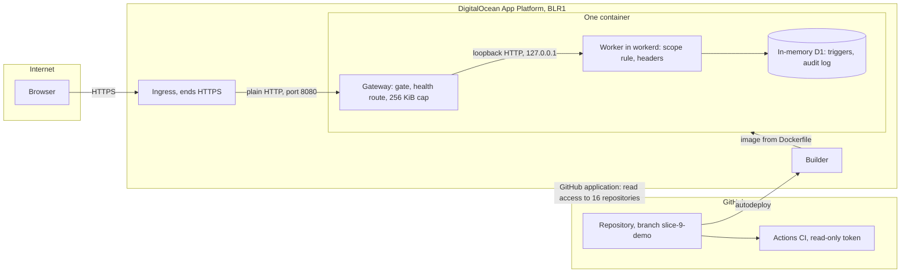

# Security and privacy: specification and threat model

Version 0.1. Date: 5 October 2026. Status: draft, not reviewed by a person.

This document states what the APLYD MSME platform protects, from whom, and by which controls as built on 5 October 2026. It sets out a threat model with each threat, its existing control, its residual risk and its status. It states the privacy position, which is mainly a list of questions for counsel and the sponsor, and a checklist of what must be decided before any real company data is held. It ends with a plan for security testing, including what only an independent person can do. Everything in the application is SYNTHETIC, and no person has read any of the code (see [HANDOVER.md](../../HANDOVER.md), "Merged without review"). Nothing here says the platform is safe for real data. It is not, and sections 6 and 7.8 say why.

How this relates to the other documents: [the BRD](../brd/BRD.md) holds the requirements cited here as BR identifiers, and the decisions, positions and open questions come from [decisions](../decisions.md) and [open questions](../open-questions.md); [the functional specification](../fsd/FSD.md) holds the rules (RULE identifiers) that these controls implement; [the high-level design](HLD.md) describes the same controls as an architecture in its section 6 and the hosting in its section 7; [the data dictionary](DATA-DICTIONARY.md) holds every table, trigger and the proposed data classes; [the API reference](API-REFERENCE.md) holds every operation; [the test strategy](../test/TEST-STRATEGY.md) and [test cases](../test/TEST-CASES.md) hold the tests cited as evidence; [the runbook](../ops/RUNBOOK.md) says how to run, reset and stop the demonstration host; [the glossary](../GLOSSARY.md) defines the terms.

## 1. How to read this document

AS BUILT means the code does it today and I read the code. TO BE means the BRD asks for it or this document proposes it, and it is not built. Claims that are not plain from a line of code carry a tag: [Certain] for hard evidence (code read, a test run, a cited source), [Likely] for a strong inference, [Guessing] for a gap filled and needing a test. Where most of a section is guessing, it says so at the top.

On 5 October 2026 the built Worker and the launcher were run on spare ports (not 8080 or 5173) to check the claims that matter most. A result from that run is tagged [Certain for that run]: it was true once, on one machine, against the local runtime, and is not a measurement of the hosted service.

Threat identifiers have the form TH-NN and are defined in section 6. The facts about the live demonstration host (region, size, branch, settings, the GitHub authorisation) were supplied by the lead on 5 October 2026 and cannot be checked from the repository. They are marked as such.

"Mitigated" in this document means a control exists, a test exercises it, and the remaining risk is only what the row states. It does not mean reviewed or accepted. The identity, scope and migration code is on a protected path ([AGENTS.md](../../AGENTS.md)) and no person has reviewed it (RK-07, BR-NFR-14, OQ-08).

## 2. Summary

What is built is a server-side authority model. Identity comes only from a signed cookie that holds a user id and an expiry; company and role are read from the database on every request; another company's record answers exactly as a missing one does; the operator reads no company; a change sent from another website is refused; and 14 tables are made append-only by 42 triggers, with 49 more triggers enforcing ordering and once-only rules, checked by a health route. One flat listing fee is copied by the database, shown to no owner, and static tests fail if a second money column or a fee-dependent ordering appears. Pools of fewer than five companies are shown to nobody. Each of these has tests. None has been reviewed by a person.

What is not built is most of what real data would need: a real sign-in (OQ-13), any way to end a session or a person's access, rate limits, a cap on audit writes, a script-restricting content policy, tamper-evidence for the audit log, a bill of materials and vulnerability audit, backup and recovery, and a decided home for the data (OQ-07). The hosted demonstration sits behind one shared password and keeps its data in memory. It is for synthetic data only.

The largest residual risks, in the order I would address them, are these. Code on protected paths is unread by any person while the live host rebuilds from a branch on every push (TH-22). The DigitalOcean account's GitHub link can read 16 repositories (TH-19). Anyone past the shared gate password can sign in as the operator (TH-04, TH-05). A leaked session cannot be ended (TH-03). Anyone with database access can alter the audit log without the application noticing (TH-12). The supply-chain gate is partial (TH-16).

| Status of the 26 threats against what is built | Count | Threats |
| --- | --- | --- |
| Mitigated | 7 | TH-01, TH-06, TH-08, TH-09, TH-14, TH-25, TH-26 |
| Partly mitigated | 13 | TH-02, TH-04, TH-05, TH-07, TH-10, TH-13, TH-15, TH-16, TH-17, TH-18, TH-21, TH-23, TH-24 |
| Open | 6 | TH-03, TH-11, TH-12, TH-19, TH-20, TH-22 |

Section 6.3 adds nine threats that proposed features would create (TH-27 to TH-35). They are TO BE and [Guessing].

## 3. Scope and assets

### 3.1 In scope and out of scope

In scope: the application (`app/`, `worker/`, `modules/*/src`), the database schema and its triggers (`drizzle/`), the launcher and gateway (`scripts/serve.mjs`, `modules/hosting/`), the `Dockerfile` and `.do/app.yaml`, the repository and its CI workflows, the dependencies, and the demonstration host as the lead described it.

Out of scope, not assessed: the security of DigitalOcean, GitHub, Cloudflare and the package registry themselves; the people and devices of the sponsor and developers; a provider's own systems (providers do not sign in, OQ-19); the legal questions of the study's material (OQ-09), which are not security questions; and any real-data environment, which does not exist (OQ-07).

### 3.2 Assets

| Asset | Where it lives today | If it were real, the harm of exposure or change | Who can read it today | Controls |
| --- | --- | --- | --- | --- |
| Company identity and contact (company name, person's name and email) | `companies` and `users` in the database, synthetic seeds | Shows who uses the platform and how to reach them; a changed address could redirect messages | A person reads only their own company row and their own identity; the sign-in page lists the synthetic people | 5.2, 5.3 |
| Factory description (25 answers, free text, a note) | `factory_revisions`, append-only | A small manufacturer's products, equipment, state and district, size, problems and budget band; the free-text fields can hold anything, personal data included | The company's owner and members | 5.3, 5.9 |
| Assessments and decisions | `assessments`, `assessment_events`; the sign-off fingerprint | What the owner was advised and decided; the record the owner relies on | The company's owner and members | 5.3, 5.9 |
| Requirements and pool membership | `requirements`, `requirement_events` | That a company wants a thing in a cluster; pool size reveals demand | Own company; a member of a pool of five or more sees a lower bound; the operator sees counts with no ids | 5.3, 5.13 |
| Engagement plans, prices and payment records | `engagements`, `milestones`, `engagement_events` | Prices agreed and paid with a provider, as the owner recorded them; the platform moves no money | Own company | 5.3 |
| Measurements | `outcome_events` (a baseline and three reviews) | The commercial performance of a unit | Own company | 5.3 |
| The audit log | `audit_events`, append-only | Who did what and when, by id; the first 64 characters of a refused id; no record contents | No page or endpoint reads it; direct database access only | 5.10 |
| The session secret | `SESSION_SECRET`: the host's encrypted environment, `.dev.vars` locally, a binding the launcher gives the Worker | Whoever holds it can sign a session for any user id | The host's account holders; the launcher process | 5.1, 5.14 |
| The access-gate credential | `DEMO_USER` and `DEMO_PASSWORD` in the host's encrypted environment | Entry to the demonstration and, through synthetic sign-in, to the operator | The host's account holders and anyone they tell | 5.12 |
| The provider registry | `providers`, `provider_services`, `provider_events` | Which vendors are listed and what they serve; listing is the platform's commercial gate | A listed provider's name and summary: any signed-in person. The whole registry: the operator | 5.4 |
| The listing fee | `listing_terms.fee_inr` and its copy `provider_events.fee_inr`; the placeholder ₹1,500; no fee is decided (OQ-11) | Shown to owners it breaches BR-COM-02; varying by provider it breaches D-03 | The operator only | 5.13 |
| Source code and the build path | The GitHub repository; branch `slice-9-demo` builds the live host | Code on protected paths decides every other control here | Whoever has repository access; DigitalOcean's GitHub application | 5.15, 5.18 |
| The demonstration host | App `aplyd-msme-demo` on DigitalOcean App Platform | Availability for presentations; reputation | Anyone past the gate | 5.12 |

### 3.3 Data the platform does not hold

The platform holds no card or bank details, no government identity numbers and no money: it records prices and payments that the owner says were made elsewhere (RULE-45). The questionnaire's 25 questions ask for no identifier, phone number or bank detail; they ask for sector, products, year started, employee band, state, district, processes, equipment, systems, problems, a budget band and who decides [Certain: the question keys were read on 5 October 2026]. The free-text answers (`own_words`, `equipment`, `products`, the problem and sector "other" fields) and every note can hold anything a person types, and nothing in the application looks for personal data in them (DATA-DICTIONARY section 7.2).

## 4. Actors and trust boundaries

### 4.1 Actors

| Actor | How they are known today | What they can do | What they must not be able to do |
| --- | --- | --- | --- |
| Visitor with no session | Not known. On the demonstration host, anyone without the gate password gets 401 on everything except `/healthz` | Read the open health route; past the gate, read the sign-in page and post a sign-in | Read any record |
| Viewer past the gate | The gate password only | Sign in as any synthetic person, the operator included | Real data must never be entered (BR-DATA-01) |
| Owner | A synthetic sign-in | Read and write their own company's records; read the listed providers | Read or change another company's records |
| Member (a non-owner with a company) | A synthetic sign-in; no member exists in the seeds (HLD section 12, item 4) | Read their own company's records | Change anything (403) |
| Operator (APLYD staff) | A synthetic sign-in with no company | Keep the registry and the one fee; read pool counts of five or more | Read any company's record or any pool below five |
| Provider | Does not sign in (OQ-19) | Nothing | Anything about a company the owner has not shared (BR-DATA-06) |
| Advisor who checks a plan | The role does not exist (OQ-18) | Nothing | Read a record without the owner's grant |
| Developer or agent with repository write access | GitHub account | Change any code, including protected paths; a push to `slice-9-demo` rebuilds the live host | Merge to `main` without the sponsor (AGENTS.md) |
| Sponsor | GitHub and DigitalOcean accounts | Merge; set the host's secrets; stop and delete the app | Not applicable |
| Third-party platforms | Accounts and tokens | DigitalOcean builds and runs the host; GitHub holds the source and runs CI; the package registry supplies dependencies; Cloudflare is the intended target for synthetic data only (D-06) and hosts nothing today | Not applicable |

### 4.2 Trust boundaries

| Boundary | What crosses it | What is checked there | What is not checked |
| --- | --- | --- | --- |
| Browser to ingress | HTTPS, owned by the platform | The platform's certificate and TLS | Nothing of ours |
| Ingress to gateway | Plain HTTP on the platform's network, including the gate password and the session cookie (RK-10) | Nothing | Eavesdropping on that hop; whether the ingress forwards the browser's Host unchanged is assumed (hosting STATUS limit 5) |
| Gateway to Worker | HTTP on 127.0.0.1 inside the container, so not reachable from outside it [Certain: the launcher binds the Worker to 127.0.0.1] | The gate; a 256 KiB cap; Authorization removed; hop-by-hop headers removed; an Origin that equals the Host rewritten so the cross-site check compares like with like | Rate, bot behaviour, anything about the person |
| Worker to database | An in-process binding | The scope rule and the authorise functions in code; the triggers in the database | Anything done with direct database access |
| Repository to build to host | Source, lockfile, Dockerfile, then an image; branch `slice-9-demo` autodeploys | The seven-day package rule, the frozen lockfile, CI on pull requests | Who may push to the branch; the content of the code |
| Developer or agent to repository | Commits, pull requests | Tests and the regression guard in CI; the sponsor decides merges | A human reading protected-path code; code owners; branch protection (not known) |
| Operator to company data | A logical boundary inside the application | The scope rule gives a person with no company no company | The people who hold the host or database credentials |

### 4.3 What this model relies on

The browser honours `HttpOnly`, `Secure` and `SameSite=Lax` [Likely]. The runtime's Web Crypto implementation is correct [Likely]. DigitalOcean's ingress ends HTTPS and does not expose the container directly [Likely; the container's port is the platform's to expose]. GitHub and DigitalOcean keep their own accounts and tokens safe. The sponsor's accounts are protected by more than a password: not known, and the sponsor would settle it by checking each account's security settings.

## 5. Security architecture as built

Each subsection says what the control does, where the evidence is (code and tests), and its limit. All of it is AS BUILT unless it says otherwise. The test titles and cases are in [the test cases](../test/TEST-CASES.md).

### 5.1 The signed session

What it does. The token is `base64url(payload).base64url(HMAC-SHA256)`. The payload holds the user id (`u`) and an expiry (`exp`) and nothing else. It lasts 28,800 seconds, 8 hours (RULE-01). The cookie is `aplyd_session` with `HttpOnly; Secure; SameSite=Lax; Path=/; Max-Age=28800`. The signature is checked with `crypto.subtle.verify` (constant time); only one spelling of the signature is accepted; the claims are checked after the signature; a cookie name that appears twice counts as no cookie. The secret must be at least 32 bytes and not one repeated character, and every place that signs or verifies goes through `getSessionSecret`.

Evidence. `modules/platform/src/identity/session.ts`, `modules/platform/src/env.ts`; tests `modules/platform/tests/unit/session.test.ts`, `unit/secret.test.ts`, `integration/platform-api.test.ts` (TC-ID-02 to TC-ID-07, TC-NFR-07 to TC-NFR-10).

Limit. The session is stateless: there is no list of sessions, no revocation, no key identifier and no rotation. Changing `SESSION_SECRET` ends every session. There is no `__Host-` prefix on the cookie (BR-NFR-13). A 32-byte secret of two alternating characters passes the check, because only the length and "one repeated character" are tested [Certain: read from `env.ts`].

### 5.2 Identity read from the database on every request

What it does. `resolveIdentity` verifies the token, then reads the person's `users` row by the id in the token. The role and the company come from that row on every request, never from the token or a header (RULE-02).

Evidence. `modules/platform/src/identity/resolve.ts`; the tests "identity is never taken from request headers" (TC-NFR-05) and "a user removed from the database loses access at once" (TC-NFR-06).

Limit. No route removes or disables a user, and a user who has saved a record cannot be deleted because a foreign key protects the history (HLD section 6.2). So the property holds in principle and is not an operating procedure.

### 5.3 The scope rule

What it does. `canReadCompany` is true only when the person has a company and it equals the company in the URL; `canWriteOwnCompany` also needs the role `owner` (RULE-03, RULE-04). The company in a URL is only compared; the queries are bound to the company in the person's own row. Another company's id answers 404 `not_found`, the same status and body as a company that does not exist, and the attempt is audited as `<area>.read.denied` or `.write.denied` with the detail `requested` cut to 64 characters. A non-owner of the same company may read and is refused a change with 403.

Evidence. `modules/platform/src/identity/scope.ts`, `modules/platform/src/api/authorize.ts`; `unit/scope.test.ts`; integration tests in every module (TC-ID-19 to TC-ID-47); static tests that read the source and fail on a query not bound to a company (`modules/factory/tests/static/scope-rules.test.ts`, `modules/diagnose/tests/static/scope-rules.test.ts`, and the `rules.test.ts` files of procure, deliver and run). On 5 October 2026 a request for another company's id and a request for a made-up id returned the same status and body [Certain for that run].

Limit. The static tests are tripwires over source text. The factory module keeps its own copy of the sign-in, scope and body checks and not the shared functions (HLD section 12, item 10). TC-ID-52 records that no single probe walks every route with a second company's cookie. The timing of the two 404 paths was not measured: a refusal for another company writes an audit row and a missing record does not [Guessing that the difference is detectable].

### 5.4 The operator is not an override

What it does. `authorizeOperator` accepts only the role `operator` with no company, refuses anyone else with 403 and an audit row (`operator.read.denied`, `operator.write.denied`), and checks a change for cross-site origin first (RULE-05). On every company route an operator is answered 404 as an outsider is. The operator's pool list holds counts of five or more, with the idea and cluster and no company, user or requirement id.

Evidence. `authorize.ts`; `modules/procure/src/db/pool.ts` (`listPoolsAtFloor`); TC-ID-53 to TC-ID-61, TC-OPS-02 to TC-OPS-04.

Limit. This is a rule in the application. It does not bind anyone who holds the host or database credentials. There is no second approver for a provider listing (BR-OPS-04 is not built). The operator is a seeded synthetic person with no password.

### 5.5 Cross-site request refusal

What it does. `isCrossSite` refuses any method other than GET, HEAD or OPTIONS when `Origin` differs from the request's own origin or is not a URL (including the text "null"), and, when there is no `Origin`, when `Sec-Fetch-Site` is `cross-site` (RULE-06). It runs before the session is read. `SameSite=Lax` is the first defence.

Evidence. `modules/platform/src/identity/cross-site.ts`, used in `authorize.ts`, `session.ts` and `modules/factory/src/api/factory.ts`; `unit/cross-site.test.ts` (TC-ID-80 to TC-ID-82), `browser/cross-origin.test.ts`, and the hosting smoke test (TC-OPS-34).

Limit. A request with neither header is accepted. On 5 October 2026 a POST with a valid cookie and neither header created a record, 201 [Certain for that run]. Browsers send `Origin` on a post, so the gap is mainly a non-browser client, which also needs the cookie [Likely].

### 5.6 The header-read rule

What it does. A static test parses every source file under `app/`, `worker/` and `modules/*/src` and fails if the code reads a request header outside an allow-list of five: `cookie`, `origin`, `sec-fetch-site`, `content-type`, `content-length` (BR-NFR-01; AD-10). It reports aliasing, spreading, loops, destructuring and optional chaining.

Evidence. `modules/platform/tests/static/source-rules.test.ts` and `modules/platform/tests/support/header-rule.ts` (TC-NFR-01 to TC-NFR-04, TC-NFR-38).

Limit. It is a tripwire, not a proof: it cannot see a header reached by reflection or a name built at run time. Three files are exempt because they run in a Node process beside the Worker: `modules/hosting/src/gate.ts`, `modules/hosting/src/gateway.ts` and `modules/demo/src/client.ts`. A second test fails if anything the Worker runs can import them (TC-NFR-02).

### 5.7 Input bounds

What it does. The content type is checked first: only an HTML form or a JSON object (415 otherwise; an empty type only with an empty body). `readTextWithin` refuses a declared length over four bytes for each allowed character without reading, and abandons a stream once it passes that bound; `MAX_BODY_CHARACTERS` is 65,536 (RULE-07; 413 `too_large`). Every field has its own limit, control characters are refused in text (RULE-12), and notes are held to 500 characters and, in the database, to 2,000 bytes.

Evidence. `modules/platform/src/api/body.ts`; `unit/body.test.ts`; integration tests for 413, 415 and 400.

Limit. Three gaps, each checked on 5 October 2026 on the Worker run on spare ports [Certain for that run]. The sign-in handler reads its body with `request.text()` or `request.json()` and no bound (`modules/platform/src/api/session.ts`, `readBody`, lines 18 to 35): a 2 MiB body was read and answered 401 `unknown_user`, and a body of 4 MiB or more was answered with a 500, which appears to be the database's limit on one bound value. Second, `drain` (`modules/platform/src/api/http.ts`) reads a refused request's body whole with `request.arrayBuffer()`. Third, the bound is checked between chunks, so one large chunk is already in memory when it is checked. On the demonstration host the gateway's 256 KiB cap applies first. What a hosted Cloudflare Worker would do with a large body is not known; a test on a Cloudflare synthetic staging environment would settle it.

### 5.8 Response headers

What it does. The Worker entry wraps every response the application produces: `x-content-type-options: nosniff`, `x-frame-options: DENY`, `referrer-policy: same-origin`, and `content-security-policy: frame-ancestors 'none'; base-uri 'self'; form-action 'self'`.

Evidence. `worker/index.ts`, `modules/platform/src/api/security-headers.ts`; `unit/security-headers.test.ts`, `static/source-rules.test.ts`, `smoke/built-app.test.ts` (TC-NFR-30 to TC-NFR-34).

Limit. No `script-src`, so nothing restricts scripts. The framework puts inline scripts in each page, so a restricting policy needs nonces or hashes in the build [Likely; not tried]. Files under `/_next/static/` are served by the assets layer before the Worker runs and carry only `cache-control` [Certain for that run]. So "every response" in TC-NFR-30 and in the platform status page holds for responses the Worker produces only.

### 5.9 The database enforces what the application also enforces

What it does. Fourteen tables are append-only: each has `<table>_no_update`, `<table>_no_delete` and `<table>_no_replace` (42 triggers), and 49 more triggers hold ordering, once-only and range rules, so 91 must exist (RULE-09). `GET /api/health` reports `degraded` with 503 when a named guard is missing on its table. No application statement changes, deletes or replaces a row of an append-only table (static tests). Every statement is prepared and its values bound; the template literals in the data layers interpolate constant fragments only [Likely: I read the ones `grep` found].

Evidence. `drizzle/0001_audit_append_only.sql` to `0014_review_fixes.sql`; `modules/platform/src/db/guards.ts`; `modules/platform/src/api/health.ts`; `unit/guards.test.ts`, `integration/append-only-keys.test.ts`, `integration/platform-api.test.ts` (TC-ID-71 to TC-ID-73, TC-NFR-11 to TC-NFR-16, TC-DATA-12 to TC-DATA-18).

Limit. SQLite cannot refuse `DROP TRIGGER`, `DROP TABLE` or `ALTER TABLE`; nothing inside it can. The health check looks at trigger names and their tables, not their bodies, so a trigger replaced by one of the same name that does nothing would pass [Certain: read from `health.ts` and `guards.ts`]. There is no hash chain and no external copy of the log. The triggers and the code that reads their messages are SQLite-specific, which constrains the choice of any other engine (HLD section 11.1). No static rule forbids interpolating a variable into SQL.

### 5.10 The audit log

What it does. Every change is audited in the same batch as the row it records, and the audit row is written only when the statement before it changed a row (`auditIfChanged`, RULE-08). Every refusal after the person is known (not found, forbidden, operator refused) is audited. Sign-in and sign-out are audited, and the address is never recorded. A sign-in refused for an unknown user is not audited: a console line without the address is written, because anyone can send one and the log cannot be pruned.

Evidence. `modules/platform/src/db/audit.ts`, `authorize.ts`, `session.ts`; TC-ID-71 to TC-ID-76.

Limit. No cap or rate limit: a signed-in person can add rows by repeating a denied read or a sign-out. The rows are attributable but cannot be removed. No page or endpoint reads the log (BR-OPS-06 is partial). The time is the application's clock. The fingerprint of a sign-off covers the assessment id, the result and the standing decisions, and not who decided or when (`modules/diagnose/src/digest.ts`).

### 5.11 Synthetic-only sign-in and the environment checks

What it does. Sign-in works only where `APLYD_ENV` is exactly `local`, `synthetic` or `test`, with a database and a valid secret, and only for a user whose `is_synthetic` is 1; elsewhere it answers 503 `sign_in_not_available` (RULE-10). The build carries no environment name: only the development server sets `local`, so a deployment that does not set `APLYD_ENV` has no sign-in. The launcher refuses to start with any other environment name (RULE-43). Every page shows the SYNTHETIC banner in a synthetic environment (MSG-01).

Evidence. `modules/platform/src/env.ts`, `session.ts`, `modules/hosting/src/gate.ts`; TC-ID-09 to TC-ID-11, TC-OPS-48, TC-DATA-06 to TC-DATA-08.

Limit. In a synthetic environment there is no password at all, by design. If real data were put in a deployment given a synthetic name, no technical control would stop it; the barrier is the gate and the rule that real data is never entered (BR-DATA-01).

### 5.12 The access gate and the gateway (hosted demonstration only)

What it does. A gateway process sits in front of the Worker. It answers `/healthz` (the exact path) without the gate: 503 while starting, then 200 when the application's own health answers 200. Every other request needs HTTP Basic credentials, compared as SHA-256 digests with `timingSafeEqual`, unless access is open. It removes `Authorization` before handing the request on, removes hop-by-hop headers, closes upgrade requests, refuses a body over 256 KiB (413, declared or streamed), and gives 502 for a failed or slow upstream. Headers must arrive within 20 seconds, a request within 120, and the upstream within 60. The launcher starts only with `DEMO_USER` (no colon) and `DEMO_PASSWORD` of at least 12 characters, or with `DEMO_ACCESS=open` in so many words and then with neither user nor password set (RULE-43, RULE-44).

Evidence. `modules/hosting/src/gate.ts`, `gateway.ts`, `scripts/serve.mjs`; `modules/hosting/tests/unit/gate.test.ts`, `integration/gateway.test.ts`, `smoke/serve.test.ts`, `static/deploy-files.test.ts` (TC-OPS-30 to TC-OPS-66). On 5 October 2026 an 8-character gate password made the container exit with code 2 (the lead's report); the launcher is written to refuse a password under 12 characters with exit code 2, so the control worked as written.

Limit. One shared password for everyone, with no lockout, no rate limit, no per-person revocation and no log of who entered. Twelve characters is a floor and not a measure of strength. The password and the cookie cross the plain-HTTP hop between the ingress and the container (RK-10). Whether the ingress forwards the browser's Host unchanged is assumed; if it rewrites Host, `APLYD_PUBLIC_HOSTS` is needed or sign-in is refused as cross-site.

### 5.13 The invariants that carry money, vendor neutrality and the floor of five

What it does. There is one listing fee, in `listing_terms`; a listing copies the fee in force into `provider_events` by a statement the database runs, and no caller supplies one; nothing is listed while no fee is set (RULE-32). Static tests fix the exact column lists of `listing_terms`, `provider_events`, `engagements`, `milestones` and `engagement_events`, scan every migration for columns whose names contain a money word, and require that exactly four exist (RULE-45); they forbid a statement that reads a price or payment together with the fee, require providers to be ordered by name alone, and forbid summing a price or payment. Owner pages and API answers carry no fee (BR-COM-02). `presentPool` shows nothing below five companies and then a multiple of five (RULE-28); the operator's list is counts only (RULE-29).

Evidence. `modules/procure/tests/static/rules.test.ts`, `modules/deliver/tests/static/rules.test.ts`, `modules/run/tests/static/rules.test.ts`, `modules/procure/tests/unit/pool.test.ts`, smoke and browser tests that read every owner page for the fee (TC-GOV-02 to TC-GOV-12, TC-GOV-20 to TC-GOV-26, TC-COM-02, TC-COM-03).

Limit. The money tests recognise a column by a list of 26 money words in its name, and the statement tests read source text. A revenue figure kept in a text or JSON field, a share computed in code, or an arrangement outside the platform would not be seen. The fee is undecided (OQ-11), so the change that will come is exactly the one the tests must be rewritten for, by a person. The floor's limits are in section 7.7.

### 5.14 Secrets and the repository

What it does. `.gitignore` and `.dockerignore` exclude `.env*` (except `.env.example`), `.dev.vars`, databases, `*.pem`, build output, `sources/` and the Claude working directory. A static test fails when a tracked file is named like a secret, a database, a PDF or build output, and another when `.env.example` holds anything but empty names (BR-NFR-03). The `Dockerfile` and `.do/app.yaml` hold no secret: the spec's three secrets are `SECRET` type placeholders that the launcher refuses.

Evidence. `modules/platform/tests/static/source-rules.test.ts` (TC-DATA-04, TC-DATA-05), `modules/hosting/tests/static/deploy-files.test.ts` (TC-OPS-49, TC-OPS-65, TC-NFR-19).

Limit. The test is a name-pattern check on file names, not a scan of what a file contains: a secret pasted into a source or Markdown file would pass. Git history is not scanned, and I found no secret-scanning setting in the repository; whether GitHub's own scanning is on is not known and the sponsor would settle it from the repository's security settings.

### 5.15 Supply chain and build

What it does. `pnpm-workspace.yaml` sets `minimumReleaseAge: 10080` (seven days, in minutes), `strictDepBuilds: true`, and `allowBuilds` for exactly four packages (esbuild, workerd, sharp, unrs-resolver), with an override pinning `miniflare>sharp` to 0.35.4. Dependencies are exact versions. CI and the image install with `pnpm install --frozen-lockfile`. The CI workflow has `permissions: contents: read` and no secret (AD-22).

Evidence. `pnpm-workspace.yaml`, `package.json`, `Dockerfile`, `.github/workflows/ci.yml`; TC-OPS-63, TC-OPS-64.

Limit. No bill of materials and no vulnerability audit run anywhere (BR-NFR-06 is partial). A package older than seven days passes the age rule whatever it contains, and the same rule delays a security fix. Four packages run build scripts at install. The CI actions are referenced by major-version tags and the base image by a version tag, not by commit or digest [Certain]. The framework layer (vinext 1.0.0-beta.5) is a beta, so an upgrade may change behaviour that tests do not cover (HLD section 11.2).

### 5.16 The container

What it does. The image builds on `node:22.22.0-bookworm-slim`, installs pnpm 11.25.0 through corepack, installs from the lockfile, builds, then sets `NODE_ENV=production`, changes ownership to the `node` user and runs as `USER node`. It sets `PORT=8080` and a `HEALTHCHECK` on `/healthz`. `.dockerignore` excludes `.git`, `.github`, `docs`, tests, `sources` and every `.env` file.

Evidence. `Dockerfile`, `.dockerignore`; `modules/hosting/tests/static/deploy-files.test.ts` (TC-OPS-49, TC-OPS-63, TC-OPS-64).

Limit. The `Dockerfile` comment says it was not built in the session that wrote it; the lead reports a first build on DigitalOcean of 2 minutes 11 seconds on 5 October 2026. The image is not scanned. The platform's health check on the live host is its default, not `/healthz` (the lead's report), so the `HEALTHCHECK` line may not be used.

### 5.17 Logging

What it does. A refused sign-in writes `{"event":"session.refused"}` and nothing else. The gateway writes one line for each refusal or failure, with the method and the reason, never a header, a body or a credential. The launcher never prints the secret (BR-NFR-10).

Evidence. `session.ts`, `gateway.ts`; TC-NFR-26, TC-OPS-45, TC-OPS-51.

Limit. No log shipping, no alert and no reader for the audit log. What DigitalOcean's own logs record about requests is not known.

### 5.18 Process controls

What it does. AGENTS.md says the sponsor decides merges, protected paths carry the label `needs-human-review`, and a merge without a person reading it is recorded in HANDOVER.md. Each module keeps `VALIDATION.md` with dated results and limits. The runner's regression guard fails a missing suite, a suite with no baseline, or fewer passing tests than the baseline (BR-NFR-05). Agent reviews found defects that fix slices address, and mutation checks (`scripts/mutation/mutate.py`) were run by the authors and are recorded per module.

Evidence. AGENTS.md, HANDOVER.md, `scripts/test.mjs`, each module's `VALIDATION.md`.

Limit. No person has read the code on any protected path (RK-07). There is no CODEOWNERS file, and whether branch protection is set on `main` or on `slice-9-demo` is not known. The baseline can be lowered in a pull request. Mutation checks are not run in CI. The live host tracks a slice branch and rebuilds on every push.

## 6. Threat model

### 6.1 Method

I listed the assets (3.2), the actors and boundaries (4), and for each boundary asked the STRIDE questions: spoofing, tampering, repudiation, information disclosure, denial of service and elevation of privilege. I kept threats that the code, the status pages or the lead's facts make real. Each row names the existing control by the subsection of section 5 that describes it, states the residual risk with a tag, and gives a status: mitigated, partly mitigated, or open. The related column names the requirement, open question or decision. Likelihood and impact are not scored: there are no real users or measured attack data to score them against, and a score would be a guess.

### 6.2 Threats against what is built

| ID | STRIDE | Threat | Asset | Existing control | Residual risk | Status | Related |
| --- | --- | --- | --- | --- | --- | --- | --- |
| TH-01 | Spoofing | Forging a session token without the secret | Session secret; every company record | HMAC-SHA256 token, constant-time check, one spelling, claims checked, secret of 32 bytes or more (5.1) | Forgery needs the secret. A secret that passes the check can still be weak: two alternating characters pass. [Certain] | Mitigated | BR-ID-01, BR-NFR-01 |
| TH-02 | Spoofing | Replaying a stolen session cookie within its 8 hours | Session; the person's company records | HttpOnly, Secure, SameSite=Lax; 8-hour expiry; no token in logs (5.1, 5.17) | Nothing ties a token to a device or address. A cookie taken from a shared machine, or from the plain-HTTP hop inside the host, works until it expires. [Likely] | Partly | BR-ID-07, RK-10 |
| TH-03 | Elevation of privilege | No revocation: a leaked token, or a person who should lose access, keeps it until expiry | Session; all of that company's records | Identity is re-read from the database on each request, so deleting a user row ends access at once (5.2) | No route removes or disables a user, and a user with records cannot be deleted. Sign-out clears the cookie only; the token stays valid. The one lever is to change `SESSION_SECRET`, which ends every session. [Certain] | Open | BR-ID-07 |
| TH-04 | Spoofing | Synthetic sign-in as any user, the operator included, by anyone who can reach a synthetic environment | All synthetic records; operator functions | Works only where `APLYD_ENV` is local, synthetic or test, and for users marked synthetic; the build carries no environment name; the launcher refuses other names (5.11) | By design there is no password. If real data were put in a deployment given a synthetic name, nothing technical would stop it; the only barrier is the gate. [Certain] | Partly | OQ-13, BR-ID-02, BR-DATA-01 |
| TH-05 | Spoofing | The shared gate password is guessed, shared, reused or read in transit | Gate credential; the whole demonstration | At least 12 characters; compared as SHA-256 digests in constant time; not passed on; the launcher refuses a weak or missing one (5.12) | One password for everyone, no lockout, no rate limit, no per-person revocation. Twelve characters is a floor and not strength. The password crosses the plain-HTTP hop inside the host. [Certain] | Partly | BR-OPS-08, RK-10 |
| TH-06 | Information disclosure | Cross-company read by a guessed or altered id in a URL | Every company record | Scope rule; queries bound to the person's company; identical 404; audit; per-module static rules (5.3) | Protected-path code no person has read; static rules read source text; some endpoint families have no cross-company probe (TC-ID-52); response timing not measured. [Likely] | Mitigated | BR-ID-03, BO-06 |
| TH-07 | Elevation of privilege | Operator over-reach: the operator role reads a company's record or learns who is in a pool | Company records; pool membership | The operator reads no company; the pool list is counts only, with no ids (5.4) | Binds the application only. A person with database or host credentials is not constrained; no second approver; nothing reads the audit log. [Likely] | Partly | BR-ID-04, BR-OPS-02, BR-OPS-04 |
| TH-08 | Tampering | Cross-site request forgery | Records, registry, fee | SameSite=Lax; Origin check, then Sec-Fetch-Site, before the session is read; every non-read method (5.5) | A request with neither header is accepted. Browsers send Origin on a post, so this is mainly a non-browser client, which needs the cookie. [Likely] | Mitigated | BR-NFR-01 |
| TH-09 | Spoofing | Header spoofing: a client sets a header to claim an identity, a role or a company | Identity | Identity only from the signed cookie; a test over every source file allows five headers; the gateway strips Authorization (5.6, 5.12) | The test is a tripwire and not a proof; three host-process files are exempt. [Likely] | Mitigated | BR-NFR-01, AD-10 |
| TH-10 | Denial of service | Oversized or malformed bodies, including the unbounded sign-in body | Availability; memory | Content type checked first; bound of 65,536 characters read in pieces; declared length refused unread; gateway cap of 256 KiB (5.7, 5.12) | The sign-in handler has no bound: 2 MiB was read, 4 MiB or more gave a 500. `drain` reads a refused body whole. The bound is checked between chunks. The hosted runtime's own limit is not known. Behind the gateway the 256 KiB cap holds. [Certain for the run] | Partly | BR-NFR-12 |
| TH-11 | Denial of service | Audit flooding by repeating denied reads or sign-outs | Audit log; storage | Every row is attributable to a person; an unknown-user sign-in is not audited (5.10) | No cap and no rate limit; rows cannot be pruned; anyone who can sign in, on the demonstration anyone past the gate, can grow the log without limit. [Certain] | Open | BR-NFR-12, BR-ID-06 |
| TH-12 | Tampering | Tampering below the application: `DROP TRIGGER`, `DROP TABLE`, `ALTER TABLE`, or a direct write after a guard is dropped | Audit log; every append-only record; the fingerprint | 91 triggers; health reports degraded when a named guard is missing; no application statement changes an append-only row (5.9) | SQLite cannot prevent it. Health checks names and tables, not bodies. No hash chain and no external copy, so a change by someone with database access would not be noticed. [Certain] | Open | BR-DATA-04, BR-NFR-02, BR-ID-06 |
| TH-13 | Information disclosure | Differencing on the pool floor | Pool membership | `presentPool` shows nothing below five, then multiples of five; the operator's list is counts only (5.13, 7.7) | A company that takes a pool across the floor learns it held at least four others; a bound that steps to 10 shows a watcher that the count was 10; the operator sees exact counts and can watch them move. [Certain] | Partly | BR-GOV-06, C-04, OQ-14 |
| TH-14 | Information disclosure | The listing fee reaches an owner | Listing fee | Fee returned only by operator operations; the owners' provider list holds name and summary; page tests check no owner page holds the fee (5.13) | Tests check the pages and answers they visit; a new field or page could leak it. [Likely] | Mitigated | BR-COM-02, BR-PROC-05, D-03, OQ-11 |
| TH-15 | Tampering | Vendor neutrality erodes through a new revenue column, a percentage, or an ordering by fee | The D-03 invariant; the registry | Static tests fix the column lists, scan all migrations for money words, forbid joining a price to the fee and order providers by name only (5.13) | The tests see column names and statement shapes. A value in a note or JSON field, a share computed in code, or an arrangement outside the platform is not seen. The fee is undecided, so the revenue change that will come is when a person must rewrite the tests. [Likely] | Partly | BR-GOV-02, D-03, OQ-11, BR-NFR-14 |
| TH-16 | Tampering | Dependency and supply-chain compromise | Build, host, source | Seven-day minimum release age; strict dependency build scripts with four allowed; exact pins; frozen lockfile in CI and the image (5.15) | No bill of materials and no vulnerability audit; a package older than seven days passes; actions and the base image are pinned by tag, not by commit or digest; the framework is a beta. [Certain] | Partly | BR-NFR-06, AD-22 |
| TH-17 | Information disclosure | A secret is committed to the repository | Session secret; gate credential | A static test fails on a tracked file named like a secret, a database or build output; the template holds names only; the spec's secrets are placeholders the launcher refuses (5.14) | A name check, not a content scan: a secret pasted into a source or Markdown file passes. No history scan or secret scanning is known. [Certain] | Partly | BR-NFR-03 |
| TH-18 | Information disclosure | The demonstration's plain-HTTP hop and in-memory state | Gate credential; session cookie; demonstration data | HTTPS from the browser to the ingress, which the platform provides; the data is synthetic; a restart wipes it (5.12) | The gate password and the cookie cross a plain-HTTP hop inside the platform's network; whether that network can be observed is not known. Real data entered would be lost on any restart. [Guessing for the hop, Certain for the memory] | Partly | RK-10, BR-DATA-01 |
| TH-19 | Elevation of privilege | The DigitalOcean account's GitHub application has read access to 16 repositories | The source of every repository it can read, this one included; the application's token | None in the repository. The runbook advises restricting it to the one repository the demonstration needs | Until it is narrowed, a compromise of the DigitalOcean account or its GitHub link exposes every repository it can read. The lead observed the 16 on 5 October 2026 and advised the sponsor to restrict it; it cannot be checked from the repository. [Certain that it was reported; Likely for the effect] | Open | OQ-01 |
| TH-20 | Denial of service | Flooding, slow requests, or repeated unauthenticated guesses at the gate | Availability of the demonstration | Gateway timeouts (headers 20 seconds, request 120, upstream 60), a 256 KiB cap, upgrade requests closed (5.12) | No rate limit, bot protection or alert; one container; a restart rebuilds the database and reseeds (about 12 seconds on a development machine, then the seed). [Certain for the absence, Likely for the effect] | Open | BR-NFR-08, BR-NFR-12 |
| TH-21 | Tampering | Clickjacking and script injection | Actions taken in a person's session | Framing refused by `x-frame-options: DENY` and `frame-ancestors 'none'` on every Worker response; `base-uri` and `form-action` restricted; HttpOnly cookie; control characters refused; no raw HTML insertion in the application (5.8) | No `script-src`: an injected script would run and could act as the person, though not read the cookie. Files under `/_next/static/` carry none of the four headers. Free text is shown to a company's own people only, so cross-company stored injection is not a route today. [Likely] | Partly | BR-NFR-13 |
| TH-22 | Tampering | Agent-written, unreviewed code on protected paths | Identity, scope, migrations, money and the library path | Agent reviews and fixes; layered tests; mutation checks; the regression guard; the label and the record in HANDOVER.md (5.18) | No person has read the code. No CODEOWNERS file. The live host tracks a branch and rebuilds on every push. The baseline can be lowered in a pull request. [Certain] | Open | RK-07, BR-NFR-14, BR-NFR-05, OQ-08 |
| TH-23 | Repudiation | A person denies an action, or an action leaves no record | Audit log | Audit row in the same batch as the change; written only when a row changed; refusals by a known person audited (5.10) | Anonymous and unknown-user attempts are not recorded; time is the application's clock; on the demonstration anyone can be any synthetic person, so the log names a role and not a human; no log shipping or reader. [Certain] | Partly | BR-ID-06, BR-OPS-06 |
| TH-24 | Information disclosure | Leakage through errors, logs, the health route or the sign-in page | Identities; internals | Health answers three status words; a refused sign-in logs an event without the address; gateway lines hold no header, body or credential (5.17) | The sign-in page lists the synthetic people and their addresses: fine for synthetic, a directory if real. The body of an unhandled-error 500 was not examined. [Certain for the page, not known for the 500 body] | Partly | BR-NFR-10 |
| TH-25 | Tampering | Injection through hand-written SQL | The database | Every statement is prepared and its values bound; the interpolations found are constant fragments (5.9) | No rule forbids interpolating a variable into SQL, and new statements are agent-written. [Likely] | Mitigated | AD-02 |
| TH-26 | Spoofing | Open access by configuration: the gate switched off with `DEMO_ACCESS=open` | The demonstration | The launcher starts open only when told in so many words, refuses open together with a user or password, and prints OPEN at start (5.12) | A deployer can choose it, and anyone who finds the address could then sign in as the operator. [Certain] | Mitigated | BR-OPS-08 |

### 6.3 Threats that proposed features would create (TO BE)

All of this table is [Guessing]: none of the features exists, and each threat comes from how such a feature usually fails. It is here so that the design of each feature starts from its threat.

| ID | STRIDE | Threat | Asset | What the feature would need | Related |
| --- | --- | --- | --- | --- | --- |
| TH-27 | Spoofing | Real sign-in (a mobile number with a one-time code, an email link, or an access layer): account takeover, finding out who has an account, abuse of the code route | Identity | A method chosen with owners; rate limits; session ending; no confirmation of whether an account exists | OQ-13, BR-ID-02, BR-ID-07 |
| TH-28 | Information disclosure | A provider reads more than the owner shared, or after the share is withdrawn | Company data | The design in 7.3; default deny; a provider view; audit of every read | BR-DATA-06, BR-ID-09, OQ-19 |
| TH-29 | Information disclosure | An advisor reads a company's record beyond the owner's grant | Company data | A grant record, a scoped read, an audit trail; a data-scope review by a person | BR-ID-08, OQ-18 |
| TH-30 | Information disclosure | Company text sent to a model, speech or translation service leaves the platform's control, and text in an answer steers a model's output | Factory description | A decision on which services and what may be sent (OQ-07); a person checks the output before the owner relies on it | BR-DESC-04, BR-DESC-07, BR-DIAG-06 |
| TH-31 | Tampering | Uploaded photographs or audio carry malicious content or location data, or are kept too long | Uploaded files | A file-type and size policy, scanning, removal of embedded location, a retention rule, storage in a place counsel has approved | BR-DESC-05, BR-DESC-04, BR-DATA-07 |
| TH-32 | Information disclosure | An export of an owner's data is used to take everything from a hijacked session | Company data | A fresh sign-in for an export; the export audited; a form that the owner can read | BR-DATA-03 |
| TH-33 | Information disclosure | A reminder or message goes to the wrong recipient or shows content on a channel the owner does not control | Contact details; plan content | Confirmed channels; content-free reminders; the channels chosen from what owners say | BR-RUN-07, BR-UX-11, OQ-17 |
| TH-34 | Tampering | An erasure procedure is used to destroy evidence, or breaks the audit history | Audit log; records | A reviewed procedure; every erasure itself recorded; counsel's answer on what may be erased | BR-DATA-05, BR-DATA-04, OQ-07 |
| TH-35 | Tampering | If the platform ever holds or moves money, fraud and a new class of loss | Money | A separate threat model, a decision on the platform's role, and a test that the amount never varies with the vendor | BR-DEPL-10, OQ-12, D-03 |

### 6.4 What stands out

Three observations. First, most of the strongest controls are tripwires over the source: they fail loudly if someone changes the rule, and they cannot stop a change that a reviewer would not notice. That is why TH-22 is open and ranks first: the controls are only as good as the review of the code and tests that carry them, and no person has done that. Second, three open threats (TH-03, TH-11, TH-20) are the same gap seen from three sides: nothing limits or ends what one authenticated person or one network client can do, and BR-ID-07 and BR-NFR-12 are not built. Third, TH-12 and TH-16 matter little for a synthetic in-memory demonstration and a great deal for any durable, real-data environment: they should be decided together with where the data lives (OQ-07).

## 7. Privacy

### 7.1 What would be held

Nothing real is held today: every company, person, provider and figure is SYNTHETIC. If a pilot used real data, the application as built would hold the following. Whether each item is personal data, and what follows if it is, are questions for counsel (7.2). Two things are plain without counsel: a person's name and email address identify that person, and a company's budget band, prices and results are confidential to the company.

| Data | Where | Identifies a person | Commercially confidential | Note |
| --- | --- | --- | --- | --- |
| Company name | `companies.name` | Where the owner is the company, probably; counsel to decide | Yes, in that it shows who uses the platform | Seen by the company's own people only |
| Person's name and email | `users.display_name`, `users.email` | Yes | No | The sign-in page lists them today; that is acceptable only for synthetic people |
| How a real owner proves who they are | Not built | Depends on the method (OQ-13): a mobile number would be personal | No | Decide before building |
| Factory description | `factory_revisions.answers`, `.note` | Not by design; the free text can name people | Yes | Append-only; cannot be edited or deleted |
| Assessment, decisions, sign-off | `assessments`, `assessment_events` | No, except in notes | Yes | Append-only |
| Requirements and pool membership | `requirements`, `requirement_events` | No | Yes | Pool size is revealed only as a lower bound and only from five |
| Plans, prices and payments the owner recorded | `milestones`, `engagement_events` | No, except in notes | Yes | The platform moves no money |
| Baseline and reviews | `outcome_events` | No, except in notes | Yes | |
| Audit log | `audit_events` | A user id, which links to a person | No | Ids and event names only, by design |
| Provider names and summaries | `providers` | A sole proprietor's name might be | Platform operational | Entered by the operator |
| Voice recordings and photographs | Not built | A recording or photograph may include people | Yes | BR-DESC-04, BR-DESC-05; counsel to decide what follows |
| What a provider is told | Not built | Depends on what is shared | Yes | See 7.3 |

### 7.2 Questions for counsel (OQ-07)

These are questions. This document states no legal rule and does not say what any law requires. The sponsor, with counsel, answers them before any real data is held (BR-DATA-02, DP-04 in the BRD). Counsel may wish to ask whether India's Digital Personal Data Protection Act, 2023 and any rules under it bear on each; that is named as a thing to ask about, from general knowledge, and not as a statement of what it requires.

1. Is data about an MSME and its owner personal data when the owner is the sole proprietor or the company's only person, and what follows if it is?
2. Which role does APLYD hold toward owners' data under any applicable law, and does the answer depend on whether the platform is the owner's single counterparty or an introducer (OQ-12)?
3. What notice must an owner be given, and what consent must be recorded, before the owner's data is held, and what of the people named in free text (employees, customers)?
4. May the data be hosted outside India, is there any rule on where it must be, and may it be on Cloudflare, which D-06 chose for synthetic data only?
5. How long may and must each kind of record be kept, and how is a request to erase answered where the records are append-only (BR-DATA-05, BR-DATA-07)?
6. Does sharing with a provider need a separate consent for each provider and purpose, and what are the provider's own duties once it has the data (BR-DATA-06, OQ-19)?
7. Do voice recordings or photographs of a factory floor raise further obligations (BR-DESC-04, BR-DESC-05)?
8. Is there a duty to report a breach, to whom, and within what time?
9. Must an owner be able to have their data returned to them on request, and in what form (BR-DATA-03)?
10. Do the contract with the study's client, the disclosure to the Mission (OQ-09) or the commitment not to approach factories introduced through a client engagement (C-05) limit what data may be collected or used?
11. Does a sector regulator's rule reach the records of a unit in a regulated sector, since the study covers medical devices and pharma (P-02, OQ-03)?
12. May the operator, or a person who checks a plan, read a company's record, under what agreement, and does that change the answer to question 1 (OQ-18)?

### 7.3 Consent and provider sharing (TO BE)

AS BUILT: no provider signs in, no route lets a provider read anything, and the platform does not contact a provider. The owner records what the provider said (OQ-19). No company data is given to anyone but its own people, so BR-DATA-06 holds today only because nothing shares [Certain]. Everything in the table is a proposal for the sponsor to accept or change; none is decided or built.

| Element | Proposal |
| --- | --- |
| Grant | An append-only record that names the company, the provider, the requirement, the fields shared, the purpose, the time and the person who granted it |
| Default | A provider reads nothing without an unrevoked grant that names it and the requirement |
| What is shown | A defined view built for the purpose (the requirement and the plan), not the factory record |
| Revocation | A new record that stops later reads. It cannot recall what was already read, and the owner is told so when granting |
| Identity | A provider signs in as itself (OQ-19), which does not exist |
| Audit | Every provider read is audited with the grant it relied on |
| Neutrality | No grant, view or ordering depends on a fee (D-03) |
| Operator | Sees counts of grants and never the contents |
| No sale | A grant is to a named provider for one purpose; it is never passed on and never bundled (C-03, BR-GOV-05) |
| Export | The owner's export includes the grant history |
| Review | It changes data scope, a protected path, so a named person reviews it before merge (BR-NFR-14, OQ-08) |

### 7.4 Retention and erasure against append-only

The conflict is plain and unresolved. BR-DATA-04 says confirmed records, revisions, audit entries and applied migrations cannot be edited or deleted, and the triggers enforce it. BR-DATA-05 says a request to erase personal data must have an answer that reconciles permanent versions with erasure, and BR-DATA-07 says a retention period must exist for each kind of record. AS BUILT there is no erase, export, archive or retention operation (DATA-DICTIONARY section 7.1). The options below are for the sponsor and counsel to choose from. None is decided, each has a cost, and which is lawful or sufficient is not for this document to say. Most of this is [Guessing].

| Option | How it would work | Cost or risk |
| --- | --- | --- |
| Keep personal data out of append-only rows | Hold contact details in a table that can change; append-only rows hold ids only | The free-text answers and notes can name people and live in append-only rows; this fixes only part of it |
| Encrypt personal fields with a key for each company and destroy the key to erase | Rows and ids stay; the content becomes unreadable | Needs key management that does not exist; interacts with the sign-off fingerprint, which is computed over stored content |
| Redact by a reviewed, recorded procedure | A person-approved, audited migration overwrites content | Contradicts the wording of BR-DATA-04 and the triggers; needs the sponsor to amend the rule for this one purpose, and the procedure itself must be recorded |
| Delete a company's whole data on exit | Remove the company and everything under it, then the audit rows that name it | Simplest to explain; leaves a gap in the history, and the guard triggers would have to be lifted for the purpose |

### 7.5 Data location

| Place | What is there | Where | Status |
| --- | --- | --- | --- |
| Developer machines | Local database of synthetic data | Not known | SYNTHETIC |
| CI runner | Synthetic data built for a test run, discarded after | GitHub-hosted; region not known | SYNTHETIC |
| The demonstration host | In-memory synthetic database in one container | DigitalOcean App Platform, Bangalore (BLR1), per the lead | SYNTHETIC |
| Cloudflare | Nothing: no account, no hosted database | Not applicable | The intended target for synthetic staging (D-06) |
| Real data | Nothing | Undecided (OQ-07) | TO BE; blocked by OQ-07, OQ-13, OQ-09 |

The decision that BR-DATA-02 asks for names the host, the region, the engine, where backups sit, who holds administrative access and which outside services receive data. The guard triggers are SQLite-specific (HLD section 11.1), so the engine choice also affects the integrity controls in 5.9.

### 7.6 Minimisation

AS BUILT: the questionnaire asks for no identifier and no bank, phone or government number (3.3); the audit log holds ids, event names and a 64-character cut of a refused id, and never a record's contents or a secret; a refused sign-in is logged without the address; the gateway logs no header, body or credential; the operator sees counts and no names. Limits: the free-text fields and notes accept anything, and only control and invisible-format characters are refused (RULE-12). TO BE, for the sponsor to decide: write down, for each field, why it is collected and who reads it; do not keep voice recordings after transcription unless the owner asks; show a provider a defined view and not the record; keep contact details apart from commercial records.

### 7.7 The floor of five as a privacy control, and its limit

What it does. No number is shown for a pool of fewer than five companies, to anyone, the pool's own members included. From five a member sees "at least 5", "at least 10", and so on, never the exact count. The operator sees pools of five or more with exact counts and no company, user or requirement id. Companies are counted, not requirements (C-04, BR-GOV-06, BR-PROC-02, RULE-27 to RULE-29).

What it does not do. It is a rule about what is said of a count, not an access control, and it has limits [Certain unless tagged]:

- A company that joins a pool and takes it across the floor learns that the pool held at least four others. The code comment in `modules/procure/src/pool.ts` and the procure status page say so.
- Anyone who watches a pool's displayed bound over time learns when it reaches 10 or 15, because the bound steps by five.
- The operator sees exact counts for pools of five or more and can watch them change. The operator sees no company, but a count of five for an idea in one cluster, combined with something the operator knows from a conversation, could point at someone [Guessing].
- Five is a carried position (C-04) with no evidence behind it that five is enough. Whether five companies in a small cluster can be identified from the idea and the cluster is not known.
- OQ-14 asks whether the floor should apply to a pool's own members at all. The cautious reading is built; the other would tell an owner that three others want the same thing.
- The floor applies to counts of companies. A different aggregate, such as outcomes across companies (BR-RUN-10, not built), would need the same function and the same test.

### 7.8 What must be decided before any real data

Each item is a gate. All are open on 5 October 2026.

| No. | Needed before real data | Blocked by or related | Status |
| --- | --- | --- | --- |
| 1 | A written decision on host, region, engine, backups, administrators and outside services | BR-DATA-02, OQ-07 | Open |
| 2 | Counsel's answers to the questions in 7.2 | OQ-07 | Not started |
| 3 | A real sign-in method, chosen with owners and built | BR-ID-02, OQ-13 | Open |
| 4 | A way to end a session or a person's access, and limits on sign-in attempts | BR-ID-07 | Not built |
| 5 | A named human reviewer, and a review of identity, scope, migrations and money code | BR-NFR-14, OQ-08, RK-07 | Not done |
| 6 | An independent penetration test of a synthetic staging environment (8.2) | BR-NFR-14 | Not done |
| 7 | The supply-chain gate: a bill of materials and an audit in CI | BR-NFR-06 | Partial |
| 8 | A durable database with the guards, backup and a practised restore | BR-NFR-07 | Not built |
| 9 | Rate limits, a cap on audit writes, and a bound on the sign-in body | BR-NFR-12 | Not built |
| 10 | A script-restricting content policy, a `__Host-` cookie, and headers on static files | BR-NFR-13 | Not built |
| 11 | Logs without secrets or personal data, and an alert when the system is unhealthy | BR-NFR-10 | Partial |
| 12 | A retention policy and an erasure procedure | BR-DATA-05, BR-DATA-07 | Open |
| 13 | Export and leave | BR-DATA-03 | Not built |
| 14 | The consent and provider-sharing design, before any provider sees data | BR-DATA-06, OQ-19 | Proposed, in 7.3 |
| 15 | The right to reuse the study's material settled, with disclosure | BR-GOV-08, OQ-09 | Open |
| 16 | The platform's position as principal or introducer decided, with the contract terms | BR-GOV-09, OQ-12 | Open |
| 17 | A notice to owners about what is held and why, and an incident-response plan with a named contact | No requirement names either; I propose adding one | Not known |
| 18 | The real environment kept apart from the demonstration, which is never given real data | BR-DATA-01 | A rule today |

## 8. Security testing plan

### 8.1 What exists

| Area | Where | Layer |
| --- | --- | --- |
| Session token, secret, cookie attributes | `modules/platform/tests/unit/session.test.ts`, `unit/secret.test.ts`, `integration/platform-api.test.ts`, `browser/session-and-scope.test.ts` | unit, integration, browser |
| Scope rule and cross-company refusal | `unit/scope.test.ts`, every module's integration test, per-module `static/scope-rules.test.ts` or `static/rules.test.ts`, the browser tests | unit to browser |
| Cross-site refusal | `unit/cross-site.test.ts`, `browser/cross-origin.test.ts`, `modules/hosting/tests/smoke/serve.test.ts` | unit, browser, smoke |
| Header-read rule, secrets and the environment template | `modules/platform/tests/static/source-rules.test.ts` | static |
| Body bounds | `unit/body.test.ts`, integration tests for 413, 415, 400; the gateway's 256 KiB tests | unit, integration |
| Security headers | `unit/security-headers.test.ts`, `smoke/built-app.test.ts` | unit, smoke |
| Triggers and the health check | `unit/guards.test.ts`, `unit/migrations.test.ts`, `integration/append-only-keys.test.ts` | unit, integration |
| Gate, gateway and launcher | `modules/hosting/tests/unit/gate.test.ts`, `integration/gateway.test.ts`, `smoke/serve.test.ts`, `static/deploy-files.test.ts` | unit to static |
| Fee, vendor neutrality, the floor | The procure, deliver and run `static/rules.test.ts`, `procure/tests/unit/pool.test.ts`, demonstration smoke tests | static, unit, smoke |
| Mutation checks | `scripts/mutation/mutate.py`, with each module's record in `VALIDATION.md` | run by the author, not in CI |
| Agent reviews | Recorded in each module's `VALIDATION.md` | Not independent of the authors' tooling |

None of this is a security review by a person, and a passing test does not promote an acceptance criterion to passed (AGENTS.md). The plan to test the controls that have no test is in [the test strategy](../test/TEST-STRATEGY.md); the open ones are TC-ID-52, TC-ID-77 and TC-NFR-29.

### 8.2 What an independent person must do (TO BE)

A penetration test, a code review and a configuration review need a person who is not the author and who has the sponsor's written permission. Nothing in the repository can do them.

1. A person reads the protected-path code (identity, scope, migrations, money, the library path) and records what they read and what they found (BR-NFR-14, OQ-08). This comes first, so a tester starts from reviewed code.
2. A penetration test of a deployed synthetic environment in the staging configuration, covering: sign-in and session handling; the scope rule on every endpoint family (TC-ID-52); cross-site requests; header handling behind the real ingress; body bounds including the sign-in route; security headers on pages and static files; the gate; the container; and the build path from GitHub to the host. Rules: synthetic data only; no attack on DigitalOcean's or GitHub's own systems; findings recorded with date and limits in `VALIDATION.md` (BR-NFR-04); every high finding fixed or accepted in writing by the sponsor.
3. A configuration review of the accounts: DigitalOcean team members and tokens, the GitHub application's repository access (TH-19), branch protection, secret scanning, and whether more than a password protects each account. All of these are not known today.
4. A review of this threat model by someone other than its author.
5. A privacy review with counsel (7.2).

For the tester's checklist, the following can be considered. They are named from general knowledge, are not in the source register, and are not requirements: the OWASP Application Security Verification Standard and the OWASP Top Ten for the web application, and ISO/IEC 27001 if APLYD ever needs a management system for information security.

### 8.3 The supply-chain gate (BR-NFR-06)

BR-NFR-06 asks that dependencies are checked before they are installed and listed in a bill of materials. AS BUILT the first half is partly met (5.15). TO BE, proposed:

| Step | What it would do | Note |
| --- | --- | --- |
| A lockfile audit in CI | Fail on a known vulnerability at or above a severity the sponsor sets | The severity is not decided |
| A bill of materials per build | Generate and keep it as a CI artefact in a standard format | A format to choose; CycloneDX and SPDX are named as things to consider |
| Pin actions by commit | Replace major-version tags with commit identifiers | Needs a way to update them on purpose |
| Pin the base image by digest | Record the digest of `node:22.22.0-bookworm-slim` | Needs a way to update it on purpose |
| Review `allowBuilds` | Treat a change to the list as a change that a person reviews | The four packages run code at install |
| A person reviews lockfile changes | A code-owner rule for `pnpm-lock.yaml`, `pnpm-workspace.yaml`, the Dockerfile and `.github/` | There is no CODEOWNERS file today |
| An override path for a security fix | A written way past the seven-day rule for an urgent fix | The rule delays fixes as well as attacks |

### 8.4 A proposed order of work

| Order | Work | Why first | Protected path |
| --- | --- | --- | --- |
| 1 | Restrict DigitalOcean's GitHub authorisation to the one repository (runbook) | Costs a minute; closes TH-19 | No |
| 2 | Name a reviewer for protected paths (OQ-08); add a CODEOWNERS file and, if the sponsor wishes, branch protection | TH-22 is the root of the others | No |
| 3 | Bound the sign-in body and `drain`; add a rate limit on sign-in and a cap on audit writes by one person | TH-10, TH-11, TH-20; BR-NFR-12 | Yes: identity |
| 4 | Add security headers to static files and design a `script-src` with nonces or hashes; consider the `__Host-` cookie | TH-21; BR-NFR-13 | Yes: identity |
| 5 | Add the audit and bill-of-materials steps and pin actions and the base image (8.3) | TH-16 | No |
| 6 | Design session ending and a way to disable a user | TH-03; BR-ID-07 | Yes: identity |
| 7 | Decide on tamper-evidence for the audit log (a hash chain, or a copy kept elsewhere) | TH-12 | Yes: migrations |
| 8 | A cross-company probe that walks every route (TC-ID-52) | TH-06 | Test only |
| 9 | The independent review and penetration test (8.2) | After 2 to 6 | No |

## 9. What is not known, and what would settle it

| Not known | What would settle it |
| --- | --- |
| What Cloudflare's runtime does with a large request body, and whether the 500 for a 4 MiB sign-in body occurs there | A test on a Cloudflare synthetic staging environment |
| Whether the ingress forwards the browser's Host unchanged, and whether a form sign-in and post were exercised on the live host | Walk the demonstration checklist in [the runbook](../ops/RUNBOOK.md) on the live address |
| What the 16 repositories are and what the application can do with them | The installed applications and their repository access in the GitHub settings of the sponsor's account |
| Whether branch protection, rulesets or secret scanning are on | The repository's settings in GitHub |
| Whether the sponsor's accounts use more than a password | Each account's security settings |
| Whether a request for another company's id takes measurably longer than one for a missing id | A timing test over many requests |
| What the body of an unhandled-error 500 contains | Cause a 500 on the built Worker and read the body |
| Whether the plain-HTTP hop inside DigitalOcean's network can be observed by anyone else | DigitalOcean's documentation or support, in writing |
| What DigitalOcean's own logs keep about requests, and for how long | DigitalOcean's documentation, and the app's log settings in the console |

### 9.1 Statements elsewhere that this document does not follow

The code is followed where it differs. The first four are in [the high-level design](HLD.md) section 12 as well; the last two are new.

- `modules/platform/STATUS.md` line 16 says every response carries the four security headers; responses from the assets layer under `/_next/static/` do not, and TC-NFR-30 repeats "every response".
- `modules/hosting/STATUS.md` line 5 says nothing has been deployed and limit 9 (line 57) says exactly two files are exempt from the header rule; a host is live per the lead and three files are exempt.
- `.do/app.yaml` does not describe the live app: name, branch, autodeploy, region and `APLYD_DEMO` differ (see [the runbook](../ops/RUNBOOK.md)).
- `modules/platform/src/api/session.ts` and `http.ts` read a body without the bound that the platform status page describes (5.7).
- `docs/fsd/FSD.md` RULE-06 (line 1366) says that on a cross-site refusal the body is discarded unread. `drain` in `modules/platform/src/api/http.ts` reads it whole, as the platform status page says.
- The committed `.github/workflows/docs.yml` runs only the documentation check; the version in the working tree on the documentation branch adds the traceability and test-document checks.
