# Wireframes: APLYD MSME platform

Version 0.2. Date: 5 October 2026. Status: draft, not reviewed by a person.

This document shows the screens of the APLYD MSME platform, page by page, as drawings with numbered notes. Version 0.1, written earlier on 5 October 2026, showed the interface as it then was, with screenshots, and proposed a redesign. It answered the sponsor's reaction on 5 October 2026 on opening the running application: "i dont under stand the ui ux at all. what does this app dp". The interface was then redesigned and built (slice 10). Version 0.2 draws the screens as built (section 2), keeps the earlier interface with its screenshots (section 3) and the earlier proposal (sections 4 to 6) as earlier versions, and says what the built interface took from the proposal and what it did not (section 7). Every company, person, provider and figure on every screen is SYNTHETIC. No owner of a factory has used the redesigned screens, and no person has reviewed this document. Later on 5 October 2026 the document was corrected after reviews run by agents, not by a person: the next-step rules and some texts had changed in the code (commit `f35b835`), and the drawings and notes follow that code.

How this relates to the other documents: the requirements it serves are BR-UX-01 to BR-UX-11 in the [business requirements](../brd/BRD.md); the screens are SCR-01 to SCR-10 in the [functional specification](../fsd/FSD.md), whose section 5 gives every field, button, message and state of each screen (this document shows where they sit) and whose rows FR-UX-15 to FR-UX-24 describe the parts every page shares; the same drawings, as boxes that follow the light or dark setting of the browser, are in the [wireframes page](wireframes.html); how a page is built is in the [interface guide](INTERFACE-GUIDE.md); the user and the five stages come from sections 1 and 3 of the [thesis](../thesis.md); the architecture is in the [high-level design](HLD.md); the words are to be fixed in the [glossary](../GLOSSARY.md); the sessions that would test the screens are in the [UAT plan](../test/UAT-PLAN.md) and the [ten-owner test](../ten-owner-test.md).

## 1. How to read this document

### 1.1 Evidence tags and what is built

- [Certain] means read in the code, observed on 5 October 2026, or stated in a cited document. [Likely] is a strong inference. [Guessing] fills a gap and needs testing with owners.
- Section 2 draws the built screens. What it says about the structure of a page is [Certain] as to what the page holds. It is not [Certain] as to what a person sees on a real phone or hears with a screen reader, because neither was tried. Section 3 is about the earlier interface and is [Certain] unless tagged. Sections 4 to 6 are a design proposal that was written before the redesign. Almost all of it is [Guessing]: it is a set of judgements about what a small manufacturer will understand, and nobody who is such a person has been asked.
- AS BUILT means the function exists in the code and the FSD cites it by an FR identifier. TO BE means it is not built. The drawings in section 2 show only what is built. Nothing marked TO BE may be shown to an owner as available.
- "Platform words" are the application's own terms for things (assessment, requirement, engagement, listing, baseline and others). Section 5 lists each with a proposed owner-facing wording; section 7 says it was not adopted.

### 1.2 Conventions in the drawings

Each drawing in section 2 is a fenced block about 40 characters wide, which is a phone held upright. It shows what a screen holds, top to bottom, in the order it holds it. A mark such as (3) points to row 3 of the table under the drawing, which says what the box is and which FR identifier in the FSD describes it. Words in headings, tags, buttons and labels are the words on the page; a paragraph is drawn as a line of `~`.

| Mark | Meaning |
| --- | --- |
| `[> Save <]` | The main button of its form or card |
| `[ Back ]` | Another button |
| `[- Sign off -]` | A disabled button |
| `[! Withdraw !]` | A button that cannot be undone (red in the application) |
| `{link}` | A link |
| `<Done>` | A tag: a small label with words in it |
| `[ Choose v ]` | A drop-down list |
| `[______]` | A text box |
| `(o)` and `( )` | A chosen and an unchosen radio button (one choice) |
| `[x]` and `[ ]` | A ticked and an unticked check box (many choices) |
| `(v)`, `[2]`, `(3)` | A step: done, the owner's turn, not yet. In the strip, `======` is under the page the owner is on |
| `[####------]` | A bar, with its words after it |
| `~~~~` | A paragraph of text that is not written out. The words are in the FSD |
| `# `, `## `, `### ` | Headings, largest first |
| `* ` | A list item |
| `[!]` | A notice that needs attention |
| `+====+` | A highlighted card: it is the owner's turn, the sign-off, or what comes next |
| `+ - - +` with `:` | A box that is not always there, or a closed section |
| `...... Frame ......` | The frame every page shares (section 2.1), not repeated |

Sample figures (names, rupee amounts, dates) come from the synthetic demonstration data of 5 October 2026. They are SYNTHETIC. The listing fee drawn on the operator's page is the placeholder written by the demonstration seed (`PLACEHOLDER_FEE_INR` in `modules/demo/src/cast.ts`) and is on no owner page.

### 1.3 What each section is

| Section | What it is | Status |
| --- | --- | --- |
| 2 | The screens as built, drawn | Current |
| 3 | The interface before the redesign, with screenshots | Earlier version |
| 4 to 6 | A design proposal written before the redesign | Earlier version |
| 7 | What the built interface took from the proposal | Current |

## 2. The screens as built

Drawn on 5 October 2026 from a capture of the pages as the application sent them, running on synthetic demo data, for six synthetic people (a visitor, four owners and the operator), and read against the source. The capture was made before this document was written, by someone other than its author, in a Chromium window 1,000 pixels wide, and is not kept in the repository. The author looked at no page on a screen, at a phone width or any other: the drawings show what each page says and in what order, not how it looks. What is said about layout at a narrow width comes from reading the style sheets. No owner of a factory has used these screens. The next-step rules and some texts were changed after the capture, in commit `f35b835` on the same day; every drawing was then read against the source as it stands after that commit, and where the capture and the source differ the drawing follows the source. Those drawings were not seen on a screen.

The drawings are made from the structure of the pages in that capture (the owner of a company with only a confirmed description, one with nothing, one with a delivery waiting, one with an agreed plan and no starting number, a visitor and the operator). Where a state was not in the capture, the drawing says it was read from the source. No screenshot is reproduced: the capture is not kept in the repository.

### 2.1 The frame every page shares

Every drawing below leaves out the frame, which is the same on every page, and marks its place with a dotted line. It is drawn here once, with a person signed in. A visitor sees no initials and no "Sign out" button.

Drawn from: Observed on every page of the capture; read in app/layout.tsx and app/_ui/appbar.tsx.

```text
+ - - - - - - - - - - - - - - - - - - -+ (1)
: {Skip to the page}                   :
+ - - - - - - - - - - - - - - - - - - -+

+--------------------------------------+ (2)
| SYNTHETIC environment. Do not enter  |
|     real company or personal data.   |
+--------------------------------------+

+--------------------------------------+ (3)
| (logo) APLYD    (SO) [ Sign out ]    |
+--------------------------------------+

+--------------------------------------+ (4)
|                                      |
| ... the page (main) ...              |
|                                      |
+--------------------------------------+

+--------------------------------------+ (5)
| APLYD MSME platform. An early        |
|     version, built to be tested with |
|     manufacturers.                   |
| English only for now.                |
+--------------------------------------+
```

| No. | What it is | Built from |
| --- | --- | --- |
| 1 | **Skip link.** The first thing in the page: the link "Skip to the page", which goes to the main part. It is seen only when it has keyboard focus. | FR-UX-15 |
| 2 | **Banner.** "SYNTHETIC environment. Do not enter real company or personal data." It is drawn only where the environment is local, synthetic or test, and is marked as a note for a screen reader. | FR-UX-01, FR-UX-15 |
| 3 | **App bar.** One link to the home page (a drawn mark, the word "APLYD" and, from 40 rem wide, "for manufacturers"; its accessible name is "APLYD home"). For a signed-in person it also shows two initials, from 40 rem wide the name and the role, and the button "Sign out". A visitor sees the mark alone: the sign-in link is on the page, once. | FR-UX-15, FR-ID-05 |
| 4 | **The page.** Everything a screen below draws goes here. The page's own top heading is the one heading of level 1. | FR-UX-15, FR-UX-16 |
| 5 | **Footer.** Two lines: "APLYD MSME platform. An early version, built to be tested with manufacturers." and "English only for now." | FR-UX-15 |

### 2.2 SCR-01 Home

Address `/`, source `app/page.tsx`, FSD section 5.2. Tells a visitor what the service is; tells an owner the next step and where each of the five steps stands; gives the operator the way to the provider list. The same drawings, as boxes, are in the [wireframes page](wireframes.html#scr-01).

#### A visitor, not signed in

Drawn from: Observed in the capture (a visitor); read in app/page.tsx.

```text
...... Frame: banner and app bar .......
+======================================+ (1)
| APLYD MSME platform                  |
| # See which technology is worth      |
|   trying in your factory.            |
| ~~~~~~~~~~~~~~~~~~~~~~~~~~~~~~~~~~~~ |
| ~~~~~~~~~~~~~~~~~~~~~                |
| [> Sign in <]   You are not signed   |
|     in.                              |
+======================================+

## How it works (2)
1 Describe ~~~~~~~~~~~~~~~~~~~~~~~~~
2 Decide ~~~~~~~~~~~~~~~~~~~~~~~~~~~
3 Choose ~~~~~~~~~~~~~~~~~~~~~~~~~~~
4 Deliver ~~~~~~~~~~~~~~~~~~~~~~~~~~
5 Measure ~~~~~~~~~~~~~~~~~~~~~~~~~~

+--------------------------------------+ (3)
| ## What you can rely on              |
| * Nothing is overwritten.            |
| * Other companies cannot see yours.  |
| * You decide.                        |
| * No money moves here.               |
+--------------------------------------+

+======================================+ (4)
| ## About this version                |
| ~~~~~~~~~~~~~~~~~~~~~~~~~~~~~~~~~~~~ |
| ~~~~~~~~~~~~~~~~~~~~~                |
+======================================+

............ Frame: footer .............
```

| No. | What it is | Built from |
| --- | --- | --- |
| 1 | **Opening block.** The service in one line, a short paragraph, and the one button "Sign in" (to the sign-in page), with "You are not signed in." beside it. It is the only "Sign in" link on the page. The top heading is the name of the service. | FR-UX-22, FR-ID-12 |
| 2 | **How it works.** Five steps in plain words, one line each: the one-word name of the step in bold and what the step is. From 52 rem wide the five sit in a row. | FR-UX-22 |
| 3 | **What you can rely on.** Four lines, each a bold sentence and one more: nothing is overwritten (the description keeps every saved version, and decisions and events are added to the record, never erased); other companies cannot see yours (the rule is kept on the server); you decide (ideas are ranked by fixed rules and nothing goes on without your yes); no money moves here. | FR-UX-22 |
| 4 | **About this version.** Says it is an early version, in English only, for one factory at a time, with no photos or voice yet, and that nothing is a finding about a real factory. | FR-UX-22 |

#### An owner whose plan is agreed and who has no starting number

Drawn from: Read in app/page.tsx and modules/journey/src/progress.ts, for the facts of owner D in the capture (a plan agreed, no starting number, two requirements, one with a provider chosen). The capture was made before the next-step rules changed (commit f35b835), so this is what the source now draws for those facts, not what was seen on a screen.

```text
...... Frame: banner and app bar .......
+======================================+ (1)
| Your next step                       |
| # Write down your starting number    |
| ~~~~~~~~~~~~~~~~~~~~~~~~~~~~~~~~~~~~ |
| ~~~~~~~~~~~~~~~~~~~~~                |
| [> Record the number <]              |
+======================================+

Signed in as SYNTHETIC Owner D (2)
<owner>

## Your five steps (3)

+--------------------------------------+ (4)
| (v) {Describe your factory} <Done>   |
| Confirmed. Newest version is 1.      |
+--------------------------------------+
+--------------------------------------+
| (v) {What to do about it} <Done>     |
| Signed off. You decided on 5 of 5    |
| ideas.                               |
+--------------------------------------+
+--------------------------------------+
| (3) {What you need} <Not yet>        |
| ~~~~~~~~~~~~~~~~~~~~~                |
| 2 requirements, 1 provider chosen.   |
+--------------------------------------+
+--------------------------------------+
| (4) {Delivery} <Not yet>             |
| ~~~~~~~~~~~~~~~~~~~~~                |
| 0 of 1 milestone accepted.           |
+--------------------------------------+
+======================================+
| [5] {Results} <Your turn>            |
| ~~~~~~~~~~~~~~~~~~~~~                |
| No starting number yet. 0 reviews    |
| recorded.                            |
+======================================+

+--------------------------------------+ (5)
| ## SYNTHETIC Company D               |
| <SYNTHETIC>                          |
| Record created 2026-10-05.           |
+--------------------------------------+

+--------------------------------------+ (6)
| ## What you can rely on              |
| * Nothing is overwritten.            |
| * Other companies cannot see yours.  |
| * You decide.                        |
| * No money moves here.               |
+--------------------------------------+

............ Frame: footer .............
```

| No. | What it is | Built from |
| --- | --- | --- |
| 1 | **The next step.** The line "Your next step", the title as the top heading, one sentence and one button. All four come from the one rule of `nextStep` that fires: nineteen rules (eighteen keys) tried in order, the first that fits wins (FSD, the table under FR-UX-20). Here it is the rule `record_baseline`: a plan is agreed, nothing is accepted and no starting number is written down. The button goes to the step's page (here Results), not to the control that does the step. | FR-UX-20, FR-UX-22 |
| 2 | **Signed in as.** The display name and the role, as a tag. | FR-UX-22 |
| 3 | **Your five steps.** The heading of the list below. | FR-UX-22 |
| 4 | **Five stage cards.** Each has a dot (the step's number, or a tick when done), a link named for the page (Describe your factory, What to do about it, What you need, Delivery, Results), a tag (Done, Your turn or Not yet), the stage's sentence and a line saying where it stands. The sentence is not shown on a card marked Done (the style sheet hides it); it is drawn here as a grey bar on the other cards. The card of the step in note 1 is "Your turn". A stage is Done only when its own condition holds and every stage before it is Done. Here Choose is "Not yet" because one requirement has no provider chosen, and Delivery is "Not yet" because the engagement is not closed (FR-UX-21). | FR-UX-21 |
| 5 | **Company record.** The company name as a heading, the tag SYNTHETIC for a synthetic company, and the date the record was created. | FR-UX-22, FR-ID-12 |
| 6 | **What you can rely on.** The same four lines as for a visitor. | FR-UX-22 |

Other states of this view:

- An owner who has done nothing: the step is "Start by describing your factory", the first card is "Your turn" and the others "Not yet" with lines such as "Waits for a confirmed description".
- An owner who is up to date: "You are up to date" with the button "Look back at the numbers"; no card is marked "Your turn". The same holds for "Work is under way" (the next drawing) and "Waiting for a provider to be listed".
- The nineteen rules and their words are in the FSD under FR-UX-20.

Wide screens: From 52 rem wide the five cards are on the left and the two cards on the right, as drawn in the wide view. Below that they are one column, in the order of the text drawing.

#### An owner whose work is under way

Drawn from: Read in app/page.tsx and modules/journey/src/progress.ts, for a company whose plan is agreed, whose starting number is recorded and whose first milestone is accepted while the others are not. It was not in the capture and was not seen on a screen.

```text
...... Frame: banner and app bar .......
+======================================+ (1)
| Your next step                       |
| # Work is under way                  |
| Nothing needs you today. The next    |
|     review opens on (date).          |
| [> Check on the work <]              |
+======================================+

Signed in as (name) <owner>

## Your five steps

+--------------------------------------+ (2)
| (v) {Describe your factory} <Done>   |
| Confirmed. Newest version is 1.      |
+--------------------------------------+
+--------------------------------------+
| (v) {What to do about it} <Done>     |
| Signed off. You decided on 5 of 5    |
| ideas.                               |
+--------------------------------------+
+--------------------------------------+
| (v) {What you need} <Done>           |
| 1 requirement, 1 provider chosen.    |
+--------------------------------------+
+--------------------------------------+
| (4) {Delivery} <Not yet>             |
| ~~~~~~~~~~~~~~~~~~~~~                |
| 1 of 3 milestones accepted.          |
+--------------------------------------+
+--------------------------------------+
| (5) {Results} <Not yet>              |
| ~~~~~~~~~~~~~~~~~~~~~                |
| Starting number recorded. 0 reviews  |
| recorded.                            |
+--------------------------------------+

............ Frame: footer .............
```

| No. | What it is | Built from |
| --- | --- | --- |
| 1 | **The next step.** The rule `keep_going` fires when work is in progress under an agreed plan and no earlier rule fits: no delivery waits for a decision, no review is open, no starting number or plan is waiting, no provider can be chosen and no engagement has every milestone accepted. The sentence is "Nothing needs you today." and one more: the date of the next review to open, or "Every review you can record so far is recorded.", or, before the first milestone is accepted, "Accept each milestone as it is delivered; the review dates start from the first one you accept." The button goes to Delivery. | FR-UX-20, FR-UX-22 |
| 2 | **No card is marked "Your turn".** Because the step says that nothing is needed from the owner, no stage is the owner's turn, on the home page or in the strip of a stage page. Delivery and Results are "Not yet" because the work is not finished. The first block is still drawn. | FR-UX-21 |

Other states of this view:

- "Waiting for a provider to be listed" (a requirement has no provider listed for it, and no work is under way): "You have said what you need. No provider is listed for it yet, so there is nothing for you to do. When one is listed you can choose it." with the button "See your requests". No card is marked "Your turn".
- "One more idea is ready to ask for" (or "N more ideas are ready to ask for"), with the button "Make a request": this is optional but it is something the owner can do, so Choose is marked "Your turn".
- The date in "The next review opens on ..." is the UTC date of the day the review opens. A review opens at the time of day of the first acceptance, so for a reader in India it can fall a day later (FSD section 12, item 32).

#### The operator

Drawn from: Observed in the capture (the operator); read in app/page.tsx.

```text
...... Frame: banner and app bar .......
+======================================+ (1)
| The platform operator                |
| # Keep the list of providers         |
| ~~~~~~~~~~~~~~~~~~~~~~~~~~~~~~~~~~~~ |
| ~~~~~~~~~~~~~~~~~~~~~~~~~~~~~~~~~~~~ |
| ~~~~~~~~~~~~~~~~~~~~~                |
| [> Providers and the listing fee <]  |
+======================================+

Signed in as SYNTHETIC Operator (2)
<operator>

+--------------------------------------+ (3)
| No company is linked to this         |
|     account, so there is no company  |
|     record to show.                  |
+--------------------------------------+

............ Frame: footer .............
```

| No. | What it is | Built from |
| --- | --- | --- |
| 1 | **Opening block.** A fixed block, not a next step: the operator has no steps. It says what the operator keeps (providers and one listing fee), that the fee is the same for every provider, and that the operator sees providers and counts, never a company's record. One button, to the operator page. | FR-UX-22 |
| 2 | **Signed in as.** Display name and role. | FR-UX-22 |
| 3 | **Company record.** The operator has no company, so the card holds one sentence (MSG-03). | FR-ID-12 |

Other states of this view:

- A signed-in person who is neither an owner nor the operator sees the heading "You are signed in". A member of a company (an account with a company that is not its owner) reads "Only the owner of your company can work through the steps. You can see your company's record below." and sees the company card. An account with no company reads "This account is not linked to a company, so there are no steps to work through here." (FSD section 12, item 23, corrected on 5 October 2026).

### 2.3 SCR-02 Sign-in

Address `/sign-in`, source `app/sign-in/page.tsx`, FSD section 5.3. Lets a person choose one of the synthetic users and sign in as that user. There is no password. The same drawings, as boxes, are in the [wireframes page](wireframes.html#scr-02).

#### The sign-in page

Drawn from: Observed in the capture (a visitor); read in app/sign-in/page.tsx.

```text
...... Frame: banner and app bar .......
# Sign in (1)
~~~~~~~~~~~~~~~~~~~~~

+ - - - - - - - - - - - - - - - - - - -+ (2)
: [!] That user was not found.         :
+ - - - - - - - - - - - - - - - - - - -+

+--------------------------------------+
| Synthetic user                       | (3)
| [ SYNTHETIC Operator (operator) v ]  |
| [> Sign in <]                        | (4)
+--------------------------------------+

+--------------------------------------+ (5)
| ## Who is who                        |
| Owner ~~~~~~~~~~~~~~~~~~~~~~~~~~~~~~ |
| Operator ~~~~~~~~~~~~~~~~~~~~~~~~~~~ |
+--------------------------------------+

............ Frame: footer .............
```

| No. | What it is | Built from |
| --- | --- | --- |
| 1 | **Head.** The title "Sign in" and one sentence: "Synthetic environment: choose a synthetic user. There is no password." There is no step line, no five-step strip and no next step on this page. | FR-UX-16, FR-ID-01 |
| 2 | **Refusal.** Drawn only after a refused sign-in (the address ends with refused=1): "That user was not found." It is announced as an alert. | FR-ID-02, MSG-05 |
| 3 | **The one field.** A drop-down list of the synthetic users, one for each, shown as "display name (role)" and ordered by name; the value sent is the email address. It is required. The capture lists eight: the operator and owners A to G. | FR-ID-01 |
| 4 | **The button.** Posts to /api/session. Success goes to the home page; a refusal comes back to this page. If the session secret is missing the form is still shown and the post answers a line of JSON instead of a page (FSD section 12, item 16). | FR-ID-02 |
| 5 | **Who is who.** Two entries. Owner: describes a factory and works through the five steps, and sees that company and no other. Operator: keeps the list of providers, and never sees a company's record. The sign-in page does not mention the fee. | FR-ID-01 |

Other states of this view:

- Where the environment is not synthetic or no database is bound, the page holds only the title and "Sign-in is not available in this environment." (MSG-04).

### 2.4 SCR-03 Describe your factory

Address `/factory`, source `app/factory/page.tsx`, FSD section 5.4. Lets the owner answer the questionnaire, save it as a version, confirm a version as accurate and look at earlier versions. The same drawings, as boxes, are in the [wireframes page](wireframes.html#scr-03).

#### An owner whose description is confirmed

Drawn from: Observed in the capture (owner A, a confirmed description); read in app/factory/page.tsx.

```text
...... Frame: banner and app bar .......
  (v)     [2]     (3)     (4)     (5)
Describe Decide  Choose Deliver Measure
 ======                                  (1)

Step 1 of 5 · Describe (2)
# Describe your factory
~~~~~~~~~~~~~~~~~~~~~~~~~~~~~~~~~~~~
~~~~~~~~~~~~~~~~~~~~~

+======================================+ (3)
| <✓ Confirmed> <SYNTHETIC>            |
| Newest version: 1, confirmed as      |
|     accurate, saved 2026-10-04.      |
| [##########] 23 of 23 questions      |
|             answered in the newest   |
|             saved version            |
+======================================+

+--------------------------------------+ (4)
| ## About your unit                   |
| Which kind of manufacturing is it?   |
| <Needed to confirm>                  |
| (o) Textiles and garments            |
| ( ) Electronics                      |
| ( ) three more choices               |
| What do you make?                    |
| <Needed to confirm>                  |
| [__________________________________] |
| ... six more questions               |
+--------------------------------------+

+--------------------------------------+ (5)
| ## How work gets done                |
| ## What you use today                |
| ## What is hurting most              |
| ## What you can spend and decide     |
+--------------------------------------+

+--------------------------------------+ (6)
| What changed since last time?        |
|     (optional)                       |
| [__________________________________] |
| ~~~~~~~~~~~~~~~~~~~~~                |
+--------------------------------------+

+--------------------------------------+ (7)
| [ Save as draft ]                    |
| [> Confirm this is accurate <]       |
+--------------------------------------+

+ - - - - - - - - - - - - - - - - - - -+ (8)
: > Earlier versions                   :
+ - - - - - - - - - - - - - - - - - - -+

+======================================+ (9)
| Your next step                       |
| ### See what is worth doing          |
| [> Get your ranked ideas <]          |
+======================================+

............ Frame: footer .............
```

| No. | What it is | Built from |
| --- | --- | --- |
| 1 | **The five steps.** Describe is done and is the page the owner is on (underlined); Decide is the owner's turn. Each is a link. Drawn on each stage page for an owner of a company, and not for a visitor or a person who is not an owner. | FR-UX-17 |
| 2 | **Head.** "Step 1 of 5 · Describe", the title as the one top heading, and one sentence: "Answer what you can and stop whenever you like: every save is kept as a new version, and nothing is overwritten." | FR-UX-16 |
| 3 | **Where your description stands.** A tag for the state (Confirmed with a tick, Draft, or Not started) and the tag SYNTHETIC; one sentence; a bar with its words; and, for a saved version that is not confirmed, a line saying how many of the five questions needed to confirm are answered. The count is of what was saved, so it does not move while the person types. | FR-UX-23, FR-DESC-04 |
| 4 | **The questions.** 25 questions in five section cards (23 always apply and two ask "If something else, what?"). A question with several choices is a group whose legend is its label. The five questions needed to confirm carry the tag "Needed to confirm". The browser requires nothing; the server checks. A radio choice, once made, cannot be cleared on the page. | FR-DESC-01, FR-DESC-02 |
| 5 | **The other four sections.** How work gets done; What you use today; What is hurting most (choose up to three); What you can spend and decide. Drawn as titles only here. | FR-DESC-01 |
| 6 | **The note.** "What changed since last time? (optional)", up to 500 characters, and a sentence saying what confirming means. | FR-DESC-03 |
| 7 | **Two buttons.** "Save as draft" and "Confirm this is accurate" (the main button), in a bar that stays at the bottom of the screen while the owner scrolls (not on a screen lower than 34 rem); on a phone they share one row. Both post a new version. Confirming works only when the five questions are answered. A post made from a version that is no longer the newest is refused. | FR-DESC-03, FR-DESC-04, FR-DESC-05 |
| 8 | **Earlier versions.** Closed when the page loads; open while an older version is read. Each version is a link, and an older version cannot be changed. | FR-DESC-06 |
| 9 | **Your next step.** Drawn because the owner's turn is on another stage. One title, one sentence (not drawn here) and one button to that stage. It is left out when the turn is on this page, and when the step says that nothing is needed from the owner (work under way, waiting for a provider to be listed, up to date). | FR-UX-18, FR-UX-20 |

Other states of this view:

- Nothing saved: the tag "Not started", "Nothing saved yet." and the help line "A draft can be saved after answering just one question."
- A draft: the tag "Draft" and the count of the five questions needed to confirm.
- An older version is being read: a notice "You are looking at version N ... It cannot be changed." and the form is read-only.
- Refused or saved: notices for the codes saved, confirmed, missing, problem and stale (MSG-19 to MSG-46).
- A visitor: the title and a card with the link "Sign in" and a short sentence; no strip. A person who is not an owner: the title and a card with one sentence and the link "Back"; a member of a company reads "This page is for the owner of your company. You can see your company's record on the home page." (MSG-198), an account with no company reads "This page is for the owner of a company. Your account is not linked to one." (MSG-10); no strip.

### 2.5 SCR-04 What to do about it

Address `/diagnose`, source `app/diagnose/page.tsx`, FSD section 5.5. Lets the owner make an assessment from the confirmed description, read the ranked ideas, decide on each, and sign the assessment off. The same drawings, as boxes, are in the [wireframes page](wireframes.html#scr-04).

#### The first visit, before an assessment exists

Drawn from: Observed in the capture (owner A); read in app/diagnose/page.tsx.

```text
...... Frame: banner and app bar .......
  (v)     [2]     (3)     (4)     (5)
Describe Decide  Choose Deliver Measure
         ======

Step 2 of 5 · Decide
# What to do about it
~~~~~~~~~~~~~~~~~~~~~~~~~~~~~~~~~~~~
~~~~~~~~~~~~~~~~~~~~~

<SYNTHETIC> ~~

+======================================+ (1)
| ## See what is worth doing           |
| Your confirmed description is        |
|     version 1, saved 2026-10-04.     |
| ~~~~~~~~~~~~~~~~~~~~~~~~~~~~~~~~~~~~ |
| ~~~~~~~~~~~~~~~~~~~~~                |
| [> Make an assessment from version 1 |
|     <]                               |
| Making it again from the same        |
| version gives the same assessment.   |
| Confirm a newer version of your      |
| description to get a new one.        |
+======================================+

+--------------------------------------+ (2)
| ## Your assessments                  |
| None yet.                            |
+--------------------------------------+

............ Frame: footer .............
```

| No. | What it is | Built from |
| --- | --- | --- |
| 1 | **The make card.** A large card until an assessment exists from the confirmed version. It has no field: one button makes the assessment from the newest confirmed description by fixed rules. A person with no confirmed description sees a card with a large link "Describe your factory" instead. | FR-DIAG-01, FR-DIAG-05 |
| 2 | **The list.** "None yet." until the first assessment exists. | FR-DIAG-10 |

#### An assessment, two of five ideas decided

Drawn from: Read in app/diagnose/page.tsx and modules/diagnose/src/progress.ts. The capture shows only the first visit and the signed-off assessment, so this state was not seen in the capture.

```text
...... Frame: banner and app bar .......
  (v)     [2]     (3)     (4)     (5)
Describe Decide  Choose Deliver Measure
         ======                          (1)

Step 2 of 5 · Decide (2)
# What to do about it
~~~~~~~~~~~~~~~~~~~~~~~~~~~~~~~~~~~~
~~~~~~~~~~~~~~~~~~~~~

<SYNTHETIC> ~~ (3)

## Assessment from version 1 of your (4)
   description
Drafted by a set of rules, not by an
AI model.
~~~~~~~~~~~~~~~~~~~~~
Problems you named: ...

+--------------------------------------+ (5)
| ### Sign off                         |
| [####------] 2 of 5 ideas decided.   |
| Decide on 3 more ideas to be able to |
|     sign off.                        |
| {Go to the next idea to decide}      |
| You can change a decision until you  |
| sign off.                            |
| [- Sign off this assessment -]       |
| > What signing off means             |
+--------------------------------------+

## The ideas, ranked (6)

+--------------------------------------+ (7)
| ### 1. Keep every job on a simple    |
|     shared log                       |
| <✓ Your decision: Accept> <No AI     |
|     needed>                          |
| <Ready to start> <Low risk>          |
| ~~~~~~~~~~~~~~~~~~~~~~~~~~~~~~~~~~~~ |
| ~~~~~~~~~~~~~~~~~~~~~                |
| Answers: (the problems it addresses) |
| What it could do ~~~~~~~~~~~~~~~~~~~ |
| One-time cost ~~~~~~~~~~~~~~~~~~~~~~ |
| Every year after ~~~~~~~~~~~~~~~~~~~ |
| First year in all ~~~~~~~~~~~~~~~~~~ |
| > Source and score                   |
| Your decision on this idea           |
| (o) Accept: I want to do this        |
| ( ) Later: not now                   |
| ( ) No: not for me                   |
| A note for yourself (optional)       |
| [__________________________________] |
| [ Save decision on Keep every job on |
|     a simple shared log ]            |
+--------------------------------------+

+--------------------------------------+ (8)
| ### 3. Let software propose the      |
|     order of jobs                    |
| <Not decided yet> <Uses AI>          |
| <Needs something else first> <Medium |
|     risk>                            |
| ~~~~~~~~~~~~~~~~~~~~~~~~~~~~~~~~~~~~ |
| ~~~~~~~~~~~~~~~~~~~~~                |
| Your decision on this idea           |
| ( ) Accept: I want to do this        |
| ( ) Later: not now                   |
| ( ) No: not for me                   |
| A note for yourself (optional)       |
| [__________________________________] |
| [> Save decision on Let software     |
|     propose the order of jobs <]     |
+--------------------------------------+

Ideas 2, 4 and 5 are drawn in the
same way.

+ - - - - - - - - - - - - - - - - - - -+ (9)
: > How the ideas were ranked          :
: > Ideas left out (2)                 :
+ - - - - - - - - - - - - - - - - - - -+

+--------------------------------------+ (10)
| ## Your assessments                  |
| {From version 1} · 2026-10-05 · 2 of |
|     5 decided <Shown above>          |
| Your confirmed description is        |
|     version 1, saved 2026-10-04.     |
| [ Make an assessment from version 1  |
|     ]                                |
| Making it again from the same        |
| version gives the same assessment.   |
| Confirm a newer version of your      |
| description to get a new one.        |
+--------------------------------------+

............ Frame: footer .............
```

| No. | What it is | Built from |
| --- | --- | --- |
| 1 | **The five steps.** Decide is the owner's turn and the page the owner is on. | FR-UX-17 |
| 2 | **Head.** "Step 2 of 5 · Decide", the title "What to do about it" and one sentence: "Here is a short, ranked list of ideas for your factory: for each one you say yes, not yet or no, and then sign off." | FR-UX-16 |
| 3 | **The SYNTHETIC line.** The tag and one sentence: the ideas and every figure are placeholders written to test the service, not advice and not estimates. It is not in a closed section. | FR-UX-01, FR-UX-24 |
| 4 | **The assessment.** The heading names the version of the description it was made from; an assessment made from an older version carries the tag "Older version". Then "Drafted by a set of rules ... not by an AI model" with the library and engine versions, and the problems the owner named. | FR-DIAG-01, FR-DIAG-05, FR-DIAG-06 |
| 5 | **The sign-off card.** A bar with its words, one sentence saying what is left, a link to the next idea with no decision (drawn once at least one idea is decided) and the button "Sign off this assessment". The button is disabled until there is at least one idea and every idea has a decision. While it is disabled, the sentence on what signing off means is in a closed section "What signing off means". Once every idea is decided the card is highlighted, a note field appears above the button, the button becomes the main button, and that sentence is plain text under it. | FR-DIAG-08, FR-UX-23 |
| 6 | **The ideas, ranked.** The heading above one card for each idea, best first. | FR-DIAG-02 |
| 7 | **An idea with a decision.** Rank and title; tags for the decision, for AI or no AI, for readiness and for risk; the summary; a line "Answers:" with the problems the owner named that it addresses; what it could do, the one-time cost, the cost every year after, and the first year in all with a comparison to the owner's yearly budget; what to do first and what to check; hidden costs; the risk; why it is here; a closed section "Source and score"; then the form: three radio choices (accept, later, no) under the legend "Your decision on this idea", a note of up to 500 characters and a button that saves that one decision. The button's name ends with the title of the idea ("Save decision on Keep every job on a simple shared log"), so that no two buttons on the page share a name. On a screen 62 rem wide or more the form is a column beside the idea. | FR-DIAG-04, FR-DIAG-07 |
| 8 | **The first idea with no decision.** The tag "Not decided yet" and a main button on the save button of this idea, the first idea in rank order that has no decision; the other save buttons are plain. The button's name ends with the title of the idea, as in note 7. | FR-DIAG-07, FR-UX-23 |
| 9 | **Closed sections.** "How the ideas were ranked" (the points for each term) and "Ideas left out (N)" (each with the reason). | FR-DIAG-03, FR-DIAG-06, FR-UX-24 |
| 10 | **Your assessments.** One link for each assessment, with the tag "Shown above" on the one on view, and a plain button (not the main button) to make an assessment again from the confirmed version, with the sentence on which version that is and a help line (the same version gives the same assessment). | FR-DIAG-10, FR-DIAG-01 |

Other states of this view:

- No ideas match the problems the owner named: a notice "Nothing in the library matches the problems you named. Naming "something else" cannot be matched.", the sentence "There is nothing in this assessment to decide on.", a sign-off button that stays disabled, and a sign-off that is refused if it is posted anyway. The card "Your next step" at the foot then says "No idea fits your answers yet" with the button "Update your description" (FR-UX-20).
- An unknown assessment in the address (?a=) shows no assessment and no message (FSD section 12, item 6).
- A person who is a member of the company, not the owner, is told that only the owner can make and sign off an assessment (MSG-48). A person with no company is told that the page is for the owner of a company (MSG-49).

Wide screens: From 62 rem wide each idea has its decision form in a column beside it.

#### An assessment that is signed off

Drawn from: Read in app/diagnose/page.tsx and modules/journey/src/progress.ts. The order is the page's (checked against the capture of owner C, where a delivery waits); the words after "Next:" are those of the rule that fires after the changes of 5 October 2026.

```text
...... Frame: banner and app bar .......
  (v)     (v)     (v)     [4]     (5)
Describe Decide  Choose Deliver Measure
         ======

Step 2 of 5 · Decide
# What to do about it
~~~~~~~~~~~~~~~~~~~~~~~~~~~~~~~~~~~~
~~~~~~~~~~~~~~~~~~~~~

<SYNTHETIC> ~~ (1)

## Assessment from version 1 of your (2)
   description

Drafted by a set of rules, not by an
AI model.
~~~~~~~~~~~~~~~~~~~~~
Problems you named: ...

+======================================+ (3)
| ### ✓ Signed off                     |
| Signed off on 2026-10-05. Your note: |
|     ...                              |
| [##########] 5 of 5 ideas decided.   |
| Next: A delivery is waiting for your |
| decision.                            |
| [> Check the work done <]            |
| ~~~~~~~~~~~~~~~~~~~~~                |
| Fingerprint of what was signed: 16   |
| characters (checked just now: it     |
| matches)                             |
+======================================+

## The ideas, ranked

+--------------------------------------+ (4)
| ### 1. Keep every job on a simple    |
|     shared log                       |
| <✓ Your decision: Accept> <No AI     |
|     needed>                          |
| <Ready to start> <Low risk>          |
| ~~~~~~~~~~~~~~~~~~~~~~~~~~~~~~~~~~~~ |
| ~~~~~~~~~~~~~~~~~~~~~                |
| Your decision: Accept: I want to do  |
| this                                 |
| > Source and score                   |
+--------------------------------------+

Ideas 2 to 5 are drawn in the same
way, without forms.

............ Frame: footer .............
```

| No. | What it is | Built from |
| --- | --- | --- |
| 1 | **The SYNTHETIC line.** The tag and the sentence that the ideas and every figure are placeholders, as in the deciding view. It is drawn in every state. | FR-UX-01, FR-UX-24 |
| 2 | **The assessment.** The heading, the line "Drafted by a set of rules, not by an AI model" with the library and engine versions, and the line "Problems you named", as in the deciding view. They are drawn whether or not the assessment is signed off. | FR-DIAG-01, FR-DIAG-06 |
| 3 | **Signed off.** In this order: the heading "Signed off" with a tick; "Signed off on (date)." and, only if the owner wrote one, "Your note: ..."; the bar with its words; when the owner's turn is on a later step, "Next:" with its title, that step's button (the main button) and one sentence; and the first 16 characters of the fingerprint with the result of checking it against what is stored just now. The card "Your next step" is then left out of the foot of the page, so the step is not shown twice. When the owner's turn is on Describe or Decide, or nothing is needed from the owner, there is no "Next:" part. | FR-DIAG-08, FR-UX-18 |
| 4 | **Ideas, no forms.** After the sign-off each idea shows the decision as a tag and in words, and has no form: nothing on a signed-off assessment can be changed. | FR-DIAG-07, FR-DIAG-08 |

#### An assessment with its comparison and where the factory stands

Drawn from: read in app/diagnose/page.tsx, modules/diagnose/src/gaps.ts and modules/diagnose/src/compare.ts, and the browser test of the gap view. Not seen on a screen; the earlier drawings of this section were made from a capture.

```text
...... Frame: banner and app bar .......
# What to do about it (1)
~~~~~~~~~~~~~~~~~~~~~

## What changed since the earlier (2)
## assessment
~~~~~~~~~~~~~~~~~~~~~~~~~~~~~~~~~~~~
* Answers that changed
* Ideas that moved up or down, and why
* Ideas that came in or dropped out

+--------------------------------------+ (3)
| ### 1. Idea title                    |
| ~~~~~~~~~~~~~~~~~~~~~~~~~~~~~~~~~~~~ |
| Where these figures come from: an    |
|     assumption (SYNTHETIC            |
|     placeholder).                    |
| Nothing the library asks for first   |
|     is missing.                      |
+--------------------------------------+

## Where your factory stands (4)
+- - - - - - - - - - - - - - - - - - -+
: Data                                 :
: ~~~~~~~~~~~~~~~~~~~~~~~~~~~~~~~~~~~~ :
: ### What stands in the way           :
: * what has to come first             :
: * what to check, what is missing     :
: * cost against the budget band       :
+- - - - - - - - - - - - - - - - - - -+
People, Systems, Money, Quality: the same
............ Frame: footer .............
```

| No. | What it is | Built from |
| --- | --- | --- |
| 1 | **The comparison.** Above the ideas: what changed since the assessment made just before this one. The owner cannot pick another. With one assessment, or the earliest of several, it says there is nothing to compare and links to the newest. | FR-DIAG-19, BR-DIAG-11 |
| 2 | **The source line.** Each idea says where its figures come from, and whether anything has to come first. | FR-DIAG-20, BR-DIAG-02 |
| 3 | **Where your factory stands.** Below the ideas, with a link to it under the assessment's heading. Five parts in a fixed order: Data, People, Systems, Money, Quality. Each part says what it is about and what stands in the way, in plain words, without reading the ideas. A part with nothing in the way says so. No level, rating or score is shown. | FR-DIAG-18, BR-DIAG-08 |
| 4 | **A part that is not assessed.** A part the library cannot support says it is not assessed (People reads one question; Money needs a yearly budget band). | FR-DIAG-18 |

Other states of this view:

- An assessment made with another library version shows its lines as not placed, because they are placed with the current library only when the versions are equal.
- The same lines can be read idea by idea, in a folded block.

### 2.6 SCR-05 What you need

Address `/procure`, source `app/procure/page.tsx`, FSD section 5.6. Lets the owner turn an accepted idea into a requirement in a cluster, see how many companies ask for the same, see the providers listed for it, choose one, or withdraw the requirement. The same drawings, as boxes, are in the [wireframes page](wireframes.html#scr-05).

#### An owner with two requirements, one still without a provider

Drawn from: Observed in the capture (owner D); read in app/procure/page.tsx and modules/procure/src/view.ts. The strip follows the source after 5 October 2026 (commit f35b835): the capture showed Choose as done.

```text
...... Frame: banner and app bar .......
  (v)     (v)     (3)     (4)     [5]
Describe Decide  Choose Deliver Measure
                 ======                  (1)

Step 3 of 5 · Choose (2)
# What you need
~~~~~~~~~~~~~~~~~~~~~~~~~~~~~~~~~~~~
~~~~~~~~~~~~~~~~~~~~~

<SYNTHETIC> ~~ (3)

+======================================+ (4)
| ~~~~~~~~~~~~~~~~~~~~~~~~~~~~~~~~~~~~ |
| ~~~~~~~~~~~~~~~~~~~~~                |
| <3 ideas ready to ask for> <1        |
|     requirement needs a provider> <1 |
|     provider chosen>                 |
| [####------] 2 of 5 accepted ideas   |
|             asked for                |
| {Jump to your requirements}          |
+======================================+

## Ideas you accepted (5)
Ready to ask for

+--------------------------------------+ (6)
| ### Let software propose the order   |
|     of jobs                          |
| <Ready to ask for> <Uses AI>         |
| ~~~~~~~~~~~~~~~~~~~~~                |
| Which cluster do you ask in?         |
| [ Choose a cluster v ]               |
| [> Make a requirement from ... <]    |
+--------------------------------------+

Already asked for (7)
<Asked for> Keep every job on a
    simple shared log

## Your requirements (8)

+--------------------------------------+ (9)
| ### Check quality against a written  |
|     list                             |
| <SYNTHETIC cluster 2> <Open> <No     |
|     provider chosen yet>             |
| Your turn: choose the provider you   |
|     want to work with.               |
| Providers listed for this            |
| (SYNTHETIC; in name order.)          |
| * A provider's name, and what it     |
|   does                               |
| Which provider do you want to work   |
|     with?                            |
| [ Choose a provider v ]              |
| [> Choose a provider for ... <]      |
| Others asking for the same thing     |
| ~~~~~~~~~~~~~~~~~~~~~                |
| A note for yourself (optional)       |
| [__________________________________] |
| [! Withdraw ... !]                   |
+--------------------------------------+

+--------------------------------------+ (10)
| ### Keep every job on a simple       |
|     shared log                       |
| <SYNTHETIC cluster 1> <Open>         |
|     <Provider chosen>                |
| [ Go to delivery ]                   |
| > Others asking, and providers       |
|   listed for this                    |
+--------------------------------------+

{Back to your assessment} (11)
{Home}

+======================================+ (12)
| Your next step                       |
| ### Write down your starting number  |
| [> Record the number <]              |
+======================================+

............ Frame: footer .............
```

| No. | What it is | Built from |
| --- | --- | --- |
| 1 | **The five steps.** Choose is the page; the owner's turn is Measure (the starting number). Choose is not marked done because one requirement has no provider chosen yet (FR-UX-21). | FR-UX-17, FR-UX-21 |
| 2 | **Head.** "Step 3 of 5 · Choose", the title "What you need" and one sentence: "Say what you need for each idea you accepted, then choose a provider." | FR-UX-16 |
| 3 | **The SYNTHETIC line.** The tag and: the ideas, the clusters and the providers are placeholders; no quote, price, contract or payment exists here; this only records what you are asking for. | FR-UX-01 |
| 4 | **Where this stands.** Drawn when an idea is accepted or a requirement exists. One sentence saying what is next (grey bar here), tags for the counts (marigold in the application for the one that is the owner's turn), a bar with its words and, when a provider is to be chosen and an idea is ready, a link to the requirements. | FR-UX-23 |
| 5 | **Ideas you accepted.** The ideas the owner said yes to in the newest signed-off assessment. "Ready to ask for" holds those with no requirement yet. | FR-PROC-01 |
| 6 | **Make a requirement.** One card for each idea without a requirement: title, tags, summary, the cost from the assessment (a placeholder), and one field, the cluster, with a drop-down of three SYNTHETIC clusters. The cluster cannot be changed afterwards. | FR-PROC-02, FR-PROC-03 |
| 7 | **Already asked for.** A card for each idea that has a requirement, with the tag "Asked for" or "Withdrawn". | FR-PROC-02 |
| 8 | **Your requirements.** One card for each requirement. "None yet." with a sentence when there are none. | FR-PROC-02 |
| 9 | **An open requirement with no provider.** Tags for the cluster, "Open" and the state. Then one sentence, the providers listed for it (name order, name and summary, no fee), the choose form, the pool sentence (a lower bound in steps of five from five companies, nothing below) and the withdraw form. The choose button cannot be undone: the provider cannot be changed afterwards. Withdraw is drawn as a red button. | FR-PROC-04, FR-PROC-05, FR-PROC-06, FR-PROC-11, FR-DEPL-01 |
| 10 | **A requirement with a provider.** "You chose <name>.", a button-shaped link to the delivery page, and a closed section holding the pool and the providers. No forms. | FR-DEPL-01, FR-UX-24 |
| 11 | **Two links.** "Back to your assessment" and "Home", at the foot of the page and above the card of note 12. | FSD section 3.1 |
| 12 | **Your next step.** The card at the foot, because the owner's turn is on another stage. It is left out when the turn is on this page, and when nothing is needed from the owner. | FR-UX-18 |

Other states of this view:

- No signed-off assessment: "A requirement is made from an idea you accepted in an assessment you signed off. You have not signed one off yet." with a link "Go to your assessment".
- No provider is listed for a requirement in the owner's cluster: "No provider is listed for this in your cluster yet. ..." and no choose form; the withdraw form remains.
- The page shows only the newest signed-off assessment's ideas (FSD section 12, item 17).
- Once every open requirement has a provider the top card says "The next step is the plan, on the delivery page.", and that sentence stays after the plan is agreed and the engagement is closed (item 29). The bar "accepted ideas asked for" counts an idea whose requirement was withdrawn as asked for (item 31).

### 2.7 SCR-06 Delivery

Address `/deliver`, source `app/deliver/page.tsx`, FSD section 5.7. Lets the owner write and agree a milestone plan with the chosen provider, record what happened to each milestone in the fixed order, note a payment made outside the service, and close the engagement. The same drawings, as boxes, are in the [wireframes page](wireframes.html#scr-06).

#### A delivery waits for the owner's decision

Drawn from: Observed in the capture (owner C); read in app/deliver/page.tsx and modules/deliver/src/summary.ts.

```text
...... Frame: banner and app bar .......
  (v)     (v)     (v)     [4]     (5)
Describe Decide  Choose Deliver Measure
                         ======          (1)

Step 4 of 5 · Deliver (2)
# Delivery
~~~~~~~~~~~~~~~~~~~~~~~~~~~~~~~~~~~~
~~~~~~~~~~~~~~~~~~~~~

+======================================+ (3)
| <Your turn>                          |
| 1 milestone is waiting for your      |
|     decision.                        |
| [ Go to milestone 2 ]                |
+======================================+

+--------------------------------------+ (4)
| ## Keep every job on a simple shared |
|    log                               |
| <In progress> <SYNTHETIC cluster 1>  |
| Provider: SYNTHETIC Provider 1 - ... |
| [#####-----] 1 of 2 milestones       |
|             accepted                 |
| You agreed the plan on 2026-10-05.   |
+--------------------------------------+

### Milestones (5)
The plan is agreed. No milestone can
be added or changed now.

+--------------------------------------+
| ### 1. Job log set up on the shop    |
|     floor <Paid>                     |
| Due 2026-11-04   Price ₹1,25,000     |
| ~~~~~~~~~~~~~~~~~~~~~                |
| Payment noted: you recorded a        |
| payment ...                          |
| (date) Delivered                     |
| (date) Accepted                      |
| (date) Payment recorded              |
+--------------------------------------+

+--------------------------------------+ (6)
| ### 2. Every shift enters its jobs   |
|     for a week <Delivered, waiting   |
|     for you>                         |
| Due 2026-12-04   Price ₹75,000       |
| How you will check it: ~             |
| 2026-10-05 Delivered: ...            |
| Check it against the test above,     |
|     then decide.                     |
| Your note, against your test         |
|     (optional)                       |
| [__________________________________] |
| [> Accept milestone 2 <] [ Reject    |
|     milestone 2 ]                    |
| Accept it if it passes the test you  |
| wrote. Reject it if it does not: it  |
| can then be delivered again. Your    |
| answer is recorded and stays on      |
| record.                              |
+--------------------------------------+

Plan total ₹2,00,000. Payments you (7)
have recorded: ₹1,25,000.

+--------------------------------------+ (8)
| ### Done with this engagement?       |
| Why you are closing it (optional)    |
| [__________________________________] |
| [ Close this engagement ]            |
+--------------------------------------+

+--------------------------------------+ (9)
| ## About this page                   |
| <SYNTHETIC> ~                        |
| ~~~~~~~~~~~~~~~~~~~~~~~~~~~~~~~~~~~~ |
| ~~~~~~~~~~~~~~~~~~~~~                |
+--------------------------------------+

[ What you need ] [ Home ]

............ Frame: footer .............
```

| No. | What it is | Built from |
| --- | --- | --- |
| 1 | **The five steps.** Deliver is the page and the owner's turn. | FR-UX-17 |
| 2 | **Head.** "Step 4 of 5 · Deliver", the title "Delivery" and one sentence: "Write the plan, record each delivery, accept or reject it against your test, and note what you paid." | FR-UX-16 |
| 3 | **Where things stand.** One tag (Your turn; Waiting for the provider; Nothing to do now; All closed) and one sentence, with a link to the first milestone that waits for a decision. | FR-UX-23 |
| 4 | **An engagement.** One card for each: the requirement's title, tags for status (Planning, In progress, Complete, Ended early) and cluster, the provider, a bar with its words, and the date the plan was agreed. | FR-DEPL-01, FR-DEPL-06 |
| 5 | **Milestones.** A numbered list. Once the plan is agreed no milestone can be added or changed. Each milestone shows a state tag (Not started, Delivered waiting for you, Accepted, Rejected, Paid), its date and price, how the owner will check it, any payment noted, and its history as dated lines. | FR-DEPL-02, FR-DEPL-04 |
| 6 | **The decision.** Only the forms the state of a milestone allows are drawn. A delivered milestone has the decision form: a note and two buttons, the first the main button. The provider does not use this service, so "delivered" is the owner recording what the provider said. Under the buttons the help line says that the answer "is recorded and stays on record"; it does not say that accepting the first milestone ends the chance to record a starting number (FSD section 12, item 28), and "it can then be delivered again" is said even after the last delivery that can be recorded (item 30). | FR-DEPL-04, FR-DEPL-07 |
| 7 | **Totals.** "Plan total ..." and "Payments you have recorded: ...", in rupees with Indian grouping. A payment is one the owner made outside the service; nothing is compared with the price. | FR-DEPL-05 |
| 8 | **Close.** Ends the engagement; everything stays on record. | FR-DEPL-06 |
| 9 | **About this page.** The tag SYNTHETIC and what the page is: the owner's own record. It does not contact the provider, hold money or move any. The provider has not seen any of it. This is at the foot of the page, not under the title. | FR-UX-01, FR-UX-24 |

Other states of this view:

- No engagement yet: "No engagement yet. Choose a provider for one of your requirements on What you need" and the card "About this page".
- A milestone rejected after being delivered as many times as can be recorded: a notice, and no delivery form.
- Complete or ended early: milestones with history and no forms.

Wide screens: From 40 rem wide the head of each engagement card is in two columns: the title, the tags and the provider on the left, the bar and the date of the plan on the right.

#### Writing the plan, before it is agreed

Drawn from: Read in app/deliver/page.tsx; the sentence in the highlighted card is built in modules/deliver/src/summary.ts. The capture has no engagement in this state.

```text
...... Frame: banner and app bar .......
  (v)     (v)     (v)     [4]     (5)
Describe Decide  Choose Deliver Measure
                         ======

Step 4 of 5 · Deliver
# Delivery
~~~~~~~~~~~~~~~~~~~~~~~~~~~~~~~~~~~~
~~~~~~~~~~~~~~~~~~~~~

+======================================+
| <Your turn>                          |
| Write your plan and agree it.        |
|     Nothing can be delivered,        |
|     accepted or paid before then.    |
+======================================+

+--------------------------------------+
| ## Check quality against a written   |
|    list                              |
| <Planning> <SYNTHETIC cluster 2>     |
| Provider: SYNTHETIC Provider 3 - ... |
| [----------] No milestones yet       |
+--------------------------------------+

### Milestones
None yet. A plan is a list of parts,
each with a date, a price and the
test you will check it by.

Plan total ₹0. Payments you have (1)
recorded: ₹0.

+--------------------------------------+ (2)
| ### 1 Add a milestone                |
| What is delivered                    |
| [__________________________________] |
| How you will check it                |
| [__________________________________] |
| Due date (YYYY-MM-DD)                |
| [__________________________________] |
| Price for this milestone, in rupees  |
| [__________________________________] |
| [> Add this milestone <]             |
+--------------------------------------+

+ - - - - - - - - - - - - - - - - - - -+ (3)
: ### 2 Agree the plan                 :
: Agreeing the plan locks it ...       :
: [> Agree this plan <]                :
+ - - - - - - - - - - - - - - - - - - -+

+--------------------------------------+ (4)
| ### Done with this engagement?       |
| Why you are closing it (optional)    |
| [__________________________________] |
| [ Close this engagement ]            |
+--------------------------------------+

+--------------------------------------+ (5)
| ## About this page                   |
| <SYNTHETIC> The providers and plans  |
|     here are placeholders written to |
|     test the service.                |
| ~~~~~~~~~~~~~~~~~~~~~~~~~~~~~~~~~~~~ |
| ~~~~~~~~~~~~~~~~~~~~~                |
+--------------------------------------+

[ What you need ] [ Home ] (6)

............ Frame: footer .............
```

| No. | What it is | Built from |
| --- | --- | --- |
| 1 | **Totals.** "Plan total ..." and "Payments you have recorded: ...", drawn in every state, under the list of milestones, here with two zeros. | FR-DEPL-05 |
| 2 | **Add a milestone.** Four fields: what is delivered, how the owner will check it (written now, before any work), a due date written like 2026-12-15, and a price in whole rupees. Up to 12 milestones. | FR-DEPL-02 |
| 3 | **Agree the plan.** Drawn only once the plan has a milestone. Agreeing locks the plan, and nothing can be delivered, accepted or paid before then. | FR-DEPL-03 |
| 4 | **Close.** Drawn while the engagement is open, including before the plan is agreed: a note and the button "Close this engagement". | FR-DEPL-06 |
| 5 | **About this page.** At the foot of every state of the page. It holds the tag SYNTHETIC and the page's only statement that the providers and plans are placeholders, then what the page is. It is not a closed section. | FR-UX-01, FR-UX-24 |
| 6 | **Two links.** "What you need" and "Home". | FSD section 3.1 |

#### Writing a milestone's test, and the warning beside Accept

Drawn from: read in app/deliver/page.tsx, modules/deliver/src/test-quality.ts and modules/deliver/src/summary.ts, and the browser test of the Delivery page. Not seen on a screen.

```text
...... Frame: banner and app bar .......
# Delivery (1)
~~~~~~~~~~~~

+--------------------------------------+ (2)
| ## Add a milestone                   |
| What it is called                    |
| [______________________________]     |
| How you will check it                |
| [______________________________]     |
| Write it so that someone else could  |
|     check it.                        |
+- - - - - - - - - - - - - - - - - - -+
: What a good test looks like          :
: <SYNTHETIC> one worked example in    :
:     five parts                       :
+- - - - - - - - - - - - - - - - - - -+

+--------------------------------------+ (3)
| ### Milestone 1                      |
| Saved test text                      |
| This test has no number, so someone  |
|     else could not tell whether it   |
|     was met.                         |
+--------------------------------------+

+- - - - - - - - - - - - - - - - - - -+ (4)
: You have not recorded your starting  :
:     number. Once you accept a        :
:     milestone, it can no longer be   :
:     recorded. {Record the starting   :
:     number first}                    :
: [> Accept <]   [ Reject ]            :
+- - - - - - - - - - - - - - - - - - -+
............ Frame: footer .............
```

| No. | What it is | Built from |
| --- | --- | --- |
| 1 | **Head.** The title and the step line, as on every page of the journey. | FR-UX-01 |
| 2 | **Help for the test.** The help under the test says to write it so that someone else could check it. A folded example, marked SYNTHETIC, shows what a good test looks like. The words are not a standard. | FR-DEPL-14, BR-DEPL-08 |
| 3 | **The flag.** A saved test with no number, or no unit, gets one sentence. Saving is never refused for a flag. An empty test is still refused. | FR-DEPL-14 |
| 4 | **The warning beside Accept.** While the engagement is open, nothing is accepted and no starting number is recorded, a sentence says that accepting the first milestone ends the chance to record the number, and a link goes to the place to record it. | FR-DEPL-15, BR-RUN-01 |

Other states of this view:

- Once a starting number is recorded, or anything is accepted, or the engagement is closed, the warning is not drawn.

### 2.8 SCR-07 Results

Address `/run`, source `app/run/page.tsx`, FSD section 5.8. Lets the owner record a starting number, record reviews 30, 90 and 180 days after the first acceptance, and see the change and the next idea. The same drawings, as boxes, are in the [wireframes page](wireframes.html#scr-07).

#### The starting number is the owner's turn

Drawn from: Observed in the capture (owner D); read in app/run/page.tsx and modules/run/src/view.ts. The strip follows the source after 5 October 2026 (commit f35b835): Choose is not done while a requirement has no provider, as on owner D's page What you need.

```text
...... Frame: banner and app bar .......
  (v)     (v)     (3)     (4)     [5]
Describe Decide  Choose Deliver Measure
                                 ======  (1)

Step 5 of 5 · Measure (2)
# Results
~~~~~~~~~~~~~~~~~~~~~~~~~~~~~~~~~~~~
~~~~~~~~~~~~~~~~~~~~~

<SYNTHETIC> Every number here is one (3)
    you type ...

+======================================+ (4)
| <Your turn>                          |
| Write down your starting number      |
|     before the first milestone is    |
|     accepted.                        |
| [ Go to the starting number ]        |
+======================================+

+--------------------------------------+ (5)
| ## Keep every job on a simple shared |
|    log                               |
| Provider: SYNTHETIC Provider 2       |
| <SYNTHETIC cluster 1>                |
| [----------] 0 of 3 reviews recorded |
+--------------------------------------+

### 1 What was expected (6)
What the assessment expected: Orders
delivered late, 10 to 30 percent.
<SYNTHETIC>

### 2 Before the work <Your turn> (7)
The number today, before the work
    (percent)
[__________________________________]
How you worked it out (optional)
[__________________________________]
[> Record the starting number <]
It is recorded once and cannot be
changed.

### 3 After the work (8)
Nothing has been accepted yet. ...
(1) Review 1: 30 days after
    <Waiting>
(2) Review 2: 90 days after
    <Waiting>
(3) Review 3: 180 days after
    <Waiting>

Next in your plan: ... {Make a (9)
    requirement for it}

+ - - - - - - - - - - - - - - - - - - -+ (10)
: > About these numbers and dates      :
+ - - - - - - - - - - - - - - - - - - -+

[ Delivery ] [ What you need ] [
    Home ]

............ Frame: footer .............
```

| No. | What it is | Built from |
| --- | --- | --- |
| 1 | **The five steps.** Measure is the page and the owner's turn. | FR-UX-17 |
| 2 | **Head.** "Step 5 of 5 · Measure", the title "Results" and one sentence: "See what you expected, what you measured before the work, and what you measured after." | FR-UX-16 |
| 3 | **The SYNTHETIC line.** The tag and: every number here is one you type; nothing on the page measures anything; the provider does not use this service. The longer caveat is in the closed section at the foot (note 10). | FR-UX-01, FR-UX-24 |
| 4 | **Where things stand.** One tag (Your turn; Nothing to do now), one sentence and, when it is the owner's turn, a link to the starting number or to the review that is open. | FR-UX-23 |
| 5 | **An engagement.** The requirement's title, the provider, the cluster and a bar with its words (reviews recorded out of three). | FR-RUN-03 |
| 6 | **What was expected.** What the assessment expected: the measure, the low and high figure and the unit, with the tag SYNTHETIC. | FR-RUN-05 |
| 7 | **Before the work.** The starting number: one number, with an optional note, recorded once and only before the first milestone is accepted. After that the card shows the number recorded, or says it was missed and cannot be added. | FR-RUN-01 |
| 8 | **After the work.** Three reviews, 30, 90 and 180 days after the first acceptance, each with a tag (Waiting, Not open yet, Open now, Recorded). An open review has a form: the number, whether it did what was expected, whether it is still in use, and a note. Dates are UTC dates. | FR-RUN-02, FR-RUN-03 |
| 9 | **The next idea.** The next accepted idea that has no requirement, with a link to the page where one is made. | FR-RUN-06 |
| 10 | **About these numbers and dates.** A closed section: the expected range comes from the assessment and is a placeholder; the day counts are assumptions; dates are UTC. | FR-UX-24 |

Other states of this view:

- Nothing needs the owner (observed for owner C): the tag "Nothing to do now", the starting number recorded, and the three reviews "Not open yet" with their dates.
- A review is due: the tag "Open now", the review form, and "Your turn" in the card at the top.
- A review is recorded: the record, and tiles showing the starting number, the latest number and the change.
- No engagement: "Nothing to look at yet. Choose a provider for one of your requirements on What you need, agree a plan on Delivery, and come back."
- An engagement with no agreed plan, or one that was closed before anything was accepted, still gets the starting-number form and the tag "Your turn", although the home page no longer asks for the number then (FSD section 12, item 27).

Wide screens: From 40 rem wide the head of each engagement card is in two columns: the title, the provider and the cluster on the left, the bar on the right.

#### A starting number that was corrected

Drawn from: read in app/run/page.tsx and modules/run/src/api/outcomes.ts, and the integration tests of the run module. Not seen on a screen.

```text
...... Frame: banner and app bar .......
# Results (1)
~~~~~~~~~~~

+--------------------------------------+ (2)
| ## Starting number                   |
| # 120                                |
| Recorded {date}. Corrected: the      |
|     first number was 100.            |
+--------------------------------------+

+--------------------------------------+ (3)
| Correct this number                  |
| The right number                     |
| [______]                             |
| Why the first one was wrong          |
| [______________________________]     |
| [> Save the correction <]            |
+--------------------------------------+
............ Frame: footer .............
```

| No. | What it is | Built from |
| --- | --- | --- |
| 1 | **Head.** The title and the step line. | FR-UX-01 |
| 2 | **A corrected number.** The large number, the tiles and the change since the starting number use the latest correction. The number first recorded stays on the page, marked as corrected, with each correction and its reason. | FR-RUN-14, BR-RUN-09 |
| 3 | **The correction form.** The right number (a whole number) and the reason (required, at most 500 characters). Nothing else. It appends a record; it changes nothing that was recorded. It is the owner's word, and nothing checks it. | FR-RUN-14 |

Other states of this view:

- A correction is allowed after the engagement is closed.
- A baseline cannot be recorded for a closed engagement or before the plan is agreed: the page says why, with a line that points to Delivery before the plan is agreed, or a line that the engagement was closed before anything was accepted.

### 2.9 SCR-08 Providers and the listing fee

Address `/operator`, source `app/operator/page.tsx`, FSD section 5.9. Lets the operator set the one listing fee, add providers, list and unlist them, and see the pools that have reached five companies. The same drawings, as boxes, are in the [wireframes page](wireframes.html#scr-08).

#### The operator's page

Drawn from: Observed in the capture (the operator, three providers listed, one pool at the floor); read in app/operator/page.tsx.

```text
...... Frame: banner and app bar .......
# Providers and the listing fee (1)
~~~~~~~~~~~~~~~~~~~~~

<SYNTHETIC> Every provider here is a (2)
    placeholder ...

+--------------------------------------+ (3)
| ### Listing fee                      |
| # ₹1,500                             |
| Version 1, a SYNTHETIC placeholder.  |
| ### Providers listed                 |
| # 3 of 3                             |
| Every provider is listed.            |
| ### Pools at the floor               |
| # 1                                  |
| Pools of five or more companies.     |
+--------------------------------------+

+--------------------------------------+ (4)
| ## Listing terms                     |
| <Fee in force> In force: ₹1,500      |
|     (version 1, set 2026-10-05).     |
| ~~~~~~~~~~~~~~~~~~~~~~~~~~~~~~~~~~~~ |
| ~~~~~~~~~~~~~~~~~~~~~                |
| Set the fee, in rupees               |
| [__________________________________] |
| Why (optional)                       |
| [__________________________________] |
| [> Save as a new version <]          |
+--------------------------------------+

+--------------------------------------+ (5)
| ## Providers                         |
+--------------------------------------+
+--------------------------------------+
| SYNTHETIC Provider 1                 |
| what it does; what it serves         |
| <Listed> <Fee ₹1,500>                |
| [ Unlist ]                           |
+--------------------------------------+
+--------------------------------------+
| SYNTHETIC Provider 2 ...             |
| <Listed> <Fee ₹1,500>                |
| [ Unlist ]                           |
+--------------------------------------+

+--------------------------------------+ (6)
| ## Add a provider                    |
| Name                                 |
| [__________________________________] |
| What it does (optional)              |
| [__________________________________] |
| Ideas it serves                      |
| [ ] 17 check boxes, one for each     |
|     idea                             |
| Clusters it serves                   |
| [ ] [ ] [ ] SYNTHETIC cluster 1 to 3 |
| [> Add provider <]                   |
+--------------------------------------+

+--------------------------------------+ (7)
| ## Pools at the floor                |
| These are the pools you can take to  |
| providers.                           |
| Keep every job on a simple shared    |
|     log, SYNTHETIC cluster 1: 5      |
|     companies                        |
+--------------------------------------+

{Home}

............ Frame: footer .............
```

| No. | What it is | Built from |
| --- | --- | --- |
| 1 | **Head.** The title and one sentence: "Add providers, list them so owners can choose, and set the one listing fee." There is no step line, no strip and no next step: the operator has no steps. | FR-UX-16, FR-OPS-01 |
| 2 | **The SYNTHETIC line.** The tag and: every provider is a placeholder; no company is named or shown; no money is collected, a listing records the fee that is due and nothing more. | FR-UX-01 |
| 3 | **At a glance.** Three figures side by side from 40 rem wide: the fee in force ("Not decided" before one is set), providers listed out of providers added, and the number of pools at the floor. The fee here is the placeholder written by the demonstration seed (SYNTHETIC). | FR-PROC-07, FR-PROC-10 |
| 4 | **Listing terms.** One fee at a time, the same for every provider. A new version applies to providers listed from now on; those already listed keep the fee they were listed at, and the page says so when listed providers pay different fees. The real fee is an open question (OQ-11). The earlier versions are listed. | FR-PROC-10 |
| 5 | **Providers.** A table of providers: the name and what it does, what it serves, the status (Listed with its fee, or Not listed) and one button, List or Unlist, in a column whose heading, "Action", is for a screen reader only. On a phone each provider is a block with those labels, which may take the table meaning from a screen reader (FSD section 12, item 36). No company is named anywhere. | FR-PROC-08, FR-PROC-09 |
| 6 | **Add a provider.** A name (required), a summary, at least one idea out of 17 and at least one of three clusters (the server checks). A new provider is not listed until the operator lists it. | FR-PROC-08 |
| 7 | **Pools at the floor.** Only pools of at least five companies, shown as a count and with no company named. The operator sees the exact count; an owner sees a lower bound (FSD section 12, item 13). The sentence "These are the pools you can take to providers." suggests an action that does not exist (item 18). | FR-PROC-05, FR-PROC-07 |

Other states of this view:

- No fee decided: "Not decided", the tag "Fee not decided", and a List button that is refused with a sentence about the fee.
- No providers: "None yet. Add one in the form below, then list it so owners can choose it."
- A visitor, or anyone who is not the operator: the title and one card with a sentence ("Sign in as a platform operator." or "This page is for a platform operator.").

### 2.10 SCR-09 Demonstration

Address `/demo`, source `app/demo/page.tsx`, FSD section 5.10. Gives a presenter the people to sign in as and eight steps of a walk through the journey that takes about 15 minutes. It is not an owner's page. The same drawings, as boxes, are in the [wireframes page](wireframes.html#scr-09).

#### The presenter's script

Drawn from: Observed in the capture (the demonstration mode); read in app/demo/page.tsx.

```text
...... Frame: banner and app bar .......
# Demonstration (1)
~~~~~~~~~~~~~~~~~~~~~

+ - - - - - - - - - - - - - - - - - - -+ (2)
: Everything in this demonstration is  :
:     SYNTHETIC ... in about 15        :
:     minutes, led by a presenter.     :
+ - - - - - - - - - - - - - - - - - - -+

Sign in on the {sign-in page}, (3)
choosing the person each step names.
{Home} has the links.

## The people

+--------------------------------------+ (4)
| SYNTHETIC Operator <Operator>        |
+--------------------------------------+
+--------------------------------------+
| SYNTHETIC Owner A (SYNTHETIC Company |
|     A) <Walked live>                 |
+--------------------------------------+
+--------------------------------------+
| SYNTHETIC Owner B ... <Has nothing>  |
+--------------------------------------+
+--------------------------------------+
| Owners C to G, each with a tag for   |
|     how far it has got               |
+--------------------------------------+

## The walk

+--------------------------------------+ (5)
| ### 1. The other side: the operator  |
|     <2 min>                          |
| Sign in as ~~~~~~~~~~~~~~~~~~~~~~~~~ |
| Open ~~~~~~~~~~~~~~~~~~~~~~~~~~~~~~~ |
| What to do ~~~~~~~~~~~~~~~~~~~~~~~~~ |
| What to say ~~~~~~~~~~~~~~~~~~~~~~~~ |
+--------------------------------------+

Steps 2 to 8 are drawn in the same
way.

+--------------------------------------+ (6)
| ## What this does not show           |
| * seven limits                       |
+--------------------------------------+

+--------------------------------------+ (7)
| ## Starting again                    |
| ~~~~~~~~~~~~~~~~~~~~~~~~~~~~~~~~~~~~ |
| ~~~~~~~~~~~~~~~~~~~~~                |
+--------------------------------------+

............ Frame: footer .............
```

| No. | What it is | Built from |
| --- | --- | --- |
| 1 | **Head.** The title "Demonstration" and one sentence: a script for the person presenting. There is no step line, no strip and no next step. | FR-OPS-04 |
| 2 | **The note.** A box marked as a note: everything is SYNTHETIC, and the walk takes about 15 minutes (the sum of the steps). | FR-OPS-04, FR-UX-01 |
| 3 | **How to use it.** Sign in on the sign-in page, choosing the person each step names. | FR-OPS-04 |
| 4 | **The people.** The operator, the company that is walked live (A), the company with nothing (B) and companies C to G, each with a tag for its stage and its story. | FR-OPS-03, FR-OPS-04 |
| 5 | **The walk.** Eight steps, each a card with its number, title, minutes, who to sign in as, what to open, what to do and what to say. | FR-OPS-04 |
| 6 | **What this does not show.** Seven limits: among them real data, real sign-in, the ten-owner test, a result for a real factory, a review, the fee level and the features that are not built. | FR-OPS-04 |
| 7 | **Starting again.** How to reset the demonstration: a restart gives a fresh database. | FR-OPS-08 |

Other states of this view:

- The page exists only when the application was started in demonstration mode (APLYD_DEMO=true). Otherwise every person gets the framework's not-found page.

### 2.11 SCR-10 Take your data with you

Address `/export`, source `app/export/page.tsx`, FSD section 5.11. Lets a person of a company download every record of that company as one file. It is not one of the five steps, and it does not close the account. The same drawings, as boxes, are in the [wireframes page](wireframes.html#scr-10).

#### An owner who may download the company's records

Drawn from: read in app/export/page.tsx and modules/portability/src/bundle.ts, and the browser test of the page. The figures are invented and SYNTHETIC. Not seen on a screen.

```text
...... Frame: banner and app bar .......
# Take your data with you (1)
~~~~~~~~~~~~~~~~~~~~~~~~~~~

What the file holds, counted (2)
* Your company: 1 record
* Your factory, every version:
      3 versions
* Ideas and your decisions: 2 lists
      of ideas, 12 ideas, 6 decisions,
      1 sign-off
* What you asked for, Providers you
      chose and the plans, Your numbers

+--------------------------------------+ (3)
| [> Download your records <]          |
| One JSON file, about 40 KB.          |
+--------------------------------------+

### What happens next (4)
~~~~~~~~~~~~~~~~~~~~~~~~~~~~~~~~~~~~~~~~

+- - - - - - - - - - - - - - - - - - -+ (5)
: What is not in the file, and why     :
+- - - - - - - - - - - - - - - - - - -+
: How the file is laid out             :
+- - - - - - - - - - - - - - - - - - -+
............ Frame: footer .............
```

| No. | What it is | Built from |
| --- | --- | --- |
| 1 | **Head.** The title "Take your data with you". There is no step line: the page is not one of the five steps. | FR-DATA-05 |
| 2 | **What the file holds.** Each section of the file in the owner's words, counted. The words are the same as in the file's own readme. | FR-DATA-05, BR-DATA-03 |
| 3 | **The download.** A plain link, "Download your records", that needs no script. It goes to GET /api/companies/{id}/export, which answers a JSON file to save. | FR-DATA-05 |
| 4 | **What happens next.** The browser saves the file; downloading does not close the account or remove anything; the file is the owner's and anyone who has it can read it; each download is noted in the log; any person of the company can download it; closing an account is not built. | FR-DATA-05, BR-GOV-05 |
| 5 | **Folded blocks.** What is left out and why (other companies' records, pool sizes, the provider register and fee, the audit log, people's names and email addresses, sessions and secrets), and how the file is laid out. | FR-DATA-05 |

Other states of this view:

- A visitor sees the title and one link named Sign in, and no download.
- The operator is told that the operator cannot download a company's records.
- A signed-in person with no company gets the not-linked notice.
- If the records cannot be read, the page says so and shows no download.

## 3. The earlier interface (earlier version)

**Earlier version.** Everything in this section describes the interface as it was before the redesign of 5 October 2026 (slice 10). It no longer matches the application. The screenshots are in `screens/as-is` and show that earlier interface; they were not retaken. The built interface is in section 2.

### 3.1 What was captured

[Certain] On 5 October 2026 the built application in `dist/` was started with the launcher `scripts/serve.mjs` in demonstration mode (`APLYD_DEMO=true`, open access), on a local port. It was opened with Chromium through playwright-core 1.56.1 at two widths: 1,280 pixels (a desktop) and 390 pixels (a phone, as a mobile viewport). The pages were opened as the people the demonstration script at `/demo` names: no one for the home page and the sign-in page; SYNTHETIC Owner A (a company with a confirmed description and nothing else) for the home page, Describe and the first visit to Diagnose; SYNTHETIC Owner B (a company with nothing) for the new owner's Describe page; SYNTHETIC Owner C (the finished example, running) for Diagnose with a signed-off assessment, Procure, Delivery and Results; SYNTHETIC Operator for the operator page. The server was stopped afterwards.

The phone captures show a long page in full. The desktop captures show the top 1,700 pixels of a long page, because the desktop layout is one centred column of at most 40 rem and the rest would only repeat it. The images are reduced to a 48-colour palette so each stays under 250 KB, so colours are close to, not exactly, what a browser shows. The pictures are of the SYNTHETIC demonstration data and nothing in them is real.

[Certain] Measurements taken in the same run, at 390 pixels wide: no page scrolled sideways (the page's scroll width equalled the 390-pixel viewport on all 11 pages captured). Links are 20 pixels high, buttons 41, drop-down lists 37 and text boxes 39. A radio button or check box is 13 by 13 pixels inside a row 24 pixels high. The page heights on a phone are one screen for the home page, 5,440 pixels for Describe, 6,279 for Diagnose with five ideas, 3,757 for Procure, 2,068 for Delivery, 1,635 for Results and 3,901 for the operator page. These are one browser, one width and one run. They say nothing about a slow connection, a screen reader or a real phone.

[Certain] The figures above are those of the earlier interface, taken on the date of the capture. The quality module measured the built interface on 6 October 2026 at commit b741f59, at 390 pixels wide: the longest pages were Describe at 8,934 pixels (about ten screens of 844) and Decide at 8,854, and every radio row was at least 44 pixels high. See [the quality validation record](../../modules/quality/VALIDATION.md#page-lengths-on-a-phone). One browser, one width and one run; nothing was tried with a person or a real phone.

### 3.2 What the sponsor saw, in order of importance

1. [Certain] No page says what the application is for. The sentence that comes nearest, "Describe, diagnose, procure, deploy and run technology for a small manufacturer", is in the page's hidden description tag (`app/layout.tsx`) and is never shown. The only place the five stages are described in plain words is `/demo`, which exists only when the application is started with `APLYD_DEMO=true` and is a presenter's script, not an owner's page. An owner who signs in meets five links with no explanation (BR-UX-01, BR-UX-02).
2. [Certain] The stages are named after the platform's pages and tables: "What to do about it", "What you need", "Delivery", "Results". Inside them the owner meets assessment, requirement, cluster, pool, engagement, milestone, review, fingerprint, library version and engine version. None is explained where it first appears (BR-UX-03). The page already says "starting number" where the code says baseline, so that one word of the BRD's list (BR-UX-03) is already plain.
3. [Certain] Much of the journey after the second stage is the owner keeping a record of what happens outside the service. The provider does not sign in and is not told anything; no offer or price arrives; no money moves; nobody other than a set of rules has checked the list of ideas; every number in Results is typed by the owner (BR-PROC-03, BR-PROC-07, BR-DEPL-05, BR-DIAG-06 and BR-RUN-08 are Not built). The pages say so, in long grey paragraphs at the top, which an owner is unlikely to read. A better interface cannot change this. The proposal in Part B states it on the page, at the point where an owner might assume otherwise, rather than hiding it.
4. [Certain] Two actions cannot be undone and the pages do not warn before them. Accepting the first part of the work before a starting number is recorded loses the starting number for good (MSG-140). Choosing a provider cannot be changed for that requirement (MSG-87, MSG-90, and OQ-15 is open). The first warning appears only after the damage; the second is discovered by trying.
5. [Certain] The page for the second stage is long and gives no summary. The figure "Orders delivered late: 10 to 30 percent" does not say whether it is a fall or a rise, because the library entry stores a measure, a unit and two numbers and no direction (`Benefit` in `modules/diagnose/src/library.ts`).
6. [Certain] A refusal before the person is known, such as a form posted after the session has ended, shows a line of JSON on an empty page (BR-UX-06 is Partial).
7. [Likely] An owner with a phone and a poor connection will find Describe, a 5,440-pixel page of 25 questions with no sign of progress, the hardest page to finish. Nothing was tested with a person.

### 3.3 Page by page

Each page shows the phone capture on the left and the desktop capture on the right.

#### 3.3.1 Home, signed out (SCR-01)

| Phone, 390 pixels | Desktop, 1,280 pixels |
| --- | --- |
| 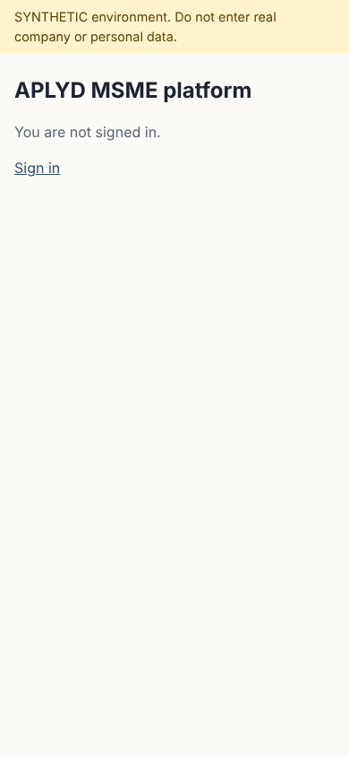 | 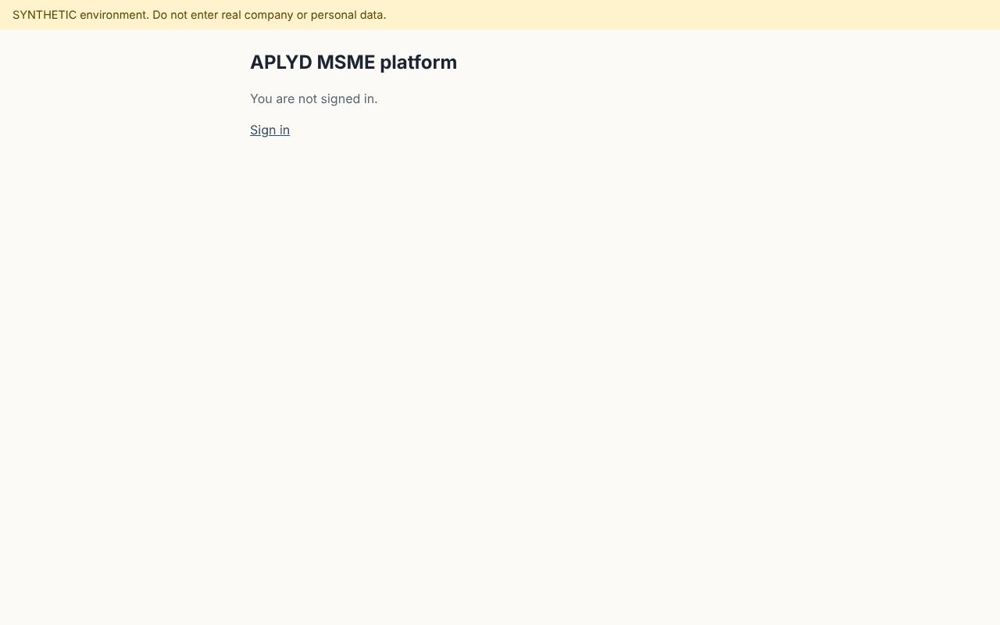 |

| What an owner sees | What an owner cannot tell | Fails |
| --- | --- | --- |
| The title "APLYD MSME platform", the sentence "You are not signed in." and a link "Sign in" | What the platform is, who it is for, what it does for a factory, what signing in leads to, whether it costs anything. "MSME platform" is a policy term; the owner of a unit may not call the business an MSME | BR-UX-01 (no purpose, and no reason for the one action), BR-UX-03, BR-UX-04 |

#### 3.3.2 Sign-in (SCR-02)

| Phone | Desktop |
| --- | --- |
| 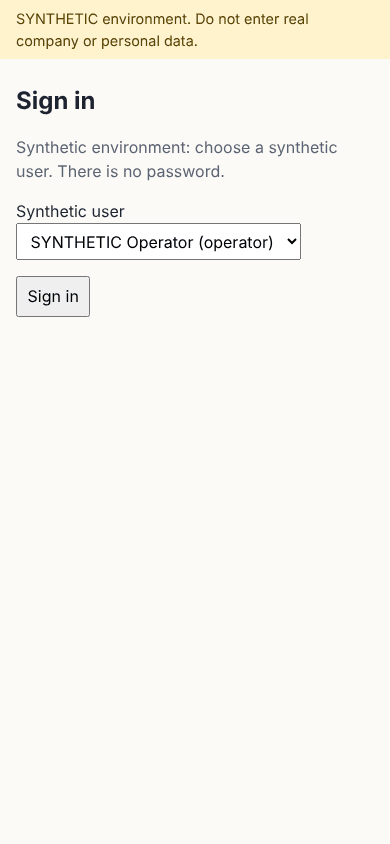 | 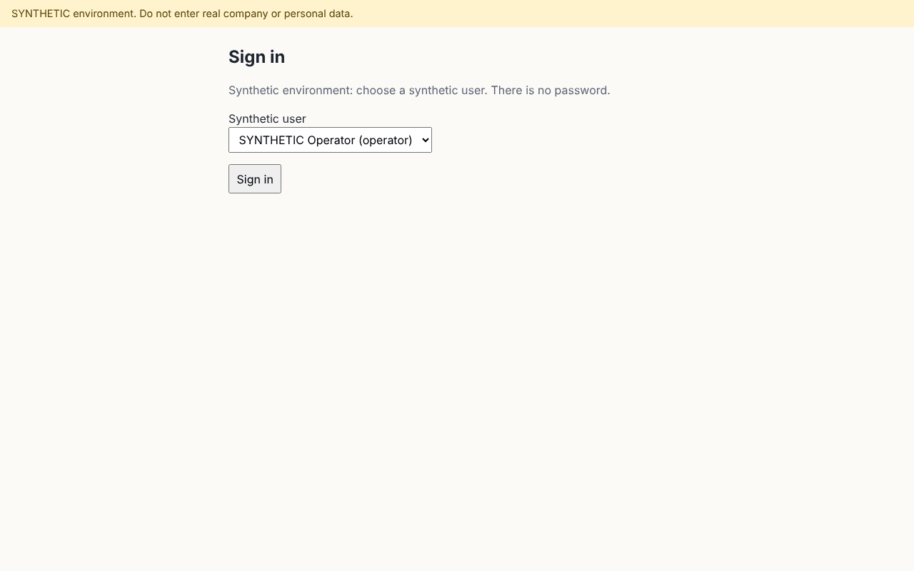 |

| What an owner sees | What an owner cannot tell | Fails |
| --- | --- | --- |
| "Synthetic environment: choose a synthetic user. There is no password." and a drop-down list of eight names with a role in brackets: the operator and owners A to G | Who each person is, which to choose, what "synthetic" means, how a real owner would sign in (OQ-13), and how to go back: the page has no link to anything but the button | BR-UX-01, BR-UX-03 |

#### 3.3.3 Home, signed in as an owner (SCR-01)

| Phone | Desktop |
| --- | --- |
| 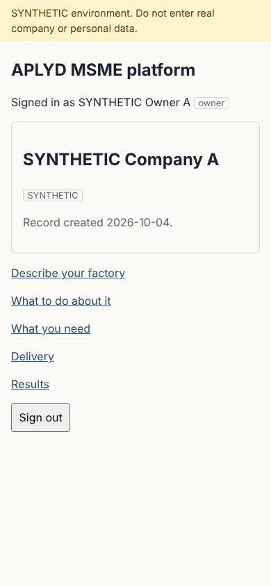 | 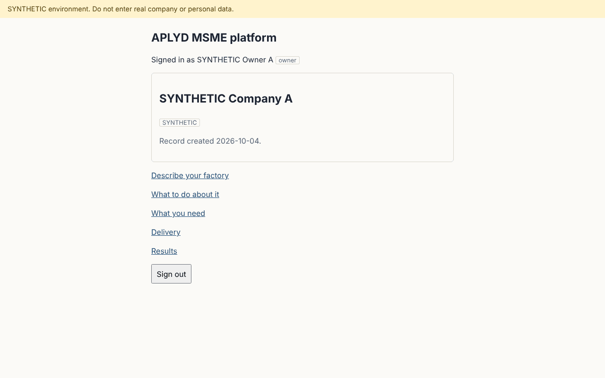 |

| What an owner sees | What an owner cannot tell | Fails |
| --- | --- | --- |
| "Signed in as SYNTHETIC Owner A" with a tag "owner"; a card with the company's name and "Record created 2026-10-04."; five links in a column (Describe your factory, What to do about it, What you need, Delivery, Results); a Sign out button | That the five links are five stages in a fixed order, which to press first, where the owner has got to, and what "company record" is for. The links are 20 pixels high on a phone | BR-UX-02 (this page is the requirement), BR-UX-01, BR-UX-03; BR-UX-05 is Unverified and this is a measurement toward it |

#### 3.3.4 Describe your factory (SCR-03)

| Phone (full page, 5,440 pixels) | Desktop (top 1,700 pixels) |
| --- | --- |
| 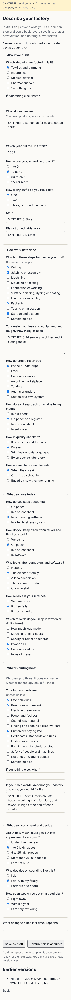 | 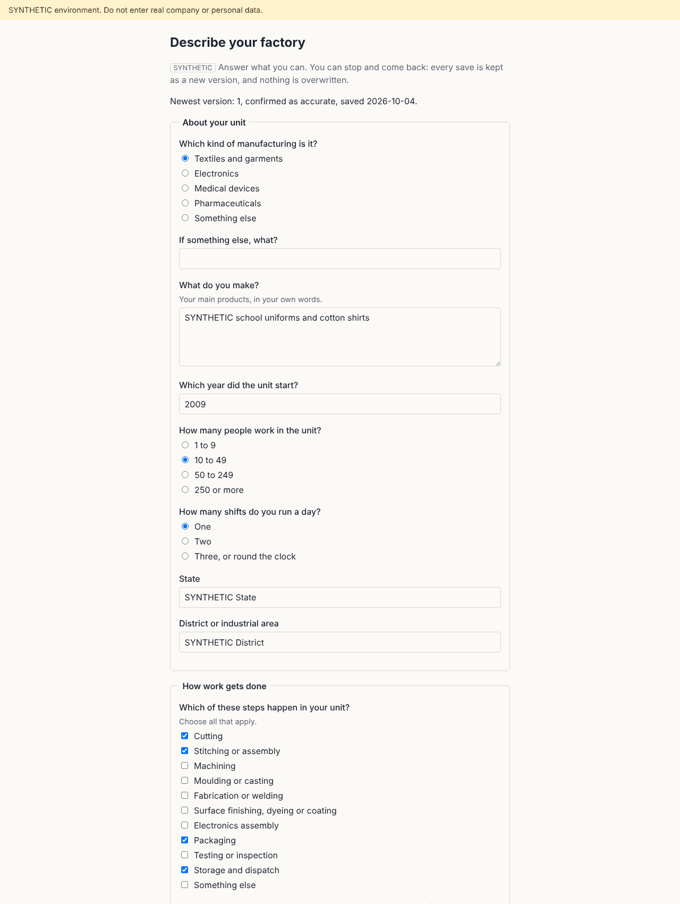 |

| What an owner sees | What an owner cannot tell | Fails |
| --- | --- | --- |
| A form of 25 questions in five boxes, "About your unit", "How work gets done", "What you use today", "What is hurting most", "What you can spend and decide"; an optional note; two buttons, "Save as draft" and "Confirm this is accurate"; "Earlier versions" | How many questions there are or how long this takes; which five are needed before "Confirm" works (they are not marked); what a "version" or a "draft" is; what confirming leads to (no link to the next stage appears afterwards); how far through they are | BR-UX-01, BR-UX-03, BR-UX-07 (the five needed questions are unmarked); BR-UX-05 is Unverified (a 5,440-pixel page; radio rows 24 pixels high) |

The new owner's view, and what happens when an owner presses "Confirm this is accurate" on an empty form:

| Phone, new owner, empty | Phone, after Confirm on an empty form |
| --- | --- |
| 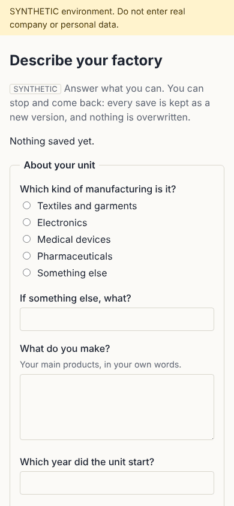 | 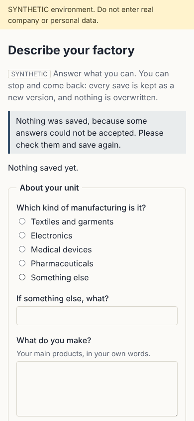 |

| What an owner sees | What an owner cannot tell | Fails |
| --- | --- | --- |
| "Nothing was saved, because some answers could not be accepted. Please check them and save again." above an empty form (MSG-23). The desktop captures are [13](screens/as-is/13-factory-new-owner-desktop.png) and [14](screens/as-is/14-factory-confirm-refused-desktop.png) | Which answers, since none was typed and no question is named; that five questions are needed; what to do now | BR-UX-06 (Partial: the message gives no way forward), BR-UX-07 |

#### 3.3.5 What to do about it (SCR-04)

The first visit (Owner A), then a made and signed-off assessment (Owner C).

| Phone, first visit | Desktop, first visit |
| --- | --- |
| 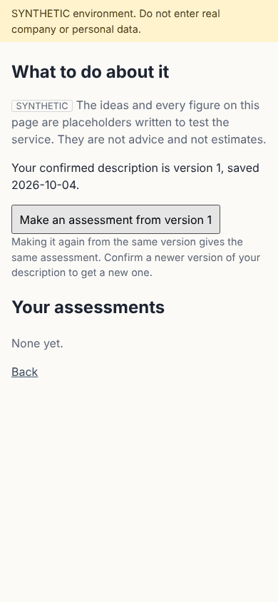 | 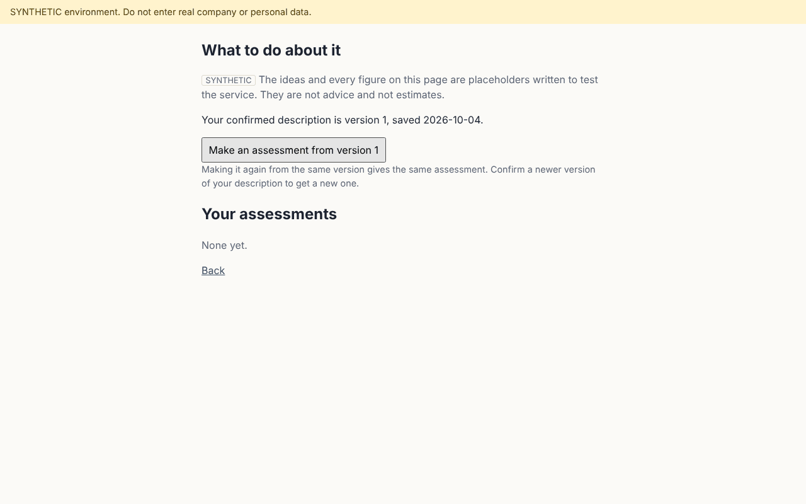 |

| What an owner sees | What an owner cannot tell | Fails |
| --- | --- | --- |
| "Your confirmed description is version 1, saved 2026-10-04.", a button "Make an assessment from version 1", and "Your assessments: None yet." | What an assessment is, what it will contain, who makes it, whether pressing the button costs anything or can be undone | BR-UX-01, BR-UX-03 |

| Phone, assessment signed off (full page, 6,279 pixels) | Desktop (top 1,700 pixels) |
| --- | --- |
| 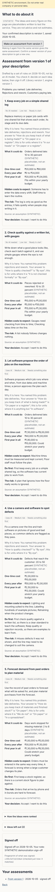 | 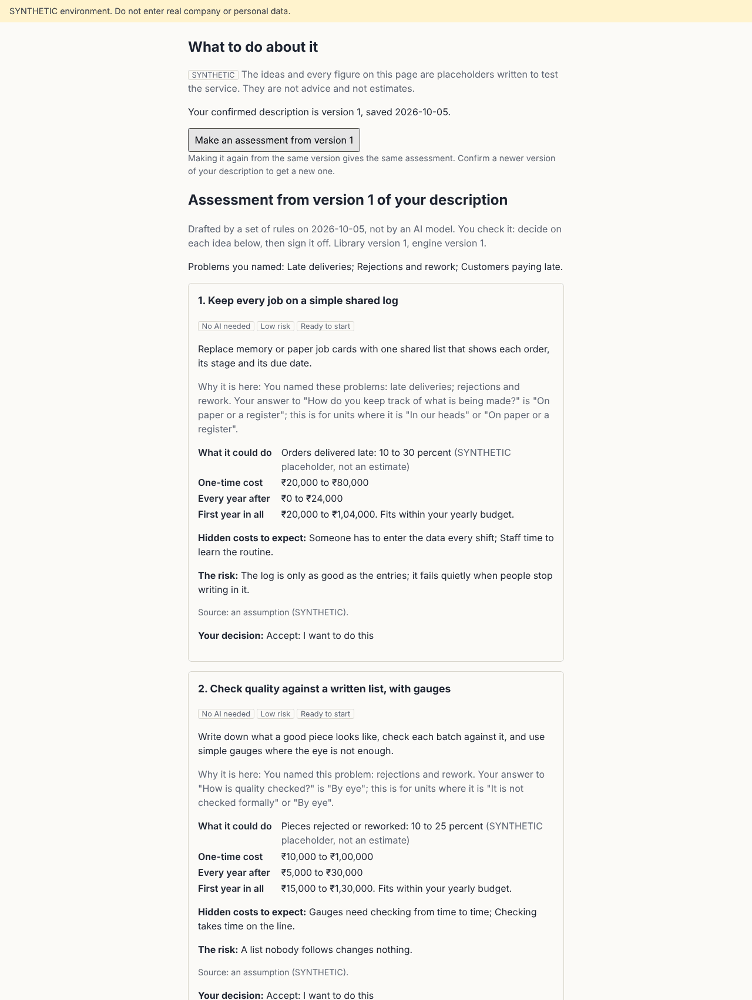 |

| What an owner sees | What an owner cannot tell | Fails |
| --- | --- | --- |
| "Assessment from version 1 of your description"; a line "Drafted by a set of rules ... not by an AI model ... Library version 1, engine version 1."; five idea cards, each with tags, a summary, "Why it is here", "What it could do", three costs, hidden costs, "Do first", the risk and a source; then "How the ideas were ranked", "Ideas left out (2)" and "Signed off" with a 16-character fingerprint | What the page adds up to (there is no summary); what "Uses AI" means; whether "10 to 30 percent" is a fall or a rise; that a decision is not final until the sign-off (before it, each idea has its own save button); what "sign off", "fingerprint", "library version" and "engine version" mean | BR-UX-03, BR-UX-01, BR-UX-05 (Unverified; 6,279 pixels) |

#### 3.3.6 What you need (SCR-05)

| Phone (full page, 3,757 pixels) | Desktop (top 1,700 pixels) |
| --- | --- |
| 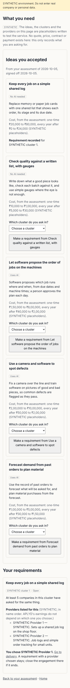 | 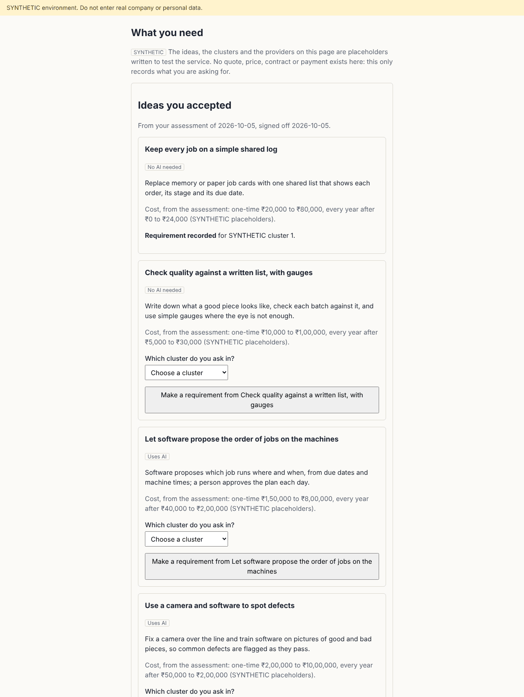 |

| What an owner sees | What an owner cannot tell | Fails |
| --- | --- | --- |
| A note that "No quote, price, contract or payment exists here: this only records what you are asking for"; "Ideas you accepted", each with a drop-down "Which cluster do you ask in?" (SYNTHETIC cluster 1, 2, 3) and a button "Make a requirement from <idea>"; "Your requirements" with a pool sentence, "Providers listed for this" and "You chose SYNTHETIC Provider 1. Go to delivery" | What a requirement, a cluster, a pool or an engagement is; that nobody is told and nothing is bought when "Make a requirement" is pressed; that choosing a provider cannot be changed afterwards (found out only by trying, MSG-90) | BR-UX-03, BR-UX-01 |

#### 3.3.7 Delivery (SCR-06)

| Phone (full page, 2,068 pixels) | Desktop |
| --- | --- |
| 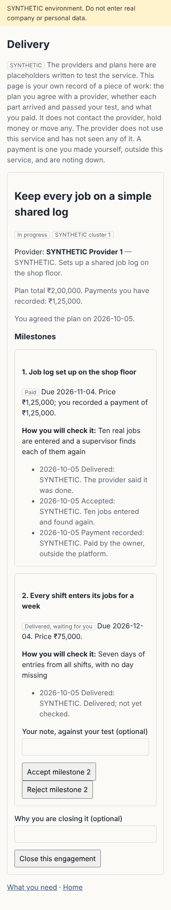 | 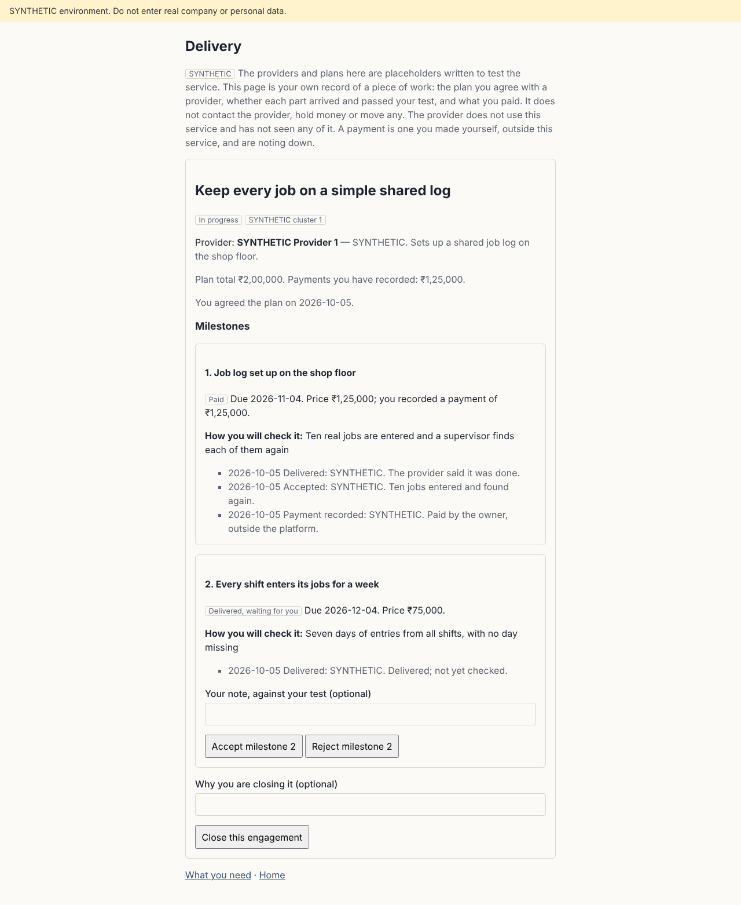 |

| What an owner sees | What an owner cannot tell | Fails |
| --- | --- | --- |
| A paragraph of about a hundred words saying the page is the owner's own record and the provider "does not use this service and has not seen any of it"; one card with status tags, the provider, "Plan total ₹2,00,000. Payments you have recorded: ₹1,25,000.", two milestones with states, their tests and history lines, "Accept milestone 2", "Reject milestone 2" and "Close this engagement" | That "Delivered" means the owner recording what the provider said; what an engagement or a milestone is; the order of steps; that accepting the first milestone before a starting number exists loses the number for good. Dates are typed as YYYY-MM-DD, which is hard on a phone | BR-UX-03, BR-UX-01; BR-UX-05 Unverified |

#### 3.3.8 Results (SCR-07)

| Phone (full page, 1,635 pixels) | Desktop |
| --- | --- |
| 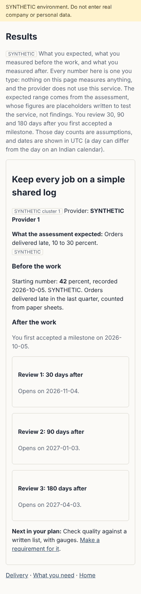 | 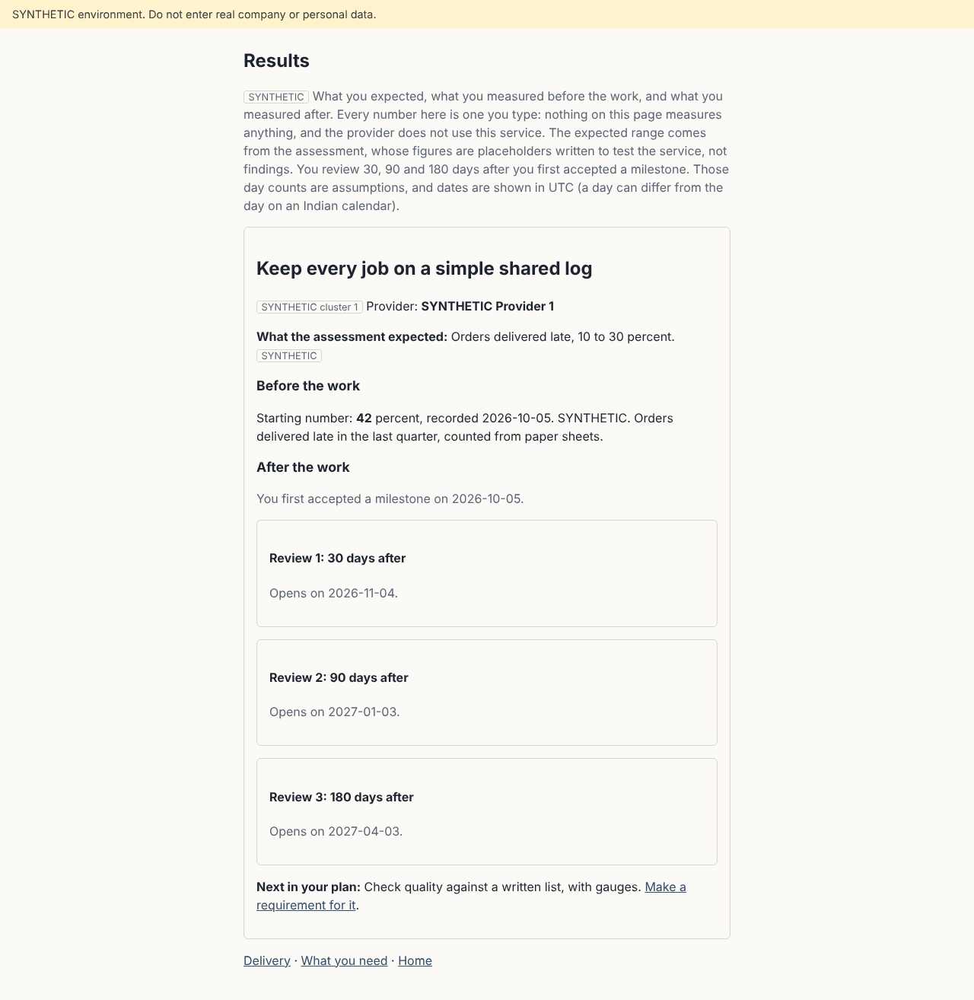 |

| What an owner sees | What an owner cannot tell | Fails |
| --- | --- | --- |
| A paragraph of about a hundred words; "What the assessment expected: Orders delivered late, 10 to 30 percent"; "Starting number: 42 percent"; "Review 1: 30 days after, Opens on 2026-11-04", the same for 90 and 180 days; "Next in your plan" | What a review is for; that nothing here is measured; that no message will tell the owner when a review opens (BR-RUN-07 is Not built); that the dates are UTC dates; what to do now | BR-UX-03, BR-UX-01, BR-UX-07 (Partial) |

#### 3.3.9 Providers and the listing fee (SCR-08), the operator

| Phone (full page, 3,901 pixels) | Desktop (top 1,700 pixels) |
| --- | --- |
| 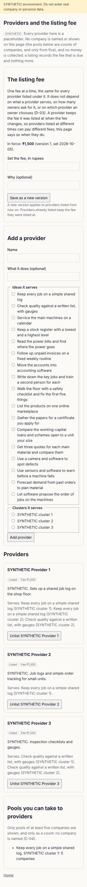 | 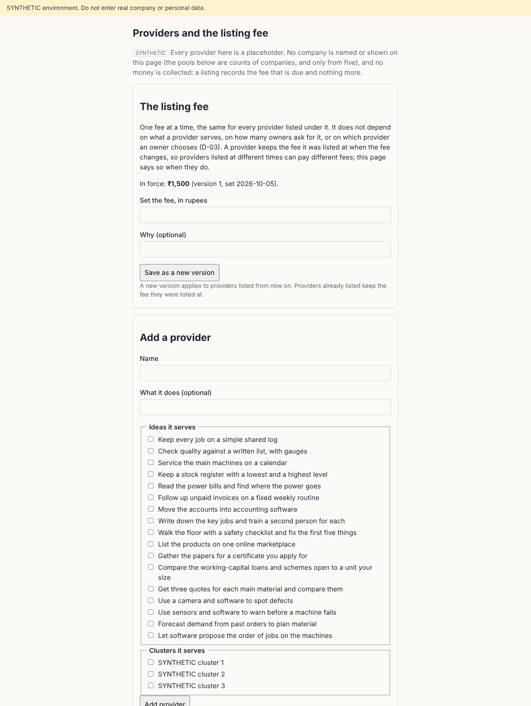 |

| What the operator sees | What the operator cannot tell | Fails |
| --- | --- | --- |
| The listing fee in force (₹1,500, a placeholder) and a form to change it; a form to add a provider with 17 check boxes for the ideas it serves and three for clusters; each provider with its fee, a summary and what it serves; "Pools you can take to providers" with "5 companies" | That nothing can be taken to providers (the heading suggests an action, and BR-PROC-03 is Not built; FSD section 12, item 18); what to do first; that the page is the only place the fee appears | The BR-UX requirements are written for owner pages; the heading is misleading (FSD 12.1, item 18) |

#### 3.3.10 Demonstration (SCR-09)

| Phone (full page, 6,406 pixels) | Desktop (top 1,700 pixels) |
| --- | --- |
| 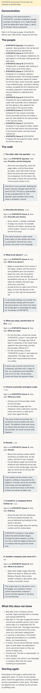 | 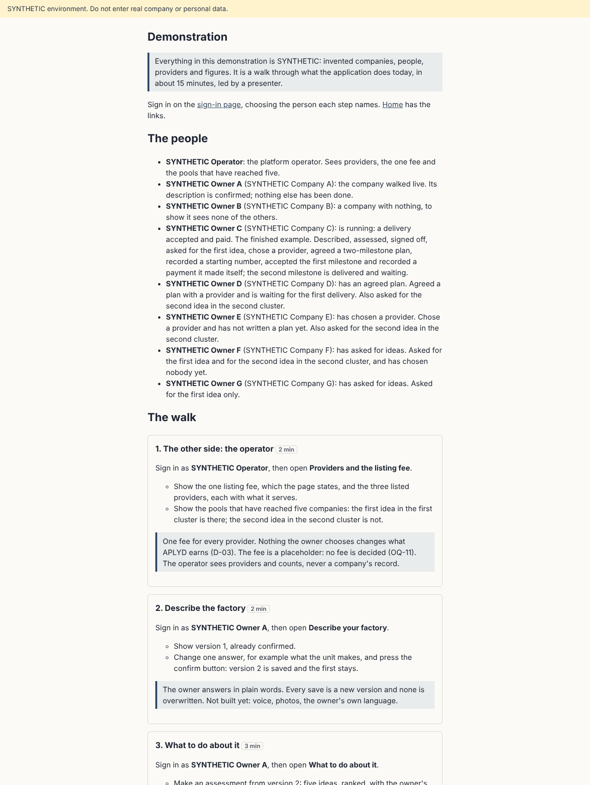 |

| What a presenter sees | Observation | Fails |
| --- | --- | --- |
| "The people" (the operator and companies A to G, each with where it is in the journey), "The walk" (eight steps, about 15 minutes), "What this does not show" (seven limits) and "Starting again" | This page is for a presenter and not for an owner. It is the only page that describes the journey in plain words and says what is not built, and it exists only with `APLYD_DEMO=true`. The FSD records no BR-UX gap against it | None recorded |

#### 3.3.11 Two states a form can leave an owner in

| Phone, a stage page, signed out | Phone, a form posted after the session ended |
| --- | --- |
| 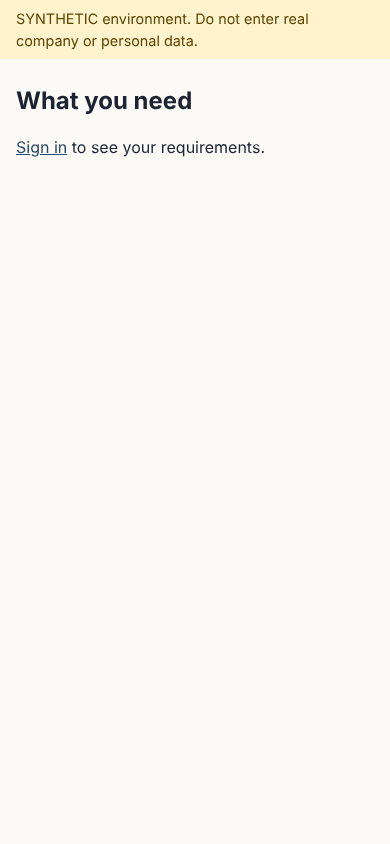 | 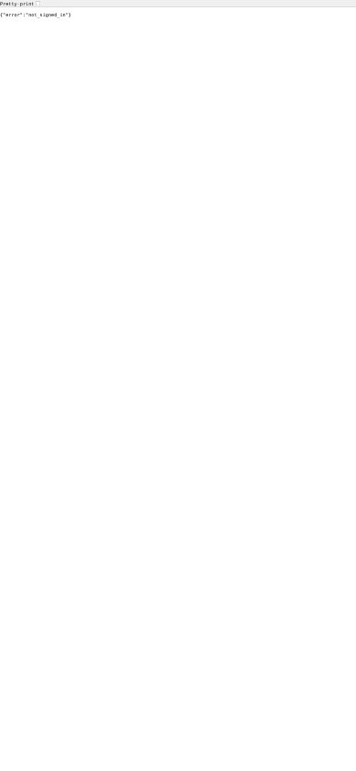 |

| What an owner sees | What an owner cannot tell | Fails |
| --- | --- | --- |
| Left: one sentence, "Sign in to see your requirements." with a link (MSG-76). Right: the line `{"error":"not_signed_in"}` on an empty page (MSG-11), the answer to "Make an assessment from version 1" pressed after the session cookie was removed. The session lasts 8 hours (RULE-01). The desktop captures are [12](screens/as-is/12-stage-page-signed-out-desktop.png) and [15](screens/as-is/15-expired-session-json-desktop.png) | Left: what the page is for, and why the owner must sign in. Right: that they were signed out, that nothing they typed was kept, and what to do | Left: BR-UX-01. Right: BR-UX-06 |

### 3.4 Which requirements the earlier pages failed

[Certain] This is read from the earlier pages and the FSD as it was written for them, not tested with owners. "Fail" means the requirement's own wording is not met by the page; "unverified" means the BRD says so and the measurements in section 3.1 are the only evidence.

| Page | BR-UX-01 purpose and next step | BR-UX-02 journey view | BR-UX-03 plain words | BR-UX-04 own language | BR-UX-05 phone | BR-UX-06 refusals | BR-UX-07 empty states |
| --- | --- | --- | --- | --- | --- | --- | --- |
| Home, signed out | fail | not applicable | fail | fail | no sideways scroll at 390 | not applicable | not applicable |
| Sign-in | fail | not applicable | fail | fail | no sideways scroll at 390 | JSON for a missing secret | not applicable |
| Home, owner | fail | fail | fail | fail | 20-pixel links | not applicable | not applicable |
| Describe | fail | not applicable | fail | fail | long page | partial | fail (needed questions unmarked) |
| Diagnose | fail | not applicable | fail | fail | long page | partial | partial |
| Procure | fail | not applicable | fail | fail | unverified | partial | partial |
| Delivery | fail | not applicable | fail | fail | typed dates | partial | partial |
| Results | fail | not applicable | fail | fail | unverified | partial | partial |

BR-UX-08 (every synthetic page carries the SYNTHETIC banner and tag) is Built and holds on every page captured. BR-UX-09 (WCAG 2.1 level AA) is Unverified and nothing in this document measures it; BR-UX-10 (take it away) and BR-UX-11 (the channel the owner uses) are Not built and Open.

## 4. Design principles (earlier proposal)

**Earlier proposal.** Sections 4 to 6 were written before the redesign was built. The built interface followed some of them and not others; section 7 says which. They refer to wireframes W-01 to W-34 and to sections 8 to 11 of this document. Those wireframes and sections were never written here, and the built screens are in section 2 instead. Where a sentence below speaks of what the application does "today", it means the earlier interface unless it says otherwise.

[Guessing] Every principle below is a judgement drawn from the BRD's UX requirements and the thesis's description of the owner (thesis sections 1 and 3: someone who does not know how to use AI, assess gaps, procure or deploy, and who is small). None has been checked with an owner. Each is tied to the requirement it serves, and each is carried out in specific wireframes.

| No. | Principle | What it means on a page | Serves | Seen in |
| --- | --- | --- | --- | --- |
| 1 | Every page says what it is for and has one main button | Under the title, one plain sentence that says what the page is for. One main button for the next step, drawn larger than the rest. Any other action is plainer and lower | BR-UX-01 | Every owner wireframe |
| 2 | The journey is always visible | A strip of the five stages is at the top of every owner page: numbered, in plain words, with each stage shown as done, here, or not yet, and each one tappable. The home page is this strip plus the one next step | BR-UX-02 | W-00, W-03 to W-05D |
| 3 | The owner is never asked to learn a platform word | Section 5 gives the replacement for each word. Where a word cannot be avoided (AI, for one), a plain sentence explains it where it first appears, and a "Words we use" page holds all of them | BR-UX-03 | W-11, W-12, W-33 |
| 4 | Every number says what it is | A number carries its unit or its rupees and what it measures: "Pay once ₹20,000 to ₹80,000", "42 percent of orders were late". A figure from the synthetic library says it was made up for testing. No bare "10 to 30" | BR-UX-03, BR-UX-08, BR-RUN-03 | W-11, W-12, W-18, W-22 |
| 5 | The owner can always see what happens next and who does it | Each stage page ends its first screen with "What happens next" and "Done by". Where the honest answer is "you, noting what the company told you", it says that | BR-UX-01, BR-UX-02 | W-03 to W-05, W-14 to W-22 |
| 6 | Say what the service does not do, where the owner might assume it does | On the page where a company is chosen: "This does not contact the company." Beside a payment: "This service does not move money." These sentences are short and next to the button, not in a grey paragraph at the top | BR-UX-01, BR-UX-08 | W-15, W-16, W-18, W-19 |
| 7 | Nothing unbuilt is shown as available | Voice, photos, a language switch, offers, reminders, a person who checks, printing and the like are drawn in the prototype as dashed boxes marked "not built yet" and with their BR identifier. In the product they would not appear until they work | BR-UX-08 and BRD section 1.3 ("built" means it exists and a test exercises it) | W-01, W-06, W-11, W-15, W-22 |
| 8 | A refusal says what happened and what to do next | On the page the person was on, in plain words, naming the field or step, with a link or button that fixes it. A refusal is never a line of JSON. The refusal is announced to a screen reader as it is today (`role="alert"`) | BR-UX-06 | W-29, W-30 |
| 9 | An empty or waiting page says what will appear and what causes it | A page with nothing on it says what will be here, what the owner has to do to cause it, and who does it. A page that waits on someone else says who and that no message will be sent | BR-UX-07 | W-10, W-32 |
| 10 | Phone first | One column. Every control at least 44 pixels high and wide. No sideways scrolling. No script needed to use a page (as today, no page uses a client component). Dates picked, not typed. No images | BR-UX-05 | All, W-17, W-19 |
| 11 | Small pieces, nothing lost | Describe is five parts, one at a time, each saved when the owner moves on, so a dropped connection loses one part at most. Every save is a version and nothing is overwritten, as built | BR-UX-05, BR-DESC-02, BR-DESC-03 | W-06 to W-09 |
| 12 | Warn before what cannot be undone | Before the first part is passed, say that a starting number can no longer be written afterwards. Before a company is chosen, say that the choice stays for this request | BR-UX-01, BR-UX-06 | W-16, W-19 |
| 13 | Never show what the rules hide | A pool is shown only from five companies, and then as "at least 5", "at least 10". The listing fee is shown to the operator and to nobody else. Providers are listed in name order and nothing else. No page says a company is approved, verified, certified, trusted or recommended, because the platform certifies nothing | BR-GOV-06, BR-COM-02, BR-PROC-06, BR-GOV-03 | W-15, W-25, W-27, W-28 |
| 14 | Mark what is made up | The SYNTHETIC banner is on every screen and each library figure says it was made up for testing | BR-UX-08 | Every wireframe |
| 15 | Built so it can be translated and reached by another channel | All owner text sits in one place, with no text in images and room for longer words; each step is small enough to say aloud or send as a message. Which languages and channels is not decided | BR-UX-04, BR-UX-11, OQ-17 | W-01, W-06 |
| 16 | Accessible by construction, not claimed | Labels, order, focus and contrast are designed in (the interface guide records what was built). No conformance is claimed: BR-UX-09 is Unverified | BR-UX-09 | Section 8 |
| 17 | Take it away | An owner can print or save the list of ideas and the work plan to show a family member or a bank. Not built | BR-UX-10 | W-22 |

## 5. The plain-language term map (earlier proposal)

[Guessing] This is a proposal and not a decision. It replaces each platform word with the words an owner might use, and gives the one-line meaning that would appear where the word first has to be used. None of it has been tested with an owner. The words marked "test" in the last column are the ones most likely to be misread and should be put to owners first (the [UAT plan](../test/UAT-PLAN.md) and the [ten-owner test](../ten-owner-test.md)). All wording is English. Whether owners get another language first, and which, is OQ-17; a translation needs its own test because a word that is plain in English may be a borrowed English word or a different thing in another language.

The terms to avoid on an owner page are: certified, approved, verified, trusted and recommended (the platform certifies nothing, C-01, and a provider on the list has not been vetted, BR-PROC-09 being Not built); and any word that suggests a fee or a ranking by money (D-03).

| Platform word, and where it appears today | Proposed owner wording | One-line meaning | Test |
| --- | --- | --- | --- |
| Describe, Diagnose, Procure, Deploy, Run (the five stages; the thesis's words) | Your factory; What could help; Who will do it; Getting it done; Did it work | The five steps, in the order an owner takes them | test |
| Description, questionnaire (Describe) | Your answers about the factory | What you told us about the unit | |
| Version, newest version (Describe) | Saved copy, latest copy | Each time you save, a new copy is kept and the old ones stay | test |
| Draft (Describe) | Not final yet | Saved, but you have not said it is right | test |
| Confirm this is accurate | Yes, this is right | You tell us your answers are correct and ready for the next step | |
| Assessment (Diagnose) | Your list of ideas | The ideas that match your problems, best first | test |
| Idea (the library's "opportunity") | Idea | Something you could do about a problem | test |
| Uses AI, No AI needed | Uses AI, No AI needed | AI here means software that finds patterns in your records; the tag is kept and explained once | test |
| Library version, engine version | Our list of ideas, our set of rules | Where the ideas and the order come from; shown under "How this list was made" | |
| Sign off | Confirm my choices | You have read every idea and the choices are yours; after this nothing on the list changes | test |
| Fingerprint | Check code | A short code that changes if anyone alters the list after you confirmed it; shown under "For your records" | |
| Source: an assumption (SYNTHETIC) | Where the numbers come from: we made them up for testing | There is no source yet; the figures are not advice | |
| One-time cost; Every year after; First year in all | Pay once; Pay each year after; First year, all together | What it costs, in rupees | |
| Hidden costs to expect | Costs people forget | Costs that are not on the price tag | |
| Do first (prerequisite) | Do this first | What has to be true before the idea is worth doing | |
| The risk | What could go wrong | The main way the idea fails | |
| Requirement (Procure) | Request | What you are asking for | test |
| Cluster | Your group of factories | Factories like yours near you that ask for the same things together; what a cluster really is waits on OQ-03 | test |
| Pool; floor of five | Others asking for the same thing; no number below 5 | How many factories in your group have asked; we show no number below 5, to protect the factories that asked | test |
| Provider | The company that will do the work | A company on our list that does this kind of work | test |
| Listing, listed (Procure and the operator) | On our list | The operator has added the company to the list of companies owners can choose from. It does not mean we checked it | test |
| Listing fee | Not shown to owners | Operator only; it is the same for every company and does not change what APLYD earns | |
| Engagement | The job | Your work with the company you chose | test |
| Plan, milestone (Deliver) | Work plan; part of the work | A list of parts, each with what is delivered, how you will check it, a date and a price | test |
| Acceptance test | How you will check it | What you will look at to decide the part is done | |
| Delivered | The company says it is done | You note that the company told you the part is finished | test |
| Accept, Reject | It passed my check; It did not pass | Your decision on a part, against your own check | |
| Payment recorded | I paid (note it) | You note an amount you paid yourself; this service moves no money | |
| Close; Complete; Ended early | Finish this job; Finished, every part passed; Stopped early | How the job ended | |
| Baseline (Run; the page already says "starting number") | Starting number | One number that says how things are now, written down before the work, so the change can be shown | |
| Review, verdict (Run) | Check-up; Did it do what we expected? | A look at 30, 90 and 180 days after the first part passed | test |
| Outcome | Result | What happened, in your own number | |
| Gap assessment (TO BE, BR-DIAG-08) | What stands between you and each idea | Where the unit stands on data, people, systems, money and quality | |
| Financing model (TO BE, BR-DIAG-10) | How you pay | Buy it, pay each month, pay as you use, or pay when it works | test |
| SYNTHETIC | Made up for testing | The word SYNTHETIC stays on every page; "made up for testing" explains it | |
| MSME platform | APLYD, this service | The platform is never called an MSME platform to an owner | |
| Session | Signed in | "You were signed out", not "your session expired" | |
| Operator | Not shown to owners | APLYD staff who keep the list of companies | |

## 6. Information architecture and navigation (earlier proposal)

### 6.1 The screens and how they connect

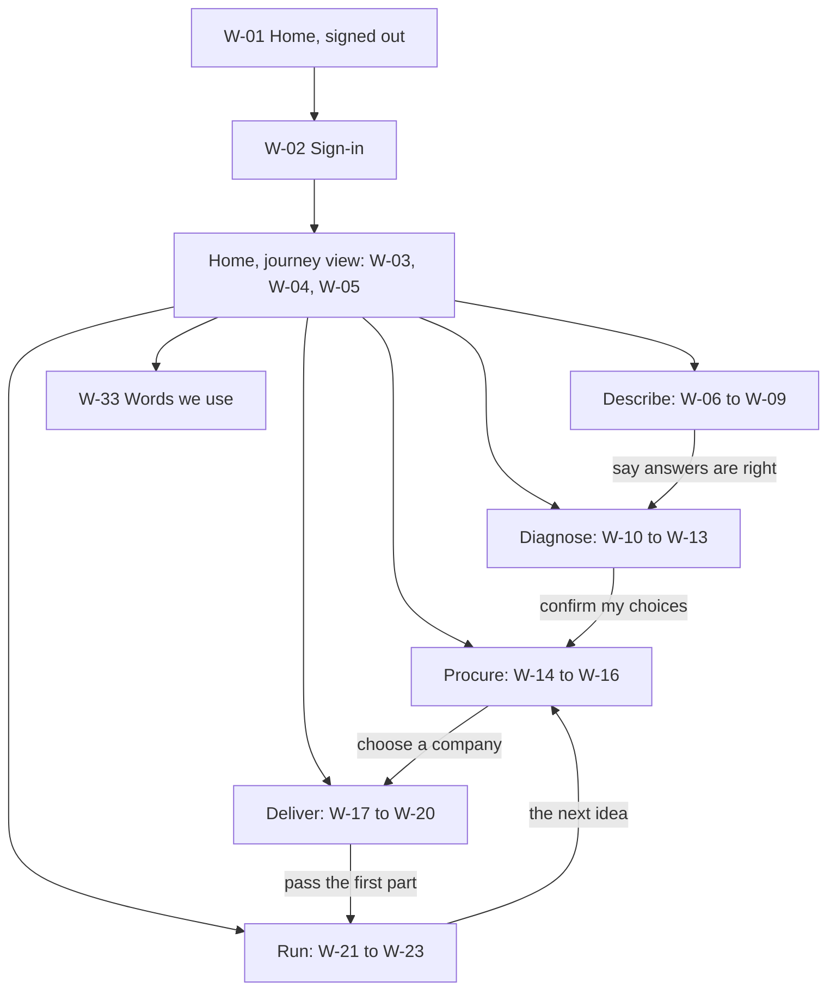

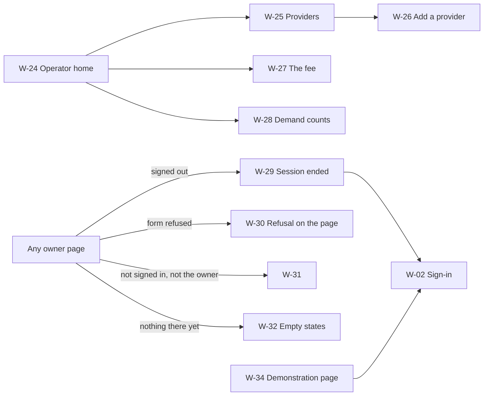

### 6.2 The journey strip

The strip is on every owner screen, under the title bar and above the page's own title. It is a list of five buttons, each a number and a plain name. On a phone the numbers are shown and the name of the stage the owner is at is written under them; on a desktop every name is shown.

| State of a stage | How it looks | What a tap does |
| --- | --- | --- |
| Done | Number replaced by a tick, name in plain weight | Opens that stage's page showing what was done |
| Here | Number in a solid mark, name in bold, "You are here" for a screen reader | Opens the stage's page at its first screen |
| Not yet | Number in an outline, name greyed, "Opens after step N" | Opens that stage's page, which answers with its empty state (W-32). This is what the built pages already do (FSD section 3.1): they answer with a sentence that names what is missing, so the strip never leads to an error |

[Certain] The built records can answer each of these states: step 1 is done when a version is confirmed (FR-DESC-04), step 2 when an assessment is signed off (FR-DIAG-08), step 3 when a provider is chosen (FR-DEPL-01), step 4 when an engagement is closed with every part accepted (FR-DEPL-06), and step 5 when the three check-ups are recorded (FR-RUN-02). Steps 3 to 5 are per idea, not per company, which section 6.3 deals with.

### 6.3 What the home page becomes

[Guessing] The home page becomes one view of the journey and nothing else: the company's name, the strip, one card for the one next step with its button, a line saying what happens after it and who does it, and below that a short list of the owner's ideas and where each is.

Steps 1 and 2 happen once for the company. From step 3 each idea an owner says yes to has its own request, its own company, its own plan and its own check-ups, so an owner with three ideas has three jobs at three different stages. The strip shows the idea in focus, which is the one the rule in section 6.4 picks. The list below the card shows every other idea with its own stage in words ("You said yes; not asked for yet", "Company chosen; plan not written"). This is the part of the design most likely to need a change after owners see it: one strip for several jobs is a simplification.

Where W-03, W-04 and W-05 differ is in which stage is current and what the one button says:

| Wireframe | The owner is | The strip | The one button |
| --- | --- | --- | --- |
| W-03 | New: nothing saved | Stage 1 here | Start |
| W-04 | Plan agreed, no starting number yet | Stages 1 to 3 done, stage 4 here | Write your starting number |
| W-05 | Running: a part waits for the owner's decision | Stages 1 to 3 done, stage 4 here, stage 5 started | Decide on part 2 |

### 6.4 The rule for the one next step

[Guessing] The home page picks one next step from the records, by the first row that is true. The rule is a proposal and is a pure function of records the application already reads through the scope rule (FR-ID-07). Rows 1 to 4 are the stages that happen once; rows 5 to 12 apply to the idea in focus, and when several ideas are in progress the first row that is true for any of them wins, which puts a company waiting on the owner ahead of everything else.

| Row | If this is true | The button says | Who does the next thing | Built from |
| --- | --- | --- | --- | --- |
| 1 | Nothing saved, or the newest copy is a draft | Start, or Continue telling us about your factory | You | FR-DESC-03, FR-DESC-04 |
| 2 | Answers confirmed and no list of ideas for that copy | Make my list of ideas | A set of rules makes it; you read it | FR-DIAG-01 |
| 3 | A list exists and an idea has no decision | Decide on the ideas (3 of 5 decided) | You | FR-DIAG-07 |
| 4 | Every idea decided and the list not confirmed | Confirm my choices | You | FR-DIAG-08 |
| 5 | A part is delivered and waits for the owner, and a starting number is already recorded | Decide on part N | You | FR-DEPL-04 |
| 6 | A part is delivered, no part has passed, and no starting number is recorded | Write your starting number first | You | FR-RUN-01 |
| 7 | A plan is agreed, nothing has passed, and no starting number is recorded | Write your starting number | You | FR-RUN-01 |
| 8 | A check-up has opened and is not recorded | Record check-up N | You | FR-RUN-02, FR-RUN-03 |
| 9 | A request exists, no company is chosen, and at least one company is on the list for it | Choose who will do it | You | FR-PROC-11, FR-DEPL-01 |
| 10 | A company is chosen and no plan is agreed | Write your work plan | You | FR-DEPL-02, FR-DEPL-03 |
| 11 | A plan is agreed and nothing has been delivered | Open your work plan (waiting for the company) | The company; you note what it tells you | FR-DEPL-04 |
| 12 | An idea was said yes to and has no request | Ask for the next idea | You | FR-RUN-06, FR-PROC-02 |
| 13 | None of the above | No button: "Nothing to do now. The next check-up opens on <date>." | Nobody yet | FR-RUN-03 |

A request with no company on the list yet is not an action for the owner. The card says "No company is on our list for this yet. Nothing for you to do; look again later. We will not send a message (not built yet, BR-RUN-07 is the nearest requirement)", and the rule moves on to the next row.

### 6.5 What each stage page shows first

| Stage page | First, in order | The main button | What happens next, and who does it |
| --- | --- | --- | --- |
| Your factory (W-06 to W-09) | Title; one sentence of purpose; "Part N of 5" and a progress bar; the questions of that part with the needed ones marked | Save and continue | When the answers are confirmed, a set of rules makes a list of ideas. Done by you, then the rules |
| What could help (W-10 to W-13) | Title; one sentence of purpose; "In short" with the problems the owner named and the number of ideas; then ideas best first as cards with their cost and benefit; how many are decided | Open this idea; then Confirm my choices | After confirming, you ask for the ideas you said yes to. Done by you |
| Who will do it (W-14 to W-16) | Title; one sentence of purpose; the ideas the owner said yes to; for a request, how many others ask for the same (only from five) and the companies on the list in name order | Ask for this; then Choose this company | A work plan is written with the company. This service does not contact the company: you do |
| Getting it done (W-17 to W-20) | Title; one sentence of purpose; the job, its status and the plan total; the parts with their states | Depends on the state: Add this part; Agree the plan; It passed my check | The company does the work and tells you. You note it and check it. The company is not in this service yet |
| Did it work (W-21 to W-23) | Title; one sentence of purpose; the number expected; the starting number; the three check-ups with their dates; the change | Write your starting number; Save check-up N | A check-up opens 30, 90 and 180 days after the first part passes. No message will tell you; you come back |

### 6.6 Navigation and page titles

- A title bar on every owner page: the word APLYD (a link to the home page) and a Menu button that opens three links: Home, Words we use and Sign out. [Guessing] Three links need no menu on a desktop, where they sit in the bar.
- A footer on every owner page: Words we use, and the SYNTHETIC note.
- Back is the browser's back button. A page never traps the owner: the sign-in page gets a link to the start. The earlier sign-in page had none; in the built interface the mark in the app bar goes to the home page and is the only link on the sign-in page (FSD section 5.3).
- Each page's browser title says the step and the page, for example "Step 2 of 5: See what could help - APLYD". In the earlier interface every page had the same title, so several open tabs could not be told apart. In the built interface the home page is titled "APLYD MSME platform" and every other page except `/export` is titled "<page>: APLYD", for example "Describe: APLYD" (FSD FR-UX-26; commit 6e4b7d3). `/export` has no title of its own yet. The built titles do not carry the step number. This serves BR-UX-01.
- After a form is posted the owner returns to the same page with a message at the top (as built, FR-UX-02), and when a stage is finished the page ends with the one button for the next stage. In the earlier interface no page sent the owner on; the built pages do, with the card "Your next step" (FR-UX-18).

## 7. What the built interface took from the earlier proposal

[Certain] This compares the proposal in sections 4 to 6, which was written before the redesign, with the built interface as the FSD describes it (section 5, FR-UX-15 to FR-UX-24). It was read from the FSD and the source on 5 October 2026 and was not tested with an owner. The proposal refers to wireframes W-01 to W-34, and to sections 8 to 11, that this document never contained; the built screens are drawn in section 2 instead.

| Earlier proposal | Built | See |
| --- | --- | --- |
| Section 6.2: the five-step strip on every owner page, each stage a link, "Opens after step N" on a stage not yet reached | The strip is on each of the five stage pages for an owner of a company. The home page has five stage cards in its place. A stage not yet reached is a link to its page, which answers with its own sentence. A step is marked done only when every step before it is done. The words "Opens after step N" are not built. | FR-UX-17 |
| Section 6.3: the home page is the strip, one card for the next step, and a list of ideas with their stages | The home page shows the next step first, then five stage cards, then the company record. The stages are those of the company, not of each idea; a list of ideas with a stage each is not built. | FR-UX-22, FR-UX-21 |
| Section 6.4: one rule for the one next step, 13 rows | `nextStep` has nineteen rules (eighteen keys) in a different order and with different words. For example a delivery that waits for a decision comes before a review, a plan and the starting number, except that the starting number comes first while a delivery waits and the number can still be recorded; "make a requirement" fires only when the owner has no requirement and no engagement; and three of the steps say that nothing is needed from the owner. | FR-UX-20 |
| Section 5: replace the platform's words with plain ones, and a page "Words we use" | Not adopted. The strip uses the words Describe, Decide, Choose, Deliver and Measure. The pages keep their names (What to do about it, What you need, Delivery, Results) and the terms assessment, requirement, engagement and fingerprint are still on pages. There is no "Words we use" page. | BR-UX-03; FSD section 5.1 |
| Principle 1: one sentence under the title and one main button | Each stage page has one sentence under the title. A main button is marked in each form or card, not one for the whole page. | FR-UX-16, FR-UX-23 |
| Principle 6: say what the service does not do, next to the button | Built in part. Beside the button that chooses a provider the page says it does not contact the provider, agree a price or move any money, and that the choice cannot be changed. Beside the payment form on Delivery it says no money is sent from here. Each stage page has its SYNTHETIC line. | FR-UX-01; SCR-05, SCR-06 |
| Principle 7: nothing unbuilt is shown as available | In reading section 5 of the FSD no built page was found to offer a control for a function the FSD marks TO BE. This was read, not tested. | FSD section 5 |
| Principle 8: a refusal is never a line of JSON | Not met. A form posted after the session has ended still answers a line of JSON. | BR-UX-06; FSD section 12, item 16 |
| Principle 9: an empty or waiting page says what will appear and what causes it | Built on the stage pages: each has a sentence for the empty case. Diagnose ignores an unknown assessment in the address without a message. | FR-UX-03; FSD section 12, item 6 |
| Principle 10: phone first, controls at least 44 pixels, no sideways scroll, dates picked, no images | Cards are one column on a phone; buttons (the small ones too), text fields, drop-down lists, option rows and the two summaries that open a section on Diagnose and Procure are at least 2.75 rem tall (44 pixels at the default size) by the style sheets; a link inside a sentence is not. No script; no photographs. Dates on Delivery are still typed as YYYY-MM-DD. No page has been measured or walked on a real phone. | FR-UX-15; FSD section 5.1 |
| Principle 11: Describe in five parts, one at a time, each saved when the owner moves on | Not built. Describe is one form of five section cards with one save; the buttons stay at the bottom of the screen while the owner scrolls. | SCR-03 |
| Principle 12: warn before what cannot be undone | Built in part. Choosing a provider says the choice cannot be changed. Results says the starting number is recorded once and must be taken before the first milestone is accepted, and the home page says so while a delivery waits and the number can still be recorded. Beside "Accept milestone N" on Delivery the page says "Your answer is recorded and stays on record." It does not warn that accepting the first milestone ends the chance to record a starting number. | SCR-05, SCR-07; FSD section 12, item 28 |
| Principle 13: never show what the rules hide | A pool is shown as a lower bound in steps of five and not at all below five; providers are listed in name order with no fee; the listing fee is on no owner page (two browser tests look for it and expect not to find it). | FR-PROC-05, FR-PROC-06, FR-PROC-11 |
| Principle 14: mark what is made up | A banner above the app bar in a synthetic environment, and a SYNTHETIC line or tag on each stage page. | FR-UX-01 |
| Principle 15: built so it can be translated | Not built. English only; the text is in each page's file. | BR-UX-04 |
| Principle 17: take it away (print or save the plan) | Not built. No stylesheet in `app/` has a print rule. | BR-UX-10 |
| Section 6.6: a title bar with a Menu, and a footer with "Words we use" | Not built. The app bar has the mark and, for a signed-in person, "Sign out". The footer has two fixed lines. | FR-UX-15 |
| Section 6.6: each page's browser title says the step and the page | Not built. Every page has the title "APLYD MSME platform". | FSD section 5.1; section 12, item 12 |
| Section 6.6: the sign-in page has a way back | Built: the mark in the app bar goes to the home page. | FR-UX-15 |
| Section 6.6: a form returns to the same page with a message, and a finished stage ends with one button to the next | Built: a posted form returns to its page with a notice at the top, and a stage page ends with the card "Your next step" when a step that needs the owner is on another stage. | FR-UX-02, FR-UX-18 |
