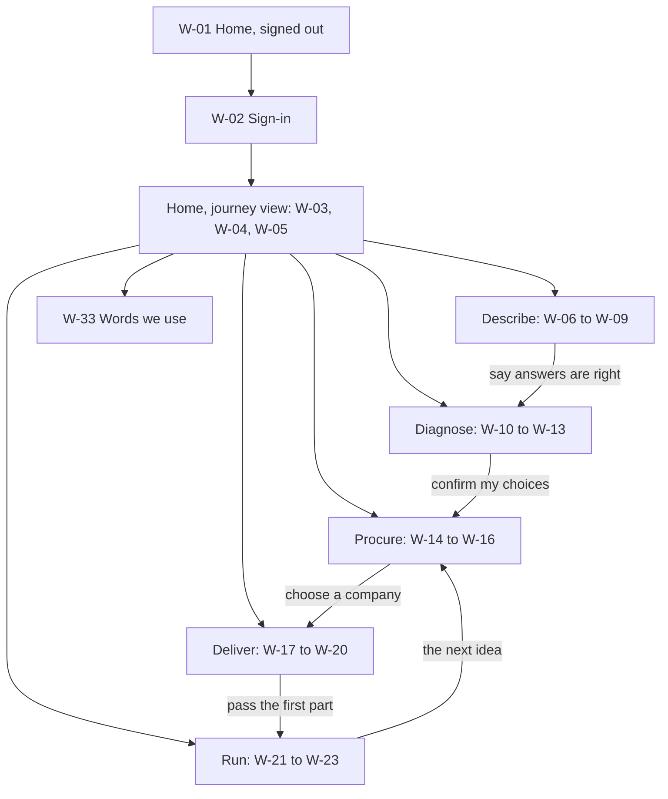
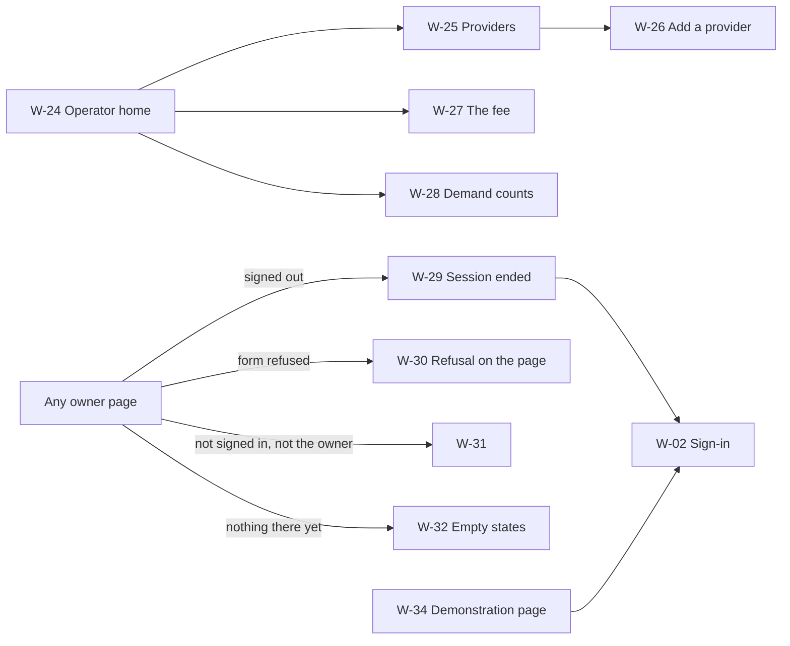

# Wireframes and prototype: APLYD MSME platform

Version 0.1. Date: 5 October 2026. Status: draft, not reviewed by a person.

This document shows what the application looks like today to the owner of a small manufacturing unit, page by page, with screenshots, and proposes what the owner's interface should be: the words, the order of the screens, the navigation and the layout, drawn for a phone first and a desktop second. It answers the sponsor's reaction on 5 October 2026 on opening the running application: "i dont under stand the ui ux at all. what does this app dp". The proposal is a design, not a decision. No owner has seen any of it, none of it has been tested with an owner, every company, person, provider and figure on every screen is SYNTHETIC, and no person has reviewed it.

How this relates to the other documents: the requirements it serves are BR-UX-01 to BR-UX-11 in the [business requirements](../brd/BRD.md); the pages it redraws are SCR-01 to SCR-09 and the messages it rewrites are MSG-01 to MSG-197 in the [functional specification](../fsd/FSD.md), whose TO BE rows FR-UX-05 to FR-UX-14 it would meet; the user and the five stages come from sections 1 and 3 of the [thesis](../thesis.md); the architecture it must not change is in the [high-level design](HLD.md); the words are to be fixed in the [glossary](../GLOSSARY.md); the sessions that would test it are in the [UAT plan](../test/UAT-PLAN.md) and the [ten-owner test](../ten-owner-test.md). The clickable prototype is [wireframes.html](wireframes.html), a single file that opens in any browser with no network.

## 1. How to read this document

### 1.1 Evidence tags and what is built

- [Certain] means read in the code, measured in the running application on 5 October 2026, or stated in a cited document. [Likely] is a strong inference. [Guessing] fills a gap and needs testing with owners.
- Part A (section 2) is about the application as it is and is [Certain] unless tagged. Part B (sections 3 to 11) is a design proposal. Almost all of it is [Guessing]: it is a set of judgements about what a small manufacturer will understand, and nobody who is such a person has been asked. The statements in Part B about what the application does today are [Certain] and cite the FSD.
- AS BUILT means the function exists in the code and the FSD cites it by an FR identifier. TO BE means it is not built. In the wireframes a TO BE element is shown only so the sponsor can judge it; it is labelled "not built yet" and carries the BR identifier that asks for it. Nothing marked TO BE may be shown to an owner as available.
- "Platform words" are the application's own terms for things (assessment, requirement, engagement, listing, baseline and others). Section 4 lists each with a proposed owner-facing wording.

### 1.2 Conventions in the wireframes

Each wireframe is a fenced block about 40 characters wide, which is a phone held upright, with a wider variant only where the layout genuinely differs. Each is labelled W-NN. A callout such as `<a>` points to a row of the table under the wireframe, which says what the element is, which FR identifier it maps to if it is built, or that it is TO BE and which BR identifier asks for it.

| Mark | Meaning |
| --- | --- |
| `[> Save <]` | The one main button of the screen |
| `[ Back ]` | A secondary button |
| `{link}` | A link |
| `(o)` and `( )` | A chosen and an unchosen radio button (one choice) |
| `[x]` and `[ ]` | A ticked and an unticked check box (many choices) |
| `[______]` | A text box |
| `(v)-(v)-[3]-(4)-(5)` | The journey strip: a stage done, the stage the person is at, stages not yet reached |
| `::text:: TO BE` | An element that is not built. Shown greyed and dashed in the prototype, with "not built yet" |
| `<a>` | A callout to the table under the wireframe |

Sample figures in the wireframes (names, rupee amounts, dates) are SYNTHETIC and illustrative. Where a figure is taken from the synthetic demonstration cast or the synthetic opportunity library (FSD appendix A) it is the figure the application shows.

## 2. The application as it is

### 2.1 What was captured

[Certain] On 5 October 2026 the built application in `dist/` was started with the launcher `scripts/serve.mjs` in demonstration mode (`APLYD_DEMO=true`, open access), on a local port. It was opened with Chromium through playwright-core 1.56.1 at two widths: 1,280 pixels (a desktop) and 390 pixels (a phone, as a mobile viewport). The pages were opened as the people the demonstration script at `/demo` names: no one for the home page and the sign-in page; SYNTHETIC Owner A (a company with a confirmed description and nothing else) for the home page, Describe and the first visit to Diagnose; SYNTHETIC Owner B (a company with nothing) for the new owner's Describe page; SYNTHETIC Owner C (the finished example, running) for Diagnose with a signed-off assessment, Procure, Delivery and Results; SYNTHETIC Operator for the operator page. The server was stopped afterwards.

The phone captures show a long page in full. The desktop captures show the top 1,700 pixels of a long page, because the desktop layout is one centred column of at most 40 rem and the rest would only repeat it. The images are reduced to a 48-colour palette so each stays under 250 KB, so colours are close to, not exactly, what a browser shows. The pictures are of the SYNTHETIC demonstration data and nothing in them is real.

[Certain] Measurements taken in the same run, at 390 pixels wide: no page scrolled sideways (the page's scroll width equalled the 390-pixel viewport on all 11 pages captured). Links are 20 pixels high, buttons 41, drop-down lists 37 and text boxes 39. A radio button or check box is 13 by 13 pixels inside a row 24 pixels high. The page heights on a phone are one screen for the home page, 5,440 pixels for Describe, 6,279 for Diagnose with five ideas, 3,757 for Procure, 2,068 for Delivery, 1,635 for Results and 3,901 for the operator page. These are one browser, one width and one run. They say nothing about a slow connection, a screen reader or a real phone.

### 2.2 What the sponsor saw, in order of importance

1. [Certain] No page says what the application is for. The sentence that comes nearest, "Describe, diagnose, procure, deploy and run technology for a small manufacturer", is in the page's hidden description tag (`app/layout.tsx`) and is never shown. The only place the five stages are described in plain words is `/demo`, which exists only when the application is started with `APLYD_DEMO=true` and is a presenter's script, not an owner's page. An owner who signs in meets five links with no explanation (BR-UX-01, BR-UX-02).
2. [Certain] The stages are named after the platform's pages and tables: "What to do about it", "What you need", "Delivery", "Results". Inside them the owner meets assessment, requirement, cluster, pool, engagement, milestone, review, fingerprint, library version and engine version. None is explained where it first appears (BR-UX-03). The page already says "starting number" where the code says baseline, so that one word of the BRD's list (BR-UX-03) is already plain.
3. [Certain] Much of the journey after the second stage is the owner keeping a record of what happens outside the service. The provider does not sign in and is not told anything; no offer or price arrives; no money moves; nobody other than a set of rules has checked the list of ideas; every number in Results is typed by the owner (BR-PROC-03, BR-PROC-07, BR-DEPL-05, BR-DIAG-06 and BR-RUN-08 are Not built). The pages say so, in long grey paragraphs at the top, which an owner is unlikely to read. A better interface cannot change this. The proposal in Part B states it on the page, at the point where an owner might assume otherwise, rather than hiding it.
4. [Certain] Two actions cannot be undone and the pages do not warn before them. Accepting the first part of the work before a starting number is recorded loses the starting number for good (MSG-140). Choosing a provider cannot be changed for that requirement (MSG-87, MSG-90, and OQ-15 is open). The first warning appears only after the damage; the second is discovered by trying.
5. [Certain] The page for the second stage is long and gives no summary. The figure "Orders delivered late: 10 to 30 percent" does not say whether it is a fall or a rise, because the library entry stores a measure, a unit and two numbers and no direction (`Benefit` in `modules/diagnose/src/library.ts`).
6. [Certain] A refusal before the person is known, such as a form posted after the session has ended, shows a line of JSON on an empty page (BR-UX-06 is Partial).
7. [Likely] An owner with a phone and a poor connection will find Describe, a 5,440-pixel page of 25 questions with no sign of progress, the hardest page to finish. Nothing was tested with a person.

### 2.3 Page by page

Each page shows the phone capture on the left and the desktop capture on the right.

#### 2.3.1 Home, signed out (SCR-01)

| Phone, 390 pixels | Desktop, 1,280 pixels |
| --- | --- |
|  |  |

| What an owner sees | What an owner cannot tell | Fails |
| --- | --- | --- |
| The title "APLYD MSME platform", the sentence "You are not signed in." and a link "Sign in" | What the platform is, who it is for, what it does for a factory, what signing in leads to, whether it costs anything. "MSME platform" is a policy term; the owner of a unit may not call the business an MSME | BR-UX-01 (no purpose, and no reason for the one action), BR-UX-03, BR-UX-04 |

#### 2.3.2 Sign-in (SCR-02)

| Phone | Desktop |
| --- | --- |
|  |  |

| What an owner sees | What an owner cannot tell | Fails |
| --- | --- | --- |
| "Synthetic environment: choose a synthetic user. There is no password." and a drop-down list of eight names with a role in brackets: the operator and owners A to G | Who each person is, which to choose, what "synthetic" means, how a real owner would sign in (OQ-13), and how to go back: the page has no link to anything but the button | BR-UX-01, BR-UX-03 |

#### 2.3.3 Home, signed in as an owner (SCR-01)

| Phone | Desktop |
| --- | --- |
|  |  |

| What an owner sees | What an owner cannot tell | Fails |
| --- | --- | --- |
| "Signed in as SYNTHETIC Owner A" with a tag "owner"; a card with the company's name and "Record created 2026-10-04."; five links in a column (Describe your factory, What to do about it, What you need, Delivery, Results); a Sign out button | That the five links are five stages in a fixed order, which to press first, where the owner has got to, and what "company record" is for. The links are 20 pixels high on a phone | BR-UX-02 (this page is the requirement), BR-UX-01, BR-UX-03; BR-UX-05 is Unverified and this is a measurement toward it |

#### 2.3.4 Describe your factory (SCR-03)

| Phone (full page, 5,440 pixels) | Desktop (top 1,700 pixels) |
| --- | --- |
|  |  |

| What an owner sees | What an owner cannot tell | Fails |
| --- | --- | --- |
| A form of 25 questions in five boxes, "About your unit", "How work gets done", "What you use today", "What is hurting most", "What you can spend and decide"; an optional note; two buttons, "Save as draft" and "Confirm this is accurate"; "Earlier versions" | How many questions there are or how long this takes; which five are needed before "Confirm" works (they are not marked); what a "version" or a "draft" is; what confirming leads to (no link to the next stage appears afterwards); how far through they are | BR-UX-01, BR-UX-03, BR-UX-07 (the five needed questions are unmarked); BR-UX-05 is Unverified (a 5,440-pixel page; radio rows 24 pixels high) |

The new owner's view, and what happens when an owner presses "Confirm this is accurate" on an empty form:

| Phone, new owner, empty | Phone, after Confirm on an empty form |
| --- | --- |
|  |  |

| What an owner sees | What an owner cannot tell | Fails |
| --- | --- | --- |
| "Nothing was saved, because some answers could not be accepted. Please check them and save again." above an empty form (MSG-23). The desktop captures are [13](screens/as-is/13-factory-new-owner-desktop.png) and [14](screens/as-is/14-factory-confirm-refused-desktop.png) | Which answers, since none was typed and no question is named; that five questions are needed; what to do now | BR-UX-06 (Partial: the message gives no way forward), BR-UX-07 |

#### 2.3.5 What to do about it (SCR-04)

The first visit (Owner A), then a made and signed-off assessment (Owner C).

| Phone, first visit | Desktop, first visit |
| --- | --- |
|  |  |

| What an owner sees | What an owner cannot tell | Fails |
| --- | --- | --- |
| "Your confirmed description is version 1, saved 2026-10-04.", a button "Make an assessment from version 1", and "Your assessments: None yet." | What an assessment is, what it will contain, who makes it, whether pressing the button costs anything or can be undone | BR-UX-01, BR-UX-03 |

| Phone, assessment signed off (full page, 6,279 pixels) | Desktop (top 1,700 pixels) |
| --- | --- |
|  |  |

| What an owner sees | What an owner cannot tell | Fails |
| --- | --- | --- |
| "Assessment from version 1 of your description"; a line "Drafted by a set of rules ... not by an AI model ... Library version 1, engine version 1."; five idea cards, each with tags, a summary, "Why it is here", "What it could do", three costs, hidden costs, "Do first", the risk and a source; then "How the ideas were ranked", "Ideas left out (2)" and "Signed off" with a 16-character fingerprint | What the page adds up to (there is no summary); what "Uses AI" means; whether "10 to 30 percent" is a fall or a rise; that a decision is not final until the sign-off (before it, each idea has its own save button); what "sign off", "fingerprint", "library version" and "engine version" mean | BR-UX-03, BR-UX-01, BR-UX-05 (Unverified; 6,279 pixels) |

#### 2.3.6 What you need (SCR-05)

| Phone (full page, 3,757 pixels) | Desktop (top 1,700 pixels) |
| --- | --- |
|  |  |

| What an owner sees | What an owner cannot tell | Fails |
| --- | --- | --- |
| A note that "No quote, price, contract or payment exists here: this only records what you are asking for"; "Ideas you accepted", each with a drop-down "Which cluster do you ask in?" (SYNTHETIC cluster 1, 2, 3) and a button "Make a requirement from <idea>"; "Your requirements" with a pool sentence, "Providers listed for this" and "You chose SYNTHETIC Provider 1. Go to delivery" | What a requirement, a cluster, a pool or an engagement is; that nobody is told and nothing is bought when "Make a requirement" is pressed; that choosing a provider cannot be changed afterwards (found out only by trying, MSG-90) | BR-UX-03, BR-UX-01 |

#### 2.3.7 Delivery (SCR-06)

| Phone (full page, 2,068 pixels) | Desktop |
| --- | --- |
|  |  |

| What an owner sees | What an owner cannot tell | Fails |
| --- | --- | --- |
| A paragraph of about a hundred words saying the page is the owner's own record and the provider "does not use this service and has not seen any of it"; one card with status tags, the provider, "Plan total ₹2,00,000. Payments you have recorded: ₹1,25,000.", two milestones with states, their tests and history lines, "Accept milestone 2", "Reject milestone 2" and "Close this engagement" | That "Delivered" means the owner recording what the provider said; what an engagement or a milestone is; the order of steps; that accepting the first milestone before a starting number exists loses the number for good. Dates are typed as YYYY-MM-DD, which is hard on a phone | BR-UX-03, BR-UX-01; BR-UX-05 Unverified |

#### 2.3.8 Results (SCR-07)

| Phone (full page, 1,635 pixels) | Desktop |
| --- | --- |
|  |  |

| What an owner sees | What an owner cannot tell | Fails |
| --- | --- | --- |
| A paragraph of about a hundred words; "What the assessment expected: Orders delivered late, 10 to 30 percent"; "Starting number: 42 percent"; "Review 1: 30 days after, Opens on 2026-11-04", the same for 90 and 180 days; "Next in your plan" | What a review is for; that nothing here is measured; that no message will tell the owner when a review opens (BR-RUN-07 is Not built); that the dates are UTC dates; what to do now | BR-UX-03, BR-UX-01, BR-UX-07 (Partial) |

#### 2.3.9 Providers and the listing fee (SCR-08), the operator

| Phone (full page, 3,901 pixels) | Desktop (top 1,700 pixels) |
| --- | --- |
|  |  |

| What the operator sees | What the operator cannot tell | Fails |
| --- | --- | --- |
| The listing fee in force (₹1,500, a placeholder) and a form to change it; a form to add a provider with 17 check boxes for the ideas it serves and three for clusters; each provider with its fee, a summary and what it serves; "Pools you can take to providers" with "5 companies" | That nothing can be taken to providers (the heading suggests an action, and BR-PROC-03 is Not built; FSD section 12, item 18); what to do first; that the page is the only place the fee appears | The BR-UX requirements are written for owner pages; the heading is misleading (FSD 12.1, item 18) |

#### 2.3.10 Demonstration (SCR-09)

| Phone (full page, 6,406 pixels) | Desktop (top 1,700 pixels) |
| --- | --- |
|  |  |

| What a presenter sees | Observation | Fails |
| --- | --- | --- |
| "The people" (the operator and companies A to G, each with where it is in the journey), "The walk" (eight steps, about 15 minutes), "What this does not show" (seven limits) and "Starting again" | This page is for a presenter and not for an owner. It is the only page that describes the journey in plain words and says what is not built, and it exists only with `APLYD_DEMO=true`. The FSD records no BR-UX gap against it | None recorded |

#### 2.3.11 Two states a form can leave an owner in

| Phone, a stage page, signed out | Phone, a form posted after the session ended |
| --- | --- |
|  |  |

| What an owner sees | What an owner cannot tell | Fails |
| --- | --- | --- |
| Left: one sentence, "Sign in to see your requirements." with a link (MSG-76). Right: the line `{"error":"not_signed_in"}` on an empty page (MSG-11), the answer to "Make an assessment from version 1" pressed after the session cookie was removed. The session lasts 8 hours (RULE-01). The desktop captures are [12](screens/as-is/12-stage-page-signed-out-desktop.png) and [15](screens/as-is/15-expired-session-json-desktop.png) | Left: what the page is for, and why the owner must sign in. Right: that they were signed out, that nothing they typed was kept, and what to do | Left: BR-UX-01. Right: BR-UX-06 |

### 2.4 Which requirements the pages fail

[Certain] This is read from the pages and the FSD (section 5, each screen's "Gaps"), not tested with owners. "Fail" means the requirement's own wording is not met by the page; "unverified" means the BRD says so and the measurements in section 2.1 are the only evidence.

| Page | BR-UX-01 purpose and next step | BR-UX-02 journey view | BR-UX-03 plain words | BR-UX-04 own language | BR-UX-05 phone | BR-UX-06 refusals | BR-UX-07 empty states |
| --- | --- | --- | --- | --- | --- | --- | --- |
| Home, signed out | fail | not applicable | fail | fail | no sideways scroll at 390 | not applicable | not applicable |
| Sign-in | fail | not applicable | fail | fail | no sideways scroll at 390 | JSON for a missing secret | not applicable |
| Home, owner | fail | fail | fail | fail | 20-pixel links | not applicable | not applicable |
| Describe | fail | not applicable | fail | fail | long page | partial | fail (needed questions unmarked) |
| Diagnose | fail | not applicable | fail | fail | long page | partial | partial |
| Procure | fail | not applicable | fail | fail | unverified | partial | partial |
| Delivery | fail | not applicable | fail | fail | typed dates | partial | partial |
| Results | fail | not applicable | fail | fail | unverified | partial | partial |

BR-UX-08 (every synthetic page carries the SYNTHETIC banner and tag) is Built and holds on every page captured. BR-UX-09 (WCAG 2.1 level AA) is Unverified and nothing in this document measures it; BR-UX-10 (take it away) and BR-UX-11 (the channel the owner uses) are Not built and Open.

## 3. Design principles

[Guessing] Every principle below is a judgement drawn from the BRD's UX requirements and the thesis's description of the owner (thesis sections 1 and 3: someone who does not know how to use AI, assess gaps, procure or deploy, and who is small). None has been checked with an owner. Each is tied to the requirement it serves, and each is carried out in specific wireframes.

| No. | Principle | What it means on a page | Serves | Seen in |
| --- | --- | --- | --- | --- |
| 1 | Every page says what it is for and has one main button | Under the title, one plain sentence that says what the page is for. One main button for the next step, drawn larger than the rest. Any other action is plainer and lower | BR-UX-01 | Every owner wireframe |
| 2 | The journey is always visible | A strip of the five stages is at the top of every owner page: numbered, in plain words, with each stage shown as done, here, or not yet, and each one tappable. The home page is this strip plus the one next step | BR-UX-02 | W-00, W-03 to W-05D |
| 3 | The owner is never asked to learn a platform word | Section 4 gives the replacement for each word. Where a word cannot be avoided (AI, for one), a plain sentence explains it where it first appears, and a "Words we use" page holds all of them | BR-UX-03 | W-11, W-12, W-33 |
| 4 | Every number says what it is | A number carries its unit or its rupees and what it measures: "Pay once ₹20,000 to ₹80,000", "42 percent of orders were late". A figure from the synthetic library says it was made up for testing. No bare "10 to 30" | BR-UX-03, BR-UX-08, BR-RUN-03 | W-11, W-12, W-18, W-22 |
| 5 | The owner can always see what happens next and who does it | Each stage page ends its first screen with "What happens next" and "Done by". Where the honest answer is "you, noting what the company told you", it says that | BR-UX-01, BR-UX-02 | W-03 to W-05, W-14 to W-22 |
| 6 | Say what the service does not do, where the owner might assume it does | On the page where a company is chosen: "This does not contact the company." Beside a payment: "This service does not move money." These sentences are short and next to the button, not in a grey paragraph at the top | BR-UX-01, BR-UX-08 | W-15, W-16, W-18, W-19 |
| 7 | Nothing unbuilt is shown as available | Voice, photos, a language switch, offers, reminders, a person who checks, printing and the like are drawn in the prototype as dashed boxes marked "not built yet" and with their BR identifier. In the product they would not appear until they work | BR-UX-08 and BRD section 1.3 ("built" means it exists and a test exercises it) | W-01, W-06, W-11, W-15, W-22 |
| 8 | A refusal says what happened and what to do next | On the page the person was on, in plain words, naming the field or step, with a link or button that fixes it. A refusal is never a line of JSON. The refusal is announced to a screen reader as it is today (`role="alert"`) | BR-UX-06 | W-29, W-30 |
| 9 | An empty or waiting page says what will appear and what causes it | A page with nothing on it says what will be here, what the owner has to do to cause it, and who does it. A page that waits on someone else says who and that no message will be sent | BR-UX-07 | W-10, W-32 |
| 10 | Phone first | One column. Every control at least 44 pixels high and wide. No sideways scrolling. No script needed to use a page (as today, no page uses a client component). Dates picked, not typed. No images | BR-UX-05 | All, W-17, W-19 |
| 11 | Small pieces, nothing lost | Describe is five parts, one at a time, each saved when the owner moves on, so a dropped connection loses one part at most. Every save is a version and nothing is overwritten, as built | BR-UX-05, BR-DESC-02, BR-DESC-03 | W-06 to W-09 |
| 12 | Warn before what cannot be undone | Before the first part is passed, say that a starting number can no longer be written afterwards. Before a company is chosen, say that the choice stays for this request | BR-UX-01, BR-UX-06 | W-16, W-19 |
| 13 | Never show what the rules hide | A pool is shown only from five companies, and then as "at least 5", "at least 10". The listing fee is shown to the operator and to nobody else. Providers are listed in name order and nothing else. No page says a company is approved, verified, certified, trusted or recommended, because the platform certifies nothing | BR-GOV-06, BR-COM-02, BR-PROC-06, BR-GOV-03 | W-15, W-25, W-27, W-28 |
| 14 | Mark what is made up | The SYNTHETIC banner is on every screen and each library figure says it was made up for testing | BR-UX-08 | Every wireframe |
| 15 | Built so it can be translated and reached by another channel | All owner text sits in one place, with no text in images and room for longer words; each step is small enough to say aloud or send as a message. Which languages and channels is not decided | BR-UX-04, BR-UX-11, OQ-17 | W-01, W-06 |
| 16 | Accessible by construction, not claimed | Labels, order, focus and contrast are designed in (section 8). No conformance is claimed: BR-UX-09 is Unverified | BR-UX-09 | Section 8 |
| 17 | Take it away | An owner can print or save the list of ideas and the work plan to show a family member or a bank. Not built | BR-UX-10 | W-22 |

## 4. The plain-language term map

[Guessing] This is a proposal and not a decision. It replaces each platform word with the words an owner might use, and gives the one-line meaning that would appear where the word first has to be used. None of it has been tested with an owner. The words marked "test" in the last column are the ones most likely to be misread and should be put to owners first (section 9). All wording is English. Whether owners get another language first, and which, is OQ-17; a translation needs its own test because a word that is plain in English may be a borrowed English word or a different thing in another language.

The terms to avoid on an owner page are: certified, approved, verified, trusted and recommended (the platform certifies nothing, C-01, and a provider on the list has not been vetted, BR-PROC-09 being Not built); and any word that suggests a fee or a ranking by money (D-03).

| Platform word, and where it appears today | Proposed owner wording | One-line meaning | Test |
| --- | --- | --- | --- |
| Describe, Diagnose, Procure, Deploy, Run (the five stages; the thesis's words) | Your factory; What could help; Who will do it; Getting it done; Did it work | The five steps, in the order an owner takes them | test |
| Description, questionnaire (Describe) | Your answers about the factory | What you told us about the unit | |
| Version, newest version (Describe) | Saved copy, latest copy | Each time you save, a new copy is kept and the old ones stay | test |
| Draft (Describe) | Not final yet | Saved, but you have not said it is right | test |
| Confirm this is accurate | Yes, this is right | You tell us your answers are correct and ready for the next step | |
| Assessment (Diagnose) | Your list of ideas | The ideas that match your problems, best first | test |
| Idea (the library's "opportunity") | Idea | Something you could do about a problem | test |
| Uses AI, No AI needed | Uses AI, No AI needed | AI here means software that finds patterns in your records; the tag is kept and explained once | test |
| Library version, engine version | Our list of ideas, our set of rules | Where the ideas and the order come from; shown under "How this list was made" | |
| Sign off | Confirm my choices | You have read every idea and the choices are yours; after this nothing on the list changes | test |
| Fingerprint | Check code | A short code that changes if anyone alters the list after you confirmed it; shown under "For your records" | |
| Source: an assumption (SYNTHETIC) | Where the numbers come from: we made them up for testing | There is no source yet; the figures are not advice | |
| One-time cost; Every year after; First year in all | Pay once; Pay each year after; First year, all together | What it costs, in rupees | |
| Hidden costs to expect | Costs people forget | Costs that are not on the price tag | |
| Do first (prerequisite) | Do this first | What has to be true before the idea is worth doing | |
| The risk | What could go wrong | The main way the idea fails | |
| Requirement (Procure) | Request | What you are asking for | test |
| Cluster | Your group of factories | Factories like yours near you that ask for the same things together; what a cluster really is waits on OQ-03 | test |
| Pool; floor of five | Others asking for the same thing; no number below 5 | How many factories in your group have asked; we show no number below 5, to protect the factories that asked | test |
| Provider | The company that will do the work | A company on our list that does this kind of work | test |
| Listing, listed (Procure and the operator) | On our list | The operator has added the company to the list of companies owners can choose from. It does not mean we checked it | test |
| Listing fee | Not shown to owners | Operator only; it is the same for every company and does not change what APLYD earns | |
| Engagement | The job | Your work with the company you chose | test |
| Plan, milestone (Deliver) | Work plan; part of the work | A list of parts, each with what is delivered, how you will check it, a date and a price | test |
| Acceptance test | How you will check it | What you will look at to decide the part is done | |
| Delivered | The company says it is done | You note that the company told you the part is finished | test |
| Accept, Reject | It passed my check; It did not pass | Your decision on a part, against your own check | |
| Payment recorded | I paid (note it) | You note an amount you paid yourself; this service moves no money | |
| Close; Complete; Ended early | Finish this job; Finished, every part passed; Stopped early | How the job ended | |
| Baseline (Run; the page already says "starting number") | Starting number | One number that says how things are now, written down before the work, so the change can be shown | |
| Review, verdict (Run) | Check-up; Did it do what we expected? | A look at 30, 90 and 180 days after the first part passed | test |
| Outcome | Result | What happened, in your own number | |
| Gap assessment (TO BE, BR-DIAG-08) | What stands between you and each idea | Where the unit stands on data, people, systems, money and quality | |
| Financing model (TO BE, BR-DIAG-10) | How you pay | Buy it, pay each month, pay as you use, or pay when it works | test |
| SYNTHETIC | Made up for testing | The word SYNTHETIC stays on every page; "made up for testing" explains it | |
| MSME platform | APLYD, this service | The platform is never called an MSME platform to an owner | |
| Session | Signed in | "You were signed out", not "your session expired" | |
| Operator | Not shown to owners | APLYD staff who keep the list of companies | |

## 5. Information architecture and navigation

### 5.1 The screens and how they connect

### 5.2 The journey strip

The strip is on every owner screen, under the title bar and above the page's own title. It is a list of five buttons, each a number and a plain name. On a phone the numbers are shown and the name of the stage the owner is at is written under them; on a desktop every name is shown.

| State of a stage | How it looks | What a tap does |
| --- | --- | --- |
| Done | Number replaced by a tick, name in plain weight | Opens that stage's page showing what was done |
| Here | Number in a solid mark, name in bold, "You are here" for a screen reader | Opens the stage's page at its first screen |
| Not yet | Number in an outline, name greyed, "Opens after step N" | Opens that stage's page, which answers with its empty state (W-32). This is what the built pages already do (FSD section 3.1): they answer with a sentence that names what is missing, so the strip never leads to an error |

[Certain] The built records can answer each of these states: step 1 is done when a version is confirmed (FR-DESC-04), step 2 when an assessment is signed off (FR-DIAG-08), step 3 when a provider is chosen (FR-DEPL-01), step 4 when an engagement is closed with every part accepted (FR-DEPL-06), and step 5 when the three check-ups are recorded (FR-RUN-02). Steps 3 to 5 are per idea, not per company, which section 5.3 deals with.

### 5.3 What the home page becomes

[Guessing] The home page becomes one view of the journey and nothing else: the company's name, the strip, one card for the one next step with its button, a line saying what happens after it and who does it, and below that a short list of the owner's ideas and where each is.

Steps 1 and 2 happen once for the company. From step 3 each idea an owner says yes to has its own request, its own company, its own plan and its own check-ups, so an owner with three ideas has three jobs at three different stages. The strip shows the idea in focus, which is the one the rule in section 5.4 picks. The list below the card shows every other idea with its own stage in words ("You said yes; not asked for yet", "Company chosen; plan not written"). This is the part of the design most likely to need a change after owners see it: one strip for several jobs is a simplification.

Where W-03, W-04 and W-05 differ is in which stage is current and what the one button says:

| Wireframe | The owner is | The strip | The one button |
| --- | --- | --- | --- |
| W-03 | New: nothing saved | Stage 1 here | Start |
| W-04 | Plan agreed, no starting number yet | Stages 1 to 3 done, stage 4 here | Write your starting number |
| W-05 | Running: a part waits for the owner's decision | Stages 1 to 3 done, stage 4 here, stage 5 started | Decide on part 2 |

### 5.4 The rule for the one next step

[Guessing] The home page picks one next step from the records, by the first row that is true. The rule is a proposal and is a pure function of records the application already reads through the scope rule (FR-ID-07). Rows 1 to 4 are the stages that happen once; rows 5 to 12 apply to the idea in focus, and when several ideas are in progress the first row that is true for any of them wins, which puts a company waiting on the owner ahead of everything else.

| Row | If this is true | The button says | Who does the next thing | Built from |
| --- | --- | --- | --- | --- |
| 1 | Nothing saved, or the newest copy is a draft | Start, or Continue telling us about your factory | You | FR-DESC-03, FR-DESC-04 |
| 2 | Answers confirmed and no list of ideas for that copy | Make my list of ideas | A set of rules makes it; you read it | FR-DIAG-01 |
| 3 | A list exists and an idea has no decision | Decide on the ideas (3 of 5 decided) | You | FR-DIAG-07 |
| 4 | Every idea decided and the list not confirmed | Confirm my choices | You | FR-DIAG-08 |
| 5 | A part is delivered and waits for the owner, and a starting number is already recorded | Decide on part N | You | FR-DEPL-04 |
| 6 | A part is delivered, no part has passed, and no starting number is recorded | Write your starting number first | You | FR-RUN-01 |
| 7 | A plan is agreed, nothing has passed, and no starting number is recorded | Write your starting number | You | FR-RUN-01 |
| 8 | A check-up has opened and is not recorded | Record check-up N | You | FR-RUN-02, FR-RUN-03 |
| 9 | A request exists, no company is chosen, and at least one company is on the list for it | Choose who will do it | You | FR-PROC-11, FR-DEPL-01 |
| 10 | A company is chosen and no plan is agreed | Write your work plan | You | FR-DEPL-02, FR-DEPL-03 |
| 11 | A plan is agreed and nothing has been delivered | Open your work plan (waiting for the company) | The company; you note what it tells you | FR-DEPL-04 |
| 12 | An idea was said yes to and has no request | Ask for the next idea | You | FR-RUN-06, FR-PROC-02 |
| 13 | None of the above | No button: "Nothing to do now. The next check-up opens on <date>." | Nobody yet | FR-RUN-03 |

A request with no company on the list yet is not an action for the owner. The card says "No company is on our list for this yet. Nothing for you to do; look again later. We will not send a message (not built yet, BR-RUN-07 is the nearest requirement)", and the rule moves on to the next row.

### 5.5 What each stage page shows first

| Stage page | First, in order | The main button | What happens next, and who does it |
| --- | --- | --- | --- |
| Your factory (W-06 to W-09) | Title; one sentence of purpose; "Part N of 5" and a progress bar; the questions of that part with the needed ones marked | Save and continue | When the answers are confirmed, a set of rules makes a list of ideas. Done by you, then the rules |
| What could help (W-10 to W-13) | Title; one sentence of purpose; "In short" with the problems the owner named and the number of ideas; then ideas best first as cards with their cost and benefit; how many are decided | Open this idea; then Confirm my choices | After confirming, you ask for the ideas you said yes to. Done by you |
| Who will do it (W-14 to W-16) | Title; one sentence of purpose; the ideas the owner said yes to; for a request, how many others ask for the same (only from five) and the companies on the list in name order | Ask for this; then Choose this company | A work plan is written with the company. This service does not contact the company: you do |
| Getting it done (W-17 to W-20) | Title; one sentence of purpose; the job, its status and the plan total; the parts with their states | Depends on the state: Add this part; Agree the plan; It passed my check | The company does the work and tells you. You note it and check it. The company is not in this service yet |
| Did it work (W-21 to W-23) | Title; one sentence of purpose; the number expected; the starting number; the three check-ups with their dates; the change | Write your starting number; Save check-up N | A check-up opens 30, 90 and 180 days after the first part passes. No message will tell you; you come back |

### 5.6 Navigation and page titles

- A title bar on every owner page: the word APLYD (a link to the home page) and a Menu button that opens three links: Home, Words we use and Sign out. [Guessing] Three links need no menu on a desktop, where they sit in the bar.
- A footer on every owner page: Words we use, and the SYNTHETIC note.
- Back is the browser's back button. A page never traps the owner: the sign-in page gets a link to the start, as the built sign-in page has none (FSD section 3.2).
- Each page's browser title says the step and the page, for example "Step 2 of 5: See what could help - APLYD". Today every page has the same title, so several open tabs cannot be told apart (FSD section 5.1). This also serves BR-UX-01.
- After a form is posted the owner returns to the same page with a message at the top (as built, FR-UX-02), and when a stage is finished the page ends with the one button for the next stage. Today no page sends the owner on (FSD section 3.1).
