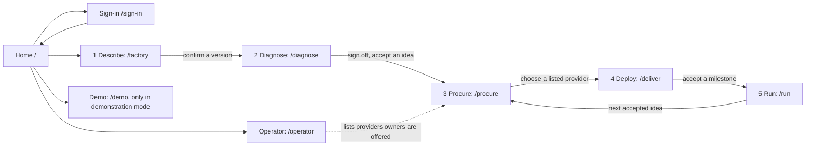
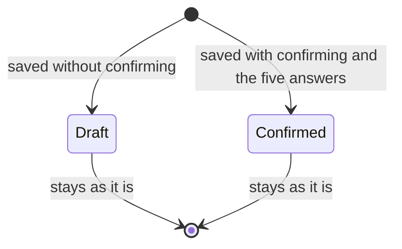
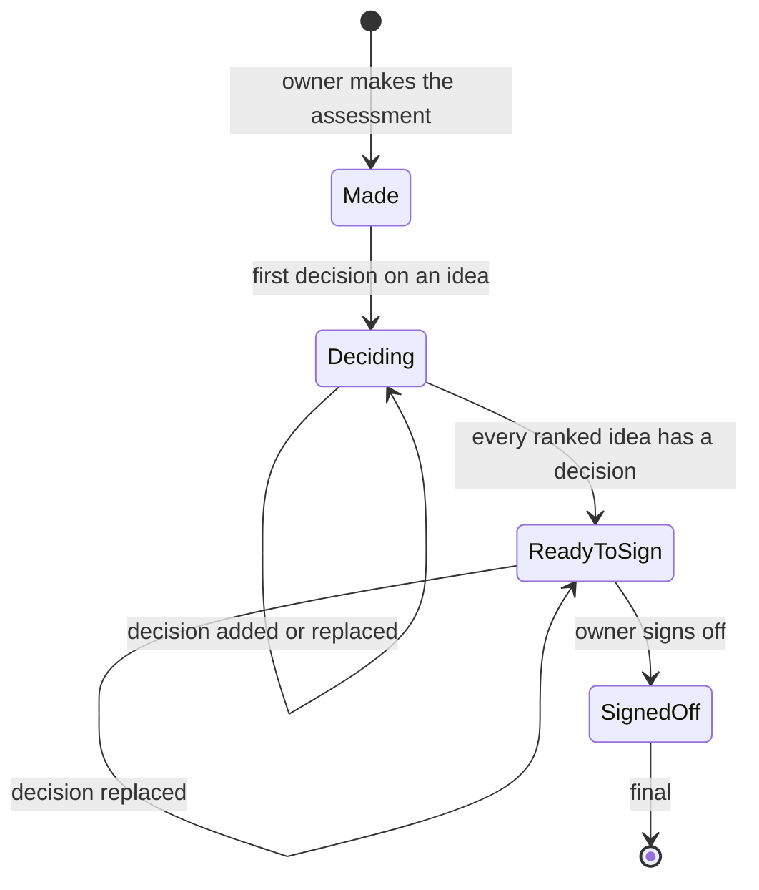
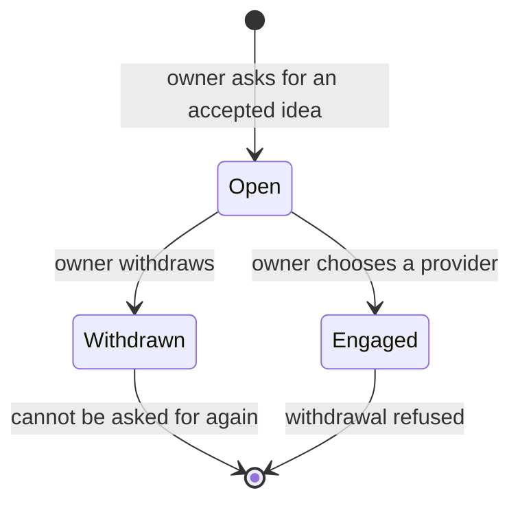
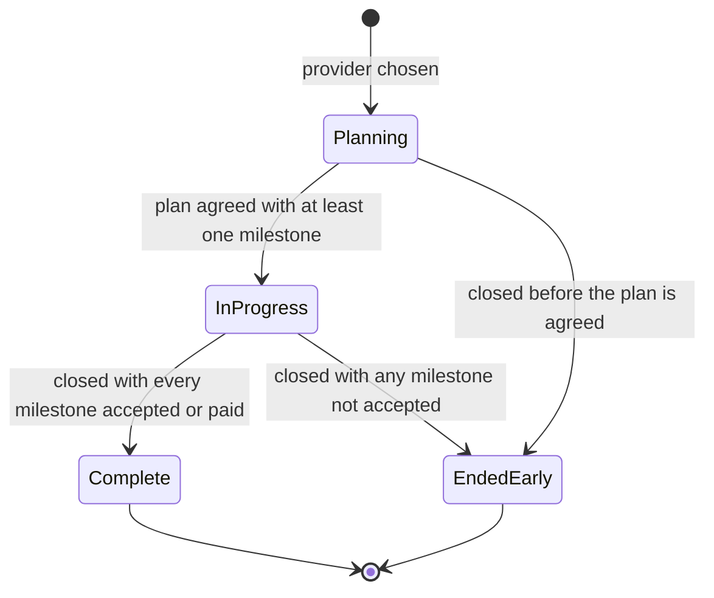
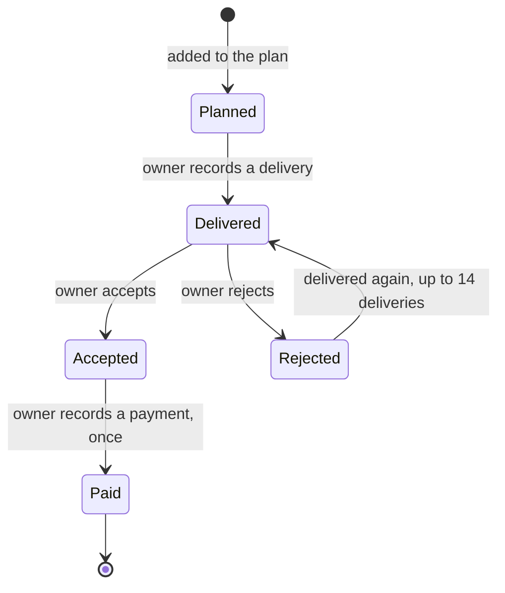
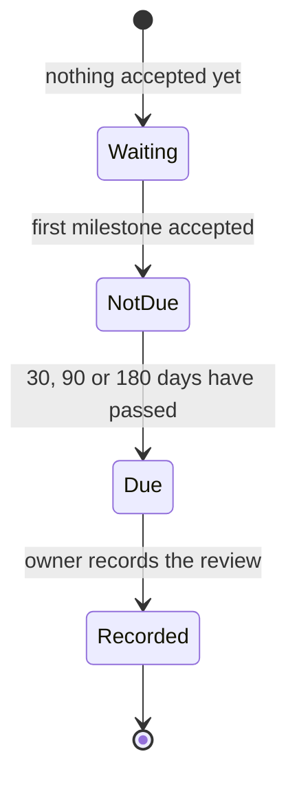
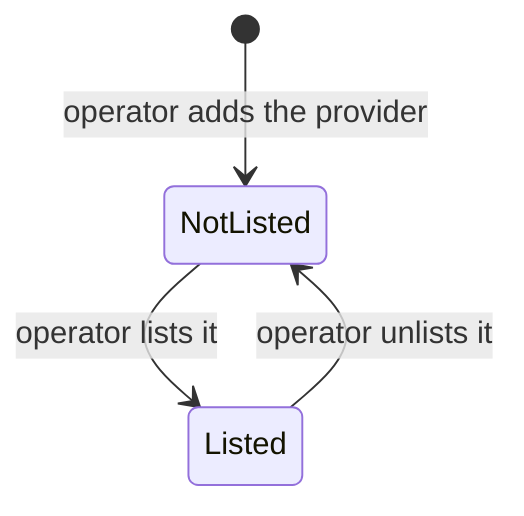

# Functional specification document: APLYD MSME platform

Version 0.1. Date: 5 October 2026. Status: draft, not reviewed by a person.

This document says what the APLYD MSME platform does, function by function and screen by screen, and what it would have to do to meet the business requirements that are not yet built. Behaviour that exists in the code on 5 October 2026 is marked AS BUILT or PARTIAL and was read in the source. Behaviour that the business requirements call for and the code does not do is marked TO BE. Every company, person, provider, figure and rule in the application is SYNTHETIC. No person has reviewed the code or this document, and no function in it has been accepted.

How this relates to the other documents: the requirements come from the [business requirements document](../brd/BRD.md) (116 requirements, referred to here as BRs). This document is read with the [documentation index](../DOCUMENTATION-INDEX.md) and the [glossary](../GLOSSARY.md). It is refined by the [high-level design](../design/HLD.md), the [low-level design](../design/LLD.md), the [wireframes](../design/WIREFRAMES.md) (also as [HTML](../design/wireframes.html)), the [data dictionary](../design/DATA-DICTIONARY.md), the [API reference](../design/API-REFERENCE.md) and the [security and privacy document](../design/SECURITY-AND-PRIVACY.md). The [test strategy](../test/TEST-STRATEGY.md), [test scenarios](../test/TEST-SCENARIOS.md), [test cases](../test/TEST-CASES.md) and [traceability matrix](../test/TRACEABILITY.md) check it, and the [runbook](../ops/RUNBOOK.md) covers running the demonstration host.

## 1. Introduction

### 1.1 Purpose and scope

The platform takes a small manufacturer through five stages: Describe, Diagnose, Procure, Deploy and Run. This document specifies, for each stage and for the operator, the demonstration and the hosting gate:

- who may do what, and what everyone else is shown or told;
- each function, with the rules it applies, the records it writes and the messages it gives;
- each screen, field by field;
- the state each kind of record can be in, and which states are stored and which are worked out on each read;
- the functions the BRD asks for that do not exist yet, with the decision or open question that blocks each.

It does not describe the architecture (see the high-level design), the code structure (low-level design), the tables and columns (data dictionary) or the test cases (test documents). Where it needs one of those it points to it.

### 1.2 Audience

Developers who continue the build need to find, without reading the code, what a function must do, which limit applies and which message appears. Testers need an exact statement of each rule and message. The sponsor needs to see which requirements have a function behind them and which wait on a decision. Reviewers need the discrepancies in section 12.

### 1.3 Conventions

| Term | Meaning in this document |
| --- | --- |
| AS BUILT | The function exists in the code on 5 October 2026 and was read in the source for this document. The author did not run the application, a browser or the tests. A passing test is not claimed. |
| PARTIAL | Part of what the requirement asks for is built. The row says which part is missing. |
| TO BE | Not built. The row outlines the function the BRD calls for, names the actors, and names the open question or decision that blocks it. It is an outline, not a design. |
| SYNTHETIC | Invented for testing. No real company, person, provider, rule, price or figure exists in the application. |
| BR-AREA-NN | A business requirement in the BRD. Areas: GOV, ID, DESC, DIAG, PROC, DEPL, RUN, OPS, UX, DATA, COM, NFR. |
| FR-AREA-NN | A functional requirement of this document. Numbers are contiguous within an area and never reused. The AS BUILT and PARTIAL rows of an area come first (section 4) and its TO BE rows follow in the same numbering (section 10). |
| UC-AREA-NN | A use case. SCR-NN: a screen. RULE-NN: a business rule. MSG-NN: a message a person can see. |
| D-nn, P-nn, C-nn, OQ-nn, S-numbers | Decisions, proposals, carried-forward positions, open questions and sources, as defined in the repository's decision, open-question and source registers. |
| [Certain], [Likely], [Guessing] | Evidence tags. [Certain] means read in code or in a cited source. [Likely] is a strong inference. [Guessing] fills a gap and needs testing. An untagged statement about behaviour is [Certain] unless the surrounding text says otherwise. |

Other conventions:

- File paths and constant names are in code spans, for example `modules/factory/src/questionnaire.ts` and `REQUIRED_TO_CONFIRM`. They are not links.
- Quoted messages are copied from the code. Where the code builds a message from a constant, the row gives the template and the value.
- Money is written in rupees with Indian digit grouping, for example ₹1,500. Dates on pages are the first ten characters of an ISO timestamp in UTC.
- A "member" is a signed-in person whose user record has a company and a role other than owner. See section 2.
- A "form post" is a request from an HTML form on a page. A "program" is any other client that sends JSON.

### 1.4 How the specification was made

[Certain] The author read the source of every module (`modules/*/src`), every page and route in `app/`, `worker/index.ts`, the migrations in `drizzle/`, the launcher `scripts/serve.mjs`, and the status page of each module. Where a status page and the code disagree the code is taken as the authority and the disagreement is recorded in section 12. The BRD's status words (Built, Partial, Not built, Open, Unverified) are taken from the BRD and are not re-assessed here, except where the code shows something the BRD does not say.

### 1.5 What every function must keep true

These come from the decisions and positions in the repository and from the BRD. Each FR below keeps them, and a TO BE function must keep them too.

- APLYD's earnings never vary with which vendor an owner chooses (D-03). No ranking, ordering or display depends on a fee. The listing fee is shown to the operator only, and no fee is decided: ₹1,500 in the demonstration is a placeholder.
- No aggregate figure is published from fewer than five companies (C-04). A company counts once in a pool.
- One company's data is never visible to another company or to the operator. The operator's role does not override a company's scope.
- The platform does not certify a factory or product (C-01), does not build products listed in a registry it runs (C-02) and does not sell company data (C-03).
- No money moves through the platform. A payment on a delivery is a number the owner types about a payment made elsewhere.
- Confirmed records, revisions, audit entries and applied migrations are never edited or deleted. A correction appends.

## 2. Actors and permissions

### 2.1 Actors

| Actor | Who | How the application knows | What they can do today | Status |
| --- | --- | --- | --- | --- |
| Visitor | Anyone without a valid session | No cookie, a cookie that does not verify, an expired token, or a token whose user record no longer exists | See the home page and the sign-in page, see the "sign in" prompt on each stage page, sign in as a synthetic person, read `/api/health` | AS BUILT |
| Owner | A person whose user record has a company and the role `owner` | Session cookie, then the user record | Use the five stage pages and every company function for their own company | AS BUILT |
| Member | A person whose user record has a company and a role other than `owner` | The same | Read their company's records through the programming interface. Every stage page tells them it is for the owner. Every change is refused with 403. No such person exists in the seed, and no function creates one. The tests insert one with the role `viewer` | AS BUILT in code, never reached through a page |
| Operator | A person whose user record has the role `operator` and no company | The same | Use the operator page and the operator functions. Read no company's record | AS BUILT |
| Provider | A vendor, integrator or consultant | Not applicable: providers are rows entered by the operator and do not sign in | Nothing. The owner records what a provider said (OQ-13, OQ-19) | TO BE (BR-ID-09, BR-DEPL-05) |
| Advisor or checker | A person other than the owner who checks a plan | Not applicable: the role does not exist | Nothing (OQ-08, OQ-18) | TO BE (BR-ID-08, BR-DIAG-06, BR-RUN-06) |
| Cluster or association body | An association that brings owners together | Not applicable: a cluster is a text label | Nothing (OQ-03) | TO BE (BR-PROC-11) |

The synthetic cast. `modules/platform/db/seed-synthetic.sql` adds two companies, A and B, with one owner each, and one operator. Company A has one confirmed description (`modules/factory/db/seed-synthetic.sql`) and company B has none. When the demonstration is on, `modules/demo/src/identities.ts` adds five more companies, C to G, with one owner each (section 4.7). All addresses end in `.invalid`.

### 2.2 The scope rule and the order of checks

The scope rule is in `modules/platform/src/identity/scope.ts`. A person reads a company's records only if the company id in the request equals their own company id, and writes only if, in addition, their role is `owner`. A person with no company reads no company. Owner authority and the operator role are irrelevant to the comparison.

Pages do not use the shared checks below. A page resolves the person, and for anyone who is not entitled to it it answers 200 with a sentence (section 5), never a status code. The programming interface answers as follows.

| Kind of function | Order of checks | Refusals, in this order |
| --- | --- | --- |
| Company read | Storage, session, scope | 503 `storage_unavailable`; 401 `not_signed_in`; 404 `not_found`, audited |
| Company change | Origin, storage, session, scope, role, body, fields, rules | 403 `cross_site_refused`; 503; 401; 404 audited; 403 `forbidden` audited; 415, 413 or 400 for the body; 400 `invalid` for fields; 409 for a rule |
| Operator read | Storage, session, role | 503; 401; 403 `forbidden` audited |
| Operator change | Origin, storage, session, role, body, fields, rules | 403 `cross_site_refused`; 503; 401; 403 audited; body; fields; rules |
| Any signed-in person | Storage, session | 503; 401 |
| Sign-in and sign-out | Origin, body, then the work | 403 `cross_site_refused`; 415; 400; for sign-in 503 `sign_in_not_available`; 401 `unknown_user` |

An audited refusal writes `<area>.read.denied`, `<area>.write.denied`, `operator.read.denied` or `operator.write.denied` with the person, their company and the requested id cut to 64 characters. A request with no session is not audited. A body that is not going to be used is read and discarded so that the connection stays usable. Where the person was known when a form post was refused, a form is sent back to its page with a message (FR-UX-02); a refusal before the person is known is JSON even for a form.

### 2.3 Function-by-actor matrix

Cell vocabulary: "allowed" means the function works for that actor. "Page message" means the page answers 200 with a refusal sentence and no data. "401", "403" and "404" are JSON refusals with that status. "Not applicable" means the actor has no such function. For every company-scoped function, a signed-in person who names a company other than their own gets 404, the same as for a company that does not exist. Any state-changing request that another site started gets 403 `cross_site_refused` first, for every actor. When no database is bound every function except `/api/health` answers 503.

Pages

| Function | Visitor | Owner | Member | Operator |
| --- | --- | --- | --- | --- |
| Home `/` | Allowed: "You are not signed in." and a link | Allowed: company record and five stage links | Allowed: company record, no stage links | Allowed: no company message and the operator link |
| Sign-in `/sign-in` | Allowed | Allowed (no redirect) | Allowed | Allowed |
| Describe `/factory` | Page message: sign in | Allowed | Page message: for the owner | Page message: for the owner |
| Diagnose `/diagnose` | Page message: sign in | Allowed | Page message: member wording | Page message: not linked to a company |
| Procure `/procure` | Page message: sign in | Allowed | Page message: for the owner | Page message: for the owner |
| Deliver `/deliver` | Page message: sign in | Allowed | Page message: for the owner | Page message: for the owner |
| Run `/run` | Page message: sign in | Allowed | Page message: for the owner | Page message: for the owner |
| Operator `/operator` | Page message: sign in | Page message: for a platform operator | Page message: for a platform operator | Allowed |
| Demo `/demo` | Allowed only when the application was started with `APLYD_DEMO=true`, otherwise the framework's not-found page, for every actor | Same | Same | Same |

Programming interface

| Function (FR) | Visitor | Owner (own company) | Member (own company) | Operator |
| --- | --- | --- | --- | --- |
| `GET /api/session` (FR-ID-06) | 401 | Allowed | Allowed | Allowed |
| `POST /api/session`, sign-in (FR-ID-02) | Allowed (503, 401 or 303 for a refusal) | Allowed: signs in as the person chosen | Same | Same |
| `POST /api/session`, sign-out (FR-ID-05) | Allowed: cookie cleared, nothing audited | Allowed | Allowed | Allowed |
| `GET /api/health` (FR-OPS-02) | Allowed | Allowed | Allowed | Allowed |
| `GET /api/companies/{id}` (FR-ID-13) | 401 | Allowed | Allowed | 404 |
| `GET /api/companies/{id}/factory` (FR-DESC-08) | 401 | Allowed | Allowed | 404 |
| `POST /api/companies/{id}/factory/revisions` (FR-DESC-03, 04) | 401 | Allowed | 403 | 404 |
| `GET` assessments, one or all (FR-DIAG-09) | 401 | Allowed | Allowed | 404 |
| `POST` assessment, decision, sign-off (FR-DIAG-01, 07, 08) | 401 | Allowed | 403 | 404 |
| `GET` requirements (FR-PROC-05, 06) | 401 | Allowed | Allowed | 404 |
| `POST` requirement, withdraw (FR-PROC-02, 04) | 401 | Allowed | 403 | 404 |
| `POST` choose a provider (FR-DEPL-01) | 401 | Allowed | 403 | 404 |
| `GET` engagements, one or all (FR-DEPL-08) | 401 | Allowed | Allowed | 404 |
| `POST` milestone, event (FR-DEPL-02 to 06) | 401 | Allowed | 403 | 404 |
| `GET` outcomes (FR-RUN-07) | 401 | Allowed | Allowed | 404 |
| `POST` outcome (FR-RUN-01, 02) | 401 | Allowed | 403 | 404 |
| `GET /api/providers` (FR-PROC-11) | 401 | Allowed | Allowed | Allowed |
| `GET /api/operator/providers`, `/listing-terms`, `/pools` (FR-PROC-07, 08, 10) | 401 | 403 | 403 | Allowed |
| `POST /api/operator/providers`, `/list`, `/unlist`, `/listing-terms` (FR-PROC-08, 09, 10) | 401 | 403 | 403 | Allowed |

An account with the role `operator` that belongs to a company gets 403 on the operator functions and 404 on every company other than its own, and can read its own company but not change it. No such account is seeded.

### 2.4 Actors that do not yet exist

| Actor | What the BRD wants them to do | What blocks it |
| --- | --- | --- |
| Provider | Sign in and see only the requirements and plans addressed to it; say what it delivered; respond to a rejection; quote (BR-ID-09, BR-DEPL-05, BR-PROC-07, BR-DATA-06) | OQ-13 (how anyone signs in) and OQ-19 (whether providers sign in and what they see) |
| Advisor or checker | Read a company's record and plan with the owner's permission; check a draft assessment and a result (BR-ID-08, BR-DIAG-06, BR-RUN-06, BR-OPS-03) | OQ-08 (who reviews protected paths, since this widens data scope) and OQ-18 (who the person is and who employs them) |
| Cluster or association body | Bring owners together and carry trust (BR-PROC-11) | OQ-03 (the first sector and cluster) |

## 3. Journey overview and navigation

### 3.1 The five stages and their pages

The stages are linked in order by what the data allows, not by redirects. No page sends a person on to the next one. Each stage page works out what the person may do from the records, so the order is enforced by the records and the database (section 6), and by the forms the page chooses to show.

| From | To | What must exist first | What the person sees if it does not |
| --- | --- | --- | --- |
| Describe | Diagnose | A confirmed version of the description | On `/diagnose`: "An assessment is made from a description of your factory that you have confirmed as accurate. You have not confirmed one yet." and a link to `/factory` |
| Diagnose | Procure | An assessment signed off by the owner, and an idea the owner accepted | On `/procure`: "A requirement is made from an idea you accepted in an assessment you signed off. You have not signed one off yet." and a link to `/diagnose` |
| Procure | Deploy | An open requirement and at least one provider the operator has listed for that idea in that cluster | On `/procure`: "No provider is listed for this in your cluster yet." No choose form is shown |
| Deploy | Run | An engagement. A baseline can be taken before the first acceptance. A review needs an accepted milestone and its day | On `/run`: "Nothing to look at yet." with links, and for reviews "Nothing has been accepted yet." |
| Run | Procure | Another idea the owner accepted in the same assessment that has no requirement | On `/run`, the next idea is shown only when there is one |

The operator is not part of the owner's path. The operator lists providers, which is what makes the "choose a provider" form appear for owners.

### 3.2 Navigation links as built

There is no menu, navigation bar or breadcrumb. The layout (`app/layout.tsx`) adds only the SYNTHETIC banner and a `main` element. Every page has the same browser title, "APLYD MSME platform". The links that exist are these, and nothing else is clickable apart from buttons.

| Page | Condition | Link text | Goes to |
| --- | --- | --- | --- |
| Home | Not signed in | Sign in | `/sign-in` |
| Home | Owner with a company | Describe your factory; What to do about it; What you need; Delivery; Results | `/factory`; `/diagnose`; `/procure`; `/deliver`; `/run` |
| Home | Operator with no company | Providers and the listing fee | `/operator` |
| Home | Signed in | Sign out (a button) | Posts to `/api/session`, then back to `/` |
| Sign-in | Always | None. There is no link back to the home page | Not applicable |
| Describe | Not signed in | Sign in | `/sign-in` |
| Describe | Not an owner | Back | `/` |
| Describe | Viewing an older version | Go to the newest version | `/factory` |
| Describe | Always (owner) | Version N, one per saved version, newest 100 | `/factory?rev=N` |
| Describe | Owner | Back | `/` |
| Diagnose | Not signed in | Sign in | `/sign-in` |
| Diagnose | Not an owner | Back | `/` |
| Diagnose | No confirmed description | Describe your factory | `/factory` |
| Diagnose | Owner | From version N, one per assessment | `/diagnose?a=<assessment id>` |
| Diagnose | Owner | Back | `/` |
| Procure | Not signed in | Sign in | `/sign-in` |
| Procure | Not an owner | Back | `/` |
| Procure | No signed-off assessment | Go to your assessment | `/diagnose` |
| Procure | Provider chosen | Go to delivery | `/deliver` |
| Procure | Owner | Back to your assessment; Home | `/diagnose`; `/` |
| Deliver | Not signed in | Sign in | `/sign-in` |
| Deliver | Not an owner | Back | `/` |
| Deliver | No engagement | What you need | `/procure` |
| Deliver | Owner | What you need; Home | `/procure`; `/` |
| Run | Not signed in | Sign in | `/sign-in` |
| Run | Not an owner | Back | `/` |
| Run | No engagement | What you need; Delivery | `/procure`; `/deliver` |
| Run | Nothing accepted yet | Delivery | `/deliver` |
| Run | A next idea exists | Make a requirement for it | `/procure` |
| Run | Owner | Delivery; What you need; Home | `/deliver`; `/procure`; `/` |
| Operator | Not signed in | Sign in | `/sign-in` |
| Operator | Not an operator | Back | `/` |
| Operator | Operator | Home | `/` |
| Demo | Demonstration mode | sign-in page; Home | `/sign-in`; `/` |

Gaps against BR-UX-02 (one view of the journey) and BR-UX-01 (every page says what to do next) are in section 5. The home page is a list of links; the sign-in page cannot be left except by signing in or using the browser's back button.

## 4. Functional specification by area

Each area states its purpose and the BRs it serves, then its use cases, then its functional requirements (FRs). The FR tables hold the functions that exist on 5 October 2026, marked AS BUILT or PARTIAL. The functions the BRD asks for that do not exist continue each area's numbering in section 10, marked TO BE. Cross-cutting behaviour (governance, user experience, data, non-functional and commercial) is in 4.8. Pages are specified in section 5, rules in section 6, states in section 7 and messages in section 8; an FR row points to them by ID and does not repeat them.

An FR row has six columns: the ID; the statement of the function; the BRs it traces to; the rules and validation, with the constant or limit and the file that holds it; the outputs and records the function produces; and the status. A "form post" is a request from an HTML form, which the application answers with a redirect to a page. A "program" is any other client, which gets JSON. Dates on pages are the first ten characters of an ISO timestamp in UTC.

### 4.1 Sign-in and session (ID)

Purpose: say who the person is, keep each company's records apart, and record what was done and what was refused. BRs served: BR-ID-01, BR-ID-03, BR-ID-04, BR-ID-05, BR-ID-06 and BR-NFR-01. The BRs that are not built (BR-ID-02, BR-ID-07, BR-ID-08, BR-ID-09) are outlined as FR-ID-14 to FR-ID-18 in section 10.

[Certain] Sign-in is a choice from a list of synthetic users, with no password. How real owners will sign in is undecided (OQ-13). Nothing in this area may be used with real people or data.

#### UC-ID-01 Sign in as a synthetic person

| Item | Description |
| --- | --- |
| Actor | Visitor |
| Trigger | The visitor follows "Sign in" from the home page or a stage page and submits the sign-in form |
| Preconditions | The application was started with `APLYD_ENV` set to local, synthetic or test (the default of the hosted demonstration); a database is bound; a session secret of at least 32 bytes that is not one repeated character is set; the chosen person exists as a synthetic user |
| Main flow | 1. The visitor opens `/sign-in`. 2. The page lists the synthetic users as "name (role)", ordered by display name. 3. The visitor chooses one and presses "Sign in". 4. The browser posts the email to `/api/session`. 5. The application refuses a cross-site post, reads the body, finds the user whose email matches and who is synthetic, signs a session token, writes `session.created` and sets the cookie. 6. The browser is redirected to `/`, which shows "Signed in as" the person and the role |
| Alternative and failure flows | A. The environment is not synthetic, or no database is bound: the page says "Sign-in is not available in this environment." and a direct post gets 503 `sign_in_not_available`. B. The user is not found (including an empty email): a form is redirected to `/sign-in?refused=1` and shows "That user was not found."; a program gets 401 `unknown_user`. Nothing is audited. C. The post came from another site: 403 `cross_site_refused`. D. The content type is neither form nor JSON: 415 `unsupported_content_type`; the body cannot be read: 400 `bad_request` |
| Postconditions | The cookie `aplyd_session` is set for 28,800 seconds; one `session.created` audit event exists with the user and the company |
| Screens | SCR-02, SCR-01 |

#### UC-ID-02 Sign out

| Item | Description |
| --- | --- |
| Actor | Owner, member or operator (a visitor can also post it) |
| Trigger | The person presses "Sign out" on the home page |
| Preconditions | None. A cookie is not needed |
| Main flow | 1. The form posts `intent=sign-out` to `/api/session`. 2. The application identifies the person if it can and writes `session.ended`. 3. The cookie is cleared (`Max-Age=0`). 4. The browser is redirected to `/`, which shows the visitor view |
| Alternative and failure flows | A. No valid session: the cookie is cleared and nothing is audited. B. Cross-site post: 403 `cross_site_refused` and the cookie is not cleared. C. A program gets 200 `{"signedOut":true}` instead of a redirect |
| Postconditions | The browser holds no session cookie. The token that was issued is not revoked and would still verify until its expiry if someone kept a copy (BR-ID-07, FR-ID-16) |
| Screens | SCR-01 |

#### UC-ID-03 Ask for another company's record

| Item | Description |
| --- | --- |
| Actor | Any signed-in person who has a company |
| Trigger | A request names a company id that is not the person's own (a program, or a hand-edited address) |
| Preconditions | A valid session |
| Main flow | 1. The application compares the company id in the path with the company id in the person's user record. 2. They differ, so the application writes `<area>.read.denied` (or `.write.denied` for a change) with the requested id cut to 64 characters. 3. It answers 404 `not_found`, the same as for a company that does not exist |
| Alternative and failure flows | A. No session: 401 `not_signed_in`, not audited. B. No database: 503 `storage_unavailable`. C. A change from another site: 403 `cross_site_refused` before anything else |
| Postconditions | No data is returned. One refusal is in the audit log. No page takes a company id: a page always uses the person's own company |
| Screens | None (programming interface only) |

#### UC-ID-04 A member tries to change a record

| Item | Description |
| --- | --- |
| Actor | Member |
| Trigger | A program posts a change to a record of the member's own company |
| Preconditions | A user record with a company and a role other than `owner`. None is seeded and nothing creates one; the tests insert one with the role `viewer` |
| Main flow | 1. The company matches, so the read passes. 2. The role is not `owner`, so the application writes `<area>.write.denied`. 3. It answers 403 `forbidden` and reads and discards the body |
| Alternative and failure flows | A member reads the same records with a GET and gets them. On a page, a member is told the page is for the owner and sees no records |
| Postconditions | Nothing is changed |
| Screens | SCR-03 to SCR-07 (the wording a member sees) |

#### UC-ID-05 The operator uses operator functions and is kept out of company records

| Item | Description |
| --- | --- |
| Actor | Operator |
| Trigger | The operator signs in as the operator user and opens `/operator`, or asks for a company record |
| Preconditions | A user record with the role `operator` and no company |
| Main flow | 1. The home page shows the link "Providers and the listing fee". 2. `/operator` opens (section 4.7). 3. A request for any company's record gets 404 `not_found`, audited, because the operator has no company to match |
| Alternative and failure flows | An owner or member who asks for an operator function gets 403 `forbidden` and `operator.read.denied` or `operator.write.denied` is written. A person with the role `operator` who belongs to a company gets the same 403 |
| Postconditions | The operator has read no company's record |
| Screens | SCR-01, SCR-08 |

#### Functional requirements: ID

| ID | Statement | Traces to (BR IDs) | Rules and validation | Outputs and records | Status |
| --- | --- | --- | --- | --- | --- |
| FR-ID-01 | The sign-in page lets a visitor choose a synthetic user and post the choice. | BR-ID-01 | Offered only when `isSyntheticEnvironment` is true (`APLYD_ENV` is local, synthetic or test) and a database is bound, in `modules/platform/src/env.ts` and `app/sign-in/page.tsx`; otherwise the page says only "Sign-in is not available in this environment." The list is the users with `is_synthetic = 1` ordered by display name. There is no password. `?refused=1` shows the alert. | SCR-02. No record. | AS BUILT |
| FR-ID-02 | A synthetic sign-in creates a session for the chosen user. | BR-ID-01 | `POST /api/session` in `modules/platform/src/api/session.ts`. Order: cross-site check, body type (form or JSON only), then work. Needs a synthetic environment, a database and a usable secret, else 503 `sign_in_not_available`. The email is trimmed and lower-cased and must match a user with `is_synthetic = 1`. An unknown user is not audited: the code writes one console line `session.refused` and no address. This handler reads the body without the 64 K cap that `modules/platform/src/api/body.ts` applies elsewhere (section 12). | Cookie `aplyd_session`; audit `session.created`; form 303 to `/`, program 200 `{"signedIn":true}`; refusals 303 `/sign-in?refused=1`, 401 `unknown_user`, 403, 415, 400, 503 | AS BUILT |
| FR-ID-03 | A session is a signed token in a cookie that carries only the user id and an expiry. | BR-ID-01, BR-NFR-01 | `modules/platform/src/identity/session.ts`. Token is base64url of `{u, exp}`, a full stop, then base64url of an HMAC-SHA256 over the first part. `SESSION_SECONDS` is 28,800 (8 hours). Cookie `HttpOnly; Secure; SameSite=Lax; Path=/; Max-Age=28800`. The token is refused if it does not have exactly two parts, if the signature is not the one canonical spelling, if it does not verify, or if `exp` is not later than now. A cookie name that appears twice is treated as absent. The secret must be at least `MIN_SECRET_BYTES` (32) and not a single repeated character, else no session verifies (`getSessionSecret`). | The cookie. No session record is stored. | AS BUILT |
| FR-ID-04 | Identity comes only from the verified token. Role, company and display name are read from the user record on every request. | BR-NFR-01, BR-ID-03 | `modules/platform/src/identity/resolve.ts`. No request header other than the cookie is read for identity. A user record that no longer exists gives no identity; a changed role or company applies on the next request. The hosted gate passes no identity header to the application (section 4.7). | `identity` of `userId`, `companyId`, `role`, `displayName` inside the request only | AS BUILT |
| FR-ID-05 | A person can sign out. | BR-ID-01 | `POST /api/session` with `intent` equal to `sign-out`, in a form field or a JSON body. Cross-site posts are refused first. Writes `session.ended` only if the person can be identified. The token is not revoked (BR-ID-07 is FR-ID-16). | Cleared cookie; audit `session.ended`; form 303 to `/`, program 200 `{"signedOut":true}` | AS BUILT |
| FR-ID-06 | A signed-in program can ask who it is signed in as. | BR-ID-01 | `GET /api/session`. | 200 with `userId`, `companyId`, `role`, `displayName`; or 401 `not_signed_in` | AS BUILT |
| FR-ID-07 | A person reads only the records of their own company. A request for another company's record is answered as if the company did not exist. | BR-ID-03 | `canReadCompany` in `modules/platform/src/identity/scope.ts`: the company id in the path equals the person's company id, which is neither null nor empty. Applied by `authorizeCompanyRead` and `authorizeCompanyWrite` in `modules/platform/src/api/authorize.ts`. Queries are bound to the person's company, never to the id in the path. The order of checks is in section 2.2. | 404 `not_found`; audit `<area>.read.denied` or `<area>.write.denied` with the requested id cut to 64 characters | AS BUILT |
| FR-ID-08 | A member of a company can read its records and cannot change them. | BR-ID-05 | `canWriteOwnCompany`: the read rule plus `role` equal to `owner`. A refused change is 403 `forbidden` and audited. On a page a member is told the page is for the owner (SCR-03 to SCR-07) and is not shown the records; this part of BR-ID-05 is not built. | 403 `forbidden`; audit `<area>.write.denied` | PARTIAL |
| FR-ID-09 | The operator role has no company and no access to any company's records; the operator functions are for that role only. | BR-ID-04 | `authorizeOperatorRead` and `authorizeOperatorChange` in `modules/platform/src/api/authorize.ts`: role must be `operator` and company id must be null, else 403 `forbidden` and audit `operator.read.denied` or `operator.write.denied`. A person without a company matches no company, so the operator gets 404 on every company route. | 403 or 404; audit | AS BUILT |
| FR-ID-10 | A request that changes something and was started from another site is refused before any other check. | BR-NFR-01, BR-ID-03 | `isCrossSite` in `modules/platform/src/identity/cross-site.ts`. GET, HEAD and OPTIONS are never refused. For any other method: if an `Origin` header is present and its origin differs from the request's own origin, or is not a URL, refused; if there is no `Origin`, refused only when `Sec-Fetch-Site` is `cross-site`; with neither header the request is allowed. The body of a refused request is read and discarded. No BR names this rule (section 12). | 403 `cross_site_refused` | AS BUILT |
| FR-ID-11 | Every change, and every refused attempt by a known person, is written to an audit log that cannot be edited or deleted. | BR-ID-06 | `audit_events` (`at`, `event`, `user_id`, `company_id`, `detail`). `auditIfChanged` writes the entry in the same database batch as the change and only when the change took effect (`changes() > 0`). `recordAudit` writes refusals. Requests with no session are not audited, and neither are refused sign-ins. The table has no update, delete or replace (triggers `audit_events_no_update`, `_no_delete`, `_no_replace`, listed in `modules/platform/src/db/guards.ts`). There is no hash chain: a change made to the database itself would not be seen. No page or function reads the log (FR-OPS-11). Event names are in section 9. | `audit_events` rows | AS BUILT |
| FR-ID-12 | The home page tells a visitor they are not signed in, and tells a signed-in person who they are, shows their company record and links to the pages they may use. | BR-ID-01, BR-ID-03 | `app/page.tsx`. The company record is loaded for the person's own company only (`loadOwnCompany`). Five stage links are shown only when the person has a company and the role `owner`. The operator link is shown only for the role `operator` with no company. | SCR-01 | AS BUILT |
| FR-ID-13 | A signed-in person can read their own company's record through the programming interface. | BR-ID-03 | `GET /api/companies/{id}`, `modules/platform/src/api/companies.ts`. Query bound to the person's company. | 200 with `id`, `name`, `synthetic`, `createdAt`; or 401, 404, 503 | AS BUILT |

### 4.2 Describe (DESC)

Purpose: let the owner describe the unit in a structured questionnaire, save it as often as they like without losing anything, and confirm a version as accurate so that Diagnose can use it. BRs served: BR-DESC-01, BR-DESC-02, BR-DESC-03 and, in part, BR-DESC-08. The BRs that are not built (BR-DESC-04 to BR-DESC-07, BR-DESC-09, and the testing part of BR-DESC-08) are outlined as FR-DESC-09 to FR-DESC-14 in section 10.

#### UC-DESC-01 Describe the factory and save a draft

| Item | Description |
| --- | --- |
| Actor | Owner |
| Trigger | The owner opens "Describe your factory" |
| Preconditions | Signed in as an owner of a company |
| Main flow | 1. `/factory` shows the 25 questions in five sections, filled from the newest version if there is one. 2. The owner answers what they can, optionally adds a note, and presses "Save as draft". 3. The application checks every answer, appends a version that holds exactly these answers, and writes `factory.revision.created`. 4. The page opens again with "Version N saved as a draft." and the newest version in the form |
| Alternative and failure flows | A. An answer is not acceptable: nothing is saved and the page says which questions to check. B. No answer at all: nothing is saved and the page gives the same sentence with no question named (the program message is "There is nothing to save yet. Answer at least one question."). C. The note is over 500 characters or has control characters: nothing is saved. D. The company has 500 versions: nothing is saved |
| Postconditions | A new row in `factory_revisions` with `confirmed` false; the earlier versions are unchanged |
| Screens | SCR-03 |

#### UC-DESC-02 Confirm a description as accurate

| Item | Description |
| --- | --- |
| Actor | Owner |
| Trigger | The owner presses "Confirm this is accurate" |
| Preconditions | As UC-DESC-01 |
| Main flow | 1. The application checks the answers as for a draft. 2. It checks that sector, products, employees, processes and problems are all answered. 3. It appends a version with `confirmed` true. 4. The page says "Version N saved and confirmed as accurate." |
| Alternative and failure flows | A. One of the five is missing: the version is saved as a draft instead, so typed answers are not lost, and the page says "It was saved as a draft, not confirmed. To confirm, please answer: ..." with the question labels. A program that asks to confirm without them gets 400 `invalid` and nothing is saved |
| Postconditions | The newest confirmed version is the one Diagnose uses (section 4.3) |
| Screens | SCR-03 |

#### UC-DESC-03 Save from a version that is no longer the newest

| Item | Description |
| --- | --- |
| Actor | Owner |
| Trigger | The owner has the page open in two places, saves in one, then saves in the other |
| Preconditions | The form carries the number of the version it started from (`based_on`) |
| Main flow | 1. The second save names a starting version that is no longer the newest. 2. The insert finds that the newest version number differs and adds nothing. 3. The page opens again with the newest version and says "Someone saved a newer version while you were typing, so yours was not saved. The newest version is shown below. Please make your changes again." |
| Alternative and failure flows | A program gets 409 `stale` with the newest number in `latest` |
| Postconditions | Nothing is written for the refused save and no audit event is written for it |
| Screens | SCR-03 |

#### UC-DESC-04 Look at an earlier version

| Item | Description |
| --- | --- |
| Actor | Owner |
| Trigger | The owner follows a "Version N" link under "Earlier versions" |
| Preconditions | The version exists for the owner's company |
| Main flow | 1. `/factory?rev=N` shows that version with every field disabled or read-only and no save buttons. 2. A link "Go to the newest version" returns to `/factory` |
| Alternative and failure flows | A. N is the newest version: the form is editable. B. N does not exist or is not a number of up to nine digits: the newest version is shown, with no message |
| Postconditions | No change |
| Screens | SCR-03 |

#### UC-DESC-05 Read the description through the programming interface

| Item | Description |
| --- | --- |
| Actor | Owner or member |
| Trigger | A program calls `GET /api/companies/{id}/factory` |
| Preconditions | Signed in; the id is the person's own company |
| Main flow | The application returns the questionnaire version, the newest version with its answers, the newest confirmed version, the newest 100 history entries and the count of versions saved |
| Alternative and failure flows | 401, 404 (audited as `factory.read.denied`) and 503 as in section 2.2 |
| Postconditions | No change |
| Screens | None |

#### Functional requirements: DESC

| ID | Statement | Traces to (BR IDs) | Rules and validation | Outputs and records | Status |
| --- | --- | --- | --- | --- | --- |
| FR-DESC-01 | The owner answers a fixed questionnaire of 25 questions in five sections, in English. | BR-DESC-01, BR-DESC-08 | `modules/factory/src/questionnaire.ts`, `SECTIONS`. `QUESTIONNAIRE_VERSION` is 1 and is stored with every version. Sections: About your unit (8 questions), How work gets done (6), What you use today (5), What is hurting most (3), What you can spend and decide (3). Kinds: 7 text, 1 number, 13 choice, 4 multiple choice. Every question is optional for a draft. The wording and options are assumptions and were never tested with an owner (OQ-03; FR-DESC-13). The fields are in SCR-03. | `factory_revisions.questionnaire_version` | AS BUILT |
| FR-DESC-02 | Each answer is checked before it is saved, and a message says what is wrong with each one. | BR-DESC-01 | `validateAnswers` in `modules/factory/src/questionnaire.ts`. Unknown key refused. Empty text, null, an empty list or an empty string count as "unknown" and are dropped. Text must be a string, is trimmed, and must not exceed the question's `maxLength`. A number must be a whole number inside the question's range. A choice must be one of the options. A multiple choice must be a list of listed options with none repeated and no more than `maxChoices` where the question sets one (only "problems": 3). Text with control characters other than tab, line feed and carriage return, or with bidirectional or invisible characters, is refused, not cleaned (`hasControlCharacters`; the joiners U+200D and U+200C are allowed). The messages are MSG-28 to MSG-40. If nothing is left after dropping unknowns, "There is nothing to save yet. Answer at least one question." The form adds `a.<key>` fields; a number field is read as a number only when it is digits with an optional minus sign. | 400 `invalid` with a message per key for a program; for a form, `problem=invalid` and the sorted keys that are real questions | AS BUILT |
| FR-DESC-03 | Every save appends a new version; nothing is edited or deleted. | BR-DESC-02, BR-DESC-03, BR-DATA-04 | `appendRevision` in `modules/factory/src/db/revisions.ts`. A version holds exactly the answers sent with it and is not merged with the version before it; the page sends every field, but a program that sends only some keys saves a version with only those. A draft needs at least one valid answer. The table `factory_revisions` has no update, delete or replace, no gap in `revision_no`, an object for `answers` and a short `note` (triggers listed in section 6). | New `factory_revisions` row (`company_id`, `revision_no`, `created_at`, `created_by`, `confirmed`, `questionnaire_version`, `answers`, `note`); audit `factory.revision.created` with the number and `confirmed`. Form: 303 to `/factory?saved=N`. Program: 201 `{revision, confirmed}` | AS BUILT |
| FR-DESC-04 | The owner can confirm a version as accurate once five questions are answered. | BR-DESC-03 | `REQUIRED_TO_CONFIRM` is sector, products, employees, processes and problems. Confirm is a form button `intent=confirm` or `confirm: true` in JSON. A form that confirms without all five saves a draft and adds `missing=<keys>`; a program gets 400 `invalid` with "Answer this before you confirm the description." on each missing key. | `confirmed` set on the new version only; `&confirmed=1` on the redirect | AS BUILT |
| FR-DESC-05 | A save made from a version that is no longer the newest is refused. | BR-DESC-02, BR-DATA-04 | The request names the version it starts from (`based_on` or `basedOn`, a whole number of 0 or more; else 400 or `problem=request`). The insert has the condition that the newest version number equals it, in one statement, so two saves from one starting point cannot both succeed. Only a lost race on the (company, version) key is reported as stale; any other failure is raised as a fault. | Form `stale=1`; program 409 `stale` with `latest`; nothing written, no audit | AS BUILT |
| FR-DESC-06 | The owner can list their earlier versions and open any of them without being able to change it. | BR-DESC-02 | `/factory` lists the newest 100 (`HISTORY_LIMIT`) with number, date, "confirmed" or "draft" and the note; older ones are kept and open by number. `?rev=N` (up to nine digits) shows version N with fields disabled and no buttons, unless N is the newest. An unknown number shows the newest. | SCR-03 | AS BUILT |
| FR-DESC-07 | A company can keep at most 500 versions, and a note is plain text of at most 500 characters. | BR-DESC-02, BR-NFR-02 | `MAX_REVISIONS_PER_COMPANY` is 500 in `modules/factory/src/db/revisions.ts` and in trigger `factory_revisions_limit` (migration 0014; a test keeps them equal); the number is an assumption. `MAX_NOTE_LENGTH` is 500 in `questionnaire.ts` and the trigger `factory_revisions_note_is_short` (at most 500 characters and 2,000 bytes). The note must not contain control characters. | Form `problem=too_many` or `problem=note`; program 409 `too_many_revisions`; 400 `invalid` | AS BUILT |
| FR-DESC-08 | A signed-in person can read the description through the programming interface. | BR-DESC-02, BR-ID-03 | `GET /api/companies/{id}/factory`, `handleFactoryRead`. Scope rule of FR-ID-07. | 200 with `questionnaireVersion`, `latest`, `latestConfirmed`, `history` (newest 100), `revisionsSaved` | AS BUILT |

### 4.3 Diagnose (DIAG)

Purpose: turn the confirmed description into a ranked list of ideas, show the owner what each idea needs and costs, and let the owner decide on every idea and sign the assessment off. BRs served: BR-DIAG-01, BR-DIAG-03, BR-DIAG-04, BR-DIAG-05, BR-DIAG-09 and, in part, BR-DIAG-02, BR-DIAG-08 and BR-DIAG-11. Not built (BR-DIAG-06, BR-DIAG-07, BR-DIAG-10, BR-DIAG-12 and the missing parts of the partial ones) are FR-DIAG-11 to FR-DIAG-17 in section 10.

[Certain] The library is 17 SYNTHETIC entries and every figure is a placeholder written to test the service (`modules/diagnose/src/library.ts`). Nothing here is advice or an estimate.

#### UC-DIAG-01 Make an assessment

| Item | Description |
| --- | --- |
| Actor | Owner |
| Trigger | The owner opens "What to do about it" and presses "Make an assessment from version N" |
| Preconditions | The company has a confirmed version of its description |
| Main flow | 1. The application takes the newest confirmed version. 2. It runs the ranking rules on its answers (FR-DIAG-02). 3. It stores the result with the version number, the library version and the engine version, and writes `assessment.created`. 4. The page opens on the new assessment |
| Alternative and failure flows | A. No confirmed version: the page says "There is no confirmed description yet." (program: 409 `no_confirmed_description`). B. An assessment already exists for this company, version, library and engine: that one is shown and nothing is written (program: 200 with `created` false) |
| Postconditions | One row in `assessments`; the result is fixed |
| Screens | SCR-04 |

#### UC-DIAG-02 Decide on each idea

| Item | Description |
| --- | --- |
| Actor | Owner |
| Trigger | The owner reads an idea and presses "Save decision on" that idea |
| Preconditions | An assessment that is not signed off |
| Main flow | 1. The owner chooses "Accept: I want to do this", "Later: not now" or "No: not for me" and may add a note of up to 500 characters. 2. The application appends a decision event for that idea and writes `assessment.decision`. 3. The page says "Your decision was saved." |
| Alternative and failure flows | A. No choice, a note that is too long or has control characters, or an idea that is not in this assessment: "That decision could not be saved. Choose one of the three answers; keep the note short." B. The assessment is signed off: "This assessment is already signed off, so it cannot be changed." C. 200 decisions already on the assessment: "This assessment holds as many decisions as it can. ..." |
| Postconditions | The latest decision on an idea is the one that stands; earlier ones stay on record |
| Screens | SCR-04 |

#### UC-DIAG-03 Sign off the assessment

| Item | Description |
| --- | --- |
| Actor | Owner |
| Trigger | The owner presses "Sign off this assessment" |
| Preconditions | Every idea has a decision |
| Main flow | 1. The application computes the fingerprint of the result and of the decision standing on each idea. 2. It appends the sign-off, carrying the fingerprint and the number of decisions it covered, and writes `assessment.signed_off`. 3. The page says "Signed off. This assessment is now fixed and cannot be changed." and shows the first 16 characters of the fingerprint |
| Alternative and failure flows | A. An idea has no decision: "Every idea needs your decision before you can sign off." B. A decision was added after the page was read: nothing is signed and the page says "A decision was added while you were signing off, so nothing was signed. ..." C. No ideas in the assessment: "There is nothing in this assessment to sign off. ..." D. Already signed off: "This assessment is already signed off, so it cannot be changed." |
| Postconditions | The assessment is final. Requirements can now be made from the ideas accepted in it (section 4.4) |
| Screens | SCR-04 |

#### UC-DIAG-04 Make a new assessment after changing the description

| Item | Description |
| --- | --- |
| Actor | Owner |
| Trigger | The owner confirms a newer version of the description and returns to "What to do about it" |
| Preconditions | A confirmed version newer than the one every existing assessment used |
| Main flow | 1. The page offers "Make an assessment from version N" for the new version. 2. The owner makes it as in UC-DIAG-01. 3. The earlier assessments stay in the list "Your assessments" |
| Alternative and failure flows | If no newer confirmed version exists the same button returns the existing assessment and the page says so in its help text |
| Postconditions | Two or more assessments exist. The application does not compare them (FR-DIAG-15) |
| Screens | SCR-04 |

#### UC-DIAG-05 Open an earlier assessment

| Item | Description |
| --- | --- |
| Actor | Owner |
| Trigger | The owner follows "From version N" in "Your assessments" |
| Preconditions | The assessment belongs to the owner's company |
| Main flow | `/diagnose?a=<id>` shows that assessment with its decisions and, if signed, its sign-off and a fresh check of the fingerprint |
| Alternative and failure flows | An id that is another company's or does not exist shows no assessment and no message; the page shows the make form and the list. An id of more than 64 characters is treated as if none was given, and the newest assessment is shown |
| Postconditions | No change |
| Screens | SCR-04 |

#### Functional requirements: DIAG

| ID | Statement | Traces to (BR IDs) | Rules and validation | Outputs and records | Status |
| --- | --- | --- | --- | --- | --- |
| FR-DIAG-01 | The owner can make an assessment from the newest confirmed version of the description. | BR-DIAG-01, BR-DIAG-04 | `handleAssessmentCreate` in `modules/diagnose/src/api/diagnose.ts`. Needs the owner role and the same company (section 2.2). No confirmed version: form 303 to `/diagnose?needs=confirm`, program 409 `no_confirmed_description`; the database also refuses (trigger `assessments_needs_confirmed_description`). One assessment per company, version, library version and engine version (unique index `assessments_inputs`); making it again returns the existing one. | `assessments` row with the result as JSON; audit `assessment.created`; form 303 to `/diagnose?a=<id>`; program 201 or 200 `{id, created, factoryRevisionNo}` | AS BUILT |
| FR-DIAG-02 | The assessment ranks the library by rules, with no term for whether an idea is AI. | BR-DIAG-01, BR-DIAG-03 | `diagnose` in `modules/diagnose/src/engine.ts`, `ENGINE_VERSION` 1. An idea is a candidate when it addresses at least one problem the owner named. Score is 10 for each named problem it addresses, plus readiness (ready 4, check 2, needs first 0), plus affordability (within 2, stretch 0, unknown 0, over -2), plus risk (low 0, medium -1, high -2), plus -1 when an answer needed to judge the gap is missing (`POINTS`). Ties are broken by idea id. The first `MAX_ITEMS` (8) are ranked; the rest are left out. Affordability compares the first-year cost range (one-time plus yearly, low and high) with the ceiling of the owner's budget band (`BUDGET_CEILING`): within if the high end is at or under it, stretch if only the low end is, else over; "I am not sure" or no answer is unknown; "over 25 lakh" has no ceiling and is within. The owner's own `readiness` answer is shown back in the result and is not scored. See RULE-17 to RULE-21. | `result.items` in rank order, each with `scoreParts` | AS BUILT |
| FR-DIAG-03 | The assessment lists the ideas it left out and says why. | BR-DIAG-01, BR-DIAG-09 | An idea whose gap condition is known to be false is left out with: Your answer to "<question>" is <what was given>; this is for units where it is <what is expected>, so the gap does not seem to exist here. (the first condition that fails, in the questionnaire's words), or "The gap this closes does not seem to exist here." An idea beyond rank 8 is left out with "Ranked below the first 8." An idea that addresses none of the named problems is neither ranked nor listed. The gap conditions are in `modules/diagnose/src/library.ts`, `appliesWhen`. | `result.leftOut` | AS BUILT |
| FR-DIAG-04 | Each ranked idea shows what the owner needs to judge it: whether it uses AI, why it is there, what it could do, what it costs, what to do first, what to check, the risk and the source. | BR-DIAG-02 | Content comes from the library entry and the owner's answers (`Item` in `engine.ts`). The benefit is a range of a measure with a unit, marked as a SYNTHETIC placeholder. Costs are a low and high for one-time and yearly, with a list of hidden costs. "Do first" lists prerequisites that do not hold; "Check" lists prerequisites that cannot be judged because an answer is missing. Every source is "an assumption". Missing: any figure with a source, and prerequisites as a separate list from "what to do first" (FR-DIAG-17). | SCR-04, `result.items` | PARTIAL |
| FR-DIAG-05 | A stored assessment never changes, and the same description, library and engine always give the same assessment. | BR-DIAG-04 | The engine is a pure function. The result is stored as JSON when the assessment is made and later reads never run the engine again. The unique index of FR-DIAG-01 holds one assessment for one set of inputs. The `assessments` table has no update, delete or replace. Score parts are never -0, so a stored result equals a fresh one. | `assessments.result` | AS BUILT |
| FR-DIAG-06 | The page says how the ideas were ranked and that no AI model drafted them. | BR-DIAG-09 | SCR-04 shows "Drafted by a set of rules on <date>, not by an AI model", the library and engine versions, and a "How the ideas were ranked" section that prints the `POINTS` values. | SCR-04 | AS BUILT |
| FR-DIAG-07 | The owner can accept, defer or reject each idea and add a note, and can change their mind until sign-off. | BR-DIAG-05 | `handleDecisionCreate`. Decision is one of accept, defer, reject (`DECISIONS`). Note: text, trimmed, at most `MAX_NOTE_LENGTH` (500), no control characters. The idea must be in the assessment (trigger `assessment_events_decision_names_an_item`). At most `MAX_DECISIONS` (200) per assessment (trigger `assessment_events_decision_limit`, migration 0007). Not after sign-off (trigger `assessment_events_signed_off_is_final`). A later decision on an idea replaces an earlier one in effect; both are kept. | `assessment_events` row of kind decision; audit `assessment.decision`; form 303 `/diagnose?a=<id>&saved=<idea>`; program 201 `{ok:true}`; refusals in MSG-47 to MSG-75 | AS BUILT |
| FR-DIAG-08 | The owner can sign off an assessment once every idea has a decision, and the sign-off carries a fingerprint of what was signed. | BR-DIAG-05 | `handleSignOff`. Every idea needs a decision (trigger `assessment_events_signoff_needs_every_decision`); none and an assessment with no ideas are refused; one sign-off per assessment (unique index `assessment_events_one_signoff`). The insert carries the number of decisions it covered, so a decision that arrives after the page was read makes it a no-op and the answer is "changed". Fingerprint: SHA-256, in hex, of the canonical (key-sorted) JSON of the assessment id, the result and the decision standing on each idea (idea, decision, note), in result order (`modules/diagnose/src/digest.ts`). It does not cover who decided, when, the sign-off note or replaced decisions. The page recomputes it on every read from the decisions made before the sign-off and says whether it matches. | `assessment_events` row of kind signoff with `digest`; audit `assessment.signed_off`; form 303 `&signed=1`; program 201 `{ok:true, digest}` | AS BUILT |
| FR-DIAG-09 | A signed-in person can read the assessments of their own company through the programming interface. | BR-DIAG-04, BR-ID-03 | `GET /api/companies/{id}/assessments` and `/assessments/{aid}`. The list is newest first with `items`, `decided` and `signedOffAt`. One assessment returns the result, the decision standing, the decision history and the sign-off with `digestMatches`. An id from another company reads as not found. | JSON; 404 audited as `assessment.read.denied` | AS BUILT |
| FR-DIAG-10 | After the description changes, the owner can make a new assessment and keep the old ones. | BR-DIAG-11 | Follows from the unique index of FR-DIAG-01. The page lists every assessment with its version, date and progress ("signed off" or "D of I decided"). There is no side-by-side comparison. | SCR-04 list | PARTIAL |

### 4.4 Procure (PROC)

Purpose: turn an accepted idea into a requirement in a cluster, show how many companies ask for the same thing without naming any, and let the owner choose a provider the operator has listed. BRs served: BR-PROC-01, BR-PROC-02, BR-PROC-04, BR-PROC-05, BR-PROC-06, BR-GOV-02 and BR-GOV-06 (see 4.8 for the cross-cutting rows). Not built (BR-PROC-03, BR-PROC-07 to BR-PROC-11) are FR-PROC-12 to FR-PROC-17 in section 10. The operator's provider and fee functions are specified here because they produce what the owner sees; the operator's page is in 4.7 and SCR-08.

#### UC-PROC-01 Make a requirement from an accepted idea

| Item | Description |
| --- | --- |
| Actor | Owner |
| Trigger | The owner opens "What you need", chooses a cluster for an accepted idea and presses "Make a requirement from" that idea |
| Preconditions | An assessment the owner signed off, in which the owner's standing decision on the idea is "accept". The page offers the ideas of the newest signed-off assessment only |
| Main flow | 1. The page lists the ideas accepted in the newest signed-off assessment, each with the cost from the assessment. 2. The owner chooses one of the three clusters from the list. 3. The application copies the idea (title, summary, kind, problems addressed, costs, source, library version) into the requirement and stores it with the cluster, and writes `requirement.created`. 4. The page says "Your requirement was recorded." and shows it under "Your requirements" |
| Alternative and failure flows | A. No cluster chosen, or a cluster not on the list: "That requirement could not be made. Choose a cluster from the list." B. A requirement for this idea and assessment already exists: nothing is written and the page says "You have already made this requirement. It is listed below, in the cluster you chose the first time." C. It was withdrawn earlier: "You withdrew this requirement earlier, and a withdrawn requirement is not made again. To ask again, make a new assessment." D. The assessment is not signed off, or the idea is not accepted (only reachable by a program): 409 `not_signed_off` or `not_accepted`. E. The assessment is not the owner's or does not exist: "That requirement could not be found." |
| Postconditions | One row in `requirements`. The owner's company now counts once in the pool for this idea and cluster |
| Screens | SCR-05 |

#### UC-PROC-02 See the pool and the providers for a requirement

| Item | Description |
| --- | --- |
| Actor | Owner |
| Trigger | The owner opens "What you need" |
| Preconditions | At least one open requirement |
| Main flow | 1. For each open requirement the page works out how many companies have an open requirement for the same idea in the same cluster. 2. From five companies up, it says "At least N companies in this cluster have asked for the same thing." where N is the number reached in steps of five (5, 10, 15 and so on). 3. Below five, it says that fewer than five have asked and that the number is not shown to anyone. 4. It lists the providers the operator has listed for that idea and cluster, in name order, with no fee |
| Alternative and failure flows | A. No provider is listed: "No provider is listed for this in your cluster yet." B. The requirement is withdrawn: neither the pool line nor providers are shown |
| Postconditions | No change. No other company is named or identifiable |
| Screens | SCR-05 |

#### UC-PROC-03 Withdraw a requirement

| Item | Description |
| --- | --- |
| Actor | Owner |
| Trigger | The owner presses "Withdraw" on an open requirement, optionally with a note |
| Preconditions | The requirement is open and no provider has been chosen for it |
| Main flow | 1. The application appends a withdrawal event for the requirement and writes `requirement.withdrawn`. 2. The page says "Your requirement was withdrawn. It stays on record, marked as withdrawn." 3. The requirement leaves its pool |
| Alternative and failure flows | A. Already withdrawn: "That requirement was already withdrawn." B. A provider has been chosen: "You have chosen a provider for that requirement, so it cannot be withdrawn. Close the engagement on the delivery page instead." C. The note is over 500 characters or has control characters: "Keep the note under 500 characters." |
| Postconditions | The requirement is marked withdrawn and cannot be made again from the same assessment (FR-PROC-16 is the unbuilt recovery) |
| Screens | SCR-05 |

#### UC-PROC-04 Add a provider

| Item | Description |
| --- | --- |
| Actor | Operator |
| Trigger | The operator fills in "Add a provider" and presses "Add provider" |
| Preconditions | Signed in as the operator |
| Main flow | 1. The operator gives a name, optionally a summary, and ticks the ideas and the clusters the provider serves. 2. The application stores the provider (always marked synthetic) with one service for every idea and cluster ticked, and writes `provider.created`. 3. The page says "The provider was added. It is not listed until you list it." |
| Alternative and failure flows | A. No name, a name over 100 characters, a summary over 300, no idea or no cluster ticked, or more than 20 idea and cluster pairs: "That provider could not be added. Give a name and choose at least one idea and one cluster." |
| Postconditions | A provider that no owner can see. Its services cannot be changed after its first listing |
| Screens | SCR-08 |

#### UC-PROC-05 Set the listing fee, then list or unlist a provider

| Item | Description |
| --- | --- |
| Actor | Operator |
| Trigger | The operator saves a fee, or presses "List" or "Unlist" beside a provider |
| Preconditions | Signed in as the operator. To list: a fee has been set, and the provider serves at least one idea in one cluster, and is not already listed |
| Main flow | 1. The operator types a whole number of rupees and presses "Save as a new version"; the application stores a new version of the fee and writes `listing_terms.set`. 2. The operator presses "List" beside a provider. 3. The application reads the fee in force inside the same statement, stores a listing event that carries that fee and the version, and writes `provider.listed`. 4. Owners whose requirement the provider serves now see it |
| Alternative and failure flows | A. A fee that is not a whole number from 1 to 1,00,00,000: "The fee must be a whole number of rupees from 1 to 1,00,00,000." B. No fee set: "No listing fee has been set, so nothing can be listed yet." C. Already listed or not listed: "That provider is already listed." or "That provider is not listed." D. Unlisting keeps the listing and its fee on record |
| Postconditions | A provider keeps the fee it was listed at when the fee later changes. The fee is never shown to an owner |
| Screens | SCR-08 |

#### UC-PROC-06 See the pools that have reached five companies

| Item | Description |
| --- | --- |
| Actor | Operator |
| Trigger | The operator opens "Providers and the listing fee" |
| Preconditions | Signed in as the operator |
| Main flow | The page lists each idea and cluster with at least five companies with open requirements, and the exact count of companies. It names no company |
| Alternative and failure flows | If none has reached five: "No pool has reached five companies." Pools below five are not listed and their size is not shown |
| Postconditions | No change |
| Screens | SCR-08 |

#### Functional requirements: PROC

| ID | Statement | Traces to (BR IDs) | Rules and validation | Outputs and records | Status |
| --- | --- | --- | --- | --- | --- |
| FR-PROC-01 | The owner sees the ideas they accepted in the newest signed-off assessment, with the cost from the assessment. | BR-PROC-01 | `app/procure/page.tsx`. The page takes the newest assessment that has a sign-off and the ideas on which the standing decision is "accept". With no signed-off assessment, or none accepted, it says so (SCR-05). The programming interface does not limit a requirement to the newest assessment: any signed-off assessment of the company will do. | SCR-05 | AS BUILT |
| FR-PROC-02 | The owner can turn an accepted idea into a requirement in a cluster. | BR-PROC-01 | `handleRequirementCreate` in `modules/procure/src/api/requirements.ts`. Fields: assessment, idea, cluster (form fields `assessment`, `opportunity`, `cluster`; JSON `assessmentId`, `opportunityId`, `cluster`). Assessment id 1 to 64 characters; idea id 1 to 80; cluster must be on the list (FR-PROC-03); the idea must be a ranked idea of the assessment. The database refuses unless the assessment is signed off and the standing decision is accept (triggers `requirements_needs_signed_off_assessment`, `requirements_needs_accepted_item`). One requirement per company, assessment and idea (unique index `requirements_one_per_item`); asking again returns the existing one with the cluster it was made in. A requirement withdrawn earlier is not made again. | `requirements` row with the cluster and a copy of the idea; audit `requirement.created`; form 303 `/procure?made=<id>` or `problem=already_made`; program 201 or 200 `{id, created, cluster}`; refusals 400 `invalid`, 404, 409 `not_signed_off`, `not_accepted`, `previously_withdrawn` | AS BUILT |
| FR-PROC-03 | A requirement is asked in one of a fixed list of clusters. | BR-PROC-01 | `CLUSTERS` in `modules/procure/src/clusters.ts`: `synthetic-cluster-1`, `synthetic-cluster-2`, `synthetic-cluster-3`, labelled "SYNTHETIC cluster 1", "SYNTHETIC cluster 2" and "SYNTHETIC cluster 3". They are invented: the first sector and cluster are not chosen (OQ-03; FR-PROC-17). The cluster is fixed when the requirement is made. | The `cluster` on the requirement | AS BUILT |
| FR-PROC-04 | The owner can withdraw a requirement, which stays on record, and cannot once a provider has been chosen. | BR-PROC-01, BR-DATA-04 | `handleRequirementWithdraw`. The note is optional text of at most `MAX_NOTE_LENGTH` (500) without control characters. One withdrawal per requirement (unique index `requirement_events_one_withdrawal`). Refused if an engagement exists (trigger `requirement_events_not_after_engagement`, migration 0011). | `requirement_events` row of kind withdraw; audit `requirement.withdrawn`; form 303 `/procure?withdrawn=1`; program 201 `{ok:true}`; 409 `already_withdrawn` or `engaged`; 404; 400 `invalid` | AS BUILT |
| FR-PROC-05 | A pool counts companies, not requirements, and no figure is shown for fewer than five. | BR-PROC-02, BR-GOV-06 | `poolCompanies` in `modules/procure/src/db/pool.ts`: the number of distinct companies with an open requirement (not withdrawn) of the same idea in the same cluster. `AGGREGATE_FLOOR` is 5 in `modules/procure/src/pool.ts`. A requirement whose engagement is closed still counts (OQ-14; BRD note). Below five, the owner is told only that fewer than five have asked. | `PoolView`: shown or not shown | AS BUILT |
| FR-PROC-06 | From five companies up, an owner is told a lower bound in steps of five, not the count. | BR-PROC-02, BR-GOV-06 | `presentPool`: at least `floor(n / 5) * 5`. The reason is that the exact count would tell a fifth company that the pool it joined had held exactly four. A company joining a pool of four to take it to five can still learn that it held at least four others (a limit in the procure STATUS page). The floor applying to a pool's own members is the cautious reading of OQ-14. | "At least N companies in this cluster have asked for the same thing." on SCR-05; `pool` in `GET` requirements | AS BUILT |
| FR-PROC-07 | The operator sees which pools have reached five companies and how many companies are in each, with no company named. | BR-OPS-02, BR-PROC-02, BR-GOV-06 | `listPoolsAtFloor` and `GET /api/operator/pools`. One query with `HAVING COUNT(DISTINCT company_id) >= 5`; it returns the idea, the cluster and the exact count and no company or requirement id. A static test keeps it to counts. The operator sees exact counts and owners see lower bounds; this is the reading recorded under OQ-14. | `pools` list; SCR-08 | AS BUILT |
| FR-PROC-08 | The operator can add a provider and what it serves. | BR-PROC-04, BR-OPS-01 | `handleProviderCreate`. Operator only (FR-ID-09). Name 1 to `MAX_NAME_LENGTH` (100) characters; summary optional, at most `MAX_SUMMARY_LENGTH` (300); services: 1 to `MAX_SERVICES` (20) pairs of an idea from the library and a cluster from the list, each pair once. The form sends ideas and clusters ticked and every combination becomes a service, so at most 20 combinations; the program sends a list of pairs. Text has no control characters. The provider is stored as synthetic and not listed. Services cannot be added after the first listing (trigger `provider_services_closed_after_first_listing`, migration 0014). | `providers` row and `provider_services` rows in one batch; audit `provider.created`; form 303 `/operator?made=<id>` or `problem=provider`; program 201 `{id}` or 400 `invalid` | AS BUILT |
| FR-PROC-09 | The operator can list a provider, which makes it visible to owners whose requirement it serves, and can unlist it. | BR-PROC-04, BR-PROC-05, BR-OPS-01 | `handleProviderList`, `handleProviderUnlist`. Listing and unlisting alternate (trigger `provider_events_alternate`). A provider needs at least one service to be listed (trigger `provider_events_list_needs_a_service`). Listing needs a fee to be set. The body is read only for a note (at most 500 characters); any fee in it is ignored. Unlisting keeps the listing and its fee on record, and does not affect an engagement already made. A listed provider is the one whose latest event is a listing. | `provider_events` row; audit `provider.listed` or `provider.unlisted`; form 303 `/operator?listed=1` or `unlisted=1`; program 201 `{ok:true, feeInr}` or `{ok:true}`; 409 `fee_undecided`, `no_service`, `already_listed`, `not_listed`; 404 | AS BUILT |
| FR-PROC-10 | The operator sets one listing fee, the same for every provider, as a new version each time. | BR-PROC-05, BR-OPS-01, BR-GOV-02 | `handleTermsSet`. A whole number of rupees from 1 to `MAX_FEE_INR` (1,00,00,000), written as digits (at most eight) or a JSON number; a note of at most 500 characters. Each save is a new version. A listing copies the fee of the newest version inside the same statement, and a trigger refuses a listing whose fee is not the one in force (`provider_events_list_carries_the_fee_in_force`); no request can name a fee for one provider. No fee is decided (OQ-11): the demonstration uses ₹1,500 as a placeholder. The fee does not depend on what a provider serves, on demand, or on which provider an owner chooses (D-03). | `listing_terms` row; audit `listing_terms.set`; form 303 `/operator?fee=1` or `problem=fee`; program 201 `{terms}` or 400 `invalid` | AS BUILT |
| FR-PROC-11 | An owner sees the providers listed for a requirement in name order, with no fee, no listing time and no demand. | BR-PROC-06, BR-GOV-02 | `listedProvidersFor` in `modules/procure/src/db/providers.ts`: providers whose latest event is a listing and which serve the idea in the cluster, `ORDER BY p.name COLLATE NOCASE, p.id`. The same order for every requester. Only the id, name and summary are returned. Any signed-in person can also read all listed providers with `GET /api/providers`, with the services of each. | SCR-05; `providers` in `GET` requirements; `GET /api/providers` | AS BUILT |

### 4.5 Deploy (DEPL)

Purpose: let the owner choose a listed provider, write a plan of milestones each with a test and a price, agree it, and then record, in a fixed order, what happened: delivered as the provider told them, accepted or rejected against the owner's own test, a payment the owner made outside the service, and the close. BRs served: BR-DEPL-01, BR-DEPL-02, BR-DEPL-03, BR-DEPL-09 and, in part, BR-DEPL-04. Not built (BR-DEPL-05 to BR-DEPL-08 and the rest of BR-DEPL-04) are FR-DEPL-09 to FR-DEPL-13 in section 10. BR-DEPL-10 has no function (section 10.2).

[Certain] No money moves through the platform. The provider does not use the service and has not seen any of it. Every record on this page is the owner's own statement.

#### UC-DEPL-01 Choose a provider

| Item | Description |
| --- | --- |
| Actor | Owner |
| Trigger | The owner chooses a provider in the list under an open requirement and presses "Choose a provider for" that requirement |
| Preconditions | An open requirement and at least one listed provider that serves it |
| Main flow | 1. The form posts the provider to the engagement address of the requirement. 2. The application checks that the requirement is open and that the provider is listed and serves the idea in the cluster, creates the engagement and writes `engagement.created`. 3. The browser goes to `/deliver` with "You chose a provider. Write the plan below." |
| Alternative and failure flows | A. No provider chosen: "Choose a provider from the list." B. The requirement was withdrawn: "That requirement was already withdrawn." C. The provider is no longer listed for it: "That provider is no longer listed for this requirement. Choose another from the list." D. A different provider was already chosen: "You have already chosen a provider for this requirement." Choosing the same provider again returns the existing engagement (program: 200) E. Failures return to `/procure` |
| Postconditions | One engagement per requirement. The requirement can no longer be withdrawn |
| Screens | SCR-05, SCR-06 |

#### UC-DEPL-02 Write and agree the plan

| Item | Description |
| --- | --- |
| Actor | Owner |
| Trigger | The owner adds milestones on `/deliver` and presses "Agree this plan" |
| Preconditions | An engagement whose plan is not agreed and which is not closed |
| Main flow | 1. For each milestone the owner gives what is delivered, how they will check it, a due date written YYYY-MM-DD, and a price in whole rupees. 2. The application numbers the milestones in order and writes `milestone.added`. 3. When there is at least one milestone, "Agree this plan" is offered. 4. Agreeing appends a plan-agreed event and writes `engagement.plan_agreed`; the page says "You agreed the plan. Nothing can be added to it now." |
| Alternative and failure flows | A. A missing or over-long field, a date that is not a real date between 2000 and 2100, or a price outside 1 to 10,00,00,000: "That could not be saved. Check each box: ..." B. 12 milestones already: "A plan holds at most 12 milestones." C. The plan is agreed: "The plan is agreed, so no milestone can be added to it." D. No milestone when agreeing: "Add at least one milestone before you agree the plan." E. Agreed already: "You have already agreed this plan." |
| Postconditions | The plan cannot change. Nothing can be delivered, accepted or paid before the plan is agreed |
| Screens | SCR-06 |

#### UC-DEPL-03 Record a delivery, then accept or reject it

| Item | Description |
| --- | --- |
| Actor | Owner |
| Trigger | The provider tells the owner a milestone is delivered, and the owner records it, then checks it against their own test |
| Preconditions | The plan is agreed and the engagement is not closed |
| Main flow | 1. On a milestone not yet delivered the page offers "Record that milestone N was delivered", with an optional note of what the provider told the owner. 2. Once delivered, the page offers "Accept milestone N" and "Reject milestone N", with an optional note against the test. 3. A rejected milestone can be recorded as delivered again. 4. Each record appends an event and writes `engagement.delivered`, `engagement.accepted` or `engagement.rejected` |
| Alternative and failure flows | A. An event that does not fit the milestone's state: "That cannot be recorded for this milestone in its present state. Reload the page to see what can." B. The plan is not agreed: "Agree the plan first. Nothing is delivered, accepted or paid before then." C. Delivered 14 times already: the long "too many deliveries" message (MSG-119) and no delivery form D. The engagement is closed: "This engagement is closed, so nothing more can be recorded on it." |
| Postconditions | The milestone's state is what its latest event says |
| Screens | SCR-06 |

#### UC-DEPL-04 Record a payment made outside the service

| Item | Description |
| --- | --- |
| Actor | Owner |
| Trigger | The owner has paid the provider by their own means and records it |
| Preconditions | The milestone is accepted and has no payment recorded |
| Main flow | 1. The page offers "Amount you paid, in rupees" (default: the agreed price) and an optional note on how. 2. The owner presses "Record a payment for milestone N". 3. The application appends a payment event with the amount and writes `engagement.payment_recorded`. 4. The page says "Recorded: the payment you made outside this service." |
| Alternative and failure flows | A. The amount is not a whole number from 1 to 10,00,00,000: "That could not be saved. ..." B. The milestone is not accepted, or already paid: the wrong-state message |
| Postconditions | The milestone is paid. The amount is not compared with the agreed price (FR-DEPL-13). Nothing is held or moved |
| Screens | SCR-06 |

#### UC-DEPL-05 Close the engagement

| Item | Description |
| --- | --- |
| Actor | Owner |
| Trigger | The owner presses "Close this engagement", optionally with a reason |
| Preconditions | The engagement is not closed. The plan need not be agreed |
| Main flow | 1. The application appends a close event and writes `engagement.closed`. 2. The page says "The engagement is closed. Everything stays on record." 3. The status shows "Complete" if there is at least one milestone and every milestone is accepted or paid; otherwise "Ended early" |
| Alternative and failure flows | Already closed: "This engagement is closed, so nothing more can be recorded on it." |
| Postconditions | Nothing more can be recorded on the engagement. Reviews on Run can still be recorded (section 12). The requirement still counts in its pool |
| Screens | SCR-06 |

#### Functional requirements: DEPL

| ID | Statement | Traces to (BR IDs) | Rules and validation | Outputs and records | Status |
| --- | --- | --- | --- | --- | --- |
| FR-DEPL-01 | The owner can choose one provider listed for an open requirement. | BR-DEPL-01 | `handleEngagementCreate` in `modules/deliver/src/api/engagements.ts`. Form field `provider`, JSON `providerId`, 1 to 64 characters. The requirement must be open (trigger `engagements_needs_an_open_requirement`) and the provider must be listed and serve the idea and cluster (trigger `engagements_needs_a_listed_provider`, both re-created in migration 0014). One engagement per requirement (unique index `engagements_one_per_requirement`). The same provider again returns the existing engagement. | `engagements` row; audit `engagement.created`; form 303 `/deliver?made=1`; program 201 or 200 `{id, created}`; refusals 409 `requirement_withdrawn`, `provider_unavailable`, `already_engaged`; 404; 400 `invalid` | AS BUILT |
| FR-DEPL-02 | The owner can add milestones to a plan until it is agreed: a name, the owner's test, a date and a price. | BR-DEPL-02 | `handleMilestoneAdd`. Title 1 to `MAX_TITLE_LENGTH` (120), test 1 to `MAX_TEST_LENGTH` (500), neither blank nor with control characters. Due date a real calendar date written YYYY-MM-DD, years 2000 to 2100 (`isCalendarDate`; trigger `milestones_due_is_a_date`). Price a whole number of rupees from 1 to `MAX_AMOUNT_INR` (10,00,00,000), written as at most nine digits or a JSON number (trigger `milestones_numbers_are_whole`). At most `MAX_MILESTONES` (12) per plan (trigger `milestones_limit`). Not after the plan is agreed or the engagement is closed (trigger `milestones_plan_is_open`). The number in the plan is worked out in the insert. These limits are assumptions. | `milestones` row; audit `milestone.added`; form 303 `/deliver?saved=milestone`; program 201 `{id, seq}`; refusals 409 `plan_locked`, `closed`, `too_many`; 404; 400 `invalid` | AS BUILT |
| FR-DEPL-03 | The owner can agree the plan once, and only when it has a milestone. | BR-DEPL-02, BR-DEPL-03 | Event kind `plan_agreed`. One agreement (unique index `engagement_events_one_agreement`; trigger `engagement_events_one_plan_agreement`). Needs a milestone (trigger `engagement_events_plan_needs_a_milestone`). | Event row; audit `engagement.plan_agreed`; refusals 409 `already_agreed`, `no_milestones`, `closed` | AS BUILT |
| FR-DEPL-04 | Delivered, then accepted or rejected, in that order, and only after the plan is agreed. | BR-DEPL-03 | Event kinds `delivered`, `accepted`, `rejected` with a milestone. `nextKinds` in `modules/deliver/src/state.ts` and the triggers `engagement_events_work_needs_an_agreed_plan`, `_delivery_follows_nothing_or_a_rejection`, `_decision_needs_a_delivery` and `_delivery_limit` (migrations 0011 and 0014) agree: planned, then delivered; delivered, then accepted or rejected; rejected, then delivered again, up to `MAX_DELIVERIES` (14) deliveries (the cap is an assumption); accepted, then payment; nothing after a payment. Note optional, at most 500. | Event row; audit `engagement.delivered`, `.accepted`, `.rejected`; refusals 409 `not_agreed`, `wrong_state`, `too_many_deliveries`, `closed` | AS BUILT |
| FR-DEPL-05 | The owner can record a payment they made outside the service, for an accepted milestone only. Nothing is compared with the price. | BR-DEPL-04 | Event kind `payment_recorded` with an amount, a whole number of rupees from 1 to 10,00,00,000 (triggers `engagement_events_payment_has_an_amount`, `_amount_is_whole`, `_payment_needs_an_acceptance`). One payment per milestone (unique index `engagement_events_one_payment`). Only a payment has an amount. The amount may be more or less than the milestone price and the application does not say so; this is the missing part of BR-DEPL-04 (FR-DEPL-13). No money is held or moved. | Event row; audit `engagement.payment_recorded` | PARTIAL |
| FR-DEPL-06 | The owner can close an engagement, and its status says honestly how it ended. | BR-DEPL-09 | Event kind `closed`, once (unique index `engagement_events_one_close`), final (trigger `engagement_events_closed_is_final`). Status is worked out on every read by `statusOf`: closed gives "complete" only if there is at least one milestone and every milestone is accepted or paid, else "ended_early"; not closed gives "in_progress" if the plan is agreed, else "planning". Status is not stored. | Event row; audit `engagement.closed`; refusals 409 `closed` | AS BUILT |
| FR-DEPL-07 | The page offers the owner only the forms the database would accept. | BR-DEPL-03 | `app/deliver/page.tsx` uses `nextKinds` per milestone, the 12-milestone and 14-delivery limits and the plan and close state to decide which forms to print. A unit test compares the table with the trigger text and an integration test runs every state against the triggers (header of `modules/deliver/src/state.ts`; not run for this document). | SCR-06 | AS BUILT |
| FR-DEPL-08 | A signed-in person can read their company's engagements. | BR-DEPL-01, BR-ID-03 | `GET /api/companies/{id}/engagements` and `/engagements/{eid}`. `presentEngagement` adds, per milestone, the state, the number of deliveries, what may be recorded next, the amount paid and the history, and the totals `agreedTotalInr` and `paidTotalInr`. | JSON; 404 audited as `engagement.read.denied` | AS BUILT |

### 4.6 Run (RUN)

Purpose: after work has been accepted, let the owner record what they measured before the work (a baseline) and what they measure 30, 90 and 180 days after they first accepted a milestone (a review), say whether the work did what the assessment expected and whether it is still in use, and see what the plan says to do next. BRs served: BR-RUN-01, BR-RUN-02, BR-RUN-03, BR-RUN-04. Not built (BR-RUN-05 to BR-RUN-10) are FR-RUN-08 to FR-RUN-13 in section 10.

[Certain] The owner types every number. Nothing on these pages measures anything. The 30, 90 and 180 day counts are assumptions (`REVIEW_DAYS` in `modules/run/src/state.ts`), and dates are in UTC.

#### UC-RUN-01 Record the starting number

| Item | Description |
| --- | --- |
| Actor | Owner |
| Trigger | The owner opens "Results" and, under an engagement, types the number as it stands before the work and presses "Record the starting number" |
| Preconditions | An engagement; no starting number recorded; no milestone of that engagement accepted yet |
| Main flow | 1. The owner types a whole number and may add how they worked it out. 2. The application appends a baseline event and writes `outcome.baseline`. 3. The page says "The starting number is recorded." |
| Alternative and failure flows | A. Not a whole number from 0 to 1,00,00,00,000, or a note that is too long: "That could not be saved. Give a whole number from 0 to 1,00,00,00,000, and for a review say whether it did what was expected and whether it is still in use." B. Already recorded: "You have already recorded the starting number for this. It is recorded once." C. A milestone has been accepted: "The starting number has to be taken before the first milestone is accepted. It cannot be recorded afterwards." |
| Postconditions | The baseline is fixed. After the first acceptance, with no baseline recorded, the page says so and never offers the form again |
| Screens | SCR-07 |

#### UC-RUN-02 Record a review

| Item | Description |
| --- | --- |
| Actor | Owner |
| Trigger | A review falls due and the owner fills in its form and presses "Record review N" |
| Preconditions | A milestone of the engagement was accepted, and the review's moment has come: 30, 90 or 180 days after the time of the first acceptance (the page works the moment out from the timestamp; the database compares day numbers with `julianday`) |
| Main flow | 1. The page shows each review as waiting, not due (with the date it opens), due (with a form) or recorded (with its record). 2. The owner types the number now, says whether it "Did what the assessment expected", "Did part of it" or "Did not do what was expected", says whether it is still in use, and may add a note. 3. The application appends a review event and writes `outcome.review`. 4. The page says "The review is recorded." |
| Alternative and failure flows | A. Missing verdict or use, or a bad number: the "That could not be saved. ..." message. B. Not yet due: "That review is not due yet. It opens on the date shown." C. Nothing accepted: "A review needs an accepted milestone. Accept one on Delivery first." D. Already recorded: "That review is already recorded. Each review is recorded once." |
| Postconditions | The review is fixed. The three reviews may be recorded in any order once due. An engagement being closed does not stop a review (section 12) |
| Screens | SCR-07 |

#### UC-RUN-03 See the change and what comes next

| Item | Description |
| --- | --- |
| Actor | Owner |
| Trigger | The owner opens "Results" |
| Preconditions | An engagement |
| Main flow | 1. The page shows what the assessment expected for the idea (a range in its own unit, marked SYNTHETIC). 2. If there is a baseline and at least one review, it shows the change: the number on the review with the highest number less the baseline, in the unit, with "+", "−" or 0, and says that whether this is better or worse depends on what is measured. 3. It shows the first accepted idea of the same assessment that has no requirement, with a link to "What you need" |
| Alternative and failure flows | A. The assessment cannot be read: "The assessment this came from could not be read, so there is no expected range to show." B. No engagement: "Nothing to look at yet. ..." |
| Postconditions | No change |
| Screens | SCR-07 |

#### Functional requirements: RUN

| ID | Statement | Traces to (BR IDs) | Rules and validation | Outputs and records | Status |
| --- | --- | --- | --- | --- | --- |
| FR-RUN-01 | The owner records one starting number for an engagement, before the first milestone is accepted. | BR-RUN-01 | `handleOutcomeRecord` in `modules/run/src/api/outcomes.ts` with `kind` equal to `baseline`. Value: a whole number from 0 to `MAX_VALUE` (1,00,00,00,000), written as at most ten digits or a JSON number (trigger `outcome_events_value_is_whole`). Note optional, at most 500 characters, no control characters. A baseline carries no review number, verdict or use. Once (unique index `outcome_events_one_baseline`; trigger `outcome_events_one_baseline_only`). Not once something is accepted (trigger `outcome_events_baseline_before_acceptance`). | `outcome_events` row; audit `outcome.baseline`; form 303 `/run?saved=baseline`; program 201 `{ok:true}`; refusals 409 `baseline_exists`, `baseline_too_late`; 404; 400 `invalid` | AS BUILT |
| FR-RUN-02 | The owner records a review 30, 90 and 180 days after the first acceptance, each once: the number, whether it did what was expected, whether it is still in use. | BR-RUN-02 | Same handler with `kind` equal to `review`. Review number 1, 2 or 3 (form field `review` as text; JSON `reviewNo` must be a number). Verdict one of `met`, `partly`, `not_met`. Use `yes` or `no` (form field `in_use`, JSON `inUse`). Once each (unique index `outcome_events_one_review`; trigger `outcome_events_one_review_each`). Needs an accepted milestone (trigger `outcome_events_review_needs_an_acceptance`). Only from its day (trigger `outcome_events_review_is_due`, which compares the day counts in the database with `REVIEW_DAYS`; a test keeps them equal). The recording time is the application's clock. The day counts are assumptions. | `outcome_events` row; audit `outcome.review`; form 303 `/run?saved=review`; program 201 `{ok:true}`; refusals 409 `review_exists`, `nothing_accepted`, `not_due`; 404; 400 `invalid` | AS BUILT |
| FR-RUN-03 | Each review is shown as waiting, not due, due or recorded, worked out on every read. | BR-RUN-02 | `reviewSlots` in `modules/run/src/state.ts`. The first acceptance is the earliest accepted event of the engagement. Waiting: nothing accepted. Not due: accepted, but now is before first acceptance plus N days. Due: now is that moment or later. Recorded: a review with that number exists. Nothing is stored. | `reviews` in the outcomes read; SCR-07 | AS BUILT |
| FR-RUN-04 | The page shows the change since the baseline. | BR-RUN-03 | `presentOutcomes`: the number on the highest-numbered recorded review less the baseline, only when both exist. It is not compared with the expected range and the page says that better or worse depends on the measure. | `changeSinceBaseline`; SCR-07 | AS BUILT |
| FR-RUN-05 | The page shows what the assessment expected for the idea. | BR-RUN-03 | The benefit range (measure, low, high, unit) of the idea in the assessment the requirement came from, marked SYNTHETIC. Units: percent, days, rupees a year. Shown only if the assessment can be read. | `expected`; SCR-07 | AS BUILT |
| FR-RUN-06 | The page offers the next idea the owner accepted that has no requirement. | BR-RUN-04 | `presentOutcomes`: the first idea, in the assessment's order, with the standing decision "accept" and no requirement in the same assessment. A withdrawn requirement counts as asked. | `next`; link to `/procure` on SCR-07 | AS BUILT |
| FR-RUN-07 | A signed-in person can read the outcomes of an engagement of their company. | BR-RUN-01, BR-RUN-02, BR-ID-03 | `GET /api/companies/{id}/engagements/{eid}/outcomes`, `handleOutcomeRead`. | JSON `PresentedOutcomes`; 404 audited as `outcome.read.denied` | AS BUILT |

### 4.7 Operator, demonstration and hosting gate (OPS)

Purpose: give the operator a page for the registry, the one fee and the pools; let the application report its health; let a presenter show the whole journey in about 15 minutes on a synthetic cast; and keep the hosted demonstration behind an access gate with limits. BRs served: BR-OPS-01, BR-OPS-02, BR-OPS-06 (in part), BR-OPS-07, BR-OPS-08, BR-NFR-10 (in part). Not built (BR-OPS-03, BR-OPS-04, BR-OPS-05, the rest of BR-OPS-06 and BR-NFR-10) are FR-OPS-09 to FR-OPS-11 in section 10.

[Certain] The launcher in `scripts/serve.mjs` and the gateway in `modules/hosting/src/` serve synthetic environments only. The BRD says the hosted demonstration is live on DigitalOcean since 5 October 2026 (BR-OPS-08); that cannot be verified from the code (section 12).

#### UC-OPS-01 Operate the registry, the fee and the pools

| Item | Description |
| --- | --- |
| Actor | Operator |
| Trigger | The operator follows "Providers and the listing fee" |
| Preconditions | Signed in as the operator |
| Main flow | The operator uses the page as in UC-PROC-04, UC-PROC-05 and UC-PROC-06 |
| Alternative and failure flows | Not signed in: "Sign in as a platform operator." Signed in as anyone else: "This page is for a platform operator." |
| Postconditions | As in section 4.4 |
| Screens | SCR-08 |

#### UC-OPS-02 Start the hosted demonstration

| Item | Description |
| --- | --- |
| Actor | Host administrator (a person who starts the launcher; not a role in the application) |
| Trigger | The administrator runs `scripts/serve.mjs` after a build |
| Preconditions | The build exists (`dist/server/wrangler.json`). The settings listed under FR-OPS-05 are valid |
| Main flow | 1. The launcher checks its settings and lists every problem found. 2. It starts the gateway on `PORT` (default 8080), which answers 503 until ready. 3. It starts the built Worker in a local runtime with an in-memory database rebuilt from the migrations and the seed. 4. With `APLYD_DEMO` equal to `true` it adds the demonstration cast. 5. It prints "The application is ready." and starts passing requests |
| Alternative and failure flows | A. A setting is wrong: "The application was not started:" and one line per problem, exit code 2. B. The build is missing: "dist/server/wrangler.json is missing. Run `pnpm build` first." and exit code 2. C. The application cannot start or the seeder is refused: "The application did not start: ..." |
| Postconditions | A gate in front of a synthetic application. Every restart gives a fresh database (FR-OPS-08) |
| Screens | None |

#### UC-OPS-03 Present the demonstration

| Item | Description |
| --- | --- |
| Actor | Presenter (signs in as the synthetic people) |
| Trigger | The presenter opens `/demo` |
| Preconditions | The application was started with `APLYD_DEMO` equal to `true` |
| Main flow | 1. `/demo` lists the people and the eight steps, with minutes, what to open as whom, what to do and what to say. 2. The presenter signs in as each person in turn and follows the script |
| Alternative and failure flows | Without `APLYD_DEMO` equal to `true`, `/demo` is the framework's not-found page |
| Postconditions | The presenter has shown the journey without a person other than the synthetic cast |
| Screens | SCR-09, SCR-02 |

#### UC-OPS-04 Check that the application is healthy

| Item | Description |
| --- | --- |
| Actor | Any caller, including the hosting platform's health check |
| Trigger | `GET /api/health`, or `GET /healthz` through the gateway |
| Preconditions | None |
| Main flow | The application checks that the database answers and that every required trigger exists by name on its table, and answers "ok" or "degraded". The gateway answers "ok" or "application not answering" from its own probe |
| Alternative and failure flows | A missing trigger or a database that does not answer gives 503 |
| Postconditions | No change |
| Screens | None |

#### Functional requirements: OPS

| ID | Statement | Traces to (BR IDs) | Rules and validation | Outputs and records | Status |
| --- | --- | --- | --- | --- | --- |
| FR-OPS-01 | The operator has one page for the provider registry, the listing fee and the pools that have reached five companies. | BR-OPS-01, BR-OPS-02 | `app/operator/page.tsx`. Operator only (FR-ID-09). The behaviours are FR-PROC-07 to FR-PROC-10. The page names no company. | SCR-08 | AS BUILT |
| FR-OPS-02 | The application reports whether it is healthy. | BR-OPS-06, BR-NFR-02 | `GET /api/health`, `modules/platform/src/api/health.ts`. No sign-in needed. Healthy when the database answers and every trigger in `REQUIRED_TRIGGERS_BY_TABLE` (`modules/platform/src/db/guards.ts`) exists by name on its table: then 200 `{"status":"ok","database":"ok","auditGuard":"ok"}`. Otherwise 503 with `status` "degraded", `database` "ok" or "unavailable", `auditGuard` "ok", "missing" or "unknown". The check reads names only, not the trigger bodies. The field is called `auditGuard` for the clients that already read it. | JSON | AS BUILT |
| FR-OPS-03 | A seeded synthetic cast puts companies at different points of the journey. | BR-OPS-07 | `modules/demo/src/cast.ts`, `identities.ts`, `seed.ts`; added only when `APLYD_DEMO` is `true`. Five companies C to G, one owner each (`owner-c@synthetic.invalid` and so on); three synthetic providers; the placeholder fee `PLACEHOLDER_FEE_INR` of ₹1,500, which no decision supports (OQ-11). C is running (baseline, an accepted and paid milestone and a delivered one), D has an agreed plan, E has chosen a provider, F and G have requirements. All five ask for the first idea in the first cluster, so that pool shows "at least 5"; three ask for the second idea in the second cluster, so a company joining it is the fourth and no number is shown. Everything after the people are added is done through the application's own requests, signing in as each person. The seeder checks that the ranking and the pools are as the script says and stops at the first refusal, so it cannot be run twice on one database. | Rows in the ordinary tables | AS BUILT |
| FR-OPS-04 | A script page tells a presenter how to show the journey in about 15 minutes. | BR-OPS-07 | `app/demo/page.tsx`, `modules/demo/src/script.ts`. Exists only when `APLYD_DEMO` is `true`; otherwise `notFound()`. Eight steps whose minutes add up to the figure the page shows (15). The page says what the demonstration does not show and how to start again. | SCR-09 | AS BUILT |
| FR-OPS-05 | The launcher refuses to start with an unsafe or incomplete configuration. | BR-OPS-08, BR-DATA-01 | `parseConfig` in `modules/hosting/src/gate.ts`, `scripts/serve.mjs`. `PORT` (default 8080) and `APLYD_UPSTREAM_PORT` (default 8787): whole numbers from 1 to 65,535 and different. `APLYD_ENV` one of local, synthetic (the default) or test. `SESSION_SECRET` at least `MIN_SECRET_BYTES` (32) and not one repeated character. Either `DEMO_USER` (no colon) with `DEMO_PASSWORD` of at least `MIN_PASSWORD_CHARACTERS` (12), or `DEMO_ACCESS` equal to `open`, not both. `APLYD_PUBLIC_HOSTS` a list of host names with optional ports. All problems are listed and the launcher exits with code 2. | Console lines (MSG-184 to MSG-197) | AS BUILT |
| FR-OPS-06 | A shared user name and password gate the whole hosted application except the health route. | BR-OPS-08 | `passesGate` in `modules/hosting/src/gate.ts` and `createGateway` in `gateway.ts`. HTTP Basic credentials are compared as SHA-256 digests with `timingSafeEqual`; the Authorization header is not passed to the application. `/healthz` for GET and HEAD is answered before the gate: 503 "starting" until ready; then, at most every 2 seconds (`HEALTH_CACHE_MS`), the gateway probes `/api/health` with a 2-second timeout and answers 200 "ok" or 503 "application not answering". Without the right credentials: 401 "Authentication required." with `WWW-Authenticate: Basic realm="APLYD synthetic demonstration", charset="UTF-8"`. Before the application is ready: 503 "The application is starting. Try again in a few seconds." with `retry-after: 5`. With `DEMO_ACCESS=open` the gate lets everyone through. The gate is a shared secret, not a person's identity: anyone who passes it can use synthetic sign-in. | Responses; one console line per refusal | AS BUILT |
| FR-OPS-07 | The gateway limits what it passes on and says so when it cannot. | BR-OPS-08, BR-NFR-10 | `modules/hosting/src/gateway.ts`. A request body over `MAX_PROXY_BODY_BYTES` (256 KB), by its declared length or as it streams: 413 "The request is too large." An upstream failure or a timeout of 60 seconds: 502 "The application did not answer." Connection upgrades are closed. Header timeout 20 seconds, request timeout 120 seconds. The `Origin` header is rewritten to `http://<Host>` when its host equals the request's `Host` or one of `APLYD_PUBLIC_HOSTS`, so the application's origin check passes behind the proxy. Log lines hold the status and method and never a header, body or credential. | Responses; console lines | AS BUILT |
| FR-OPS-08 | A restart gives a fresh database, so restarting is the way to reset the demonstration. | BR-OPS-08 | The built Worker runs in a local runtime with an in-memory database that is rebuilt from the migrations and seed at every start. Nothing is kept across a restart. This is by design for synthetic data and is also why no backup exists (BR-NFR-07 is not met). | A new database | AS BUILT |

### 4.8 Cross-cutting behaviour (GOV, UX, DATA, NFR, COM)

These rows hold behaviours that belong to no single stage. A row appears only where there is a functional behaviour to specify. The requirements without one are in section 10.2.

#### Functional requirements: GOV

| ID | Statement | Traces to (BR IDs) | Rules and validation | Outputs and records | Status |
| --- | --- | --- | --- | --- | --- |
| FR-GOV-01 | No function certifies, rates or approves a factory, a provider or a product. | BR-GOV-03 | True by absence: no module issues a certificate, score of a company, rating or approval. A listing records the fee that is due "and nothing more" (SCR-08). The ranking of ideas (FR-DIAG-02) is a draft the owner checks and is not a rating of the owner's unit. No test pins this (BRD status). | None | PARTIAL |
| FR-GOV-02 | No company's data is given to another company, a provider or the operator, and nothing is sold. | BR-GOV-05, BR-ID-03 | True by construction and by absence. Every read of a company's records is bound to the person's own company (FR-ID-07). The one query across companies returns counts of companies only (FR-PROC-05, FR-PROC-07). Providers do not sign in and receive nothing. There is no export (section 9). No test pins the absence of a sale or a hand-over. | None | PARTIAL |

#### Functional requirements: UX

| ID | Statement | Traces to (BR IDs) | Rules and validation | Outputs and records | Status |
| --- | --- | --- | --- | --- | --- |
| FR-UX-01 | Every page and every figure that is not real is marked SYNTHETIC. | BR-UX-08, BR-DATA-01 | `app/layout.tsx` shows the banner "SYNTHETIC environment. Do not enter real company or personal data." (`role="note"`) when `APLYD_ENV` is local, synthetic or test. Each of Describe, Diagnose, Procure, Deliver, Run and Operator opens with a SYNTHETIC tag, the home page tags the company record, and the library figures are marked as placeholders. The tag on a stage page is unconditional. | SCR-01 to SCR-09 | AS BUILT |
| FR-UX-02 | When a form post is refused after the person is known, the person goes back to the page and is told in a sentence what happened. | BR-UX-06 | A form post gets 303 to the page with `problem=<code>`, `saved=<code>` or similar. The page prints the sentence for a code it knows (`Object.hasOwn` on its list) and ignores any other code. Problems use `role="alert"`, confirmations `role="status"`. Not covered: a refusal before the person is known (no session, 404, 403, 413, an expired session) is JSON even for a form (FR-UX-09). | MSG-nn in section 8 | PARTIAL |
| FR-UX-03 | A page with nothing on it says what will appear and what causes it. | BR-UX-07 | Each stage page has a sentence for the empty case (SCR-04 to SCR-07). Not covered: the Diagnose page ignores an unknown `?a=` silently, and the sign-in page has no link back (section 5). | SCR-03 to SCR-08 | PARTIAL |
| FR-UX-04 | A signed-in person who is not the owner of a company is told in a sentence that the page is not for them. | BR-ID-05, BR-UX-06 | Describe, Procure, Deliver and Run: "This page is for the owner of a company. Your account is not linked to one." with a link "Back". Diagnose gives a member of a company a different sentence (`notOwnerMessage`). Operator: "This page is for a platform operator." No data is shown. | SCR-03 to SCR-08 | AS BUILT |

#### Functional requirements: DATA

| ID | Statement | Traces to (BR IDs) | Rules and validation | Outputs and records | Status |
| --- | --- | --- | --- | --- | --- |
| FR-DATA-01 | Companies, users and providers are marked synthetic and the application takes only synthetic people. | BR-DATA-01 | `companies.is_synthetic`, `users.is_synthetic`, `providers.is_synthetic` (providers are always stored as synthetic). Sign-in accepts users with `is_synthetic = 1` only and only in a synthetic environment (FR-ID-02). The launcher refuses an environment that is not synthetic (FR-OPS-05). A real owner cannot sign in (OQ-13). | The flags | AS BUILT |
| FR-DATA-02 | Confirmed records, revisions, audit entries and events cannot be edited, deleted or replaced, and the order and once-only rules are kept by the database as well as the application. | BR-DATA-04, BR-NFR-02, BR-DESC-02 | 14 tables have three triggers each (`_no_update`, `_no_delete`, `_no_replace`): `audit_events`, `factory_revisions`, `assessments`, `assessment_events`, `requirements`, `requirement_events`, `providers`, `provider_services`, `provider_events`, `listing_terms`, `engagements`, `milestones`, `engagement_events`, `outcome_events`. The rule triggers are listed in section 6. `/api/health` checks that the triggers exist by name (FR-OPS-02). A correction is a new row. | Triggers, section 6 | AS BUILT |

#### Functional requirements: NFR

| ID | Statement | Traces to (BR IDs) | Rules and validation | Outputs and records | Status |
| --- | --- | --- | --- | --- | --- |
| FR-NFR-01 | A request body is limited in size and kind. | BR-NFR-12 | `modules/platform/src/api/body.ts`: the type must be form-urlencoded or JSON (an empty type is allowed only with an empty body); at most `MAX_BODY_CHARACTERS` (64 × 1,024 = 65,536 characters, about 262,144 bytes at four bytes a character), counted as the body streams, so it is a limit on what is accepted and not a hard cap on memory; unreadable or malformed 400 `bad_request`; JSON must be an object. The Describe handler has its own reader with the same limits and does not accept an empty type. The sign-in handler reads without this cap. The hosted gateway adds a 256 KB limit (FR-OPS-07). Not covered: rate limits on sign-in and writes, and a cap on what a person can write to the audit log (FR-ID-16). | 415 `unsupported_content_type`, 413 `too_large`, 400 `bad_request` | PARTIAL |
| FR-NFR-02 | Responses carry browser security headers. | BR-NFR-13 | `worker/index.ts`, `withSecurityHeaders` in `modules/platform/src/api/security-headers.ts`: `x-content-type-options: nosniff`, `x-frame-options: DENY`, `referrer-policy: same-origin`, `content-security-policy: frame-ancestors 'none'; base-uri 'self'; form-action 'self'`. The policy does not restrict scripts or images. The session cookie is `HttpOnly; Secure; SameSite=Lax` and not host-bound (FR-NFR-03). | Headers | AS BUILT |

#### Functional requirements: COM

| ID | Statement | Traces to (BR IDs) | Rules and validation | Outputs and records | Status |
| --- | --- | --- | --- | --- | --- |
| FR-COM-01 | No fee is shown to an owner, and no earning depends on the vendor an owner chooses. | BR-COM-02, BR-GOV-02 | No owner page, owner function or provider list returns a fee: the fee appears only in operator functions and on SCR-08 (FR-PROC-10). Money columns are `listing_terms.fee_inr`, its copy on a listing (`provider_events.fee_inr`), `milestones.agreed_inr` and `engagement_events.amount_inr`; the last two are the owner's own figures about a provider's work and are not earnings. Owner pages say "APLYD's earnings do not depend on which one you choose." No money moves. | None | AS BUILT |

## 5. Screen catalogue

There are nine screens, all pages in `app/`. They are listed in the order of the journey: home, sign-in, Describe, Diagnose, Procure, Deploy, Run, operator, demonstration. Each is rendered on the server on every request (`export const dynamic = "force-dynamic"`), uses plain HTML forms, and uses no client component anywhere in `app/` [Certain].

| Screen | Address | Source | Stage |
| --- | --- | --- | --- |
| SCR-01 Home | `/` | `app/page.tsx` | Entry |
| SCR-02 Sign-in | `/sign-in` | `app/sign-in/page.tsx` | Entry |
| SCR-03 Describe your factory | `/factory` | `app/factory/page.tsx` | Describe |
| SCR-04 What to do about it | `/diagnose` | `app/diagnose/page.tsx` | Diagnose |
| SCR-05 What you need | `/procure` | `app/procure/page.tsx` | Procure |
| SCR-06 Delivery | `/deliver` | `app/deliver/page.tsx` | Deploy |
| SCR-07 Results | `/run` | `app/run/page.tsx` | Run |
| SCR-08 Providers and the listing fee | `/operator` | `app/operator/page.tsx` | Operator |
| SCR-09 Demonstration | `/demo` | `app/demo/page.tsx` | Demonstration |

### 5.1 What every screen shares

- Layout. `app/layout.tsx` puts every page in one `main` column of at most 40 rem, adds a dark colour scheme for browsers that ask for it, and shows the banner "SYNTHETIC environment. Do not enter real company or personal data." (`role="note"`) above it when `APLYD_ENV` is local, synthetic or test. There is no navigation bar, header or footer.
- Browser title and language. Every page has the title "APLYD MSME platform", the description "Describe, diagnose, procure, deploy and run technology for a small manufacturer." and the language `en`. A person with several tabs open cannot tell the pages apart by title.
- Entitlement. Every stage page answers 200 to everyone and decides what to show: a visitor gets one sentence with a link "Sign in"; a person who may not use the page gets one sentence and a link "Back" to `/`. No data is shown in either case (section 2.3).
- Notices. A form post that comes back to a page does so through the address, for example `/procure?problem=engaged`. The page prints a sentence from a fixed list for a code it knows and nothing for any other code, as `role="alert"` for a refusal and `role="status"` for a confirmation. Exceptions, where any value shows a confirmation, are listed in section 12.
- Format. Dates are the first ten characters of an ISO timestamp, so they are UTC dates. Money is "₹" and a number with Indian grouping (for example ₹1,00,000), produced by `toLocaleString("en-IN")`.
- A "tag" is a small bordered label next to a title.
- Gaps that apply to every screen and are not repeated below: BR-UX-01 (one browser title; no sentence at the top of each page that says what it is for and what to do next, with one clear action); BR-UX-04 (English only); BR-UX-05 and BR-UX-09 (unverified: the layout is one column and fields have labels and a visible focus outline, but no phone or accessibility check has been done); BR-UX-10 (nothing can be printed or exported); BR-UX-11 (the channel is the web only). The proposed layouts are in the [wireframes](../design/WIREFRAMES.md).

### 5.2 SCR-01 Home

| Item | Description |
| --- | --- |
| Address and source | `/`, `app/page.tsx` |
| Purpose | Tell the person whether they are signed in and as whom, show their own company's record, and link to the pages they may use |
| Who may open it | Anyone |
| What others see | A visitor sees only the sign-in prompt. A member sees the company record and no stage links. The operator sees no company record and the operator link |
| Sections in order | Visitor: title; "You are not signed in."; link "Sign in". Signed in: title; "Signed in as" the display name and the role as a tag; the card "Company record"; the five stage links for an owner; the operator link for the operator; the sign-out form |
| Fields | One hidden field `intent` with the value `sign-out`. No visible field |
| Messages | MSG-01 to MSG-03 |

Buttons and links

| Label | Kind | Shown when | Destination |
| --- | --- | --- | --- |
| Sign in | Link | Not signed in | `/sign-in` |
| Describe your factory | Link | Owner with a company | `/factory` |
| What to do about it | Link | Owner with a company | `/diagnose` |
| What you need | Link | Owner with a company | `/procure` |
| Delivery | Link | Owner with a company | `/deliver` |
| Results | Link | Owner with a company | `/run` |
| Providers and the listing fee | Link | Role `operator` and no company | `/operator` |
| Sign out | Button | Signed in | Posts to `/api/session`, then back to `/` |

States

| State | What the person sees |
| --- | --- |
| Not signed in | "APLYD MSME platform", "You are not signed in." and the link. Also what a person sees when no database is bound or the session cannot be verified |
| Owner | "Signed in as <name>" and the role tag; the company card with the company name, a SYNTHETIC tag when the company is synthetic, and "Record created <date>."; five links; "Sign out" |
| Member | The same, with no stage links |
| Operator, or any person with no company | "No company is linked to this account, so there is no company record to show." The operator also sees the operator link |
| Empty, error, refused | Not applicable. The page has no form that can fail |

Gaps. BR-UX-02: the home page is a list of links; it does not show the five stages, which are done, which is current, or one button for the next step (FR-UX-06). BR-UX-03: the link names are the page titles, not the stage names Describe, Diagnose, Procure, Deploy and Run. A member has nothing to open (FR-ID-15).

### 5.3 SCR-02 Sign-in

| Item | Description |
| --- | --- |
| Address and source | `/sign-in`, `app/sign-in/page.tsx` |
| Purpose | Let a person choose one of the synthetic users and sign in as that user |
| Who may open it | Anyone, including a person who is already signed in (no redirect) |
| What others see | Everyone sees the same page. Where the environment is not synthetic or no database is bound, the page holds only "Sign in" and "Sign-in is not available in this environment." |
| Sections in order | Title "Sign in"; "Synthetic environment: choose a synthetic user. There is no password."; the alert "That user was not found." when `?refused=1`; the form |
| Messages | MSG-04 to MSG-09 |

Fields

| Label | Name | Type | Limits | Required |
| --- | --- | --- | --- | --- |
| Synthetic user | `email` | Drop-down list | One option for each user with `is_synthetic = 1`, ordered by display name; shown as "display name (role)"; the value is the email address | Yes |

Buttons and links

| Label | Kind | Destination |
| --- | --- | --- |
| Sign in | Button | Posts to `/api/session`; success goes to `/`, refusal to `/sign-in?refused=1` |

States

| State | What the person sees |
| --- | --- |
| Not available | Title and "Sign-in is not available in this environment." |
| Populated | The list of synthetic users: the two companies' owners, the operator, and in demonstration mode the five further owners (section 4.7) |
| Refused | The alert above the form |
| Error | If the session secret is missing the form is still shown, and the post answers with JSON `{"error":"sign_in_not_available"}` instead of a page |
| Empty | A list with no option cannot be submitted because the field is required |

Gaps. BR-UX-06: a failure that comes from the secret or a cross-site post is JSON, not a sentence. The page has no link to the home page or to anything else (section 3.2). The page does not say who the operator is or which user is for what, and the list shows role names, not what the person can do.

### 5.4 SCR-03 Describe your factory

| Item | Description |
| --- | --- |
| Address and source | `/factory`, `app/factory/page.tsx`. Query values: `rev`, `saved`, `confirmed`, `missing`, `problem`, `fields`, `stale` |
| Purpose | Let the owner answer the questionnaire, save it as a version, confirm a version as accurate and look at earlier versions |
| Who may open it | An owner of a company |
| What others see | A visitor: "Sign in to describe your factory." with the link. Anyone else: "This page is for the owner of a company. Your account is not linked to one." and a link "Back" |
| Sections in order | Title; the SYNTHETIC line; the notices; the status line; the notice about an older version (only then); the form with five sections, the note, the two buttons and a help line; "Earlier versions"; "Back" |
| Messages | MSG-19 to MSG-46 |

Wording of the page's own text

| Place | Text |
| --- | --- |
| Title | Describe your factory |
| Below the title | SYNTHETIC tag, then "Answer what you can. You can stop and come back: every save is kept as a new version, and nothing is overwritten." |
| Status | "Newest version: N, confirmed as accurate, saved <date>." or "Newest version: N, a draft, saved <date>." or "Nothing saved yet." |
| Older version | "You are looking at version N, saved <date>. It cannot be changed. Go to the newest version to make changes." |
| Below the buttons | "Confirming says the description is accurate and ready for the next step. You can still save a newer version later." |
| History | "Earlier versions"; entries "Version N · <date> · confirmed" or "draft", and " · <note>" when there is one; "None yet."; "The newest H of N versions are listed. Older ones are kept." when there are more than 100 |

Fields. Every field is optional on the page: no question has the HTML `required` attribute. The server needs the five marked "Yes" before it will confirm. The name of each answer in the post is `a.` and the key. A radio button, once chosen, cannot be cleared on the page; a check box or text can. The form also carries the hidden field `based_on`, the number of the newest version (0 if none).

**About your unit**

| No. | Name | Label on the page | Control | Limits | Needed to confirm | Options: label (stored value) |
| --- | --- | --- | --- | --- | --- | --- |
| 1 | a.sector | Which kind of manufacturing is it? | Radio buttons, one choice | One of the options | Yes | Textiles and garments (textiles_garments); Electronics (electronics); Medical devices (medical_devices); Pharmaceuticals (pharma); Something else (other) |
| 2 | a.sector_other | If something else, what? | Text box | Up to 100 characters | No |  |
| 3 | a.products | What do you make? Help: Your main products, in your own words. | Text area, 4 rows | Up to 500 characters | Yes |  |
| 4 | a.year_started | Which year did the unit start? | Number box | Whole number from 1900 to 2026 | No |  |
| 5 | a.employees | How many people work in the unit? | Radio buttons, one choice | One of the options | Yes | 1 to 9 (1_9); 10 to 49 (10_49); 50 to 249 (50_249); 250 or more (250_plus) |
| 6 | a.shifts | How many shifts do you run a day? | Radio buttons, one choice | One of the options | No | One (one); Two (two); Three, or round the clock (three) |
| 7 | a.state | State | Text box | Up to 100 characters | No |  |
| 8 | a.district | District or industrial area | Text box | Up to 100 characters | No |  |

**How work gets done**

| No. | Name | Label on the page | Control | Limits | Needed to confirm | Options: label (stored value) |
| --- | --- | --- | --- | --- | --- | --- |
| 9 | a.processes | Which of these steps happen in your unit? Help: Choose all that apply. | Check boxes | Any of the options, none repeated | Yes | Cutting (cutting); Stitching or assembly (stitching_assembly); Machining (machining); Moulding or casting (moulding_casting); Fabrication or welding (fabrication_welding); Surface finishing, dyeing or coating (surface_finishing); Electronics assembly (electronics_assembly); Packaging (packaging); Testing or inspection (testing_inspection); Storage and dispatch (storage_dispatch); Something else (other_process) |
| 10 | a.equipment | Your main machines and equipment, and roughly how many of each | Text area, 4 rows | Up to 800 characters | No |  |
| 11 | a.orders_in | How do orders reach you? | Check boxes | Any of the options, none repeated | No | Phone or WhatsApp (phone_whatsapp); Email (email); Customers walk in (walk_in); An online marketplace (online_marketplace); Tenders (tenders); Agents or traders (agents_traders); Customer's own system (erp) |
| 12 | a.production_tracking | How do you keep track of what is being made? | Radio buttons, one choice | One of the options | No | In our heads (memory); On paper or a register (paper); In a spreadsheet (spreadsheet); In software (software) |
| 13 | a.quality_checks | How is quality checked? | Radio buttons, one choice | One of the options | No | It is not checked formally (none); By eye (visual); With instruments or gauges (instruments); By an outside laboratory (third_party_lab) |
| 14 | a.maintenance | How are machines maintained? | Radio buttons, one choice | One of the options | No | When they break (when_it_breaks); On a fixed schedule (fixed_schedule); Based on how they are running (condition_based) |

**What you use today**

| No. | Name | Label on the page | Control | Limits | Needed to confirm | Options: label (stored value) |
| --- | --- | --- | --- | --- | --- | --- |
| 15 | a.accounts | How do you keep accounts? | Radio buttons, one choice | One of the options | No | On paper (paper); In a spreadsheet (spreadsheet); In accounting software (accounting_software); In a full business system (erp) |
| 16 | a.inventory | How do you keep track of materials and finished stock? | Radio buttons, one choice | One of the options | No | We do not (none); On paper (paper); In a spreadsheet (spreadsheet); In software (software) |
| 17 | a.it_support | Who looks after computers and software? | Radio buttons, one choice | One of the options | No | Nobody (nobody); The owner or family (owner_or_family); A local technician (local_freelancer); The software vendor (vendor_support); Our own staff (in_house) |
| 18 | a.connectivity | How reliable is your internet? | Radio buttons, one choice | One of the options | No | We have none (none); It often fails (unreliable); It mostly works (reliable) |
| 19 | a.data_kept | Which records do you keep in written or digital form? | Check boxes | Any of the options, none repeated | No | How much was made (production_counts); Machine running hours (machine_hours); Quality or rejection records (quality_records); Power bills (energy_bills); Customer orders (customer_orders); None of these (none) |

**What is hurting most** (the section says: "Choose up to three. It does not matter whether technology could fix them.")

| No. | Name | Label on the page | Control | Limits | Needed to confirm | Options: label (stored value) |
| --- | --- | --- | --- | --- | --- | --- |
| 20 | a.problems | Your biggest problems | Check boxes | Up to 3 of the options; the page says "Choose up to 3." | Yes | Late deliveries (late_deliveries); Rejections and rework (rejects_rework); Machine breakdowns (breakdowns); Power and fuel cost (energy_cost); Cost of raw material (material_cost); Finding and keeping skilled workers (skilled_labour); Customers paying late (payment_delays); Certificates, standards and rules (compliance_certification); Finding new buyers (finding_buyers); Running out of material or stock (stock_shortages); Safety of people and machines (safety); Not enough working capital (working_capital); Something else (other_problem) |
| 21 | a.problem_other | If something else, what? | Text box | Up to 200 characters | No |  |
| 22 | a.own_words | In your own words: describe your factory and what you would fix first | Text area, 4 rows | Up to 2000 characters | No |  |

**What you can spend and decide**

| No. | Name | Label on the page | Control | Limits | Needed to confirm | Options: label (stored value) |
| --- | --- | --- | --- | --- | --- | --- |
| 23 | a.budget_band | About how much could you put into improvements in a year? | Radio buttons, one choice | One of the options | No | Under 1 lakh rupees (under_1_lakh); 1 to 5 lakh rupees (1_to_5_lakh); 5 to 25 lakh rupees (5_to_25_lakh); More than 25 lakh rupees (over_25_lakh); I am not sure (not_sure) |
| 24 | a.decides | Who decides on spending like this? | Radio buttons, one choice | One of the options | No | I do (owner_alone); I do, with my family (owner_family); Partners or a board (partners_board) |
| 25 | a.readiness | How soon would you act on a good plan? | Radio buttons, one choice | One of the options | No | Right away (ready_now); Within a year (within_year); I am only exploring (just_exploring) |

Buttons and links

| Label | Kind | Shown when | Destination |
| --- | --- | --- | --- |
| Save as draft | Button (`intent` = `save`) | Newest version, owner | Posts to `/api/companies/{company id}/factory/revisions`; returns to `/factory?saved=N` |
| Confirm this is accurate | Button (`intent` = `confirm`) | Newest version, owner | The same post; confirms if the five questions are answered |
| Version N | Link | One for each of the newest 100 versions | `/factory?rev=N` |
| Go to the newest version | Link | Viewing an older version | `/factory` |
| Sign in | Link | Not signed in | `/sign-in` |
| Back | Link | Always (owner), and for a person who is not an owner | `/` |

States

| State | What the person sees |
| --- | --- |
| Not signed in | Title and "Sign in to describe your factory." |
| Not an owner | Title, "This page is for the owner of a company. Your account is not linked to one." and "Back". A member of a company is told this too |
| Empty | "Nothing saved yet.", the empty form, "None yet." under "Earlier versions" |
| Populated | The newest version in the form, the status line and the list of earlier versions |
| Saved | "Version N saved as a draft." or "Version N saved and confirmed as accurate." |
| Saved as a draft although confirm was pressed | The saved notice and "It was saved as a draft, not confirmed. To confirm, please answer: " the labels of the missing questions joined by "; " |
| Refused | The sentence for `invalid` (with " Check: " and the labels, when known), `note`, `request` or `too_many`; or the stale sentence |
| Older version | Read-only form, no buttons, the notice above |
| Session expired when posting | Not a page: the browser shows JSON (BR-UX-06, FR-UX-09) |

Gaps. BR-UX-06: when answers are refused the page lists the questions to check by label and does not say what is wrong with each, and it does not mark them in the form. BR-UX-07: the five questions needed to confirm are not marked on the form, so the owner learns which they are only after pressing "Confirm this is accurate". BR-UX-01: after a confirmation the page does not link to the next stage. BR-DESC-04 to BR-DESC-07: no voice, photo, own-language or AI-assisted entry (FR-DESC-09 to FR-DESC-12). The page is long: 25 questions with no progress indication.

### 5.5 SCR-04 What to do about it

| Item | Description |
| --- | --- |
| Address and source | `/diagnose`, `app/diagnose/page.tsx`. Query values: `a` (an assessment id), `saved`, `signed`, `problem`, `needs` |
| Purpose | Let the owner make an assessment from the confirmed description, read the ranked ideas, decide on each, and sign the assessment off |
| Who may open it | An owner of a company |
| What others see | A visitor: "Sign in to see your assessment." with the link. A member of a company: "This page is for the owner of the company. You are signed in as a member of it, and only the owner can make and sign off an assessment." Anyone else: "This page is for the owner of a company. Your account is not linked to one." Both with a link "Back" |
| Sections in order | Title; the SYNTHETIC line; the notices; either the card for "no confirmed description" or the make form; the assessment (heading, "drafted by" line, problems named, the ideas, "How the ideas were ranked", "Ideas left out", the sign-off card); "Your assessments"; "Back" |
| Messages | MSG-47 to MSG-75 |

Wording of the page's own text

| Place | Text |
| --- | --- |
| Title | What to do about it |
| Below the title | SYNTHETIC tag, then "The ideas and every figure on this page are placeholders written to test the service. They are not advice and not estimates." |
| No confirmed description | "An assessment is made from a description of your factory that you have confirmed as accurate. You have not confirmed one yet." and the link "Describe your factory" |
| Make form | "Your confirmed description is version N, saved <date>."; the button; "Making it again from the same version gives the same assessment. Confirm a newer version of your description to get a new one." |
| Assessment heading | "Assessment from version N of your description" |
| Drafted by | "Drafted by a set of rules on <date>, not by an AI model. You check it: decide on each idea below, then sign it off. Library version L, engine version E." |
| Problems named | "Problems you named: ...; ...." or "You named no problems, so there is nothing to match." |
| No ideas | `Nothing in the library matches the problems you named. Naming "something else" cannot be matched.` |
| Ranking details | "How the ideas were ranked": the points of `POINTS` and `MAX_ITEMS`, ending "Whether an idea uses AI plays no part in the ranking." |
| Left out | "Ideas left out (N)" and, for each, the title and the reason |
| Sign-off, open | "Sign off", "N of M ideas decided.", "Signing off says you have read every idea and the decisions are yours. After that nothing on it can be changed. To change your mind, confirm a newer description and make a new assessment." |
| Sign-off, done | "Signed off", "Signed off on <date>." and "Your note: ..." if any, "Fingerprint of what was signed: " the first 16 characters and "(checked just now: it matches)" or "(checked just now: IT DOES NOT MATCH what is stored)" |
| List | "Your assessments"; "From version N · <date> · signed off" or "D of I decided"; "None yet." |

Each idea is a card with, in order: its rank and title; the tags "Uses AI" or "No AI needed", "Low risk", "Medium risk" or "High risk", and "Ready to start", "A few things to check first" or "Needs something else first"; the summary; "Why it is here: " and the reasons; the facts "What it could do" (measure, low to high, unit, and "(SYNTHETIC placeholder, not an estimate)"), "One-time cost", "Every year after" and "First year in all" followed by one of "Fits within your yearly budget.", "Could stretch your yearly budget.", "Is more than your yearly budget." or "You did not give a budget, so this is not compared."; "Hidden costs to expect: "; "Do first: " when there is anything; "Check: " and "You did not answer a question needed to judge this." when there is anything; "The risk: "; "Source: an assumption (SYNTHETIC)."; then the decision form, or after sign-off "Your decision: " and the label, with the note in brackets, or "none".

Fields

| Label | Name | Type | Limits | Required |
| --- | --- | --- | --- | --- |
| (the make form has no field) | | | | |
| Your decision on this idea | `decision` | Radio buttons: "Accept: I want to do this" (`accept`), "Later: not now" (`defer`), "No: not for me" (`reject`) | One of three; the current decision is pre-selected | Yes |
| (hidden) | `opportunity` | The idea's id | Set by the page | Yes |
| A note for yourself (optional) | `note` | Text box, one for each idea | 500 characters; pre-filled with the current note | No |
| A note (optional), in the sign-off card | `note` | Text box | 500 characters | No |

Buttons and links

| Label | Kind | Shown when | Destination |
| --- | --- | --- | --- |
| Make an assessment from version N | Button | There is a confirmed description | Posts to `/api/companies/{id}/assessments` |
| Save decision on <title> | Button | Assessment not signed off | Posts to `/api/companies/{id}/assessments/{aid}/decisions` |
| Sign off this assessment | Button, disabled until there is at least one idea and every idea has a decision | Assessment not signed off | Posts to `/api/companies/{id}/assessments/{aid}/signoff` |
| From version N | Link, one for each assessment | Always | `/diagnose?a=<assessment id>` |
| Describe your factory | Link | No confirmed description | `/factory` |
| Sign in, Back | Links | Not signed in; not an owner | `/sign-in`; `/` |

States

| State | What the person sees |
| --- | --- |
| Not signed in, not an owner | The sentences above |
| No confirmed description | The card with the link, and "None yet." in the list |
| Confirmed, no assessment | The make form and "None yet." |
| Assessment, not signed off | The ideas with forms, "N of M ideas decided.", the sign-off button disabled until all are decided |
| Signed off | Ideas with "Your decision:", the sign-off card with the fingerprint |
| No ideas | The "Nothing in the library matches" notice; the sign-off button is disabled, and a sign-off is refused |
| Refused or saved | The sentences for the `problem`, `saved`, `signed` and `needs` values |
| Unknown assessment in the address | No assessment, no message; the make form and the list |

Gaps. BR-UX-03: the page uses the platform's own terms (assessment, sign off, fingerprint, library version, engine version). BR-UX-06: an unknown `?a=` is ignored silently. BR-DIAG-02: no figure has a source and "Do first" stands in for prerequisites. BR-DIAG-08: no gap view of data, people, systems, money and quality. BR-DIAG-10: no financing options. BR-DIAG-11: no comparison between assessments. The score of each idea is not shown, only the general points table. A person with eight ideas has eight forms on one page.

### 5.6 SCR-05 What you need

| Item | Description |
| --- | --- |
| Address and source | `/procure`, `app/procure/page.tsx`. Query values: `made`, `withdrawn`, `problem` |
| Purpose | Let the owner turn an accepted idea into a requirement in a cluster, see how many companies ask for the same, see the providers listed for it, choose one, or withdraw the requirement |
| Who may open it | An owner of a company |
| What others see | A visitor: "Sign in to see your requirements." with the link. Anyone else: "This page is for the owner of a company. Your account is not linked to one." and "Back" |
| Sections in order | Title; the SYNTHETIC line; the notices; the card "Ideas you accepted"; "Your requirements"; the links |
| Messages | MSG-76 to MSG-101 |

Wording of the page's own text

| Place | Text |
| --- | --- |
| Title | What you need |
| Below the title | SYNTHETIC tag, then "The ideas, the clusters and the providers on this page are placeholders written to test the service. No quote, price, contract or payment exists here: this only records what you are asking for." |
| No signed-off assessment | "A requirement is made from an idea you accepted in an assessment you signed off. You have not signed one off yet. " and the link "Go to your assessment" |
| Nothing accepted | "You signed off your latest assessment without accepting any idea, so there is nothing to ask for. To change your mind, confirm a newer description and make a new assessment." |
| Accepted ideas | "From your assessment of <date>, signed off <date>."; for each idea its title, "Uses AI" or "No AI needed", the summary and "Cost, from the assessment: one-time X, every year after Y (SYNTHETIC placeholders)." |
| After a requirement is made | "Requirement recorded for <cluster>." or "Requirement recorded for <cluster>, then withdrawn." |
| A requirement | Title; tags for the cluster and "Open" or "Withdrawn"; "Withdrawn on <date>. It no longer counts in any pool."; the pool sentence; "Providers listed for this" and "(SYNTHETIC; in name order. APLYD's earnings do not depend on which one you choose.)"; the names, each with " — " and the summary; "No provider is listed for this in your cluster yet." |
| Pool sentence | "At least N companies in this cluster have asked for the same thing." or "Fewer than 5 companies have asked for this in your cluster, so the number is not shown to anyone, to protect the companies that asked." |
| Choose a provider | "This records your choice and opens a plan you write with them. It does not contact the provider, agree a price or move any money." |
| Provider chosen | "You chose <name>." and the link "Go to delivery", then ". A requirement with a provider chosen stays; close the engagement there if it ends." |
| List | "Your requirements"; "None yet." |

Fields

| Label | Name | Type | Limits | Required |
| --- | --- | --- | --- | --- |
| (hidden) | `assessment`, `opportunity` | The assessment id and the idea id | Set by the page | Yes |
| Which cluster do you ask in? | `cluster` | Drop-down list: "Choose a cluster" (a disabled first line), "SYNTHETIC cluster 1", "SYNTHETIC cluster 2", "SYNTHETIC cluster 3" | One of the three | Yes |
| Which provider do you want to work with? | `provider` | Drop-down list: "Choose a provider" and the listed providers by name | One of the listed providers | Yes |
| A note for yourself (optional) | `note` | Text box | 500 characters | No |

Buttons and links

| Label | Kind | Shown when | Destination |
| --- | --- | --- | --- |
| Make a requirement from <title> | Button | An accepted idea without a requirement | Posts to `/api/companies/{id}/requirements` |
| Choose a provider for <title> | Button | An open requirement with no engagement and at least one listed provider | Posts to `/api/companies/{id}/requirements/{rid}/engagement`; success goes to `/deliver?made=1` |
| Withdraw <title> | Button | An open requirement with no engagement | Posts to `/api/companies/{id}/requirements/{rid}/withdraw` |
| Go to your assessment | Link | No signed-off assessment | `/diagnose` |
| Go to delivery | Link | A provider has been chosen | `/deliver` |
| Back to your assessment; Home | Links | Always (owner) | `/diagnose`; `/` |

States

| State | What the person sees |
| --- | --- |
| Not signed in, not an owner | The sentences above |
| No signed-off assessment, or nothing accepted | The sentences above and "None yet." |
| Accepted, no requirement | The idea with the cluster form |
| Open requirement, pool under five | The "Fewer than 5" sentence |
| Open requirement, pool of five or more | "At least N companies ..." with N a multiple of five |
| No provider listed | "No provider is listed for this in your cluster yet." and no choose form; the withdraw form remains |
| Provider chosen | "You chose <name>." and no forms |
| Withdrawn | Tags and the withdrawal sentence only |
| Refused or saved | The sentences for `made`, `withdrawn` and the twelve `problem` values |

Gaps. BR-UX-03: the page uses "requirement", "cluster" and "engagement". BR-UX-06: a refusal when the session has expired is JSON. BR-PROC-03, BR-PROC-07, BR-PROC-08: a pool is a count and nothing more; providers do not quote; no contract terms. The page shows only the newest signed-off assessment's ideas, so an idea accepted in an earlier assessment cannot be asked for here, though the programming interface allows it (FR-PROC-01).

### 5.7 SCR-06 Delivery

| Item | Description |
| --- | --- |
| Address and source | `/deliver`, `app/deliver/page.tsx`. Query values: `made`, `saved`, `problem` |
| Purpose | Let the owner write and agree a milestone plan with the chosen provider, record what happened to each milestone in the fixed order, record a payment made outside the service, and close the engagement |
| Who may open it | An owner of a company |
| What others see | A visitor: "Sign in to see your engagements." with the link. Anyone else: "This page is for the owner of a company. Your account is not linked to one." and "Back" |
| Sections in order | Title; the SYNTHETIC paragraph; the notices; the list of engagements, each a card with its title, tags, provider, totals, dates, the milestones, the add-milestone and agree-plan forms (before agreement) and the close form; the links |
| Messages | MSG-102 to MSG-134 |

Wording of the page's own text

| Place | Text |
| --- | --- |
| Title | Delivery |
| Below the title | SYNTHETIC tag, then "The providers and plans here are placeholders written to test the service. This page is your own record of a piece of work: the plan you agree with a provider, whether each part arrived and passed your test, and what you paid. It does not contact the provider, hold money or move any. The provider does not use this service and has not seen any of it. A payment is one you made yourself, outside this service, and are noting down." |
| Empty | "No engagement yet. Choose a provider for one of your requirements on " the link "What you need" |
| Engagement | The requirement's title; tags for the status (Planning, In progress, Complete, Ended early) and the cluster; "Provider: <name> — 
"; "Plan total ₹X. Payments you have recorded: ₹Y."; "You agreed the plan on <date>."; "Closed on <date>." |
| Milestones | "Milestones"; "None yet. A plan is a list of parts, each with a date, a price and the test you will check it by."; each milestone: "N. <title>", a state tag (Not started, Delivered, waiting for you, Accepted, Rejected, Paid), "Due <date>. Price ₹X" and "; you recorded a payment of ₹Y", "How you will check it: ...", and its history lines "<date> <event>: <note>" |
| Delivery cap | "This milestone was rejected after being delivered N times, as many as can be recorded, so it cannot be delivered again. Close the engagement to end it; everything stays on record." |
| Plan | "Add a milestone"; "The plan holds the most milestones it can (12)."; "Agreeing the plan locks it: no milestone can be added or changed after. Nothing can be delivered, accepted or paid before then." |

Fields

| Label | Name | Type | Limits | Required |
| --- | --- | --- | --- | --- |
| What is delivered | `title` | Text box | 120 characters | Yes |
| How you will check it | `test` | Text box | 500 characters | Yes |
| Due date (YYYY-MM-DD) | `due` | Text box, example 2026-12-15 | 10 characters; a real date from 2000 to 2100 | Yes |
| Price for this milestone, in rupees (up to ₹10,00,00,000) | `amount` | Text box, numeric keypad | 9 digits; 1 to 10,00,00,000 | Yes |
| What the provider told you (optional) | `note` | Text box | 500 characters | No |
| Your note, against your test (optional) | `note` | Text box | 500 characters | No |
| Amount you paid, in rupees | `amount` | Text box, numeric keypad, pre-filled with the agreed price | 9 digits; 1 to 10,00,00,000 | Yes |
| How you paid (optional) | `note` | Text box | 500 characters | No |
| Why you are closing it (optional) | `note` | Text box | 500 characters | No |
| (hidden) | `kind`, `milestone` | The event kind and the milestone id | Set by the page | Yes |

Buttons and links

| Label | Kind | Shown when | Destination |
| --- | --- | --- | --- |
| Add this milestone | Button | Plan not agreed, engagement open, fewer than 12 milestones | Posts to `/api/companies/{id}/engagements/{eid}/milestones` |
| Agree this plan | Button | Plan not agreed, open, at least one milestone | Posts to `.../engagements/{eid}/events` with `kind` = `plan_agreed` |
| Record that milestone N was delivered | Button | The milestone may be delivered now | `.../events`, `kind` = `delivered` |
| Accept milestone N; Reject milestone N | Buttons | The milestone is delivered | `.../events`, `kind` = `accepted` or `rejected` |
| Record a payment for milestone N | Button | The milestone is accepted | `.../events`, `kind` = `payment_recorded` |
| Close this engagement | Button | Engagement open | `.../events`, `kind` = `closed` |
| What you need; Home | Links | Always (owner) | `/procure`; `/` |

States

| State | What the person sees |
| --- | --- |
| Not signed in, not an owner | The sentences above |
| Empty | "No engagement yet. ..." |
| Planning | Add-milestone form, agree-plan form, close form |
| In progress | Milestones with only the forms their state allows, and the close form |
| Complete or ended early | Milestones with history and no forms |
| At the delivery cap | The cap notice and no delivery form |
| Refused or saved | The sentences for `made`, the seven `saved` values and the ten `problem` values |

Gaps. BR-UX-03: "engagement", "milestone" and "plan" are the platform's terms. BR-UX-06: an expired session on a form post shows JSON. BR-DEPL-05, BR-DEPL-06, BR-DEPL-07, BR-DEPL-08: the provider cannot take part, there is no dispute, no change to an agreed plan, and any sentence passes as a test. The "saved" notice does not say which milestone it refers to. A payment is not compared with the price (FR-DEPL-13).

### 5.8 SCR-07 Results

| Item | Description |
| --- | --- |
| Address and source | `/run`, `app/run/page.tsx`. Query values: `saved`, `problem` |
| Purpose | Let the owner record a starting number, record reviews 30, 90 and 180 days after the first acceptance, and see the change and the next idea |
| Who may open it | An owner of a company |
| What others see | A visitor: "Sign in to see what your engagements did." with the link. Anyone else: "This page is for the owner of a company. Your account is not linked to one." and "Back" |
| Sections in order | Title; the SYNTHETIC paragraph; the notices; the list of engagements, each a card with its title, cluster, provider, the expected range, "Before the work", "After the work" with three review slots, the change and the next idea; the links |
| Messages | MSG-135 to MSG-153 |

Wording of the page's own text

| Place | Text |
| --- | --- |
| Title | Results |
| Below the title | SYNTHETIC tag, then "What you expected, what you measured before the work, and what you measured after. Every number here is one you type: nothing on this page measures anything, and the provider does not use this service. The expected range comes from the assessment, whose figures are placeholders written to test the service, not findings. You review 30, 90 and 180 days after you first accepted a milestone. Those day counts are assumptions, and dates are shown in UTC (a day can differ from the day on an Indian calendar)." |
| Empty | "Nothing to look at yet. Choose a provider for one of your requirements on " the link "What you need", ", agree a plan on " the link "Delivery", ", and come back." |
| Expected | "What the assessment expected: <measure>, L to H <unit>." and a SYNTHETIC tag; or "The assessment this came from could not be read, so there is no expected range to show." |
| Before the work | "Starting number: N <unit>, recorded <date>." and the note; or the form with "It is recorded once and cannot be changed. It has to be taken before the first milestone is accepted."; or "No starting number was recorded before the first milestone was accepted, and it cannot be added now. The reviews below are still worth recording; there is just nothing to compare them with." |
| After the work | "Nothing has been accepted yet. The reviews start counting from the day you accept your first milestone on " the link "Delivery"; or "You first accepted a milestone on <date>." |
| Reviews | "Review N: D days after"; the record (verdict tag, use tag, "Number: N <unit>, recorded <date>." and the note); or "Starts when you accept your first milestone."; or "Opens on <date>."; or the form with "Each review is recorded once and cannot be changed." |
| Change | "Change since the starting number: +N, −N or 0 <unit>, on your latest review. Whether that is better or worse depends on what is measured; this page does not say." |
| Next | "Next in your plan: <title>. " and the link "Make a requirement for it" |

Fields

| Label | Name | Type | Limits | Required |
| --- | --- | --- | --- | --- |
| The number today, before the work (unit) | `value` | Text box, numeric keypad | 10 digits; 0 to 1,00,00,00,000 | Yes |
| How you worked it out (optional) | `note` | Text box | 500 characters | No |
| The number now (unit) | `value` | Text box, numeric keypad | 10 digits; 0 to 1,00,00,00,000 | Yes |
| Did it do what the assessment expected? | `verdict` | Drop-down list: "Choose", "Did what the assessment expected" (`met`), "Did part of it" (`partly`), "Did not do what was expected" (`not_met`) | One of three | Yes |
| Is it still in use? | `in_use` | Drop-down list: "Choose", "Yes, still in use" (`yes`), "No, no longer in use" (`no`) | One of two | Yes |
| Anything to add (optional) | `note` | Text box | 500 characters | No |
| (hidden) | `kind`, `review` | `baseline` or `review`; the review number 1, 2 or 3 | Set by the page | Yes |

Buttons and links

| Label | Kind | Shown when | Destination |
| --- | --- | --- | --- |
| Record the starting number | Button | No baseline and nothing accepted | Posts to `/api/companies/{id}/engagements/{eid}/outcomes` |
| Record review N | Button | Review N is due and not recorded | The same post with `kind` = `review` |
| Make a requirement for it | Link | A next idea exists | `/procure` |
| Delivery, What you need, Home | Links | Always (owner) | `/deliver`; `/procure`; `/` |

States

| State | What the person sees |
| --- | --- |
| Not signed in, not an owner | The sentences above |
| Empty | "Nothing to look at yet. ..." |
| Nothing accepted | The baseline form (or the recorded baseline), "Nothing has been accepted yet. ...", and three reviews that say "Starts when you accept your first milestone." |
| Accepted, review not yet due | "Opens on <date>." |
| Review due | The review form |
| Review recorded | The record |
| Baseline missed | The "No starting number was recorded ..." sentence |
| Refused or saved | The sentences for the two `saved` values and the seven `problem` values |

Gaps. BR-UX-06: an expired session on a form post shows JSON. BR-RUN-05 to BR-RUN-08: no support route, no person re-checking, no reminder when a review is due (the owner must come back and look, FR-RUN-10), and every number is typed. BR-RUN-09: a wrong number cannot be corrected. A review that opens on a date in the future is shown as a UTC date.

### 5.9 SCR-08 Providers and the listing fee

| Item | Description |
| --- | --- |
| Address and source | `/operator`, `app/operator/page.tsx`. Query values: `made`, `listed`, `unlisted`, `fee`, `problem` |
| Purpose | Let the operator set the one listing fee, add providers, list and unlist them, and see the pools that have reached five companies |
| Who may open it | A person with the role `operator` and no company |
| What others see | A visitor: "Sign in as a platform operator." with the link. Anyone else: "This page is for a platform operator." and "Back" |
| Sections in order | Title; the SYNTHETIC line; the notices; the card "The listing fee"; the card "Add a provider"; "Providers"; the card "Pools you can take to providers"; "Home" |
| Messages | MSG-154 to MSG-197 |

Wording of the page's own text

| Place | Text |
| --- | --- |
| Title | Providers and the listing fee |
| Below the title | SYNTHETIC tag, then "Every provider here is a placeholder. No company is named or shown on this page (the pools below are counts of companies, and only from five), and no money is collected: a listing records the fee that is due and nothing more." |
| Fee card | "The listing fee"; "One fee at a time, the same for every provider listed under it. It does not depend on what a provider serves, on how many owners ask for it, or on which provider an owner chooses (D-03). A provider keeps the fee it was listed at when the fee changes, so providers listed at different times can pay different fees; this page says so when they do." |
| Fee in force | "In force: ₹N (version V, set <date>)." or "The fee has not been decided (OQ-11), so no provider can be listed." |
| Fee form help | "A new version applies to providers listed from now on. Providers already listed keep the fee they were listed at." |
| Earlier fees | "Earlier versions: v2 ₹X, v1 ₹Y." (newest first, without the one in force) |
| Providers | "Providers"; "None yet."; for each: the name, the tags "Listed" or "Not listed" and "Fee ₹N", the summary, "Serves: <idea> (<cluster>); ...." |
| Fee differs | "The providers now listed are paying N different fees, because the fee changed after some of them were listed. Each fee is shown on its provider below." |
| Pools | "Pools you can take to providers"; "Only pools of at least five companies are shown, and only as a count: no company is named (C-04)."; "No pool has reached five companies."; "<idea>, <cluster>: N companies" |

Fields

| Label | Name | Type | Limits | Required |
| --- | --- | --- | --- | --- |
| Set the fee, in rupees | `feeInr` | Text box, numeric keypad | A whole number of rupees from 1 to 1,00,00,000 (checked on the server; no limit on the box) | Yes |
| Why (optional) | `note` | Text box | 500 characters | No |
| Name | `name` | Text box | 100 characters | Yes |
| What it does (optional) | `summary` | Text box | 300 characters | No |
| Ideas it serves | `opportunity` | 17 check boxes, one for each library idea, labelled with its title | At least one on the server; ideas times clusters at most 20 | No on the page |
| Clusters it serves | `cluster` | 3 check boxes: "SYNTHETIC cluster 1", "SYNTHETIC cluster 2", "SYNTHETIC cluster 3" | At least one on the server | No on the page |

Buttons and links

| Label | Kind | Destination |
| --- | --- | --- |
| Save as a new version | Button | Posts to `/api/operator/listing-terms` |
| Add provider | Button | Posts to `/api/operator/providers` |
| List <name> | Button, for a provider not listed | Posts to `/api/operator/providers/{id}/list` |
| Unlist <name> | Button, for a listed provider | Posts to `/api/operator/providers/{id}/unlist` |
| Home; Sign in; Back | Links | `/`; `/sign-in`; `/` |

States

| State | What the person sees |
| --- | --- |
| Not signed in, not the operator | The sentences above |
| No fee | "The fee has not been decided (OQ-11), so no provider can be listed." and a list button that is refused with the fee message |
| Fee set | "In force: ..." and, with more than one version, the earlier ones |
| No providers | "None yet." |
| Providers | One card each; the fee-differs notice when the listed providers pay more than one fee |
| No pool at five | "No pool has reached five companies." |
| Refused or saved | The sentences for `made`, `listed`, `unlisted`, `fee` and the eight `problem` values |

Gaps. The BR-UX requirements are written for owner pages; BR-UX-08 is met by the SYNTHETIC tag. The heading "Pools you can take to providers" suggests an action the application does not have: a pool is a count and nothing is taken to a provider (BR-PROC-03, FR-PROC-12). The list and unlist buttons have no note field, so the note a program can send cannot be given on the page. A note that is too long on the fee form is reported as a fee problem (section 12).

### 5.10 SCR-09 Demonstration

| Item | Description |
| --- | --- |
| Address and source | `/demo`, `app/demo/page.tsx`, `modules/demo/src/script.ts`, `cast.ts` |
| Purpose | Give a presenter the people to sign in as and the eight steps of a walk through the journey that takes about 15 minutes |
| Who may open it | Anyone, but only when the application was started with `APLYD_DEMO` equal to `true`; otherwise the page does not exist (the framework's not-found page) for every person |
| What others see | Not applicable. Nothing on the page depends on who is signed in |
| Sections in order | Title "Demonstration"; the note; "Sign in on the sign-in page, choosing the person each step names. Home has the links."; "The people"; "The walk"; "What this does not show"; "Starting again" |
| Fields | None |
| Messages | MSG-01 to MSG-03 |

Wording of the page's own text. The note reads "Everything in this demonstration is SYNTHETIC: invented companies, people, providers and figures. It is a walk through what the application does today, in about 15 minutes, led by a presenter." (the number of minutes is the sum of the steps). "The people" lists the operator, the company walked live (A), the company with nothing (B) and companies C to G with their stage and story. "What this does not show" lists seven limits, among them real data, real sign-in, the ten-owner test, a result for a real factory, a review, the fee level and the features that are not built. "Starting again" says that everything is rebuilt when the application starts, so a restart returns to the starting point, and that the append-only tables cannot be reset by deleting rows.

The walk

| Step | Title | Minutes | Sign in as | Open |
| --- | --- | --- | --- | --- |
| 1 | The other side: the operator | 2 | SYNTHETIC Operator | Providers and the listing fee |
| 2 | Describe the factory | 2 | SYNTHETIC Owner A | Describe your factory |
| 3 | What to do about it | 3 | SYNTHETIC Owner A | What to do about it |
| 4 | What you need, and the floor of five | 2 | SYNTHETIC Owner A | What you need |
| 5 | Choose a provider and agree a plan | 2 | SYNTHETIC Owner A | What you need |
| 6 | Results | 2 | SYNTHETIC Owner A | Results |
| 7 | A month in: a company that is further on | 1 | SYNTHETIC Owner C | Delivery |
| 8 | Another company sees none of it | 1 | SYNTHETIC Owner B | What to do about it |

Buttons and links

| Label | Kind | Destination |
| --- | --- | --- |
| sign-in page | Link | `/sign-in` |
| Home | Link | `/` |

States. Demonstration mode: the page above. Any other mode: not found. Gaps: none against the BR-UX list; the page is a presenter's script and is not meant for an owner. The step texts are checked by a static test against the labels on the pages (a statement in `modules/demo/src/script.ts`; the test was not run for this document).

## 6. Business rules

Each rule has one row. The third column gives the value the code uses. The fourth names where the rule is enforced: "application" is TypeScript under `app/` or `modules/*/src`, and "database" is a trigger, index or CHECK constraint in `drizzle/`. Where both enforce a rule, the application gives the person a sentence and the database is the check against any other writer, so both are named. A value the code comments call an assumption is marked "assumption": it is a placeholder for a number that real owners or the sponsor have not set. The health check confirms that every trigger named in `modules/platform/src/db/guards.ts` exists by name; it does not run the rules [Certain]. The fifth column gives the requirement or decision the rule serves. Where the BRD has no requirement for a rule, the closest one is named and the gap is recorded in section 12.

### 6.1 Identity, scope and request handling

| ID | Rule | Constant or limit | Where it is enforced | BR or decision |
| --- | --- | --- | --- | --- |
| RULE-01 | A session lasts 8 hours from sign-in. The token holds the user id and an expiry and is signed with HMAC-SHA256. A token past its expiry, with a signature that does not verify, or in a cookie that appears twice is treated as no session. The signing secret must be at least 32 bytes and must not be one repeated character | `SESSION_SECONDS` 28800; `MIN_SECRET_BYTES` 32; cookie `aplyd_session` with HttpOnly, Secure, SameSite=Lax, Path=/ and Max-Age=28800 | Application only: `modules/platform/src/identity/session.ts` (`SESSION_SECONDS`, `SESSION_COOKIE`); `modules/platform/src/env.ts` (`getSessionSecret`, `MIN_SECRET_BYTES`). The launcher repeats the secret rule in `modules/hosting/src/gate.ts` (`MIN_SECRET_BYTES`) | BR-ID-01, BR-NFR-01. Signing out clears the cookie but does not revoke the token (BR-ID-07) |
| RULE-02 | Who the person is, which company they belong to and their role are read from the `users` table on every request, using only the user id in the verified token. Nothing a browser sends names a company or a role for this purpose | Not a number | Application only: `modules/platform/src/identity/resolve.ts` | BR-NFR-01, BR-ID-03 |
| RULE-03 | A person reads the records of one company only: the one in their own `users` row. A person with no company reads none. A company id in a URL is compared with the person's own and never selects a company. Another company's id is answered 404 `not_found` exactly as an id that does not exist is, and the attempt is audited | Company id equal to the person's own and neither null nor empty | Application: `modules/platform/src/identity/scope.ts` (`canReadCompany`); `modules/platform/src/api/authorize.ts` (`authorizeCompanyRead`, `authorizeCompanyWrite`); every query in `modules/*/src/db/` is bound to the company id taken from the identity. Database: composite foreign keys that pair a row's company with its parent's, for example `requirement_events` on `requirement_id` and `company_id` (`drizzle/0008_procure_tables.sql`) | BR-ID-03 |
| RULE-04 | Only the owner of a company may change its records. A member of the same company may read and is refused a change with 403 `forbidden`, audited. The pages decide separately what a member sees (section 2) | Role equal to "owner" | Application: `modules/platform/src/identity/scope.ts` (`canWriteOwnCompany`); `authorize.ts`. Database: none | BR-ID-05 |
| RULE-05 | An operator operation needs the role `operator` and no company. Anyone else is refused 403 `forbidden`, audited as `operator.read.denied` or `operator.write.denied` with the detail `requested` set to "operator". An operator has no company, so on every company route it is answered 404 as any outsider is. The operator's pool list holds counts of companies and no company, user or requirement | Role "operator" and company null | Application: `authorize.ts` (`authorizeOperator`); `modules/procure/src/db/pool.ts` (`listPoolsAtFloor` returns counts only) | BR-ID-04, BR-OPS-01, BR-OPS-02 |
| RULE-06 | A request that changes something is refused when another website sent it. If an Origin header is present and its origin differs from the request's own, or is not a URL (including the text "null"), the answer is 403 `cross_site_refused`. With no Origin header it is refused only when Sec-Fetch-Site is "cross-site". GET, HEAD and OPTIONS are never refused by this rule. For a change the check comes first, before the session is read, and the body is discarded unread | Not a number | Application only: `modules/platform/src/identity/cross-site.ts` (`isCrossSite`), used by `authorize.ts`, `modules/platform/src/api/session.ts` and `modules/factory/src/api/factory.ts`. SameSite=Lax on the cookie is the first defence | No BR names this rule; closest BR-NFR-01 (section 12) |
| RULE-07 | A request body is accepted only as an HTML form or a JSON object; an empty content type is accepted only with an empty body. A body over 65,536 characters is refused 413 `too_large`: the bound is checked while the body is streamed at four bytes for each character, so it is not a hard memory cap. Another content type is refused 415 `unsupported_content_type`; an unreadable body, or JSON that is not an object, 400 `bad_request`. The sign-in and sign-out handler reads its body with no application cap. The hosted gateway refuses a body over 256 KB with 413 | `MAX_BODY_CHARACTERS` 65,536 (64 x 1,024); `MAX_PROXY_BODY_BYTES` 262,144 (256 x 1,024) | Application: `modules/platform/src/api/body.ts` (`MAX_BODY_CHARACTERS`, `readBody`, `takeBody`); `modules/factory/src/api/factory.ts` (`readSubmission`, own reader, no empty type); `modules/hosting/src/gate.ts` (`MAX_PROXY_BODY_BYTES`), `modules/hosting/src/gateway.ts`. Database: none | No BR names this rule; closest BR-NFR-12, which is Not built (section 12) |
| RULE-08 | Every change is audited in the same database batch as the row it records, and the audit row is written only when the statement before it changed a row. Every refusal after the person is known (not found, forbidden, operator refused) is audited with the event name for the area. A sign-in refused for an unknown user is not audited (a console line without the address is written). Signing out is audited as `session.ended` only when the person is identified | Event names in section 9 | Application: `modules/platform/src/db/audit.ts` (`auditIfChanged`, `recordAudit`); `authorize.ts` (`refuse`). Database: the 3 append-only triggers on `audit_events` | BR-ID-06 |
| RULE-09 | Fourteen tables are append-only: no row is updated, deleted or replaced. Each has three triggers (`<table>_no_update`, `<table>_no_delete`, `<table>_no_replace`), 42 in all, and 49 further triggers enforce the rules in the rows below, so 91 triggers must exist. `GET /api/health` answers 503 `degraded` when any is missing (by name) | 14 tables, 42 + 49 = 91 triggers | Database: the migrations `drizzle/0001_audit_append_only.sql` to `drizzle/0014_review_fixes.sql`. Application: `modules/platform/src/db/guards.ts` (`APPEND_ONLY_TABLES`, `RULE_TRIGGERS`, `REQUIRED_TRIGGERS_BY_TABLE`), `modules/platform/src/api/health.ts` | BR-DATA-04, BR-NFR-02, BR-ID-06 |
| RULE-10 | Sign-in exists only in a synthetic environment (`APLYD_ENV` local, synthetic or test) with a database and a session secret. Only a user with `is_synthetic` equal to 1 can sign in. The SYNTHETIC banner is shown on every page only in such an environment. Elsewhere sign-in answers 503 `sign_in_not_available` | `SYNTHETIC_ENVIRONMENTS` local, synthetic, test | Application: `modules/platform/src/env.ts` (`isSyntheticEnvironment`); `modules/platform/src/api/session.ts`; `app/layout.tsx`; `modules/hosting/src/gate.ts` (`SYNTHETIC_ENVIRONMENTS`). Database: none | BR-DATA-01, BR-UX-08, BR-ID-01 |

### 6.2 Describe

| ID | Rule | Constant or limit | Where it is enforced | BR or decision |
| --- | --- | --- | --- | --- |
| RULE-11 | Each answer is checked against its question. A key that is not a question is refused ("This question does not exist."). A text answer is trimmed and must be text within its length. A number must be a whole number in its range. A choice must be one of the options. A multiple choice must be a list of listed options with no repeat and no more than the question's maximum. An empty text, a null and an empty list count as not answered and are dropped. A form field is read as a number only when it is a whole number written in digits (an optional minus sign) | 25 questions, version 1. Text: `sector_other` 100, `products` 500, `equipment` 800, `state` 100, `district` 100, `problem_other` 200, `own_words` 2,000 characters. `year_started` 1900 to 2026. `problems` at most 3 choices | Application only: `modules/factory/src/questionnaire.ts` (`QUESTIONNAIRE_VERSION`, `validateAnswers`, `answersFromForm`). The database checks only that the answers are a JSON object (`factory_revisions_answers_are_an_object`) | BR-DESC-01 |
| RULE-12 | A text answer, or a note, that holds a control or invisible formatting character is refused ("This answer has characters that cannot be saved."). Refused: U+0000 to U+0008, U+000B, U+000C, U+000E to U+001F, U+007F, U+061C, U+200B, U+200E, U+200F, U+202A to U+202E, U+2060 to U+2064, U+2066 to U+2069, U+FEFF. Allowed: tab, line feed, carriage return, U+200C and U+200D (used in some Indian scripts) | Character classes as listed | Application only: `modules/factory/src/questionnaire.ts` (`hasControlCharacters`); the other notes use the same test through their own handlers | BR-DESC-01, BR-NFR-01 |
| RULE-13 | A draft needs at least one answer. Confirming a version as accurate needs five answers: sector, products, employees, processes and problems. A program that asks to confirm without all five is refused 400 `invalid`. A form that does so is saved as a draft and the page says which answers are missing, so typed answers are never lost | `REQUIRED_TO_CONFIRM` of 5 | Application only: `modules/factory/src/questionnaire.ts` (`REQUIRED_TO_CONFIRM`); `modules/factory/src/api/factory.ts` (`missingRequired`). No database trigger checks it: a confirmed row inserted by another writer needs none of the five (the Diagnose guard checks only that the version is confirmed) | BR-DESC-03 |
| RULE-14 | Every save is a new version. The version sent as the starting point (`basedOn`, or `based_on` in a form) must be the newest; if someone saved in between, the save is refused (stale) and nothing is written. Version numbers start at 1 and have no gaps. A version holds exactly the answers sent and is not merged with an earlier one. A company holds at most 500 versions. The page lists the newest 100 | `MAX_REVISIONS_PER_COMPANY` 500; `HISTORY_LIMIT` 100 | Application: `modules/factory/src/db/revisions.ts` (`appendRevision`, `MAX_REVISIONS_PER_COMPANY`, `HISTORY_LIMIT`). Database: `factory_revisions_no_gaps`, `factory_revisions_limit` (500), unique index `factory_revisions_company_revision` | BR-DESC-02 |
| RULE-15 | A note, wherever one is accepted, is text of at most 500 characters. The database additionally holds each note to 2,000 bytes. The application states the limit with the words "Keep the note ..." (section 8) | 500 characters and 2,000 bytes. `MAX_NOTE_LENGTH` 500 in `modules/factory/src/questionnaire.ts`, `modules/diagnose/src/api/diagnose.ts`, `modules/procure/src/api/providers.ts`, `modules/procure/src/api/requirements.ts`, `modules/deliver/src/state.ts` and `modules/run/src/state.ts` | Application: each handler as listed. Database: the six triggers `factory_revisions_note_is_short`, `assessment_events_note_is_short`, `listing_terms_note_is_short`, `provider_events_note_is_short`, `requirement_events_note_is_short`, `engagement_events_note_is_short` (`drizzle/0014_review_fixes.sql`); for outcomes a CHECK constraint `outcome_events_note` of 500 characters (`drizzle/0012_run_tables.sql`) | BR-DATA-04, BR-NFR-02 |

### 6.3 Diagnose

| ID | Rule | Constant or limit | Where it is enforced | BR or decision |
| --- | --- | --- | --- | --- |
| RULE-16 | An assessment is made only from a version of the description that the owner confirmed. It records the version, the library version and the engine version it was made with. Making it again from the same version, library and engine returns the one that exists and writes nothing, so the same inputs give one assessment | `ENGINE_VERSION` 1; `LIBRARY_VERSION` 1 | Application: `modules/diagnose/src/db/assessments.ts` (`createAssessment`); `modules/diagnose/src/engine.ts`; `modules/diagnose/src/library.ts`. Database: `assessments_needs_confirmed_description`; unique index `assessments_inputs` | BR-DIAG-01, BR-DIAG-04 |
| RULE-17 | Ranking. Each library idea that addresses at least one problem the owner named, and whose gap is not known to be absent, gets a score and the ideas are listed from the highest score. Score = 10 for each named problem the idea addresses + readiness points + affordability points + risk points + a missing-answer point. The owner's own answer to the question about readiness is shown on the assessment but is not scored; the readiness term comes from the prerequisites (RULE-19) | `POINTS`: per problem 10; readiness ready 4, check 2, needs first 0; affordability within 2, stretch 0, unknown 0, over -2; risk low 0, medium -1, high -2; missing answer -1 | Application only: `modules/diagnose/src/engine.ts` (`POINTS`, `diagnose`). A library entry is an assumption, not a finding, and the engine is a pure function of the answers and the library | BR-DIAG-01, BR-DIAG-04, BR-DIAG-09 |
| RULE-18 | Affordability compares the idea's first-year cost range (one-time plus yearly, low and high) with the owner's yearly budget band. High end at or under the ceiling: within. Low end at or under it but the high end over: stretch. Low end over it: over. "Over 25 lakh" has no ceiling and is always within. "Not sure", or no answer: unknown | Ceilings: under 1 lakh ₹1,00,000; 1 to 5 lakh ₹5,00,000; 5 to 25 lakh ₹25,00,000; over 25 lakh none; not sure none | Application only: `modules/diagnose/src/engine.ts` (`affordability`); `modules/diagnose/src/library.ts` (`BUDGET_CEILING`). The cost figures are SYNTHETIC | BR-DIAG-02 |
| RULE-19 | Readiness comes from the idea's prerequisites. A prerequisite on an answer: answered "no" puts the idea at "needs first"; not answered puts it at "check". A prerequisite on another idea: if that idea's gap still exists the idea is "needs first"; if that is not known, "check". Any "needs first" outranks "check"; with neither, the idea is "ready" | Prerequisite states yes, no, unknown | Application only: `modules/diagnose/src/engine.ts` (`evaluate`, `diagnose`) | BR-DIAG-02, BR-DIAG-08 |
| RULE-20 | Left out. An idea that addresses a problem the owner named but whose gap is known to be absent is not ranked; it is listed as left out with the owner's own answer and what the idea is for: `Your answer to "<question>" is <given>; this is for units where it is <expected>, so the gap does not seem to exist here.` An idea ranked below the eighth is listed as "Ranked below the first 8." An idea that addresses no problem the owner named is neither ranked nor listed | `MAX_ITEMS` 8 | Application only: `modules/diagnose/src/engine.ts` (`MAX_ITEMS`, `diagnose`) | BR-DIAG-01, BR-DIAG-09 |
| RULE-21 | Nothing in the score depends on whether an idea uses AI: an AI idea has neither advantage nor penalty. At most 8 ideas are ranked. Equal scores are ordered by idea id, so the same answers always give the same list | No AI term; `MAX_ITEMS` 8 | Application only: `modules/diagnose/src/engine.ts` (`diagnose`, the sort by score then id). A unit test pins the absence of an AI term (code comment, not run here) | BR-DIAG-03, BR-DIAG-04 |
| RULE-22 | The owner records accept, defer or reject on each ranked idea, with an optional note. A later decision on the same idea replaces the earlier one in effect; the earlier row stays. A decision must name an idea in the assessment. After sign-off no decision can be added. An assessment holds at most 200 decision rows. A decision row must carry one of the three values | `DECISIONS` accept, defer, reject; `MAX_DECISIONS` 200 | Application: `modules/diagnose/src/api/diagnose.ts` (`DECISIONS`); `modules/diagnose/src/db/assessments.ts` (`appendDecision`, `MAX_DECISIONS`). Database: `assessment_events_decision_names_an_item`, `assessment_events_signed_off_is_final`, `assessment_events_decision_limit`, `assessment_events_decision_needs_a_value` | BR-DIAG-05 |
| RULE-23 | Sign-off is once. It needs a decision on every ranked idea, so an assessment with no ranked idea cannot be signed off. If a decision is added while the sign-off is being made, the sign-off is refused as changed and the owner reads the assessment again. After sign-off the assessment is final | One sign-off for each assessment | Application: `modules/diagnose/src/db/assessments.ts` (`appendSignOff`). Database: `assessment_events_signoff_needs_every_decision`, `assessment_events_signoff_needs_an_item`, `assessment_events_one_signoff_only`, unique index `assessment_events_one_signoff` | BR-DIAG-05 |
| RULE-24 | The sign-off stores a fingerprint of what it covers: the assessment id, the whole result and the decision standing on each ranked idea with its note. The page recomputes it from the stored rows on every read, using only decisions made before the sign-off, and says whether it still matches. It does not cover who decided, when, the sign-off note or a decision that was replaced | SHA-256, shown as 64 hexadecimal characters, over key-sorted JSON | Application only: `modules/diagnose/src/digest.ts` (`canonicalJson`, `standingDecisions`, `digestOf`); `modules/diagnose/src/api/diagnose.ts` (`digestMatches`). Database: the table is append-only, so a change made outside the application is what a mismatch would show | BR-DIAG-04, BR-DIAG-05 |

### 6.4 Procure

| ID | Rule | Constant or limit | Where it is enforced | BR or decision |
| --- | --- | --- | --- | --- |
| RULE-25 | A requirement is made only from an assessment the owner signed off and only for an idea the owner accepted. The cluster must be one of three. There is at most one requirement for each company, assessment and idea. Asking again returns the existing one with the cluster it was first made in. If it was withdrawn it is not made again: the answer is `previously_withdrawn`. The requirement keeps a copy of the idea as it stood (title, summary, kind, problems addressed, cost ranges, source and library version) | Clusters `synthetic-cluster-1`, `synthetic-cluster-2`, `synthetic-cluster-3`, shown as "SYNTHETIC cluster 1" to "SYNTHETIC cluster 3" | Application: `modules/procure/src/clusters.ts` (`CLUSTERS`); `modules/procure/src/db/requirements.ts` (`createRequirement`); `modules/procure/src/api/requirements.ts`. Database: `requirements_needs_signed_off_assessment`, `requirements_needs_accepted_item`, unique index `requirements_one_per_item` | BR-PROC-01 |
| RULE-26 | An owner may withdraw a requirement once, with an optional note. A withdrawn requirement stays on record, leaves its pool and cannot be asked for again or given a provider. A requirement for which a provider has been chosen cannot be withdrawn; the engagement is closed instead. A withdrawal cannot be undone | One withdrawal for each requirement | Application: `modules/procure/src/db/requirements.ts` (`withdrawRequirement`). Database: `requirement_events_not_after_engagement`; unique index `requirement_events_one_withdrawal`; `engagements_needs_an_open_requirement` | BR-PROC-01, BR-PROC-10 (not built: recovery) |
| RULE-27 | A pool is the set of companies that have a requirement for the same idea in the same cluster and have not withdrawn it. Companies are counted, not requirements, so one company counts once. A requirement whose engagement has been closed still counts | Count of distinct companies | Application only: `modules/procure/src/db/pool.ts` (`poolCompanies`). This is the only query that reads requirements across companies, and it returns a number | BR-PROC-02 |
| RULE-28 | The floor of five. A pool of fewer than five companies is not shown to anyone, including the companies in it: the page says the pool is not shown. From five up the page says "at least" and a multiple of five (5 for 5 to 9, 10 for 10 to 14, and so on), never the exact number. A joiner who takes a pool across the floor can still infer that it held at least four others, which the module's STATUS page states | `AGGREGATE_FLOOR` 5; steps of 5 | Application only: `modules/procure/src/pool.ts` (`AGGREGATE_FLOOR`, `presentPool`). No database rule | BR-GOV-06, BR-PROC-02; C-04; OQ-14 |
| RULE-29 | The operator's pool list holds only pools of at least five companies and shows the exact count, with the idea and the cluster and no company, user or requirement. A pool below five is not listed | `AGGREGATE_FLOOR` 5 | Application only: `modules/procure/src/db/pool.ts` (`listPoolsAtFloor`, `HAVING` at least the floor) | BR-OPS-02, BR-GOV-06 |
| RULE-30 | A provider has a name of 1 to 100 characters, a summary of at most 300 characters, and between 1 and 20 services, each an idea from the library in one cluster, with none named twice. A provider is always made synthetic and not listed. Its services are fixed from its first listing on, listed or not | `MAX_NAME_LENGTH` 100; `MAX_SUMMARY_LENGTH` 300; `MAX_SERVICES` 20 | Application: `modules/procure/src/api/providers.ts` (the three constants); `modules/procure/src/db/providers.ts` (`createProvider`). Database: unique index `provider_services_unique`; `provider_services_closed_after_first_listing`. The lengths and the count of services have no database check | BR-PROC-04 |
| RULE-31 | A provider is listed only if it serves at least one idea in a cluster, and only when a fee has been set. Listing and unlisting alternate: a provider that is not listed cannot be unlisted, and a listed one cannot be listed again. "Listed" means that the provider's latest listing event is a listing. Each event keeps its time and an optional note | One listing event at a time | Application: `modules/procure/src/db/providers.ts` (`listProvider`, `unlistProvider`). Database: `provider_events_list_needs_a_service`, `provider_events_alternate` | BR-PROC-04, BR-OPS-01 |
| RULE-32 | There is one listing fee for every provider. A listing copies the fee in force at that moment (the newest version of the terms) into the listing event, and nothing is listed while no fee is set. The fee is a whole number of rupees from 1 to 10,000,000. Setting a new fee adds a version and changes no earlier listing. No fee is decided: ₹1,500 is a placeholder that exists only in the demonstration, and no page shows a fee to an owner | `MAX_FEE_INR` 10,000,000; fee pattern one to eight digits | Application: `modules/procure/src/api/providers.ts` (`MAX_FEE_INR`); `modules/procure/src/db/providers.ts` (`setTerms`, `listProvider` reads the fee inside the statement). Database: CHECK `listing_terms_fee_positive`, `listing_terms_fee_is_whole`, `provider_events_list_carries_the_fee_in_force`. The ceiling has no database check | BR-PROC-05, BR-COM-02, BR-GOV-02; D-03; OQ-11 |
| RULE-33 | Providers are shown to an owner in name order, ignoring case, with the id as a tie-break. The owner sees the name and summary of providers that are listed and serve the requirement's idea in its cluster. An owner sees no fee, no listing time and no count of requirements or demand | Order: name without regard to case, then id | Application only: `modules/procure/src/db/providers.ts` (`listedProvidersFor`, `listPublicProviders`, `ORDER BY p.name COLLATE NOCASE, p.id`) | BR-PROC-06, BR-GOV-02; D-03 |

### 6.5 Deploy

| ID | Rule | Constant or limit | Where it is enforced | BR or decision |
| --- | --- | --- | --- | --- |
| RULE-34 | The owner may choose a provider for a requirement of the owner's own when the requirement has not been withdrawn, the provider is listed now, and the provider serves that idea in that cluster. There is one engagement for each requirement. Choosing the same provider again returns the engagement that exists; choosing another is refused. A provider unlisted later does not end an engagement that was made. The choice carries no fee | One engagement for each requirement | Application: `modules/deliver/src/db/engagements.ts` (`createEngagement`). Database: `engagements_needs_an_open_requirement`, `engagements_needs_a_listed_provider`, unique index `engagements_one_per_requirement` | BR-DEPL-01, BR-GOV-02; D-03 |
| RULE-35 | A plan holds 1 to 12 milestones. Each has a title of 1 to 120 characters, a test of 1 to 500 characters that is not blank, a due date written YYYY-MM-DD that is a real date from 2000 to 2100, and an agreed price that is a whole number of rupees from 1 to 100,000,000. Milestones are numbered in the order added. They can be added only until the owner agrees the plan, and never after the engagement is closed. Agreeing the plan needs at least one milestone | `MAX_MILESTONES` 12; `MAX_TITLE_LENGTH` 120; `MAX_TEST_LENGTH` 500; `MAX_AMOUNT_INR` 100,000,000 (assumptions) | Application: `modules/deliver/src/state.ts` (the four constants, `isCalendarDate`); `modules/deliver/src/db/engagements.ts` (`addMilestone`). Database: `milestones_plan_is_open`, `milestones_limit`, `milestones_numbers_are_whole`, `milestones_due_is_a_date`, `milestones_text_is_not_blank`, CHECK constraints on the number, title, test and price, unique index `milestones_order`; `engagement_events_plan_needs_a_milestone` | BR-DEPL-02 |
| RULE-36 | Events on an engagement follow a fixed order. The plan is agreed once. Nothing is delivered, accepted, rejected or paid before it is agreed. A milestone is delivered; a delivered one is accepted or rejected; a rejected one may be delivered again; an accepted one may be paid, once. Nothing is recorded after the engagement is closed, and it is closed once. Where several rules could refuse an event, the first of these is the one reported: closed, plan not agreed, then the others | Event kinds `plan_agreed`, `delivered`, `accepted`, `rejected`, `payment_recorded`, `closed` | Application: `modules/deliver/src/state.ts` (`EVENT_KINDS`, `nextKinds`); `modules/deliver/src/db/engagements.ts` (`appendEvent`). Database: `engagement_events_closed_is_final`, `engagement_events_one_close`, `engagement_events_one_plan_agreement`, `engagement_events_work_needs_an_agreed_plan`, `engagement_events_delivery_follows_nothing_or_a_rejection`, `engagement_events_decision_needs_a_delivery`, `engagement_events_payment_needs_an_acceptance`, and unique indexes `engagement_events_one_agreement`, `engagement_events_one_close`, `engagement_events_one_payment` | BR-DEPL-03 |
| RULE-37 | A milestone may be delivered at most 14 times, each delivery followed by at most one decision, then one payment, so a milestone holds at most 29 events. At the cap a rejected milestone offers nothing more and the owner closes the engagement | `MAX_DELIVERIES` 14 (assumption) | Application: `modules/deliver/src/state.ts` (`MAX_DELIVERIES`, `nextKinds`). Database: `engagement_events_delivery_limit` | BR-DEPL-03 |
| RULE-38 | A payment can be recorded only for an accepted milestone, once, with a whole number of rupees from 1 to 100,000,000 and an optional note. Only a payment has an amount. The platform does not move money, and the amount is a number the owner types about a payment made outside it. Nothing compares it with the agreed price | `MAX_AMOUNT_INR` 100,000,000 | Application: `modules/deliver/src/api/engagements.ts`; `modules/deliver/src/state.ts` (`MAX_AMOUNT_INR`). Database: `engagement_events_payment_needs_an_acceptance`, `engagement_events_amount_is_whole`, `engagement_events_payment_has_an_amount`, unique index `engagement_events_one_payment` | BR-DEPL-04 (Partial), BR-DEPL-10 |
| RULE-39 | The status of an engagement is worked out from its events and is never stored. Planning until the plan is agreed. In progress from then until it is closed. When closed, complete if there is at least one milestone and every one is accepted or paid, and otherwise ended early (this includes an engagement closed before the plan was agreed). The state of a milestone is what its latest event says; with none it is planned | Four statuses; five milestone states | Application only: `modules/deliver/src/state.ts` (`statusOf`, `milestoneState`) | BR-DEPL-09 |

### 6.6 Run

| ID | Rule | Constant or limit | Where it is enforced | BR or decision |
| --- | --- | --- | --- | --- |
| RULE-40 | The baseline is one whole number, from 0 to 1,000,000,000, for the state of things before the work, with an optional note. It is recorded once for an engagement and only before any milestone has been accepted | One baseline; `MAX_VALUE` 1,000,000,000 | Application: `modules/run/src/api/outcomes.ts`; `modules/run/src/db/outcomes.ts` (`recordBaseline`); `modules/run/src/state.ts` (`MAX_VALUE`). Database: `outcome_events_one_baseline_only`, `outcome_events_baseline_before_acceptance`, `outcome_events_value_is_whole`, CHECK on the value, unique index `outcome_events_one_baseline` | BR-RUN-01 |
| RULE-41 | There are three reviews, numbered 1 to 3, due 30, 90 and 180 days after the first accepted milestone. A review is recorded once for each number, only after it is due, and only when something was accepted. It holds a whole number, whether the work did what the assessment expected (met, partly or not met), whether it is still in use (yes or no) and an optional note. A review can still be recorded after the engagement has been closed | `REVIEW_DAYS` 30, 90, 180 (assumptions); `VERDICTS` met, partly, not_met; `IN_USE` yes, no | Application: `modules/run/src/state.ts` (`REVIEW_DAYS`, `dueAt`, `reviewSlots`); `modules/run/src/db/outcomes.ts` (`recordReview`). Database: `outcome_events_one_review_each`, `outcome_events_review_needs_an_acceptance`, `outcome_events_review_is_due` (compares day numbers with `julianday`), unique index `outcome_events_one_review` | BR-RUN-02 |
| RULE-42 | The change since the baseline is the number in the review with the highest number, less the baseline, in the unit the assessment used for that idea's benefit (percent, days or rupees a year). The next idea offered is the first accepted idea of the same assessment, in rank order, that has no requirement; a withdrawn requirement counts as asked | Not a number | Application only: `modules/run/src/api/outcomes.ts` (`presentOutcomes`); `modules/run/src/state.ts` (`UNIT_LABEL`) | BR-RUN-03, BR-RUN-04 |

### 6.7 Hosting, demonstration and money

| ID | Rule | Constant or limit | Where it is enforced | BR or decision |
| --- | --- | --- | --- | --- |
| RULE-43 | The launcher starts only with a valid configuration and otherwise prints every problem and exits with code 2. The port defaults to 8080 and the application port to 8787 (each 1 to 65535, and different). The environment is local, synthetic (the default) or test. The session secret is at least 32 bytes and not one repeated character. Access is a user name without a colon with a password of at least 12 characters, or the explicit setting `DEMO_ACCESS=open`, not both; any other value of `DEMO_ACCESS` is refused | Ports 8080 and 8787; `MIN_SECRET_BYTES` 32; `MIN_PASSWORD_CHARACTERS` 12 | Application only: `modules/hosting/src/gate.ts` (`parseConfig`, `MIN_PASSWORD_CHARACTERS`, `MIN_SECRET_BYTES`); `scripts/serve.mjs` | BR-OPS-08, BR-NFR-03 |
| RULE-44 | The gateway answers `/healthz` before the gate: 503 until the application is ready, then 200 when `/api/health` answers 200 and 503 otherwise (checked at most every 2 seconds, with a 2-second limit). Every other request needs HTTP Basic credentials (compared as SHA-256 digests in constant time) unless access is open. The credentials are not passed on. An upstream that fails or takes over 60 seconds gives 502; a body over 256 KB gives 413; an upgrade to another protocol is closed. Headers must arrive within 20 seconds and a request within 120 seconds. One log line is written for each refusal, with no header, body or credential | `HEALTH_CACHE_MS` 2,000; upstream limit 60,000 ms; `MAX_PROXY_BODY_BYTES` 262,144 | Application only: `modules/hosting/src/gateway.ts`, `modules/hosting/src/gate.ts` (`passesGate`, `upstreamHeaders`) | BR-OPS-08, BR-NFR-10 |
| RULE-45 | Nothing the platform earns depends on the provider an owner chooses. The only money columns are `listing_terms.fee_inr` and `provider_events.fee_inr` (one fee for every provider, copied at listing), `milestones.agreed_inr` and `engagement_events.amount_inr` (numbers the owner records about a deal made outside the platform). No engagement, milestone or payment value is read by any fee, ranking or pool rule. No money moves through the platform | Not a number | Application: the deal amounts are read only by `modules/deliver/src`, `app/deliver/page.tsx` and the demonstration seed (a search of `app/` and `modules/*/src`); none is read by the fee, ranking or pool code. Database: the four columns above are the only ones named `_inr` in `drizzle/` [Certain] | BR-GOV-02, BR-DEPL-10; D-03 |
| RULE-46 | The demonstration page exists only when the setting `APLYD_DEMO` is exactly "true"; otherwise the address answers as an unknown page. The seeded demonstration stops at its first refusal, so it cannot be seeded twice into one database. The hosted demonstration runs on an in-memory database that is rebuilt from the migrations and the seed at every start | `APLYD_DEMO` equal to "true" | Application: `app/demo/page.tsx`; `modules/demo/src/seed.ts` (`seedDemo`); `scripts/serve.mjs` | BR-OPS-07, BR-OPS-08 |

## 7. State models

Seven things move through states. For each, the diagram shows the states and the events that move between them. The table after the diagrams says which states are stored as a column or a row and which are worked out when a page or the programming interface reads the record. A state that is worked out is never written down, so it cannot disagree with the events it comes from. The names in the diagrams are the names used in this document; the code uses `planning`, `in_progress`, `complete`, `ended_early`, `planned`, `delivered`, `accepted`, `rejected` and `paid` for the engagement and the milestone, and `waiting`, `not_due`, `due` and `recorded` for a review [Certain, `modules/deliver/src/state.ts`, `modules/run/src/state.ts`].

### 7.1 Description version

A version never changes after it is saved. It is a draft or confirmed from the moment it is written, and the confirmed flag is a stored column. A later save is a new version, not a change to this one. "Newest" and "newest confirmed" are worked out by comparing version numbers; Diagnose uses the newest confirmed version.

### 7.2 Assessment

An assessment is made once from a confirmed version. Decisions and the sign-off are appended as events. The owner can replace a decision until the sign-off, but an idea that has a decision never goes back to having none, so "every idea decided" is reached once and kept. An assessment with no ranked idea can never be signed off.

### 7.3 Requirement

A requirement is open until it is withdrawn or a provider is chosen for it. Both outcomes are final for the requirement. Closing the engagement later does not reopen it.

### 7.4 Engagement

The engagement is created when the owner chooses a provider and begins in planning. Its status is worked out from its events.

### 7.5 Milestone

A milestone is added while the engagement is in planning. Its state is what its latest event says. After the plan is agreed, no milestone is added or changed.

### 7.6 Outcome review

The baseline is a stored event. Each of the three review slots has a state that is worked out from the time of the first acceptance, the clock and the reviews recorded. Only "recorded" is written down, and it is written as the review itself.

### 7.7 Provider listing

A provider is created not listed. The operator lists and unlists it in turn, and each is a stored event. "Listed" means that the latest event is a listing. A provider can be listed only when a fee is set and it serves at least one idea in a cluster.

### 7.8 What is stored and what is worked out

| Object | Stored as | Worked out when read | Where it is worked out |
| --- | --- | --- | --- |
| Description version | One row in `factory_revisions` with the flag `confirmed` | Newest version; newest confirmed version; earlier version | `modules/factory/src/db/revisions.ts` |
| Assessment | One row in `assessments` (the ranked result as JSON); events in `assessment_events` of kind decision or signoff | Number of ideas decided; whether every idea is decided; whether it is signed off; the decision that stands on each idea; whether the fingerprint still matches | `modules/diagnose/src/db/assessments.ts`, `modules/diagnose/src/api/diagnose.ts` (`presentAssessment`) |
| Requirement | One row in `requirements`; one event of kind withdraw in `requirement_events` | Open, withdrawn or engaged (engaged means an engagement row exists) | `modules/procure/src/db/requirements.ts`; trigger `requirement_events_not_after_engagement` |
| Provider listing | One row in `providers`; events of kind list or unlist in `provider_events` | Listed or not listed (the latest event) | `modules/procure/src/db/providers.ts` |
| Engagement | One row in `engagements`; events in `engagement_events` | Planning, in progress, complete or ended early | `modules/deliver/src/state.ts` (`statusOf`) |
| Milestone | One row in `milestones` | Planned, delivered, accepted, rejected or paid; what may be recorded next | `modules/deliver/src/state.ts` (`milestoneState`, `nextKinds`) |
| Outcome review | Events in `outcome_events` of kind baseline or review | Waiting, not due, due or recorded for each of the three slots; whether a baseline can still be recorded; change since the baseline | `modules/run/src/state.ts` (`reviewSlots`), `modules/run/src/api/outcomes.ts` (`presentOutcomes`) |

The only moment-dependent state is the review slot, which depends on the clock. A review whose day has come is "due" as soon as the clock passes it, with no write. The database repeats the comparison when a review is recorded, and compares day numbers with `julianday` where the page compares the exact time, so a review recorded at the exact boundary time could be accepted by one and refused by the other [Likely, not observed].

## 8. Message catalogue

Every sentence below is what a person can read when something is refused or confirmed, copied from the code. A page shows a sentence in a box marked `role="alert"` for a refusal and `role="status"` for a confirmation, chosen by the query value in the address (for example `/procure?problem=engaged`). A value the page does not know shows nothing, with the exceptions listed in section 12. A program, and any refusal that comes before the person is known, gets JSON: the code is the text. Where a sentence has a number built from a constant, the number is written out. A word in angle brackets, such as `<N>`, stands for a value that varies. The "Where" column names the screen from section 5, or the programming interface, the gateway or the launcher.

Three kinds of text are not repeated here: a screen's own headings and labels (section 5), the questionnaire's question texts (the table in section 5.4) and the library's idea texts (Appendix A).

### 8.1 Entry, sign-in and the whole programming interface

Sources: `app/page.tsx`, `app/sign-in/page.tsx`, `modules/platform/src/api/session.ts`, `modules/platform/src/api/authorize.ts`, `modules/platform/src/api/body.ts`, `modules/platform/src/api/companies.ts`. The codes in the second half are used by every area, and are listed once here.

| ID | Text or code | Kind | When it appears | Where |
| --- | --- | --- | --- | --- |
| MSG-01 | `SYNTHETIC environment. Do not enter real company or personal data.` | Notice | Every page, above its content, where `APLYD_ENV` is local, synthetic or test (RULE-10). Marked `role="note"` | All screens |
| MSG-02 | `You are not signed in.` | Notice | Home is opened with no valid session, or with no database bound | SCR-01 |
| MSG-03 | `No company is linked to this account, so there is no company record to show.` | Notice | Home is opened by a person whose account has no company, such as the operator | SCR-01 |
| MSG-04 | `Sign-in is not available in this environment.` | Refusal | The sign-in page is opened where the environment is not synthetic or no database is bound | SCR-02 |
| MSG-05 | `That user was not found.` | Refusal | A form sign-in names no synthetic user; the person is sent to `/sign-in?refused=1` | SCR-02 |
| MSG-06 | `503 {"error":"sign_in_not_available"}` | Error code | A sign-in is posted where the environment is not synthetic, no database is bound or the session secret is missing or weak. A form post sees this JSON, not a page | API, and a form on `/sign-in` |
| MSG-07 | `401 {"error":"unknown_user"}` | Error code | A program signs in with an address that is not a synthetic user. Not audited | API |
| MSG-08 | `200 {"signedIn":true}` | Success code | A program signs in; the cookie is set. A form is sent to `/` | API |
| MSG-09 | `200 {"signedOut":true}` | Success code | A program signs out; the cookie is cleared. A form is sent to `/` | API |
| MSG-10 | `This page is for the owner of a company. Your account is not linked to one.` | Refusal | A signed-in person who is not an owner with a company opens `/factory`, `/procure`, `/deliver` or `/run`. A member of a company sees this too | SCR-03, SCR-05, SCR-06, SCR-07 |
| MSG-11 | `401 {"error":"not_signed_in"}` | Error code | Any operation other than sign-in is called with no valid session | API |
| MSG-12 | `403 {"error":"forbidden"}` | Error code | A member of the company tries a change; or a person who is not the operator calls an operator operation. Audited | API |
| MSG-13 | `404 {"error":"not_found"}` | Error code | A company id, or a record, is not the person's own or does not exist (the answer is the same). Audited when it names a company. Also given to an operator, who has no company | API |
| MSG-14 | `503 {"error":"storage_unavailable"}` | Error code | No database is bound | API |
| MSG-15 | `403 {"error":"cross_site_refused"}` | Error code | A change was sent from another website (RULE-06) | API, and any form |
| MSG-16 | `415 {"error":"unsupported_content_type"}` | Error code | The body is neither a form nor JSON (RULE-07) | API |
| MSG-17 | `413 {"error":"too_large"}` | Error code | The body is over 65,536 characters (RULE-07) | API, and any form |
| MSG-18 | `400 {"error":"bad_request"}` | Error code | The body cannot be read, or is JSON that is not an object | API |

### 8.2 Describe

Sources: `app/factory/page.tsx`, `modules/factory/src/api/factory.ts`, `modules/factory/src/questionnaire.ts`. The page lists a question by its label, taken from the questionnaire, and never repeats what the person typed.

| ID | Text or code | Kind | When it appears | Where |
| --- | --- | --- | --- | --- |
| MSG-19 | `Sign in to describe your factory.` | Refusal | A visitor opens `/factory` | SCR-03 |
| MSG-20 | `Version <N> saved and confirmed as accurate.` | Confirmation | A form save came back with `saved=<N>` and `confirmed=1`. The page prints whatever `<N>` the address carries | SCR-03 |
| MSG-21 | `Version <N> saved as a draft.` | Confirmation | A form save came back with `saved=<N>` and no `confirmed=1` | SCR-03 |
| MSG-22 | `It was saved as a draft, not confirmed. To confirm, please answer: <labels>.` | Notice | A form asked to confirm without the five required answers; the labels are those of the missing questions, joined by a semicolon and a space | SCR-03 |
| MSG-23 | `Nothing was saved, because some answers could not be accepted. Please check them and save again.` | Refusal | `problem=invalid`: an answer failed validation, or nothing at all was answered. When questions are named, the page adds ` Check: <labels>.` | SCR-03 |
| MSG-24 | `Nothing was saved. Keep the note to plain text of 500 characters or fewer.` | Refusal | `problem=note`: the note is too long or holds a refused character | SCR-03 |
| MSG-25 | `Nothing was saved, because the request was not complete. Please reload the page and try again.` | Refusal | `problem=request`: the starting version number is missing or not a whole number of 0 or more | SCR-03 |
| MSG-26 | `Nothing was saved. A company can keep at most 500 saved versions, and this one has reached it.` | Refusal | `problem=too_many` | SCR-03 |
| MSG-27 | `Someone saved a newer version while you were typing, so yours was not saved. The newest version is shown below. Please make your changes again.` | Refusal | `stale=1`: the version the form started from is no longer the newest | SCR-03 |
| MSG-28 | `Answers must be an object.` | Field message | The `answers` value of a JSON body is not an object. Field `answers` | API |
| MSG-29 | `This question does not exist.` | Field message | A key is not one of the 25 questions | API |
| MSG-30 | `Answer in words.` | Field message | A text question is answered with something other than text | API |
| MSG-31 | `This answer has characters that cannot be saved.` | Field message | A text answer holds a refused control or invisible character (RULE-12) | API |
| MSG-32 | `Keep this under <L> characters.` | Field message | A text answer is longer than the question's limit: 100, 500, 800, 200 or 2000 (RULE-11) | API |
| MSG-33 | `Give a whole number.` | Field message | A number question is answered with something that is not a whole number | API |
| MSG-34 | `Give a number from 1900 to 2026.` | Field message | The year the unit started is outside that range | API |
| MSG-35 | `Choose one of the options.` | Field message | A single choice is not one of its options | API |
| MSG-36 | `Choose from the options.` | Field message | A multiple choice is not a list of its options | API |
| MSG-37 | `An option was chosen twice.` | Field message | A multiple choice names an option more than once | API |
| MSG-38 | `Choose at most 3.` | Field message | More than three problems are chosen | API |
| MSG-39 | `There is nothing to save yet. Answer at least one question.` | Field message | No answer remains after empty ones are dropped. Field `answers` | API |
| MSG-40 | `Answer this before you confirm the description.` | Field message | A program asks to confirm without one of the five required answers (RULE-13). Field is the question's key | API |
| MSG-41 | `Say which revision this starts from (0 for the first).` | Field message | `basedOn` is missing, not a whole number, or below 0. Field `basedOn` | API |
| MSG-42 | `Keep the note under 500 characters, as plain text.` | Field message | The note is too long or holds a refused character. Field `note` | API |
| MSG-43 | `400 {"error":"invalid","fields":{...}}` | Error code | Any of the field messages above, one entry for each field | API |
| MSG-44 | `409 {"error":"stale","latest":<N>}` | Error code | The version the save started from is not the newest; `latest` is the newest number | API |
| MSG-45 | `409 {"error":"too_many_revisions"}` | Error code | The company already holds 500 versions | API |
| MSG-46 | `201 {"revision":<N>,"confirmed":<true or false>}` | Success code | A version was saved | API |

### 8.3 Diagnose

Sources: `app/diagnose/page.tsx`, `modules/diagnose/src/api/diagnose.ts`.

| ID | Text or code | Kind | When it appears | Where |
| --- | --- | --- | --- | --- |
| MSG-47 | `Sign in to see your assessment.` | Refusal | A visitor opens `/diagnose` | SCR-04 |
| MSG-48 | `This page is for the owner of the company. You are signed in as a member of it, and only the owner can make and sign off an assessment.` | Refusal | A member of a company opens `/diagnose` | SCR-04 |
| MSG-49 | `This page is for the owner of a company. Your account is not linked to one.` | Refusal | A person with no company opens `/diagnose` | SCR-04 |
| MSG-50 | `Your decision was saved.` | Confirmation | A decision came back with `saved=<id>`; any non-empty value shows it | SCR-04 |
| MSG-51 | `Signed off. This assessment is now fixed and cannot be changed.` | Confirmation | A sign-off came back with `signed=1` | SCR-04 |
| MSG-52 | `There is no confirmed description yet.` | Refusal | `needs=confirm`: an assessment was asked for before any version was confirmed | SCR-04 |
| MSG-53 | `That decision could not be saved. Choose one of the three answers; keep the note short.` | Refusal | `problem=decision`: no idea, no valid decision, a bad note, or an idea that is not in the assessment | SCR-04 |
| MSG-54 | `This assessment is already signed off, so it cannot be changed.` | Refusal | `problem=signed`: a decision or a second sign-off after the sign-off | SCR-04 |
| MSG-55 | `Every idea needs your decision before you can sign off.` | Refusal | `problem=undecided` | SCR-04 |
| MSG-56 | `Keep the note under 500 characters.` | Refusal | `problem=note`: the sign-off note is too long or holds a refused character | SCR-04 |
| MSG-57 | `A decision was added while you were signing off, so nothing was signed. Look at the ideas again and sign off once you have read them.` | Refusal | `problem=changed` | SCR-04 |
| MSG-58 | `This assessment holds as many decisions as it can. Sign it off, or confirm a newer description and make a new assessment.` | Refusal | `problem=too_many`: 200 decisions are recorded | SCR-04 |
| MSG-59 | `There is nothing in this assessment to sign off. Describe your problems again, confirm the description, and make a new assessment.` | Refusal | `problem=no_items` | SCR-04 |
| MSG-60 | `That assessment could not be found.` | Refusal | `problem=missing`: the assessment is not the company's or does not exist | SCR-04 |
| MSG-61 | `Say which item this is about.` | Field message | A decision names no idea (or one over 80 characters). Field `opportunityId` | API |
| MSG-62 | `Choose accept, defer or reject.` | Field message | The decision is not one of the three. Field `decision` | API |
| MSG-63 | `Write the note as text.` | Field message | The note is not text. Field `note` | API |
| MSG-64 | `Keep the note under 500 characters.` | Field message | The note is too long. Field `note` | API |
| MSG-65 | `The note has characters that cannot be saved.` | Field message | The note holds a refused character. Field `note` | API |
| MSG-66 | `That item is not in this assessment.` | Field message | The named idea is not among the assessment's ranked ideas. Field `opportunityId` | API |
| MSG-67 | `409 {"error":"no_confirmed_description"}` | Error code | An assessment is asked for and no version is confirmed (a form is sent to `/diagnose?needs=confirm`) | API |
| MSG-68 | `409 {"error":"signed_off"}` | Error code | A decision is posted after the sign-off | API |
| MSG-69 | `409 {"error":"too_many_decisions"}` | Error code | A decision is posted when 200 are recorded | API |
| MSG-70 | `409 {"error":"undecided"}` | Error code | A sign-off is posted while an idea has no decision | API |
| MSG-71 | `409 {"error":"already_signed_off"}` | Error code | A second sign-off is posted | API |
| MSG-72 | `409 {"error":"no_items"}` | Error code | A sign-off is posted for an assessment with no ranked idea | API |
| MSG-73 | `409 {"error":"changed","detail":"A decision was added while this was being signed. Read it again."}` | Error code | A decision was added between reading and signing | API |
| MSG-74 | `201 {"id":...,"created":true,"factoryRevisionNo":<N>}` | Success code | An assessment was made; `200` with `created` false when one already existed for the same version, library and engine | API |
| MSG-75 | `201 {"ok":true}` and `201 {"ok":true,"digest":...}` | Success code | A decision was saved; a sign-off was saved, with its fingerprint | API |

### 8.4 Procure

Sources: `app/procure/page.tsx`, `modules/procure/src/api/requirements.ts`, `modules/procure/src/pool.ts`. The three messages for choosing a provider are listed here because the Procure page shows them; their codes are in 8.5.

| ID | Text or code | Kind | When it appears | Where |
| --- | --- | --- | --- | --- |
| MSG-76 | `Sign in to see your requirements.` | Refusal | A visitor opens `/procure` | SCR-05 |
| MSG-77 | `Your requirement was recorded.` | Confirmation | A requirement came back with `made=<id>`; any non-empty value shows it | SCR-05 |
| MSG-78 | `Your requirement was withdrawn. It stays on record, marked as withdrawn.` | Confirmation | A withdrawal came back with `withdrawn=1` | SCR-05 |
| MSG-79 | `That requirement could not be made. Choose a cluster from the list.` | Refusal | `problem=request`: assessment, idea or cluster missing or not valid, or the idea is not in the assessment | SCR-05 |
| MSG-80 | `Only an assessment you have signed off can be turned into requirements.` | Refusal | `problem=not_signed_off` | SCR-05 |
| MSG-81 | `Only an idea you accepted can be turned into a requirement.` | Refusal | `problem=not_accepted` | SCR-05 |
| MSG-82 | `You have already made this requirement. It is listed below, in the cluster you chose the first time.` | Notice | `problem=already_made`: the same idea of the same assessment is asked for again | SCR-05 |
| MSG-83 | `You withdrew this requirement earlier, and a withdrawn requirement is not made again. To ask again, make a new assessment.` | Refusal | `problem=previously_withdrawn` | SCR-05 |
| MSG-84 | `Keep the note under 500 characters.` | Refusal | `problem=note`: the withdrawal note is too long or holds a refused character | SCR-05 |
| MSG-85 | `That requirement was already withdrawn.` | Refusal | `problem=withdrawn`: a second withdrawal; also when a provider is chosen for a withdrawn requirement | SCR-05 |
| MSG-86 | `That requirement could not be found.` | Refusal | `problem=missing` | SCR-05 |
| MSG-87 | `You have chosen a provider for that requirement, so it cannot be withdrawn. Close the engagement on the delivery page instead.` | Refusal | `problem=engaged` | SCR-05 |
| MSG-88 | `Choose a provider from the list.` | Refusal | `problem=engage`: no provider named when choosing | SCR-05 |
| MSG-89 | `That provider is no longer listed for this requirement. Choose another from the list.` | Refusal | `problem=provider_unavailable` | SCR-05 |
| MSG-90 | `You have already chosen a provider for this requirement.` | Refusal | `problem=already_engaged`: a different provider is chosen for a requirement that has one | SCR-05 |
| MSG-91 | `At least <N> companies in this cluster have asked for the same thing.` | Notice | A pool has reached five companies; `<N>` is a multiple of five (RULE-28) | SCR-05 |
| MSG-92 | `Fewer than 5 companies have asked for this in your cluster, so the number is not shown to anyone, to protect the companies that asked.` | Notice | A pool has fewer than five companies | SCR-05 |
| MSG-93 | `Say which assessment this is from.` | Field message | No assessment id (or one over 64 characters). Field `assessmentId` | API |
| MSG-94 | `Say which idea this is about.` | Field message | No idea id (or one over 80 characters). Field `opportunityId` | API |
| MSG-95 | `Choose a cluster from the list.` | Field message | The cluster is not one of the three. Field `cluster` | API |
| MSG-96 | `That idea is not in this assessment.` | Field message | The idea is not among the assessment's ranked ideas. Field `opportunityId` | API |
| MSG-97 | `Keep the note to text under 500 characters.` | Field message | The withdrawal note is too long or holds a refused character. Field `note` | API |
| MSG-98 | `409 {"error":"not_signed_off"}`, `409 {"error":"not_accepted"}`, `409 {"error":"previously_withdrawn"}` | Error code | A requirement is asked for under the conditions of the three refusals above | API |
| MSG-99 | `409 {"error":"already_withdrawn"}`, `409 {"error":"engaged"}` | Error code | A withdrawal is posted twice; a withdrawal is posted for a requirement with an engagement | API |
| MSG-100 | `201 {"id":...,"created":true,"cluster":...}` | Success code | A requirement was made; `200` with `created` false when it already existed, with the cluster it was first made in | API |
| MSG-101 | `201 {"ok":true}` | Success code | A requirement was withdrawn | API |

### 8.5 Deploy

Sources: `app/deliver/page.tsx`, `modules/deliver/src/api/engagements.ts`.

| ID | Text or code | Kind | When it appears | Where |
| --- | --- | --- | --- | --- |
| MSG-102 | `Sign in to see your engagements.` | Refusal | A visitor opens `/deliver` | SCR-06 |
| MSG-103 | `You chose a provider. Write the plan below.` | Confirmation | A provider was chosen: `made=1`; any non-empty value shows it | SCR-06 |
| MSG-104 | `The milestone was added to the plan.` | Confirmation | `saved=milestone` | SCR-06 |
| MSG-105 | `You agreed the plan. Nothing can be added to it now.` | Confirmation | `saved=plan_agreed` | SCR-06 |
| MSG-106 | `Recorded: delivered, as the provider told you.` | Confirmation | `saved=delivered` | SCR-06 |
| MSG-107 | `Recorded: you accepted it against the test you wrote.` | Confirmation | `saved=accepted` | SCR-06 |
| MSG-108 | `Recorded: you rejected it. It can be delivered again.` | Confirmation | `saved=rejected` | SCR-06 |
| MSG-109 | `Recorded: the payment you made outside this service.` | Confirmation | `saved=payment_recorded` | SCR-06 |
| MSG-110 | `The engagement is closed. Everything stays on record.` | Confirmation | `saved=closed` | SCR-06 |
| MSG-111 | `That could not be saved. Check each box: a name, how you will check it, a date written YYYY-MM-DD, and a whole number of rupees.` | Refusal | `problem=invalid`: any field of a milestone or an event failed validation | SCR-06 |
| MSG-112 | `The plan is agreed, so no milestone can be added to it.` | Refusal | `problem=plan_locked` | SCR-06 |
| MSG-113 | `A plan holds at most 12 milestones.` | Refusal | `problem=too_many` | SCR-06 |
| MSG-114 | `This engagement is closed, so nothing more can be recorded on it.` | Refusal | `problem=closed` | SCR-06 |
| MSG-115 | `You have already agreed this plan.` | Refusal | `problem=already_agreed` | SCR-06 |
| MSG-116 | `Add at least one milestone before you agree the plan.` | Refusal | `problem=no_milestones` | SCR-06 |
| MSG-117 | `Agree the plan first. Nothing is delivered, accepted or paid before then.` | Refusal | `problem=not_agreed` | SCR-06 |
| MSG-118 | `That cannot be recorded for this milestone in its present state. Reload the page to see what can.` | Refusal | `problem=wrong_state`: the event does not follow the milestone's latest event | SCR-06 |
| MSG-119 | `This milestone has been delivered 14 times, as many as can be recorded. If the last one is still waiting for your decision, decide on it. Once it is rejected, the only step left is to close the engagement.` | Refusal | `problem=too_many_deliveries` | SCR-06 |
| MSG-120 | `That engagement or milestone could not be found.` | Refusal | `problem=missing` | SCR-06 |
| MSG-121 | `Name the milestone, in up to 120 characters.` | Field message | No title, or one over 120 characters. Field `title` | API |
| MSG-122 | `Say how you will check it, in up to 500 characters.` | Field message | No test, or one over 500 characters. Field `acceptanceTest` | API |
| MSG-123 | `Give a date, written YYYY-MM-DD.` | Field message | The due date is not a real date from 2000 to 2100. Field `dueOn` | API |
| MSG-124 | `Give a whole number of rupees from 1 to 100000000.` | Field message | The price or the payment amount is not a whole number from 1 to 100,000,000. Field `agreedInr` or `amountInr` | API |
| MSG-125 | `Say what happened.` | Field message | The event kind is not one of the six. Field `kind` | API |
| MSG-126 | `Say which milestone.` | Field message | A delivery, acceptance, rejection or payment names no milestone. Field `milestoneId` | API |
| MSG-127 | `This does not name a milestone.` | Field message | A plan agreement or a close carries a milestone. Field `milestoneId` | API |
| MSG-128 | `Only a payment has an amount.` | Field message | An amount comes with an event that is not a payment. Field `amountInr` | API |
| MSG-129 | `Keep the note to text under 500 characters.` | Field message | The note is too long or holds a refused character. Field `note` | API |
| MSG-130 | `Choose a provider from the list.` | Field message | No provider id (or one over 64 characters) when choosing. Field `providerId` | API |
| MSG-131 | `409 {"error":"requirement_withdrawn"}`, `409 {"error":"provider_unavailable"}`, `409 {"error":"already_engaged"}` | Error code | A provider is chosen for a withdrawn requirement; a provider that is not listed or does not serve the requirement; a second, different provider | API |
| MSG-132 | `409 {"error":"plan_locked"}`, `409 {"error":"closed"}`, `409 {"error":"too_many"}` | Error code | A milestone is added after the plan is agreed; to a closed engagement; as a thirteenth | API |
| MSG-133 | `409 {"error":"already_agreed"}`, `409 {"error":"no_milestones"}`, `409 {"error":"not_agreed"}`, `409 {"error":"wrong_state"}`, `409 {"error":"too_many_deliveries"}`, `409 {"error":"closed"}` | Error code | An event breaks the order in RULE-36 or RULE-37 | API |
| MSG-134 | `201 {"id":...,"created":true}`, `201 {"id":...,"seq":<N>}`, `201 {"ok":true}` | Success code | An engagement was made (`200` with `created` false when the same provider was chosen again); a milestone was added; an event was recorded | API |

### 8.6 Run

Sources: `app/run/page.tsx`, `modules/run/src/api/outcomes.ts`.

| ID | Text or code | Kind | When it appears | Where |
| --- | --- | --- | --- | --- |
| MSG-135 | `Sign in to see what your engagements did.` | Refusal | A visitor opens `/run` | SCR-07 |
| MSG-136 | `The starting number is recorded.` | Confirmation | `saved=baseline` | SCR-07 |
| MSG-137 | `The review is recorded.` | Confirmation | `saved=review` | SCR-07 |
| MSG-138 | `That could not be saved. Give a whole number from 0 to 1,00,00,00,000, and for a review say whether it did what was expected and whether it is still in use.` | Refusal | `problem=invalid`: any field failed validation | SCR-07 |
| MSG-139 | `You have already recorded the starting number for this. It is recorded once.` | Refusal | `problem=baseline_exists` | SCR-07 |
| MSG-140 | `The starting number has to be taken before the first milestone is accepted. It cannot be recorded afterwards.` | Refusal | `problem=baseline_too_late` | SCR-07 |
| MSG-141 | `That review is already recorded. Each review is recorded once.` | Refusal | `problem=review_exists` | SCR-07 |
| MSG-142 | `A review needs an accepted milestone. Accept one on Delivery first.` | Refusal | `problem=nothing_accepted` | SCR-07 |
| MSG-143 | `That review is not due yet. It opens on the date shown.` | Refusal | `problem=not_due` | SCR-07 |
| MSG-144 | `That engagement could not be found.` | Refusal | `problem=missing` | SCR-07 |
| MSG-145 | `Say whether this is a baseline or a review.` | Field message | `kind` is neither. Field `kind` | API |
| MSG-146 | `Give a whole number from 0 to 1000000000.` | Field message | The figure is not a whole number from 0 to 1,000,000,000. Field `value` | API |
| MSG-147 | `Keep the note to text under 500 characters.` | Field message | The note is too long or holds a refused character. Field `note` | API |
| MSG-148 | `Say which review: 1, 2 or 3.` | Field message | A review without a number from 1 to 3 (JSON must send a number). Field `reviewNo` | API |
| MSG-149 | `Say whether it did what the assessment expected.` | Field message | A review without a verdict of met, partly or not_met. Field `verdict` | API |
| MSG-150 | `Say whether it is still in use.` | Field message | A review without yes or no. Field `inUse` | API |
| MSG-151 | `A baseline has no review number, verdict or use.` | Field message | A baseline carries one of them. Field `reviewNo`, `verdict` or `inUse` | API |
| MSG-152 | `409 {"error":"baseline_exists"}`, `409 {"error":"baseline_too_late"}`, `409 {"error":"review_exists"}`, `409 {"error":"nothing_accepted"}`, `409 {"error":"not_due"}` | Error code | The five refusals above, posted by a program | API |
| MSG-153 | `201 {"ok":true}` | Success code | A baseline or a review was recorded | API |

### 8.7 Operator, health, gateway and launcher

Sources: `app/operator/page.tsx`, `modules/procure/src/api/providers.ts`, `modules/platform/src/api/health.ts`, `modules/hosting/src/gateway.ts`, `modules/hosting/src/gate.ts`, `scripts/serve.mjs`. The gateway and launcher texts are read by whoever runs the hosted demonstration, not by an owner.

| ID | Text or code | Kind | When it appears | Where |
| --- | --- | --- | --- | --- |
| MSG-154 | `Sign in as a platform operator.` | Refusal | A visitor opens `/operator` | SCR-08 |
| MSG-155 | `This page is for a platform operator.` | Refusal | A signed-in person who is not the operator opens `/operator` | SCR-08 |
| MSG-156 | `The provider was added. It is not listed until you list it.` | Confirmation | `made=<id>`; any non-empty value shows it | SCR-08 |
| MSG-157 | `The provider is listed, at the fee in force.` | Confirmation | `listed=1` | SCR-08 |
| MSG-158 | `The provider is no longer listed. Its earlier listing stays on record.` | Confirmation | `unlisted=1` | SCR-08 |
| MSG-159 | `The listing fee was saved as a new version.` | Confirmation | `fee=1` | SCR-08 |
| MSG-160 | `The providers now listed are paying <N> different fees, because the fee changed after some of them were listed. Each fee is shown on its provider below.` | Notice | More than one distinct fee is held by the providers now listed. Marked `role="status"` | SCR-08 |
| MSG-161 | `That provider could not be added. Give a name and choose at least one idea and one cluster.` | Refusal | `problem=provider`: the name, the summary or the services failed validation, or a service was named twice | SCR-08 |
| MSG-162 | `The fee must be a whole number of rupees from 1 to 1,00,00,000.` | Refusal | `problem=fee`: the fee is not valid; also shown when only the note on the fee form is too long | SCR-08 |
| MSG-163 | `Keep the note under 500 characters.` | Refusal | `problem=note`: the note on a listing or unlisting is too long or holds a refused character | SCR-08 |
| MSG-164 | `No listing fee has been set, so nothing can be listed yet.` | Refusal | `problem=fee_undecided` | SCR-08 |
| MSG-165 | `A provider that serves nothing cannot be listed.` | Refusal | `problem=no_service`. Not reachable through the page, which requires a service when adding a provider | SCR-08 |
| MSG-166 | `That provider is already listed.` | Refusal | `problem=already_listed` | SCR-08 |
| MSG-167 | `That provider is not listed.` | Refusal | `problem=not_listed` | SCR-08 |
| MSG-168 | `That provider could not be found.` | Refusal | `problem=missing` | SCR-08 |
| MSG-169 | `Give a name of up to 100 characters.` | Field message | No name, or one over 100 characters. Field `name` | API |
| MSG-170 | `Keep the summary to text under 300 characters.` | Field message | The summary is too long or holds a refused character. Field `summary` | API |
| MSG-171 | `Choose what it serves: ideas from the library, in clusters from the list.` | Field message | No valid service, or more than 20. Field `services` | API |
| MSG-172 | `Each service may be named once.` | Field message | A service is repeated. Field `services` | API |
| MSG-173 | `Give a whole number of rupees from 1 to 10000000.` | Field message | The fee is not a whole number from 1 to 10,000,000. Field `feeInr` | API |
| MSG-174 | `Keep the note to text under 500 characters.` | Field message | A note is too long or holds a refused character. Field `note` | API |
| MSG-175 | `409 {"error":"fee_undecided"}`, `409 {"error":"no_service"}`, `409 {"error":"already_listed"}`, `409 {"error":"not_listed"}` | Error code | The four refusals above, posted by a program | API |
| MSG-176 | `201 {"id":...}`, `201 {"ok":true,"feeInr":<N>}`, `201 {"ok":true}`, `201 {"terms":{...}}` | Success code | A provider was added; a provider was listed with the fee in force; a provider was unlisted; the fee was set | API |
| MSG-177 | `200 {"status":"ok","database":"ok","auditGuard":"ok"}` | Status | `GET /api/health` finds the database and every required trigger by name | API |
| MSG-178 | `503 {"status":"degraded","database":"ok" or "unavailable","auditGuard":"ok", "missing" or "unknown"}` | Status | The database cannot be read, or a required trigger is missing | API |
| MSG-179 | `Authentication required.` with the header `WWW-Authenticate: Basic realm="APLYD synthetic demonstration", charset="UTF-8"` | Refusal | 401 from the hosted gateway: the access gate's user name and password are missing or wrong | Gateway |
| MSG-180 | `The application is starting. Try again in a few seconds.` | Refusal | 503 from the gateway before the application is ready, with `retry-after: 5` | Gateway |
| MSG-181 | `The request is too large.` | Refusal | 413 from the gateway: a body over 256 KB, declared or streamed | Gateway |
| MSG-182 | `The application did not answer.` | Refusal | 502 from the gateway: the application failed or took over 60 seconds | Gateway |
| MSG-183 | `starting`, `ok`, `application not answering` | Status | Body of `/healthz`, with status 503, 200 and 503 | Gateway |
| MSG-184 | `The application was not started:` followed by one line `  - <problem>` for each problem, exit code 2 | Refusal | The launcher is started with a configuration that RULE-43 refuses. The problems are the rows headed Launcher that follow | Launcher |
| MSG-185 | `PORT must be a whole number from 1 to 65535.` and `APLYD_UPSTREAM_PORT must be a whole number from 1 to 65535.` and `PORT and APLYD_UPSTREAM_PORT must differ.` | Refusal | A port is not a whole number from 1 to 65535, or the two are equal | Launcher |
| MSG-186 | `APLYD_ENV is "<value>". This launcher serves synthetic environments only (local, synthetic, test): how a real owner signs in is undecided (OQ-13).` | Refusal | `APLYD_ENV` is set to anything else | Launcher |
| MSG-187 | `SESSION_SECRET must be at least 32 bytes.` and `SESSION_SECRET must not be one repeated character.` | Refusal | The session secret is short or is one repeated character | Launcher |
| MSG-188 | `DEMO_ACCESS=open and DEMO_USER or DEMO_PASSWORD are both set: choose one.` | Refusal | Open access and a user name or password are both set | Launcher |
| MSG-189 | `DEMO_ACCESS may only be "open" (leave it unset to require DEMO_USER and DEMO_PASSWORD).` | Refusal | `DEMO_ACCESS` has another value | Launcher |
| MSG-190 | `Set DEMO_USER and DEMO_PASSWORD (the access gate), or DEMO_ACCESS=open to leave the address open. Synthetic sign-in lets anyone who reaches the address sign in as the operator.` | Refusal | Neither access setting is given | Launcher |
| MSG-191 | `DEMO_USER must not contain a colon.` | Refusal | The user name holds a colon | Launcher |
| MSG-192 | `DEMO_PASSWORD must be at least 12 characters.` | Refusal | The password is shorter than 12 characters | Launcher |
| MSG-193 | `APLYD_PUBLIC_HOSTS holds "<value>", which is not a host name with an optional port.` | Refusal | An entry of the host list is not a host name | Launcher |
| MSG-194 | ``dist/server/wrangler.json is missing. Run `pnpm build` first.`` | Refusal | The build is absent; exit code 2 | Launcher |
| MSG-195 | `The demonstration was added: <N> companies, <N> providers, <N> requests.` | Notice | Started with `APLYD_DEMO=true`; printed after the seed | Launcher |
| MSG-196 | `The application is ready.` | Notice | The migrations, the seed and any demonstration are done | Launcher |
| MSG-197 | `The application did not start: <message>` | Refusal | The migrations, the seed or the demonstration failed; exit code 1. One message is `APLYD_DEMO=true, but this build has no demonstration package (modules/demo).` | Launcher |

## 9. Interfaces and outputs

### 9.1 Programming interface

The application has 29 operations in 23 route files under `app/api/` [Certain, counted from the route files]. Each is JSON. A change accepts either an HTML form or a JSON object (RULE-07). The field-by-field contract, with every request and answer, is in the [API reference](../design/API-REFERENCE.md); this section outlines what each operation is for and who may call it. In the paths, `{id}` is the person's own company id (RULE-03). "Owner" means the owner of that company; "Person of the company" means an owner or a member.

| Area | Method and path | Who may call | What it does |
| --- | --- | --- | --- |
| Identity | `GET /api/session` | Anyone (401 when not signed in) | Returns the person's user id, company id, role and display name |
| Identity | `POST /api/session` | Anyone, from this site | Synthetic sign-in by email address, or sign-out when `intent` is `sign-out` |
| Platform | `GET /api/health` | Anyone | Reports whether the database answers and every required trigger exists |
| Platform | `GET /api/companies/{id}` | Person of the company | The company's name, whether it is synthetic and when the record was created |
| Describe | `GET /api/companies/{id}/factory` | Person of the company | The newest version, the newest confirmed version, up to 100 earlier versions and the number of versions saved |
| Describe | `POST /api/companies/{id}/factory/revisions` | Owner | Saves a new version, optionally confirmed |
| Diagnose | `GET /api/companies/{id}/assessments` | Person of the company | The company's assessments with how many ideas are decided and when each was signed off |
| Diagnose | `POST /api/companies/{id}/assessments` | Owner | Makes an assessment from the newest confirmed version, or returns the one that exists |
| Diagnose | `GET /api/companies/{id}/assessments/{aid}` | Person of the company | One assessment with its ranked ideas, the decision standing on each, the sign-off and whether its fingerprint matches |
| Diagnose | `POST /api/companies/{id}/assessments/{aid}/decisions` | Owner | Records accept, defer or reject on one idea, with a note |
| Diagnose | `POST /api/companies/{id}/assessments/{aid}/signoff` | Owner | Signs the assessment off and returns the fingerprint |
| Procure | `GET /api/companies/{id}/requirements` | Person of the company | The company's requirements with pool statement and the providers listed for each |
| Procure | `POST /api/companies/{id}/requirements` | Owner | Makes a requirement from an accepted idea of a signed-off assessment, in a cluster |
| Procure | `POST /api/companies/{id}/requirements/{rid}/withdraw` | Owner | Withdraws a requirement |
| Procure | `GET /api/providers` | Any signed-in person | The listed providers: name, summary and services; no fee |
| Deploy | `POST /api/companies/{id}/requirements/{rid}/engagement` | Owner | Chooses a listed provider for a requirement |
| Deploy | `GET /api/companies/{id}/engagements` | Person of the company | The company's engagements with plans and events |
| Deploy | `GET /api/companies/{id}/engagements/{eid}` | Person of the company | One engagement |
| Deploy | `POST /api/companies/{id}/engagements/{eid}/milestones` | Owner | Adds a milestone to a plan that is not yet agreed |
| Deploy | `POST /api/companies/{id}/engagements/{eid}/events` | Owner | Records the plan agreed, a delivery, an acceptance, a rejection, a payment or the close |
| Run | `GET /api/companies/{id}/engagements/{eid}/outcomes` | Person of the company | The baseline, the three review slots, the change since the baseline and the next idea |
| Run | `POST /api/companies/{id}/engagements/{eid}/outcomes` | Owner | Records the baseline or one review |
| Operator | `GET /api/operator/providers` | Operator | All providers with whether each is listed and at what fee |
| Operator | `POST /api/operator/providers` | Operator | Adds a provider, not listed |
| Operator | `POST /api/operator/providers/{pid}/list` | Operator | Lists a provider at the fee in force |
| Operator | `POST /api/operator/providers/{pid}/unlist` | Operator | Unlists a provider |
| Operator | `GET /api/operator/listing-terms` | Operator | The fee in force and every earlier version |
| Operator | `POST /api/operator/listing-terms` | Operator | Sets a new fee as a new version |
| Operator | `GET /api/operator/pools` | Operator | Pools of at least five companies, by idea and cluster, with the exact count |

A form post made by a person whose identity is known is answered by a redirect to the page with a query value, and any other caller by JSON (section 8). The stage pages read the database directly and do not call these operations.

### 9.2 Exports

None. The platform produces no file, report, print view or download. No page has a print style. An owner can take away only what they copy from the screen (BR-UX-10, Not built; FR-UX-11). The operations in 9.1 return JSON to a program, which is a way to read records and not an export function for an owner (BR-DATA-03, Not built; FR-DATA-03).

### 9.3 Notifications

None. The application sends no email, text message, WhatsApp message or push notice, and shows no reminder. A review that falls due is visible only to an owner who opens the Results page (BR-RUN-07, Not built; FR-RUN-10). The platform does not contact a provider: the owner records what the provider said (BR-DEPL-05, Not built).

### 9.4 Integrations

None. The application's code makes no call to any other service: no identity provider, no model, no payment service, no registry, no file store [Certain, a search of `app/`, `modules/*/src`, `scripts/` and `worker/` for outbound requests]. Two things resemble one and are not: the hosted gateway forwards requests to the application on the same machine (`modules/hosting/src/gateway.ts`), and the demonstration seed calls the application's own interface over the loopback address (`modules/demo/src/client.ts`).

### 9.5 Audit events

Every change writes one audit row in the same database batch as the record (RULE-08). The table lists the event names and when each is written. The audit table's columns, the detail fields and how to read them are in the [data dictionary](../design/DATA-DICTIONARY.md). No page and no operation shows the audit log: there is no audit viewer (BR-OPS-06, Partial; FR-OPS-11).

| Event | Written when | Detail |
| --- | --- | --- |
| `session.created` | A sign-in succeeds | None |
| `session.ended` | A sign-out is made by an identified person | None |
| `company.read.denied` | A person asks for a company that is not their own | The id asked for, cut to 64 characters |
| `factory.revision.created` | A description version is saved | Version number; whether confirmed |
| `assessment.created` | An assessment is made (once for each version, library and engine) | Assessment id; version number |
| `assessment.decision` | A decision is recorded | Assessment id; idea id; decision |
| `assessment.signed_off` | An assessment is signed off | Assessment id |
| `requirement.created` | A requirement is made | Requirement id; idea id; cluster |
| `requirement.withdrawn` | A requirement is withdrawn | Requirement id |
| `provider.created` | The operator adds a provider | Provider id |
| `provider.listed` | The operator lists a provider | Provider id |
| `provider.unlisted` | The operator unlists a provider | Provider id |
| `listing_terms.set` | The operator sets a fee | The fee in rupees (the only audit row with a money value) |
| `engagement.created` | The owner chooses a provider | Engagement id; requirement id; provider id |
| `milestone.added` | A milestone is added | Engagement id; milestone id |
| `engagement.plan_agreed`, `engagement.delivered`, `engagement.accepted`, `engagement.rejected`, `engagement.payment_recorded`, `engagement.closed` | The matching event is recorded | Engagement id; milestone id (empty for the plan and the close) |
| `outcome.baseline`, `outcome.review` | The baseline or a review is recorded | Engagement id; review number (0 for the baseline) |
| `factory.read.denied`, `factory.write.denied`, `assessment.read.denied`, `assessment.write.denied`, `requirement.read.denied`, `requirement.write.denied`, `engagement.read.denied`, `engagement.write.denied`, `outcome.read.denied`, `outcome.write.denied` | A person asks for, or tries to change, another company's record, or a member tries a change | The id asked for, cut to 64 characters |
| `operator.read.denied`, `operator.write.denied` | A person who is not the operator calls an operator operation | `requested` equal to "operator" |

A refused sign-in is not an audit event; the application writes one console line, `{"event":"session.refused"}`, without the address (RULE-08). The audit rows record the company id and user id of the person making the change, which is why no audit row for an operator action carries a company.

## 10. TO BE functions

This section outlines, in one row each, the functions that the BRD requires for every requirement whose BRD status is Not built, Partial, Open or Unverified. The rows are in the same format as section 4 and carry the status TO BE. They are outlines and not designs: each states the actors, the function as the BRD's acceptance criterion describes it, and the open question or decision that blocks it. Nothing here is built, and nothing here may be shown to a person as available. Where a blocker is my inference and not the BRD's, it is tagged [Likely] or [Guessing]. Where a requirement is Partial, the built part is an FR in section 4 and the remainder is the row here.

The "Rules and validation" column holds the BRD's acceptance criterion in short and the blocker. The "Outputs and records" column says what the BRD says is recorded, and otherwise that the record is not decided; this document does not invent one.

### 10.1 Outlines by area

#### Identity and access

| ID | Statement | Traces to (BR IDs) | Rules and validation | Outputs and records | Status |
| --- | --- | --- | --- | --- | --- |
| FR-ID-14 | A real owner signs in by a method that suits owners, and an attempt to sign in as another person fails. Actors: owner, visitor | BR-ID-02, BR-ID-01 | The method is one of a mobile number with a one-time code, an email link or an access layer. Blocked by OQ-13, which has not chosen it. Synthetic sign-in would then stay available only in synthetic environments | A signed session as today; what is recorded about a failed attempt is not decided | TO BE |
| FR-ID-15 | A member of a company opens the stage pages and reads the company's record, with no control that changes anything. Actors: member | BR-ID-05 | The interface already gives a member 403 on every change (FR-ID-08). The pages must show the record instead of the sentence "This page is for the owner". No open question blocks it; it is not scheduled [Likely] | None new. No member exists in the seed and no function creates one (section 12) | TO BE |
| FR-ID-16 | A session can be ended everywhere, and repeated failed sign-in attempts are refused for a period. Actors: the person; the operator [Guessing: the BRD does not say who ends a session] | BR-ID-07, BR-NFR-12 | Revoking a user ends that user's sessions; repeated failed attempts are refused for a period. The period and the count are not decided. Not blocked by an open question. It needs a session to be checked against stored state, which a signed token alone cannot give [Likely] | A record of the revocation; not decided | TO BE |
| FR-ID-17 | With the owner's permission, a named advisor reads one company's record and plan to check what the software drafted. The owner grants and revokes the access; the grant expires; each read is audited. Actors: owner, advisor | BR-ID-08 | The advisor reads only that company. Blocked by OQ-08 (who reviews a data-scope change) and OQ-18 (who the checking person is and whether they may read a record). This is a change to the scope rule (RULE-03) | A grant with its expiry and an audit row for each read; fields not decided | TO BE |
| FR-ID-18 | A provider signs in and sees only the requirements and plans addressed to it. Actors: provider | BR-ID-09, BR-DATA-06 | A provider reads nothing about any company that has not chosen it or asked it for an offer. Blocked by OQ-13 (how anyone signs in) and OQ-19 (what a provider sees) | Not decided | TO BE |

#### Describe

| ID | Statement | Traces to (BR IDs) | Rules and validation | Outputs and records | Status |
| --- | --- | --- | --- | --- | --- |
| FR-DESC-09 | The owner speaks the description in a supported language, reviews what was heard and saves it as the answer. Actors: owner | BR-DESC-04 | Which languages: OQ-17. The owner reviews before saving; nothing is saved from speech without that step | A version as today; whether the audio is kept is not decided | TO BE |
| FR-DESC-10 | The owner attaches photographs of the factory floor, products or paperwork to a version, and only that company can read them. Actors: owner | BR-DESC-05 | A photo is shown with its version. Where files are stored is part of where company data lives, which is OQ-07 [Likely] | A photo linked to a version; not decided | TO BE |
| FR-DESC-11 | The owner gives the description in an Indian language of the owner's choice and completes Describe without help. Actors: owner | BR-DESC-06 | Which languages: OQ-17 | The language chosen; not decided | TO BE |
| FR-DESC-12 | Free text, speech and photos are turned into structured answers that the owner sees, can change and confirms. Actors: owner | BR-DESC-07 | The owner sees every machine-filled answer; nothing is saved as confirmed until the owner confirms. No model has been chosen and nothing calls one. Depends on FR-DESC-09 to FR-DESC-11 for its inputs [Likely]. The checking person is OQ-18 | Which answers were machine-filled; not decided | TO BE |
| FR-DESC-13 | The questions and options are tested with real owners before the first sector is fixed, and a change is a new questionnaire version. Actors: APLYD staff, owners | BR-DESC-08 | The ten-owner test records which questions owners did not follow or wanted added. Blocked by the ten-owner test itself (P-01) and by OQ-02 and OQ-03. The questionnaire is already versioned (RULE-11) | A new questionnaire version for each change | TO BE |
| FR-DESC-14 | A person from APLYD completes the description with the owner on a visit, and the version records that it was assisted. Actors: APLYD staff, owner | BR-DESC-09 | The version records who entered it and that the owner confirmed it. A person who is not the owner would need access to a company's record: a data-scope change tied to OQ-08 and OQ-18 [Likely] | Who entered the version; that the owner confirmed it | TO BE |

#### Diagnose

| ID | Statement | Traces to (BR IDs) | Rules and validation | Outputs and records | Status |
| --- | --- | --- | --- | --- | --- |
| FR-DIAG-11 | Someone other than the owner reviews an assessment before the owner relies on it as advice. Actors: checking person, owner | BR-DIAG-06 | An unchecked assessment is labelled so. Blocked by OQ-08 and OQ-18 | The assessment records its checker and the date | TO BE |
| FR-DIAG-12 | The library holds real content: each entry cites a source from the register or says it is an assumption, and shows a named custodian. Actors: custodian, and whoever publishes library content (the BRD does not name them) | BR-DIAG-07, BR-GOV-08, BR-GOV-10 | An item without the official document, the date read and the custodian cannot be published. Blocked by OQ-03 (which sector), OQ-04 (who the custodian is) and OQ-09 (the right to reuse the study's material) | Source, date read and custodian on each entry | TO BE |
| FR-DIAG-13 | The owner reads a gap assessment: where the unit stands on data, people, systems, money and quality, and what stands between it and each idea, in plain words without the idea list. Actors: owner | BR-DIAG-08 | Not blocked by an open question [Likely] | Not decided | TO BE |
| FR-DIAG-14 | The owner reads each idea's total cost under each financing model: purchase, subscription or pay-per-use, and outcome-linked, with the source. Actors: owner | BR-DIAG-10 | Figures need sources (FR-DIAG-12) | Not decided | TO BE |
| FR-DIAG-15 | After the description changes, the owner compares the new assessment with the earlier one side by side. Actors: owner | BR-DIAG-11 | A new confirmed version already gives a new assessment (FR-DIAG-10). The side-by-side shows what moved | Not decided | TO BE |
| FR-DIAG-16 | The library and the ranking differ by sector: a textile unit and an electronics unit with the same answers elsewhere get different libraries. Actors: owner | BR-DIAG-12 | Blocked by OQ-03 | A sector on each library entry; not decided | TO BE |
| FR-DIAG-17 | Every idea shows what the owner needs to judge it: AI or not, why it is listed, the benefit range and its measure, one-time, yearly and hidden cost, prerequisites, risk and source, with every figure sourced or labelled an assumption. Actors: owner | BR-DIAG-02 | Today "What to do first" stands in for prerequisites and no figure has a source (FR-DIAG-04). Needs FR-DIAG-12 | Not decided | TO BE |

#### Procure

| ID | Statement | Traces to (BR IDs) | Rules and validation | Outputs and records | Status |
| --- | --- | --- | --- | --- | --- |
| FR-PROC-12 | A pool of five or more companies produces one joint request to the listed providers, and the owners in the pool are told what was asked for and by how many. Actors: owner, operator, provider | BR-PROC-03 | Each member keeps their own record. The floor of five applies (RULE-28). The BRD names no open question; the position towards the owner (OQ-12) would shape it [Guessing] | A joint request; not decided | TO BE |
| FR-PROC-13 | The owner sees offers from vetted providers side by side on one-time, recurring and hidden cost and the financing model, and chooses on that basis. Actors: owner, provider | BR-PROC-07 | Providers do not quote today. Needs a provider to take part (FR-ID-18, FR-DEPL-09; OQ-13, OQ-19) | An offer from each provider; not decided | TO BE |
| FR-PROC-14 | Standard contract terms covering data ownership, exit and separation of the application from the data are shown before a choice is made, and the owner's acceptance is recorded. Actors: owner | BR-PROC-08, BR-GOV-09 | Blocked by OQ-12 (single counterparty or introducer). The terms must state the position | The owner's acceptance of the terms | TO BE |
| FR-PROC-15 | The operator applies published criteria before listing a provider, and the criteria do not depend on the fee. Actors: operator | BR-PROC-09 | A listing records which criteria were met; a test shows the fee plays no part. The BRD names no open question | The criteria met, on the listing | TO BE |
| FR-PROC-16 | An owner who withdrew a requirement, or chose the wrong provider, can ask again. Actors: owner | BR-PROC-10 | A new requirement for the same idea can be made after a withdrawal; the route for the engagement is decided first. Blocked by OQ-15. Today both are permanent (RULE-26, RULE-34) | Not decided | TO BE |
| FR-PROC-17 | Clusters are real places or associations. Actors: operator, cluster body | BR-PROC-11 | The first cluster is named and its body has agreed to take part. Blocked by OQ-03 | Not decided | TO BE |

#### Deploy

| ID | Statement | Traces to (BR IDs) | Rules and validation | Outputs and records | Status |
| --- | --- | --- | --- | --- | --- |
| FR-DEPL-09 | The provider sees the plan, says what it delivered and responds to a rejection. Actors: provider | BR-DEPL-05 | A provider's statement is recorded as the provider's and not as the owner's record of it. Blocked by OQ-13 and OQ-19 | A provider's statement; not decided | TO BE |
| FR-DEPL-10 | When owner and provider disagree about acceptance, the platform helps settle it. Actors: owner, provider, a person responsible | BR-DEPL-06 | A disputed milestone enters a defined route with a person responsible and a time limit. Blocked by OQ-12 | Not decided | TO BE |
| FR-DEPL-11 | Milestones can be changed, extended or split by agreement, with the history kept. Actors: owner, provider | BR-DEPL-07 | A change is a new record naming both sides; the old plan stays. The plan is fixed once agreed today (RULE-35). Naming both sides needs the provider to take part (FR-DEPL-09) [Likely] | A change record naming both sides | TO BE |
| FR-DEPL-12 | The page helps the owner write an acceptance test that someone else could apply. Actors: owner | BR-DEPL-08 | The owner is shown what a good test looks like; an empty or vague test is flagged and not blocked. Today any non-blank sentence passes (RULE-35) | Not decided | TO BE |
| FR-DEPL-13 | A payment the owner records is compared with the agreed price of the milestone. Actors: owner | BR-DEPL-04 | The BRD's acceptance (a payment for a milestone not accepted is refused) is met today; the comparison with the price is the remainder. The platform still moves no money. What the comparison does when the two differ is not decided. Related: BR-DEPL-10 (OQ-12) | Not decided | TO BE |

#### Run

| ID | Statement | Traces to (BR IDs) | Rules and validation | Outputs and records | Status |
| --- | --- | --- | --- | --- | --- |
| FR-RUN-08 | After deployment the owner has a route to support, and the provider's system is monitored. Actors: owner, provider | BR-RUN-05 | A support request reaches the provider and is tracked to closure. Needs the provider to take part (OQ-19) [Likely] | A support request and its closure; not decided | TO BE |
| FR-RUN-09 | At each review point a person other than the owner re-checks the result. Actors: checking person, owner | BR-RUN-06 | The review records who checked and what they found. Blocked by OQ-18 | Checker and finding on the review | TO BE |
| FR-RUN-10 | The owner is told when a review is due. Actors: owner | BR-RUN-07 | A message reaches the owner on the day, by the channel the owner chose. Blocked by OQ-17. Nothing is sent today (section 9.3) | A message sent; not decided | TO BE |
| FR-RUN-11 | Outcomes are read from the source (a sheet, a machine, an app) where one exists, and a number is shown with where it came from. Actors: owner | BR-RUN-08 | Not blocked by an open question [Likely]; needs an integration, and the application has none today (section 9.4) | The source of each number | TO BE |
| FR-RUN-12 | A wrong baseline or review is corrected by appending a correction with its reason. Actors: owner | BR-RUN-09 | The correction is a new record that names the one it corrects, and both stay visible. Today the only remedy is a note on a later review | A correction record naming the one corrected | TO BE |
| FR-RUN-13 | Aggregate outcomes across companies are shown only from five or more companies. Actors: owner, operator | BR-RUN-10, BR-GOV-06 | An aggregate over fewer than five companies is never shown (C-04). None exists today | Not decided | TO BE |

#### Operator

| ID | Statement | Traces to (BR IDs) | Rules and validation | Outputs and records | Status |
| --- | --- | --- | --- | --- | --- |
| FR-OPS-09 | The operator sees which owners are stuck and where, in a queue that respects the scope rule. Actors: operator | BR-OPS-03 | An owner who has stopped at a stage appears in the queue once a scoped route exists. Blocked by OQ-08 (a data-scope decision) | Not decided | TO BE |
| FR-OPS-10 | A second person approves a provider before it is listed. Actors: operator, a second person | BR-OPS-04 | A listing needs two named people. Blocked by OQ-08 | The two names on a listing | TO BE |
| FR-OPS-11 | The operator reads the health check and searches the audit log within the scope rule, and is alerted when the system is unhealthy. Actors: operator | BR-OPS-06, BR-NFR-10 | Health exists as an interface only (FR-OPS-02) and nothing alerts. Logs must carry no secret, header, body or personal data. Not blocked by an open question [Likely] | Not decided | TO BE |

#### Governance

| ID | Statement | Traces to (BR IDs) | Rules and validation | Outputs and records | Status |
| --- | --- | --- | --- | --- | --- |
| FR-GOV-03 | The provider registry holds no entry owned or built by APLYD, and an operator control refuses to list one. Actors: operator | BR-GOV-04 | Carried position C-02. Today it is true by absence: there is no field for ownership | A refusal; not decided | TO BE |
| FR-GOV-04 | The origin of every contact is logged from first touch; a contact with no origin cannot be saved; no outreach is possible to a contact introduced through the study. Actors: APLYD staff | BR-GOV-07 | Carried position C-05. No contact record exists today; the ten-owner worksheet logs origin by hand | A contact record with its origin and date | TO BE |

#### Cross-cutting: experience, data, security and commercial

| ID | Statement | Traces to (BR IDs) | Rules and validation | Outputs and records | Status |
| --- | --- | --- | --- | --- | --- |
| FR-UX-05 | Every page says in one or two plain sentences what it is for and shows one clear next step. Actors: owner | BR-UX-01 | The BRD's acceptance is a session with owners in which 8 of 10 can say what the page is for and what they would do next, unaided; the 8 of 10 is itself a [Guessing] in the BRD | Not applicable | TO BE |
| FR-UX-06 | The home page shows the five stages, which are done and which is current, and one button for the next step. Actors: owner | BR-UX-02 | An owner can say which stage they are at and press one button to continue | Not applicable | TO BE |
| FR-UX-07 | The interface avoids the platform's own terms (assessment, requirement, engagement, listing, baseline) or explains each where it first appears. Actors: owner | BR-UX-03 | A [glossary](../GLOSSARY.md) exists and every term on a page is plain or explained there and on the page | Not applicable | TO BE |
| FR-UX-08 | Every owner page can be used in a language the owner chooses. Actors: owner | BR-UX-04 | Which languages: OQ-17. Related FR-DESC-11 | The language chosen; not decided | TO BE |
| FR-UX-09 | A refusal that comes before the person is known, such as an expired session on a form post, shows a message and a way forward and not JSON. Actors: owner, visitor | BR-UX-06 | Every refused form post goes back to its page with a message. Today these refusals are JSON (section 8) | Not applicable | TO BE |
| FR-UX-10 | Each empty and waiting state says what will appear and what causes it, and is checked in a browser test. Actors: owner | BR-UX-07 | Today the states are written but not all are checked in a browser test | Not applicable | TO BE |
| FR-UX-11 | An owner prints or exports their plan, with its figures and the SYNTHETIC marks, to show a family member or a bank. Actors: owner | BR-UX-10 | The plan exports to a document. No format is decided | A document; not decided | TO BE |
| FR-UX-12 | The owner uses the platform by the channel the owner already uses: a phone call, WhatsApp or the web. Actors: owner | BR-UX-11 | The channels are chosen from what owners say. Blocked by OQ-17 | Not decided | TO BE |
| FR-UX-13 | Each owner page is usable on a phone-sized screen and a slow connection, with no horizontal scrolling and no unreachable control. Actors: owner | BR-UX-05 | Unverified: the layout is one column, but only desktop Chromium has been run | Not applicable | TO BE |
| FR-UX-14 | The owner pages meet WCAG 2.1 level AA. Actors: owner | BR-UX-09 | Unverified: fields have labels and a visible focus outline, and nothing has been measured. The acceptance is an accessibility audit of each page with no failure at level AA | Not applicable | TO BE |
| FR-DATA-03 | An owner can export all of their company's records in a documented form, and the platform can stop serving them. Actors: owner | BR-DATA-03 | The application is separable from the data. No format is decided | An export file; not decided | TO BE |
| FR-DATA-04 | A provider reads nothing about a company that the owner has not shared with that provider, and each share is recorded. Actors: owner, provider | BR-DATA-06, BR-GOV-05 | True today because providers see nothing. Needs a provider to sign in (OQ-13, OQ-19) | A record of each share | TO BE |
| FR-NFR-03 | Every response carries a content-security policy that restricts scripts, and the session cookie uses a `__Host-` prefix. Actors: all | BR-NFR-13 | Today only the frame, form, base, referrer and nosniff headers are set (FR-NFR-02). The prefix needs the cookie to have no Domain and the path `/`, which it already has [Likely] | Not applicable | TO BE |
| FR-NFR-04 | Writes are rate limited, and one person cannot flood the audit log. Actors: all | BR-NFR-12 | Repeated attempts are refused; the audit log cannot be flooded by one person. The BRD points to limits 2 and 8 in the platform module's status page | Not decided | TO BE |
| FR-COM-02 | The time and money spent on one owner's Describe and Diagnose are recorded. Actors: APLYD staff | BR-COM-03 | The ten-owner worksheet records minutes and rupees per owner. Blocked by the ten-owner test (P-01) | Minutes and rupees for each owner | TO BE |
| FR-COM-03 | APLYD can issue an invoice for each decided revenue line. Actors: APLYD staff | BR-COM-04 | Nothing is charged today. Blocked by BR-COM-01 (the revenue model), OQ-06 and OQ-11. The amounts must not vary with the vendor (D-03) | An invoice; not decided | TO BE |

### 10.2 Requirements with no function

These requirements are not built, partial, open or unverified and still have no function to outline, because what they ask for is a decision, a document, a test or a property of how the platform is run. They are therefore not traced to an FR; the traceability table in section 11 says "none" with the reason. The BRs that are Built and also have no function (BR-NFR-03, BR-NFR-04 and BR-NFR-05, which are repository and process controls) appear the same way.

| BR | Status in the BRD | Why there is no function | Where it is dealt with |
| --- | --- | --- | --- |
| BR-GOV-01 | Open | Ownership of the repository and the product is an organisational act: the repository sits under a personal account (OQ-01) | The sponsor's decision |
| BR-DEPL-10 | Open | The platform holds and moves no money; the requirement applies only if that changes, and the BRD says it is not required now (OQ-12) | Revisit with OQ-12 |
| BR-OPS-05 | Not built | Written playbooks for vetting, unusual cases and disputes are documents used by people | The ten-owner test and the [runbook](../ops/RUNBOOK.md) |
| BR-DATA-02 | Open | The hosting location and obligations are a written decision with counsel's sign-off (OQ-07) | The sponsor, with counsel |
| BR-DATA-05 | Open | A policy and a procedure for erasure that reconcile permanent versions with erasure (OQ-07) | The sponsor, with counsel |
| BR-DATA-07 | Not built | A retention period for each kind of record, written down and applied; no function is specified | Not decided |
| BR-COM-01 | Open | The revenue model is a decision (OQ-06, OQ-11); each line then needs a test | The sponsor |
| BR-NFR-06 | Partial | Dependency control is a repository and build practice | The [security and privacy document](../design/SECURITY-AND-PRIVACY.md) |
| BR-NFR-07 | Not built | Backup and recovery is an operating practice for a durable database; the hosted demonstration is in memory | The [runbook](../ops/RUNBOOK.md) |
| BR-NFR-08 | Not built | An availability target is set and measured, not a function | The [runbook](../ops/RUNBOOK.md) |
| BR-NFR-09 | Not built | A response-time target is set and measured, not a function | The [test strategy](../test/TEST-STRATEGY.md) |
| BR-NFR-11 | Partial | A supported browser list is stated and tested | The [test strategy](../test/TEST-STRATEGY.md) |
| BR-NFR-14 | Not built | A named person reviews changes to protected paths (OQ-08); a working practice | The sponsor |
| BR-NFR-15 | Not built | Two instances serving one durable database is an architecture property | The [high-level design](../design/HLD.md) |
| BR-NFR-03 | Built | Keeping secrets and real data out of the repository is a repository control | The repository checks |
| BR-NFR-04 | Built | Recording evidence for every change is a development practice | The module validation pages |
| BR-NFR-05 | Built | Protection against removing a test suite is a development practice | The repository checks |

## 11. Traceability

One row for each of the 116 requirements in the [BRD](../brd/BRD.md). The covering FRs are those whose "Traces to" column names the requirement, in the order they appear in this document. An FR marked TO BE is outlined in section 10 and does not exist. An FR marked PARTIAL describes a function that exists and meets only part of the requirement. A requirement with only a TO BE FR is not met by anything built. "None" means the requirement asks for something that is not a function of the application; the reason is the one in section 10.2.

| BR | Status in the BRD | Covering FRs | Note |
| --- | --- | --- | --- |
| BR-GOV-01 | Open | none | Ownership of the repository and the product is an organisational act: the repository sits under a personal account (OQ-01) |
| BR-GOV-02 | Built | FR-PROC-10, FR-PROC-11, FR-COM-01 | As built |
| BR-GOV-03 | Partial | FR-GOV-01 (PARTIAL) | The function exists and meets part of the requirement |
| BR-GOV-04 | Not built | FR-GOV-03 (TO BE) | Only a TO BE function; nothing built meets it |
| BR-GOV-05 | Partial | FR-GOV-02 (PARTIAL), FR-DATA-04 (TO BE) | Built part in the first FRs; the remainder is TO BE |
| BR-GOV-06 | Built | FR-PROC-05, FR-PROC-06, FR-PROC-07, FR-RUN-13 (TO BE) | Built part in the first FRs; the remainder is TO BE |
| BR-GOV-07 | Not built | FR-GOV-04 (TO BE) | Only a TO BE function; nothing built meets it |
| BR-GOV-08 | Open | FR-DIAG-12 (TO BE) | Only a TO BE function; nothing built meets it |
| BR-GOV-09 | Open | FR-PROC-14 (TO BE) | Only a TO BE function; nothing built meets it |
| BR-GOV-10 | Open | FR-DIAG-12 (TO BE) | Only a TO BE function; nothing built meets it |
| BR-ID-01 | Partial | FR-ID-01, FR-ID-02, FR-ID-03, FR-ID-05, FR-ID-06, FR-ID-12, FR-ID-14 (TO BE) | Built part in the first FRs; the remainder is TO BE |
| BR-ID-02 | Not built | FR-ID-14 (TO BE) | Only a TO BE function; nothing built meets it |
| BR-ID-03 | Built | FR-ID-04, FR-ID-07, FR-ID-10, FR-ID-12, FR-ID-13, FR-DESC-08, FR-DIAG-09, FR-DEPL-08, FR-RUN-07, FR-GOV-02 (PARTIAL) | The function exists and meets part of the requirement |
| BR-ID-04 | Built | FR-ID-09 | As built |
| BR-ID-05 | Partial | FR-ID-08 (PARTIAL), FR-UX-04, FR-ID-15 (TO BE) | Built part in the first FRs; the remainder is TO BE |
| BR-ID-06 | Built | FR-ID-11 | As built |
| BR-ID-07 | Not built | FR-ID-16 (TO BE) | Only a TO BE function; nothing built meets it |
| BR-ID-08 | Not built | FR-ID-17 (TO BE) | Only a TO BE function; nothing built meets it |
| BR-ID-09 | Not built | FR-ID-18 (TO BE) | Only a TO BE function; nothing built meets it |
| BR-DESC-01 | Built | FR-DESC-01, FR-DESC-02 | As built |
| BR-DESC-02 | Built | FR-DESC-03, FR-DESC-05, FR-DESC-06, FR-DESC-07, FR-DESC-08, FR-DATA-02 | As built |
| BR-DESC-03 | Built | FR-DESC-03, FR-DESC-04 | As built |
| BR-DESC-04 | Not built | FR-DESC-09 (TO BE) | Only a TO BE function; nothing built meets it |
| BR-DESC-05 | Not built | FR-DESC-10 (TO BE) | Only a TO BE function; nothing built meets it |
| BR-DESC-06 | Not built | FR-DESC-11 (TO BE) | Only a TO BE function; nothing built meets it |
| BR-DESC-07 | Not built | FR-DESC-12 (TO BE) | Only a TO BE function; nothing built meets it |
| BR-DESC-08 | Partial | FR-DESC-01, FR-DESC-13 (TO BE) | Built part in the first FRs; the remainder is TO BE |
| BR-DESC-09 | Not built | FR-DESC-14 (TO BE) | Only a TO BE function; nothing built meets it |
| BR-DIAG-01 | Built | FR-DIAG-01, FR-DIAG-02, FR-DIAG-03 | As built |
| BR-DIAG-02 | Partial | FR-DIAG-04 (PARTIAL), FR-DIAG-17 (TO BE) | Built part in the first FRs; the remainder is TO BE |
| BR-DIAG-03 | Built | FR-DIAG-02 | As built |
| BR-DIAG-04 | Built | FR-DIAG-01, FR-DIAG-05, FR-DIAG-09 | As built |
| BR-DIAG-05 | Built | FR-DIAG-07, FR-DIAG-08 | As built |
| BR-DIAG-06 | Not built | FR-DIAG-11 (TO BE) | Only a TO BE function; nothing built meets it |
| BR-DIAG-07 | Not built | FR-DIAG-12 (TO BE) | Only a TO BE function; nothing built meets it |
| BR-DIAG-08 | Partial | FR-DIAG-13 (TO BE) | Only a TO BE function; nothing built meets it |
| BR-DIAG-09 | Built | FR-DIAG-03, FR-DIAG-06 | As built |
| BR-DIAG-10 | Not built | FR-DIAG-14 (TO BE) | Only a TO BE function; nothing built meets it |
| BR-DIAG-11 | Partial | FR-DIAG-10 (PARTIAL), FR-DIAG-15 (TO BE) | Built part in the first FRs; the remainder is TO BE |
| BR-DIAG-12 | Not built | FR-DIAG-16 (TO BE) | Only a TO BE function; nothing built meets it |
| BR-PROC-01 | Built | FR-PROC-01, FR-PROC-02, FR-PROC-03, FR-PROC-04 | As built |
| BR-PROC-02 | Built | FR-PROC-05, FR-PROC-06, FR-PROC-07 | As built |
| BR-PROC-03 | Not built | FR-PROC-12 (TO BE) | Only a TO BE function; nothing built meets it |
| BR-PROC-04 | Built | FR-PROC-08, FR-PROC-09 | As built |
| BR-PROC-05 | Built | FR-PROC-09, FR-PROC-10 | As built |
| BR-PROC-06 | Built | FR-PROC-11 | As built |
| BR-PROC-07 | Not built | FR-PROC-13 (TO BE) | Only a TO BE function; nothing built meets it |
| BR-PROC-08 | Not built | FR-PROC-14 (TO BE) | Only a TO BE function; nothing built meets it |
| BR-PROC-09 | Not built | FR-PROC-15 (TO BE) | Only a TO BE function; nothing built meets it |
| BR-PROC-10 | Not built | FR-PROC-16 (TO BE) | Only a TO BE function; nothing built meets it |
| BR-PROC-11 | Open | FR-PROC-17 (TO BE) | Only a TO BE function; nothing built meets it |
| BR-DEPL-01 | Built | FR-DEPL-01, FR-DEPL-08 | As built |
| BR-DEPL-02 | Built | FR-DEPL-02, FR-DEPL-03 | As built |
| BR-DEPL-03 | Built | FR-DEPL-03, FR-DEPL-04, FR-DEPL-07 | As built |
| BR-DEPL-04 | Partial | FR-DEPL-05 (PARTIAL), FR-DEPL-13 (TO BE) | Built part in the first FRs; the remainder is TO BE |
| BR-DEPL-05 | Not built | FR-DEPL-09 (TO BE) | Only a TO BE function; nothing built meets it |
| BR-DEPL-06 | Not built | FR-DEPL-10 (TO BE) | Only a TO BE function; nothing built meets it |
| BR-DEPL-07 | Not built | FR-DEPL-11 (TO BE) | Only a TO BE function; nothing built meets it |
| BR-DEPL-08 | Not built | FR-DEPL-12 (TO BE) | Only a TO BE function; nothing built meets it |
| BR-DEPL-09 | Built | FR-DEPL-06 | As built |
| BR-DEPL-10 | Open | none | The platform holds and moves no money; the requirement applies only if that changes, and the BRD says it is not required now (OQ-12) |
| BR-RUN-01 | Built | FR-RUN-01, FR-RUN-07 | As built |
| BR-RUN-02 | Built | FR-RUN-02, FR-RUN-03, FR-RUN-07 | As built |
| BR-RUN-03 | Built | FR-RUN-04, FR-RUN-05 | As built |
| BR-RUN-04 | Built | FR-RUN-06 | As built |
| BR-RUN-05 | Not built | FR-RUN-08 (TO BE) | Only a TO BE function; nothing built meets it |
| BR-RUN-06 | Not built | FR-RUN-09 (TO BE) | Only a TO BE function; nothing built meets it |
| BR-RUN-07 | Not built | FR-RUN-10 (TO BE) | Only a TO BE function; nothing built meets it |
| BR-RUN-08 | Not built | FR-RUN-11 (TO BE) | Only a TO BE function; nothing built meets it |
| BR-RUN-09 | Not built | FR-RUN-12 (TO BE) | Only a TO BE function; nothing built meets it |
| BR-RUN-10 | Not built | FR-RUN-13 (TO BE) | Only a TO BE function; nothing built meets it |
| BR-OPS-01 | Built | FR-PROC-08, FR-PROC-09, FR-PROC-10, FR-OPS-01 | As built |
| BR-OPS-02 | Built | FR-PROC-07, FR-OPS-01 | As built |
| BR-OPS-03 | Not built | FR-OPS-09 (TO BE) | Only a TO BE function; nothing built meets it |
| BR-OPS-04 | Not built | FR-OPS-10 (TO BE) | Only a TO BE function; nothing built meets it |
| BR-OPS-05 | Not built | none | Written playbooks for vetting, unusual cases and disputes are documents used by people |
| BR-OPS-06 | Partial | FR-OPS-02, FR-OPS-11 (TO BE) | Built part in the first FRs; the remainder is TO BE |
| BR-OPS-07 | Built | FR-OPS-03, FR-OPS-04 | As built |
| BR-OPS-08 | Built | FR-OPS-05, FR-OPS-06, FR-OPS-07, FR-OPS-08 | As built |
| BR-UX-01 | Not built | FR-UX-05 (TO BE) | Only a TO BE function; nothing built meets it |
| BR-UX-02 | Not built | FR-UX-06 (TO BE) | Only a TO BE function; nothing built meets it |
| BR-UX-03 | Not built | FR-UX-07 (TO BE) | Only a TO BE function; nothing built meets it |
| BR-UX-04 | Not built | FR-UX-08 (TO BE) | Only a TO BE function; nothing built meets it |
| BR-UX-05 | Unverified | FR-UX-13 (TO BE) | Only a TO BE function; nothing built meets it |
| BR-UX-06 | Partial | FR-UX-02 (PARTIAL), FR-UX-04, FR-UX-09 (TO BE) | Built part in the first FRs; the remainder is TO BE |
| BR-UX-07 | Partial | FR-UX-03 (PARTIAL), FR-UX-10 (TO BE) | Built part in the first FRs; the remainder is TO BE |
| BR-UX-08 | Built | FR-UX-01 | As built |
| BR-UX-09 | Unverified | FR-UX-14 (TO BE) | Only a TO BE function; nothing built meets it |
| BR-UX-10 | Not built | FR-UX-11 (TO BE) | Only a TO BE function; nothing built meets it |
| BR-UX-11 | Open | FR-UX-12 (TO BE) | Only a TO BE function; nothing built meets it |
| BR-DATA-01 | Built | FR-OPS-05, FR-UX-01, FR-DATA-01 | As built |
| BR-DATA-02 | Open | none | The hosting location and obligations are a written decision with counsel's sign-off (OQ-07) |
| BR-DATA-03 | Not built | FR-DATA-03 (TO BE) | Only a TO BE function; nothing built meets it |
| BR-DATA-04 | Built | FR-DESC-03, FR-DESC-05, FR-PROC-04, FR-DATA-02 | As built |
| BR-DATA-05 | Open | none | A policy and a procedure for erasure that reconcile permanent versions with erasure (OQ-07) |
| BR-DATA-06 | Not built | FR-ID-18 (TO BE), FR-DATA-04 (TO BE) | Only a TO BE function; nothing built meets it |
| BR-DATA-07 | Not built | none | A retention period for each kind of record, written down and applied; no function is specified |
| BR-COM-01 | Open | none | The revenue model is a decision (OQ-06, OQ-11); each line then needs a test |
| BR-COM-02 | Built | FR-COM-01 | As built |
| BR-COM-03 | Not built | FR-COM-02 (TO BE) | Only a TO BE function; nothing built meets it |
| BR-COM-04 | Not built | FR-COM-03 (TO BE) | Only a TO BE function; nothing built meets it |
| BR-NFR-01 | Built | FR-ID-03, FR-ID-04, FR-ID-10 | As built |
| BR-NFR-02 | Built | FR-DESC-07, FR-OPS-02, FR-DATA-02 | As built |
| BR-NFR-03 | Built | none | Keeping secrets and real data out of the repository is a repository control |
| BR-NFR-04 | Built | none | Recording evidence for every change is a development practice |
| BR-NFR-05 | Built | none | Protection against removing a test suite is a development practice |
| BR-NFR-06 | Partial | none | Dependency control is a repository and build practice |
| BR-NFR-07 | Not built | none | Backup and recovery is an operating practice for a durable database; the hosted demonstration is in memory |
| BR-NFR-08 | Not built | none | An availability target is set and measured, not a function |
| BR-NFR-09 | Not built | none | A response-time target is set and measured, not a function |
| BR-NFR-10 | Partial | FR-OPS-07, FR-OPS-11 (TO BE) | Built part in the first FRs; the remainder is TO BE |
| BR-NFR-11 | Partial | none | A supported browser list is stated and tested |
| BR-NFR-12 | Not built | FR-NFR-01 (PARTIAL), FR-ID-16 (TO BE), FR-NFR-04 (TO BE) | Built part in the first FRs; the remainder is TO BE |
| BR-NFR-13 | Partial | FR-NFR-02, FR-NFR-03 (TO BE) | Built part in the first FRs; the remainder is TO BE |
| BR-NFR-14 | Not built | none | A named person reviews changes to protected paths (OQ-08); a working practice |
| BR-NFR-15 | Not built | none | Two instances serving one durable database is an architecture property |

Of the 116 requirements, 50 are covered by at least one FR that describes a function that exists (AS BUILT or PARTIAL), 49 only by a TO BE outline and 17 by none. Every BR cited by an FR exists in the BRD.

## 12. Discrepancies and limits found while writing

Where the code, a module's STATUS page and the BRD disagree, the code is taken as the authority and this document describes the code. The table lists each disagreement with the file and line, so that the owner of the other document can correct it. Lines are as read on 5 October 2026.

### 12.1 Discrepancies

| No. | Where | What differs | How this document treats it |
| --- | --- | --- | --- |
| 1 | `modules/diagnose/STATUS.md` line 36 (limit 4) and `modules/diagnose/src/api/diagnose.ts` lines 80 to 87 | The STATUS page says the decision-note handler does not refuse control characters. `readNote` refuses them with "The note has characters that cannot be saved." | The code wins (RULE-12, section 8) |
| 2 | `modules/hosting/STATUS.md` lines 26 and 58 and `scripts/serve.mjs` lines 95 to 101 | The STATUS page says the demonstration package is not in the slice and describes `seedDemo(baseUrl)`. `modules/demo/src/seed.ts` exists and the launcher calls `seedDemo({ db, baseUrl })` | The code wins (FR-OPS-03, FR-OPS-05) |
| 3 | `docs/brd/BRD.md` line 267 (BR-OPS-08) | The BRD says the hosted demonstration is "Live on DigitalOcean since 5 October 2026". Nothing in the code can show that | Only the launcher and gateway are specified; liveness is not asserted |
| 4 | `modules/diagnose/src/api/diagnose.ts` lines 20 to 23; `app/factory/page.tsx` line 96; `app/procure/page.tsx` line 51; `app/deliver/page.tsx` line 59; `app/run/page.tsx` line 52 | A member of a company is told on `/diagnose` that they are a member and only the owner can act. On the other four pages the same member is told "Your account is not linked to one", which is untrue. `docs/brd/BRD.md` line 163 (BR-ID-05) and `modules/run/STATUS.md` line 49 describe the sentence as "This page is for the owner" | Both texts are recorded (section 8); FR-ID-15 is the remedy |
| 5 | `app/factory/page.tsx` lines 14 and 120 to 122; `app/diagnose/page.tsx` line 103; `app/procure/page.tsx` line 76; `app/deliver/page.tsx` line 78; `app/operator/page.tsx` line 65 | The comment at line 14 says nothing the sender wrote is shown back, but the `saved` value is printed in "Version <value> saved ...". The other four notices show a confirmation for any non-empty `saved` or `made` value. A crafted link can make a page say that something was recorded when it was not. No data changes | Recorded as built; not in the BRD, which is silent (BR-UX-06, BR-UX-07) |
| 6 | `app/diagnose/page.tsx` lines 88 to 90 | An unknown `?a=` value, or another company's, shows no assessment and no message. Only a value over 64 characters falls back to the newest assessment. The `missing` problem is reachable only from a form post | Recorded (UC-DIAG-05); a gap against BR-UX-06 and BR-UX-07 |
| 7 | `modules/platform/src/api/session.ts` lines 22 and 26 | The sign-in and sign-out handler reads the body with `request.text()` and `request.json()` and no application size cap. The 64 K limit applies to `takeBody` and the factory reader only | RULE-07 states it; only the gateway's 256 KB limit applies on the hosted demonstration |
| 8 | `modules/run/src/db/outcomes.ts` and trigger `outcome_events_review_needs_an_acceptance` | A review can be recorded after the engagement is closed, because only an accepted milestone is required. The BRD and the STATUS pages are silent | RULE-41 states it as built |
| 9 | `docs/brd/BRD.md`, whole | No requirement names the origin check (`modules/platform/src/identity/cross-site.ts`), the body limits, the content-type rule or the session lifetime | Traced to BR-NFR-01, BR-NFR-12 and BR-ID-01; the rules are RULE-01, RULE-06 and RULE-07 |
| 10 | `drizzle/0000_init.sql` line 22; `modules/platform/src/db/schema.ts` line 17 | The `role` column is free text with no constraint. The BRD speaks of owners, members and the operator; the code checks only for "owner" and "operator". No member exists in the seed and no function creates one; tests insert a role `viewer` | Section 2; BR-ID-05's interface behaviour is exercised only by tests |
| 11 | `modules/diagnose/src/engine.ts` lines 8, 9, 146 and 190; `docs/brd/BRD.md` line 198 (BR-DIAG-08) | The BRD says "Readiness feeds the score". The owner's own answer to the readiness question is echoed in `inputs.readiness` and never scored. The scored term is the prerequisite state | RULE-17 and RULE-19 state it as built |
| 12 | `app/layout.tsx` lines 7 to 13; `docs/brd/BRD.md` lines 275, 282 and 283 (BR-UX-01, BR-UX-08, BR-UX-09) | Every page has the one title "APLYD MSME platform". The SYNTHETIC banner appears only where `APLYD_ENV` is local, synthetic or test, while BR-UX-08 says every synthetic page | Section 5.1 |
| 13 | `app/operator/page.tsx` line 206 and `modules/procure/STATUS.md` limit 2 | The operator sees the exact count of a pool of five or more; an owner sees a lower bound in steps of five | Disclosed in the STATUS page and consistent with BR-GOV-06 and OQ-14 (RULE-28, RULE-29) |
| 14 | `modules/procure/src/api/providers.ts` lines 48 to 60 (`readServices`) and `app/operator/page.tsx` line 19 | The sentence "A provider that serves nothing cannot be listed." cannot be reached through the interface, because adding a provider requires at least one service. It guards direct writes (trigger `provider_events_list_needs_a_service`) | Listed in section 8 with that note |
| 15 | `modules/procure/src/api/providers.ts` lines 141 to 155; `app/operator/page.tsx` lines 175 to 190 | A note that is too long on the fee form is reported as `problem=fee`, with the sentence about the fee. The List and Unlist buttons have no note field although the interface accepts one. The List button is offered when no fee is set | Recorded in SCR-08 |
| 16 | `app/sign-in/page.tsx` lines 10 to 23 and `modules/platform/src/api/session.ts` lines 62 to 65 | The form is shown when the environment is synthetic and a database is bound, even when the session secret is missing. The post then answers JSON 503 `sign_in_not_available` | Recorded in SCR-02; a gap against BR-UX-06 |
| 17 | `app/procure/page.tsx` lines 63 to 66 and `modules/procure/src/api/requirements.ts` lines 60 to 97 | The page offers requirements only for the accepted ideas of the newest signed-off assessment. The interface allows a requirement from any signed-off assessment of the company | Recorded in SCR-05 and FR-PROC-02 |
| 18 | `app/operator/page.tsx` line 198 | The heading "Pools you can take to providers" suggests an action. A pool is only a count (BR-PROC-03, Not built) | Recorded in SCR-08 |
| 19 | `app/factory/page.tsx` | A radio answer cannot be cleared once chosen, and the five questions needed to confirm are not marked on the form | Recorded in SCR-03 |
| 20 | `drizzle/0013_run_guards.sql` (`outcome_events_review_is_due`) and `modules/run/src/state.ts` (`reviewSlots`) | The database compares day numbers with `julianday`; the page compares milliseconds. A review recorded at the exact boundary could be accepted by one and refused by the other [Likely, not observed] | Section 7.8 |
| 21 | `modules/factory/src/questionnaire.ts` lines 214 to 215 | The comment says control characters other than tab and newline are refused. The character class also allows the carriage return (U+000D) | RULE-12 states the class as coded |
| 22 | `docs/brd/BRD.md` (traceability) and `scripts/check-traceability.mjs` | The script checks that every requirement mentioned exists and that the BRD's counts are current. It does not check that every requirement is covered by a function, so the coverage in section 11 was checked by a script written for this document, not by the repository | Section 11 |

### 12.2 Limits of this document

- Nothing was run. No browser, server or test suite was started. Every behaviour is read from the source and the migrations, so it is [Certain] as to what the code says and not as to what a person sees in a browser.
- The messages in section 8 were checked against the source by a text search. Eleven of them are built from a constant, a link inside a sentence or a list of names, and were checked by reading them.
- Amounts on the pages are written with `toLocaleString("en-IN")`, so a figure such as ₹1,00,000 depends on the language data of the runtime that serves the page. It was checked in Node; the Worker's runtime was not run [Likely the same].
- No person has reviewed any of the code (HANDOVER.md, "Merged without review"). The statuses AS BUILT and PARTIAL mean "the code does this", not "accepted".
- The ideas, costs, benefits, clusters and providers in the library and the demonstration are SYNTHETIC. No figure in this document is a finding about a real unit.
- The wireframes in [WIREFRAMES](../design/WIREFRAMES.md) were not available when this document was drafted. The gaps in section 5 point to them by document and not by wireframe number.
- Whether the hosted demonstration is live cannot be determined from the code (item 3).

## Appendix A. The synthetic opportunity library

The library that Diagnose ranks holds 17 entries (13 not AI and 4 AI), version 1, in `modules/diagnose/src/library.ts`. Every entry is SYNTHETIC: each benefit, cost and risk is a placeholder written to test the service, and the source of every entry is "assumption". The table is generated from the code as it stands on 5 October 2026; amounts are in rupees, written with Indian digit grouping. "The gap exists when" is the condition on the owner's answers under which the idea is ranked (RULE-20). A prerequisite that does not hold puts the idea at "needs first" or "check" (RULE-19).

| Id | Idea | Kind | Problems it addresses | The gap exists when | Each prerequisite holds when | Risk | One-time cost | Every year after | What it could do (placeholder) |
| --- | --- | --- | --- | --- | --- | --- | --- | --- | --- |
| digital_job_log | Keep every job on a simple shared log | Not AI | Late deliveries; Rejections and rework | "How do you keep track of what is being made?" is In our heads or On paper or a register | None | low | ₹20,000 to ₹80,000 | ₹0 to ₹24,000 | Orders delivered late: 10 to 30 percent |
| inspection_checklist_and_gauges | Check quality against a written list, with gauges | Not AI | Rejections and rework | "How is quality checked?" is It is not checked formally or By eye | None | low | ₹10,000 to ₹1,00,000 | ₹5,000 to ₹30,000 | Pieces rejected or reworked: 10 to 25 percent |
| preventive_maintenance_plan | Service the main machines on a calendar | Not AI | Machine breakdowns | "How are machines maintained?" is When they break | None | low | ₹10,000 to ₹50,000 | ₹20,000 to ₹1,00,000 | Unplanned stoppage time: 15 to 40 percent |
| stock_register_min_max | Keep a stock register with a lowest and a highest level | Not AI | Running out of material or stock; Not enough working capital | "How do you keep track of materials and finished stock?" is We do not or On paper | None | low | ₹10,000 to ₹60,000 | ₹0 to ₹20,000 | Days work stopped for missing material: 2 to 10 days |
| energy_review_and_tariff_check | Read the power bills and find where the power goes | Not AI | Power and fuel cost | No condition | "Which records do you keep in written or digital form?" includes Power bills | low | ₹10,000 to ₹60,000 | ₹0 to ₹15,000 | Power cost: 5 to 15 percent |
| receivables_follow_up | Follow up unpaid invoices on a fixed weekly routine | Not AI | Customers paying late; Not enough working capital | "How do you keep accounts?" is On paper or In a spreadsheet | None | low | ₹0 to ₹20,000 | ₹0 to ₹30,000 | Days to get paid: 5 to 20 days |
| accounting_software | Move the accounts into accounting software | Not AI | Customers paying late; Not enough working capital | "How do you keep accounts?" is On paper or In a spreadsheet | "Who looks after computers and software?" is anything but Nobody | medium | ₹15,000 to ₹80,000 | ₹5,000 to ₹40,000 | Days to get paid: 3 to 12 days |
| skills_training_plan | Write down the key jobs and train a second person for each | Not AI | Finding and keeping skilled workers | No condition | None | medium | ₹10,000 to ₹80,000 | ₹10,000 to ₹60,000 | Days lost when a skilled person is absent: 2 to 10 days |
| safety_walkthrough | Walk the floor with a safety checklist and fix the first five things | Not AI | Safety of people and machines | No condition | None | low | ₹5,000 to ₹60,000 | ₹5,000 to ₹30,000 | Near-misses and injuries: 10 to 40 percent |
| marketplace_listing | List the products on one online marketplace | Not AI | Finding new buyers | "How do orders reach you?" does not include An online marketplace | "How reliable is your internet?" is It mostly works or It often fails | medium | ₹5,000 to ₹40,000 | ₹0 to ₹40,000 | Enquiries from new buyers per month: 5 to 30 percent |
| paperwork_organiser | Gather the papers for a certificate you apply for | Not AI | Certificates, standards and rules | No condition | None | medium | ₹5,000 to ₹50,000 | ₹0 to ₹20,000 | Applications sent back for missing papers: 20 to 60 percent |
| financing_options_review | Compare the working-capital loans and schemes open to a unit your size | Not AI | Not enough working capital | No condition | None | medium | ₹0 to ₹25,000 | ₹0 | Cost of working capital: 5 to 20 percent |
| supplier_quotes_comparison | Get three quotes for each main material and compare them | Not AI | Cost of raw material | No condition | None | low | ₹0 to ₹20,000 | ₹0 to ₹20,000 | Cost of the materials compared: 2 to 8 percent |
| camera_inspection_ai | Use a camera and software to spot defects | AI | Rejections and rework | "How is quality checked?" is By eye | The gap that "Check quality against a written list, with gauges" closes does not exist; "Which records do you keep in written or digital form?" includes Quality or rejection records; "Who looks after computers and software?" is anything but Nobody | medium | ₹2,00,000 to ₹10,00,000 | ₹50,000 to ₹2,00,000 | Defects that reach the customer: 20 to 50 percent |
| predictive_maintenance_ai | Use sensors and software to warn before a machine fails | AI | Machine breakdowns | "How are machines maintained?" is When they break or On a fixed schedule | The gap that "Service the main machines on a calendar" closes does not exist; "Which records do you keep in written or digital form?" includes Machine running hours; "How reliable is your internet?" is It mostly works or It often fails | high | ₹3,00,000 to ₹15,00,000 | ₹60,000 to ₹3,00,000 | Unplanned stoppage time: 10 to 30 percent |
| demand_forecast_ai | Forecast demand from past orders to plan material | AI | Running out of material or stock; Late deliveries | "How do you keep track of materials and finished stock?" is We do not or On paper or In a spreadsheet | The gap that "Keep a stock register with a lowest and a highest level" closes does not exist; "Which records do you keep in written or digital form?" includes Customer orders | medium | ₹1,00,000 to ₹5,00,000 | ₹30,000 to ₹1,50,000 | Days work stopped for missing material: 2 to 8 days |
| ai_job_scheduling | Let software propose the order of jobs on the machines | AI | Late deliveries | "How do you keep track of what is being made?" is anything but In software | The gap that "Keep every job on a simple shared log" closes does not exist; "Who looks after computers and software?" is anything but Nobody | medium | ₹1,50,000 to ₹8,00,000 | ₹40,000 to ₹2,00,000 | Orders delivered late: 10 to 30 percent |
