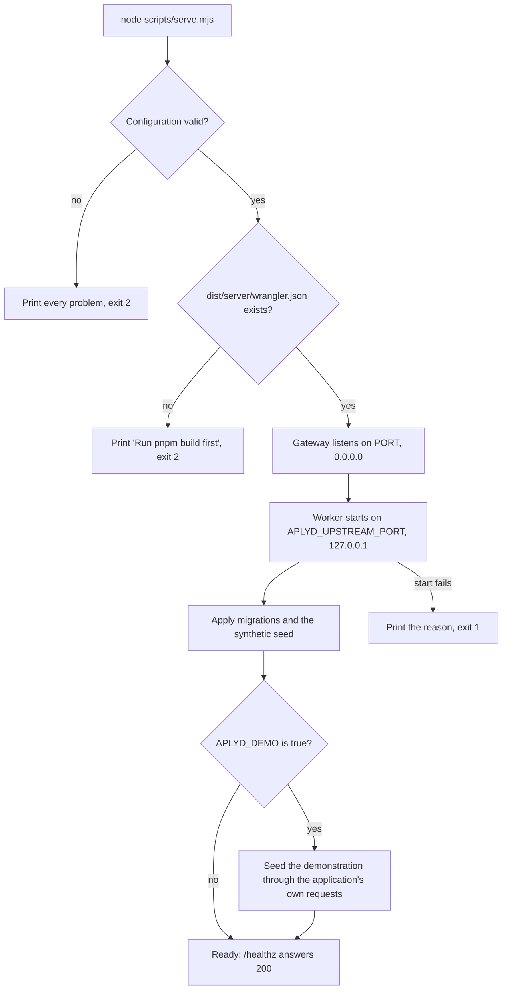
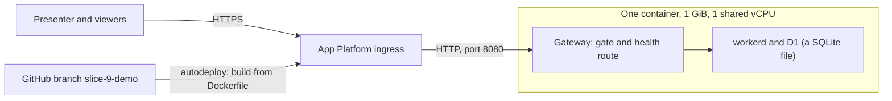

# Runbook: running, showing and stopping the APLYD MSME platform

Version 0.1. Date: 5 October 2026. Status: draft, not reviewed by a person.

This runbook is for someone who has the repository and the sponsor's accounts and has to run the platform locally, run the launcher on any machine, show the hosted demonstration, reset it, change its password, release a change, or stop it and its cost. Everything in the application is SYNTHETIC: no real company, person, provider, rule or figure exists in it, and nothing in this runbook makes it fit for real data. Commands are taken from the repository (`docs/DEVELOPMENT.md`, `package.json`, `scripts/`, `modules/hosting/STATUS.md`). The facts about the live host were supplied by the lead on 5 October 2026 and cannot be checked from the repository; they are marked. No secret value appears here, and none may be added.

How this relates to the other documents: [the high-level design](../design/HLD.md) describes the hosting architecture (its sections 4.5 and 7) and the controls behind it; [the security and privacy document](../design/SECURITY-AND-PRIVACY.md) holds the threats that this runbook's warnings come from (TH-05, TH-18, TH-19, TH-22); [the BRD](../brd/BRD.md) holds the requirements it serves (BR-OPS-07, BR-OPS-08, BR-NFR-04, BR-NFR-07); [the test strategy](../test/TEST-STRATEGY.md) says what the test layers prove; [the glossary](../GLOSSARY.md) defines the terms; [HANDOVER.md](../../HANDOVER.md), [AGENTS.md](../../AGENTS.md) and [docs/DEVELOPMENT.md](../DEVELOPMENT.md) are the repository's own working rules.

## 1. Environments

| Environment | Purpose | How it starts | Where the data lives | Who can reach it | How it resets |
| --- | --- | --- | --- | --- | --- |
| Local development | Building and trying | `pnpm dev` (section 3) | SQLite files under `.wrangler/state` | The developer, at `http://localhost:5173` | `pnpm db:local` deletes and rebuilds it |
| Automated tests | Proving behaviour | `node scripts/test.mjs` (section 3.4) | In-memory or temporary databases built from the migrations and the seed | The test run | Every run starts fresh |
| CI | The same checks on every pull request and push to `main` | GitHub Actions (section 15) | As the tests | GitHub | Every run starts fresh |
| Hosted synthetic demonstration | Showing the journey to others | The launcher in a container on DigitalOcean App Platform (sections 4 and 5) | A SQLite file in the container's temporary directory, new at every start | Anyone who holds the gate password | A restart or redeploy (section 8) |
| Cloudflare synthetic staging | A staging that others can reach | Not built: no account, no hosted database, no deployment workflow (HLD section 7.4) | Not applicable | Not applicable | Not applicable |
| Real-data environment | A pilot with real owners | Does not exist and must not be improvised | Not decided (OQ-07) | Not applicable | Not applicable |

## 2. What you need

- Node 22.18 or later. The tests and the launcher are TypeScript run directly by Node; an older Node will not start them. The container image uses 22.22.0.
- pnpm 11.25.0, which `corepack enable` selects from `package.json`.
- For the browser test layer, Google Chrome or Chromium (section 3.4). Nothing downloads a browser.
- `openssl`, to make a random secret.
- For the live host: the sponsor's DigitalOcean and GitHub accounts. Only a person who holds them can act on the live host. An agent has no credentials for it and must not be given the gate password or the session secret.

## 3. Running locally

### 3.1 Set up

```
corepack enable
pnpm install --frozen-lockfile
cp .env.example .dev.vars
```

The install refuses packages published in the last seven days and runs dependency build scripts only for the packages named in `pnpm-workspace.yaml`. Open `.dev.vars` (ignored by Git) and fill in `SESSION_SECRET` with at least 32 bytes of random text, for example the output of `openssl rand -hex 32`. A shorter secret, or one repeated character, makes sign-in refuse. Leave `APLYD_ENV` empty: `pnpm dev` sets `local` itself. A built application carries no environment name.

### 3.2 Run the development server

```
pnpm db:local
pnpm dev
```

`pnpm db:local` resets the local database, deleting whatever was there, and applies the migrations and the SYNTHETIC seed. `pnpm dev` serves the application at `http://localhost:5173`. Open `/sign-in`, choose a synthetic user from the list (there is no password), and the SYNTHETIC banner shows on every page.

### 3.3 Build, and run what was built

```
pnpm build
pnpm typecheck
```

`pnpm build` writes `dist/` (the client and the Worker in `dist/server`). The launcher (section 4) and the smoke and browser test layers need it.

### 3.4 Tests and checks

```
pnpm test
node scripts/test.mjs pr --guard
node scripts/test.mjs unit
node scripts/test.mjs integration --only <suite id>
node scripts/test.mjs --list
node scripts/test.mjs --check-catalogue
```

`pnpm test` is `node scripts/test.mjs pr --guard`. The layers are `static`, `unit`, `integration`, `smoke` and `browser`; `pr` runs all five. `--list` prints every suite with its id, for example `deliver/unit/state`. The smoke and browser layers need `pnpm build` first. The guard fails when a suite is missing, has no baseline, or passes fewer tests than its baseline in `modules/<module>/tests/baseline.json`; a skipped, todo or cancelled test counts as a failure. The only way to lower or add a baseline is `node scripts/test.mjs <layers> --update-baseline --reason "<why>"`, and the reason must be true.

The browser layer picks a browser in this order: the file named by `APLYD_CHROMIUM_PATH`; `/opt/pw-browsers/chromium` if it exists; Google Chrome through Playwright's `chrome` channel. An `APLYD_CHROMIUM_PATH` that names a missing file is an error, not a reason to use another browser. Do not run `playwright install`. To see what the Worker printed when a browser test fails, run the suite with `APLYD_BROWSER_DEBUG=1` (and `WRANGLER_LOG=debug` for more).

Documentation checks, which need only Node:

```
node scripts/check-documentation.mjs
node scripts/check-traceability.mjs
node scripts/check-test-docs.mjs
```

The first checks links, anchors, decision, question and source identifiers, source checksums and conflict markers. The second reads the BRD as data and checks that every requirement and every cited identifier is defined. The third checks that every test case names a real requirement and, if automated, a real test file and title. The third file exists on the documentation branch and is not yet committed to `main` on 5 October 2026.

Mutation checks break the code on purpose to see whether the tests notice. Run them on a copy of the working tree, never on the tree you are editing: `python3 scripts/mutation/mutate.py <repo> <mutations.json>`. Nothing in CI runs them, and a run takes tens of minutes on the layers that start a Worker (`scripts/mutation/README.md`).

## 4. Running the launcher on any machine

### 4.1 What it is

`scripts/serve.mjs` runs the built Worker in workerd through Miniflare, with a SQLite database that is rebuilt from the migrations and the SYNTHETIC seed at every start. The database is a file in the temporary directory (Miniflare's D1, in a new `miniflare-<random>` directory at each start, about 1.4 MB), not memory [Certain: checked on 6 October 2026, `modules/hosting/VALIDATION.md`]. In front of it a gateway (`modules/hosting/src/gateway.ts`) holds the access gate, answers `/healthz`, caps the request size and hands every other request on. It is a demonstration host, not a production one. A restart is a reset. There is no way to keep data, by design: the tables are append-only, so a demonstration cannot be put back by deleting rows.



### 4.2 Commands

On any machine with Node 22.18 or later, from the repository root:

```
pnpm install --frozen-lockfile
pnpm build
SESSION_SECRET="$(openssl rand -hex 32)" \
DEMO_USER="demo" \
DEMO_PASSWORD="replace-with-a-password-of-12-or-more-characters" \
APLYD_DEMO=true \
node scripts/serve.mjs
```

It listens on `PORT`, default 8080. Open `http://localhost:8080`; the browser asks for the user and password. The session cookie is `Secure`. Chrome and Chromium keep it on `http://localhost` [Likely; the browser test layer relies on it]; on any other plain `http` address a browser will not keep it and sign-in will seem not to work, so use an `https` address. To leave the address open on a machine only you can reach, set `DEMO_ACCESS=open` and set neither `DEMO_USER` nor `DEMO_PASSWORD`; never do that on a reachable host, because anyone who reaches it can sign in as the operator.

On startup the launcher prints, in order: `Listening on port 8080; starting the application (synthetic, access: password).`; with `APLYD_DEMO=true`, `The demonstration was added: 5 companies, 3 providers, N requests.` (68 requests when it was run on 5 October 2026); then `The application is ready.` Until then `/healthz` answers 503 `starting`, and any other request that passes the gate gets 503 `The application is starting. Try again in a few seconds.` with `retry-after: 5`. On the development machine it was ready about 12 seconds after starting without the demonstration; the container's start time was not measured.

### 4.3 Environment variables

| Name | Required | Default | Rule | What happens otherwise |
| --- | --- | --- | --- | --- |
| `PORT` | No | 8080 | A whole number from 1 to 65535, different from `APLYD_UPSTREAM_PORT` | `PORT must be a whole number from 1 to 65535.` or `PORT and APLYD_UPSTREAM_PORT must differ.` Exit 2 |
| `APLYD_UPSTREAM_PORT` | No | 8787 | The same; the Worker listens on 127.0.0.1 at this port and is not reachable from outside | `APLYD_UPSTREAM_PORT must be a whole number from 1 to 65535.` Exit 2 |
| `APLYD_ENV` | No | `synthetic` | Exactly `local`, `synthetic` or `test`; case matters | A message that the launcher serves synthetic environments only. Exit 2 |
| `SESSION_SECRET` | Yes | None | At least 32 bytes, not one repeated character, and not the placeholder `REPLACE_ME` | `SESSION_SECRET is still the placeholder REPLACE_ME. ...`, `SESSION_SECRET must be at least 32 bytes.` or `SESSION_SECRET must not be one repeated character.` The value is never printed. Exit 2 |
| `DEMO_USER` | Yes, unless `DEMO_ACCESS=open` | None | Not empty; no colon; not the placeholder `REPLACE_ME` | `DEMO_USER is still the placeholder REPLACE_ME. ...` or `DEMO_USER must not contain a colon.` Exit 2 |
| `DEMO_PASSWORD` | Yes, unless `DEMO_ACCESS=open` | None | At least 12 characters, counted as characters and not bytes; not the placeholder `REPLACE_ME` | `DEMO_PASSWORD is still the placeholder REPLACE_ME. ...` or `DEMO_PASSWORD must be at least 12 characters.` Exit 2 |
| `DEMO_ACCESS` | No | Unset | Only `open`, or unset or empty. With `open`, `DEMO_USER` and `DEMO_PASSWORD` must both be unset or empty | `DEMO_ACCESS=open and DEMO_USER or DEMO_PASSWORD are both set: choose one.` or `DEMO_ACCESS may only be "open"` Exit 2 |
| `APLYD_PUBLIC_HOSTS` | No | Empty | Comma-separated host names, each with an optional port, lower-cased. Names the public host if the platform's ingress rewrites the Host header | `APLYD_PUBLIC_HOSTS holds "<value>", which is not a host name with an optional port.` Exit 2 |
| `APLYD_WATCHDOG_PROBES` | No | 6 | A whole number from 0 to 1000. After this many failed health probes of the Worker in a row the launcher exits with code 1 (section 4.4). 0 turns the watchdog off | `APLYD_WATCHDOG_PROBES must be a whole number from 0 (no watchdog) to 1000.` Exit 2 |
| `APLYD_WATCHDOG_SECONDS` | No | 5 | A whole number from 1 to 3600: the pause between probes | `APLYD_WATCHDOG_SECONDS must be a whole number from 1 to 3600.` Exit 2 |
| `APLYD_DEMO` | No | Off | On only for exactly `true` | With `true` and no `modules/demo/src/seed.ts`: `The application did not start: APLYD_DEMO=true, but this build has no demonstration package (modules/demo).` Exit 1 |

With neither a gate nor `DEMO_ACCESS=open`, the launcher prints `Set DEMO_USER and DEMO_PASSWORD (the access gate), or DEMO_ACCESS=open to leave the address open. Synthetic sign-in lets anyone who reaches the address sign in as the operator.` and exits 2. The launcher does not read `NODE_ENV` (the `Dockerfile` sets it to `production` after the build), and it does not read `.dev.vars`, which only `pnpm dev` uses.

### 4.4 Refuse-to-start rules and exit codes

| Exit code | When | What is printed |
| --- | --- | --- |
| 2 | The configuration is invalid. Every problem is listed at once | `The application was not started:` then one line for each problem beginning with a dash |
| 2 | `dist/server/wrangler.json` is missing | `dist/server/wrangler.json is missing. Run pnpm build first.` |
| 1 | The Worker or the database fails to start after the gateway is listening | `The application did not start: <reason>` then `Stopping.` |
| 1 | An error that nothing handles, for example the port is already in use (`EADDRINUSE`) | A Node error with a stack trace |
| 1 | The Worker's process has died or stopped answering: its health route failed 6 probes in a row (5 seconds apart, about 30 seconds), counted from when the application became ready | `The application has not answered its health check 6 times in a row (one probe every 5 seconds). Exiting with code 1 so that the platform restarts the container.` then `Stopping.` A platform that restarts a stopped container then replaces it, and the practice data is rebuilt (section 8) |
| 0 | `SIGTERM` or `SIGINT` | `Stopping.` The gateway closes, the Worker's process ends. A forced exit follows after 10 seconds if it has not |

The container's `HEALTHCHECK` (`Dockerfile`) calls `/healthz` every 30 seconds, with a 5 second timeout, a 60 second start period and 3 retries.

## 5. The live demonstration host

### 5.1 Facts

The facts in this table were supplied by the lead on 5 October 2026 and cannot be verified from the repository. The address of the app is not recorded in the repository; the sponsor has it.

| Fact | Value |
| --- | --- |
| Platform | DigitalOcean App Platform |
| Region | Bangalore (BLR1) |
| App name and project | `aplyd-msme-demo`, in the project `first-project` |
| Size | One container, 1 GiB memory, 1 shared vCPU |
| Cost | $10 a month, as the console showed on 5 October 2026 (not in `docs/sources.md`; check it again before relying on it) |
| Build | From the repository's `Dockerfile`; the first build took 2 minutes 11 seconds |
| Source | Repository `nakul175/aplyd-msme-platform`, branch `slice-9-demo`, autodeploy on |
| Port | 8080 |
| Settings | `APLYD_DEMO=true`; `SESSION_SECRET`, `DEMO_USER` and `DEMO_PASSWORD` as encrypted run-time values set by the sponsor. `APLYD_ENV` is not set, so the launcher uses `synthetic` |
| Health check | The platform's default check, not `/healthz` |
| Live since | 5 October 2026 |



What follows from these facts. Each push to `slice-9-demo` rebuilds the image and restarts the container, which empties the database and reseeds it. The gate is one shared password over plain HTTP between the ingress and the container. The data is a file in the container's temporary directory, discarded with the container, and is not backed up. The host tracks a slice branch and not `main`, so `main` may not hold the code that is live (the HLD's technical question about this is open).

### 5.2 `.do/app.yaml` does not match the live app

The file in the repository is a template for creating the app. It does not describe the live app:

| Item | `.do/app.yaml` | Live app |
| --- | --- | --- |
| App name | `aplyd-demo` | `aplyd-msme-demo` |
| Branch | `main` | `slice-9-demo` |
| Autodeploy | `deploy_on_push: false` | On |
| Region | Not set ("choose one in the console") | BLR1 |
| `APLYD_DEMO` | Not set | `true` |
| `APLYD_ENV` | `synthetic` | Not set (the launcher's default is `synthetic`) |
| Health check | `/healthz`, with a 60 second initial delay | The platform's default |

A deployment made from the file would therefore not reproduce the live host. To reconcile, choose one of two courses and say which in the pull request:

1. Keep the file as the safe template and record the live differences in this runbook (this section). This is what holds today. A static test pins the file to `deploy_on_push: false`, `branch: main` and `http_path: /healthz` (`modules/hosting/tests/static/deploy-files.test.ts`, TC-OPS-66), so the file cannot be made to match the live app without changing that test.
2. Make the file match the live app. Open the app in the console and read its App Spec, which is the authority for the live values, including the region's exact spelling. In a branch, edit `.do/app.yaml` to match, leaving every secret as `REPLACE_ME` and writing no value; change `deploy-files.test.ts` deliberately and give the reason; update `modules/hosting/STATUS.md`; open a draft pull request (section 13). The hosting module is not a protected path in AGENTS.md, but the pull request touches a file that decides what runs on the live host, so say so in it.

Either way, `modules/hosting/STATUS.md` (which still says nothing has been deployed) and `HANDOVER.md` (its slice 8 entry) are out of date, and the sponsor or the module's owner should correct them.

## 6. Seeing it and signing in

1. Open the app's address, which the sponsor has. Use `https`.
2. The browser asks for a user name and password for the realm `APLYD synthetic demonstration`. Enter the gate's user and password, which the sponsor holds. A wrong pair gives `Authentication required.` (401).
3. The home page opens with the SYNTHETIC banner. This gate is not the application's sign-in.
4. Open the sign-in page at `/sign-in`. It lists the synthetic people, each with a role. Choose one and press Sign in. There is no password; the page says so.
5. With `APLYD_DEMO=true` the page at `/demo` holds the presenter's script: eight steps, about 15 minutes, each saying who to sign in as. The people are the operator, the company walked live, a company that has nothing, and five companies at different points of the journey.

To check that the host is up without the password: `curl -s https://<app address>/healthz` answers `ok` (200), or 503 with `starting` while it builds the database. `curl -i https://<app address>/` answers 401 with a `www-authenticate: Basic realm="APLYD synthetic demonstration"` header, which shows the gate is on. Behind the gate, `GET /api/health` answers `{"status":"ok","database":"ok","auditGuard":"ok"}`, or 503 `degraded` when a guard trigger is missing.

## 7. Before showing the demonstration

This checklist comes from `modules/demo/STATUS.md` and its limits. Do it in this order.

1. Restart the app shortly before the session (section 8), so the starting state is clean. The walked company, Company A, then holds only its confirmed description, and nothing from an earlier session remains. The tables are append-only, so there is no way to tidy it by hand.
2. Wait until `/healthz` answers 200 and the app's runtime log in the console shows `The demonstration was added: 5 companies, 3 providers, N requests.` If a page says the application is starting, wait and try again.
3. Have the gate's user and password from the sponsor. Do not put them on a slide or in a chat.
4. Open `/demo` and check that it lists eight steps and the cast.
5. Sign in as the operator and check that the page shows one fee, three providers and one pool that has reached five. The fee is the placeholder, ₹1,500, and no fee is decided (OQ-11). Do not call it a price.
6. Know the floor of five, which the cast shows on purpose (C-04): five companies already ask for the first idea in the first cluster, so a company that asks for it sees "at least 5"; three ask for the second idea in the second cluster, so a company that joins is the fourth and the page says the number is not shown. The seeder checks this and refuses to finish if it is not so.
7. Know what the demonstration does not show: no voice, no photograph, no owner's own language, no provider sign-in, no money, no real compliance rule, no review by a second person. The 30, 90 and 180 day reviews appear as dates only. The page lists these.
8. Know the limits to say aloud: everything is invented; anyone who can sign in can sign in as anyone, and the gate is the only protection; the host is one container with one password; viewers share one database, so two people working in the same company at once will see each other's changes.
9. Use a recent desktop Chrome or Chromium. That is what was tested (Chromium 141 on Linux). Other browsers and phones are untested (platform status page, limit 11).
10. Never type real data into the demonstration, and tell viewers not to.
11. If something was entered and must be undone, restart. The seeder cannot be run twice on one database; the second run stops at the first refusal.

## 8. Resetting it

A restart or a redeploy resets everything, because the database is a file in the container's temporary directory, in a new directory at every start, and is rebuilt from the migrations and the seed each time. There is no reset button, on purpose, and no way to put one record back. The same happens on platform maintenance.

To reset, a person with the DigitalOcean account restarts the app or forces a new deployment from the app's actions in the console. The menu wording is the console's and is not recorded here [not known]. The app answers 503 `starting` until the database and the demonstration seed are done; expect longer than the 12 seconds measured on a development machine [the container's time was not measured]. A sign-in survives a restart while `SESSION_SECRET` is unchanged, because the seeded people keep their ids: a cookie issued before a restart was accepted after it, and the person saw the freshly rebuilt company [Certain: observed on 6 October 2026, and pinned by a smoke test, `modules/hosting/VALIDATION.md`]. Sign out and in again if a page behaves oddly.

A push to `slice-9-demo` also resets it (section 13).

## 9. Changing the gate password or the session secret

Only a person with the DigitalOcean account does this, in the console. The values are typed there, as encrypted run-time values, and are never written in Git, a document, a pull request or a chat.

1. Open the app, then its component's environment variables.
2. Edit `DEMO_PASSWORD` (or `DEMO_USER`, or `SESSION_SECRET`), keep it marked as an encrypted value, and save.
3. DigitalOcean redeploys. The redeploy resets all demonstration data (section 8).
4. Tell the people who need the new password through a channel other than Git.

Rules. The gate password must be at least 12 characters, or the container exits with code 2 and the deploy does not become healthy. This happened on 5 October 2026 with an 8-character password. `DEMO_USER` must not contain a colon. `SESSION_SECRET` must be at least 32 bytes and not one repeated character; `openssl rand -hex 32` gives 64 characters. Changing `SESSION_SECRET` ends every session, so everyone signs in again. A value left as the spec's placeholder `REPLACE_ME` is refused by name, in each of `SESSION_SECRET`, `DEMO_USER` and `DEMO_PASSWORD` on its own (before 6 October 2026 only the two that were too short were: a `DEMO_USER` left as `REPLACE_ME` started). What the platform serves while a failed deploy is unhealthy, whether the previous deployment or nothing, is not known; check the console after any change.

## 10. Troubleshooting

| Symptom | Likely cause | What to do |
| --- | --- | --- |
| The browser keeps asking for a user and password; `Authentication required.` | Wrong user or password. Both are compared exactly | Ask the sponsor for the current pair; check for a changed password (section 9) |
| `The application is starting. Try again in a few seconds.` (503) | The database and the seed are still being built after a start or deploy | Wait and reload. If it lasts minutes, read the runtime log for `The application did not start:` |
| `/healthz` answers 503 `starting` or `application not answering` | Still starting, or the Worker has stopped. A Worker that stays stopped makes the launcher exit with code 1 after about 30 seconds (section 4.4), so the platform restarts the container | Wait; if the container did not restart by itself, restart it (section 8) and read the log for `has not answered its health check` |
| The container exits at once; the log shows `The application was not started:` and lines with dashes | A setting is invalid (section 4.3) | Fix every line named; all problems are printed at once. A password under 12 characters, a secret under 32 bytes, a missing user, or `REPLACE_ME` left in place are the usual causes. Exit code 2 |
| `dist/server/wrangler.json is missing. Run pnpm build first.` | The build did not run, or failed | On a laptop, run `pnpm build`. On the host, read the build log |
| `The application did not start: ...` followed by Stopping | The Worker or the database failed to start, or `APLYD_DEMO=true` with no demonstration package | Read the reason in the line. Exit code 1 |
| A Node error with `EADDRINUSE` | The port is in use | Stop the other process, or set `PORT` and `APLYD_UPSTREAM_PORT` |
| The sign-in page says `Sign-in is not available in this environment.` | The Worker has no valid environment name or secret. Through the launcher this follows from a rejected setting; running the built Worker without the launcher, `APLYD_ENV` was not set | Use the launcher; check `APLYD_ENV` and `SESSION_SECRET` |
| After pressing Sign in the page shows `{"error":"cross_site_refused"}` | The ingress rewrote the Host header, so the origin check does not match | Set `APLYD_PUBLIC_HOSTS` to the public host name of the app (comma-separated if more than one) and redeploy [Likely, from `modules/hosting/STATUS.md`; not observed] |
| Sign-in appears to work but the next page is the sign-in page again | The cookie is `Secure` and was not kept: the address is plain `http` and not `localhost` | Use the `https` address |
| `/demo` says the page is not found | `APLYD_DEMO` is not exactly `true` (case matters) | Set it to `true` and redeploy |
| Data entered earlier has gone | A restart, redeploy or platform maintenance reset the database (a file in the container's temporary directory) | By design. Nothing can be recovered |
| The demonstration is in the wrong state: a company already has work done | Someone used it since the last restart | Restart (section 8) |
| The host behaves differently from yesterday | A push to `slice-9-demo` redeployed it | Read the deployment history in the console and the branch's commits |
| The build fails on the host while installing | The seven-day package rule refused a very new package, or the builder's resources ran out [Guessing] | Read the build log; do not weaken `pnpm-workspace.yaml` to get past it |
| 413 `The request is too large.` | A body over 256 KiB reached the gateway; the application's own limit is 64 KiB of characters | Send less |
| 502 `The application did not answer.` | The Worker crashed or took over 60 seconds | Read the log. A crashed Worker ends the launcher after about 30 seconds and the platform restarts the container; if it does not, restart it |
| `GET /api/health` answers 503 `degraded` | A guard trigger is missing, or the database is unavailable | Read the three status words; a missing trigger means the migrations did not apply. Restart; if it persists, stop and tell the module's owner |

## 11. Stopping the app and ending the cost

Only a person with the DigitalOcean account may stop or delete the app: the sponsor, in the console. No agent and no other person may, and no one should ask an agent to try. Stopping the cost means deleting the app (its settings page has the destroy action, which asks for confirmation) [Likely; the wording is the console's]. How the last month is charged is not known; check the invoice.

Deleting the app loses nothing durable, because the data is a file in the container's temporary directory and is synthetic. It leaves the GitHub authorisation in place: do section 12 as well. To bring the host back, a person with the accounts follows `modules/hosting/STATUS.md`, "How to deploy it on DigitalOcean App Platform", with the live settings from section 5.1:

1. Sign in to DigitalOcean and create an app from GitHub: repository `nakul175/aplyd-msme-platform`, the branch the sponsor chooses. App Platform finds the `Dockerfile`.
2. Choose Bangalore (BLR1) and a container of 1 GiB. Set the HTTP port to 8080.
3. Set four run-time values, three of them as encrypted values typed by the sponsor: `APLYD_DEMO=true`, `SESSION_SECRET`, `DEMO_USER`, `DEMO_PASSWORD`.
4. Deploy, then run section 7.

## 12. Restricting DigitalOcean's GitHub authorisation

The lead observed on 5 October 2026 that the DigitalOcean account's GitHub application has read access to 16 repositories, and advised the sponsor to restrict it to the one repository the demonstration needs, `nakul175/aplyd-msme-platform`. It cannot be checked from the repository. Until it is narrowed, anyone who compromises the DigitalOcean account or its GitHub link can read the source of every repository it covers (TH-19 in [the security document](../design/SECURITY-AND-PRIVACY.md)).

The sponsor does this in GitHub: Settings, Applications, Installed GitHub Apps, DigitalOcean, Configure; under Repository access choose "Only select repositories", pick the one repository, and save [Likely; the screens are GitHub's and may differ]. Also look for a DigitalOcean entry under Authorized OAuth Apps [Guessing that one exists]. Then trigger a deployment and confirm it still builds. If it does not, the wrong repository was left selected.

## 13. Releasing a change

This is the procedure in [AGENTS.md](../../AGENTS.md) and [HANDOVER.md](../../HANDOVER.md).

1. Branch from `main`. One reviewable slice per branch. Never work on `slice-9-demo` unless a redeploy of the live host is what you intend, because the live host tracks that branch and rebuilds on every push.
2. Make the change in the module that owns it. Do not edit another module's files; cross-module changes go through the owner's pull request and the pull request says so.
3. Run the affected checks before saying the change is done: for code, `pnpm build` then `node scripts/test.mjs pr --guard`; for documentation, `node scripts/check-documentation.mjs` and, when requirements or identifiers are touched, the traceability and test-document checks (section 3.4).
4. Record the real result, with its date and limits, in the module's `VALIDATION.md` (BR-NFR-04), and update its `STATUS.md`. A passing unit test does not promote an acceptance case to passed. If a check could not run, say so.
5. Publish the branch and open a draft pull request into `main`. Never push to `main` directly with code. Documentation-only corrections that the sponsor directs in conversation may go straight to `main`, and each is listed in HANDOVER.md under "Direct to main".
6. If the change touches a protected path (authentication and identity, anything that decides which company's data a person can read, migrations, anything that moves or records money, the rule-library publishing path), label the pull request `needs-human-review`. No person has yet been named as the reviewer (OQ-08).
7. The sponsor decides when it merges. Do not merge unless the sponsor says so in that conversation. If the sponsor merges without a person reading it, record that plainly in HANDOVER.md under "Merged without review", with the date. Do not describe such code as reviewed.
8. Never force-push `main`. Check the remote before pushing and preserve concurrent work. After pushing, verify the resulting tree; report a failed push as a failure.
9. If the change should reach the live host, that happens when the tracked branch is updated, and it resets the demonstration. Do it when no one is presenting.

At most four agents write code at once; each owns one module under `modules/<name>/`. The root documents are updated by the sponsor's integrating pull request only.

## 14. What must not be done

- Do not enter real data of any kind in any environment: no real company, person, address, factory, provider, price or compliance rule. The host has one shared password, a throwaway database (a file in the temporary directory) and a plain-HTTP hop (RK-10, BR-DATA-01).
- Do not take or show a percentage of deals, or any fee that varies with the vendor chosen (D-03, OQ-11). The ₹1,500 figure is a placeholder, shown to the operator only; no fee is decided; do not show it to owners.
- Do not describe the platform as certifying a factory or a product, building products it lists, or selling company data (C-01 to C-03).
- Do not push to `slice-9-demo` expecting nothing to happen: it redeploys the live host and resets its data.
- Do not set `DEMO_ACCESS=open` on a reachable host: anyone who finds the address could sign in as the operator.
- Do not force-push `main`, or merge without the sponsor's say-so.
- Do not put a secret in Git, a document, a pull request or a chat, and do not give an agent the gate password or the session secret.
- Do not turn on a provider, message real recipients, or deploy a new site merely because a documentation update is complete.
- Do not edit an applied migration, lower a test baseline without a true reason, run `playwright install`, or weaken `pnpm-workspace.yaml` to get an install through.
- Do not call any of the code reviewed or accepted: no person has read it.

## 15. The CI workflows

Neither workflow uses secrets, a hosted database or a deployment. The live host is not deployed by a workflow: DigitalOcean builds from the branch.

| Workflow | File | When it runs | What it runs | Limit |
| --- | --- | --- | --- | --- |
| `engineering-checks` | `.github/workflows/ci.yml` | Every pull request, and every push to `main`, that changes more than Markdown or `docs/`; also on demand | In order: `node scripts/test.mjs --check-catalogue`; `corepack enable` and `pnpm install --frozen-lockfile`; `pnpm build`; `google-chrome --version`; `node scripts/test.mjs pr --guard`; then it uploads `reports/summary.json` as the artifact `test-summary` | 20 minutes; read-only repository permission; one run at a time for each pull request |
| `documentation-checks` | `.github/workflows/docs.yml` | Every pull request, including documentation-only ones; also on demand | `node scripts/check-documentation.mjs`. The version in the working tree of the documentation branch also runs `node scripts/check-traceability.mjs` and `node scripts/check-test-docs.mjs`; that version was not committed on 5 October 2026 | 5 minutes; needs no install |

A pull request that changes only Markdown or `docs/` runs the documentation checks and not the engineering checks; a code pull request runs both. A CI result for the merged pull requests #1 to #9 was not read by the agent that merged them, so whether CI passed on the merged tree is not known from the record (HANDOVER.md, "Merged without review").

## 16. Backup, recovery and monitoring

AS BUILT: none. The demonstration's database is a throwaway file in the container's temporary directory and synthetic, so there is nothing to back up or restore (BR-NFR-07 is not built). No availability target is set (BR-NFR-08). The platform's default health check is the only monitoring; there is no log shipping and no alert (BR-NFR-10). The gateway writes one line for each refusal or failure, with the method and the reason and never a header, body or credential. TO BE, before any durable or real-data environment: a backup, a restore that has been run and timed, an availability target that is measured, and an alert (these are the requirements named above).

## 17. Commands used in this runbook

| Command | What it does | Defined in |
| --- | --- | --- |
| `pnpm install --frozen-lockfile` | Installs exactly what the lockfile says, with the seven-day rule | `docs/DEVELOPMENT.md`, `Dockerfile` |
| `pnpm dev` | Serves the application on port 5173 with `APLYD_ENV=local` | `package.json` |
| `pnpm build` | Builds `dist/` | `package.json` |
| `pnpm typecheck` | Type check | `package.json` |
| `pnpm db:local` | Resets the local database, then applies migrations and the synthetic seed | `package.json`, `scripts/local-db.mjs` |
| `pnpm db:generate`, `pnpm db:check` | Generate migrations from the schema; check them | `package.json` |
| `pnpm test`, `pnpm test:static`, `pnpm test:unit`, `pnpm test:integration`, `pnpm test:smoke`, `pnpm test:catalogue` | The test runner's layers and catalogue check. There is no `test:browser` script: use `node scripts/test.mjs browser` | `package.json` |
| `pnpm docs:check` | The documentation check | `package.json` |
| `node scripts/test.mjs <layers> [--guard] [--only <id>] [--list] [--check-catalogue] [--update-baseline --reason "<why>"]` | The test runner | `scripts/test.mjs` |
| `node scripts/check-documentation.mjs`, `node scripts/check-traceability.mjs`, `node scripts/check-test-docs.mjs` | Document checks | `scripts/` |
| `node scripts/serve.mjs` | The launcher | `scripts/serve.mjs` |
| `python3 scripts/mutation/mutate.py <repo> <mutations.json>` | Mutation checks | `scripts/mutation/` |
| `doctl apps create --spec .do/app.yaml` | Creates an App Platform app from the template (do not use it for the live app; it would not match it) | `.do/app.yaml` |

## 18. What is not known

| Not known | What would settle it |
| --- | --- |
| The address of the live app | The sponsor's console; it is not in the repository |
| What the console calls the restart and delete actions, and how the last month is billed | The console and the invoice |
| What the platform serves while a failed deployment is unhealthy | A deliberate, scheduled test by the sponsor |
| Whether the ingress forwards the browser's Host unchanged, and whether sign-in was exercised on the live host | Section 7 on the live address; if it fails, section 10 |
| How long the container takes to be ready | Time one restart from the console to `/healthz` answering 200 |
| Whether `main` holds the code that is live | Compare the branch `slice-9-demo` with `main` |
| Whether branch protection or secret scanning is set on the repository | The repository's settings in GitHub |
| The $10 a month figure, and the 1 GiB size's current price | DigitalOcean's pricing page, read again; it is not in `docs/sources.md` |

## 19. Moving the live host to `main` (added 6 October 2026)

Status: draft, not reviewed by a person. Written on 6 October 2026 from the repository, from GitHub's run history for the repository (read with `gh run list`), and from runs of the Dockerfile's steps in a clean copy (without Docker: this machine has no container daemon and cannot reach Docker Hub). Every number below comes from [modules/hosting/VALIDATION.md](../../modules/hosting/VALIDATION.md), section "Deploy readiness, 6 October 2026". The console wording is DigitalOcean's and was not run: nobody who wrote this has the account. Where a statement cannot be checked from the repository it carries a tag.

### 19.1 What the repository shows, and what it cannot

- `.do/app.yaml` names the app `aplyd-demo`, the branch `main`, and `deploy_on_push: false`. The live app is called `aplyd-msme-demo`, tracks the branch `slice-9-demo` and autodeploys (section 5). The repository cannot show the console, so the live values rest on the lead's report of 5 October. Two things in the repository agree with that report: the branch `slice-9-demo` exists on GitHub (commit `034320ce8a21`, the head of pull request #11), and the HLD, the security document and this runbook all describe the live app that way. The file is a template for a new app. It was never the live app's spec [Certain for the file; Likely for the live values].
- On 6 October 2026 `git ls-remote origin refs/heads/main` printed `d6b0e0282e02` (pull request #9 merged). That tree has no `Dockerfile`, no `scripts/serve.mjs`, no `.do/app.yaml`, no `modules/hosting` and no `modules/demo`. They arrive with pull requests #10, #11 and #12. **Pointing the app at `main` before those are merged gives a build with nothing to build from** [Certain for the tree; Likely for what DigitalOcean then does: the build fails and the old deployment stays].

### 19.2 Before you move it

Do all five. Stop at the first one that is not true.

1. Pull requests #10, #11 and #12, and everything else the integrator is merging today, are in `main`. Check the tip has the files: `git fetch origin main && git ls-tree --name-only origin/main Dockerfile scripts/serve.mjs modules/demo/src/seed.ts` lists all three. Do not delete the branch `slice-9-demo` when merging (no "delete branch"): rollback in 19.5 needs it. `git ls-remote origin refs/heads/slice-9-demo` must still print `034320ce8a21db0818b9b4a39315d0d4b2f976c4`.
2. Write down the tip: `git rev-parse origin/main`. You will compare the first seven characters with `/healthz` in 19.4.
3. The merged tree installs and builds from nothing. CI does this on the push to `main` (steps "Install pinned dependencies" and "Build" took 12 to 15 seconds and 6 to 8 seconds on 4 and 5 October). On a clean copy of `origin/main`: `pnpm install --frozen-lockfile && pnpm build && node scripts/test.mjs smoke --only hosting/smoke/serve`.
4. The three run-time values on the live app are still set (19.6). Nothing in this move changes them.
5. Nobody is presenting. The redeploy rebuilds the practice data from the start (section 8), and the address may answer 503 `starting` for a short time while it does.

### 19.3 (a) Point the app at `main`

In the console (wording is DigitalOcean's; not run) [Likely]:

1. Apps, then `aplyd-msme-demo`, then Settings, then the component `web`.
2. In the source section choose Edit. Leave the repository `nakul175/aplyd-msme-platform`. Change the branch from `slice-9-demo` to `main`. Save.
3. DigitalOcean starts a new deployment, because the source changed. If it does not, use the app's Create Deployment action.

The same change in the spec is `services[0].github.branch: main` (`.do/app.yaml`, the field `branch` under `github`). To make it from a terminal, never send the repository's file to the live app:

```
doctl apps list                              # find the app id of aplyd-msme-demo
doctl apps spec get <app id> > live-spec.yaml
# edit live-spec.yaml: github.branch from slice-9-demo to main. Leave every EV[1:...] value as it is.
doctl apps update <app id> --spec live-spec.yaml
```

Why not `doctl apps update --spec .do/app.yaml`: that file holds `REPLACE_ME` for the three secret values and no region. Sent to the live app it would replace the encrypted values (the launcher refuses `REPLACE_ME`, so the new deployment would not start) and could change the region. The spec you get from `doctl apps spec get` carries the secrets as `EV[1:...]` text, and DigitalOcean's documentation says to send that encrypted text back unchanged [Certain from the documentation; not run]. Keep `live-spec.yaml` out of the repository.

Two more changes are worth making in the same edit. Both are optional and neither is needed for the move.

- **Health check.** The live app uses the platform's default check, not `/healthz` (the lead's report). Set an HTTP check: path `/healthz`, port 8080, initial delay 60 seconds, period 10, timeout 5, failure threshold 3 (the values in `.do/app.yaml`). Reason, from runs on 6 October: the gateway listens within about one second, five to eight seconds before the application is ready. A default check that only tests the port passes in that gap. When the Worker process dies the gateway stays up: `/healthz` turns 503 within two seconds and every other page answers 502. Until 6 October 2026 nothing but an HTTP check on `/healthz` could make the platform notice. Now the launcher itself exits with code 1 about 30 seconds after the Worker stops answering (section 4.4; `APLYD_WATCHDOG_PROBES` and `APLYD_WATCHDOG_SECONDS`), and a platform that restarts a stopped container then replaces it, whichever check is set [Certain for the exit, run on 6 October 2026; Likely for what the platform does with an exit, not run]. The HTTP check is still worth setting, for the gap at start.
- **Commit on `/healthz`.** Add a run-time value `APLYD_COMMIT` with the value `${_self.COMMIT_HASH}` (not encrypted). DigitalOcean fills that bindable variable at run time, and for a Dockerfile build it is available at run time only. Without it `/healthz` says `commit unknown` and everything else works [Certain that the launcher behaves so; Likely that the variable is filled as documented, not run].

Autodeploy. After the move every push to `main` rebuilds the app and resets the practice data, documentation-only pushes included: DigitalOcean has no path filter. Either leave autodeploy on and tell everyone who pushes to `main` that each push resets the demonstration, or turn it off for demonstration days (set `deploy_on_push` to false in Source, or the console toggle) and deploy by hand when `main` is ready (Create Deployment, or `doctl apps create-deployment <app id>`). The sponsor decides [Likely for the push behaviour; the toggle's wording is the console's].

### 19.4 (b) Confirm the deploy

Use the app's address, which only the sponsor has, over `https`. `APP` below stands for it.

1. Console, the app's Activity or Deployments tab: the new deployment goes through Building and Deploying to Active. The build log shows `pnpm install --frozen-lockfile` and `pnpm build`. The first build on 5 October took 2 minutes 11 seconds. From a terminal: `doctl apps list-deployments <app id>`.
2. `curl -s -i https://APP/healthz` answers 200 and two lines: `ok` and `commit <id>`. The first seven characters of the id must equal the tip written down in 19.2. `commit unknown` means `APLYD_COMMIT` is not set: the deploy is fine, the label is missing. No second line at all means an older build is still serving: wait, then read the Deployments tab. 503 `starting` means the database and the demonstration seed are being built: wait ten seconds and ask again.
3. `curl -s -o /dev/null -w "%{http_code}\n" https://APP/sign-in` prints 401: the gate is closed. `curl -s -u demo -o /dev/null -w "%{http_code}\n" https://APP/sign-in` asks for the password and prints 200 (give the real user name in place of `demo`; type the password at the prompt, never on the command line).
4. `curl -s -u <user> https://APP/api/health` prints `{"status":"ok","database":"ok","auditGuard":"ok"}`.
5. One owner walk, in a browser, about two minutes. Give the gate's user and password. Open `/sign-in`, choose SYNTHETIC Owner A, press Sign in: the home page shows SYNTHETIC Company A and the SYNTHETIC banner. Open Describe (`/factory`), Diagnose (`/diagnose`), Procure (`/procure`), Deliver (`/deliver`) and Run (`/run`): each opens. Open `/demo`: eight steps. Sign out, sign in as SYNTHETIC Operator, open `/operator`: one fee, three providers, one pool of five (section 7, item 5). If the page after Sign in says `cross_site_refused`, go to section 10 (`APLYD_PUBLIC_HOSTS`).
6. The runtime log, in this order: `Listening on port 8080; starting the application (synthetic, access: password).`, `Commit: <id>.`, `The demonstration was added: 5 companies, 3 providers, 68 requests.` (68 on the commit of 6 October; it changes when the demonstration cast changes), `The application is ready.`

### 19.5 (c) Roll back to the previous branch

1. Change the branch back: Settings, `web`, Source, Edit, branch `slice-9-demo`, Save. The spec field is the same `github.branch`; with `doctl`, repeat 19.3 with the branch reversed. DigitalOcean rebuilds from the head of `slice-9-demo` (`034320ce8a21`, the demonstration without slice 10's interface). Allow the build time (2 to 3 minutes) and the start time. The practice data is rebuilt again.
2. Check: `curl -s https://APP/healthz` prints `ok` and no commit line (that build does not know the name). That absence is how you tell the old build from the new one. Then 19.4, items 3 to 5.
3. The console also has a rollback to an earlier deployment in its Activity tab [Likely; the wording is the console's, not run]. After using it, open Settings and check that the branch and the autodeploy toggle are what you intend [Guessing: a rollback may change them].
4. A rollback does not repair a wrong password or a short secret: those are section 9. It does not bring data back: nothing does (section 8).
5. If `slice-9-demo` was deleted, the rollback by branch is impossible. Recreate it from the commit above (`git branch slice-9-demo 034320ce8a21 && git push origin slice-9-demo`: the sponsor's call, as a push to that branch redeploys the live app if it is still tracking it).

### 19.6 (d) Giving someone the demonstration's credentials

- The sponsor holds the values. They exist in one place only: DigitalOcean's encrypted run-time values on the app, named `DEMO_USER`, `DEMO_PASSWORD` and `SESSION_SECRET` (Settings, `web`, Environment Variables; the console does not show an encrypted value again, so a lost password is replaced, not read). `SESSION_SECRET` is never given to anybody.
- Do not put the user name or the password in a chat, an email, a document, a ticket, a pull request, a screenshot or a slide, and do not give them to an agent.
- Hand over the address, the user name and the password separately, by voice, or through the sponsor's password manager's sharing feature. If the person only needs to look once, share it as a one-time item.
- To end someone's access, replace `DEMO_PASSWORD` (section 9). There are no personal accounts: everyone holds the same password and can sign in as the operator and as every synthetic owner (limit 1 in the hosting status). The redeploy resets the practice data.
- The rules the launcher enforces: `DEMO_USER` has no colon; `DEMO_PASSWORD` is 12 or more characters (an 8-character one stopped the first deploy on 5 October); `SESSION_SECRET` is 32 or more bytes and not one repeated character (`openssl rand -hex 32`). Never set `DEMO_ACCESS=open` on this host.

### 19.7 (e) If the first load is slow

What was measured, in a clean copy on a two-core machine (not on DigitalOcean's): the launcher listens 0.5 to 1.2 seconds after it starts. It answers `/healthz` 200 after 2.2 seconds without the demonstration on an idle machine, 5.3 seconds with it on an idle machine, and 8.0 seconds with it on a machine whose load average was 7. The first page after that took 50 to 120 milliseconds, and the median page after sign-in 24 to 68 milliseconds. Memory after start was about 300 to 345 MB (section 19.8 and the hosting validation file).

So the wait after a deploy or a restart is mostly the platform's: pulling the image, starting the container and the health check's initial delay (60 seconds in `.do/app.yaml`). A fixed container does not sleep when idle [Likely], so a slow first load means a restart or a deploy is in progress.

Say this to a viewer: "The demonstration has just been updated and is rebuilding its practice data. It takes up to a minute. Please reload." While it rebuilds the page shows `The application is starting. Try again in a few seconds.` (503, retry after 5 seconds), after the password has been given. If it lasts more than three minutes: open the runtime log and look for `The application did not start:` or `The application was not started:` (section 10), and check the Deployments tab.

### 19.8 What would surprise you

- **A restart resets the data but not the sign-ins.** After a restart the cookie of someone already signed in still works (checked on 6 October, and pinned by a smoke test), because the key that signs it is unchanged and the seeded people keep their ids. They see the freshly rebuilt company. Changing `SESSION_SECRET` ends every sign-in.
- **The database is a file, not memory.** The launcher's own text said "in memory". Miniflare keeps the SQLite database as files in the temporary directory, in a new directory at every start. A restart is still a reset, and on a container the disk is discarded with it. On a machine that is not a container the old directories stay in the temporary directory (about 1.4 MB each).
- **A dead Worker restarts the container by itself.** If workerd is killed or crashes and stays unanswering for about 30 seconds, the launcher logs `The application has not answered its health check ... Exiting with code 1` and ends, and the platform starts a new container, which rebuilds the practice data (section 4.4). A very slow page does not trigger it: it takes six failed probes in a row, five seconds apart, and one good answer starts the count again. To turn it off set `APLYD_WATCHDOG_PROBES=0`.
- **Every push to `main` is a deploy,** if autodeploy is on (19.3).
- **A failed deploy.** With the default health check a build that starts and then breaks can replace a good one. With the `/healthz` check the platform should keep the old deployment [Likely; FND-204 lists it as not observed].
- **Size.** The 1 GiB container is enough: highest resident memory of both processes together 345 MB at start with the demonstration (about 289 MB when shared pages are counted once), 297 to 319 MB after a browse. The 512 MiB size would probably hold but leaves little [Guessing]; do not use it for a presentation.

### 19.9 What CI does when this is merged (from `.github/workflows` and the run history to 5 October 19:20 UTC)

| Event | `engineering-checks` | `documentation-checks` |
| --- | --- | --- |
| Pull request that changes anything but Markdown or `docs/` | Runs: about 10.5 to 11.7 minutes of job time (633 to 704 seconds on three runs read), plus up to 5 minutes waiting for a runner on 5 October | Runs: seconds |
| Pull request that changes only Markdown or `docs/` | Skipped | Runs |
| Push to `main` that changes anything but Markdown or `docs/` | Runs, same length. A newer push to `main` cancels a run still going (it did seven times on 5 October) | Does not run |
| Push to `main` that changes only Markdown or `docs/` | Skipped | Does not run |
| Push to any other branch | Does not run (only pull requests do) | Does not run |

Neither workflow needs a secret, a token or a service: no deploy, no Cloudflare, no hosted database (both have `permissions: contents: read`). The run history from 4 October 14:30 UTC to 5 October 19:20 UTC holds 59 runs and about 220 billed minutes by my count (job start to end, rounded up; cancelled runs counted as the minute they ran). Merging #10, #11 and #12 one after another produces one full run of about 11 to 12 minutes and one or two cancelled runs of about a minute each. A change that touches only Markdown and `docs/` (HANDOVER, this runbook) costs nothing on `main`.

Is the full guard deterministic on a two-core runner? The runner executes the suites one after another, each with its own time limit (10 to 15 minutes), picks free ports, and does not retry. 23 of the 24 completed `engineering-checks` runs in the history passed; the one that failed (4 October, branch `slice-3-diagnose`) failed in the install step after 23 seconds, before any test ran, and its log could not be read [Likely not a test flake]. The guard step took 600 to 672 seconds. The job limit was 20 minutes, a margin of about 8 minutes at 67 suites, and every suite added since lengthens the run and shortens the margin [Likely]. This pass raised the limit to 30 minutes in `.github/workflows/ci.yml` (section 15 and the regression pack still say 20). Each suite keeps its own limit of 10 to 15 minutes, so a hang is stopped as before. Chrome comes from the runner image and can change when the image changes [Guessing]. I did not run the guard.
